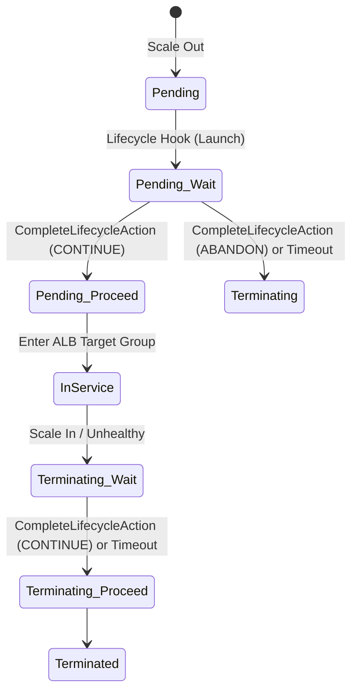
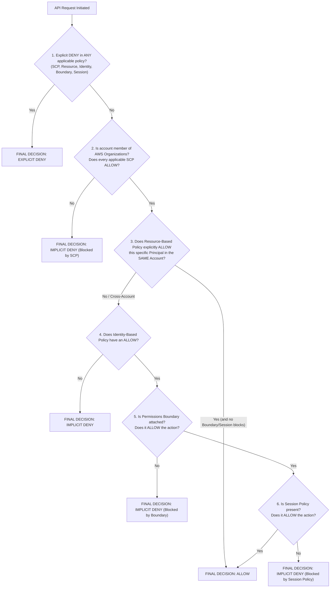

# AWS Certified DevOps Engineer - Professional (DOP-C02) — Master Cheat Sheet & Exam Battle Guide

**Exam Code:** `DOP-C02`  
**Duration:** 180 Minutes (75 Questions — Multiple Choice & Multiple Response)  
**Passing Score:** 750 / 1000  

> [!IMPORTANT]
> **How to Read DOP-C02 Scenario Questions:**
> Every DOP-C02 question tests an architectural constraint: **"LEAST operational overhead"**, **"MOST secure"**, **"MOST cost-effective"**, **"Zero RPO / Lowest RTO"**, or **"Preventative vs. Detective vs. Responsive governance"**. Immediately eliminate options that rely on custom cron scripts on EC2, polling Lambda functions when native EventBridge events exist, or static IAM user credentials (`AWS_ACCESS_KEY_ID`) when IAM Roles / OIDC / `git-remote-codecommit` are available.

---

## 1. Domain Weight Breakdown & Core Service Map

| Domain | Weight | Core AWS Services | High-Frequency Exam Scenarios |
|---|---|---|---|
| **Domain 1: SDLC Automation** | **22%** | CodeCommit, CodeBuild, CodeDeploy, CodePipeline (V1/V2), CodeArtifact, EC2 Image Builder, AWS SAM | Cross-account pipelines with CMK + S3 Bucket Policy; CodeBuild in private VPC via NAT Gateway; CodeDeploy `appspec.yml` hook order & rollbacks; ECS Blue/Green Canary with Test Listener; Monorepo path filtering. |
| **Domain 2: Configuration Management & IaC** | **17%** | CloudFormation, StackSets, `cfn-init`/`cfn-signal`/`cfn-hup`, Custom Resources, `cfn-guard`, CDK, SSM (Parameter Store, Patch Manager, State Manager, Session Manager, AppConfig), Elastic Beanstalk | ASG `UpdatePolicy` (`AutoScalingRollingUpdate`) + `CreationPolicy`; StackSets `SERVICE_MANAGED` vs `SELF_MANAGED`; Custom Resource `ResponseURL` hang; SSM Patch Baselines + Patch Groups + Maintenance Windows; Beanstalk Immutable vs Rolling with Additional Batch. |
| **Domain 3: Resilient Cloud Solutions** | **15%** | EC2 Auto Scaling (Lifecycle Hooks, Warm Pools, Mixed Instances), ALB/NLB/GWLB, Route 53 & ARC, RDS Multi-AZ Instance vs Cluster, RDS Proxy, Aurora Global DB, DynamoDB Global Tables, S3 CRR/RTC/MRAP, AWS DRS | ASG `Terminating:Wait` hook -> EventBridge -> SSM/Lambda -> `CompleteLifecycleAction`; Route 53 ARC Routing Control (data plane 5-cluster quorum) vs Readiness Check; Aurora Global Managed Failover (`RPO=0`) vs Unplanned Failover (`RPO<1s`). |
| **Domain 4: Monitoring & Logging** | **15%** | CloudWatch (Metrics, Unified Agent, EMF, Alarms, Composite Alarms, Metric Streams, Logs, Metric/Subscription Filters, Logs Insights, Data Protection, Contributor Insights, Synthetics), CloudTrail, X-Ray, ADOT, VPC Flow Logs | CloudWatch Unified Agent `procstat` + `append_dimensions` + `aggregation_dimensions`; Cross-account Logs Destination (`put-destination`) to Kinesis; X-Ray indexed **Annotations** vs unindexed **Metadata**; VPC Flow Logs v5 `pkt-srcaddr`/`pkt-dstaddr` across TGW/NAT. |
| **Domain 5: Incident & Event Response** | **14%** | EventBridge (Buses, Rules, Input Transformer, Archive/Replay, Global Endpoints, Pipes), SSM Incident Manager, AWS Chatbot, SSM Automation, AWS Config Remediations, Step Functions Forensics, AWS Health, AWS FIS | GuardDuty finding -> EventBridge -> Step Functions EC2 isolation (`DetachInstances` without decrementing capacity + Quarantine SG + EBS Snapshot); Config + SSM Automation; Spot 2-min interruption + Rebalance Recommendation; FIS with CloudWatch Alarm Stop Condition. |
| **Domain 6: Security & Compliance** | **17%** | IAM (Permission Boundaries, Evaluation Logic, Roles Anywhere), Organizations & SCPs, KMS (Key Policies, Grants, Multi-Region Keys), Secrets Manager, AWS Config & Conformance Packs, Control Tower, Service Catalog, GuardDuty, Inspector v2, Macie, Security Hub, WAF, Firewall Manager | SCP vs Permission Boundary vs Identity/Resource Policy evaluation; Cross-account encrypted AMI launch with Auto Scaling Service-Linked Role KMS Grant; Secrets Manager Alternating Users rotation; Service Catalog Launch Constraints. |

---

## 2. Domain 1: SDLC Automation — Deep Reference Matrices

### 2.1 CodeDeploy Lifecycle Hook Execution Order (Memorize Cold!)

```mermaid
flowchart LR
    subgraph EC2["EC2 / On-Premises (In-Place & Blue/Green)"]
        direction LR
        E1["BeforeBlockTraffic"] --> E2["BlockTraffic (Agent)"]
        E2 --> E3["AfterBlockTraffic"]
        E3 --> E4["ApplicationStop (Prev Rev!)"]
        E4 --> E5["DownloadBundle (Agent)"]
        E5 --> E6["BeforeInstall"]
        E6 --> E7["Install (Agent)"]
        E7 --> E8["AfterInstall"]
        E8 --> E9["ApplicationStart"]
        E9 --> E10["ValidateService"]
        E10 --> E11["BeforeAllowTraffic"]
        E11 --> E12["AllowTraffic (Agent)"]
        E12 --> E13["AfterAllowTraffic"]
    end
```



| Platform | File Name | Exact Hook Sequence | Critical Exam Nuances |
|---|---|---|---|
| **EC2 / On-Premises** | `appspec.yml` | `BeforeBlockTraffic` $\rightarrow$ `BlockTraffic`* $\rightarrow$ `AfterBlockTraffic` $\rightarrow$ `ApplicationStop` $\rightarrow$ `DownloadBundle`* $\rightarrow$ `BeforeInstall` $\rightarrow$ `Install`* $\rightarrow$ `AfterInstall` $\rightarrow$ `ApplicationStart` $\rightarrow$ `ValidateService` $\rightarrow$ `BeforeAllowTraffic` $\rightarrow$ `AllowTraffic`* $\rightarrow$ `AfterAllowTraffic` | Hooks marked with `*` (`BlockTraffic`, `DownloadBundle`, `Install`, `AllowTraffic`) are **reserved for the CodeDeploy Agent** — you CANNOT attach custom scripts to them! `ApplicationStop` runs the script from the **previous** revision's `appspec.yml`. If `ApplicationStop` fails because the old script had a bug, deploy with `--ignore-application-stop-failures`. |
| **Amazon ECS (Blue/Green)** | `appspec.yaml` | `BeforeInstall` $\rightarrow$ `Install`* $\rightarrow$ `AfterInstall` $\rightarrow$ `AllowTestTraffic`* $\rightarrow$ `AfterAllowTestTraffic` $\rightarrow$ `BeforeAllowTraffic` $\rightarrow$ `AllowTraffic`* $\rightarrow$ `AfterAllowTraffic` | Only supports **Blue/Green** (unless ECS native rolling update or External controller is used). Validation tests against the replacement task set must run in **`AfterAllowTestTraffic`** (which hits the ALB Test Listener port) and call `codedeploy:PutLifecycleEventHookExecutionStatus`. |
| **AWS Lambda** | `appspec.yaml` | `BeforeAllowTraffic` $\rightarrow$ `AllowTraffic`* $\rightarrow$ `AfterAllowTraffic` | Used by AWS SAM (`AutoPublishAlias` + `DeploymentPreference`). Pre-traffic hook runs in `BeforeAllowTraffic`; post-traffic hook runs in `AfterAllowTraffic`. |

### 2.2 Cross-Account CodePipeline Checklist (Tools Account `A` $\rightarrow$ Prod Account `B`)

Whenever a CodePipeline in **Account A** deploys to **Account B** and fails with `Access Denied` or `The ciphertext refers to a customer master key that does not exist, does not allow access, or is invalid`, verify all **4 pillars**:

1. **Customer Managed KMS Key (CMK) in Account A**:
   - You **MUST** use a Customer Managed Key (`aws/s3` AWS-managed key CANNOT have its key policy modified for cross-account access).
   - **KMS Key Policy in Account A** must grant `kms:Decrypt`, `kms:DescribeKey`, `kms:GenerateDataKey*`, `kms:ReEncrypt*` to:
     - The CodePipeline Service Role in Account A.
     - The Cross-Account Role in Account B (`arn:aws:iam::ACCOUNT_B:role/CrossAccountPipelineRole`).
     - The Execution Role in Account B (e.g., CloudFormation Role, CodeDeploy Role, or EC2 Instance Profile in Account B that downloads the artifact from S3).
2. **S3 Artifact Bucket Policy in Account A**:
   - Must grant `s3:GetObject*`, `s3:PutObject*`, and `s3:ListBucket` to `arn:aws:iam::ACCOUNT_B:role/CrossAccountPipelineRole` and the target service role/instance profile in Account B.
3. **Cross-Account IAM Role in Account B**:
   - **Trust Policy**: Allows `arn:aws:iam::ACCOUNT_A:root` (or the specific CodePipeline Service Role ARN in Account A) to call `sts:AssumeRole`.
   - **Permissions Policy**: Grants `s3:GetObject*` on Account A's artifact bucket, `kms:Decrypt` on Account A's CMK, and `codedeploy:*` / `cloudformation:*` / `ecs:*` to perform the deployment.
4. **CodePipeline Service Role in Account A**:
   - Must allow `sts:AssumeRole` on `arn:aws:iam::ACCOUNT_B:role/CrossAccountPipelineRole`.

### 2.3 CodeBuild Environment & Networking Gotchas

| Topic | Rule / Exam Fact |
|---|---|
| **Env Var Precedence** | **1 (Highest):** `start-build` API / CLI override / CodePipeline action env vars $\rightarrow$ **2:** CodeBuild Project definition $\rightarrow$ **3 (Lowest):** `buildspec.yml` `env.variables`. |
| **VPC Internet Access** | CodeBuild ENIs inside a VPC **NEVER** receive a public IPv4 address. Placing CodeBuild in a Public Subnet with an Internet Gateway causes **100% connection timeout** to the internet! **Fix:** Place CodeBuild in a **Private Subnet** whose route table sends `0.0.0.0/0` to a **NAT Gateway** located in a Public Subnet (or use VPC Interface/Gateway Endpoints). |
| **Phase Failure Cleanup** | If a command in `build` fails, remaining commands in `build` are skipped, BUT the `finally:` block of `build` AND the `post_build` phase **still execute**! Always put resource cleanup in `finally:` blocks. |
| **Docker-in-Docker** | Building Docker images or running `docker buildx` requires `privileged-mode: true` on the CodeBuild project environment. |
| **Secrets in Buildspec** | Never put plaintext secrets in `variables:`. Use `env.parameter-store` (for SSM `SecureString`) or `env.secrets-manager: KEY: "secret-id:json-key:version-stage:version-id"`. |

---

## 3. Domain 2: Configuration Management & IaC — Deep Reference Matrices

### 3.1 CloudFormation Policies & Helper Scripts

| Feature | Purpose & Mechanics | Exam Trap / Gotcha |
|---|---|---|
| **`CreationPolicy`** | Attached to `AWS::EC2::Instance` or `AWS::AutoScaling::AutoScalingGroup`. Waits for `Count` signals within `Timeout` (e.g., `PT15M`) via `cfn-signal`. | If `cfn-signal` cannot reach the CloudFormation API (missing NAT Gateway or missing `com.amazonaws.<region>.cloudformation` VPC Interface Endpoint in private subnet), the stack hangs until `Timeout` and rolls back! |
| **`UpdatePolicy`** | `AutoScalingRollingUpdate` (`MinInstancesInService`, `MaxBatchSize`, `PauseTime`, `WaitOnResourceSignals: true`, `SuspendProcesses: [HealthCheck, ReplaceUnhealthy, AZRebalance, AlarmNotification, ScheduledActions]`). | Always include **`SuspendProcesses`** in `AutoScalingRollingUpdate` so ASG scheduled actions or AZ rebalancing don't interfere mid-deployment! If `WaitOnResourceSignals: true`, UserData MUST run `cfn-signal` on every update. |
| **`DeletionPolicy`** | Controls resource fate when removed from template or stack deleted: `Delete` (default for most; `Snapshot` default for RDS DBInstance), `Retain`, `RetainExceptOnCreate`, `Snapshot`. | When importing existing resources into CloudFormation (`ResourceImport` Change Set), every imported resource **MUST** specify `DeletionPolicy: Retain` (or `Snapshot` where applicable). |
| **Custom Resource** | `AWS::CloudFormation::CustomResource` or `Custom::MyResource`. Sends `{RequestType: "Create"|"Update"|"Delete", ResponseURL: "https://s3...", PhysicalResourceId: "..."}` to Lambda/SNS. | 1) If Lambda crashes before uploading JSON to the pre-signed S3 `ResponseURL`, CloudFormation waits **1 hour** before timing out! Always wrap Lambda handler in `try/except/finally` using `cfnresponse.send()`.<br>2) Returning a **different** `PhysicalResourceId` during an `Update` causes CloudFormation to treat it as a **Replacement** and immediately send a `Delete` request for the old `PhysicalResourceId`! |
| **StackSets** | `SELF_MANAGED` requires creating `AWSCloudFormationStackSetAdministrationRole` in admin account and `AWSCloudFormationStackSetExecutionRole` in target accounts. `SERVICE_MANAGED` integrates with AWS Organizations, creates IAM roles automatically, and supports **Auto-Deployment** when accounts join/leave an OU. | `FailureToleranceCount` / `FailureTolerancePercentage`: If failures **exceed** this number, the StackSet operation halts immediately. For `MaxConcurrentCount`, setting it higher speeds up rollouts across accounts/regions (`RegionConcurrencyType: PARALLEL`), but increases blast radius if a template bug exists. |

### 3.2 Elastic Beanstalk Deployment Policies Comparison

| Deployment Policy | Capacity During Deploy | Downtime? | Speed | Rollback Mechanism | Best Use Case |
|---|---|---|---|---|---|
| **All at once** | Drops to 0% briefly | **Yes** | Fastest | Redeploy previous version manually | Dev/Test environments |
| **Rolling** | Reduced by batch size | No | Medium | Another rolling update required | Cost-sensitive non-critical workloads |
| **Rolling with additional batch** | 100% maintained (launches extra batch first) | No | Medium-Slow | Another rolling update required | Production where capacity cannot drop below 100% |
| **Immutable** | 100% maintained (creates temporary ASG matching full fleet size) | No | Slowest | **Instant** — simply terminates the temporary ASG if health checks fail | Mission-critical production needing zero-impact rollback |
| **Traffic splitting** | 100% maintained (creates temporary ASG + shifts ALB target group weights) | No | Configurable evaluation window | **Instant** — shifts 100% traffic back to original ASG | Production Canary testing with CloudWatch Alarm rollback |

> [!TIP]
> **`.ebextensions` vs `.platform/hooks`**:
> - In `.ebextensions/*.config`, **`commands:`** run **before** the web server/application is set up, whereas **`container_commands:`** run **after** the application source is unpacked (staged) but before it starts. Use **`leader_only: true`** inside `container_commands` to execute database schema migrations (`flyway migrate` / `alembic upgrade head`) on only **ONE** instance per deployment!
> - On Amazon Linux 2 / AL2023 platforms, prefer executable shell scripts in **`.platform/hooks/prebuild/`**, **`.platform/hooks/predeploy/`**, and **`.platform/hooks/postdeploy/`** for application-level lifecycle scripts.

---

## 4. Domain 3: Resilient Cloud Solutions — Deep Reference Matrices

### 4.1 Disaster Recovery (DR) Patterns Matrix

| DR Strategy | RTO | RPO | Target Region Footprint (Idle State) | Failover Action Required | Relative Cost |
|---|---|---|---|---|---|
| **Backup & Restore** | Hours (2–24h) | Hours (time since last snapshot/backup) | S3 CRR + Cross-Region RDS/EBS Snapshots via AWS Backup. Zero compute running. | Provision infrastructure via CloudFormation/Terraform and restore snapshots. | `$` (Lowest) |
| **Pilot Light** | 10–30 Minutes | Seconds to Minutes | Database replicas actively replicating (Aurora Global / RDS Cross-Region Replica) or DRS staging. App servers **OFF** (ASG `Min=0, Desired=0`) or AMIs pre-baked. | Promote DB replica + scale ASG/ECS from `0` to production capacity + flip Route 53. | `$$` |
| **Warm Standby** | Minutes (1–5m) | Seconds | Full stack running at **minimum capacity** (e.g., 1–2 small EC2/ECS tasks, active DB replica) continuously handling synthetic health checks. | Flip Route 53 / ARC Routing Control + scale out ASG/ECS to 100% production size. | `$$$` |
| **Multi-Site Active-Active** | **Near Zero (ms–seconds)** | **Zero / Near Zero** | Full production capacity in 2+ regions simultaneously. DynamoDB Global Tables or Aurora Global DB (with Write Forwarding / Managed Switchover). | Route 53 Latency/Weighted + ARC Routing Control automatically drains unhealthy region. | `$$$$` (Highest) |

### 4.2 Route 53 Health Checks vs Application Recovery Controller (ARC)

- **Standard Route 53 Health Checks + DNS Failover**:
  - Relies on the Route 53 **Control Plane** (hosted in `us-east-1`) when updating DNS records or evaluating CloudWatch Alarms in `us-east-1`.
- **Route 53 Application Recovery Controller (ARC)**:
  - **Readiness Check (Control Plane)**: Audits quotas, capacity, ASG sizes, and configuration parity across regions *before* a disaster occurs.
  - **Routing Control (Data Plane)**: Provides 5 globally distributed, quorum-based cluster endpoints. Toggling a Routing Control (`On`/`Off`) updates Route 53 health check states entirely via the **Data Plane** — meaning it works even if the `us-east-1` control plane is completely unreachable!
  - **Safety Rules**: Prevent operator errors during chaos (e.g., an `AssertionRule` ensuring at least 1 region's routing control remains `On` so you never blackhole both regions simultaneously).

### 4.3 Auto Scaling Lifecycle Hooks State Machine



- **Key API Calls**:
  - Extend timeout while long script runs: `aws autoscaling record-lifecycle-action-heartbeat --lifecycle-hook-name ... --auto-scaling-group-name ... --lifecycle-action-token ...`
  - Finish hook and proceed: `aws autoscaling complete-lifecycle-action --lifecycle-action-result CONTINUE ...`
  - Default timeout is **3600 seconds (1 hour)**; max with heartbeats is **48 hours** (or max instance lifetime).

---

## 5. Domain 4: Monitoring & Logging — Deep Reference Matrices

### 5.1 CloudWatch Alarm Missing Data Treatments

| Treatment Setting | Behavior When Datapoints Are Missing | Ideal DOP-C02 Scenario |
|---|---|---|
| **`missing`** (Default) | Missing datapoints are ignored, but if all datapoints in evaluation range are missing, alarm goes to `INSUFFICIENT_DATA`. | Standard infrastructure metrics (EC2 CPU, RDS connections). |
| **`notBreaching`** | Missing datapoints are treated as **within the safe threshold** (`OK`). | **Error-count Metric Filters** (e.g., counting `"ERROR"` in logs where 0 errors means no metric datapoints are emitted!). Without `notBreaching`, 0 errors causes `INSUFFICIENT_DATA`! |
| **`breaching`** | Missing datapoints are treated as **violating the threshold** (`ALARM`). | **Heartbeat / Liveness Dead-Man's Switch metrics** (if an agent stops sending heartbeats, immediately trigger `ALARM`!). |
| **`ignore`** | The current alarm state is **maintained** unchanged. | Sparse intermittent batch metrics where state shouldn't flip during idle windows. |

### 5.2 AWS X-Ray: Annotations vs Metadata

| Attribute | Indexed by X-Ray? | Searchable in Filter Expressions? | Max per Trace | Best Use Case |
|---|---|---|---|---|
| **Annotations** | **YES** | **YES** (`annotation.orderTier = "VIP"`) | 50 key-value pairs | Filtering traces in ServiceLens/X-Ray by `userId`, `tenantId`, `deploymentVersion`, `region`, `featureFlag`. |
| **Metadata** | **NO** | **NO** | 64 KB total | Attaching large diagnostic objects, SQL query strings, request/response headers, or debug arrays for manual inspection. |

### 5.3 VPC Flow Logs v5 Custom Fields for Network Debugging

- **Default v2 format** ONLY includes: `version account-id interface-id srcaddr dstaddr srcport dstport protocol packets bytes start end action log-status`.
- **Why v2 fails across Transit Gateway / NAT Gateway**: `srcaddr` and `dstaddr` show the intermediate NAT Gateway or Transit Gateway ENI IP, hiding the true origin/destination instance IP!
- **v5 Custom Format Fields to Enable**:
  - `pkt-srcaddr` & `pkt-dstaddr`: Reveals the **original packet source IP and final destination IP** across NAT/TGW hops.
  - `flow-direction`: `ingress` vs `egress`.
  - `traffic-path`: Identifies whether egress traffic went via Intra-VPC (`1`), Internet Gateway (`2`), VPC Peering (`3`), Gateway VPC Endpoint (`6`), NAT Gateway (`7`), or Transit Gateway (`8`).
  - `tcp-flags`: Identifies `SYN` (`2`), `SYN-ACK` (`18`), `RST` (`4`), `FIN` (`1`).

---

## 6. Domain 5: Incident & Event Response — Deep Reference Matrices

### 6.1 EventBridge Pattern Matching Cheat Sheet

```json
{
  "source": ["aws.guardduty"],
  "detail-type": ["GuardDuty Finding"],
  "detail": {
    "severity": [{ "numeric": [">=", 7.0, "<=", 10.0] }],
    "type": [{ "prefix": "UnauthorizedAccess:EC2/" }],
    "resource": {
      "instanceDetails": {
        "instanceState": [{ "anything-but": ["terminated", "shutting-down"] }],
        "tags": {
          "Environment": [{ "equals-ignore-case": "production" }]
        }
      }
    }
  }
}
```

### 6.2 Compromised EC2 Instance Forensic Isolation Runbook (Order Matters!)

When an exam question asks how to respond to a compromised EC2 instance in an Auto Scaling Group **while preserving volatile memory and disk evidence**:
1. **Do NOT terminate or reboot** the instance (rebooting destroys volatile RAM!).
2. **Enable Termination Protection** (`ec2:ModifyInstanceAttribute --disable-api-termination`).
3. **Detach the instance from the Auto Scaling Group** (`autoscaling:DetachInstances` with `ShouldDecrementDesiredCapacity: false`) — this keeps the compromised instance alive outside the ASG AND forces the ASG to immediately launch a clean replacement instance! (Alternatively, place the instance in `Standby` if keeping it associated, but `DetachInstances` completely isolates it from ASG lifecycle actions).
4. **Isolate Network**: Replace the instance's Security Groups with a **Forensic Quarantine Security Group** (0 inbound rules, 0 outbound rules — or outbound only to forensic S3 VPC endpoint) and/or apply a deny-all NACL to clear active stateful connections! (Remember: Security Groups are **stateful**, so removing an inbound rule does NOT immediately drop an already established TCP connection in conntrack until timeout, whereas **NACLs are stateless** and immediately block packets in both directions!).
5. **Capture Memory & Disk**: Trigger an SSM Run Command to dump RAM (`LiME`) to a WORM-protected S3 bucket (S3 Object Lock in Compliance mode) and call `ec2:CreateSnapshots` on all attached EBS volumes.
6. **Revoke IAM Credentials**: Attach the `AWSRevokeOlderSessions` inline policy (`aws:TokenIssueTime < Now`) to the instance profile's IAM Role to invalidate stolen IMDS temporary credentials immediately.

---

## 7. Domain 6: Security & Compliance — Deep Reference Matrices

### 7.1 IAM Policy Evaluation Logic Flowchart



### 7.2 High-Yield SCP Templates

#### Enforce IMDSv2 & Hop Limit = 1 Across All EC2 Launches
```json
{
  "Version": "2012-10-17",
  "Statement": [
    {
      "Sid": "RequireIMDSv2OnLaunch",
      "Effect": "Deny",
      "Action": "ec2:RunInstances",
      "Resource": "arn:aws:ec2:*:*:instance/*",
      "Condition": {
        "StringNotEquals": {
          "ec2:MetadataHttpTokens": "required"
        }
      }
    },
    {
      "Sid": "PreventDisablingIMDSv2OnExistingInstances",
      "Effect": "Deny",
      "Action": "ec2:ModifyInstanceMetadataOptions",
      "Resource": "*",
      "Condition": {
        "StringNotEquals": {
          "ec2:MetadataHttpTokens": "required"
        }
      }
    }
  ]
}
```

#### Region Restriction SCP (Allow Only `us-east-1` & `eu-west-1` + Global Services Exemption)
```json
{
  "Version": "2012-10-17",
  "Statement": [
    {
      "Sid": "DenyAllOutsideApprovedRegions",
      "Effect": "Deny",
      "NotAction": [
        "a4b:*", "acm:*", "aws-marketplace-management:*", "aws-marketplace:*",
        "aws-portal:*", "budgets:*", "ce:*", "chime:*", "cloudfront:*",
        "config:*", "cur:*", "directconnect:*", "ec2:DescribeRegions",
        "ec2:DescribeTransitGateways", "ec2:DescribeVpnGateways",
        "fms:*", "globalaccelerator:*", "health:*", "iam:*",
        "importexport:*", "kms:*", "mobileanalytics:*", "networkmanager:*",
        "organizations:*", "pricing:*", "route53:*", "route53domains:*",
        "route53-recovery-cluster:*", "route53-recovery-control-config:*",
        "route53-recovery-readiness:*", "s3:GetAccountPublic*",
        "s3:ListAllMyBuckets", "s3:PutAccountPublic*", "shield:*",
        "sso:*", "sts:*", "support:*", "trustedadvisor:*", "waf-regional:*",
        "waf:*", "wafv2:*", "wellarchitected:*"
      ],
      "Resource": "*",
      "Condition": {
        "StringNotEquals": {
          "aws:RequestedRegion": ["us-east-1", "eu-west-1"]
        },
        "ArnNotLike": {
          "aws:PrincipalARN": ["arn:aws:iam::*:role/OrganizationAdminRole"]
        }
      }
    }
  ]
}
```

---

## 8. Top 25 "Pass-or-Fail" DOP-C02 Exam Reflexes

1. **"Cross-account CodePipeline fails with KMS / AccessDenied"** $\rightarrow$ Replace default `aws/s3` key with a **Customer Managed Key (CMK)** in the Tools account, grant `kms:Decrypt` to the Target Account Role in the CMK Policy, and grant `s3:GetObject*` in the S3 Artifact Bucket Policy.
2. **"Cross-account Auto Scaling Group fails to launch EC2 instances from a shared encrypted AMI"** $\rightarrow$ Grant `kms:Decrypt`, `kms:DescribeKey`, and **`kms:CreateGrant`** (with condition `kms:GrantIsForAWSResource: true`) on the source CMK directly to the target account's **Auto Scaling Service-Linked Role** (`arn:aws:iam::<TARGET_ACCOUNT_ID>:role/aws-service-role/autoscaling.amazonaws.com/AWSServiceRoleForAutoScaling`).
3. **"CodeBuild inside a VPC times out running `npm install` / `pip install` even though it is in a public subnet"** $\rightarrow$ Move CodeBuild to a **Private Subnet** routing `0.0.0.0/0` to a **NAT Gateway** in a Public Subnet (CodeBuild ENIs never get public IPs).
4. **"Monorepo in CodeCommit / GitHub triggers all microservice pipelines on every commit"** $\rightarrow$ Use **CodePipeline V2 trigger `filePaths` filter** (for GitHub/CodeConnections) OR an **EventBridge rule + Lambda** inspecting `codecommit:GetDifferences` to trigger only the modified microservice's pipeline.
5. **"Run database migrations on only ONE instance during an Elastic Beanstalk deployment"** $\rightarrow$ Use `container_commands` with **`leader_only: true`** in `.ebextensions/*.config`.
6. **"CloudFormation Custom Resource hangs for 60 minutes during `Delete` or `Update`"** $\rightarrow$ The backing Lambda function threw an unhandled exception and never uploaded a response JSON to the S3 pre-signed **`ResponseURL`**. Wrap the Lambda handler in `try/catch/finally` using `cfn-response`.
7. **"Cannot delete or update CloudFormation Stack A because Stack B uses `Fn::ImportValue` on its Output"** $\rightarrow$ Replace hard-coupled CloudFormation Exports with **SSM Parameter Store** parameters and dynamic references (`{{resolve:ssm:...}}`) or first update Stack B to remove the `Fn::ImportValue` reference.
8. **"Automatically deploy baseline IAM/Config/GuardDuty stacks whenever a new AWS Account is created or moved into an OU"** $\rightarrow$ Use **CloudFormation StackSets** with **`SERVICE_MANAGED`** permissions and `AutoDeployment: Enabled`.
9. **"Allow developers to create IAM Roles for Lambda/ECS without allowing privilege escalation to Admin"** $\rightarrow$ Attach an **IAM Permissions Boundary** and require `iam:PermissionsBoundary` condition on every `iam:CreateRole` / `iam:PutRolePermissionsBoundary` action.
10. **"Prevent even `AdministratorAccess` users in member accounts from turning off CloudTrail, GuardDuty, or launching in unapproved regions"** $\rightarrow$ Attach a **Service Control Policy (SCP)** at the Root or OU level in AWS Organizations (remember SCPs do not affect the Management Account).
11. **"Ensure zero-downtime database password rotation for an application that caches connection pools"** $\rightarrow$ Use **AWS Secrets Manager** with the **Alternating Users (`2-user`) rotation strategy** and/or **Amazon RDS Proxy**.
12. **"Capture memory dumps or application logs from EC2 instances in an Auto Scaling Group before they terminate on scale-in"** $\rightarrow$ Configure an ASG **`Terminating:Wait` Lifecycle Hook** $\rightarrow$ EventBridge rule (`EC2 Instance-terminate Lifecycle Action`) $\rightarrow$ SSM Run Command / Automation $\rightarrow$ `CompleteLifecycleAction`.
13. **"Speed up Auto Scaling out from 8 minutes to 30 seconds for an application with heavy boot-time initialization"** $\rightarrow$ Configure an **EC2 Auto Scaling Warm Pool** (with instances pre-initialized in `Stopped`, `Running`, or `Hibernated` state) rather than just baking an AMI if runtime state initialization is still slow.
14. **"Fail over multi-region DNS traffic even if the `us-east-1` Route 53 control plane is experiencing a service disruption"** $\rightarrow$ Use **Amazon Route 53 Application Recovery Controller (ARC) Routing Controls** hosted on the 5 regional data-plane cluster endpoints.
15. **"Perform a planned quarterly DR fail-over test of an Amazon Aurora Global Database with zero data loss (`RPO = 0`)"** $\rightarrow$ Use **Aurora Global Database Managed Planned Failover (`FailoverGlobalCluster`)**, which waits for secondary storage to catch up completely and preserves the replication topology.
16. **"Identify which specific DynamoDB partition key is causing `ProvisionedThroughputExceededException` throttling"** $\rightarrow$ Enable **CloudWatch Contributor Insights for DynamoDB**.
17. **"Mask credit card numbers and SSNs written to CloudWatch Logs before developers can view them"** $\rightarrow$ Apply a **CloudWatch Logs Data Protection Policy** (Account-level or Log Group-level); only IAM principals granted `logs:Unmask` can view unmasked data.
18. **"Suppress dozens of downstream microservice CloudWatch alarms during a scheduled maintenance window or when the primary database is down"** $\rightarrow$ Create a **CloudWatch Composite Alarm** (`ALARM(ServiceAlarm) AND NOT ALARM(DatabaseDownOrMaintenanceAlarm)`) and send notifications only from the Composite Alarm.
19. **"Metric Filter counting `ERROR` log lines goes into `INSUFFICIENT_DATA` whenever the application is healthy and emits zero errors"** $\rightarrow$ Set the CloudWatch Alarm Missing Data treatment to **`treatMissingData: notBreaching`**.
20. **"Filter AWS X-Ray traces by `CustomerTier` or `OrderID` in the ServiceLens console"** $\rightarrow$ Record the key-value pair as an X-Ray **Annotation** (indexed), NOT Metadata (unindexed).
21. **"Identify original client and destination pod/instance IPs in VPC Flow Logs when traffic crosses a Transit Gateway or NAT Gateway"** $\rightarrow$ Create a **Custom Format (v5) VPC Flow Log** including **`pkt-srcaddr`**, **`pkt-dstaddr`**, and **`traffic-path`**.
22. **"Isolate a GuardDuty-flagged EC2 instance in an Auto Scaling Group for forensics without ASG terminating it or losing capacity"** $\rightarrow$ Enable Termination Protection + call `DetachInstances` (`ShouldDecrementDesiredCapacity: false`) + attach Quarantine Security Group & NACL + snapshot EBS + dump RAM.
23. **"Test multi-AZ resilience of EC2, ECS, EKS, and RDS in production with an automatic emergency kill-switch if error rates spike"** $\rightarrow$ Use **AWS Fault Injection Service (FIS)** with a **CloudWatch Alarm Stop Condition**.
24. **"Allow non-technical teams to provision approved multi-tier environments without granting them `ec2:*` or `rds:*` IAM permissions"** $\rightarrow$ Use **AWS Service Catalog** with a **Launch Constraint** (Service Catalog assumes the privileged Launch Role; end-users only need `servicecatalog:*` permissions).
25. **"Ensure on-premises servers can assume AWS IAM Roles without static long-lived IAM User access keys or SSM Agent"** $\rightarrow$ Use **IAM Roles Anywhere** with X.509 certificates issued by an **AWS Private CA** and `aws_signing_helper`.
