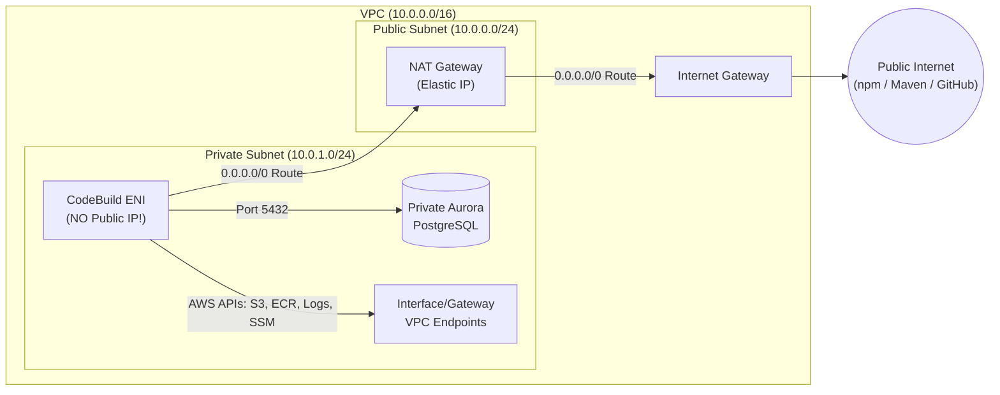
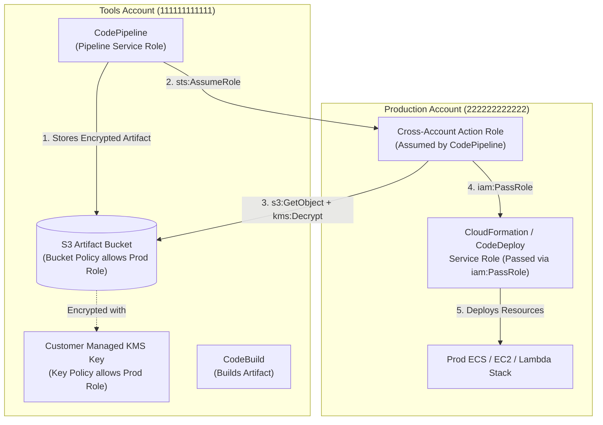
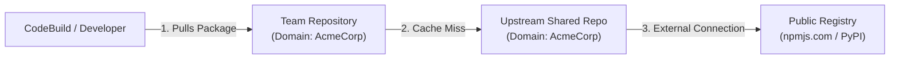
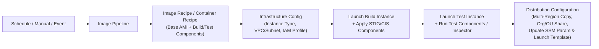

# Domain 1: SDLC Automation — Master-Level Study Guide (DOP-C02)

> **Exam Weighting:** 22% of the AWS Certified DevOps Engineer – Professional (DOP-C02) Exam  
> **Core Focus:** Automating security, testing, building, artifact management, and multi-account/multi-region deployment pipelines across EC2, ECS/Fargate, and AWS Lambda.

---

## 1. AWS CodeCommit

### 1.1 Architecture & Encryption Internals
AWS CodeCommit is a fully managed, highly available, multi-AZ Git service backed by Amazon S3 and Amazon DynamoDB metadata indices.
* **Encryption in Transit:** Enforced strictly via HTTPS (TLS 1.2+) or SSH (`ssh-rsa`, `ecdsa`, `ed25519`). Plain HTTP (`git://`) is not supported.
* **Encryption at Rest:**
  * **Default:** When the first repository is created in a region, CodeCommit automatically creates an AWS-managed KMS key (`alias/aws/codecommit`) in that account/region.
  * **Customer Managed Key (CMK):** You can specify a customer-managed symmetric KMS key at repository creation or update it later.
  * **Cross-Account / Disaster Recovery Trap:** The default `aws/codecommit` KMS key policy **cannot be modified**. However, unlike CodePipeline S3 artifact buckets (which require a CMK for cross-account access because S3 encryption happens via direct S3 object access across accounts), Cross-Account CodeCommit access works by having principals in Account B assume an IAM Role **inside Account A** (the repository owner account). Because the assumed role resides in Account A, it can use `alias/aws/codecommit` as long as it has `kms:Encrypt`, `kms:Decrypt`, `kms:ReEncrypt*`, `kms:GenerateDataKey*`, and `kms:DescribeKey`. If you use a custom KMS CMK, ensure the repository IAM role is permitted in the key policy or via IAM policies (`kms:*` via `Condition: {"StringEquals": {"kms:ViaService": "codecommit.<region>.amazonaws.com"}}`).

### 1.2 Authentication Methods & Why Static Credentials Are an Anti-Pattern

| Authentication Method | Underlying Mechanism | Supports IAM Roles / EC2 Instance Profiles / CodeBuild Roles? | Supports Cross-Account `sts:AssumeRole`? | DOP-C02 Exam Verdict |
| :--- | :--- | :--- | :--- | :--- |
| **`git-remote-codecommit` (GRC)** | Python utility wrapping Git URL (`codecommit::us-east-1://MyRepo` or `codecommit://Profile@MyRepo`). Signs requests using AWS SigV4 with temporary STS credentials. | **YES** (Native, zero static secrets) | **YES** (Natively reads `~/.aws/config` profiles) | **GOLD STANDARD (Recommended for EC2, CodeBuild, Lambda, Cross-Account)** |
| **AWS CLI Credential Helper** | `git config --global credential.helper '!aws codecommit credential-helper $@'` with `UseHttpPath = true`. Signs HTTPS requests via SigV4. | **YES** | **YES** (If AWS CLI profile is configured) | **Valid Alternative** (Requires `git-credential-helper: yes` in CodeBuild `buildspec.yml`) |
| **HTTPS Git Credentials** | Static username/password generated in IAM Console under an **IAM User**. | **NO** (IAM Users only) | **NO** | **EXAM TRAP / ANTI-PATTERN** for automation, EC2, or cross-account access. |
| **SSH Keys** | Public SSH key uploaded to an **IAM User** object (`aws iam upload-ssh-public-key`). Uses SSH Key ID as username. | **NO** (IAM Users only) | **NO** | **EXAM TRAP / ANTI-PATTERN** for automation, EC2, or cross-account access. |

> **Critical Exam Rule:** Never create an IAM User just to generate HTTPS Git credentials or upload SSH public keys for an EC2 instance, CodeBuild environment, or cross-account developer. IAM Roles do **not** have Git credentials or SSH keys associated with them in IAM. Always use an IAM Role combined with **`git-remote-codecommit`** or the **AWS CLI Credential Helper**.

### 1.3 Cross-Account CodeCommit Access Pattern
When developers or automation in **Account B (Dev/Tools Account: `222222222222`)** need to clone/push to a CodeCommit repository in **Account A (Repo Account: `111111111111`)**:

1. **In Account A (`111111111111`):** Create an IAM Role `CrossAccountCodeCommitRole` trusting `arn:aws:iam::222222222222:root`. Attach permissions for `codecommit:GitPull`, `codecommit:GitPush`, etc.
2. **In Account B (`222222222222`):** Attach an IAM policy allowing `sts:AssumeRole` on `arn:aws:iam::111111111111:role/CrossAccountCodeCommitRole`.
3. **Configure `~/.aws/config` on the client:**
   ```ini
   [profile shared-repo-access]
   role_arn = arn:aws:iam::111111111111:role/CrossAccountCodeCommitRole
   credential_source = Ec2InstanceMetadata  # Or source_profile = default
   region = us-east-1
   ```
4. **Clone using `git-remote-codecommit`:**
   ```bash
   pip install git-remote-codecommit
   git clone codecommit::us-east-1://shared-repo-access@ProductionAppRepo
   ```

### 1.4 Approval Rule Templates
Approval Rule Templates enforce governance on Pull Requests (PRs) across one or more repositories before merging.
* **Key Characteristics:**
  * Approval rules apply **only to Pull Requests** merged via the CodeCommit Console, API, or CLI (`MergePullRequestByFastForward`, `MergePullRequestBySquash`, `MergePullRequestByThreeWay`).
  * **Exam Trap:** An Approval Rule Template does **NOT** stop a user who has direct `codecommit:GitPush` permission on `refs/heads/main` from pushing directly from their terminal! To enforce PR-only workflows, you **must** combine Approval Rule Templates with an **IAM Deny policy using the `codecommit:References` condition key**:

```json
{
  "Version": "2012-10-17",
  "Statement": [
    {
      "Sid": "DenyDirectPushAndBranchDeletionOnMainAndProd",
      "Effect": "Deny",
      "Action": [
        "codecommit:GitPush",
        "codecommit:DeleteBranch",
        "codecommit:PutFile",
        "codecommit:MergeBranchesByFastForward",
        "codecommit:MergeBranchesBySquash",
        "codecommit:MergeBranchesByThreeWay"
      ],
      "Resource": "arn:aws:codecommit:us-east-1:111111111111:ProductionAppRepo",
      "Condition": {
        "StringEqualsIfExists": {
          "codecommit:References": [
            "refs/heads/main",
            "refs/heads/prod"
          ]
        },
        "Null": {
          "codecommit:References": "false"
        }
      }
    }
  ]
}
```

#### Approval Rule Template JSON Structure & CLI Association
Approval pool members can use wildcards (`*`) and support IAM Users, IAM Roles (`arn:aws:iam::123456789012:role/SeniorLead`), or Federated Assumed Roles (`arn:aws:sts::123456789012:assumed-role/CodeReviewers/*`).

```json
{
  "Version": "2018-11-08",
  "DestinationReferences": [
    "refs/heads/main",
    "refs/heads/release/*"
  ],
  "Statements": [
    {
      "Type": "Approvers",
      "NumberOfApprovalsNeeded": 2,
      "ApprovalPoolMembers": [
        "arn:aws:sts::111111111111:assumed-role/SecOpsLead/*",
        "arn:aws:iam::111111111111:user/PrincipalArchitect"
      ]
    }
  ]
}
```

```bash
# 1. Create the template
aws codecommit create-approval-rule-template \
  --approval-rule-template-name "Require-Two-Senior-Approvals-Main" \
  --approval-rule-template-content file://approval-rule.json

# 2. Associate with a single repository or batch-associate with multiple repositories
aws codecommit associate-approval-rule-template-with-repository \
  --approval-rule-template-name "Require-Two-Senior-Approvals-Main" \
  --repository-name "ProductionAppRepo"

aws codecommit batch-associate-approval-rule-template-with-repositories \
  --approval-rule-template-name "Require-Two-Senior-Approvals-Main" \
  --repository-names "ServiceA" "ServiceB" "ServiceC"
```

### 1.5 CodeCommit Repository Triggers vs. Amazon EventBridge Rules
Understanding the difference between native **Repository Triggers** and **Amazon EventBridge** is heavily tested on DOP-C02:

| Feature | CodeCommit Repository Triggers | Amazon EventBridge Rules |
| :--- | :--- | :--- |
| **Supported Events** | Git push/branch/tag operations **ONLY**: `all`, `updateReference`, `createReference`, `deleteReference`. | **All** CodeCommit operations: Repository State Changes, **Pull Request State Changes**, Approval Rule Changes, Comment events, API calls. |
| **Supported Targets** | **SNS** and **AWS Lambda** ONLY (Max 10 triggers per repo). | **20+ AWS Services:** CodePipeline, CodeBuild, Step Functions, Lambda, SNS, SQS, SSM Automation, API Destination, EventBus. |
| **Filtering Granularity** | Branch names only (`branches: ["main", "dev"]`). | Deep JSON payload matching (`referenceType`, `referenceName`, `pullRequestStatus`, `approvalStatus`, `isMerged`, prefix/suffix/anything-but). |
| **Cross-Account Delivery** | Can invoke cross-account Lambda/SNS if resource-based policy permits. | Native Cross-Account / Cross-Region Event Bus routing. |

#### Exact EventBridge JSON Patterns for DOP-C02
**Pattern A: Trigger on Release Tag Creation (`v*`) or `main` Branch Update**
```json
{
  "source": ["aws.codecommit"],
  "detail-type": ["CodeCommit Repository State Change"],
  "resources": ["arn:aws:codecommit:us-east-1:111111111111:ProductionAppRepo"],
  "detail": {
    "event": ["referenceCreated", "referenceUpdated"],
    "referenceType": ["tag"],
    "referenceName": [{ "prefix": "v" }]
  }
}
```

**Pattern B: Trigger Automated Validation Build on Pull Request Created or Source Updated**
```json
{
  "source": ["aws.codecommit"],
  "detail-type": ["CodeCommit Pull Request State Change"],
  "resources": ["arn:aws:codecommit:us-east-1:111111111111:ProductionAppRepo"],
  "detail": {
    "event": ["pullRequestCreated", "pullRequestSourceBranchUpdated"],
    "destinationReference": ["refs/heads/main"],
    "pullRequestStatus": ["Open"]
  }
}
```

### 1.6 Monorepo Selective Pipeline Triggering Architecture
When multiple microservices (`services/auth/`, `services/billing/`, `services/orders/`) share a single repository (Monorepo), triggering all pipelines on every commit wastes build capacity and causes deployment collisions.

#### Approach 1: CodePipeline V2 Native File Path Filters (GitHub / GitLab / Bitbucket via CodeConnections)
If using **CodePipeline V2** (`pipelineType: V2`) with **AWS CodeConnections** (formerly CodeStar Connections), native `triggers` with `filePaths` (`includes` / `excludes`) and `branches` filters inspect changed files automatically without custom Lambda code:
```yaml
Triggers:
  - ProviderType: CodeStarSourceConnection
    GitConfiguration:
      SourceActionName: SourceAction
      Push:
        - Branches:
            Includes:
              - main
          FilePaths:
            Includes:
              - services/billing/**
              - shared/libs/**
            Excludes:
              - services/billing/**/*.md
```

#### Approach 2: CodeCommit Monorepo Selective Triggering (EventBridge + Lambda `GetDifferences`)
Because CodePipeline V2 native Git file path triggers apply to `CodeStarSourceConnection` sources and **not** native CodeCommit source actions, the canonical AWS pattern for a **CodeCommit Monorepo** is:
1. Disable periodic polling and default EventBridge rules on the individual microservice CodePipelines.
2. Create an **EventBridge Rule** matching `CodeCommit Repository State Change` (`referenceUpdated` on `main`).
3. Route the event to an **Inspector AWS Lambda Function**.
4. The Lambda extracts `detail.oldCommitId` (`beforeCommitSpecifier`) and `detail.commitId` (`afterCommitSpecifier`) from the EventBridge payload and calls `codecommit:GetDifferences`.
5. The Lambda extracts top-level changed directories (e.g., `services/billing/*`), maps them to target pipelines (via DynamoDB, SSM Parameter, or naming convention), and calls `codepipeline:StartPipelineExecution` **only** for the modified microservices.

### 1.7 Repository Migration (`--mirror`)
To migrate a repository from GitHub, GitLab, Bitbucket, or on-premises Git to CodeCommit while preserving **all branches, tags, commit history, and refs**:
```bash
# 1. Clone bare mirror from source repository
git clone --mirror https://github.com/org/legacy-repo.git aws-migration-temp

# 2. Push mirror to AWS CodeCommit using git-remote-codecommit
cd aws-migration-temp
git push --mirror codecommit::us-east-1://ProductionAppRepo
```

---

## 2. AWS CodeBuild

### 2.1 Compute Environments, Images, & Privileged Mode
* **Compute Modes:**
  * **On-Demand EC2 (Linux / Windows / ARM Graviton):** Ephemeral, isolated VM provisioned per build; supports VPC networking, local caching, and `privileged-mode: true`.
  * **AWS Lambda Compute:** Sub-second startup time for lightweight builds/scripts (< 15 minutes max timeout). **Limitations:** Does **NOT** support building Docker images (`privileged-mode`), GPUs, or persistent local caching.
  * **Reserved Capacity Fleets:** Dedicated pool of warm EC2 instances managed by CodeBuild that stay running 24/7 (`ScalingConfigurationInput` supports Target Tracking Auto Scaling). Eliminates provisioning startup latency and supports macOS builds.
* **Custom Docker Images from Amazon ECR:**
  * CodeBuild can pull a custom build environment image from Amazon ECR in the same account or a cross-account ECR repository.
  * **Cross-Account ECR Pull Permissions:**
    1. The **CodeBuild Service Role** (or the user/resource principal depending on `imagePullCredentialsType: SERVICE_ROLE | CODEBUILD`) must have `ecr:GetDownloadUrlForLayer`, `ecr:BatchGetImage`, and `ecr:BatchCheckLayerAvailability`.
    2. The **ECR Repository Policy** in the source account must allow both the **CodeBuild Service Role ARN** AND the **CodeBuild Service Principal** (`"Service": "codebuild.amazonaws.com"`).
* **`privileged-mode: true`:**
  * Required whenever your build runs the Docker daemon (`docker build`, `docker push`, Docker-in-Docker) or builds multi-architecture container images via `docker buildx`.
  * **For Multi-Arch Images (`linux/amd64` + `linux/arm64`) without QEMU emulation bottlenecks:** Instead of slow QEMU emulation on a single architecture, use a **CodeBuild Batch Build** (`build-matrix` or `build-graph`) that runs two parallel builds—one on `ARM_CONTAINER` (`aws/codebuild/amazonlinux2-aarch64-standard:3.0`) and one on `LINUX_CONTAINER` (`aws/codebuild/standard:7.0`)—pushes architecture-specific tags, and combines them with `docker manifest create` & `docker manifest push` in a downstream build step.

### 2.2 Complete `buildspec.yml` v0.2 Reference
Always specify `version: 0.2` at the top of `buildspec.yml` (v0.1 ran each command in an isolated subshell and is deprecated). In v0.2, all commands across all phases run in the **same default shell instance**, preserving working directories (`cd`) and exported shell variables.

```yaml
version: 0.2

run-as: root # Optional default Linux user for all commands

env:
  shell: bash
  git-credential-helper: yes # Automatically configures AWS SigV4 credential helper for CodeCommit submodules/clones
  variables:
    APP_ENV: "staging"
    DOCKER_BUILDKIT: "1"
  parameter-store:
    DB_HOST: "/app/staging/db_host" # Fetches String or SecureString (automatically decrypted via KMS)
    SONAR_TOKEN: "/secops/sonar_token"
  secrets-manager:
    # Format: KEY_NAME: "secret-id:json-key:version-stage:version-id"
    DB_PASSWORD: "staging/aurora/credentials:password:AWSCURRENT"
    DB_USER: "staging/aurora/credentials:username"
  exported-variables:
    # Variables exported to CodePipeline downstream stages (Max 5,000 chars total across namespace)
    - IMAGE_TAG
    - COMMIT_HASH

phases:
  install:
    run-as: root
    runtime-versions:
      nodejs: 20
      python: 3.12
    commands:
      - echo "Installing dependencies..."
      - npm ci
    finally:
      - echo "Install phase completed (runs even if npm ci fails)."

  pre_build:
    commands:
      - echo "Authenticating to Amazon ECR..."
      - aws ecr get-login-password --region $AWS_DEFAULT_REGION | docker login --username AWS --password-stdin $ECR_REGISTRY
      - export COMMIT_HASH=$(echo $CODEBUILD_RESOLVED_SOURCE_VERSION | cut -c 1-7)
      - export IMAGE_TAG=${COMMIT_HASH:=latest}

  build:
    on-failure: ABORT # Options: ABORT (default) or CONTINUE
    commands:
      - echo "Running unit tests and coverage..."
      - npm run test:ci
      - docker build --cache-from $ECR_REPO:latest -t $ECR_REPO:$IMAGE_TAG -t $ECR_REPO:latest .
    finally:
      - echo "Uploading test logs regardless of test pass/fail..."

  post_build:
    commands:
      - docker push $ECR_REPO:$IMAGE_TAG
      - docker push $ECR_REPO:latest
      - printf '[{"name":"app","imageUri":"%s"}]' $ECR_REPO:$IMAGE_TAG > imagedefinitions.json
      - printf '{"ImageURI":"%s"}' $ECR_REPO:$IMAGE_TAG > imageDetail.json

reports:
  # Report group ARN or name; supports JUNITXML, CUCUMBERJSON, NUNITXML, TESTNGXML, CLOVERXML, COBERTURAXML, JACOCOXML, SIMPLECOV
  UnitTestReportGroup:
    files:
      - "junit-report.xml"
    base-directory: "reports/junit"
    file-format: JUNITXML
  CodeCoverageReportGroup:
    files:
      - "cobertura-coverage.xml"
    base-directory: "coverage"
    file-format: COBERTURAXML

artifacts:
  files:
    - imagedefinitions.json
    - imageDetail.json
    - appspec.yaml
    - taskdef.json
  discard-paths: yes # Flattens directory hierarchy in output ZIP
  secondary-artifacts:
    MigrationArtifact:
      files:
        - db/migrations/**/*
      base-directory: "."
      discard-paths: no
      name: db-migrations.zip

cache:
  paths:
    - "/root/.npm/**/*"
    - "node_modules/**/*"
```

#### Critical Phase Execution Rules (`finally` Blocks)
* If a command in `install`, `pre_build`, or `build` exits with a non-zero status code:
  1. CodeBuild **immediately stops** executing the remaining commands in that phase's `commands` block.
  2. CodeBuild **executes the `finally` block** of that current phase.
  3. CodeBuild **skips all subsequent phases**! For example, if a command in `pre_build` fails, `pre_build.finally` runs, and then the build **terminates**—`build` and `post_build` (and their `finally` blocks) are **never executed**.
  4. **Exception:** `reports` and `artifacts` upload phases still attempt to run if test report files were generated before the failure (this ensures JUnit test failure reports are still visible in the CodeBuild Console even when the unit test command in `build` exits with code `1`).

### 2.3 Environment Variable Precedence Order
When the same environment variable key is defined in multiple places, CodeBuild resolves it using this strict precedence order (1 = Highest Priority, overrides 2 and 3):
1. **`StartBuild` API / CLI Override (`--environment-variables-override`) or CodePipeline Action Configuration Environment Variables** (Highest Precedence).
2. **CodeBuild Project Definition Environment Variables** (configured via Console/CloudFormation/Terraform on the Project resource).
3. **`buildspec.yml` `env.variables` section** (Lowest Precedence).

*(Note: If you re-assign a variable explicitly using `export VAR=value` inside a phase `commands` block, that shell assignment overwrites the environment variable for subsequent shell commands in that phase).*

### 2.4 CodeBuild Caching Modes: S3 vs. Local Cache
| Cache Type | Storage Location | Lifecycle & Persistence | Best Use Case |
| :--- | :--- | :--- | :--- |
| **Amazon S3 Cache** | S3 Bucket | Persistent across all build hosts and over time. Archived/downloaded over the network at start/end of build. | Small-to-medium dependency directories (`~/.m2`, `~/.npm`, `~/.cache/pip`) across infrequent builds. |
| **`LOCAL_SOURCE_CACHE`** | Build Host SSD | Caches `.git` metadata so subsequent builds run `git fetch` deltas instead of full clones. | Large Git repositories / Monorepos. |
| **`LOCAL_DOCKER_LAYER_CACHE`** | Build Host SSD | Caches Docker layers locally on the underlying worker host. Requires `privileged-mode: true`. | Multi-stage Docker builds on high-frequency pipelines. |
| **`LOCAL_CUSTOM_CACHE`** | Build Host SSD | Caches directories listed in `cache.paths` on the worker host SSD. | Huge `node_modules` or build directories where S3 network transfer takes too long. |

> **Exam Caveat on Local Cache:** Local cache is stored on the underlying physical build host, which is ephemeral and shared only on best-effort affinity in On-Demand mode. If a build lands on a fresh worker host, the local cache is cold. To guarantee warm local caches, combine Local Caching with a **CodeBuild Reserved Capacity Fleet** or pull/push Docker cache layers to ECR (`docker build --cache-from`).

### 2.5 VPC Networking Deep Dive (Top DOP-C02 Exam Scenario)
When you configure CodeBuild to run inside a VPC (to reach private RDS/Aurora databases, private EKS endpoints, ElastiCache, or internal ALBs):



#### Why Placing CodeBuild in a Public Subnet Fails
1. CodeBuild creates an Elastic Network Interface (`AWSCodeBuild` managed ENI) in the subnet(s) you specify.
2. **CodeBuild NEVER assigns a public IPv4 address to its ENI**, even if the subnet has `MapPublicIpOnLaunch: true`.
3. In a Public Subnet, the route table points `0.0.0.0/0 -> igw-xxxx` (Internet Gateway).
4. An Internet Gateway drops traffic from any ENI that lacks a Public IPv4 address.
5. **Result:** The build hangs and fails with `TIMED_OUT` or `CLIENT_ERROR: Unable to initialize build container` / `Unable to download source`.
6. **Mandatory Fix:** Always place CodeBuild in a **Private Subnet** whose route table routes `0.0.0.0/0` to a **NAT Gateway** located in a **Public Subnet**.

#### Zero-Internet Air-Gapped Private Builds (Required VPC Endpoints)
If corporate security prohibits NAT Gateways (`0.0.0.0/0`), your private subnet must have these **VPC Endpoints** (and DNS Resolution/Hostnames enabled on the VPC):
* `com.amazonaws.<region>.s3` (**Gateway Endpoint** — required for S3 artifacts, S3 cache, and ECR Docker image layer blobs stored in S3).
* `com.amazonaws.<region>.ecr.api` (**Interface Endpoint** — ECR control plane API calls).
* `com.amazonaws.<region>.ecr.dkr` (**Interface Endpoint** — Docker Registry v2 pull/push manifest endpoints).
* `com.amazonaws.<region>.logs` (**Interface Endpoint** — required to stream build logs to CloudWatch Logs; without this, builds fail during provisioning!).
* `com.amazonaws.<region>.ssm` & `com.amazonaws.<region>.secretsmanager` & `com.amazonaws.<region>.kms` (**Interface Endpoints** — required if `buildspec.yml` resolves parameters/secrets).
* `com.amazonaws.<region>.codecommit` or `git-fips` (**Interface Endpoint** — if pulling from CodeCommit).
* **Artifact Dependencies:** Replace public `npm`/`pip`/`maven` with **AWS CodeArtifact** via `com.amazonaws.<region>.codeartifact.api` and `com.amazonaws.<region>.codeartifact.repositories` Interface Endpoints.

#### Required IAM Permissions for CodeBuild VPC Service Role
The CodeBuild Service Role requires EC2 ENI lifecycle permissions, or the build immediately fails before `INSTALL` phase:
```json
{
  "Effect": "Allow",
  "Action": [
    "ec2:CreateNetworkInterface",
    "ec2:DescribeDhcpOptions",
    "ec2:DescribeNetworkInterfaces",
    "ec2:DeleteNetworkInterface",
    "ec2:DescribeSubnets",
    "ec2:DescribeSecurityGroups",
    "ec2:DescribeVpcs"
  ],
  "Resource": "*"
},
{
  "Effect": "Allow",
  "Action": ["ec2:CreateNetworkInterfacePermission"],
  "Resource": "arn:aws:ec2:us-east-1:111111111111:network-interface/*",
  "Condition": {
    "StringEquals": {
      "ec2:AuthorizedService": "codebuild.amazonaws.com"
    },
    "ArnEquals": {
      "ec2:Subnet": [
        "arn:aws:ec2:us-east-1:111111111111:subnet/subnet-private1",
        "arn:aws:ec2:us-east-1:111111111111:subnet/subnet-private2"
      ]
    }
  }
}
```

### 2.6 CodeBuild Batch Builds (`build-graph` vs. `build-matrix`)
Batch builds execute multiple coordinated builds from a single `batch:` section in `buildspec.yml`:
* **`build-list`:** Runs independent builds in parallel with no dependencies.
* **`build-graph`:** Defines a Directed Acyclic Graph (DAG) of builds using `depend-on` so downstream builds wait for upstream builds (e.g., `build_shared_lib` -> `build_service_a` & `build_service_b` -> `integration_tests`).
* **`build-matrix`:** Automatically expands Cartesian combinations of `env.compute-type`, `env.image`, and `env.variables` (e.g., testing across Python 3.10, 3.11, 3.12 and `x86_64` vs `ARM64`).
* **`combine-artifacts: true`:** Combines artifacts from all child builds in the batch into a single output ZIP archive in S3.

---

## 3. AWS CodeDeploy

### 3.1 Complete `appspec.yml` Syntax & Exact Lifecycle Event Hook Sequences

#### Platform 1: EC2 / On-Premises (`os: linux | windows`, `version: 0.0`)
Used for **In-Place** and **Blue/Green** EC2 deployments. The **CodeDeploy Agent** runs as a daemon on the instance, polls CodeDeploy via HTTPS (outbound port 443—no inbound ports needed!), downloads the bundle from S3/GitHub, and executes hooks in strict sequence:

```mermaid
flowchart LR
    BBT["1. BeforeBlockTraffic"] --> BT["2. BlockTraffic<br/>(Reserved: Deregister ELB)"]
    BT --> ABT["3. AfterBlockTraffic"]
    ABT --> AS["4. ApplicationStop<br/>(Runs from PREVIOUS revision!)"]
    AS --> DB["5. DownloadBundle<br/>(Reserved: Agent fetches bundle)"]
    DB --> BI["6. BeforeInstall"]
    BI --> INS["7. Install<br/>(Reserved: Copies files)"]
    INS --> AI["8. AfterInstall"]
    AI --> AST["9. ApplicationStart"]
    AST --> VS["10. ValidateService"]
    VS --> BAT["11. BeforeAllowTraffic"]
    BAT --> AT["12. AllowTraffic<br/>(Reserved: Register ELB)"]
    AT --> AAT["13. AfterAllowTraffic"]
```



* **Reserved Hooks (CANNOT have user scripts in `appspec.yml`):**
  1. `BlockTraffic` (Deregisters instance from ELB Target Group / Classic ELB).
  2. `DownloadBundle` (CodeDeploy Agent downloads archive to `/opt/codedeploy-agent/deployment-root/<deployment-group-id>/<deployment-id>/bundle.tar`).
  3. `Install` (CodeDeploy Agent copies files defined in the `files:` section of `appspec.yml` to `destination:` and applies `permissions:`).
  4. `AllowTraffic` (Registers instance with ELB Target Group and waits for ELB health checks to pass).
* **When Traffic Hooks Are Skipped:** If the Deployment Group is **not** associated with a Load Balancer (or "Enable load balancing" is unchecked), `BeforeBlockTraffic`, `BlockTraffic`, `AfterBlockTraffic`, `BeforeAllowTraffic`, `AllowTraffic`, and `AfterAllowTraffic` are skipped.
* **The `ApplicationStop` Exam Trap:**
  * During a deployment, `ApplicationStop` runs **before** `DownloadBundle`!
  * Therefore, `ApplicationStop` executes the script specified in the **PREVIOUSLY deployed revision's `appspec.yml`**, NOT the new revision being deployed.
  * **Scenario:** A deployment fails during `ApplicationStop` because the old `stop_server.sh` script had a bug and returned exit code `1`. Pushing a fixed `stop_server.sh` in the new revision will still fail because CodeDeploy tries to run the old revision's `ApplicationStop` script first!
  * **Fix:** Either deploy with `--ignore-application-stop-failures` (`ignoreApplicationStopFailures: true` in API/CLI/CodePipeline) OR manually fix the broken script on the instance under `/opt/codedeploy-agent/deployment-root/<group-id>/<last-successful-deployment-id>/deployment-archive/`.

```yaml
version: 0.0
os: linux
files:
  - source: /build/app.jar
    destination: /opt/app
  - source: /config/nginx.conf
    destination: /etc/nginx
file_exists_behavior: OVERWRITE # DISALLOW (default) | OVERWRITE | RETAIN
permissions:
  - object: /opt/app
    pattern: "*.jar"
    owner: appuser
    group: appgroup
    mode: 750
    type:
      - file
hooks:
  BeforeBlockTraffic:
    - location: scripts/drain_connections.sh
      timeout: 120
      runas: root
  ApplicationStop:
    - location: scripts/stop_service.sh
      timeout: 60
      runas: root
  BeforeInstall:
    - location: scripts/cleanup_old_files.sh
      timeout: 180
      runas: root
  AfterInstall:
    - location: scripts/configure_app.sh
      timeout: 300
      runas: appuser
  ApplicationStart:
    - location: scripts/start_service.sh
      timeout: 120
      runas: root
  ValidateService:
    - location: scripts/health_check_local.sh
      timeout: 180
      runas: appuser
```

#### Platform 2: Amazon ECS Blue/Green (`version: 0.0`)
ECS deployments **only support Blue/Green** (no In-Place via CodeDeploy; ECS native rolling update is handled by ECS directly). There is **no CodeDeploy agent** on ECS tasks; instead, CodeDeploy invokes **AWS Lambda functions** for lifecycle hooks and manipulates an **Application Load Balancer (ALB)** or **Network Load Balancer (NLB)**.

**Exact Hook Sequence:**
1. **`BeforeInstall`** (User Lambda Hook — runs before Replacement Task Set is created).
2. **`Install`** (Reserved — CodeDeploy registers new Task Definition and creates the Green `REPLACEMENT` Task Set in ECS).
3. **`AfterInstall`** (User Lambda Hook — runs after the Green Task Set tasks reach `RUNNING` state).
4. **`AllowTestTraffic`** (Reserved — CodeDeploy shifts the ALB **Test Listener** e.g., Port `8080` to route to the Green Target Group).
5. **`AfterAllowTestTraffic`** (User Lambda Hook — **Critical Hook for running synthetic integration/smoke tests against the Test Listener on Port 8080** before any production user sees the new version!).
6. **`BeforeAllowTraffic`** (User Lambda Hook — runs right before production traffic shifts).
7. **`AllowTraffic`** (Reserved — CodeDeploy shifts the ALB **Production Listener** e.g., Port `443` from Blue Target Group to Green Target Group according to AllAtOnce, Canary, or Linear config).
8. **`AfterAllowTraffic`** (User Lambda Hook — runs after 100% of production traffic is on the Green Target Group. After this succeeds, CodeDeploy waits `TerminationWaitTimeInMinutes` before terminating the original Blue Task Set).

**Dynamic Image Replacement (`imageDetail.json` + `taskdef.json`):**
In CodePipeline (`Amazon ECS (Blue/Green)` deploy action):
* CodeBuild outputs `imageDetail.json`: `{"ImageURI": "111111111111.dkr.ecr.us-east-1.amazonaws.com/my-app:a1b2c3d"}`
* `taskdef.json` contains `"image": "<IMAGE1_NAME>"`
* `appspec.yaml` references `TaskDefinition: "<TASK_DEFINITION>"`
* CodePipeline dynamically replaces `<IMAGE1_NAME>` with the URI from `imageDetail.json`, registers the new ECS Task Definition revision, and replaces `<TASK_DEFINITION>` in `appspec.yaml` with the new Task Definition ARN.

```yaml
version: 0.0
Resources:
  - TargetService:
      Type: AWS::ECS::Service
      Properties:
        TaskDefinition: "<TASK_DEFINITION>"
        LoadBalancerInfo:
          ContainerName: "web-app"
          ContainerPort: 8080
        PlatformVersion: "LATEST"
Hooks:
  - BeforeInstall: "arn:aws:lambda:us-east-1:111111111111:function:PreInstallCheck"
  - AfterAllowTestTraffic: "arn:aws:lambda:us-east-1:111111111111:function:RunSmokeTestsOnPort8080"
  - AfterAllowTraffic: "arn:aws:lambda:us-east-1:111111111111:function:PostProdValidation"
```

#### Platform 3: AWS Lambda (`version: 0.0`)
Lambda deployments shift traffic between two **Lambda Function Versions** using a **Lambda Alias** (e.g., `live`) routing configuration.
* **Exact Hook Sequence:**
  1. **`BeforeAllowTraffic`** (User Lambda Hook — runs **before** any traffic shifts to `TargetVersion`. Used to invoke the new `TargetVersion` directly to verify functionality).
  2. **`AllowTraffic`** (Reserved — CodeDeploy updates the Lambda Alias weights via Canary, Linear, or AllAtOnce).
  3. **`AfterAllowTraffic`** (User Lambda Hook — runs after 100% of alias traffic is routed to `TargetVersion`).

```yaml
version: 0.0
Resources:
  - MyLambdaFunction:
      Type: AWS::Lambda::Function
      Properties:
        Name: "OrderProcessorFunction"
        Alias: "live"
        CurrentVersion: "1"
        TargetVersion: "2"
Hooks:
  - BeforeAllowTraffic: "ValidateNewLambdaVersionHook"
  - AfterAllowTraffic: "VerifyMetricsPostTrafficHook"
```

### 3.2 Deployment Configurations & `MinimumHealthyHosts`
* **EC2 In-Place Built-in Configurations:**
  * `CodeDeployDefault.OneAtATime`: Deploys to 1 instance at a time. (For 10 instances, `MinimumHealthyHosts` = 9).
  * `CodeDeployDefault.HalfAtATime`: Deploys to up to 50% of instances simultaneously.
  * `CodeDeployDefault.AllAtOnce`: Deploys to all instances simultaneously (`MinimumHealthyHosts` = 0). Fast, causes downtime.
* **Custom EC2 Deployment Configurations:**
  * `HOST_COUNT`: Absolute number of healthy instances that must remain healthy (e.g., `Value: 8` on a 10-instance fleet deploys 2 at a time).
  * `FLEET_PERCENT`: Percentage of instances that must remain healthy (e.g., `Value: 75` on a 10-instance fleet rounds up to $\lceil 10 \times 0.75 \rceil = 8$ healthy hosts, deploying 2 at a time).
* **Lambda & ECS Deployment Configurations:**
  * **Canary:** Shifts $X\%$ of traffic immediately, waits $Y$ minutes, then shifts the remaining $(100-X)\%$ (e.g., `CodeDeployDefault.LambdaCanary10Percent5Minutes`, `CodeDeployDefault.ECSCanary10Percent15Minutes`).
  * **Linear:** Shifts $X\%$ of traffic every $Y$ minutes in equal increments until reaching 100% (e.g., `CodeDeployDefault.LambdaLinear10PercentEvery1Minute`).
  * **AllAtOnce:** Shifts 100% of traffic immediately (`CodeDeployDefault.LambdaAllAtOnce`, `CodeDeployDefault.ECSAllAtOnce`).

### 3.3 Auto Scaling Group (ASG) Integration Deep Dive
When you associate an Auto Scaling Group with a CodeDeploy Deployment Group:
1. CodeDeploy automatically installs an **ASG Scale-Out Lifecycle Hook** (`CodeDeploy-managed-automatic-launch-deployment-hook-...`) on the Auto Scaling Group.
2. When the ASG scales out, the newly launched EC2 instance enters the **`Pending:Wait`** state (it is **NOT** yet registered with the Load Balancer or receiving production traffic).
3. Auto Scaling sends a lifecycle notification to CodeDeploy.
4. CodeDeploy automatically triggers a deployment of the **last successfully deployed revision** for that Deployment Group onto the new instance while it is in `Pending:Wait`.
5. **If the CodeDeploy deployment succeeds:** CodeDeploy completes the ASG lifecycle action with `CONTINUE`, and the instance transitions to `Pending:Proceed` -> **`InService`** and registers with the ALB Target Group.
6. **If the CodeDeploy deployment fails:** CodeDeploy completes the ASG lifecycle action with **`ABANDON`**, and Auto Scaling **immediately terminates** the broken instance before it ever receives production traffic, then launches a replacement instance.

### 3.4 Automatic Rollbacks
* **Triggers:**
  1. When a deployment fails (e.g., a lifecycle script exits with a non-zero code or times out).
  2. When one or more monitored **Amazon CloudWatch Alarms** enter the `ALARM` state during the deployment window (or during the bake/wait period in Canary/Linear deployments).
* **How Rollback Works Internally (Exam Favourite):**
  * For **EC2 In-Place**, CodeDeploy does **NOT** snapshot or restore files in place. Instead, CodeDeploy creates a **brand-new Deployment ID** and deploys the **last known good revision** from S3/GitHub over the failed instances, executing the full lifecycle hook sequence again!
  * For **ECS Blue/Green**, if a rollback triggers before `TerminationWaitTimeInMinutes` expires, CodeDeploy simply switches the ALB Production Listener back to the original **Blue Target Group** (which is still running) and terminates the Green replacement task set—making rollback near-instantaneous.
  * For **Lambda**, CodeDeploy resets the Lambda Alias routing weight back to 100% on `CurrentVersion`.

### 3.5 Troubleshooting CodeDeploy Agent on Linux
* **Primary Agent Daemon Log:** `/var/log/aws/codedeploy-agent/codedeploy-agent.log` (check here for IAM authorization errors, S3 download errors, or communication issues with the CodeDeploy endpoint).
* **Deployment Script Execution Logs (`stdout` / `stderr` of hook scripts):**
  * `/opt/codedeploy-agent/deployment-root/deployment-logs/codedeploy-agent-deployments.log`
  * `/opt/codedeploy-agent/deployment-root/<deployment-group-id>/<deployment-id>/logs/scripts.log`
* **Top 4 Reasons CodeDeploy Fails with `Pending` or `BeforeInstall` Timeout:**
  1. **CodeDeploy Agent is not installed or not running** (`systemctl status codedeploy-agent`)—especially common when a new Golden AMI didn't bake the agent or start it in `UserData`.
  2. **Missing IAM Instance Profile** or missing `s3:GetObject` / `kms:Decrypt` permissions on the CodePipeline/CodeDeploy S3 artifact bucket.
  3. **No outbound HTTPS (Port 443) connectivity** from the private EC2 subnet to `codedeploy.<region>.amazonaws.com` and `s3.<region>.amazonaws.com` (missing NAT Gateway or VPC Endpoints).
  4. **EC2 Instance launched before IAM Instance Profile was attached:** If you attach an IAM Instance Profile to an already-running EC2 instance, the already-running `codedeploy-agent` caches the absence of credentials and must be restarted (`sudo service codedeploy-agent restart`).

---

## 4. AWS CodePipeline

### 4.1 CodePipeline V1 vs. V2 Feature Comparison

| Feature | CodePipeline V1 (`pipelineType: V1`) | CodePipeline V2 (`pipelineType: V2`) |
| :--- | :--- | :--- |
| **Execution Modes** | `SUPERSEDED` only (newer executions overtake older ones at stage boundaries). | **`QUEUED`**, **`SUPERSEDED`**, or **`PARALLEL`**! |
| **Git Triggers & Filtering** | Branch polling or EventBridge rules (no native file-path filtering in pipeline definition). | Native `Triggers` with **Branch, Tag, and File Path (`includes`/`excludes`) filters** on push and Pull Request events (`CodeStarSourceConnection`). |
| **Pipeline-Level Variables** | Action output variables only. | Pipeline-level variables (`variables` block) overridable at execution start (`StartPipelineExecution`) + rule conditions. |
| **Stage-Level Rollbacks & Conditions** | No native stage rollback. | **Automatic & Manual Stage Rollback** + Stage Entry (`BeforeEntry`), `OnSuccess`, and `OnFailure` conditions/rules. |
| **Pricing Model** | Per active pipeline per month. | Per action execution minute. |

#### Execution Modes Explained (V2)
* **`SUPERSEDED` (Default):** Executions wait for an in-progress stage to finish; if multiple executions are waiting at a stage entrance, the newest execution supersedes (cancels) the older waiting ones.
* **`QUEUED`:** Every pipeline execution runs through every stage in strict FIFO order without ever superseding or skipping intermediate executions (crucial for sequential database migrations or incremental ledger updates).
* **`PARALLEL`:** Pipeline executions run completely independently and concurrently through the same stages without waiting for or superseding each other.

### 4.2 Cross-Account CI/CD Architecture (Tools Account -> Prod Account)
This is one of the **most frequently tested architectures** on the DOP-C02 exam.



#### Why the Default S3 AWS Managed Key (`aws/s3`) ALWAYS Fails Cross-Account
* CodePipeline encrypts all pipeline artifacts in its S3 Artifact Bucket.
* By default, S3/CodePipeline uses the AWS-managed KMS key `alias/aws/s3` in the Tools Account.
* AWS-managed keys (`aws/s3`) have an immutable key policy that **cannot be edited** to trust external AWS accounts (`222222222222`).
* When the Cross-Account Role in the Production Account (`222222222222`) attempts to download the artifact from the Tools Account S3 bucket, KMS denies `kms:Decrypt` with `AccessDeniedException`.
* **Mandatory Solution:** You **MUST** create a **Customer Managed KMS Key (CMK)** in the Tools Account (`111111111111`), configure CodePipeline's `ArtifactStore` to use that CMK (`encryptionKey`), and grant permissions in **4 distinct places**:
  1. **Tools Account KMS CMK Policy:** Allow the Tools Account CodePipeline Role AND the Prod Account Cross-Account Role (`arn:aws:iam::222222222222:role/ProdCrossAccountPipelineRole` and CodeDeploy EC2 Instance Profile Role if using EC2 CodeDeploy) to perform `kms:Decrypt`, `kms:DescribeKey`, `kms:GenerateDataKey*`, `kms:ReEncrypt*`.
  2. **Tools Account S3 Artifact Bucket Policy:** Allow the Prod Account Cross-Account Role (and Prod EC2 Instance Profile if using CodeDeploy) `s3:GetObject*`, `s3:GetBucket*`, `s3:List*`, and `s3:PutObject*`.
  3. **Tools Account CodePipeline Service Role:** Allow `sts:AssumeRole` on `arn:aws:iam::222222222222:role/ProdCrossAccountPipelineRole`.
  4. **Prod Account Cross-Account Role:** Trust `arn:aws:iam::111111111111:root` (or the CodePipeline Service Role ARN), allow `s3:GetObject*` + `kms:Decrypt` on the Tools Account S3 bucket & KMS key, and allow `cloudformation:*` + `iam:PassRole` on the Prod CloudFormation Execution Role.

### 4.3 Cross-Region Actions (`ArtifactStores` Map)
When a CodePipeline in `us-east-1` executes a Deploy or Invoke action in `eu-west-1` (e.g., Multi-Region Active-Active deployment):
* You **cannot** use a single S3 Artifact Bucket in `us-east-1` for actions running in `eu-west-1`.
* You must replace the singular `ArtifactStore` property in the pipeline definition with the plural **`ArtifactStores` map**, specifying one **Regional S3 Artifact Bucket** and one **Regional KMS Key** (or Multi-Region KMS Key replica) in **every region** where the pipeline executes an action.
* CodePipeline automatically replicates the needed input artifacts from the source region's S3 bucket to the target region's S3 bucket before executing the regional action.

### 4.4 Custom Actions vs. Native Invoke Actions
* **Prefer Built-in Invoke Actions whenever possible:**
  * **AWS Lambda Invoke Action:** Synchronously or callbacks via `codepipeline:PutJobSuccessResult` / `codepipeline:PutJobFailureResult` using `jobId`.
  * **AWS Step Functions Invoke Action:** Orchestrates complex multi-step workflows, parallel approvals, or long-running integration tests (> 15 mins).
  * **Manual Approval Action:** Pauses pipeline execution for up to 7 days, publishes an SNS notification with `ApprovalReviewLink`, and requires `codepipeline:PutApprovalResult`.
* **Custom Actions (Job Worker Poll Model):**
  * Used only when integrating an **on-premises build server (e.g., Jenkins inside a corporate data center)** or a 3rd-party tool without incoming network connectivity from AWS.
  * An agent/poller on the on-premises server polls `codepipeline:PollForJobs`, acknowledges the job via `codepipeline:AcknowledgeJob`, downloads artifacts using the temporary STS `artifactCredentials` returned in the job payload, runs the task, and reports completion via `codepipeline:PutJobSuccessResult` or `codepipeline:PutJobFailureResult`.

---

## 5. AWS CodeArtifact, EC2 Image Builder, & AWS SAM

### 5.1 AWS CodeArtifact
AWS CodeArtifact is a managed software package repository supporting `npm`, `PyPI` (`pip`/`twine`), `Maven`/`Gradle`, `NuGet`, `Swift`, `RubyGems`, and `Cargo`.



* **Architecture Hierarchy:**
  * **Domain:** Top-level organizational boundary that aggregates storage and encryption under a single KMS key. Even if 10 repositories inside the same Domain cache `lodash@4.17.21`, the binary asset is stored **only once** at the Domain level (deduplicated storage).
  * **Repository:** Contains package versions. A repository can have **Upstream Repositories** (within the same Domain) and at most **one External Connection** to a public registry (`public:npmjs`, `public:pypi`, `public:maven-central`, etc.).
  * **Chaining Best Practice:** Create ONE `external-proxy-repo` connected to `public:npmjs`, and configure all internal team repositories (`team-a-repo`, `team-b-repo`) to use `external-proxy-repo` as an **Upstream Repository**.
* **Defending Against Dependency Confusion / Package Name Squatting (Package Origin Controls):**
  * **Attack Vector:** An organization publishes an internal private package `@acme/auth-utils` (or `acme-auth-utils`). An attacker publishes a higher version `99.0.0` of `acme-auth-utils` to public PyPI/npm. Without origin controls, CodeArtifact's upstream external connection might fetch the malicious public version!
  * **Solution — Package Origin Configuration (`put-package-origin-configuration`):**
    * For **Internal Packages:** Set `publish: ALLOW` and **`upstream: BLOCK`**. This guarantees CodeArtifact **never** fetches any version of that package name from an upstream or public repository.
    * For **External Public Packages:** Set `publish: BLOCK` and `upstream: ALLOW` to prevent internal developers from accidentally overwriting a public dependency name.
* **CodeBuild Integration & Token TTL:**
  * CodeArtifact authentication tokens obtained via `aws codeartifact login` or `aws codeartifact get-authorization-token` are valid for **up to 12 hours** (minimum 15 minutes, default 12 hours) and **cannot be made permanent**.
  * Therefore, **never hardcode a CodeArtifact auth token in a Docker image or SSM Parameter**. Always generate the token dynamically in the `pre_build` phase of `buildspec.yml`:
    ```bash
    aws codeartifact login --tool npm --repository team-a-repo --domain acme-corp --domain-owner 111111111111
    ```

### 5.2 EC2 Image Builder
EC2 Image Builder automates the creation, hardening, vulnerability scanning, testing, and multi-account distribution of Golden AMIs and Docker container images.



* **Core Components:**
  1. **Image Recipe (AMI) / Container Recipe (Docker):** Defines the Base Image (`arn:aws:imagebuilder:us-east-1:aws:image/amazon-linux-2023-x86/x.x.x` using semantic wildcards so pipelines always pull the latest patched OS), storage block mappings, and ordered **Components**.
  2. **Components (YAML Documents powered by SSM AWSTOE — AWS Task Orchestrator and Executor):**
     * **Build Components:** Install packages, agents (`codedeploy-agent`, `amazon-cloudwatch-agent`), or apply **AWS-managed STIG (`stig-build-linux-high`)**hardening.
     * **Test Components:** Run verification scripts, security compliance checks, or trigger **Amazon Inspector** CVE scans before baking the final AMI.
  3. **Infrastructure Configuration:** Specifies the EC2 instance type, VPC/Subnet, Security Group, S3 logging bucket, SNS failure topic, and IAM Instance Profile (`EC2InstanceProfileForImageBuilder`) used during the temporary build/test phase (`TerminateInstanceOnFailure: true | false`—set to `false` when debugging failed builds!).
  4. **Distribution Configuration (Exam Highlight for Multi-Account):**
     * Copies the Golden AMI across multiple AWS Regions (encrypting with region-specific KMS CMKs).
     * Shares the AMI permissions directly with **AWS Accounts**, **AWS Organizations**, or **Organizational Units (OUs)** (`organizations:DescribeOrganization` integration).
     * **Native Launch Template & SSM Parameter Integration:** Image Builder can automatically create a new version of specified **EC2 Launch Templates** with the new AMI ID and update an **SSM Parameter** (e.g., `/golden-ami/al2023/latest`) without requiring custom Lambda glue code!

### 5.3 AWS Serverless Application Model (AWS SAM)
AWS SAM is an open-source CloudFormation extension (`Transform: AWS::Serverless-2016-10-31`) optimized for serverless applications.
* **Key Resource Shorthands:**
  * `AWS::Serverless::Function` -> expands into Lambda Function, IAM Execution Role, EventSourceMappings, Lambda Version, Lambda Alias, and **CodeDeploy Application + DeploymentGroup**.
  * `AWS::Serverless::Api` / `AWS::Serverless::HttpApi` -> API Gateway REST / HTTP API.
  * `AWS::Serverless::SimpleTable` -> DynamoDB Table with primary key.
* **Safe Lambda Deployments with `DeploymentPreference`:**
  Adding `AutoPublishAlias: live` and `DeploymentPreference` automatically provisions a CodeDeploy Blue/Green traffic shift on the Lambda alias:

```yaml
AWSTemplateFormatVersion: '2010-09-09'
Transform: AWS::Serverless-2016-10-31

Resources:
  PaymentProcessorFunction:
    Type: AWS::Serverless::Function
    Properties:
      CodeUri: src/
      Handler: app.lambda_handler
      Runtime: python3.12
      AutoPublishAlias: live
      DeploymentPreference:
        Type: Canary10Percent10Minutes # Or Linear10PercentEvery1Minute, AllAtOnce
        Alarms:
          - !Ref AliasErrorMetricGreaterThanZeroAlarm
          - !Ref LatestVersionLatencyAlarm
        Hooks:
          PreTraffic: !Ref PreTrafficValidationFunction
          PostTraffic: !Ref PostTrafficValidationFunction
```

* **How `PreTraffic` and `PostTraffic` Hook Lambda Functions Work:**
  1. CodeDeploy invokes the Hook Lambda with a payload containing `DeploymentId` and `LifecycleEventHookExecutionId`.
  2. The Hook Lambda invokes the newly published Lambda version (`CurrentVersion` or `TargetVersion`), runs synthetic tests, and **MUST** call `codedeploy:PutLifecycleEventHookExecutionStatus` with `status='Succeeded'` or `status='Failed'`.
  3. **Critical Naming & IAM Requirement:** By default, the SAM-generated CodeDeploy IAM Role only has permission to invoke hook functions whose function names begin with **`CodeDeployHook_`** (unless a custom `Role` is provided in `DeploymentPreference`), and the Hook Lambda itself must have `codedeploy:PutLifecycleEventHookExecutionStatus` in its IAM Execution Role.

---

## 6. DOP-C02 Exam Traps, Anti-Patterns & Quick Decision Matrices

### 6.1 Top 12 SDLC Automation Exam Traps
1. **Trap:** "Generate IAM Git credentials or upload an SSH public key to an IAM Role so an EC2 instance or cross-account user can clone a CodeCommit repo."
   * **Reality:** IAM Roles do **not** support static Git credentials or SSH keys. Always use `git-remote-codecommit` or the AWS CLI credential helper with `sts:AssumeRole`.
2. **Trap:** "Create an Approval Rule Template in CodeCommit to prevent developers from pushing directly to the `main` branch."
   * **Reality:** Approval Rule Templates only govern **Pull Requests**. To block `git push origin main`, you must attach an **IAM `Deny` policy** using the `codecommit:References` condition key (`refs/heads/main`).
3. **Trap:** "Use a CodeCommit Repository Trigger to trigger an AWS CodePipeline or start a CodeBuild job when a Pull Request is created."
   * **Reality:** CodeCommit Repository Triggers only support **SNS and Lambda** targets and only fire on **Git push/ref changes** (not Pull Request events). Always use **Amazon EventBridge** for PR events or to trigger CodePipeline/CodeBuild directly.
4. **Trap:** "Place CodeBuild in a Public Subnet with an Internet Gateway so it can download npm packages and connect to a private RDS instance."
   * **Reality:** CodeBuild ENIs never get a Public IPv4 address. In a public subnet, outbound internet traffic fails. Place CodeBuild in a **Private Subnet** routing `0.0.0.0/0` to a **NAT Gateway** in a Public Subnet.
5. **Trap:** "Encrypt the CodePipeline S3 Artifact Bucket with the default `aws/s3` KMS key for a cross-account deployment to Production."
   * **Reality:** The `aws/s3` key policy cannot be modified to allow cross-account access. You **must** create a **Customer Managed Key (CMK)** and grant access to the target account's IAM roles in both the KMS Key Policy and S3 Bucket Policy.
6. **Trap:** "Attach a cleanup script to the `Install` or `AllowTraffic` hook in an EC2 `appspec.yml`."
   * **Reality:** `BlockTraffic`, `DownloadBundle`, `Install`, and `AllowTraffic` are **reserved** for the CodeDeploy Agent. Scripts attached to them cause `InvalidAppSpec` errors. Use `BeforeInstall`, `AfterInstall`, `BeforeAllowTraffic`, or `AfterAllowTraffic`.
7. **Trap:** "Fix a failing `ApplicationStop` script by pushing a new deployment with the corrected script."
   * **Reality:** `ApplicationStop` runs from the **previous revision's** `appspec.yml` before the new bundle is downloaded! You must set `--ignore-application-stop-failures` on the new deployment.
8. **Trap:** "Use CodeDeploy In-Place deployment for Amazon ECS or AWS Lambda to save costs."
   * **Reality:** CodeDeploy **only** supports **Blue/Green** deployments for ECS and Lambda. (In-Place is supported only for EC2/On-Premises).
9. **Trap:** "Store a CodeArtifact auth token in Secrets Manager and reference it directly in `buildspec.yml` `env.secrets-manager` for permanent builds."
   * **Reality:** CodeArtifact authorization tokens expire after a maximum of **12 hours**. Generate the token dynamically during `pre_build` via `aws codeartifact login` (or rotate it every <12 hours via EventBridge + Lambda if injected into external CI systems).
10. **Trap:** "Prevent open-source dependency confusion attacks in CodeArtifact by removing the external connection during builds."
    * **Reality:** Use **CodeArtifact Package Origin Controls** (`upstream: BLOCK`, `publish: ALLOW`) on internal packages so CodeArtifact never queries upstream or public registries for internal package names.
11. **Trap:** "In `buildspec.yml`, put critical cleanup commands in the `post_build` phase so they run if unit tests fail in the `build` phase."
    * **Reality:** If any command in `build` fails, `post_build` is **skipped entirely**! Put mandatory cleanup commands inside the **`finally:`** block of the `build` phase.
12. **Trap:** "Allow concurrent pipeline executions to run database migrations sequentially without skipping intermediate commits using CodePipeline V1."
    * **Reality:** CodePipeline V1 only supports `SUPERSEDED` mode, which cancels intermediate queued runs. Upgrade to **CodePipeline V2 (`pipelineType: V2`)** and set **`executionMode: QUEUED`**.

### 6.2 Quick Decision Matrix: Choosing the Right Deployment & Validation Pattern

| Requirement / Scenario | Optimal AWS Solution | Key Configuration / Mechanism |
| :--- | :--- | :--- |
| Run integration tests against new ECS containers **before** any production user traffic hits them | **CodeDeploy ECS Blue/Green** with ALB Test Listener | Configure ALB **Test Listener** (e.g., port 8080) and invoke a validation Lambda in the **`AfterAllowTestTraffic`** hook. |
| Validate a new Lambda version before shifting any production alias traffic | **CodeDeploy Lambda Blue/Green** (via SAM `DeploymentPreference`) | Configure a **`BeforeAllowTraffic` (`PreTraffic`)** Lambda hook that invokes `TargetVersion` directly and calls `PutLifecycleEventHookExecutionStatus`. |
| Ensure newly scaled-out EC2 instances in an ASG get the latest application code before receiving ALB traffic | **CodeDeploy Deployment Group integrated with ASG** | CodeDeploy automatically registers an ASG **`Pending:Wait` Lifecycle Hook**; failed deployments trigger `ABANDON` and terminate the instance. |
| Automatically distribute hardened AMIs across 50 accounts in an AWS Organization and update Launch Templates | **EC2 Image Builder** | Use **Distribution Configuration** with **AWS Organizations / OU sharing** + native **Launch Template version update** + **SSM Parameter** update. |
| Trigger only the modified microservice's pipeline in a **CodeCommit** monorepo | **EventBridge + Lambda + `codecommit:GetDifferences`** | EventBridge captures `referenceUpdated` -> Lambda calls `GetDifferences(beforeCommitSpecifier, afterCommitSpecifier)` -> starts affected pipelines. |
| Trigger only the modified microservice's pipeline in a **GitHub / GitLab** monorepo | **CodePipeline V2 Native Git Triggers** | Use `pipelineType: V2` with `CodeStarSourceConnection` and `GitConfiguration.Push.FilePaths.Includes`. |
