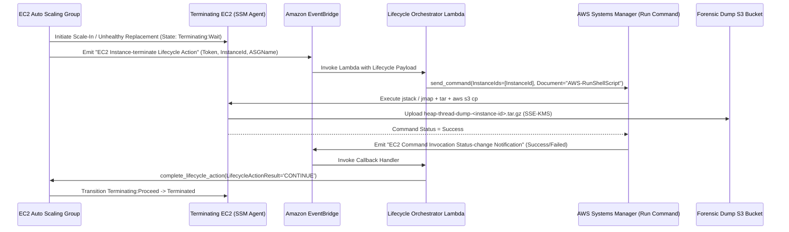
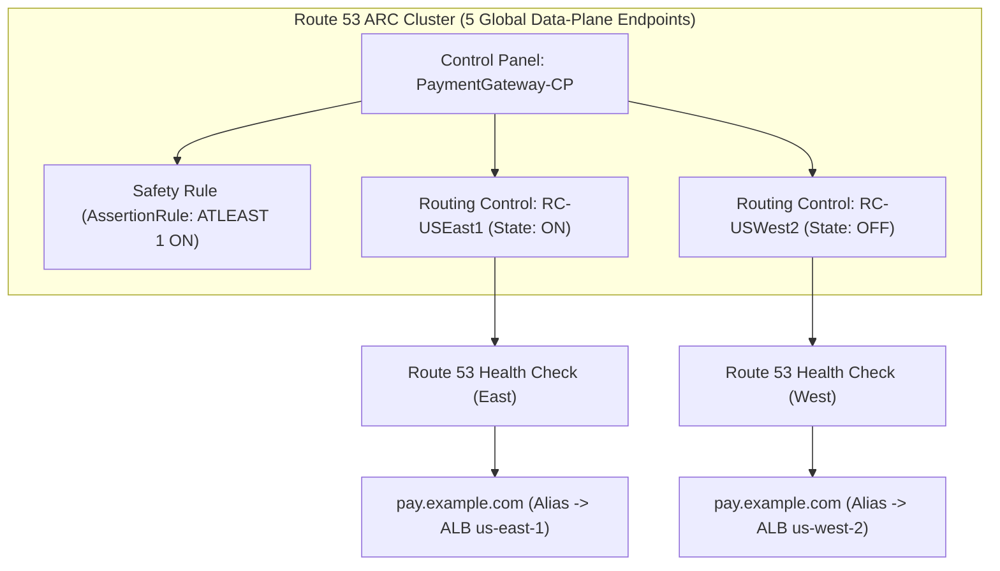
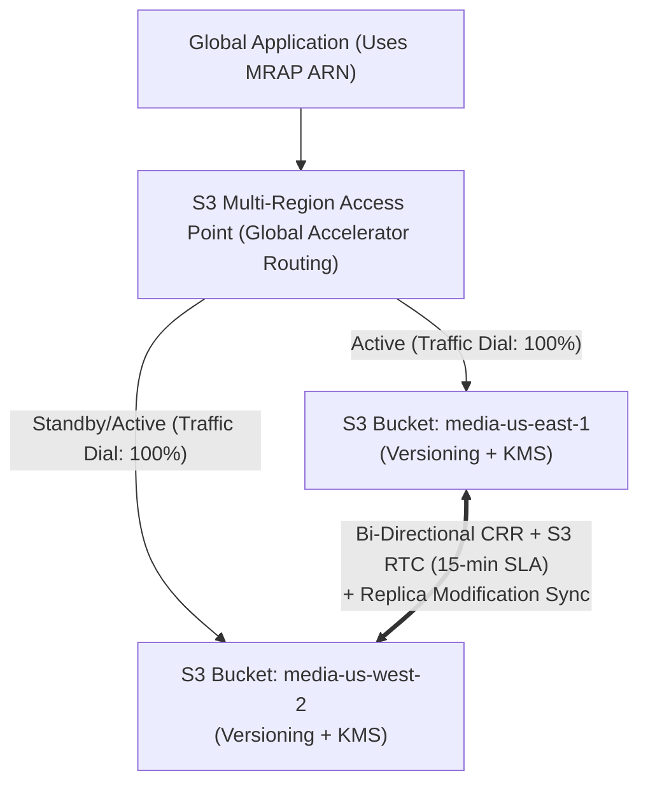
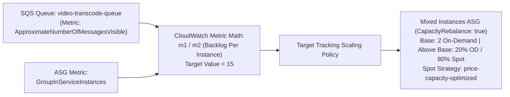
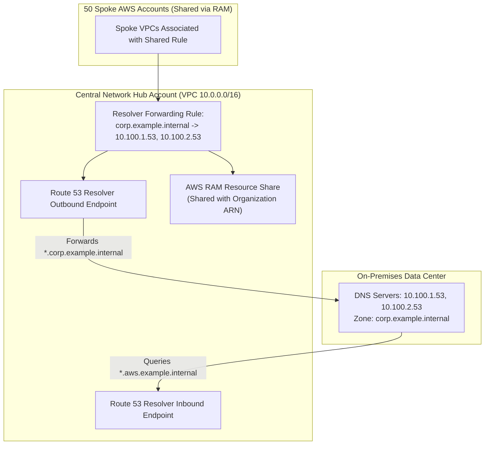

# Domain 3: Resilient Cloud Solutions — Hands-On Production Exercises (DOP-C02)

These 6 production-grade exercises cover the most heavily tested resilience architectures on the **AWS Certified DevOps Engineer - Professional (DOP-C02)** exam. Every exercise includes an architectural diagram, step-by-step scenario requirements, and **complete, working Infrastructure as Code (CloudFormation), Python automation scripts, and AWS CLI runbooks**.

---

## Exercise 1: Auto Scaling `Terminating:Wait` Lifecycle Hook to Dump JVM Thread/Heap Logs to S3 Before Instance Termination

### Scenario & Architecture
Your financial trading platform runs a stateful Java microservice on an Amazon EC2 Auto Scaling Group (ASG). Occasionally, instances become unhealthy or scale in during high memory pressure. Before any instance is terminated, operations requires an automated pipeline that:
1. Pauses the instance in `Terminating:Wait` for up to 15 minutes (`HeartbeatTimeout: 900`).
2. Intercepts the `EC2 Instance-terminate Lifecycle Action` event via Amazon EventBridge.
3. Triggers an AWS Lambda function that executes an **AWS Systems Manager (SSM) Run Command** (`AWS-RunShellScript`) on the terminating instance to capture a JVM thread dump (`jstack`), memory heap histogram (`jmap`), and `/var/log/app/` logs, uploads them to an encrypted S3 bucket, and then calls `CompleteLifecycleAction` (`CONTINUE`) to release the instance for termination.



### Complete Working Solution (CloudFormation + Python Lambda)

```yaml
AWSTemplateFormatVersion: '2010-09-09'
Description: 'DOP-C02 Ex 1: ASG Terminating:Wait Hook + EventBridge + SSM Run Command + S3 Dump'

Parameters:
  AsgName:
    Type: String
    Default: prod-trading-jvm-asg

Resources:
  ForensicDumpsBucket:
    Type: AWS::S3::Bucket
    Properties:
      BucketEncryption:
        ServerSideEncryptionConfiguration:
          - ServerSideEncryptionByDefault:
              SSEAlgorithm: AES256
      LifecycleConfiguration:
        Rules:
          - Id: ExpireDumpsAfter90Days
            Status: Enabled
            ExpirationInDays: 90
      PublicAccessBlockConfiguration:
        BlockPublicAcls: true
        BlockPublicPolicy: true
        IgnorePublicAcls: true
        RestrictPublicBuckets: true

  TerminateLifecycleHook:
    Type: AWS::AutoScaling::LifecycleHook
    Properties:
      AutoScalingGroupName: !Ref AsgName
      LifecycleHookName: jvm-forensic-dump-hook
      LifecycleTransition: autoscaling:EC2_INSTANCE_TERMINATING
      HeartbeatTimeout: 900
      DefaultResult: CONTINUE

  LifecycleLambdaRole:
    Type: AWS::IAM::Role
    Properties:
      AssumeRolePolicyDocument:
        Version: '2012-10-17'
        Statement:
          - Effect: Allow
            Principal:
              Service: lambda.amazonaws.com
            Action: sts:AssumeRole
      ManagedPolicyArns:
        - arn:aws:iam::aws:policy/service-role/AWSLambdaBasicExecutionRole
      Policies:
        - PolicyName: LifecycleAndSSMExecution
          PolicyDocument:
            Version: '2012-10-17'
            Statement:
              - Effect: Allow
                Action:
                  - ssm:SendCommand
                  - ssm:ListCommandInvocations
                Resource: '*'
              - Effect: Allow
                Action:
                  - autoscaling:CompleteLifecycleAction
                  - autoscaling:RecordLifecycleActionHeartbeat
                Resource: !Sub 'arn:aws:autoscaling:${AWS::Region}:${AWS::AccountId}:autoScalingGroup:*:autoScalingGroupName/${AsgName}'

  LifecycleOrchestratorFunction:
    Type: AWS::Lambda::Function
    Properties:
      FunctionName: asg-jvm-dump-orchestrator
      Runtime: python3.12
      Handler: index.handler
      Timeout: 60
      Role: !GetAtt LifecycleLambdaRole.Arn
      Environment:
        Variables:
          DUMP_BUCKET: !Ref ForensicDumpsBucket
      Code:
        ZipFile: |
          import json
          import os
          import boto3

          ssm = boto3.client('ssm')
          asg = boto3.client('autoscaling')
          BUCKET = os.environ['DUMP_BUCKET']

          def handler(event, context):
              print("Received event:", json.dumps(event))
              detail_type = event.get('detail-type')
              detail = event.get('detail', {})

              # Phase 1: ASG enters Terminating:Wait -> Trigger SSM Run Command
              if detail_type == "EC2 Instance-terminate Lifecycle Action":
                  instance_id = detail['EC2InstanceId']
                  asg_name = detail['AutoScalingGroupName']
                  hook_name = detail['LifecycleHookName']
                  token = detail['LifecycleActionToken']

                  shell_commands = [
                      "set -e",
                      f"TIMESTAMP=$(date -u +%Y%m%dT%H%M%SZ)",
                      f"DUMP_DIR=/tmp/forensics-{instance_id}-$TIMESTAMP",
                      "mkdir -p $DUMP_DIR",
                      "APP_PID=$(pgrep -f 'java' | head -n 1 || true)",
                      "if [ -n \"$APP_PID\" ]; then",
                      "  jstack -l $APP_PID > $DUMP_DIR/threads.txt || true",
                      "  jmap -histo:live $APP_PID > $DUMP_DIR/heap_histo.txt || true",
                      "fi",
                      "cp -r /var/log/app $DUMP_DIR/ 2>/dev/null || true",
                      "tar -czf /tmp/dump.tar.gz -C $DUMP_DIR .",
                      f"aws s3 cp /tmp/dump.tar.gz s3://{BUCKET}/{asg_name}/{instance_id}/$TIMESTAMP-dump.tar.gz",
                      f"aws autoscaling complete-lifecycle-action --lifecycle-hook-name {hook_name} --auto-scaling-group-name {asg_name} --lifecycle-action-token {token} --lifecycle-action-result CONTINUE --region {os.environ['AWS_REGION']}"
                  ]

                  try:
                      resp = ssm.send_command(
                          InstanceIds=[instance_id],
                          DocumentName='AWS-RunShellScript',
                          Comment=f"Forensic dump for {instance_id}",
                          Parameters={'commands': shell_commands},
                          TimeoutSeconds=600
                      )
                      return {"status": "SSM_DISPATCHED", "commandId": resp['Command']['CommandId']}
                  except Exception as e:
                      print(f"SSM dispatch failed ({e}); completing lifecycle action immediately.")
                      asg.complete_lifecycle_action(
                          LifecycleHookName=hook_name,
                          AutoScalingGroupName=asg_name,
                          LifecycleActionToken=token,
                          LifecycleActionResult='CONTINUE'
                      )
                      raise

  TerminateHookEventRule:
    Type: AWS::Events::Rule
    Properties:
      Name: capture-asg-terminating-wait
      EventPattern:
        source:
          - aws.autoscaling
        detail-type:
          - "EC2 Instance-terminate Lifecycle Action"
        detail:
          AutoScalingGroupName:
            - !Ref AsgName
      Targets:
        - Id: OrchestratorLambda
          Arn: !GetAtt LifecycleOrchestratorFunction.Arn

  LambdaInvokePermission:
    Type: AWS::Lambda::Permission
    Properties:
      FunctionName: !Ref LifecycleOrchestratorFunction
      Action: lambda:InvokeFunction
      Principal: events.amazonaws.com
      SourceArn: !GetAtt TerminateHookEventRule.Arn
```

---

## Exercise 2: Multi-Region Failover with Route 53 Application Recovery Controller (ARC) Routing Controls & Safety Rules

### Scenario & Architecture
You operate a Tier-0 payment processing gateway across `us-east-1` (Primary) and `us-west-2` (Secondary). You cannot rely on the Route 53 Control Plane in `us-east-1` (`ChangeResourceRecordSets` or CloudWatch Alarm Health Checks) to execute DNS failover during a catastrophic `us-east-1` outage.
1. Provision an **ARC Cluster**, **Control Panel**, and two **Routing Controls** (`RC-USEast1` and `RC-USWest2`).
2. Attach an **ARC Assertion Safety Rule (`ATLEAST 1`)** to guarantee an operator or buggy automation script can never turn off both regions simultaneously.
3. Link the Routing Controls to **Route 53 Health Checks** and Alias Records, and write the resilient **Data-Plane Failover Script** that iterates through the 5 Regional ARC Cluster Endpoints until quorum failover succeeds.



### Complete Working Solution (CloudFormation + Data-Plane Failover Script)

```yaml
AWSTemplateFormatVersion: '2010-09-09'
Description: 'DOP-C02 Ex 2: Route 53 ARC Cluster, Routing Controls, Assertion Safety Rule & Health Checks'

Parameters:
  HostedZoneId:
    Type: String
  DomainName:
    Type: String
    Default: pay.example.com
  EastAlbDns:
    Type: String
  EastAlbHostedZoneId:
    Type: String
  WestAlbDns:
    Type: String
  WestAlbHostedZoneId:
    Type: String

Resources:
  ArcCluster:
    Type: AWS::Route53RecoveryControl::Cluster
    Properties:
      Name: Tier0PaymentArcCluster

  ArcControlPanel:
    Type: AWS::Route53RecoveryControl::ControlPanel
    Properties:
      ClusterArn: !GetAtt ArcCluster.ClusterArn
      Name: PaymentGatewayControlPanel

  RoutingControlEast:
    Type: AWS::Route53RecoveryControl::RoutingControl
    Properties:
      ClusterArn: !GetAtt ArcCluster.ClusterArn
      ControlPanelArn: !GetAtt ArcControlPanel.ControlPanelArn
      Name: RC-USEast1

  RoutingControlWest:
    Type: AWS::Route53RecoveryControl::RoutingControl
    Properties:
      ClusterArn: !GetAtt ArcCluster.ClusterArn
      ControlPanelArn: !GetAtt ArcControlPanel.ControlPanelArn
      Name: RC-USWest2

  # Safety Rule: Prevent turning off both regions simultaneously (100% blackhole prevention)
  PreventDualOutageSafetyRule:
    Type: AWS::Route53RecoveryControl::SafetyRule
    Properties:
      ControlPanelArn: !GetAtt ArcControlPanel.ControlPanelArn
      Name: RequireAtLeastOneActiveRegion
      AssertedControls:
        - !GetAtt RoutingControlEast.RoutingControlArn
        - !GetAtt RoutingControlWest.RoutingControlArn
      RuleConfig:
        Inverted: false
        Threshold: 1
        Type: ATLEAST
      WaitPeriodMs: 5000

  HealthCheckEast:
    Type: AWS::Route53::HealthCheck
    Properties:
      HealthCheckConfig:
        Type: RECOVERY_CONTROL
        RoutingControlArn: !GetAtt RoutingControlEast.RoutingControlArn

  HealthCheckWest:
    Type: AWS::Route53::HealthCheck
    Properties:
      HealthCheckConfig:
        Type: RECOVERY_CONTROL
        RoutingControlArn: !GetAtt RoutingControlWest.RoutingControlArn

  DnsRecordEast:
    Type: AWS::Route53::RecordSet
    Properties:
      HostedZoneId: !Ref HostedZoneId
      Name: !Ref DomainName
      Type: A
      SetIdentifier: Primary-USEast1
      Failover: PRIMARY
      HealthCheckId: !Ref HealthCheckEast
      AliasTarget:
        DNSName: !Ref EastAlbDns
        HostedZoneId: !Ref EastAlbHostedZoneId
        EvaluateTargetHealth: true

  DnsRecordWest:
    Type: AWS::Route53::RecordSet
    Properties:
      HostedZoneId: !Ref HostedZoneId
      Name: !Ref DomainName
      Type: A
      SetIdentifier: Secondary-USWest2
      Failover: SECONDARY
      HealthCheckId: !Ref HealthCheckWest
      AliasTarget:
        DNSName: !Ref WestAlbDns
        HostedZoneId: !Ref WestAlbHostedZoneId
        EvaluateTargetHealth: true
```

#### Resilient Multi-Endpoint Data-Plane Failover Python Script (`arc_failover.py`)
```python
#!/usr/bin/env python3
"""
Executes atomic multi-region failover using the 5 independent Route 53 ARC
Regional Data-Plane Cluster Endpoints. Completely independent of us-east-1 control plane.
"""
import boto3
from botocore.exceptions import ClientError, EndpointConnectionError

# The 5 redundant regional data-plane endpoints returned when creating the ARC Cluster
CLUSTER_ENDPOINTS = [
    ("us-west-2", "https://cde111.route53-recovery-cluster.us-west-2.amazonaws.com/v1"),
    ("eu-west-1", "https://cde222.route53-recovery-cluster.eu-west-1.amazonaws.com/v1"),
    ("ap-northeast-1", "https://cde333.route53-recovery-cluster.ap-northeast-1.amazonaws.com/v1"),
    ("ap-southeast-2", "https://cde444.route53-recovery-cluster.ap-southeast-2.amazonaws.com/v1"),
    ("us-east-1", "https://cde555.route53-recovery-cluster.us-east-1.amazonaws.com/v1"),
]

RC_EAST_ARN = "arn:aws:route53-recovery-control::111122223333:controlpanel/cp-123/routingcontrol/rc-east"
RC_WEST_ARN = "arn:aws:route53-recovery-control::111122223333:controlpanel/cp-123/routingcontrol/rc-west"

def failover_to_west():
    # IMPORTANT: Update both controls in a SINGLE atomic batch call so the
    # ATLEAST 1 Assertion Safety Rule is satisfied at all times!
    entries = [
        {"RoutingControlArn": RC_WEST_ARN, "RoutingControlState": "On"},
        {"RoutingControlArn": RC_EAST_ARN, "RoutingControlState": "Off"},
    ]

    for region, endpoint_url in CLUSTER_ENDPOINTS:
        try:
            print(f"Attempting data-plane failover via {region} ({endpoint_url})...")
            client = boto3.client(
                "route53-recovery-cluster",
                region_name=region,
                endpoint_url=endpoint_url,
            )
            client.update_routing_control_states(
                UpdateRoutingControlStatesEntries=entries
            )
            print(f"SUCCESS: Failover to us-west-2 committed via {region} data plane!")
            return True
        except (ClientError, EndpointConnectionError) as exc:
            print(f"WARNING: Endpoint {region} failed ({exc}). Trying next quorum endpoint...")

    raise RuntimeError("CRITICAL: All 5 ARC regional data-plane endpoints were unreachable!")

if __name__ == "__main__":
    failover_to_west()
```

---

## Exercise 3: Aurora Global Database Unplanned Failover & Managed Switchover Automation with RDS Proxy

### Scenario & Architecture
Your enterprise SaaS platform uses an **Amazon Aurora PostgreSQL Global Database** with `us-east-1` as the Primary Writer Region and `us-west-2` as the Secondary Reader Region (`EnableGlobalWriteForwarding: true`), fronted in each region by **Amazon RDS Proxy** for AWS Lambda connection pooling.
1. Define the Aurora Global Cluster, Primary Cluster, RDS Proxy, and Secondary Cluster with Write Forwarding enabled.
2. Provide a single automated runbook script supporting both:
   - **Mode A (`SWITCHOVER`)**: Planned DR drill (`SwitchoverGlobalCluster`) achieving **`RPO = 0` (zero data loss)** while keeping the global cluster replication topology intact.
   - **Mode B (`FAILOVER`)**: Unplanned regional disaster recovery (`FailoverGlobalCluster --allow-data-loss`) achieving **`RPO < 1s` and `RTO < 1 min`**.

```mermaid
flowchart LR
    subgraph Region1 ["us-east-1 (Primary Region)"]
        L1["Lambda Microservices"] --> Proxy1["RDS Proxy (East)"]
        Proxy1 --> AuroraPri["Aurora Primary Cluster (Writer + Reader)"]
    end

    subgraph Region2 ["us-west-2 (Secondary DR Region)"]
        L2["Lambda Microservices"] --> Proxy2["RDS Proxy (West)"]
        Proxy2 --> AuroraSec["Aurora Secondary Cluster (Write Forwarding Enabled)"]
    end

    AuroraPri === "Aurora Global DB Storage Replication (< 1s)" ===> AuroraSec
```

### Complete Working Solution (CloudFormation + Python Failover/Switchover Runbook)

```yaml
AWSTemplateFormatVersion: '2010-09-09'
Description: 'DOP-C02 Ex 3: Aurora PostgreSQL Global Database + RDS Proxy + Secrets Manager'

Parameters:
  GlobalClusterId:
    Type: String
    Default: saas-global-aurora-pg
  VpcId:
    Type: AWS::EC2::VPC::Id
  PrivateSubnetIds:
    Type: List<AWS::EC2::Subnet::Id>
  DbSecurityGroupId:
    Type: AWS::EC2::SecurityGroup::Id

Resources:
  DbMasterSecret:
    Type: AWS::SecretsManager::Secret
    Properties:
      Name: /prod/aurora/master-creds
      GenerateSecretString:
        SecretStringTemplate: '{"username": "postgres_admin"}'
        GenerateStringKey: "password"
        PasswordLength: 32
        ExcludeCharacters: '"@/\'

  AuroraGlobalCluster:
    Type: AWS::RDS::GlobalCluster
    Properties:
      GlobalClusterIdentifier: !Ref GlobalClusterId
      Engine: aurora-postgresql
      EngineVersion: '15.4'
      StorageEncrypted: true

  PrimaryDBSubnetGroup:
    Type: AWS::RDS::DBSubnetGroup
    Properties:
      DBSubnetGroupDescription: Aurora Primary Subnets
      SubnetIds: !Ref PrivateSubnetIds

  PrimaryAuroraCluster:
    Type: AWS::RDS::DBCluster
    Properties:
      GlobalClusterIdentifier: !Ref AuroraGlobalCluster
      DBClusterIdentifier: saas-aurora-cluster-primary
      Engine: aurora-postgresql
      EngineVersion: '15.4'
      MasterUsername: !Sub '{{resolve:secretsmanager:${DbMasterSecret}:SecretString:username}}'
      MasterUserPassword: !Sub '{{resolve:secretsmanager:${DbMasterSecret}:SecretString:password}}'
      DBSubnetGroupName: !Ref PrimaryDBSubnetGroup
      VpcSecurityGroupIds:
        - !Ref DbSecurityGroupId
      StorageEncrypted: true
      BackupRetentionPeriod: 14

  PrimaryWriterInstance:
    Type: AWS::RDS::DBInstance
    Properties:
      DBClusterIdentifier: !Ref PrimaryAuroraCluster
      DBInstanceIdentifier: saas-aurora-primary-writer-1
      DBInstanceClass: db.r6g.xlarge
      Engine: aurora-postgresql
      PromotionTier: 0

  PrimaryFailoverReaderInstance:
    Type: AWS::RDS::DBInstance
    Properties:
      DBClusterIdentifier: !Ref PrimaryAuroraCluster
      DBInstanceIdentifier: saas-aurora-primary-reader-1
      DBInstanceClass: db.r6g.xlarge
      Engine: aurora-postgresql
      PromotionTier: 1

  RdsProxyIamRole:
    Type: AWS::IAM::Role
    Properties:
      AssumeRolePolicyDocument:
        Version: '2012-10-17'
        Statement:
          - Effect: Allow
            Principal:
              Service: rds.amazonaws.com
            Action: sts:AssumeRole
      Policies:
        - PolicyName: ReadDbSecret
          PolicyDocument:
            Version: '2012-10-17'
            Statement:
              - Effect: Allow
                Action:
                  - secretsmanager:GetSecretValue
                  - secretsmanager:DescribeSecret
                Resource: !Ref DbMasterSecret

  PrimaryRdsProxy:
    Type: AWS::RDS::DBProxy
    Properties:
      DBProxyName: saas-aurora-rds-proxy
      EngineFamily: POSTGRESQL
      IdleClientTimeout: 1800
      RequireTLS: true
      RoleArn: !GetAtt RdsProxyIamRole.Arn
      VpcSecurityGroupIds:
        - !Ref DbSecurityGroupId
      VpcSubnetIds: !Ref PrivateSubnetIds
      Auth:
        - AuthScheme: SECRETS
          SecretArn: !Ref DbMasterSecret
          IAMAuth: REQUIRED

  PrimaryRdsProxyTargetGroup:
    Type: AWS::RDS::DBProxyTargetGroup
    Properties:
      DBProxyName: !Ref PrimaryRdsProxy
      TargetGroupName: default
      DBClusterIdentifiers:
        - !Ref PrimaryAuroraCluster
      ConnectionPoolConfigurationInfo:
        MaxConnectionsPercent: 90
        MaxIdleConnectionsPercent: 50
        ConnectionBorrowTimeout: 120
```

#### Automated Planned Switchover (`RPO=0`) vs. Unplanned Failover (`RTO<1m`) Script (`aurora_dr_orchestrator.py`)
```python
#!/usr/bin/env python3
"""
Automates Aurora Global Database Managed Planned Switchover (RPO=0)
and Unplanned Regional Failover (RPO<1s, RTO<1m).
"""
import sys
import time
import boto3

GLOBAL_CLUSTER_ID = "saas-global-aurora-pg"
TARGET_SECONDARY_CLUSTER_ARN = "arn:aws:rds:us-west-2:111122223333:cluster:saas-aurora-cluster-secondary"
DR_REGION = "us-west-2"

def execute_dr_operation(mode: str):
    rds = boto3.client("rds", region_name=DR_REGION)

    if mode == "SWITCHOVER":
        print(f"[PLANNED DR DRILL] Initiating zero-data-loss Switchover (RPO=0) to {TARGET_SECONDARY_CLUSTER_ARN}...")
        rds.switchover_global_cluster(
            GlobalClusterIdentifier=GLOBAL_CLUSTER_ID,
            TargetDbClusterIdentifier=TARGET_SECONDARY_CLUSTER_ARN
        )
    elif mode == "FAILOVER":
        print(f"[UNPLANNED OUTAGE] Initiating emergency Failover (RPO<1s) to {TARGET_SECONDARY_CLUSTER_ARN}...")
        rds.failover_global_cluster(
            GlobalClusterIdentifier=GLOBAL_CLUSTER_ID,
            TargetDbClusterIdentifier=TARGET_SECONDARY_CLUSTER_ARN,
            AllowDataLoss=True
        )
    else:
        raise ValueError("Mode must be 'SWITCHOVER' or 'FAILOVER'")

    # Poll until the Global Cluster returns to 'available' state
    while True:
        resp = rds.describe_global_clusters(GlobalClusterIdentifier=GLOBAL_CLUSTER_ID)
        status = resp["GlobalClusters"][0]["Status"]
        print(f"Global Cluster Status: {status}")
        if status == "available":
            print("Operation complete! Global cluster is active in target region.")
            break
        time.sleep(10)

if __name__ == "__main__":
    op_mode = sys.argv[1].upper() if len(sys.argv) > 1 else "SWITCHOVER"
    execute_dr_operation(op_mode)
```

---

## Exercise 4: S3 Bi-Directional Replication with Replication Time Control (RTC) and Multi-Region Access Points (MRAP)

### Scenario & Architecture
Your global media application requires active-active S3 object reads and writes in both `us-east-1` and `us-west-2` with:
1. A contractual SLA guaranteeing 99.99% of objects replicate within 15 minutes (**S3 Replication Time Control - RTC**) and CloudWatch metrics tracking replication lag (`BytesPendingReplication`, `ReplicationLatency`).
2. **Replica Modification Sync** enabled so metadata/tag updates sync bi-directionally without looping.
3. An **S3 Multi-Region Access Point (MRAP)** providing a single global endpoint (`arn:aws:s3::111122223333:accesspoint/<mrap-alias>`) with Active-Passive / Active-Active traffic routing controls.



### Complete Working Solution (CloudFormation + MRAP Failover CLI)

```yaml
AWSTemplateFormatVersion: '2010-09-09'
Description: 'DOP-C02 Ex 4: S3 Bi-Directional CRR with S3 RTC, Replica Modification Sync & MRAP'

Parameters:
  EastBucketName:
    Type: String
    Default: corp-global-media-us-east-1
  WestBucketArn:
    Type: String
    Default: arn:aws:s3:::corp-global-media-us-west-2

Resources:
  S3ReplicationRole:
    Type: AWS::IAM::Role
    Properties:
      AssumeRolePolicyDocument:
        Version: '2012-10-17'
        Statement:
          - Effect: Allow
            Principal:
              Service: s3.amazonaws.com
            Action: sts:AssumeRole
      Policies:
        - PolicyName: BiDirectionalCRRPolicy
          PolicyDocument:
            Version: '2012-10-17'
            Statement:
              - Effect: Allow
                Action:
                  - s3:GetReplicationConfiguration
                  - s3:ListBucket
                Resource:
                  - !Sub 'arn:aws:s3:::${EastBucketName}'
                  - !Ref WestBucketArn
              - Effect: Allow
                Action:
                  - s3:GetObjectVersionForReplication
                  - s3:GetObjectVersionAcl
                  - s3:GetObjectVersionTagging
                Resource:
                  - !Sub 'arn:aws:s3:::${EastBucketName}/*'
                  - !Sub '${WestBucketArn}/*'
              - Effect: Allow
                Action:
                  - s3:ReplicateObject
                  - s3:ReplicateDelete
                  - s3:ReplicateTags
                Resource:
                  - !Sub 'arn:aws:s3:::${EastBucketName}/*'
                  - !Sub '${WestBucketArn}/*'

  EastMediaBucket:
    Type: AWS::S3::Bucket
    Properties:
      BucketName: !Ref EastBucketName
      VersioningConfiguration:
        Status: Enabled
      ReplicationConfiguration:
        Role: !GetAtt S3ReplicationRole.Arn
        Rules:
          - Id: ReplicateEastToWestWithRTC
            Status: Enabled
            Priority: 1
            Filter:
              Prefix: ""
            DeleteMarkerReplication:
              Status: Enabled
            SourceSelectionCriteria:
              ReplicaModifications:
                Status: Enabled
            Destination:
              Bucket: !Ref WestBucketArn
              # Enable S3 Replication Time Control (15-minute 99.99% SLA + CloudWatch Metrics)
              ReplicationTime:
                Status: Enabled
                Time:
                  Minutes: 15
              Metrics:
                Status: Enabled
                EventThreshold:
                  Minutes: 15

  GlobalMediaMRAP:
    Type: AWS::S3::MultiRegionAccessPoint
    Properties:
      Name: global-media-mrap
      Regions:
        - Bucket: !Ref EastMediaBucket
        - Bucket: !Select [5, !Split [':', !Ref WestBucketArn]]

  ReplicationLatencyAlarm:
    Type: AWS::CloudWatch::Alarm
    Properties:
      AlarmName: S3-RTC-ReplicationLatency-High
      Namespace: AWS/S3
      MetricName: ReplicationLatency
      Statistic: Maximum
      Period: 60
      EvaluationPeriods: 3
      Threshold: 600
      ComparisonOperator: GreaterThanThreshold
      Dimensions:
        - Name: SourceBucket
          Value: !Ref EastMediaBucket
        - Name: DestinationBucket
          Value: !Select [5, !Split [':', !Ref WestBucketArn]]
        - Name: RuleId
          Value: ReplicateEastToWestWithRTC
```

#### Failing Over S3 MRAP Routing Controls via AWS CLI
```bash
# 1. Inspect current Multi-Region Access Point routing configuration
aws s3control get-multi-region-access-point-routes \
  --account-id 111122223333 \
  --mrap arn:aws:s3::111122223333:accesspoint/mfzwi23gnjvgw.mrap \
  --region us-west-2

# 2. Shift 100% of S3 MRAP traffic to us-west-2 (Drain us-east-1 to 0%)
aws s3control submit-multi-region-access-point-routes \
  --account-id 111122223333 \
  --mrap arn:aws:s3::111122223333:accesspoint/mfzwi23gnjvgw.mrap \
  --route-updates '[
    {"Bucket": "corp-global-media-us-east-1", "TrafficDialPercentage": 0},
    {"Bucket": "corp-global-media-us-west-2", "TrafficDialPercentage": 100}
  ]' \
  --region us-west-2
```

---

## Exercise 5: Spot Instance Fleet Resilience with Mixed Instances Policy, Capacity Rebalancing, and SQS Backlog-Per-Instance Target Tracking

### Scenario & Architecture
You need to build a highly resilient, cost-optimized video transcoding worker fleet pulling jobs from an Amazon SQS queue (`video-transcode-queue`).
1. The ASG must maintain a guaranteed baseline of **2 On-Demand instances**, and scale out up to **40 instances** using **80% Spot and 20% On-Demand** above the base capacity.
2. Use **`price-capacity-optimized`** Spot Allocation Strategy with **Attribute-Based Instance Type Selection (`InstanceRequirements`)** and **Capacity Rebalancing (`CapacityRebalance: true`)** to replace Spot instances proactively before interruption.
3. Scale the ASG dynamically using a **Target Tracking Scaling Policy with CloudWatch Metric Math** calculating **SQS Backlog Per Instance** (`ApproximateNumberOfMessagesVisible / GroupInServiceInstances`), targeting a backlog of `15` messages per worker.



### Complete Working Solution (CloudFormation)

```yaml
AWSTemplateFormatVersion: '2010-09-09'
Description: 'DOP-C02 Ex 5: Mixed Instances ASG + Capacity Rebalancing + SQS Backlog-Per-Instance Metric Math'

Parameters:
  AmiId:
    Type: AWS::SSM::Parameter::Value<AWS::EC2::Image::Id>
    Default: /aws/service/ami-amazon-linux-latest/al2023-ami-kernel-default-x86_64
  PrivateSubnetIds:
    Type: List<AWS::EC2::Subnet::Id>

Resources:
  TranscodeQueue:
    Type: AWS::SQS::Queue
    Properties:
      QueueName: video-transcode-queue
      VisibilityTimeout: 900

  WorkerLaunchTemplate:
    Type: AWS::EC2::LaunchTemplate
    Properties:
      LaunchTemplateName: transcode-worker-lt
      LaunchTemplateData:
        ImageId: !Ref AmiId
        MetadataOptions:
          HttpEndpoint: enabled
          HttpTokens: required
          HttpPutResponseHopLimit: 1

  TranscodeWorkerASG:
    Type: AWS::AutoScaling::AutoScalingGroup
    Properties:
      AutoScalingGroupName: transcode-worker-mixed-asg
      MinSize: '2'
      MaxSize: '40'
      DesiredCapacity: '4'
      VPCZoneIdentifier: !Ref PrivateSubnetIds
      # Proactively replace Spot instances upon receiving EC2 Rebalance Recommendation
      CapacityRebalance: true
      TerminationPolicies:
        - AllocationStrategy
        - OldestLaunchTemplate
        - Default
      MetricsCollection:
        - Granularity: 1Minute
          Metrics:
            - GroupInServiceInstances
      MixedInstancesPolicy:
        InstancesDistribution:
          OnDemandAllocationStrategy: lowest-price
          OnDemandBaseCapacity: 2
          OnDemandPercentageAboveBaseCapacity: 20
          SpotAllocationStrategy: price-capacity-optimized
        LaunchTemplate:
          LaunchTemplateSpecification:
            LaunchTemplateId: !Ref WorkerLaunchTemplate
            Version: !GetAtt WorkerLaunchTemplate.DefaultVersionNumber
          Overrides:
            - InstanceRequirements:
                VCpuCount:
                  Min: 4
                  Max: 16
                MemoryMiB:
                  Min: 8192
                  Max: 65536
                CpuManufacturers:
                  - intel
                  - amd
                BurstablePerformance: excluded
                BareMetal: excluded

  # Target Tracking Policy using Metric Math: SQS Visible Messages / InService Instances
  BacklogPerInstanceScalingPolicy:
    Type: AWS::AutoScaling::ScalingPolicy
    Properties:
      AutoScalingGroupName: !Ref TranscodeWorkerASG
      PolicyType: TargetTrackingScaling
      EstimatedInstanceWarmup: 120
      TargetTrackingConfiguration:
        TargetValue: 15.0
        CustomizedMetricSpecification:
          Metrics:
            - Id: m1
              Label: Get SQS Queue Depth
              ReturnData: false
              MetricStat:
                Metric:
                  Namespace: AWS/SQS
                  MetricName: ApproximateNumberOfMessagesVisible
                  Dimensions:
                    - Name: QueueName
                      Value: !GetAtt TranscodeQueue.QueueName
                Stat: Average
            - Id: m2
              Label: Get ASG InService Instances
              ReturnData: false
              MetricStat:
                Metric:
                  Namespace: AWS/AutoScaling
                  MetricName: GroupInServiceInstances
                  Dimensions:
                    - Name: AutoScalingGroupName
                      Value: !Ref TranscodeWorkerASG
                Stat: Average
            - Id: e1
              Label: Calculate Backlog Per Instance
              Expression: m1 / m2
              ReturnData: true
```

---

## Exercise 6: Hybrid DNS Architecture Across Multi-Account VPCs Using Route 53 Resolver Endpoints and AWS RAM

### Scenario & Architecture
Your enterprise connects an on-premises data center (`corp.example.internal`, DNS servers `10.100.1.53` and `10.100.2.53`) to a central **Network Hub Account VPC** via AWS Direct Connect. You have 50 Spoke AWS Accounts connected via AWS Transit Gateway.
1. Deploy **Route 53 Resolver Inbound and Outbound Endpoints** in the Central Network Hub VPC (never in individual spoke VPCs!).
2. Create a **Resolver Forwarding Rule** for `corp.example.internal` pointing to the on-premises DNS servers.
3. Share the Forwarding Rule across the entire **AWS Organization** using **AWS Resource Access Manager (AWS RAM)** so all 50 Spoke VPCs can resolve `corp.example.internal` seamlessly.



### Complete Working Solution (CloudFormation)

```yaml
AWSTemplateFormatVersion: '2010-09-09'
Description: 'DOP-C02 Ex 6: Centralized Route 53 Resolver Endpoints + Forwarding Rules Shared via AWS RAM'

Parameters:
  HubVpcId:
    Type: AWS::EC2::VPC::Id
  HubSubnetAz1:
    Type: AWS::EC2::Subnet::Id
  HubSubnetAz2:
    Type: AWS::EC2::Subnet::Id
  OrganizationArn:
    Type: String
    Description: 'ARN of AWS Organization (e.g., arn:aws:organizations::111122223333:organization/o-example123)'

Resources:
  ResolverEndpointSG:
    Type: AWS::EC2::SecurityGroup
    Properties:
      GroupDescription: Allow DNS TCP/UDP 53 between On-Prem and VPC CIDRs
      VpcId: !Ref HubVpcId
      SecurityGroupIngress:
        - IpProtocol: udp
          FromPort: 53
          ToPort: 53
          CidrIp: 10.0.0.0/8
        - IpProtocol: tcp
          FromPort: 53
          ToPort: 53
          CidrIp: 10.0.0.0/8

  InboundResolverEndpoint:
    Type: AWS::Route53Resolver::ResolverEndpoint
    Properties:
      Name: hub-inbound-dns-endpoint
      Direction: INBOUND
      SecurityGroupIds:
        - !Ref ResolverEndpointSG
      IpAddresses:
        - SubnetId: !Ref HubSubnetAz1
        - SubnetId: !Ref HubSubnetAz2

  OutboundResolverEndpoint:
    Type: AWS::Route53Resolver::ResolverEndpoint
    Properties:
      Name: hub-outbound-dns-endpoint
      Direction: OUTBOUND
      SecurityGroupIds:
        - !Ref ResolverEndpointSG
      IpAddresses:
        - SubnetId: !Ref HubSubnetAz1
        - SubnetId: !Ref HubSubnetAz2

  OnPremForwardingRule:
    Type: AWS::Route53Resolver::ResolverRule
    Properties:
      Name: forward-corp-example-internal
      DomainName: corp.example.internal.
      RuleType: FORWARD
      ResolverEndpointId: !Ref OutboundResolverEndpoint
      TargetIps:
        - Ip: 10.100.1.53
          Port: '53'
        - Ip: 10.100.2.53
          Port: '53'

  HubVpcRuleAssociation:
    Type: AWS::Route53Resolver::ResolverRuleAssociation
    Properties:
      ResolverRuleId: !Ref OnPremForwardingRule
      VPCId: !Ref HubVpcId

  # Share the Resolver Forwarding Rule with the entire AWS Organization via AWS RAM
  ResolverRuleOrgShare:
    Type: AWS::RAM::ResourceShare
    Properties:
      Name: org-shared-dns-forwarding-rules
      AllowExternalPrincipals: false
      ResourceArns:
        - !GetAtt OnPremForwardingRule.Arn
      Principals:
        - !Ref OrganizationArn
```
