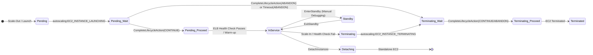
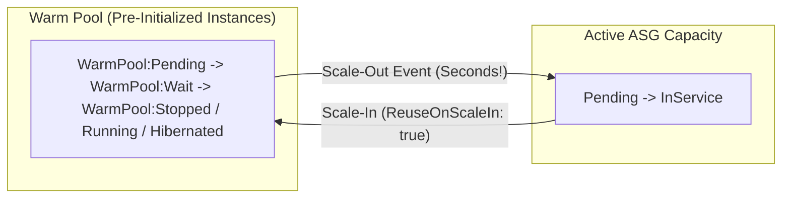
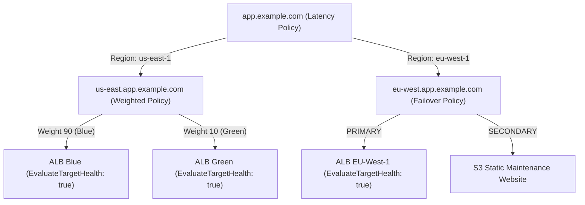
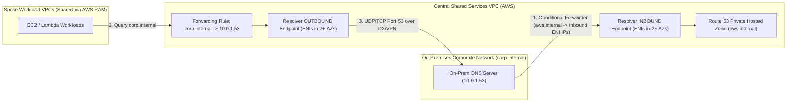
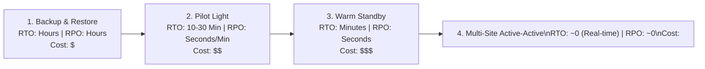

# Domain 3: Resilient Cloud Solutions — Master-Level Study Guide (DOP-C02)

> [!IMPORTANT]
> **Exam Weighting & Core Focus:** Domain 3 accounts for **17% of the AWS Certified DevOps Engineer - Professional (DOP-C02)** exam. Questions in this domain test your ability to architect, automate, and troubleshoot highly available, fault-tolerant, multi-AZ, and multi-Region systems. You must understand the exact failure modes, data-plane vs. control-plane boundaries, quorum mechanics, state transitions, and replication lag characteristics of compute, load balancing, DNS, databases, and storage.

---

## 1. Amazon EC2 Auto Scaling Deep Dive

### 1.1 Launch Templates vs. Launch Configurations

Launch Configurations are legacy/deprecated and immutable. **EC2 Launch Templates (`AWS::EC2::LaunchTemplate`)** are the mandatory standard for modern Auto Scaling Groups (ASGs), EKS Managed Node Groups, and AWS Batch.

| Feature / Capability | Launch Template | Launch Configuration (Deprecated) |
| :--- | :--- | :--- |
| **Mutability & Versioning** | Versioned (`v1`, `v2`, ...); supports `$Latest` and `$Default` pointers | Completely immutable; must create a new resource on every change |
| **Mixed Instances Policy** | Supported (combine On-Demand + Spot + multiple instance types) | Not supported (single instance type and purchasing option only) |
| **Attribute-Based Selection** | Supported (`InstanceRequirements`: vCPU, RAM, architecture, network) | Not supported |
| **IMDSv2 Enforcement** | Native support (`HttpTokens: required`, `HttpPutResponseHopLimit`) | Limited/legacy support |
| **T2/T3 Unlimited Burst** | Supported (`CpuOptions`, `CreditSpecification`) | Not supported |
| **Dedicated Hosts / Capacity Reservations** | Supported (Resource Group ARN targeting) | Not supported |
| **EBS Encryption & Tagging on Creation** | Tags instances, volumes, and ENIs atomically at launch | Only tags instances; EBS volume tagging requires post-launch scripts |

#### Launch Template Versioning & `$Default` vs. `$Latest` Anti-Patterns
*   **Never bind production ASGs directly to `$Latest`** without controlled CI/CD gates. If an engineer creates a new Launch Template version with a broken AMI or malformed `UserData`, an unexpected Spot replacement or AZ rebalance will immediately pull `$Latest` and launch broken instances.
*   **Best Practice:** Pin the ASG to `$Default` (or a specific version number in Infrastructure as Code), validate new versions in a staging/canary ASG, and update the Launch Template's `DefaultVersionNumber` via CloudFormation (`AWS::EC2::LaunchTemplate` + `DefaultVersionNumber`) before triggering an **Instance Refresh** (`StartInstanceRefresh`).
*   **Enforcing IMDSv2 in Launch Templates:**
    ```yaml
    MetadataOptions:
      HttpEndpoint: enabled
      HttpTokens: required              # Enforces IMDSv2 session-oriented PUT token requests
      HttpPutResponseHopLimit: 1        # Set to 2 ONLY if running containerized workloads (ECS/EKS/Docker bridge)
      InstanceMetadataTags: enabled     # Allows querying tags locally via http://169.254.169.254/latest/meta-data/tags/instance
    ```

#### Instance Refresh (`StartInstanceRefresh`) for Zero-Downtime Rolling Updates
When updating a Launch Template version, use **ASG Instance Refresh** instead of manually terminating instances:
*   **`MinHealthyPercentage`**: Minimum percentage of `DesiredCapacity` that must remain `InService` and healthy during the rolling replacement (e.g., `90%`).
*   **`MaxHealthyPercentage`**: Maximum percentage above `DesiredCapacity` allowed during the rollout (e.g., `110%` or `120%`—allows the ASG to **launch replacement instances BEFORE terminating old ones**!).
*   **`Checkpoints` & `CheckpointDelay`**: Pause the rolling replacement at specified percentages (e.g., `[10, 50, 100]`) for a bake time (`CheckpointDelay: 1800` seconds) to verify canary health before replacing the rest of the fleet.
*   **`AutoRollback: true` + `AlarmSpecification`**: Attach CloudWatch Alarms (e.g., ALB HTTP 5xx rate) directly to the Instance Refresh. If an alarm enters `ALARM` state during the refresh or bake window, the ASG **automatically cancels the refresh and rolls back** to the previous Launch Template version!

---

### 1.2 Mixed Instances Policy & Spot Allocation Strategies

A `MixedInstancesPolicy` allows a single ASG to combine **On-Demand** and **Spot** capacity across heterogeneous instance families while maintaining unified lifecycle hooks, target groups, and scaling policies.

#### Capacity Distribution Parameters
Inside `InstancesDistribution`:
1.  **`OnDemandAllocationStrategy`**:
    *   `prioritized` (default): Uses the exact order of instance types listed in the Launch Template `Overrides` array.
    *   `lowest-price`: Automatically selects the cheapest On-Demand instance type from the pool.
2.  **`OnDemandBaseCapacity`**: The minimum number of instances in the ASG that are **guaranteed to be On-Demand**. As the ASG scales from `0` up to `OnDemandBaseCapacity`, 100% of launched instances are On-Demand.
3.  **`OnDemandPercentageAboveBaseCapacity`**: Once `DesiredCapacity > OnDemandBaseCapacity`, this percentage (`0` to `100`) controls the split between On-Demand and Spot for all additional capacity.

> **Calculation Example:**
> *   `DesiredCapacity = 20`
> *   `OnDemandBaseCapacity = 4`
> *   `OnDemandPercentageAboveBaseCapacity = 25`
> *   **Result:** First `4` instances = **On-Demand**. Remaining `16` instances (`20 - 4`): `25%` of `16` = `4` **On-Demand**, and `75%` of `16` = `12` **Spot**. Total: **8 On-Demand + 12 Spot**.
> *   **Weighted Capacity (`WeightedCapacity`):** You can assign weights per instance type in `Overrides` (e.g., `c6i.large = 2`, `c6i.xlarge = 4`, `c6i.2xlarge = 8`). `DesiredCapacity`, `MinSize`, and `MaxSize` then represent **capacity units (vCPUs)** rather than instance counts!

#### Spot Allocation Strategies (`SpotAllocationStrategy`)
Choosing the right Spot allocation strategy is heavily tested on DOP-C02:

| Strategy | Mechanism | When to Use (Exam Scenario) |
| :--- | :--- | :--- |
| **`price-capacity-optimized`** *(Recommended)* | Identifies the deepest Spot capacity pools (lowest interruption risk) first, then selects the **lowest-priced** pool among those top-tier capacity pools. | Default best practice for production stateless workloads, batch processing, and containerized clusters balancing stability and cost. |
| **`capacity-optimized`** | Launches instances into the Spot pools with the **highest available capacity** regardless of price differences among those pools. | Workloads with high state-initialization overhead, CI/CD build runners, or strict SLA workloads where Spot interruptions are expensive. |
| **`lowest-price`** *(Legacy Anti-Pattern)* | Selects the N cheapest pools (`SpotInstancePools: N`). Often lands in shallow capacity pools that suffer frequent Spot interruptions. | Rarely recommended; only useful for tiny, ultra-short-lived fault-tolerant tasks where cost overrides all interruption churn. |

#### Attribute-Based Instance Type Selection (`InstanceRequirements`)
Instead of manually maintaining a list of 30 instance types (`m5.large`, `m5a.large`, `m6i.large`, etc.), you specify hardware boundaries:
```yaml
InstanceRequirements:
  VCpuCount:
    Min: 4
    Max: 8
  MemoryMiB:
    Min: 16384
    Max: 32768
  CpuManufacturers: [intel, amd]
  BurstablePerformance: excluded
  BareMetal: excluded
  ExcludedInstanceGenerations: [previous]
  SpotMaxPricePercentageOverLowestPrice: 100
```
*   When AWS releases new instance families (e.g., `m7i`), the ASG automatically adopts them without requiring template updates, expanding the number of Spot capacity pools.

---

### 1.3 Capacity Rebalancing for Spot Instances

*   **Standard Spot Interruption Notice:** EC2 emits an EventBridge event (`EC2 Spot Instance Interruption Warning`) and exposes metadata at `http://169.254.169.254/latest/meta-data/spot/instance-action` exactly **2 minutes** before reclaiming the instance.
*   **EC2 Instance Rebalance Recommendation:** EC2 emits an early warning (`EC2 Instance Rebalance Recommendation`) when a Spot instance is at **elevated risk** of interruption—often **much earlier than the 2-minute interruption notice**.
*   **How ASG `CapacityRebalance: true` Works:**
    1.  ASG receives the `EC2 Instance Rebalance Recommendation` signal for an existing Spot instance.
    2.  Instead of terminating the at-risk instance first (which would reduce available capacity), the ASG **proactively launches a replacement Spot instance** into a healthy pool (temporarily exceeding `DesiredCapacity` and even `MaxSize` by up to 10% or 1 instance).
    3.  Once the new replacement instance passes all Launch Lifecycle Hooks and ELB health checks (`InService`), the ASG initiates termination (including `Terminating:Wait` hooks and ELB deregistration delay) on the old at-risk Spot instance.

#### Exact EventBridge Event Patterns for Spot Resilience
```json
{
  "source": ["aws.ec2"],
  "detail-type": [
    "EC2 Spot Instance Interruption Warning",
    "EC2 Instance Rebalance Recommendation"
  ]
}
```

---

### 1.4 Auto Scaling Lifecycle Hooks

Lifecycle hooks pause an instance during scale-out (`Pending:Wait`) or scale-in (`Terminating:Wait`), allowing external automation (EventBridge + Lambda / SSM Run Command / Step Functions) to execute custom workflows before the instance enters service or is destroyed.

#### Complete ASG Instance State Machine



*   **Important Ordering with ELB Deregistration Delay (Connection Draining):**
    When an instance attached to an ALB/NLB Target Group is terminated by the ASG:
    1.  **ELB Connection Draining (Deregistration Delay) runs FIRST.** The instance is deregistered from the Target Group so no new requests arrive, while in-flight requests complete.
    2.  **`Terminating:Wait` Lifecycle Hook runs SECOND** (or concurrently depending on Target Group integration, though in standard ASG-managed Target Groups, connection draining completes or initiates before the instance is finally terminated after `CompleteLifecycleAction`). *Exam Rule:* Use Deregistration Delay to drain active HTTP connections (`30s–300s`), and use `Terminating:Wait` Lifecycle Hooks to ship logs, upload JVM heap dumps, deregister from Chef/Puppet/Active Directory, or drain long-running background queues (`up to 48 hours`).

#### Lifecycle Hook Parameters & API Mechanics
*   **`LifecycleTransition`**:
    *   `autoscaling:EC2_INSTANCE_LAUNCHING` (puts instance in `Pending:Wait`)
    *   `autoscaling:EC2_INSTANCE_TERMINATING` (puts instance in `Terminating:Wait`)
*   **`HeartbeatTimeout`**: Default is `3600` seconds (1 hour). Configurable from `30` seconds to `7200` seconds (2 hours).
*   **Extending the Timeout (`RecordLifecycleActionHeartbeat`):**
    If a graceful drain or batch job takes longer than the configured `HeartbeatTimeout`, your automation (or daemon on the instance) can call `aws autoscaling record-lifecycle-action-heartbeat` repeatedly. An instance can remain in a `*Wait` state for a maximum of **48 hours** (or 100x the heartbeat timeout, whichever is smaller).
*   **Completing the Hook (`CompleteLifecycleAction`):**
    Once your script finishes, call `aws autoscaling complete-lifecycle-action` passing:
    *   `--lifecycle-hook-name`
    *   `--auto-scaling-group-name`
    *   `--lifecycle-action-token` (preferred, passed in the EventBridge payload) OR `--instance-id`
    *   `--lifecycle-action-result CONTINUE | ABANDON`
*   **`DefaultResult` (`CONTINUE` vs. `ABANDON`):**
    *   During **`Pending:Wait` (Launch)**: Default should almost always be **`ABANDON`**. If the configuration script fails or times out, `ABANDON` immediately aborts the launch and triggers termination (`Terminating:Wait` -> `Terminated`) so a half-configured instance never receives production traffic, and the ASG launches a fresh replacement.
    *   During **`Terminating:Wait` (Scale-In)**: Both `CONTINUE` and `ABANDON` result in the instance terminating, except `ABANDON` skips any remaining subsequent termination lifecycle hooks.
*   **Polling Lifecycle State Directly From Inside the EC2 Instance (IMDSv2):**
    Without waiting for EventBridge, an agent running on the instance can poll `http://169.254.169.254/latest/meta-data/autoscaling/target-lifecycle-state` every few seconds. When the value changes from `InService` to `Terminated`, the instance knows immediately it has entered `Terminating:Wait`!

---

### 1.5 Warm Pools

Warm Pools solve the problem of **slow scale-out times** caused by heavy OS/application initialization (e.g., downloading 50 GB machine learning models, compiling caches, joining domains, warming up large monoliths).



#### Warm Pool States (`PoolState`)
1.  **`Stopped` (Default):** Instances are launched, run `UserData` and `Pending:Wait` lifecycle hooks, and are then **Stopped (`ebs-backed`)**. You pay **only for EBS storage** and Elastic IPs (zero EC2 compute cost). Scale-out takes ~20–40 seconds (boot from pre-initialized EBS volume).
2.  **`Running`:** Instances remain running in the background. Highest cost (full EC2 compute price), but fastest scale-out (~5–10 seconds, just Target Group registration).
3.  **`Hibernated`:** Instances are initialized, memory (RAM state) is pre-warmed, and the RAM contents are written to the encrypted root EBS volume before stopping. On scale-out, the exact in-memory process state is restored without re-running application startup!
    *   *Prerequisites for `Hibernated`:* Encrypted root EBS volume with sufficient free space to hold RAM dump, supported instance family, and RAM `< 150 GB`.

#### Key Warm Pool Features & Limitations
*   **Lifecycle Hook Differentiation:** When an instance launches into the Warm Pool, the EventBridge `EC2 Instance-launch Lifecycle Action` event contains `"Origin": "AutoScalingGroup"` and `"Destination": "WarmPool"`. When the instance later moves from the Warm Pool into active service, the event shows `"Origin": "WarmPool"` and `"Destination": "AutoScalingGroup"`. This allows you to run heavy installation scripts during `Destination: WarmPool` and fast registration/license activation scripts during `Destination: AutoScalingGroup`.
*   **`ReuseOnScaleIn: true`:** Instead of terminating instances on scale-in, the ASG returns healthy instances back to the Warm Pool (`Stopped`/`Running`/`Hibernated`), saving re-initialization costs.
*   **`MaxGroupPreparedCapacity`:** Defines the total combined cap of `InService` + `WarmPool` instances. If omitted, Warm Pool size equals `MaxSize - DesiredCapacity`.
*   **Exam Restriction:** Warm Pools **cannot** be used on ASGs that utilize a `MixedInstancesPolicy` with **Spot Instances** (Warm Pools require 100% On-Demand instances).

---

### 1.6 Scaling Policies Deep Dive

| Scaling Policy Type | How It Works | Best Use Case |
| :--- | :--- | :--- |
| **Target Tracking** | Automatically creates and manages High/Low CloudWatch Alarms and adjusts capacity proportionally to maintain a target metric value (e.g., `CPU = 60%`). | 90% of workloads. Web tiers (`ALBRequestCountPerTarget`), CPU-bound microservices (`ASGAverageCPUUtilization`), or SQS worker pools. |
| **Step Scaling** | Uses custom CloudWatch Alarms with stepped adjustment bounds (e.g., `60-70% -> +10%`, `70-85% -> +25%`, `>85% -> +50%`). Respects `EstimatedInstanceWarmup`. | Workloads with non-linear load spikes requiring aggressive multi-tier scale-out steps or distinct scale-in vs. scale-out thresholds. |
| **Predictive Scaling** | Analyzes up to **14 days** of historical metric data (minimum **24 hours** required) using ML to generate a daily 48-hour capacity forecast updated every 24 hours. Launches instances **ahead of predicted traffic spikes**. | Cyclical/diurnal traffic patterns (e.g., 9 AM Monday morning login surge) or slow-booting applications paired with Target Tracking. |
| **Scheduled Scaling** | Cron or one-time schedule (`at(yyyy-mm-ddThh:mm:ss)` or `cron(...)` with explicit IANA timezones like `America/New_York`). | Known marketing events, flash sales, or predictable weekend shutdowns of non-prod environments. |

#### The Classic DOP-C02 Exam Scenario: Scaling an SQS Worker Fleet
> [!WARNING]
> **Why `ApproximateNumberOfMessagesVisible` Alone Fails as a Target Tracking Metric:**
> Target Tracking requires a **utilization metric that is inversely proportional to the number of instances** in the ASG (when instances double, the metric value should halve). Raw queue depth (`ApproximateNumberOfMessagesVisible`) does NOT automatically drop the instant new EC2 instances launch—it only drops after messages are processed. Furthermore, if you have 1,000 messages and 100 instances (10 msgs/instance), raw queue depth looks identical to 1,000 messages and 1 instance (1,000 msgs/instance)!

**The Correct Architecture — Backlog Per Instance (`BacklogPerInstance`):**
1.  Calculate **Acceptable Backlog Per Instance**:
    $$\text{Acceptable Backlog Per Instance} = \frac{\text{Acceptable Message Latency (seconds)}}{\text{Average Processing Time per Message (seconds)}}$$
    *Example:* If your SLA requires every message to be processed within `100 seconds`, and each instance takes `0.5 seconds` to process 1 message, each instance can clear `100 / 0.5 = 200` messages within the SLA. Your Target Tracking value is **`200`**.
2.  Compute the dynamic metric using **CloudWatch Metric Math** directly inside the Target Tracking Scaling Policy (no custom Lambda needed anymore, though legacy questions may still mention publishing a custom metric via Lambda):
    *   `m1`: `ApproximateNumberOfMessagesVisible` (Namespace: `AWS/SQS`)
    *   `m2`: `GroupInServiceInstances` (Namespace: `AWS/AutoScaling`)
    *   Expression: `m1 / m2` (Backlog per instance).
3.  **Scale-In Protection for Long-Running SQS Workers:**
    Combine this with either **Instance Scale-In Protection** (`SetInstanceProtection` enabled by the worker script while actively processing a long job, disabled when idle) OR a **`Terminating:Wait` Lifecycle Hook** so scale-in never kills an in-flight job.

#### Predictive Scaling Modes
*   **`ForecastOnly`**: Generates and publishes capacity forecast metrics in CloudWatch (`PredictiveScaling...`) so you can verify accuracy without modifying actual ASG capacity.
*   **`ForecastAndScale`**: Actively schedules minimum capacity adjustments in advance of forecasted peaks.
*   **`SchedulingBufferTime` (Pre-Launch Buffer):** Launches instances `N` seconds before the forecasted peak to ensure cold-start bootstrapping completes before traffic arrives.
*   **`MaxCapacityBreachBehavior`**: When predicted demand exceeds `MaxSize`, choose `HonorMaxCapacity` (hard ceiling) or `IncreaseMaxCapacity` (allows scaling up to `MaxCapacityBuffer` above `MaxSize`).

---

### 1.7 Termination Policies & AZ Rebalancing

When an ASG scales in, it executes a **2-phase evaluation** to pick which instance to terminate:

#### Phase 1: Availability Zone Selection (Always Runs First!)
1.  The ASG selects the **Availability Zone with the most instances** (to maintain multi-AZ balance).
2.  If multiple AZs are tied for the highest instance count, it applies the configured **Termination Policy** across those tied AZs.

#### Phase 2: Termination Policy Evaluation Within the Chosen AZ
If using the **`Default`** termination policy, it evaluates in this exact sequence:
1.  **Oldest Launch Template / Configuration:** Terminates instances running an older version of the Launch Template (or Launch Configuration).
2.  **Closest to Next Billing Hour (`ClosestToNextInstanceHour`):** Terminates the instance closest to the next full instance-hour (note: even though Linux/Windows instances now bill per-second, this legacy heuristic remains part of the `Default` policy evaluation).
3.  **Random:** If still tied, picks one at random.

**Other Built-in & Custom Termination Policies:**
*   `AllocationStrategy`: Terminates instances to realign the ASG with its `MixedInstancesPolicy` allocation strategy (e.g., terminating excess On-Demand or suboptimal Spot pools).
*   `OldestInstance`: Useful when upgrading instances incrementally or eliminating memory-leaking long-lived nodes.
*   `NewestInstance`: Useful when testing a new launch configuration or immediately shedding burst capacity while keeping warm cached instances alive.
*   **Custom Termination Policy via AWS Lambda:** You can specify a Lambda function ARN as your Termination Policy! When a scale-in occurs, EC2 Auto Scaling invokes your Lambda with a JSON list of candidate instances (`Instances`, `AutoScalingGroupARN`, `CapacityToTerminate`, `Cause`). Your Lambda queries internal application metrics (e.g., Redis memory usage, active game sessions, zero-queue workers) and returns the ordered list of `InstanceIds` safe to terminate.

#### Why Suspending `AZRebalance` Prevents Unexpected Churn
*   The `AZRebalance` process continuously monitors AZ distribution. If one AZ temporarily runs out of Spot capacity or you manually detach/terminate an instance in `us-east-1a`, `AZRebalance` immediately launches a new instance in `us-east-1a` **before** terminating an instance in `us-east-1b`.
*   **Exam Trap:** During custom rolling deployments, manual maintenance (`EnterStandby`), or when using `DeleteAutoScalingGroup` / custom lifecycle scripts, leaving `AZRebalance` active can trigger cascading launches and terminations. **Suspend `AZRebalance`** (`aws autoscaling suspend-processes --scaling-processes AZRebalance`) before performing manual AZ-level capacity shifts or custom blue/green instance detachments.

#### Complete List of Suspendable ASG Scaling Processes
Understanding which specific ASG process to suspend during troubleshooting is a frequent DOP-C02 scenario:
*   **`Launch` / `Terminate`:** Suspends launching new instances or terminating existing ones.
*   **`HealthCheck`:** Stops the ASG from marking instances `Unhealthy` based on EC2 or ELB health checks.
*   **`ReplaceUnhealthy`:** Allows `HealthCheck` to still mark instances `Unhealthy` (for visibility), but **prevents the ASG from terminating and replacing them** so an engineer can investigate a failing production box live!
*   **`AZRebalance`:** Prevents automatic cross-AZ rebalancing.
*   **`AlarmNotification`:** Ignores CloudWatch Alarm triggers from Step/Target Tracking policies during a maintenance window while keeping scheduled actions or manual scaling functional.
*   **`ScheduledActions`:** Temporarily disables cron/time-based scaling rules.
*   **`AddToLoadBalancer`:** Launches instances in the ASG without registering them into the attached ALB/NLB Target Group (useful for pre-flight smoke testing).
*   **`InstanceRefresh`:** Pauses an ongoing Instance Refresh rollout.

---

## 2. Elastic Load Balancing (ALB, NLB, GWLB) Resilience

### 2.1 Architectural Comparison Matrix

| Feature / Capability | Application Load Balancer (ALB) | Network Load Balancer (NLB) | Gateway Load Balancer (GWLB) |
| :--- | :--- | :--- | :--- |
| **OSI Layer** | Layer 7 (Application) | Layer 4 (Transport) | Layer 3 (Network / IP) + Layer 4 GENEVE |
| **Supported Protocols** | HTTP/1.1, HTTP/2, HTTP/3 (QUIC), HTTPS, gRPC, WebSockets | TCP, UDP, TCP_UDP, TLS | IP (All IP packets on all ports) encapsulated in **GENEVE (UDP port 6081)** |
| **Static IP / Elastic IP** | **No** (Dynamic IPs; must use DNS CNAME/Alias or front with Global Accelerator / NLB) | **Yes** (1 Static IP per AZ; supports customer-assigned Elastic IPs) | **No** (Accessed via **Gateway Load Balancer Endpoints - GWLBe** powered by PrivateLink) |
| **Security Groups** | **Yes** (Always supported) | **Yes** (Supported since Aug 2023; must be attached at creation time; cannot add SGs to an NLB created without one!) | **No** (Relies on VPC route tables and appliance rules) |
| **Cross-Zone Load Balancing (Default)** | **Enabled by default** (Can be disabled at the **Target Group** level) | **Disabled by default** (Enabled at the Load Balancer level) | **Disabled by default** |
| **Cross-Zone Data Transfer Charges** | **Free** (No AWS inter-AZ data transfer charges for ALB cross-zone traffic) | **Billed** (\$0.01/GB regional data transfer charge when Cross-Zone LB is enabled on NLB) | **Billed** (Inter-AZ charges apply when Cross-Zone LB is enabled) |
| **Client IP Preservation** | **No** at Layer 3 (Backend sees ALB private IP; real client IP is injected into **`X-Forwarded-For`**, `X-Forwarded-Port`, `X-Forwarded-Proto` HTTP headers) | **Yes by default** for Instance targets (and IP targets in TCP/UDP without TLS unless disabled); or via **Proxy Protocol v2** | **Yes** (Original packet is encapsulated inside GENEVE header) |
| **Target Types** | `instance`, `ip`, `lambda`, `alb` (No ALB-to-ALB; NLB can target ALB) | `instance`, `ip`, `alb` | `instance`, `ip` |

> [!TIP]
> **Static IPs + Layer 7 WAF/Path Routing Pattern:** If a regulated enterprise client requires static whitelisted IP addresses AND Layer 7 path-based routing / AWS WAF inspection, you have two native patterns:
> 1.  **NLB (with Elastic IPs) -> Target Group (`target-type: alb`) -> Internal/Internet-facing ALB -> Backends.**
> 2.  **AWS Global Accelerator (2 static Anycast IPs) -> ALB (with WAF attached) -> Backends.**

---

### 2.2 Advanced Resilience & Traffic Management Features

#### 1. Deregistration Delay (Connection Draining)
*   **Default:** `300 seconds` (configurable from `0` to `3600` seconds on the Target Group).
*   **Behavior on ALB:** Immediately stops sending new requests to the deregistering target. Existing in-flight HTTP/WebSocket requests are allowed to finish up to the delay timeout. For sticky sessions, subsequent requests from a pinned client are re-routed to a healthy target.
*   **Behavior on NLB:** Immediately stops new TCP/UDP flows. Existing TCP connections remain open until the client/server closes them or the timeout expires.
    *   **NLB `deregistration_delay.connection_termination.enabled`:** By default (`false`), NLB allows existing long-lived TCP connections to remain open even *after* the deregistration delay expires (until the target EC2 instance itself is terminated). Setting `connection_termination.enabled = true` forces the NLB to send TCP RST packets to actively sever open connections the exact second the deregistration delay expires.
*   **Stateless UDP / Short-Polling Optimization:** Set Deregistration Delay to `0` or `15–30 seconds` for stateless microservices or Lambda/container rollouts to dramatically accelerate ECS/ASG deployments.

#### 2. Slow Start Mode (ALB Target Group)
*   **The Problem:** When a new JVM, .NET, or local-cache-heavy instance enters `InService` during a high-traffic spike, receiving an immediate full share of requests overwhelms the cold instance (causing CPU 100%, cache stampedes, and failing health checks).
*   **The Solution:** Configure `slow_start.duration_seconds` (`30` to `900` seconds) on the ALB Target Group. The ALB linearly ramps up the proportion of traffic sent to the newly registered target over the configured duration.
*   *Constraint:* Slow Start **cannot** be combined with the **Least Outstanding Requests (LOR)** routing algorithm.

#### 3. Routing Algorithms (ALB Target Group)
1.  **Round Robin (Default):** Distributes requests evenly in sequence across all healthy targets regardless of how long each request takes.
2.  **Least Outstanding Requests (LOR):** Routes each new request to the target that currently has the **fewest open/in-flight requests**.
    *   *When to use LOR:* Heterogeneous instance sizes (Mixed Instances Policy without weight adjustments), workloads with wildly varying query complexity (e.g., reporting endpoints mixed with fast lookups), or long-polling APIs.
3.  **Weighted Random (with Automatic Target Weights / Anomaly Mitigation):** Dynamically down-weights anomalous targets exhibiting elevated HTTP 5xx rates.

#### 4. HTTP Desync Mitigation Mode (ALB / CLB)
Protects applications against **HTTP Request Smuggling (Desync) attacks** where front-end proxies and back-end servers disagree on message boundaries (`Content-Length` vs. `Transfer-Encoding: chunked`):
*   **`Monitor`:** Allows all requests through to targets but logs RFC-non-compliant / ambiguous requests in ALB Access Logs (`Classification: Ambiguous` or `Severe`) and emits `DesyncMitigationMode_NonCompliant_Request_Count`.
*   **`Defensive` (Default):** Blocks `Severe` RFC threats with `HTTP 400`, routes `Acceptable` requests normally, and closes connections after serving `Ambiguous` requests to prevent request smuggling across keep-alive connections.
*   **`Strictest`:** Rejects both `Severe` and `Ambiguous` requests immediately with `HTTP 400`.

#### 5. Fail-Open Behavior (All Targets Unhealthy) & Zonal Shift
*   **ELB "Fail Open" Mechanism:** If **100% of targets** in a Target Group fail health checks simultaneously (e.g., a dependency database blips causing `/health` to return `500` on all nodes), ALB and NLB **fail open** and route traffic across all registered targets anyway, in case the health check endpoint itself is broken while the main application can still serve cached requests!
*   **Minimum Healthy Targets (`TargetGroupHealth`):** You can configure **DNS Failover** and **Routing Failover** thresholds (`min_healthy_targets.count` or `min_healthy_targets.percentage`) on the Target Group so that if an AZ drops below e.g. `50%` healthy targets, ELB marks that AZ impaired or fails over across zones.
*   **ARC Zonal Shift:** When a single Availability Zone experiences a **gray failure** (power degradation, elevated packet loss, or storage latency that hasn't completely killed instances or failed health checks), enabling **ARC Zonal Shift** on an ALB or NLB immediately withdraws the impaired AZ's load balancer node IP from DNS and stops routing traffic to targets in that AZ.

---

## 3. Amazon Route 53 & Application Recovery Controller (ARC)

### 3.1 Route 53 Routing Policies Deep Dive

| Routing Policy | Mechanism | Health Check Support? | Typical DOP-C02 Use Case |
| :--- | :--- | :--- | :--- |
| **Simple** | Single record with one or more values returned at random. If Alias, points to 1 AWS resource. | **No** (Unless Alias with `EvaluateTargetHealth: true` in a nested chain) | Single-region environments without DNS-level traffic splitting. |
| **Weighted** | Assigns relative weights (`0` to `255`). Weight Proportion = $\frac{\text{Record Weight}}{\sum \text{All Weights}}$. Weight `0` stops traffic. | **Yes** | Blue/Green canary traffic shifting (`90/10`) across Regions or ALBs. |
| **Latency (LBR)** | Routes based on lowest network round-trip latency from the resolver/EDNS0 client subnet to the target AWS Region. | **Yes** | Active-Active multi-region architectures optimizing global user speed. |
| **Failover** | Active-Passive (`PRIMARY` and `SECONDARY`). Routes 100% to `PRIMARY` unless its health check fails. | **Mandatory on `PRIMARY`** (Optional on `SECONDARY`) | Classic Active-Passive Disaster Recovery (Pilot Light / Warm Standby). |
| **Geolocation** | Routes based on continent, country, or US state of the client DNS query. Always configure a **`Default` (`*`)** catch-all record! | **Yes** | Data residency compliance (GDPR), localized content restriction. |
| **Geoproximity** | Routes based on physical distance between users and resources, adjustable via a **Bias (`-99` to `+99`)** that expands or shrinks a region's geographic catchment zone. | **Yes** | Shifting geographic boundaries dynamically between adjacent regions. |
| **Multivalue Answer** | Returns up to **8 healthy IP addresses** at random in response to DNS queries (client-side load balancing). | **Yes** (Each IP has its own health check) | Legacy non-ELB fleets needing basic health-checked round-robin A records. |
| **IP-Based Routing** | Matches client IP CIDR blocks (from CIDR collections) to specific endpoints. | **Yes** | Optimizing ISP-specific peering routes or routing known corporate CIDRs. |

#### Nested Alias Routing Trees (Chaining Routing Policies)
Route 53 allows you to chain records inside the same Hosted Zone using **Alias records pointing to other Route 53 records** of the same type:

*   **Critical Rule on `EvaluateTargetHealth: true`:** When chaining Alias records, if all endpoints under `us-east.app.example.com` (both Blue and Green ALBs) become unhealthy and `EvaluateTargetHealth: true` is enabled all the way up the tree, Route 53 automatically fails over the top-level **Latency** record (`app.example.com`) away from `us-east-1` to `eu-west-1`!

---

### 3.2 Route 53 Health Checks & The `us-east-1` Control Plane Trap

Route 53 supports three types of Health Checks:

1.  **Endpoint Health Checks:**
    *   Global fleet of health checkers across 8+ AWS regions send HTTP, HTTPS, or TCP probes every `30 seconds` (Standard) or `10 seconds` (Fast) to a public IP or domain.
    *   Marked **Healthy** if $> 18\%$ of health checkers report `HTTP 2xx/3xx` (or TCP handshake) within 2–4 seconds (and optional string match in the **first 5,120 bytes** of the response body).
    *   *Firewall Requirement:* Target Security Groups/NACLs must allow inbound traffic from the `ROUTE53_HEALTHCHECKS` IP ranges (obtainable via `ip-ranges.json` or AWS Managed Prefix Lists).
2.  **Calculated Health Checks:**
    *   Combines up to **255 child health checks** using boolean logic: `AND` (all healthy), `OR` (at least 1 healthy), or `M of N` (e.g., at least 3 of 5 internal microservices healthy).
    *   Supports **Invert Health Check Status** (useful for triggering automated maintenance page cutovers when an alarm turns healthy/unhealthy).
3.  **CloudWatch Alarm Health Checks:**
    *   Monitors the state of a CloudWatch Alarm (`OK`, `ALARM`, `INSUFFICIENT_DATA`) instead of probing a public port.
    *   **How to Health Check Private VPC Resources:** Since Route 53 Endpoint Health Checkers live on the public internet and **cannot directly probe private RFC 1918 VPC IPs**, you monitor the private resource using a **CloudWatch Metric + CloudWatch Alarm**, and associate a **Route 53 CloudWatch Alarm Health Check** with that alarm!

> [!CAUTION]
> **MAJOR DOP-C02 EXAM TRAP — Route 53 Control Plane & CloudWatch Alarm Health Checks in `us-east-1`:**
> Route 53 Health Checks are managed by the Route 53 Control Plane in **`us-east-1` (N. Virginia)**.
> *   If you rely on a **CloudWatch Alarm Health Check** (or change Route 53 records via the Route 53 API `ChangeResourceRecordSets`) to fail over away from `us-east-1` during a major `us-east-1` control-plane outage, **the failover can fail or stall** because the control plane that reads CloudWatch Alarms or updates DNS records is itself hosted in `us-east-1`!
> *   **How to Survive a Complete `us-east-1` Outage:**
>     1. Use **Route 53 Endpoint Health Checks** (which execute on the distributed **Data Plane** across global locations and continue functioning even if the `us-east-1` control plane is impaired), **OR**
>     2. Use **Amazon Route 53 Application Recovery Controller (ARC) Routing Controls** (hosted on 5 independent Regional data-plane cluster endpoints).

---

### 3.3 Hybrid DNS with Route 53 Resolver

Every VPC has an implicit Route 53 Resolver at `VPC_CIDR_BASE + 2` (or `169.254.169.253`). To bridge DNS resolution between on-premises data centers (via Direct Connect or Site-to-Site VPN) and AWS VPCs, use **Route 53 Resolver Endpoints**:



*   **Inbound Endpoint (`On-Premises -> AWS`):** Allocates 2+ static ENI IP addresses inside your VPC. Your on-premises DNS admins configure a **Conditional Forwarder** on their BIND/Active Directory DNS servers to forward queries for `*.aws.internal` (or `*.amazonaws.com` for PrivateLink Interface Endpoints) to those Inbound ENI IPs.
*   **Outbound Endpoint + Resolver Forwarding Rules (`AWS -> On-Premises`):** When workloads inside AWS query `*.corp.internal`, the Resolver Forwarding Rule intercepts the query and sends it out through the **Outbound Endpoint ENIs** across Direct Connect / VPN to the on-premises DNS server IP (`10.0.1.53`).
*   **Multi-Account Scaling Pattern (Centralized Hub-and-Spoke):**
    Do **NOT** deploy Outbound/Inbound Endpoints in every single AWS account (expensive and consumes ENIs). Deploy **one pair of Inbound/Outbound Endpoints** in a centralized **Network / Shared Services Account**, create the **Resolver Forwarding Rules** there, and **share the Forwarding Rules across the entire AWS Organization using AWS Resource Access Manager (AWS RAM)** (`ram:CreateResourceShare`), associating them with spoke VPCs.
*   **Route 53 Resolver DNS Firewall:** Protects Outbound queries from VPCs against **DNS Exfiltration** and **Domain Generation Algorithms (DGA)** by evaluating outbound DNS queries against managed or custom domain blocklists/allowlists (`ALERT` or `BLOCK` with `NODATA`, `NXDOMAIN`, or custom `OVERRIDE` CNAME).

---

### 3.4 Route 53 Application Recovery Controller (ARC)

ARC is purpose-built for mission-critical Tier-0 workloads requiring deterministic, control-plane-independent disaster recovery.

#### 1. Readiness Check (Control Plane — Continuous Pre-Flight Auditing)
*   **Problem Solved:** Six months after building a DR region (`us-west-2`), engineers scale up the primary region (`us-east-1`)—raising EC2 vCPU quotas, increasing DynamoDB provisioned capacity, adding new Secrets Manager secrets, or attaching new IAM policies—while forgetting to mirror those changes in `us-west-2`. During an actual failover, the DR region crashes due to `VcpuLimitExceeded` or missing configs.
*   **How Readiness Check Works:**
    *   You group regional resources into **Cells** (e.g., `Cell-USEast1` and `Cell-USWest2`) and combine them in a **Recovery Group**.
    *   ARC continuously audits **Resource Readiness** (configuration parity across ALB, ASG, DynamoDB, RDS, NLB), **Service Quotas** (comparing vCPU/ENI limits between cells), and **Capacity Readiness**.

#### 2. Routing Control (Data Plane — Ultra-Reliable Failover Switches)
*   **Architecture:** When you create an ARC **Cluster**, AWS provisions **5 independent Regional Cluster Endpoints** across 5 distinct AWS Regions (e.g., `us-east-1`, `us-west-2`, `eu-west-1`, `ap-northeast-1`, `ap-southeast-2`) using a consensus quorum protocol (Paxos/Raft).
*   **Zero Control-Plane Dependency:** Even if `us-east-1` suffers a catastrophic outage, you can connect to any of the other 4 Regional Cluster Endpoints on the **Data Plane** to flip a Routing Control (`On` or `Off`), which immediately updates the tied **Route 53 Health Check** and switches DNS traffic in seconds!
*   **Safety Rules (Preventing Accidental Dual Outages):**
    *   **`AssertionRule`:** Enforces invariants such as *"At least `1` of `[CellEast_Control, CellWest_Control]` must be `ON` at all times"* (prevents an operator or script from turning off both regions simultaneously, which would cause a 100% outage) or *"At most `1` must be `ON`"* (prevents split-brain Active-Active writes on an Active-Passive database).
    *   **`GatingRule`:** Evaluates target controls against gating conditions before permitting a state change.
*   **Executing Failover via AWS CLI (Best Practice):**
    Never use `route53-recovery-control-config` (control plane) during an outage. Always use **`route53-recovery-cluster`** (data plane) with an explicit regional `--endpoint-url`:
    ```bash
    aws route53-recovery-cluster update-routing-control-states \
      --update-routing-control-states-entries \
        '[{"RoutingControlArn": "arn:aws:route53-recovery-control::111122223333:controlpanel/cp-1/routingcontrol/rc-east", "RoutingControlState": "Off"},
          {"RoutingControlArn": "arn:aws:route53-recovery-control::111122223333:controlpanel/cp-1/routingcontrol/rc-west", "RoutingControlState": "On"}]' \
      --region us-west-2 \
      --endpoint-url https://cde12345.route53-recovery-cluster.us-west-2.amazonaws.com/v1
    ```
    *Note:* Notice that both states (`Off` and `On`) are submitted in a **single atomic batch call** (`update-routing-control-states`) so the `AssertionRule` ("at least 1 ON") is never violated mid-transition!

#### 3. Zonal Shift & Zonal Autoshift
*   **Zonal Shift:** Temporarily shifts traffic for supported resources (**ALB, NLB, EKS**) away from an impaired Availability Zone with a single API call (`aws arc-zonal-shift start-zonal-shift`). Shifts automatically expire after a user-defined TTL (`1 minute` to `3 days`) and can be extended.
*   **Zonal Autoshift:** Allows AWS to **automatically shift traffic away from an AZ** when AWS internal telemetry detects power/network degradation in that AZ.
    *   **Practice Runs:** Requires configuring mandatory **Practice Runs** (weekly 30-minute simulated AZ shifts) monitored by two customer CloudWatch Alarms: an **Outcome Alarm** (halts the practice run if business health drops) and a **Blocking Alarm** (prevents practice runs during peak hours or incidents).

---

## 4. High Availability & Multi-Region Databases & Storage

### 4.1 Amazon RDS High Availability Architectures

| Deployment Option | Architecture & Replication | Failover RTO / RPO | Can Standby Serve Reads? | Ideal Use Case |
| :--- | :--- | :--- | :--- | :--- |
| **RDS Multi-AZ DB Instance** | **1 Primary + 1 Standby** in a different AZ. **Synchronous physical block-level replication** (DRBD/storage layer). | **RTO: `60–120 seconds`**<br>**RPO: `0` (Zero data loss)** | **NO** (Passive standby only) | Standard transactional HA workloads where standby read scaling is unnecessary. |
| **RDS Multi-AZ DB Cluster** *(MySQL / PostgreSQL)* | **1 Writer + 2 Reader Standbys** across 3 AZs using **semi-synchronous engine-native transaction log replication** + local NVMe SSD cache. | **RTO: `~35 seconds`**<br>**RPO: `0` (At least 1 standby confirms commit before acknowledging client)** | **YES** (Both standbys accept read traffic via Reader Endpoint!) | Workloads needing **2x faster write latency**, lower failover RTO (`~35s`), and extra read capacity without paying for idle standbys. |
| **RDS Read Replicas** *(Same-Region or Cross-Region)* | Up to 15 replicas. **Asynchronous engine-level replication**. | **Manual Promotion**<br>RTO: `Minutes`<br>RPO: `Seconds/Minutes` (Replication Lag) | **YES** | Offloading heavy BI/reporting queries or Cross-Region Disaster Recovery (`PromoteReadReplica`). |

#### RDS Custom for Oracle / SQL Server Resilience Considerations
*   Unlike standard RDS, **RDS Custom** grants OS-level SSH/SSM access and administrative privileges for legacy applications requiring custom agents or OS patches.
*   **Support Perimeter:** RDS Custom runs a **Support Perimeter** watch-dog that verifies the underlying EC2 instance, ENIs, and EBS volumes still enable automated backups and automation. If an admin deletes required SSM agents or breaks storage layout, the instance enters **`unsupported-configuration`** state and automated backups/Multi-AZ failovers are paused until remediated!

---

### 4.2 Amazon RDS Proxy

RDS Proxy sits between your application tier (especially **AWS Lambda, ECS, and Kubernetes microservices**) and your RDS/Aurora database.

*   **Connection Pooling & Multiplexing:** Lambda functions scaling out to 2,000 concurrent executions during a traffic spike will rapidly exhaust `max_connections` on RDS, causing `Too many connections` errors and severe CPU memory overhead from opening/closing TLS database sessions. RDS Proxy reuses warm underlying database connections across transactions.
*   **Up to 66% Faster Failover Times:**
    *   Without RDS Proxy, a Multi-AZ failover requires waiting for DNS TTL propagation (`15–60s`) and forces applications to drop and re-establish TCP connections.
    *   With RDS Proxy, **client connections to RDS Proxy stay open during a database failover!** RDS Proxy buffers in-flight requests, automatically detects the new primary writer via internal control-plane signals (bypassing public DNS caching), and routes subsequent transactions to the promoted standby seamlessly.
*   **Security Enforcement:** Can enforce **IAM Database Authentication** and centrally retrieve database credentials from **AWS Secrets Manager**, eliminating hardcoded passwords in application code.
*   **Exam Trap — Connection Pinning:**
    If your application sets session-level state (e.g., `SET @variable`, temporary tables, prepared statements, or modifying session character sets), RDS Proxy **pins** that client connection to a single underlying DB connection for the rest of the session, preventing connection multiplexing! Avoid session state variables to maximize RDS Proxy efficiency.

---

### 4.3 Amazon Aurora & Aurora Global Database

#### Aurora Storage Architecture & Quorum Mechanics
Aurora separates compute from storage. The shared storage volume automatically stripes data in 10 GB protection groups replicated into **6 copies across 3 Availability Zones** (2 copies per AZ):
*   **Write Quorum (`4 of 6`):** A write is acknowledged as durable as soon as **4 out of 6** storage nodes confirm the log record write.
    *   *Fault Tolerance:* Aurora can lose an **entire AZ (2 copies) PLUS 1 additional storage node (`3` copies lost during repair)** and still maintain read availability; it can lose an entire AZ (`2` copies) and maintain full write availability (`4` copies remaining) with zero impact!
*   **Read Quorum (`3 of 6`):** Reads require quorum across 3 nodes (though normally served directly from in-memory cache or a known up-to-date storage node).
*   **Self-Healing Storage:** Peer-to-peer gossip automatically repairs bad 10 GB segments from healthy copies in the background.

#### Aurora Failover Priority Tiers & Custom Endpoints
*   **Failover Priority Tiers (`Tier 0` to `Tier 15`):**
    *   Each Aurora Replica can be assigned a Promotion Tier (`0` = highest priority, `15` = lowest priority).
    *   During a primary writer failure, Aurora promotes the replica with the **lowest numbered tier** (`Tier 0` first). If multiple replicas share the same tier, Aurora promotes the **largest instance size** among them.
    *   **Best Practice:** Assign `Tier 0` or `Tier 1` to mission-critical OLTP replicas (sized identically to the Writer) and assign `Tier 14` or `Tier 15` to smaller analytics/reporting replicas so a small BI instance is never accidentally promoted to Primary Writer!
*   **Aurora Custom Endpoints:** Allow you to group a subset of Aurora Replicas (e.g., three `r6g.4xlarge` instances dedicated to heavy BI reporting) behind a dedicated DNS endpoint so analytical queries never impact OLTP read replicas.
*   **Aurora Serverless v2 in High Availability:** Scales instantaneously in **0.5 ACU (Aurora Capacity Unit)** increments (`1 ACU ≈ 2 GB RAM`). You can mix Provisioned instances with Serverless v2 instances in the same cluster; placing a Serverless v2 reader in **`Tier 0` or `Tier 1`** provides an elastic, low-cost HA failover target that scales up only if promoted!

#### Aurora Global Database (Multi-Region Resilience)
An Aurora Global Database spans a **Primary Region** (read/write) and up to **5 Secondary Regions** (read-only), with up to 16 read replicas per secondary region.
*   **Storage-Layer Replication (`< 1 second` lag):** Replication happens directly between the Aurora storage fleets across regions (completely bypassing the database engine CPU), achieving typical cross-region lag (`AuroraGlobalDBReplicationLag`) of **under 1 second**.

```mermaid
flowchart LR
    subgraph Primary ["Primary Region (us-east-1)"]
        W["Writer Instance"]
        R1["Reader Instance"]
        S_Pri[("Aurora Storage (6 copies / 3 AZs)")]
        W --> S_Pri
        R1 --> S_Pri
    end
    
    subgraph Secondary ["Secondary Region (us-west-2)"]
        R2["Reader Instance (Write Forwarding Enabled)"]
        S_Sec[("Aurora Storage (6 copies / 3 AZs)")]
        S_Sec --> R2
    end
    
    S_Pri === "Dedicated Storage-Layer Replication (< 1s lag)" ===> S_Sec
    R2 -. "EnableGlobalWriteForwarding (Forwards DML writes to Primary Writer)" .-> W
```

#### Crucial Exam Distinction: Managed Planned Failover (Switchover) vs. Unplanned Failover (Detach & Promote)

| Feature | Managed Planned Failover (**Switchover** / `SwitchoverGlobalCluster`) | Unplanned Failover (**Detach & Promote** / `FailoverGlobalCluster` or `RemoveFromGlobalCluster`) |
| :--- | :--- | :--- |
| **When to Use** | Planned DR drills, regional maintenance, migrating the primary region closer to users, or rotating active regions. | Catastrophic, unrecoverable outage of the Primary Region. |
| **RPO (Data Loss)** | **`RPO = 0` (Zero Data Loss Guaranteed!)** | **`RPO < 1 second`** (Depends on `AuroraGlobalDBReplicationLag` at the moment of failure) |
| **RTO (Recovery Time)** | Typically `1–2 minutes` | **`< 1 minute`** |
| **How It Works** | 1. Quiesces writes on old primary (`us-east-1`).<br>2. Waits until secondary (`us-west-2`) catches up 100% (`Lag = 0`).<br>3. Promotes `us-west-2` to Primary Writer.<br>4. Demotes `us-east-1` to Secondary Reader.<br>**Global cluster topology remains intact!** | 1. Using `FailoverGlobalCluster --allow-data-loss` (or legacy: `RemoveFromGlobalCluster` + promote).<br>2. Immediately promotes `us-west-2` to accept writes.<br>3. If using legacy detach, you must manually re-add old regions once recovered. |
| **Global Cluster Global Writer Endpoint** | Automatically updates the `*.global.rds.amazonaws.com` CNAME to point to the new primary region writer! | Updates CNAME if using `FailoverGlobalCluster`. |

#### Aurora Global Database Write Forwarding (`EnableGlobalWriteForwarding`)
*   Normally, Aurora Secondary Regions are strictly read-only. If an application in `us-west-2` needs to perform occasional writes without managing dual database connection strings, enable **Write Forwarding** (`EnableGlobalWriteForwarding: true`) on the secondary cluster.
*   The secondary reader accepts `INSERT`/`UPDATE`/`DELETE` statements, forwards them over AWS's backbone to the Primary Region Writer (`us-east-1`), executes them there, and replicates the storage blocks back.
*   **Read Consistency Modes (`aurora_replica_read_consistency`):**
    *   `EVENTUAL`: Fastest reads, may not immediately see the forwarded write.
    *   `SESSION` *(Recommended)*: Guarantees **read-your-own-writes** within the same database session (waits until the secondary storage catches up to the LSN of the session's last forwarded write).
    *   `GLOBAL`: Waits for all committed changes in the primary region up to the moment the query started to replicate before returning results.

---

### 4.4 Amazon DynamoDB Global Tables & Resilience

*   **Multi-Region, Multi-Active Architecture:** Unlike Aurora Global Database (which has 1 writer region), **DynamoDB Global Tables (Version 2019.11.21)** are **true Multi-Active**: any application can read and write locally to the table in **any participating Region** with single-digit millisecond latency.
*   **Replication Mechanism & Conflict Resolution:**
    *   Relies on **DynamoDB Streams (`NEW_AND_OLD_IMAGES`)** under the hood to replicate item changes asynchronously across regions (typically `< 1 second`).
    *   **Conflict Resolution:** Uses **Last-Writer-Wins (LWW)** based on timestamps. If the exact same item (same Partition Key + Sort Key) is updated concurrently in `us-east-1` and `eu-west-1` within milliseconds, the update with the latest timestamp overwrites the other globally.
    *   *Exam Note on Strong Consistency:* Strongly Consistent Reads (`ConsistentRead: true`) and **DynamoDB Transactions (`TransactWriteItems`)** are strictly **Regional**—they do NOT guarantee cross-region strong consistency across Global Table replicas!
    *   **Capacity Modes Across Replicas:** All replica tables in a Global Table must share the same billing mode (**On-Demand** or **Provisioned with Auto Scaling enabled**). If using Provisioned capacity, you must enable **DynamoDB Auto Scaling** across all regions so a regional failover doesn't throttle replicated writes (`ReplicationLatency` spike)!
*   **Point-in-Time Recovery (PITR):**
    *   Continuous backups for the last **35 days** with **1-second granularity** (`RPO = 1 second`).
    *   Restoring from PITR always creates a **new DynamoDB table** (`RestoreTableToPointInTime`).
*   **DynamoDB Accelerator (DAX):**
    *   Fully managed, multi-AZ, in-memory **write-through cache** for DynamoDB reducing read times from milliseconds to **microseconds**.
    *   **Prevents `ProvisionedThroughputExceededException` on Hot Keys** for read-heavy workloads (e.g., celebrity profile, product catalog flash sale).

---

### 4.5 Resilient Storage: S3, EFS, and FSx

#### Amazon S3 Replication (CRR, SRR, RTC, MRAP)
1.  **Prerequisites for S3 Replication (CRR & SRR):**
    *   **S3 Versioning MUST be enabled** on both Source and Destination buckets.
    *   IAM Role granted to S3 (`s3.amazonaws.com`) with `s3:GetReplicationConfiguration`, `s3:GetObjectVersionForReplication` on Source and `s3:ReplicateObject`, `s3:ReplicateDelete` on Destination.
    *   If objects are encrypted with **SSE-KMS**, you must explicitly enable `ReplicaKmsKeyID` and grant `kms:Decrypt` on the source KMS key and `kms:Encrypt` on the destination regional KMS key.
    *   **Existing Objects:** By default, enabling S3 Replication **only replicates NEW objects uploaded after the rule is enabled**. To replicate pre-existing objects, you must run an **S3 Batch Replication** job!
    *   **Delete Markers:** By default, S3 Replication **does NOT replicate Delete Markers** (to protect against malicious or accidental deletions propagating to DR). You can optionally enable `DeleteMarkerReplication: Enabled`, but **permanent version ID deletions are NEVER replicated**.
2.  **S3 Replication Time Control (S3 RTC):**
    *   Standard CRR replicates on a best-effort basis (can take minutes to hours for large spikes).
    *   **S3 RTC** provides a backed SLA guaranteeing **99.99% of new objects are replicated within 15 minutes** (with most replicating in seconds/minutes).
    *   Automatically enables **S3 Replication Metrics** in CloudWatch (`ReplicationLatency`, `BytesPendingReplication`, `OperationsPendingReplication`), allowing you to create CloudWatch Alarms if DR RPO drifts approaching 15 minutes!
3.  **S3 Bi-Directional Replication + Multi-Region Access Points (MRAP):**
    *   Configure two-way CRR (`Bucket-East <-> Bucket-West`) with **Replica Modification Sync** enabled (synchronizes metadata/tag/ACL changes both ways without infinite replication loops!).
    *   Front both regional buckets with a single global **S3 Multi-Region Access Point (`*.accesspoint.s3-global.amazonaws.com`)**.
    *   MRAP uses AWS Global Accelerator under the hood to route S3 requests to the lowest-latency active bucket and provides built-in **Active-Active or Active-Passive Routing Controls** to fail over S3 traffic between regions in **under 2 minutes**.
4.  **S3 Object Lock (Ransomware & Compliance Resilience):**
    *   Enforces **WORM (Write-Once-Read-Many)** immutability on S3 object versions.
    *   **Governance Mode:** Users cannot overwrite/delete locked object versions *unless* they have explicit `s3:BypassGovernanceRetention` IAM permissions.
    *   **Compliance Mode:** **NO user—not even the AWS Account Root User—can delete or shorten the retention period** of a locked object version until the retention timestamp expires!
    *   **Legal Hold:** An indefinite on/off switch (`s3:PutObjectLegalHold`) independent of retention periods that prevents deletion during litigation or incident investigations.

#### Shared File Systems Resilience (EFS vs. FSx)
*   **Amazon EFS (NFSv4):**
    *   **EFS Standard:** Stores data redundantly across **3+ AZs**. Create a **Mount Target (ENI)** in each AZ so EC2/ECS/Lambda instances mount EFS locally within their own AZ (eliminating cross-AZ data transfer fees and single-AZ failure domains).
    *   **EFS One Zone:** Stores data in a single AZ (47% cheaper, suitable only for dev/test or rebuildable caches).
    *   **EFS Replication:** Native asynchronous replication to another AWS Region (or same region) with an **`RPO of 15 minutes`** and **`RTO of minutes`**. Read-only in destination until promoted via `DeleteReplicationConfiguration`.
*   **Amazon FSx:**
    *   **FSx for Windows File Server (SMB + AD):** Deploy as **Multi-AZ** (synchronous replication across 2 AZs with automatic failover and a single DNS name). Use **AWS Backup** for cross-region snapshot copy.
    *   **FSx for NetApp ONTAP (NFS/SMB/iSCSI):** Multi-AZ deployment with built-in **NetApp SnapMirror** for block-efficient cross-region replication.

---

## 5. Disaster Recovery Architecture Patterns & AWS Elastic Disaster Recovery (DRS)

### 5.1 The 4 Canonical AWS Disaster Recovery Patterns



| DR Strategy | Primary Region State | DR Region State (Normal Operations) | Automated Failover Steps (During Disaster) | Typical RTO / RPO |
| :--- | :--- | :--- | :--- | :--- |
| **1. Backup & Restore** | 100% Active | No running compute or DB instances. Only **AWS Backup Cross-Region Copies**, S3 CRR, AMI copies, and CloudFormation templates stored in S3/Git. | 1. Trigger CloudFormation/Terraform stack in DR.<br>2. Restore RDS/DynamoDB/EBS from latest snapshot.<br>3. Update Route 53 DNS. | **RTO: `2–24 Hours`**<br>**RPO: `1–24 Hours`** (Snapshot frequency) |
| **2. Pilot Light** | 100% Active | **Data layer is LIVE and continuously replicating** (Aurora Global DB secondary / RDS Read Replica / DRS staging). **Application/Compute tier is OFF** (`ASG Desired=0` or stopped EC2 instances). | 1. Promote DB replica.<br>2. Start EC2 instances or set `ASG DesiredCapacity = N` (or use Warm Pools).<br>3. Switch Route 53 Failover / ARC Routing Control. | **RTO: `10–30 Minutes`**<br>**RPO: `Seconds`** |
| **3. Warm Standby** | 100% Active | **Full functional stack is RUNNING at minimal scale** (e.g., `ASG Desired=1 or 2` small instances, ALB active, DB replicating). Can handle synthetic canary health checks immediately. | 1. Promote DB replica.<br>2. Switch Route 53 / ARC Routing Control (immediate traffic capture!).<br>3. ASG scales out horizontally from `2 -> 50` instances. | **RTO: `1–5 Minutes`**<br>**RPO: `Seconds`** |
| **4. Multi-Site Active-Active** | Active (e.g., 50% traffic) | **100% Production-scaled Active stack** serving live user traffic simultaneously via Route 53 Latency/Weighted routing, **DynamoDB Global Tables**, or Aurora Global DB + Write Forwarding. | 1. Route 53 Health Check / ARC Routing Control automatically removes impaired region.<br>2. Remaining region absorbs 100% of global load via ASG / Serverless auto-scaling. | **RTO: `Near Zero (Seconds)`**<br>**RPO: `Zero / Sub-second`** |

#### Centralized Backup Resilience with AWS Backup & Vault Lock
*   **Cross-Region & Cross-Account Backup Copy:** AWS Backup Backup Plans can automatically copy snapshots (EBS, RDS, Aurora, DynamoDB, EFS, FSx, S3) to a dedicated **Backup Vault** in another Region and/or an isolated **Security/Vault AWS Account** within AWS Organizations.
*   **AWS Backup Vault Lock:** Enforces WORM immutability on the Backup Vault (Governance Mode or Compliance Mode with a mandatory **cooling-off period of 72 hours / 3 days** before locking permanently so admins can catch configuration mistakes before the vault becomes un-deletable even by root).

---

### 5.2 AWS Elastic Disaster Recovery (AWS DRS)

When an exam question asks to protect **on-premises physical/VMware servers** OR **stateful EC2 instances containing legacy OS-level state** across regions with **sub-minute RPO and minute-level RTO at minimal cost**, the answer is **AWS Elastic Disaster Recovery (AWS DRS)** (the successor to CloudEndure Disaster Recovery).

#### How AWS DRS Works
1.  **AWS Replication Agent:** Installed on source Linux/Windows servers (no reboot required). Captures **continuous asynchronous block-level writes** at the OS disk layer.
2.  **Low-Cost Staging Area Subnet (Pilot Light Equivalent):**
    *   Source disks replicate continuously over TLS (TCP port `1500`) to lightweight **Replication Servers** (`t3.small` / `m5.large`) and low-cost EBS Staging Volumes (`gp3` / `st1`) in an isolated **Staging Area Subnet** in the target DR Region.
    *   *Cost Advantage:* You do **not** pay for full-sized production compute (`c6i.8xlarge`) or commercial OS licenses (SQL Server/RHEL) while sitting in the Staging Area!
3.  **Point-in-Time Recovery (PITR) Snapshots:** DRS maintains granular point-in-time EBS snapshots in the staging area (allowing you to recover from **ransomware** by rolling back 10 minutes prior to encryption, not just the latest corrupted block!).
4.  **Launch Drill / Recovery (`StartRecovery`):**
    *   When you initiate a Drill or Recovery, DRS runs an **Automated Machine Conversion** process in seconds, attaches the hydrated EBS volumes to full production EC2 instances built from your **EC2 Launch Template**, and boots them inside your production **Recovery VPC/Subnets**.
5.  **Failback:** Once the primary site/region is repaired, DRS reverses the replication direction (`StartFailbackLaunch`) to synchronize only the changed blocks back to the primary site.

---

### 5.3 Chaos Engineering & Resilience Verification with AWS Fault Injection Service (FIS)

DOP-C02 frequently tests how to **continuously validate resilience assumptions** (Game Days / CI/CD resilience gates) using **AWS Fault Injection Service (FIS)**:
*   **Experiment Templates:** Define **Actions** (faults to inject), **Targets** (specific EC2 instances, ECS tasks, EKS pods, RDS clusters, or whole AZs filtered by resource tags), and **Stop Conditions** (CloudWatch Alarms).
*   **Native FIS Fault Actions:**
    *   *Compute:* `aws:ec2:stop-instances`, `aws:ec2:terminate-instances`, `aws:ec2:send-spot-instance-interruptions` (triggers a real 2-minute Spot interruption warning + rebalance recommendation to test ASG Capacity Rebalancing and `Terminating:Wait` hooks!).
    *   *SSM On-Host Faults:* `aws:ssm:send-command` with managed documents `AWSFIS-Run-CPU-Stress`, `AWSFIS-Run-Memory-Stress`, `AWSFIS-Run-Disk-Fill`, `AWSFIS-Run-Network-Latency`, `AWSFIS-Run-Network-Packet-Loss`, `AWSFIS-Run-Network-Blackhole-Port`.
    *   *Database:* `aws:rds:failover-db-cluster` (triggers real Multi-AZ RDS/Aurora failover), `aws:rds:reboot-db-instances`.
    *   *Cross-Region / AZ:* **AZ Availability Power Interruption Scenario** (simulates full AZ impairment across EC2, ASG, ALB/NLB Zonal Shift, and RDS).
*   **Stop Conditions (Safety Guardrails):** Every production FIS Experiment Template should include a **CloudWatch Alarm Stop Condition** (e.g., customer checkout success rate `< 99%`). If the alarm trips during the experiment, FIS immediately halts the experiment and runs rollback actions!

---

## 6. DOP-C02 Exam Traps, Anti-Patterns & Troubleshooting Runbooks

### 6.1 Top 10 Domain 3 Exam Traps & Anti-Patterns

> [!WARNING]
> Memorize these subtle traps—they directly separate passing candidates from failing ones on DOP-C02:

1.  **Trap: Using RDS Multi-AZ Standby for Read Traffic.**
    *   *Fact:* Standard **RDS Multi-AZ DB Instance** standbys **cannot** serve read queries. If a question asks for synchronous HA failover (`RPO=0`) **plus** readable standbys and faster failover (`~35s`), choose **RDS Multi-AZ DB Cluster** (or Amazon Aurora).
2.  **Trap: Enabling S3 CRR and Expecting Existing Objects to Replicate Automatically.**
    *   *Fact:* S3 Replication only replicates objects written **after** the replication rule is created. To replicate historical objects, you **must** create an **S3 Batch Replication** job.
3.  **Trap: Using Route 53 CloudWatch Alarm Health Checks in `us-east-1` for Multi-Region Failover.**
    *   *Fact:* Because the Route 53 Control Plane resides in `us-east-1`, modifying DNS records via API or evaluating CloudWatch Alarm state via control plane during a `us-east-1` regional impairment is unreliable. Use **Route 53 Application Recovery Controller (ARC) Routing Controls** (data plane) or **Endpoint Health Checks**.
4.  **Trap: Scaling SQS Workers on `ApproximateNumberOfMessagesVisible` with Target Tracking.**
    *   *Fact:* Always divide `ApproximateNumberOfMessagesVisible` by `GroupInServiceInstances` (**Backlog Per Instance**) so the metric scales proportionally with fleet size.
5.  **Trap: ASG Scale-In Terminating Active Batch Workers Despite Deregistration Delay.**
    *   *Fact:* ELB Deregistration Delay only applies to requests flowing through the Load Balancer. Pure SQS pull-workers do not sit behind an ELB! To prevent an ASG from terminating an SQS worker mid-job, use **ASG Instance Scale-In Protection (`SetInstanceProtection`)** or a **`Terminating:Wait` Lifecycle Hook**.
6.  **Trap: ALB Static IP Whitelisting via `nslookup` Hardcoding.**
    *   *Fact:* ALB IP addresses change dynamically as the load balancer scales. Never whitelist resolved ALB IPs in firewalls. Put an **NLB (with Elastic IPs)** or **AWS Global Accelerator** in front of the ALB.
7.  **Trap: Aurora Global Database `Switchover` vs. `Failover`.**
    *   *Fact:* For a **planned DR test or rotation** requiring `RPO = 0` and preserving the global topology automatically, use **Managed Planned Failover (`SwitchoverGlobalCluster`)**. For an **unplanned regional disaster**, use **Unplanned Failover (`FailoverGlobalCluster --allow-data-loss`)**.
8.  **Trap: Deploying Route 53 Resolver Endpoints in Every Spoke VPC.**
    *   *Fact:* Deploy Inbound/Outbound Resolver Endpoints once in a central Network Account and share the **Resolver Forwarding Rules** across the AWS Organization using **AWS RAM**.
9.  **Trap: Lambda Exhausting RDS Connections During Failover or Burst.**
    *   *Fact:* Place **Amazon RDS Proxy** between Lambda and RDS/Aurora to pool connections and reduce failover disruption by up to 66%.
10. **Trap: S3 CRR Failing Silently When KMS Encryption is Enabled.**
    *   *Fact:* S3 Replication skips KMS-encrypted objects by default unless you explicitly enable `SseKmsEncryptedObjects: Status: Enabled`, specify the destination regional KMS Key ARN (`ReplicaKmsKeyID`), and grant the replication IAM role `kms:Decrypt` (source key) and `kms:Encrypt` (destination key).

---

### 6.2 Production Troubleshooting Runbooks

#### Runbook 1: ASG Thrashing (Instances Continuously Launching and Immediately Terminating)
*   **Symptom:** ASG Activity History shows instances launching into `InService` and terminating 3–5 minutes later in an infinite loop.
*   **Root Causes & Diagnostics:**
    1.  **`HealthCheckType: ELB` Misconfiguration:** The ASG is configured with `HealthCheckType: ELB`, and the ALB Target Group health check path (`/healthz`) is returning `HTTP 404`, `403`, or `500` (e.g., database connection failure, missing security group rule allowing ALB -> EC2 traffic on the app port, or `HealthCheckGracePeriod` is shorter than the app's boot time).
    2.  **Fix:**
        *   Verify the EC2 Security Group allows inbound traffic from the **ALB Security Group** on the application port.
        *   Increase `HealthCheckGracePeriod` (or implement a **`Pending:Wait` Lifecycle Hook** or **Warm Pool**) so ELB health check failures are ignored until bootstrapping finishes.
        *   Temporarily place one failing instance into **`Standby`** (or suspend the `ReplaceUnhealthy` / `HealthCheck` ASG process) to SSH/SSM into the node and inspect `/var/log/cloud-init-output.log` without the ASG terminating it under your feet!

#### Runbook 2: S3 Cross-Region Replication Status Stuck in `PENDING` or `FAILED`
*   **Symptom:** Objects uploaded to the source bucket have `x-amz-replication-status: FAILED` or remain `PENDING` well past 15 minutes.
*   **Diagnostics Checklist:**
    1.  Enable **S3 Replication Failure Events** via Amazon EventBridge (`s3:Replication:OperationFailedReplication`) to inspect the exact failure reason code.
    2.  Check **Destination Bucket Policy**: If Cross-Account CRR, verify the Destination Bucket Policy grants `s3:ReplicateObject`, `s3:ReplicateDelete`, and `s3:ObjectOwnerOverrideToBucketOwner` to the Source Replication IAM Role.
    3.  Check **KMS Key Policies**: Ensure the Source KMS Key Policy allows the replication role `kms:Decrypt` with condition `kms:ViaService: s3.<source-region>.amazonaws.com`, and the Destination KMS Key Policy allows `kms:Encrypt` / `kms:GenerateDataKey*`.
    4.  Check **Object Lock / Versioning**: Ensure Versioning wasn't suspended on the destination bucket.

#### Runbook 3: Route 53 Failover Record Not Failing Over When Backend Dies
*   **Symptom:** All EC2 instances behind the Primary ALB are unhealthy (`502/503`), yet Route 53 continues returning the Primary ALB's IPs instead of failing over to the Secondary Region.
*   **Root Cause:** In the Route 53 Alias record pointing to the Primary ALB, **`EvaluateTargetHealth` is set to `false`!**
*   **Explanation:** When `EvaluateTargetHealth: false` on an ALB Alias record, Route 53 assumes the ALB itself is healthy regardless of whether its target groups have `0` healthy targets.
*   **Fix:** Set **`EvaluateTargetHealth: true`** on the Route 53 Alias record (or attach a custom Route 53 Health Check monitoring the synthetic end-to-end health endpoint). When `EvaluateTargetHealth: true`, Route 53 inspects the ALB's Target Groups: if **every enabled AZ** has **zero healthy targets**, Route 53 marks the Alias record unhealthy and fails over to the `SECONDARY` record.

#### Runbook 4: NLB Target Health Checks Failing Intermittently (`Host Unreachable` / Timeout) When Target Type is `ip` or `instance`
*   **Symptom:** You register EC2 instances into an NLB Target Group with **Client IP Preservation enabled** (`preserve_client_ip.enabled = true`). External client traffic works or fails intermittently, and NLB Health Checks fail!
*   **Root Cause:**
    1.  When Client IP Preservation is enabled on NLB, **health check probes still originate from the NLB's internal subnet private IP addresses**, whereas real client traffic arrives with the **external client's public source IP**. If your EC2 Security Group only allows the client CIDR (and omits the VPC/NLB Subnet CIDRs), NLB health checks are blocked!
    2.  **Hairpin Routing (Loopback Deadlock):** If an EC2 instance acts as both a **client** calling the NLB and a **registered target** of that same NLB with Client IP Preservation enabled, when the NLB routes the packet back to the exact same instance that sent it, the OS kernel sees its own Private IP as the source IP on an ingress interface and drops the packet silently!
*   **Fix:**
    *   Allow the **NLB Subnet CIDR blocks** on the health check port in the Target Security Group.
    *   If instances must call their own NLB, **disable Client IP Preservation** on the Target Group (or switch to PrivateLink / ALB).
