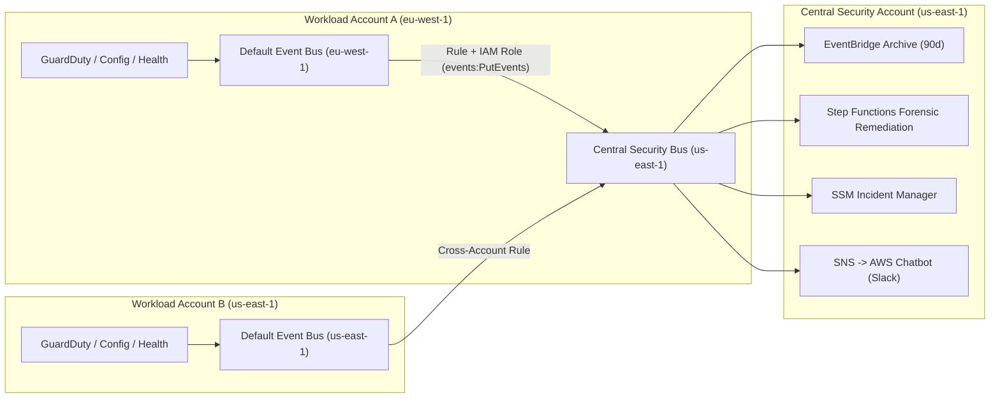
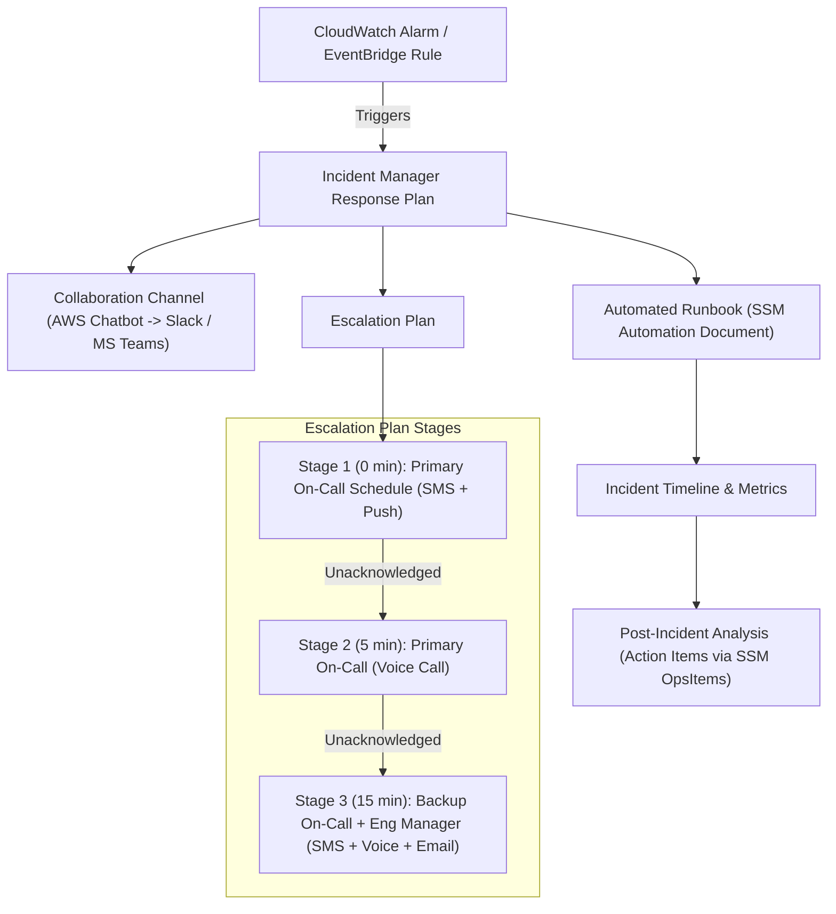
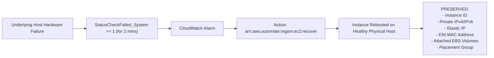
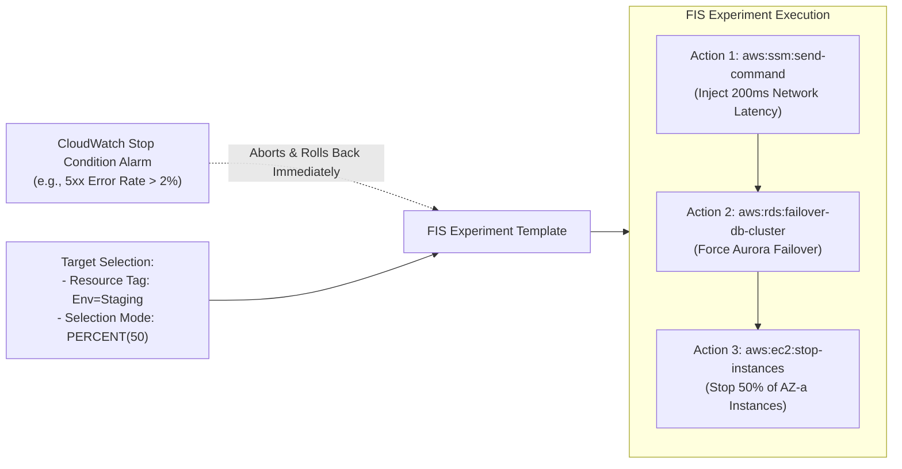

# Domain 5: Incident and Event Response — Master-Level Study Guide (DOP-C02)

> **Exam Weight:** 14% of the AWS Certified DevOps Engineer – Professional (DOP-C02) exam.
> **Core Focus:** Event-driven architectures at multi-account/multi-region scale, automated security & operational remediation workflows, incident response orchestration, chaos engineering, and proactive hardware/capacity event handling.

---

## 1. Amazon EventBridge Deep Dive

Amazon EventBridge is the serverless event router at the heart of AWS incident and event response architectures. On the DOP-C02 exam, EventBridge is tested not as a simple cron scheduler, but as a multi-account, multi-region event mesh capable of content-based filtering, payload transformation, replay recovery, and resilient delivery.

### 1.1 Event Buses: Default, Custom, and Partner

| Event Bus Type | Source of Events | Common DOP-C02 Use Cases | Resource Policy Support | Archive & Replay |
| :--- | :--- | :--- | :--- | :--- |
| **Default Event Bus** | AWS Services (`aws.*` namespaces: EC2, GuardDuty, Config, Health, CloudTrail) + Custom `PutEvents` | Catching native AWS state changes, CloudTrail API calls (`AWS API Call via CloudTrail`), GuardDuty findings | Yes (Cross-account `PutEvents` and rule management) | Yes |
| **Custom Event Bus** | Custom applications (`PutEvents`), cross-account/cross-region forwarded events, EventBridge Pipes | Domain-driven microservices decoupling, centralized Organization-wide Security/Operations Event Bus | Yes (`aws:PrincipalOrgID` conditions) | Yes |
| **Partner Event Bus** | SaaS Partner integrations (Datadog, PagerDuty, Auth0, Zendesk, CrowdStrike, GitHub, Stripe) | Triggering AWS SSM Automation or Step Functions directly from Datadog APM alerts or Auth0 suspicious login events | Yes | Yes |

> **Exam Nuance — CloudTrail vs. Native Service Events:**
> Many AWS services emit **high-speed native state-change events** directly to the Default Event Bus (e.g., `EC2 Instance State-change Notification`, `ECS Task State Change`, `CodePipeline Pipeline Execution State Change`). If a service does *not* emit a native event for a specific mutation (e.g., `AuthorizeSecurityGroupIngress` or `CreateAccessKey`), EventBridge can still match it with `"detail-type": ["AWS API Call via CloudTrail"]`, **provided a CloudTrail trail with Management Events (Write/Read) is enabled in that Region**. Read-only API calls (like `Get*`, `Describe*`, `List*`) are *only* delivered to EventBridge if recorded by an active CloudTrail trail.

---

### 1.2 Cross-Account & Cross-Region Event Mesh Architecture

In an enterprise AWS Organization, security and operations teams aggregate events from hundreds of workload accounts and multiple regions into a **Central Security/Operations Account** (`Account 999988887777`, `us-east-1`).



#### Resource-Based Policy on the Central Event Bus
Instead of enumerating 500 member account IDs, attach a resource-based policy to the central custom event bus (`arn:aws:events:us-east-1:999988887777:event-bus/central-secops-bus`) using `aws:PrincipalOrgID`:

```json
{
  "Version": "2012-10-17",
  "Statement": [
    {
      "Sid": "AllowEntireOrganizationToPutEvents",
      "Effect": "Allow",
      "Principal": "*",
      "Action": "events:PutEvents",
      "Resource": "arn:aws:events:us-east-1:999988887777:event-bus/central-secops-bus",
      "Condition": {
        "StringEquals": {
          "aws:PrincipalOrgID": "o-a1b2c3d4e5"
        }
      }
    }
  ]
}
```

#### Critical Cross-Account / Cross-Region Routing Rules
1. **Spoke Account Execution Role:** When an EventBridge rule in Account A forwards an event to an Event Bus in Account B (or another Region), the rule in Account A requires an IAM Execution Role with `events:PutEvents` permission on the destination Event Bus ARN.
2. **Preventing Infinite Event Loops (Single Bus-to-Bus Hop Limit):**
   - **EventBridge does not support chaining more than one bus-to-bus hop** (`Bus 1 -> Bus 2 -> Bus 3` is blocked; events received from one event bus cannot match a rule on the receiving bus whose target is *another* event bus!).
   - Therefore, spoke accounts in `eu-west-1` must route **directly** from their Default Event Bus in `eu-west-1` to the Central Account's Event Bus in `us-east-1` in a **single hop** (cross-account AND cross-region in one rule is natively supported!), or invoke a regional target (such as Lambda/SNS/Step Functions) on the regional central bus.

---

### 1.3 Advanced Event Pattern Matching

EventBridge evaluates event patterns against incoming JSON payloads in $O(1)$ time relative to the number of rules using an internal state-machine matcher. Understanding every advanced operator is mandatory for DOP-C02.

#### Complete Reference of Content-Based Filtering Operators

| Operator | Syntax Example | Behavior & Exam Notes |
| :--- | :--- | :--- |
| **Exact Match (OR array)** | `"state": ["stopping", "stopped"]` | Matches if `"state"` equals `"stopping"` OR `"stopped"`. Multiple fields at the same level are combined with `AND`. |
| **Prefix Matching** | `{"prefix": "arn:aws:s3:::prod-"}` | Matches strings starting with `"arn:aws:s3:::prod-"`. Supports `{"prefix": {"equals-ignore-case": "prod-"}}`. |
| **Suffix Matching** | `{"suffix": ".png"}` | Matches strings ending with `".png"`. Supports `{"suffix": {"equals-ignore-case": ".png"}}`. |
| **Anything-But** | `{"anything-but": ["STOPPED", "TERMINATED"]}` | Matches anything *except* the listed values. Can wrap `prefix`, `suffix`, `equals-ignore-case`, or `wildcard`: `{"anything-but": {"prefix": "init-"}}`. |
| **Numeric Matching** | `{"numeric": [">=", 7.0, "<=", 10.0]}` | Half-open or closed numeric ranges (`>`, `>=`, `=`, `<`, `<=`). Essential for GuardDuty `detail.severity`. |
| **Exists Matching** | `{"exists": false}` | `"exists": false` matches when the leaf key is completely absent from the JSON payload. `"exists": true` matches only if the key is present as a leaf node. |
| **IP / CIDR Matching** | `{"cidr": "10.0.0.0/8"}` | Matches IPv4 (`10.x.x.x`) or IPv6 addresses falling within the CIDR block (e.g., `detail.sourceIPAddress`). |
| **Equals-Ignore-Case** | `{"equals-ignore-case": "root"}` | Case-insensitive string comparison. |
| **Wildcard Matching** | `{"wildcard": "*/prod/*/config.json"}` | Glob-style matching with `*`. Consecutive `*` (`**`) are invalid. |
| **Complex `$or` Matching** | `"$or": [ { "fieldA": [...] }, { "fieldB": [...] } ]` | Evaluates logical OR across *different* fields in the event structure. |

#### Master JSON Example: Combining All Advanced Operators
This single EventBridge pattern matches GuardDuty findings or CloudTrail events where:
- The event comes from `aws.guardduty` or `aws.ec2`
- It is a live event (not an EventBridge Replay: `"replay-name": [{"exists": false}]`)
- Resource environment tag is NOT `sandbox-*`
- S3 object key (if present) ends with `.pem` or `.key`, OR GuardDuty severity is between `7.0` and `10.0`, OR the source IP is outside `10.0.0.0/8`:

```json
{
  "source": ["aws.guardduty", "aws.s3"],
  "replay-name": [{ "exists": false }],
  "detail": {
    "resource": {
      "instanceDetails": {
        "tags": {
          "value": [
            { "anything-but": { "prefix": "sandbox-" } }
          ]
        }
      }
    },
    "$or": [
      {
        "severity": [
          { "numeric": [">=", 7.0, "<=", 10.0] }
        ]
      },
      {
        "object": {
          "key": [
            { "suffix": { "equals-ignore-case": ".pem" } },
            { "wildcard": "*/secrets/*.json" }
          ]
        }
      },
      {
        "service": {
          "action": {
            "networkConnectionAction": {
              "remoteIpDetails": {
                "ipAddressV4": [
                  { "anything-but": { "cidr": "10.0.0.0/8" } }
                ]
              }
            }
          }
        }
      }
    ]
  }
}
```

---

### 1.4 Input Transformer (`InputPathsMap` & `InputTemplate`)

**Exam Trap:** When an exam question asks for the *most operationally efficient* or *lowest maintenance* way to send a customized, human-readable alert to Amazon SNS (email/SMS) or pass specific extracted parameters (`InstanceId`, `AccountId`, `FindingType`) to an **SSM Automation Document** or **Step Functions State Machine**, **DO NOT write a glue AWS Lambda function**. Use the **EventBridge Input Transformer**.

- **`InputPathsMap`**: Up to **100 key-value pairs** mapping JSONPath expressions (`$.detail.instance-id`) to variable names (`instance`). Variable names cannot start with `aws.`.
- **`InputTemplate`**: Either a valid JSON object (for SSM Automation, Step Functions, Lambda, ECS) or a quoted string with `\n` newlines (for SNS human-readable notifications).

#### Example A: Human-Readable SNS / Email Alert via Input Transformer
**`InputPathsMap`:**
```json
{
  "account": "$.account",
  "region": "$.region",
  "time": "$.time",
  "instanceId": "$.detail.resource.instanceDetails.instanceId",
  "findingType": "$.detail.type",
  "severity": "$.detail.severity"
}
```

**`InputTemplate` (String format for SNS):**
```text
"CRITICAL SECURITY ALERT: GuardDuty detected finding <findingType> (Severity: <severity>) on EC2 Instance <instanceId> in Account <account> (<region>) at <time>. Automated forensic isolation has been initiated."
```

#### Example B: Structured JSON Payload for SSM Automation (`StartAutomationExecution`)
When EventBridge targets an SSM Automation Document directly, SSM expects parameter values as **arrays of strings** (`["i-0123456789abcdef0"]`):

**`InputPathsMap`:**
```json
{
  "instanceId": "$.detail.instance-id"
}
```

**`InputTemplate` (JSON format for SSM Automation parameters):**
```json
{
  "InstanceId": ["<instanceId>"],
  "AutomationAssumeRole": ["arn:aws:iam::111122223333:role/SSMRemediationExecutionRole"]
}
```

---

### 1.5 EventBridge Archive & Replay

When a downstream microservice, Lambda function, or database experiences a bug or outage (e.g., a faulty code deployment drops order events for 3 hours, or DynamoDB throttles heavily), **EventBridge Archive & Replay** provides native recovery without custom S3 event logging.

1. **Event Archive:**
   - Configured per Event Bus (Default, Custom, or Partner).
   - Can archive **all events** on the bus or use an **Event Pattern filter** to archive only critical events (reducing storage cost).
   - Configurable retention period (`1` to `N` days, or **indefinite** `0`).
   - Automatically managed under a system rule (`Events-Archive-<ArchiveName>`).
2. **Event Replay:**
   - Specifies the source Archive, a **Start Time** and **End Time** window, and the specific **Rules** on the source Event Bus to replay into (you do not have to replay to *all* rules on the bus—you can select only the broken downstream consumer's rule!).
   - **Critical Replay Loop Prevention & Filtering:** When EventBridge replays an event, it injects a top-level field `"replay-name": "<name-of-replay>"` into the JSON event.
   - Standard archive rules automatically exclude events containing `"replay-name"` so replayed events are not re-archived endlessly.
   - If you want a production notification rule to ONLY process live events (never replays), add:
     ```json
     {
       "replay-name": [{ "exists": false }]
     }
     ```
   - Conversely, if you want a temporary recovery rule to ONLY process replayed events:
     ```json
     {
       "replay-name": [{ "exists": true }]
     }
     ```

---

### 1.6 EventBridge Global Endpoints (Multi-Region Resiliency)

For mission-critical custom events (`PutEvents`) requiring cross-region disaster recovery:
- **Global Endpoint Architecture:** Wraps a **Primary Event Bus** (e.g., `us-east-1`) and a **Secondary Event Bus** (e.g., `us-west-2`) with the **exact same bus name**.
- **Health Check & Failover Trigger:** Uses an **Amazon Route 53 Health Check** backed by a **CloudWatch Alarm** monitoring the EventBridge metric `IngestionToInvocationStartLatency` (in the primary region).
  - If `IngestionToInvocationStartLatency` breaches the threshold (e.g., `> 30,000 ms` for 2 consecutive minutes due to regional EventBridge degradation), the CloudWatch Alarm enters `ALARM`, the Route 53 Health Check turns unhealthy, and publishers using the Global Endpoint ID (`endpointId: "abc123xyz.veo"`) automatically route `PutEvents` calls directly to the Secondary Region (`us-west-2`) within minutes!
- **Event Replication:** Enabling **Replication** (`ReplicationConfig: State: ENABLED`) on the Global Endpoint creates managed cross-region rules that replicate events between the Primary and Secondary buses. Combined with an **Archive** in the Primary Region, once the Primary Region recovers, you can replay missed events or process them directly in the Secondary Region.

#### CloudFormation Blueprint: EventBridge Global Endpoint with Route 53 Health Check
```yaml
Resources:
  EventLatencyAlarm:
    Type: AWS::CloudWatch::Alarm
    Properties:
      AlarmName: EventBridge-PrimaryRegion-Latency-High
      Namespace: AWS/Events
      MetricName: IngestionToInvocationStartLatency
      Statistic: Average
      Period: 60
      EvaluationPeriods: 2
      DatapointsToAlarm: 2
      Threshold: 30000
      ComparisonOperator: GreaterThanThreshold
      TreatMissingData: notBreaching

  EventBridgeR53HealthCheck:
    Type: AWS::Route53::HealthCheck
    Properties:
      HealthCheckConfig:
        Type: CLOUDWATCH_METRIC
        InsufficientDataHealthStatus: Healthy
        AlarmIdentifier:
          Name: !Ref EventLatencyAlarm
          Region: us-east-1

  GlobalEventEndpoint:
    Type: AWS::Events::Endpoint
    Properties:
      Name: prod-orders-global-endpoint
      RoutingConfig:
        FailoverConfig:
          Primary:
            HealthCheck: !GetAtt EventBridgeR53HealthCheck.HealthCheckId
          Secondary:
            Route: us-west-2
      ReplicationConfig:
        State: ENABLED
      RoleArn: !GetAtt GlobalEndpointReplicationRole.Arn
      EventBuses:
        - EventBusArn: arn:aws:events:us-east-1:111122223333:event-bus/orders-bus
        - EventBusArn: arn:aws:events:us-west-2:111122223333:event-bus/orders-bus
```

---

### 1.7 EventBridge Pipes vs. Event Buses

| Feature | EventBridge Event Bus | EventBridge Pipes |
| :--- | :--- | :--- |
| **Topology** | **Many-to-Many** event router (1 event -> up to 300 rules, 5 targets per rule) | **Point-to-Point** integration (1 streaming/queue source -> 1 target) |
| **Supported Sources** | `PutEvents` API, AWS Services, SaaS Partners | **SQS, Kinesis Data Streams, DynamoDB Streams, Amazon MQ, Managed Streaming for Apache Kafka (MSK), Self-Managed Kafka** |
| **Ordering & Concurrency** | Unordered, high-throughput asynchronous delivery | **Strict ordering preserved** per shard/partition or FIFO MessageGroupId |
| **Pipeline Stages** | Event Bus -> Rule Pattern -> Input Transformer -> Target | **Source** -> **Filtering** -> **Enrichment** (Lambda, Step Functions Express, API Gateway, API Destination) -> **Target** |

> **DOP-C02 Best Practice:** Whenever a scenario involves reading from **DynamoDB Streams, Kinesis, or SQS**, filtering out 90% of records, enriching the remaining 10% via an external REST API or lookup table, and sending them to Step Functions/EventBridge/Kinesis Firehose—choose **EventBridge Pipes** instead of writing and maintaining a custom polling Lambda function.

---

### 1.8 API Destinations, Dead-Letter Queues (DLQs), & Retry Policies

- **API Destinations:** Allow EventBridge (Buses or Pipes) to invoke any external HTTP/HTTPS REST endpoint (e.g., ServiceNow, Jira, PagerDuty, custom webhook) as a native target.
  - Uses an **EventBridge Connection** resource to handle authentication (**OAuth Client Credentials, Basic Auth, or API Key**).
  - EventBridge automatically provisions and stores the secret credentials inside **AWS Secrets Manager** (encrypted with KMS) and handles token refresh transparently.
  - Supports configurable **invocation rate limits** (`InvocationRateLimitPerSecond`: `1` to `300` requests/sec) to prevent overwhelming external third-party APIs; excess events are queued and retried within the retry window.
- **Retry Policy & Dead-Letter Queues (DLQ):**
  - By default, if a target (Lambda, Step Functions, API Destination, SSM) fails or throttles, EventBridge retries with exponential backoff and jitter for up to **24 hours** (`86400` seconds) and up to **185 times**.
  - You can customize per-target retry limits: `MaximumEventAgeInSeconds` (`60` to `86400` seconds) and `MaximumRetryAttempts` (`0` to `185`).
  - Attach an **Amazon SQS Standard Queue** as a **Dead-Letter Queue (DLQ)** on the EventBridge Target configuration. Any event that exhausts its retry policy or hits a non-retryable error (e.g., `AccessDeniedException` on target IAM role) is written to the SQS DLQ with error metadata (`ERROR_CODE`, `ERROR_MESSAGE`, `RULE_ARN`, `TARGET_ARN`) in SQS message attributes.

---

## 2. AWS Systems Manager Incident Manager & AWS Chatbot

### 2.1 Incident Manager Architecture

**AWS Systems Manager Incident Manager** automates incident response lifecycle management from detection to post-incident analysis.



1. **Contacts & Contact Channels:**
   - Defines individual responders (`Contact`) with up to three verification-required communication channels: **SMS, Voice Call, and Email** (plus AWS Chatbot push).
   - Contact engagement rules define sequential delays (e.g., Email at `0 min`, SMS at `2 min`, Voice at `5 min`) until the responder enters the 6-digit acknowledgment code.
2. **On-Call Schedules:**
   - Rotating shifts (daily, weekly, custom handoff times, time zones) with override support for vacations.
3. **Escalation Plans:**
   - Composed of sequential **Stages** with configurable durations (`1` to `60` minutes).
   - Each stage engages one or more Contacts or On-Call Schedules.
   - Enable **"Stop progression to next stage if any contact acknowledges the incident"** (`StopIfAcknowledged`) so Stage 2 (paging leadership) only fires if Stage 1 fails to acknowledge.
4. **Response Plans:**
   - Ties together the **Incident Template** (title, impact level `1-Critical` to `5-No Impact`, dedupe string), **Chat Channel** (AWS Chatbot), **Engagements** (Contacts/Escalation Plans), and **Runbook** (SSM Automation Document executed under an IAM role immediately when the incident starts).
   - **Deduplication String (`dedupeString`):** Prevents alert storms from creating 50 separate incidents when the same CloudWatch Alarm flaps or multiple related EventBridge events fire simultaneously.
5. **Post-Incident Analysis:**
   - Reconstructs the incident timeline automatically from CloudWatch metrics, SSM Automation step completions, and responder chat updates.
   - Generates structured root-cause analysis templates (Five Whys, Mitigation, Detection gaps) and converts remediation tasks directly into trackable **SSM OpsCenter OpsItems**.

---

### 2.2 AWS Chatbot (ChatOps) Security & Remediation

**AWS Chatbot** bridges Amazon SNS / EventBridge with **Slack** and **Microsoft Teams** channels for interactive ChatOps.

- **Architecture:** `CloudWatch Alarm / EventBridge / Security Hub / Incident Manager -> Amazon SNS Topic -> AWS Chatbot -> Slack / MS Teams Channel`.
- **Two-Layer Permission Model (Heavily Tested on DOP-C02):**
  1. **Channel IAM Role:** An IAM Role assumed by AWS Chatbot when users run CLI commands (`@aws ...`) in the channel (or **User-Level Roles** where each Slack user maps to their own IAM role, requiring explicit user identity mapping).
  2. **Channel Guardrail Policies:** Managed IAM Policies configured on the Chatbot channel configuration that establish the **strict maximum permissions ceiling** (similar to an IAM Permissions Boundary) for that chat channel.
     - *Rule:* Effective permissions = $(\text{Channel/User IAM Role}) \cap (\text{Channel Guardrail Policies})$. Even if the Channel IAM Role has `AdministratorAccess`, if the Channel Guardrail Policy is set to `ReadOnlyAccess`, no user in Slack can run `@aws ec2 stop-instances`!
- **Interactive Remediation from Slack/Teams:**
  - Responders can run read-only diagnostics directly in chat:
    - `@aws cloudwatch describe-alarms --state-value ALARM`
    - `@aws logs start-query ...`
    - `@aws ecs describe-services --cluster prod ...`
  - Responders can trigger pre-approved **SSM Automation Runbooks** from chat buttons or CLI syntax:
    - `@aws ssm start-automation-execution --document-name Prod-Failover-ReadReplica --parameters InstanceId=db-prod-01`
  - Mutating CLI commands (`ec2:TerminateInstances`, `iam:*`) are either blocked by default or require explicit confirmation prompts in the Slack thread.

---

## 3. AWS Systems Manager Automation & Multi-Account Remediation

### 3.1 SSM Automation Document Schema (v0.3 YAML/JSON)

Unlike SSM Run Command (`schemaVersion: "2.2"`), which executes shell/PowerShell commands *inside* a target EC2 instance via the SSM Agent, **SSM Automation (`schemaVersion: "0.3"`)** runs **control-plane orchestration** via AWS APIs, Python/PowerShell scripts on managed serverless workers, and child Run Command invocations.

#### Core SSM Automation Action Types (Exam Must-Knows)

| Action Type | Purpose & Execution Context | Key Inputs |
| :--- | :--- | :--- |
| `aws:executeAwsApi` | Calls any boto3 AWS SDK API directly (e.g., `ec2:CreateSnapshot`, `s3:PutPublicAccessBlock`, `iam:UpdateAccessKey`). | `Service`, `Api`, API parameters, `Outputs` (JSONPath selector) |
| `aws:executeScript` | Runs inline or attached **Python (3.8–3.11)** or **PowerShell** code in a temporary SSM-managed sandbox (up to **600 seconds** per step). | `Runtime`, `Handler`, `Script`, `InputPayload`, `Outputs` |
| `aws:runCommand` | Invokes an SSM Run Command document (`AWS-RunShellScript`) on target EC2/on-prem managed instances via SSM Agent. | `DocumentName`, `InstanceIds`, `Parameters` |
| `aws:runInstances` | Launches temporary EC2 instances (e.g., golden AMI baking or forensic analysis bastion). | `ImageId`, `InstanceType`, `IamInstanceProfileName` |
| `aws:waitForAwsResourceProperty` | Polls an AWS API until a resource reaches a desired state (e.g., waiting for an EBS Snapshot to reach `completed` or RDS status `available`) without wasting compute! | `Service`, `Api`, `PropertySelector`, `DesiredValues`, `TimeoutSeconds` |
| `aws:assertAwsResourceProperty` | Verifies a resource property matches expected state immediately; fails or branches if not matched. | `Service`, `Api`, `PropertySelector`, `DesiredValues` |
| `aws:approve` | **Pauses the Automation execution** (up to 7 days), sends an SNS notification to `Approvers`, and waits for an authorized IAM principal to call `SendAutomationSignal` (`Approve` or `Reject`). | `Approvers`, `NotificationArn`, `MinRequiredApprovals`, `Message` |
| `aws:branch` | Conditional `if / elif / else` branching to different steps based on step outputs or input parameters (`StringEquals`, `NumericGreater`, `BooleanEquals`). | `Choices`, `Default` |
| `aws:sleep` | Pauses execution for a fixed ISO-8601 duration (`PT5M` for 5 minutes). | `Duration` |
| `aws:changeInstanceState` | Safely transitions EC2 instances (`running`, `stopped`, `terminated`). | `InstanceIds`, `DesiredState` |
| `aws:createImage` | Creates an AMI from an EC2 instance and automatically waits for availability. | `InstanceId`, `ImageName`, `NoReboot` |

#### Complete SSM Automation v0.3 Reference YAML Demonstrating All Core Actions
```yaml
schemaVersion: '0.3'
description: 'Master Reference SSM Automation Runbook: Assert -> Branch -> Approve -> ExecuteApi -> Wait -> ExecuteScript'
assumeRole: '{{ AutomationAssumeRole }}'
parameters:
  InstanceId:
    type: String
    description: 'Target EC2 Instance ID'
  Environment:
    type: String
    default: 'prod'
  ApproverRoleArn:
    type: String
    description: 'IAM Role ARN allowed to approve production remediation'
  NotificationTopicArn:
    type: String
  AutomationAssumeRole:
    type: String
mainSteps:
  - name: CheckInstanceIsRunning
    action: 'aws:assertAwsResourceProperty'
    inputs:
      Service: ec2
      Api: DescribeInstances
      InstanceIds:
        - '{{ InstanceId }}'
      PropertySelector: '$.Reservations[0].Instances[0].State.Name'
      DesiredValues:
        - running
    onFailure: Abort

  - name: BranchByEnvironment
    action: 'aws:branch'
    inputs:
      Choices:
        - NextStep: RequireManualApprovalForProd
          Variable: '{{ Environment }}'
          StringEquals: 'prod'
      Default: CreateVolumeSnapshot

  - name: RequireManualApprovalForProd
    action: 'aws:approve'
    timeoutSeconds: 3600
    inputs:
      NotificationArn: '{{ NotificationTopicArn }}'
      Message: 'Production instance {{ InstanceId }} requires approval before snapshot and isolation.'
      MinRequiredApprovals: 1
      Approvers:
        - '{{ ApproverRoleArn }}'
    nextStep: CreateVolumeSnapshot

  - name: CreateVolumeSnapshot
    action: 'aws:executeAwsApi'
    inputs:
      Service: ec2
      Api: DescribeInstances
      InstanceIds:
        - '{{ InstanceId }}'
    outputs:
      - Name: RootVolumeId
        Selector: '$.Reservations[0].Instances[0].BlockDeviceMappings[0].Ebs.VolumeId'
        Type: String
    nextStep: TriggerEbsSnapshot

  - name: TriggerEbsSnapshot
    action: 'aws:executeAwsApi'
    inputs:
      Service: ec2
      Api: CreateSnapshot
      VolumeId: '{{ CreateVolumeSnapshot.RootVolumeId }}'
      Description: 'Automated forensic snapshot for {{ InstanceId }}'
    outputs:
      - Name: SnapshotId
        Selector: '$.SnapshotId'
        Type: String
    nextStep: WaitForSnapshotCompletion

  - name: WaitForSnapshotCompletion
    action: 'aws:waitForAwsResourceProperty'
    timeoutSeconds: 1800
    inputs:
      Service: ec2
      Api: DescribeSnapshots
      SnapshotIds:
        - '{{ TriggerEbsSnapshot.SnapshotId }}'
      PropertySelector: '$.Snapshots[0].State'
      DesiredValues:
        - completed
    nextStep: PostRemediationAuditScript

  - name: PostRemediationAuditScript
    action: 'aws:executeScript'
    inputs:
      Runtime: python3.11
      Handler: script_handler
      InputPayload:
        InstanceId: '{{ InstanceId }}'
        SnapshotId: '{{ TriggerEbsSnapshot.SnapshotId }}'
      Script: |-
        import boto3
        def script_handler(events, context):
            ec2 = boto3.client('ec2')
            ec2.create_tags(
                Resources=[events['InstanceId'], events['SnapshotId']],
                Tags=[{'Key': 'ForensicSnapshot', 'Value': events['SnapshotId']}]
            )
            return {'Status': 'TAGGED_SUCCESSFULLY'}
    isEnd: true
```

---

### 3.2 Multi-Account & Multi-Region Execution (`TargetLocations`)

SSM Automation can execute a single runbook across **multiple AWS Accounts (or Organizational Units)** and **multiple AWS Regions** concurrently from a Central Management/Delegated Admin Account:

1. **IAM Role Requirements:**
   - **Management/Administration Account:** Contains the **Administration Role** (`AWS-SystemsManager-AutomationAdministrationRole`), which has `sts:AssumeRole` permission on the execution roles in target accounts.
   - **Target Member Accounts:** Each contains an **Execution Role** (`AWS-SystemsManager-AutomationExecutionRole`, deployed via CloudFormation StackSets) trusting the Administration Role in the central account.
2. **Execution Controls:**
   - `TargetLocations`: Defines the list of `Accounts` (or `TargetOrganizationalUnits`), `Regions` (e.g., `["us-east-1", "eu-west-1"]`), and `ExecutionRoleName`.
   - `TargetParameterName` & `Targets`: Identifies which parameter represents the target resource (e.g., `InstanceId` matched by Tag `PatchGroup=Prod`) and fans out across matching resources in each account/region.
   - **`MaxConcurrency`**: Number (`10`) or percentage (`"20%"`) of accounts/targets remediated simultaneously (enables canary rollouts!).
   - **`MaxErrors`**: Number (`1`) or percentage (`"5%"`) of failures allowed before halting the entire multi-account wave.

---

## 4. Automated Security & Operational Remediation Workflows

### 4.1 Pattern A: Compromised EC2 Instance Forensic Isolation (Step Functions + EventBridge + GuardDuty)

**Exam Critical Distinction:** When an EC2 instance is compromised (e.g., GuardDuty detects `CryptoCurrency:EC2/BitcoinTool.B!DNS` or `UnauthorizedAccess:EC2/TorClient`), **NEVER immediately terminate or stop the EC2 instance** if the requirement mentions **forensic analysis, memory capture, or preserving volatile state**. Stopping or terminating an EC2 instance wipes volatile RAM and ephemeral instance-store volumes!

```mermaid
sequenceDiagram
    autonumber
    participant GD as Amazon GuardDuty
    participant EB as Amazon EventBridge
    participant SFN as AWS Step Functions
    participant ASG as Auto Scaling / EC2 API
    participant SSM as SSM Run Command
    participant IAM as AWS IAM / S3

    GD->>EB: Emit Finding (Severity >= 7.0)
    EB->>SFN: Trigger Forensic Isolation State Machine
    SFN->>ASG: 1. Enable DisableApiTermination=true & DetachInstances (ShouldDecrementDesiredCapacity=false)
    Note over ASG: ASG immediately launches healthy replacement;<br/>compromised instance stays running out-of-service!
    SFN->>ASG: 2. Deregister Targets from ALB & Replace SGs with Quarantine-SG (0 Inbound / VPC Endpoint Egress Only)
    SFN->>IAM: 3. Attach AWSRevokeOlderSessions inline policy to Instance Profile Role
    SFN->>SSM: 4. Run Forensics Capture (RAM dump via LiME + netstat/ps -> S3 Object Lock via VPC Endpoint)
    SFN->>ASG: 5. Create EBS Snapshots (tagged ForensicEvidence=true) & Share with Security Account
    SFN->>ASG: 6. Remove All Egress from Quarantine-SG & Hibernate/Stop Instance
```

#### Step-by-Step Forensic Workflow Breakdown
1. **Detection & Filtering:**
   - GuardDuty generates a finding (`detail.severity >= 7.0`, `detail.resource.resourceType == "Instance"`).
   - EventBridge rule invokes an **AWS Step Functions Standard Workflow** (chosen over Express because memory dumps and EBS snapshots can take longer than 5 minutes and require exactly-once execution auditing).
2. **Prevent Termination & Detach from Auto Scaling Group:**
   - Call `ec2:ModifyInstanceAttribute` to set `DisableApiTermination: { Value: true }` and `InstanceInitiatedShutdownBehavior: { Value: "stop" }`.
   - Check if the instance belongs to an Auto Scaling Group (`autoscaling:DescribeAutoScalingInstances`).
   - If in an ASG, call **`autoscaling:DetachInstances` with `ShouldDecrementDesiredCapacity: false`**.
     - *Why `ShouldDecrementDesiredCapacity: false`?* Detaching the compromised instance removes it from the ASG and connected Elastic Load Balancers (stopping production traffic to it), while `ShouldDecrementDesiredCapacity: false` instructs the ASG to **immediately launch a clean replacement instance** to maintain production capacity!
3. **Network Containment (Quarantine Security Group & NACL):**
   - Call `ec2:ModifyInstanceAttribute` (`Groups: ["sg-quarantine000000"]`) to replace all attached Security Groups with a dedicated **Quarantine Security Group** that has **zero inbound rules** and **only outbound HTTPS (`443`) to the VPC Interface Endpoints for SSM (`com.amazonaws.<region>.ssm`, `ssmmessages`, `ec2messages`) and S3 Gateway Endpoint** (so SSM Agent can still execute the memory dump and upload to the forensics S3 bucket without giving the attacker internet access!).
   - Once volatile memory capture is complete, swap to a strict Zero-Egress Quarantine Security Group (zero inbound, zero outbound rules).
   - Note: Removing an allow rule from a Security Group immediately drops existing tracked connections. To block a specific malicious external IP across the entire subnet immediately at the stateless layer, add an explicit `DENY` rule to the subnet's **Network ACL (NACL)**.
4. **Revoke Active IAM Role Temporary Credentials:**
   - Even if isolated, an attacker may have already exfiltrated the temporary STS credentials (`AccessKeyId`, `SecretAccessKey`, `SessionToken`) from the Instance Metadata Service (`http://169.254.169.254/latest/meta-data/iam/security-credentials/<role>`).
   - Attach the inline policy `AWSRevokeOlderSessions` to the EC2 Instance Profile's IAM Role to invalidate all STS tokens issued before the exact timestamp of the isolation:
     ```json
     {
       "Version": "2012-10-17",
       "Statement": [
         {
           "Effect": "Deny",
           "Action": "*",
           "Resource": "*",
           "Condition": {
             "DateLessThan": {
               "aws:TokenIssueTime": "2026-10-16T19:20:00Z"
             }
           }
         }
       ]
     }
     ```
5. **Volatile Memory Capture & Disk Snapshots:**
   - Trigger **SSM Run Command** on the quarantined instance to dump volatile RAM (using `LiME` / `avml`), active network sockets (`ss -tulpan`), running processes (`ps auxf`), and open files (`lsof`), streaming the encrypted artifact directly to an **S3 bucket with S3 Object Lock (Compliance Mode)** for chain-of-custody legal preservation.
   - Call `ec2:CreateSnapshots` across all attached EBS volumes, tagging snapshots with `CaseId`, `InstanceId`, and `ForensicEvidence=true`.

---

### 4.2 Pattern B: Compromised IAM Access Key / Root Activity Auto-Remediation

1. **Trigger Sources:**
   - **GuardDuty:** `UnauthorizedAccess:IAMUser/InstanceCredentialExfiltration.OutsideAWS`, `Recon:IAMUser/MaliciousIPCaller`, `Policy:IAMUser/RootCredentialUsage`.
   - **AWS Health (`aws.health`):** `AWS_RISK_CREDENTIALS_EXPOSED` (triggered automatically when AWS scans public GitHub repositories and detects a leaked AWS IAM Access Key!).
   - **CloudTrail via EventBridge:** Root user login (`detail.userIdentity.type == "Root"`) or `CreateAccessKey` / `AttachUserPolicy`.
2. **Automated Remediation Steps:**
   - **Step 1:** Immediately deactivate (or delete) the exposed IAM Access Key via `iam:UpdateAccessKey` (`Status: "Inactive"`). Deactivating first is preferred over deleting during initial triage so investigators can correlate the `AccessKeyId` in CloudTrail logs and allow quick rollback if a false positive occurred.
   - **Step 2:** Attach an explicit `Deny *` inline policy (`AWSCompromisedKeyQuarantinePolicy` or `DateLessThan aws:TokenIssueTime`) to the IAM User to neutralize any temporary `sts:GetSessionToken` or `sts:AssumeRole` sessions spawned by the leaked key!
   - **Step 3:** Query CloudTrail (`cloudtrail:LookupEvents` by `AccessKeyId` or `Username`) over the past 24 hours, export the audit log to S3, and open a High-Severity incident in SSM Incident Manager.

---

### 4.3 Pattern C: Unintended Public S3 Bucket or Open Security Group Auto-Remediation (AWS Config vs. EventBridge)

On the DOP-C02 exam, you must know when to use **AWS Config Auto-Remediation** versus **EventBridge + CloudTrail**:

| Dimension | AWS Config + SSM Automation | EventBridge (CloudTrail API Event) + Step Functions/Lambda |
| :--- | :--- | :--- |
| **Detection Speed** | Near real-time to a few minutes (Configuration Item recorded -> Config Rule evaluated -> Auto-Remediation triggered) | **Sub-second / Real-time** (triggers immediately on `AuthorizeSecurityGroupIngress` or `PutBucketAcl` API call) |
| **Historical Compliance & Drift Audit** | **Yes** — Maintains a complete compliance timeline, dashboard, Conformance Pack score, and configuration history | **No** — EventBridge is stateless; does not provide compliance posture dashboards |
| **Periodic Re-evaluation** | **Yes** — Catches resources that existed before the rule was created | **No** — Only catches events occurring *after* the rule is enabled |
| **Built-in Retry & Manual Toggle** | Supports Automatic or Manual remediation with `MaximumAutomaticAttempts` (`1–25`) and `RetryAttemptSeconds` | Handled via EventBridge Retry Policy / Step Functions |

#### Standard AWS Config Managed Rules & Paired SSM Automation Runbooks
- **Public S3 Bucket:**
  - Config Rules: `s3-bucket-public-read-prohibited`, `s3-bucket-public-write-prohibited`, `s3-bucket-level-public-access-prohibited`.
  - SSM Automation Document: `AWS-DisableS3BucketPublicReadWrite` or `AWSConfigRemediation-ConfigureS3BucketPublicAccessBlock` (sets `BlockPublicAcls=true`, `IgnorePublicAcls=true`, `BlockPublicPolicy=true`, `RestrictPublicBuckets=true`).
- **Security Group Open Port 22 / 3389 (`0.0.0.0/0`):**
  - Config Rule: `restricted-ssh` (`incoming-ssh-disabled`) or `restricted-common-ports`.
  - SSM Automation Document: `AWS-DisableIncomingSSHOnPort22` or `AWSConfigRemediation-RemoveUnrestrictedSourceIngressRules` (revokes offending ingress rules on the Security Group).

---

## 5. AWS Health, EC2 Auto Recovery & Spot Interruption Handling

### 5.1 AWS Health API & Organizational View

- **AWS Health (`aws.health`) Events:**
  - Divided into **Account-Specific Events** (affecting your specific EC2 instances, EBS volumes, RDS databases) and **Public Service Events** (regional service outages).
  - Categories: `issue` (unplanned operational degradation), `accountNotification` (security/exposed credentials, billing, deprecations), and `scheduledChange` (planned hardware maintenance or instance retirement).
- **Critical `eventTypeCode` Values Tested on DOP-C02:**
  - `AWS_EC2_PERSISTENT_INSTANCE_RETIREMENT_SCHEDULED` / `AWS_EC2_INSTANCE_RETIREMENT_SCHEDULED`: Underlying physical host is scheduled for decommissioning. Stopping and starting the EBS-backed instance moves it to a new physical host immediately.
  - `AWS_EC2_MAINTENANCE_SCHEDULED`: Planned live migration or reboot window.
  - `AWS_EC2_INSTANCE_STORE_DRIVE_PERFORMANCE_DEGRADED`: Ephemeral NVMe instance store drive on the physical host is failing (requires replacing the instance or stopping/starting if EBS-backed to migrate hosts; data on ephemeral drives is lost on stop!).
  - `AWS_EBS_LOST_VOLUME` / `AWS_EBS_DEGRADED_VOLUME`: Trigger automated restoration from the latest EBS snapshot via SSM Automation.
  - `AWS_RISK_CREDENTIALS_EXPOSED`: Publicly leaked IAM credentials detected by AWS.

#### Example EventBridge Pattern for AWS Health Scheduled EC2 Retirement
```json
{
  "source": ["aws.health"],
  "detail-type": ["AWS Health Event"],
  "detail": {
    "service": ["EC2"],
    "eventTypeCategory": ["scheduledChange"],
    "eventTypeCode": [
      "AWS_EC2_PERSISTENT_INSTANCE_RETIREMENT_SCHEDULED",
      "AWS_EC2_INSTANCE_RETIREMENT_SCHEDULED",
      "AWS_EC2_MAINTENANCE_SCHEDULED"
    ]
  }
}
```
> **Passing Affected Instance IDs from AWS Health to SSM Automation:**
> In an `aws.health` event, affected EC2 Instance IDs are located in the array `$.resources` (or `$.detail.affectedEntities[*].entityValue`). Use an EventBridge Input Transformer with `"instanceId": "$.resources[0]"` to pass the instance directly to `AWS-RestartEC2Instance` or `AWS-StopEC2Instance`!

- **AWS Health Organizational View:**
  - Requires **AWS Organizations** (all features enabled).
  - Aggregates AWS Health events across all member accounts in the Organization.
  - Can register a **Delegated Administrator account** (up to 5 accounts) so the central Operations or Security account can query the **AWS Health API** (`DescribeEventsForOrganization`, `DescribeAffectedAccountsForOrganization`) and receive Organization-wide `aws.health` events. *(Note: Direct access to the AWS Health GraphQL/REST API requires an AWS Business, Enterprise On-Ramp, or Enterprise Support plan, though all accounts receive `aws.health` events in EventBridge for free!)*

---

### 5.2 EC2 Auto Recovery vs. Auto Scaling Replacement

When an underlying physical host suffers a power, network, or hypervisor failure, the CloudWatch metric **`StatusCheckFailed_System`** turns `1`.



| Characteristic | EC2 Simplified Auto Recovery / CloudWatch Action (`ec2:recover`) | Auto Scaling Group Health Check Replacement |
| :--- | :--- | :--- |
| **Instance ID** | **Preserved** (Same `i-xxxx` ID) | **New** Instance ID (`i-yyyy`) |
| **Private IP & ENI** | **Preserved** (Same primary & secondary Private IPs) | **New** Private IP |
| **Elastic IP** | **Preserved** (Remains attached automatically) | Must be re-associated via UserData/Lifecycle Hook |
| **Root & Attached EBS Volumes** | **Preserved** (All data on EBS volumes stays intact) | Old root volume deleted; new root volume created from AMI |
| **In-Memory (RAM) State** | **Lost** (Equivalent to an OS hard reboot) | **Lost** |
| **Instance Store (Ephemeral) Volumes** | **Not Supported** (Only EBS-backed instances without ephemeral drives or supported families) | Supported (re-initialized blank on new instance) |

> **Prerequisites for EC2 Auto Recovery:**
> 1. Must be a supported instance type (`A1, C3, C4, C5, C6i, M3, M4, M5, M6i, R3, R4, R5, R6i, T2, T3, T4g`, etc.).
> 2. Must be **EBS-backed** (not instance-store backed) and cannot have ephemeral instance-store volumes attached.
> 3. Must run on **Shared (`default`) tenancy** or **Dedicated Instance** (Dedicated Hosts are not supported for host-migration recovery).
> 4. **Exam Tip:** Never trigger `ec2:recover` on `StatusCheckFailed_Instance`! `StatusCheckFailed_Instance` indicates an OS/kernel/filesystem issue inside the guest OS (which should be remediated with `ec2:reboot` or SSM), whereas `StatusCheckFailed_System` indicates an AWS physical hardware issue (remediated with `ec2:recover`).

---

### 5.3 Spot Instance Interruption Notice & Rebalance Recommendation Handling

AWS emits two distinct EventBridge events for Spot Instances—knowing the difference is a classic DOP-C02 exam differentiator:

1. **`EC2 Instance Rebalance Recommendation` (`detail-type`):**
   - **Early Warning Signal:** Sent when an EC2 Spot Instance is at an **elevated risk** of interruption.
   - Can arrive **several minutes to hours** *before* the actual 2-minute interruption warning (though not guaranteed in sudden capacity spikes).
   - **Use Case:** Proactively launch replacement Spot (or On-Demand) capacity and gracefully drain long-running workloads *before* the 2-minute countdown even begins.
   - **Auto Scaling Capacity Rebalancing:** When enabled on an EC2 Auto Scaling Group, the ASG automatically listens for `EC2 Instance Rebalance Recommendation`, launches a replacement Spot instance from another pool (`price-capacity-optimized`), waits for it to pass health checks, and only then terminates the at-risk instance!
2. **`EC2 Spot Instance Interruption Warning` (`detail-type`):**
   - **Final 2-Minute Countdown:** Emitted **exactly 2 minutes** before EC2 interrupts (`terminate`, `stop`, or `hibernate`) the Spot Instance.
   - Also available locally inside the instance via IMDSv2 at `/latest/meta-data/spot/instance-action`.

#### EventBridge Pattern for Both Spot Signals
```json
{
  "source": ["aws.ec2"],
  "detail-type": [
    "EC2 Spot Instance Interruption Warning",
    "EC2 Instance Rebalance Recommendation"
  ]
}
```

#### Graceful Draining Across Compute Platforms
- **Amazon ECS on EC2:**
  - Set the ECS Container Agent parameter **`ECS_ENABLE_SPOT_INSTANCE_DRAINING=true`** in `/etc/ecs/ecs.config`.
  - When the agent polls IMDS and detects the 2-minute interruption notice, it immediately sets the ECS Container Instance status to **`DRAINING`**, preventing new task placements, sending `SIGTERM` to running tasks (waiting up to `ECS_CONTAINER_STOP_TIMEOUT`), and deregistering tasks from ALB target groups so the ECS Service scheduler replaces them on healthy nodes.
- **Amazon EKS:**
  - Deploy **AWS Node Termination Handler (NTH)** (either as a DaemonSet polling IMDS or in **Queue-Processor mode** listening to an SQS queue fed by EventBridge rules for `EC2 Spot Instance Interruption Warning`, `EC2 Instance Rebalance Recommendation`, `EC2 Instance State-change Notification`, and `AWS Health Scheduled Change`).
  - NTH automatically executes `kubectl cordon <node>` and `kubectl drain <node> --ignore-daemonsets --delete-emptydir-data`, evicting pods while respecting `PodDisruptionBudgets` (`PDB`) before the node disappears.
- **Stateful / Batch EC2 Workers:**
  - Route `EC2 Spot Instance Interruption Warning` -> EventBridge -> **SSM Run Command** (or SQS queue polled by worker) to checkpoint state to S3/DynamoDB, stop pulling new jobs from SQS, and upload final logs to CloudWatch before shutdown.

---

## 6. Chaos Engineering with AWS Fault Injection Service (FIS)

**AWS Fault Injection Service (FIS)** is a managed chaos engineering service for running controlled fault-injection experiments on AWS workloads to validate resilience, observability alarms, and automated failover mechanisms.

### 6.1 Core FIS Components



1. **Experiment Templates:**
   - Reusable blueprints defining the **Targets**, **Actions** (sequential or parallel via `startAfter`), **Stop Conditions**, **IAM Role**, and **Experiment Options** (Account Targeting: Single-Account vs. **Multi-Account Experiments** across an Organization).
2. **Actions:**
   - **Control-Plane Native Actions:**
     - `aws:ec2:stop-instances`, `aws:ec2:terminate-instances`, `aws:ec2:reboot-instances`, `aws:ec2:send-spot-instance-interruptions` (**triggers a real 2-minute Spot Interruption Warning + Rebalance Recommendation on a real Spot Instance to test draining!**).
     - `aws:ecs:drain-container-instances`, `aws:ecs:stop-task`.
     - `aws:eks:terminate-nodegroup-instances`, `aws:eks:inject-kubernetes-custom-resource`.
     - `aws:rds:failover-db-cluster`, `aws:rds:reboot-db-instances`.
     - `aws:network:disrupt-connectivity` (blocks subnet traffic across AZs, internet, or VPC endpoints using managed network controls to simulate an AZ network partition!).
     - `aws:ebs:pause-volume-io` (simulates a stalled/frozen EBS volume).
   - **Host-Level / In-Guest Actions via SSM Agent (`aws:ssm:send-command`):**
     - Uses pre-built AWS FIS SSM documents:
       - `AWSFIS-Run-CPU-Stress`
       - `AWSFIS-Run-Memory-Stress`
       - `AWSFIS-Run-IO-Stress`
       - `AWSFIS-Run-Network-Latency` / `AWSFIS-Run-Network-Packet-Loss` / `AWSFIS-Run-Network-Blackhole-Port`
       - `AWSFIS-Run-Kill-Process`
3. **Targets & Selection Modes:**
   - Resources can be selected by explicit Resource ARNs, **Resource Tags** (e.g., `ChaosReady=true`), and **Resource Filters** (e.g., `"Path": "Placement.AvailabilityZone", "Values": ["us-east-1a"]` and `"Path": "State.Name", "Values": ["running"]`).
   - **Selection Modes:** `ALL` (all matching resources), `COUNT(n)` (exact number `n` picked randomly), or `PERCENT(p)` (percentage `p` picked randomly).
4. **Stop Conditions (Mandatory Safety Guardrail):**
   - Linked to one or more **Amazon CloudWatch Alarms** (recommended: a **CloudWatch Composite Alarm** aggregating synthetic canary availability, ALB 5xx rate, and checkout latency).
   - If any Stop Condition alarm enters the `ALARM` state during an experiment, FIS **immediately halts the experiment** and executes **rollback actions** (such as restarting stopped EC2 instances via `startInstancesAfterDuration` or restoring disrupted network connectivity).

---

## 7. DOP-C02 Exam Traps & Anti-Patterns

| Scenario / Requirement | Common Exam Trap (Wrong Answer) | Correct DOP-C02 Architecture |
| :--- | :--- | :--- |
| **"Format an EventBridge GuardDuty finding into a human-readable message for an SNS email topic."** | Writing a custom AWS Lambda function just to parse JSON and call `sns:Publish`. | Use an **EventBridge Input Transformer** (`InputPathsMap` + `InputTemplate`) directly on the SNS target. Zero code to maintain! |
| **"Remediate a compromised EC2 instance while preserving volatile memory for forensics."** | Terminating, stopping, or rebooting the EC2 instance immediately, or leaving it in the ASG while modifying SGs. | Enable **Termination Protection**, **Detach from ASG** with `ShouldDecrementDesiredCapacity: false`, swap SGs to a **Quarantine SG**, revoke IAM role sessions, and dump RAM via **SSM Run Command** before stopping. |
| **"Centralize EventBridge events from 200 accounts in `eu-west-1` and `ap-southeast-1` to a central bus in `us-east-1`."** | Routing Spoke Bus -> Regional Central Bus -> Global Central Bus (`Bus 1 -> Bus 2 -> Bus 3`). | **EventBridge blocks chaining more than one bus-to-bus hop!** Route directly from each Spoke Bus to the destination Central Bus in a single hop, or use an intermediate Pipe/Lambda if multi-hop transformation is needed. |
| **"Test whether your EKS cluster and ECS services gracefully handle Spot Instance interruptions."** | Manually calling `ec2:TerminateInstances` from the CLI. (`TerminateInstances` does NOT emit the 2-minute Spot Interruption Warning!) | Run an **AWS Fault Injection Service (FIS)** experiment with action **`aws:ec2:send-spot-instance-interruptions`**. |
| **"Automatically recover an EC2 instance when its guest OS kernel panics (`StatusCheckFailed_Instance`)."** | Using CloudWatch action `arn:aws:automate:region:ec2:recover`. | `ec2:recover` only works with **`StatusCheckFailed_System`** (AWS hardware failure). For `StatusCheckFailed_Instance`, use `ec2:reboot` or SSM Automation. |
| **"Prevent developers in a Slack channel from running destructive `@aws` commands via AWS Chatbot even if the channel role is overly permissive."** | Relying solely on Slack channel membership restrictions. | Attach restrictive **Channel Guardrail Policies** (e.g., `ReadOnlyAccess` + `AWSSupportAccess` + `ssm:StartAutomationExecution`) in the AWS Chatbot configuration. |
| **"Filter DynamoDB Stream records and enrich them with an external REST API before sending to Step Functions."** | Writing a custom Lambda function to poll DynamoDB Streams, make HTTP requests, and invoke Step Functions. | Use **Amazon EventBridge Pipes** with a Source Filter and an **API Destination** enrichment stage. |

---

## 8. Troubleshooting Runbooks for Incident & Event Response

### Runbook 1: EventBridge Rule Matches Event Pattern, But Target Never Executes
1. **Check CloudWatch Metrics (`AWS/Events` namespace):**
   - Compare **`MatchedEvents`** vs. **`Invocations`** vs. **`FailedInvocations`**.
   - If `MatchedEvents > 0` and `FailedInvocations > 0`: The event matched the pattern, **but EventBridge failed to deliver it to the target** (almost always an IAM permission or KMS issue!).
   - If `TriggeredRules > 0` and `Invocations == 0`: Check if the target itself is disabled or misconfigured.
2. **Verify Target Permission Model (Resource Policy vs. Execution Role):**
   - **Lambda, SNS, SQS, CloudWatch Log Group targets:** EventBridge uses a **Resource-Based Policy** on the target resource (allowing `Principal: {"Service": "events.amazonaws.com"}` with `aws:SourceArn` matching the Rule ARN). It does *not* use an IAM execution role for standard Lambda/SNS/SQS invocation!
   - **Step Functions, SSM Automation, SSM Run Command, ECS Task, Kinesis, EventBridge Bus targets:** EventBridge **requires an IAM Execution Role** (`RoleArn` on the Target) with `states:StartExecution`, `ssm:StartAutomationExecution`, or `events:PutEvents`.
3. **Check KMS Key Policy (If Target SQS Queue or SNS Topic Uses a Customer Managed KMS Key):**
   - If the target SNS Topic or SQS Queue (including the EventBridge DLQ!) is encrypted with a **Customer Managed KMS Key (CMK)**, the KMS Key Policy **must** explicitly allow `Service: events.amazonaws.com` to call `kms:GenerateDataKey*` and `kms:Decrypt`. The default AWS Managed Key (`alias/aws/sqs` or `alias/aws/sns`) cannot be used by EventBridge!
4. **Inspect the EventBridge Target Dead-Letter Queue (DLQ):**
   - Poll a message from the SQS DLQ with `ReceiveMessage --message-attribute-names All`. Read the `ERROR_CODE` and `ERROR_MESSAGE` attributes (e.g., `InvalidParameterValueException` when an Input Transformer generates malformed JSON for SSM Automation).

### Runbook 2: AWS Config Auto-Remediation Fails Repeatedly
1. **Inspect Remediation Execution Status:**
   - Run `aws configservice describe-remediation-execution-status --config-rule-name <rule-name>`.
2. **Verify `AutomationAssumeRole` Permissions:**
   - AWS Config requires a static parameter `AutomationAssumeRole` passed to the SSM Automation document. The IAM Role must trust **`ssm.amazonaws.com`** (NOT `config.amazonaws.com`!) because SSM Automation is the service actually executing the runbook steps.
3. **Verify Resource Concurrency & Locks:**
   - If remediating multiple Security Group rules or S3 buckets simultaneously, check `SSM ExecutionId` step logs for `Client.RequestLimitExceeded` or `OptInRequired` and adjust `RetryAttemptSeconds` and `MaximumAutomaticAttempts`.
