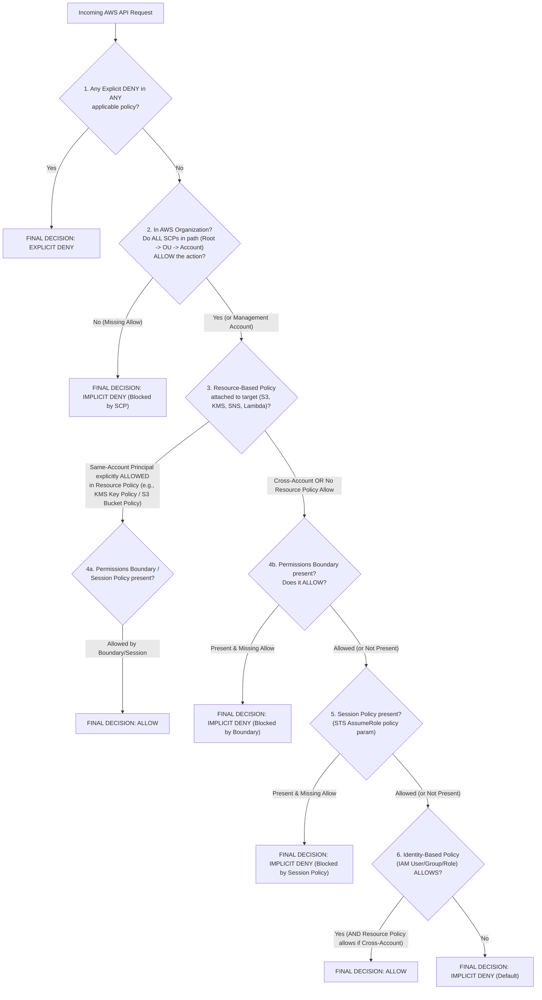
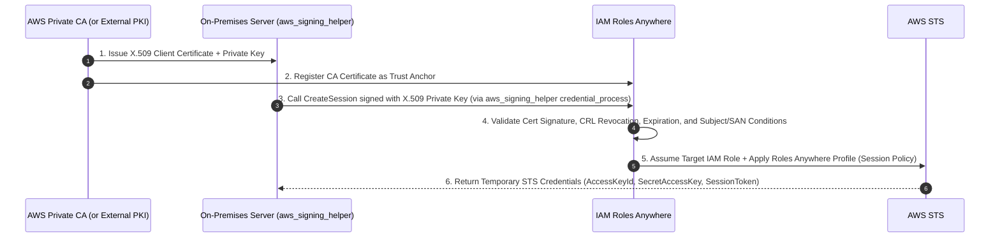
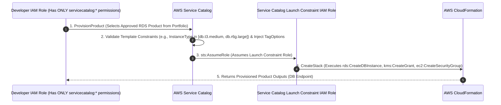

# Domain 6: Security and Compliance — Master-Level Study Guide (DOP-C02)

> **Exam Weight:** 17% of the AWS Certified DevOps Engineer – Professional (DOP-C02) exam.
> **Core Focus:** Enterprise IAM & AWS Organizations governance, KMS cross-account cryptography, automated secret management, Compliance-as-Code (AWS Config, Control Tower, Service Catalog), threat detection (GuardDuty, Inspector, Macie, Security Hub), and perimeter security automation.

---

## 1. IAM & AWS Organizations Governance

### 1.1 Exact IAM Policy Evaluation Logic

Every AWS API request is evaluated through a deterministic decision pipeline. Memorizing this exact sequence—and its **same-account vs. cross-account exception**—is essential for DOP-C02.



#### Critical Subtle Exception: Same-Account vs. Cross-Account Resource-Based Policies
1. **Within the SAME AWS Account:**
   - If a **Resource-Based Policy** (such as an S3 Bucket Policy or KMS Key Policy) explicitly grants `Allow` directly to a specific IAM User or IAM Role in the **same account**, the principal **gets access even if their Identity-Based Policy has ZERO permissions** for that service—*unless* there is an Explicit `Deny`, or an SCP / Permissions Boundary / Session Policy fails to allow the action!
2. **Across DIFFERENT AWS Accounts (Cross-Account Access):**
   - Cross-account access is an **intersection (`AND`)**: **BOTH** the Identity-Based Policy in Account A **AND** the Resource-Based Policy (or IAM Role Trust Policy) in Account B must explicitly `Allow` the action!
   - If Account A's S3 Bucket Policy allows `arn:aws:iam::222222222222:role/AppRole`, AND `AppRole` in Account B does not have `s3:GetObject` in its own IAM identity policy, the request fails with `AccessDenied`.
   - *(Subtle Exception to the Cross-Account Rule:* If the target resource has a resource-based policy that grants access to `Principal: "*"` or a federated/anonymous principal that doesn't require IAM identity evaluation, or when assuming an IAM Role via `sts:AssumeRole`, both the calling role's `sts:AssumeRole` identity policy and the target role's Trust Policy must allow the assumption; once assumed, the session adopts the target role's permissions in Account B.)*

---

### 1.2 Delegated IAM Administration with Permissions Boundaries

In a fast-moving DevOps organization, application teams need to create IAM Roles for their new Lambda functions, ECS tasks, and Step Functions inside their CI/CD pipelines. However, granting a developer `iam:CreateRole` and `iam:AttachRolePolicy` without guardrails allows **Privilege Escalation** (a developer can create a role with `AdministratorAccess` and assume it).

**Solution:** Attach a **Permissions Boundary** (`DeveloperMaxBoundary`) and condition the developer's `iam:CreateRole` permission so they can **only** create roles if they attach `DeveloperMaxBoundary`!

#### Complete JSON Policy: Safe Delegated IAM Role Creation (`DelegatedRoleCreatorPolicy`)
```json
{
  "Version": "2012-10-17",
  "Statement": [
    {
      "Sid": "AllowCreateRoleOnlyWithMandatoryBoundary",
      "Effect": "Allow",
      "Action": [
        "iam:CreateRole",
        "iam:AttachRolePolicy",
        "iam:DetachRolePolicy",
        "iam:PutRolePolicy",
        "iam:DeleteRolePolicy",
        "iam:PutRolePermissionsBoundary"
      ],
      "Resource": "arn:aws:iam::111122223333:role/app-*",
      "Condition": {
        "StringEquals": {
          "iam:PermissionsBoundary": "arn:aws:iam::111122223333:policy/DeveloperMaxBoundary"
        }
      }
    },
    {
      "Sid": "DenyDeletingOrAlteringPermissionsBoundary",
      "Effect": "Deny",
      "Action": [
        "iam:DeleteRolePermissionsBoundary"
      ],
      "Resource": "*"
    },
    {
      "Sid": "DenyMutatingTheBoundaryPolicyItself",
      "Effect": "Deny",
      "Action": [
        "iam:CreatePolicyVersion",
        "iam:DeletePolicy",
        "iam:DeletePolicyVersion",
        "iam:SetDefaultPolicyVersion"
      ],
      "Resource": "arn:aws:iam::111122223333:policy/DeveloperMaxBoundary"
    },
    {
      "Sid": "AllowPassRoleOnlyForAppPrefixedRoles",
      "Effect": "Allow",
      "Action": "iam:PassRole",
      "Resource": "arn:aws:iam::111122223333:role/app-*",
      "Condition": {
        "StringEquals": {
          "iam:PassedToService": [
            "lambda.amazonaws.com",
            "ecs-tasks.amazonaws.com",
            "states.amazonaws.com"
          ]
        }
      }
    }
  ]
}
```
> **Exam Crucial Notes on Permissions Boundaries:**
> - A Permissions Boundary **never grants permissions** on its own; it only defines the **maximum upper bound** of what an Identity-Based Policy on that User/Role can do: $\text{Effective Permissions} = \text{Identity Policy} \cap \text{Permissions Boundary}$.
> - Permissions Boundaries apply **only to IAM Users and IAM Roles** (they cannot be attached to IAM Groups).

---

### 1.3 Service Control Policies (SCPs) Deep Dive

Service Control Policies (SCPs) are AWS Organizations governance guardrails that define the **maximum available permissions** for all IAM users, IAM roles, and the **Account Root User** in member accounts.

#### Golden Rules of SCPs (Heavily Tested!)
1. **SCPs NEVER affect principals in the Organization Management Account!** (Even if attached to the Root of the Organization).
2. **SCPs NEVER affect Service-Linked Roles** (`arn:aws:iam::*:role/aws-service-role/*`), ensuring AWS services like Auto Scaling, Config, and GuardDuty can always operate.
3. **SCPs do NOT grant permissions.** You still need IAM identity/resource policies in the member account.
4. **Inheritance Hierarchy (`Root -> OU -> Child OU -> Account`):**
   - Every node in the hierarchy from `Root` down to the `Account` must evaluate to `Allow`.
   - **Deny-List Strategy (Default):** AWS attaches the `FullAWSAccess` (`Allow * on *`) SCP to every Root, OU, and Account by default. You add specific `Deny` statements on top.
   - **Allow-List Strategy:** You detach `FullAWSAccess` and explicitly attach an SCP listing only approved services (e.g., `ec2:*`, `s3:*`, `rds:*`). Any service omitted is implicitly denied at the Organization level!
5. **Size & Quota Limits:** Maximum **5,120 bytes (5 KB)** per SCP document; up to **5 SCPs** attached directly to any single Root, OU, or Account; up to **5 levels of OUs** deep.

#### Master Production SCP Suite (All High-Frequency Exam Patterns)

```json
{
  "Version": "2012-10-17",
  "Statement": [
    {
      "Sid": "1DenyNonApprovedRegionsExceptGlobalServices",
      "Effect": "Deny",
      "NotAction": [
        "a4b:*",
        "acm:*",
        "aws-marketplace-management:*",
        "aws-marketplace:*",
        "aws-portal:*",
        "budgets:*",
        "ce:*",
        "chime:*",
        "cloudfront:*",
        "config:*",
        "cur:*",
        "directconnect:*",
        "ec2:DescribeRegions",
        "ec2:DescribeTransitGateways",
        "ec2:DescribeVpnGateways",
        "fms:*",
        "globalaccelerator:*",
        "health:*",
        "iam:*",
        "importexport:*",
        "kms:*",
        "mobileanalytics:*",
        "networkmanager:*",
        "organizations:*",
        "pricing:*",
        "route53:*",
        "route53domains:*",
        "route53-recovery-cluster:*",
        "route53-recovery-control-config:*",
        "route53-recovery-readiness:*",
        "s3:GetAccountPublicAccessBlock",
        "s3:ListAllMyBuckets",
        "s3:PutAccountPublicAccessBlock",
        "shield:*",
        "sts:*",
        "support:*",
        "trustedadvisor:*",
        "waf-regional:*",
        "waf:*",
        "wafv2:*",
        "wellarchitected:*"
      ],
      "Resource": "*",
      "Condition": {
        "StringNotEquals": {
          "aws:RequestedRegion": [
            "us-east-1",
            "eu-west-1"
          ]
        },
        "ArnNotLike": {
          "aws:PrincipalArn": "arn:aws:iam::*:role/AWSControlTowerExecution"
        }
      }
    },
    {
      "Sid": "2BlockRootUserActivity",
      "Effect": "Deny",
      "Action": "*",
      "Resource": "*",
      "Condition": {
        "StringLike": {
          "aws:PrincipalArn": "arn:aws:iam::*:root"
        }
      }
    },
    {
      "Sid": "3PreventDisablingSecurityAndAuditTools",
      "Effect": "Deny",
      "Action": [
        "cloudtrail:StopLogging",
        "cloudtrail:DeleteTrail",
        "cloudtrail:UpdateTrail",
        "config:StopConfigurationRecorder",
        "config:DeleteConfigurationRecorder",
        "config:DeleteDeliveryChannel",
        "config:DeleteRetentionConfiguration",
        "guardduty:DeleteDetector",
        "guardduty:DisassociateFromMasterAccount",
        "guardduty:DisassociateFromAdministratorAccount",
        "guardduty:StopMonitoringMembers",
        "guardduty:UpdateDetector",
        "securityhub:DisableSecurityHub",
        "securityhub:DisassociateFromMasterAccount",
        "securityhub:DeleteMembers",
        "access-analyzer:DeleteAnalyzer"
      ],
      "Resource": "*",
      "Condition": {
        "ArnNotLike": {
          "aws:PrincipalArn": "arn:aws:iam::*:role/OrgSecurityAdminRole"
        }
      }
    },
    {
      "Sid": "4EnforceIMDSv2AndHopLimit",
      "Effect": "Deny",
      "Action": "ec2:RunInstances",
      "Resource": "arn:aws:ec2:*:*:instance/*",
      "Condition": {
        "StringNotEquals": {
          "ec2:MetadataHttpTokens": "required"
        }
      }
    },
    {
      "Sid": "5DenyUsingIMDSv1AtRuntime",
      "Effect": "Deny",
      "Action": "*",
      "Resource": "*",
      "Condition": {
        "NumericLessThan": {
          "ec2:RoleDelivery": "2.0"
        }
      }
    },
    {
      "Sid": "6RequireEbsVolumeEncryptionAndS3KmsEncryption",
      "Effect": "Deny",
      "Action": "ec2:CreateVolume",
      "Resource": "*",
      "Condition": {
        "Bool": {
          "ec2:Encrypted": "false"
        }
      }
    },
    {
      "Sid": "7PreventInternetGatewayAttachmentAndLeavingOrg",
      "Effect": "Deny",
      "Action": [
        "ec2:AttachInternetGateway",
        "ec2:CreateInternetGateway",
        "ec2:CreateEgressOnlyInternetGateway",
        "organizations:LeaveOrganization"
      ],
      "Resource": "*"
    }
  ]
}
```
> **Exam Deep-Dive on IMDSv2 & Encryption SCPs:**
> - `ec2:MetadataHttpTokens: "required"` on `ec2:RunInstances` prevents launching an EC2 instance unless IMDSv2 is required at launch time. You can also enforce `NumericGreaterThan: {"ec2:MetadataHttpPutResponseHopLimit": "1"}` to prevent container breakout credential theft on non-container hosts.
> - `NumericLessThan: {"ec2:RoleDelivery": "2.0"}` denies **any AWS API call** made using IAM Role credentials that were retrieved via IMDSv1 (`RoleDelivery == 1.0`), even on existing instances!
> - For S3 encryption enforcement via SCP or Bucket Policy, deny `s3:PutObject` when `"StringNotEquals": {"s3:x-amz-server-side-encryption": "aws:kms"}`.

---

### 1.4 IAM Identity Center (AWS SSO) & IAM Roles Anywhere

#### AWS IAM Identity Center
- Centralizes workforce human authentication across all accounts in an AWS Organization.
- Supports External Identity Providers (**Okta, Microsoft Entra ID / Azure AD, Ping Identity**) via **SAML 2.0** and automatic user/group synchronization via **SCIM v2.0**.
- **Permission Sets:** Templates stored in IAM Identity Center (Management or Delegated Admin Account). When assigned to a `(User/Group, AWS Account)` pair, IAM Identity Center automatically creates and maintains a corresponding IAM Role (`AWSReservedSSO_<PermissionSetName>_<random>`) in the target member account, attaching AWS Managed Policies, Customer Managed Policies (which must exist by name in the member account), Inline Policies, and a Permissions Boundary!
- **Attribute-Based Access Control (ABAC):** Passes SAML/SCIM user attributes (e.g., `Department`, `CostCenter`, `Project`) as **STS Session Tags** (`${aws:PrincipalTag/CostCenter}`), allowing a single Permission Set to dynamically restrict access to resources tagged with the matching `aws:ResourceTag/CostCenter`!

#### IAM Roles Anywhere (Passwordless On-Premises & Hybrid Authentication)
When on-premises servers, Kubernetes nodes, or CI runners outside AWS need AWS API credentials **without static long-lived IAM User Access Keys**:



- **Trust Anchor:** Points to an **AWS Private Certificate Authority (AWS PCA)** or an imported external Root/Intermediate CA certificate bundle.
- **Target IAM Role Trust Policy for IAM Roles Anywhere:**
```json
{
  "Version": "2012-10-17",
  "Statement": [
    {
      "Effect": "Allow",
      "Principal": {
        "Service": "rolesanywhere.amazonaws.com"
      },
      "Action": [
        "sts:AssumeRole",
        "sts:TagSession",
        "sts:SetSourceIdentity"
      ],
      "Condition": {
        "ArnEquals": {
          "aws:SourceArn": "arn:aws:rolesanywhere:us-east-1:111122223333:trust-anchor/ta-0123456789abcdef"
        },
        "StringEquals": {
          "aws:PrincipalTag/x509Subject/OU": "ProdOnPremServers"
        }
      }
    }
  ]
}
```
- **Profile:** Defines which IAM Roles can be assumed and optionally applies a **Session Policy** that further narrows permissions.
- **`aws_signing_helper`:** Local binary configured in `~/.aws/config` via `credential_process` that signs the `CreateSession` request using the server's private key (supports PKCS#11 HSMs and TPM 2.0 chips so the private key never leaves hardware!).

---

## 2. AWS KMS & Cryptography

### 2.1 Key Types, Key Policies vs. IAM Policies, and Grants

| KMS Key Type | Rotation Behavior | Cross-Account Support | Key Policy Customizable? | Cost |
| :--- | :--- | :--- | :--- | :--- |
| **AWS Owned Key** | Managed by AWS (varies) | No | No | Free |
| **AWS Managed Key (`aws/s3`, `aws/ebs`, `aws/rds`, `aws/secretsmanager`)** | Automatic every **1 year** (365 days) | **NO!** (Cannot be shared across accounts!) | **No** (Read-only policy) | Free (pay per API call over free tier) |
| **Customer Managed Key (CMK) — KMS Generated Material** | Optional automatic rotation every **1 year** (`365` days) or on-demand (`90–2560` days configurable) | **Yes** | **Yes** | \$1/month per key + API calls |
| **Customer Managed Key (CMK) — Imported Key Material (BYOK)** | **NO automatic rotation** (Must manually rotate by creating a new CMK and updating the **KMS Alias**) | **Yes** | **Yes** | \$1/month per key + API calls |

#### Key Policy vs. IAM Policy
- Unlike S3 (where a bucket policy is optional for same-account IAM access), **a KMS Key Policy is mandatory** and is the primary gatekeeper for every KMS key.
- The default Key Policy includes the statement `"Sid": "Enable IAM User Permissions"`, which grants `"Action": "kms:*"` to `"Principal": {"AWS": "arn:aws:iam::111122223333:root"}`.
- **What does granting `kms:*` to `:root` actually do?** It does *not* make every user in the account an admin of the key; it **delegates evaluation to IAM Identity-Based Policies** in that account! If you remove that `:root` statement from a KMS Key Policy, **even `AdministratorAccess` IAM users/roles in the same account cannot use the KMS key** unless their specific ARN is listed in the Key Policy!

---

### 2.2 Cross-Account KMS Encryption (S3, EBS, AMIs, and RDS Snapshots)

This is one of the **most heavily tested topics** on the DOP-C02 exam.

#### Trap 1: Sharing an AMI or RDS Snapshot Encrypted with the Default Key (`aws/ebs` or `aws/rds`)
- **Rule:** You **CANNOT** share an AMI, EBS Snapshot, or RDS Snapshot across AWS accounts if it is encrypted with an **AWS Managed Key** (`alias/aws/ebs` or `alias/aws/rds`).
- **Why?** Because you cannot edit the Key Policy of an AWS Managed Key to grant the target account `kms:Decrypt` permissions, and AWS blocks modifying snapshot sharing attributes on default-encrypted snapshots.
- **Exact Remediation Workflow:**
  1. Create a **Customer Managed Key (CMK)** in the Source Account (`Account A`).
  2. Copy (`ec2:CopyImage`, `ec2:CopySnapshot`, or `rds:CopyDBSnapshot`) the snapshot/AMI in `Account A`, specifying the new **CMK ARN** to re-encrypt the copy.
  3. Share the **CMK** with `Account B` via the CMK's Key Policy (`kms:Decrypt`, `kms:DescribeKey`, `kms:CreateGrant`, `kms:ReEncrypt*`).
  4. Share the **re-encrypted AMI / Snapshot** with `Account B` (`ModifyImageAttribute` / `ModifySnapshotAttribute` / `ModifyDBSnapshotAttribute`).
  5. *(Optional Best Practice for Production Independence):* In `Account B`, copy the shared AMI/Snapshot again using `Account B`'s own local CMK so `Account B` can launch instances even if `Account A` later revokes or deletes its key!

#### Trap 2: Auto Scaling Group in Account B Fails to Launch Instances from an Encrypted AMI Shared by Account A
- **Symptom:** An IAM administrator in `Account B` can manually run `aws ec2 run-instances` using `Account A`'s shared encrypted AMI without issue, **but when an EC2 Auto Scaling Group in `Account B` tries to launch the exact same AMI, the instance immediately terminates with `Client.InternalError: Client error on launch`!**
- **Root Cause:** When you manually call `ec2:RunInstances`, your own IAM User/Role credentials are used to call KMS. However, when an **EC2 Auto Scaling Group** in `Account B` launches instances asynchronously, the call is made by `Account B`'s **Auto Scaling Service-Linked Role**:
  `arn:aws:iam::<ACCOUNT_B_ID>:role/aws-service-role/autoscaling.amazonaws.com/AWSServiceRoleForAutoScaling`
- **Solution:** In `Account A`'s KMS CMK Key Policy, you must explicitly grant `kms:Decrypt`, `kms:GenerateDataKeyWithoutPlaintext`, `kms:ReEncrypt*`, `kms:DescribeKey`, and **`kms:CreateGrant`** to `arn:aws:iam::<ACCOUNT_B_ID>:role/aws-service-role/autoscaling.amazonaws.com/AWSServiceRoleForAutoScaling`!

```json
{
  "Sid": "AllowAccountBAutoScalingServiceLinkedRoleUseOfKey",
  "Effect": "Allow",
  "Principal": {
    "AWS": "arn:aws:iam::222222222222:role/aws-service-role/autoscaling.amazonaws.com/AWSServiceRoleForAutoScaling"
  },
  "Action": [
    "kms:Encrypt",
    "kms:Decrypt",
    "kms:ReEncrypt*",
    "kms:GenerateDataKey*",
    "kms:DescribeKey"
  ],
  "Resource": "*"
},
{
  "Sid": "AllowAccountBAutoScalingServiceLinkedRoleCreateGrant",
  "Effect": "Allow",
  "Principal": {
    "AWS": "arn:aws:iam::222222222222:role/aws-service-role/autoscaling.amazonaws.com/AWSServiceRoleForAutoScaling"
  },
  "Action": "kms:CreateGrant",
  "Resource": "*",
  "Condition": {
    "Bool": {
      "kms:GrantIsForAWSResource": "true"
    }
  }
}
```

---

### 2.3 Multi-Region KMS Keys, Imported Key Material, & Envelope Encryption

- **Multi-Region KMS Keys (`mrk-*`):**
  - Have the **exact same Key ID (`mrk-1234abcd...`) and cryptographic key material** replicated across multiple AWS Regions (one Primary Key, one or more Replica Keys).
  - *Why they matter:* Standard KMS keys are strictly regional—ciphertext encrypted in `us-east-1` cannot be decrypted in `us-west-2` without calling `us-east-1` over the network. With a **Multi-Region KMS Key**, data encrypted in `us-east-1` (e.g., **DynamoDB Global Tables, S3 Cross-Region Replication, Aurora Global Database, Secrets Manager Multi-Region Secrets**) can be decrypted locally in `us-west-2` with zero cross-region KMS API latency!
- **Imported Key Material (BYOK):**
  - You generate the 256-bit symmetric key on-premises (HSM), download the KMS wrapping public key + import token (`GetParametersForImport`), wrap your key material using `RSAES_OAEP_SHA_256`, and call `ImportKeyMaterial` with an optional expiration date.
  - If the key material expires or is deleted (`DeleteImportedKeyMaterial`), the key state becomes `PendingImport` and **all encrypted data using that key becomes immediately inaccessible** until you re-import the exact same key material!
  - **How to rotate Imported Key Material:** Since automatic rotation is unsupported for BYOK, create a **new KMS CMK**, import the new key material, and update the **KMS Alias (`UpdateAlias`)** to point to the new CMK! (Existing ciphertext still stores the old CMK ID in its header metadata, so KMS automatically uses the old CMK to decrypt historical data while new writes via the Alias use the new CMK!).
- **Envelope Encryption & S3 Bucket Keys:**
  - Payloads larger than **4 KB** cannot be encrypted directly via `kms:Encrypt`.
  - Instead, call `kms:GenerateDataKey`, which returns a **Plaintext Data Key** (used in-memory to AES-GCM encrypt the large file, then immediately wiped from RAM) and an **Encrypted Data Key (CiphertextBlob)** (stored alongside the encrypted file).
  - **S3 Bucket Keys:** Reduces S3-to-KMS request costs and KMS RPS throttling by up to **99%** by generating a short-lived bucket-level key from KMS and deriving unique object data keys locally within S3.

---

## 3. AWS Secrets Manager vs. Systems Manager Parameter Store

### 3.1 Architectural Comparison Matrix

| Feature | AWS Secrets Manager | SSM Parameter Store (`SecureString`) |
| :--- | :--- | :--- |
| **Max Secret / Parameter Size** | **64 KB** | **4 KB** (Standard) / **8 KB** (Advanced) |
| **Native Automated Rotation** | **Yes** — Built-in schedules, managed rotation functions for RDS/Redshift/DocumentDB, or custom Lambda rotation state machine | **No** — Requires custom EventBridge + Lambda orchestration |
| **Multi-Region Replication** | **Yes** — Native read-replica secrets synchronized automatically across Regions | **No** — Must replicate via EventBridge/Lambda or StackSets |
| **Cross-Account Resource Policy** | **Yes** — Attach a Resource-Based Policy directly to the Secret | **Yes** — Supported ONLY on **Advanced Tier** parameters via AWS RAM |
| **Pricing** | \$0.40 per secret/month + \$0.05 per 10,000 API calls | **Standard Tier:** Free (up to 10,000 parameters). **Advanced Tier:** \$0.05 per parameter/month |
| **CloudFormation Dynamic Reference** | `{{resolve:secretsmanager:MySecret:SecretString:password}}` | `{{resolve:ssm-secure:/prod/db/password:1}}` |

---

### 3.2 Secrets Manager Rotation Lifecycle & Zero-Downtime Alternating Users

When Secrets Manager rotates a secret, it invokes a rotation Lambda function four times in sequence using staging labels (`AWSCURRENT`, `AWSPENDING`, `AWSPREVIOUS`):

```mermaid
sequenceDiagram
    autonumber
    participant SM as AWS Secrets Manager
    participant L as Rotation Lambda Function
    participant DB as Target Database (RDS / Custom)

    SM->>L: Step 1: createSecret (Version with AWSPENDING label)
    L->>SM: Generate random strong password & PutSecretValue(AWSPENDING)
    SM->>L: Step 2: setSecret (AWSPENDING)
    L->>DB: Connect using AWSCURRENT (or Master Secret) & update user password in DB
    SM->>L: Step 3: testSecret (AWSPENDING)
    L->>DB: Open read/write test connection using AWSPENDING credentials
    SM->>L: Step 4: finishSecret (AWSPENDING)
    L->>SM: UpdateSecretVersionStage: Move AWSCURRENT to new version; old version becomes AWSPREVIOUS
```

#### Single-User vs. Alternating-Users Rotation Strategy (Exam Favorite!)
1. **Single-User Strategy:**
   - Updates the password of the **same database user** (`app_user`).
   - *Problem:* Between Step 2 (`setSecret`) and when all running EC2/ECS/Lambda instances refresh their cached secret, any application opening a *new* connection with the old cached password fails authentication!
2. **Alternating-Users (Multi-User) Strategy (Zero Downtime!):**
   - Stores a **Master/Admin Secret** alongside the **Application Secret**.
   - The Application Secret alternates between two database users: **`app_user_A`** and **`app_user_B`** (both having identical privileges on the database schemas).
   - If `AWSCURRENT` is currently using `app_user_A`:
     - `createSecret` creates an `AWSPENDING` secret containing `app_user_B` with a newly generated password (`GetRandomPassword`).
     - `setSecret` uses the **Master Secret** to log into the database and change the password of **`app_user_B`** (leaving `app_user_A` completely untouched!).
     - `testSecret` verifies `app_user_B` can connect.
     - `finishSecret` moves `AWSCURRENT` to the version with `app_user_B`.
   - **Result:** Existing application instances holding cached credentials for `app_user_A` continue to work with **zero connection drops**, while new instances fetching `AWSCURRENT` seamlessly connect as `app_user_B`!

---

### 3.3 Cross-Account Secret Access & EKS Secrets Store CSI Driver

- **Cross-Account Secret Access Requirements:**
  1. The secret **must** be encrypted with a **Customer Managed KMS Key (CMK)** (not the default `aws/secretsmanager` key).
  2. **Secret Resource Policy** in Account A must allow the IAM Role in Account B `secretsmanager:GetSecretValue`:
     ```json
     {
       "Version": "2012-10-17",
       "Statement": [
         {
           "Effect": "Allow",
           "Principal": {
             "AWS": "arn:aws:iam::222222222222:role/ProdEcsTaskRole"
           },
           "Action": "secretsmanager:GetSecretValue",
           "Resource": "*",
           "Condition": {
             "ForAnyValue:StringEquals": {
               "secretsmanager:VersionStage": "AWSCURRENT"
             }
           }
         }
       ]
     }
     ```
  3. **KMS Key Policy** in Account A must allow `arn:aws:iam::222222222222:role/ProdEcsTaskRole` `kms:Decrypt` (with optional condition `"kms:ViaService": "secretsmanager.us-east-1.amazonaws.com"`).
  4. **IAM Role Identity Policy** in Account B must allow `secretsmanager:GetSecretValue` on the Secret ARN AND `kms:Decrypt` on the CMK ARN.
- **Amazon EKS Integration:**
  - Use **IAM Roles for Service Accounts (IRSA)** or **EKS Pod Identity** coupled with the **Kubernetes Secrets Store CSI Driver + AWS Secrets and Configuration Provider (ASCP)**.
  - Mounts Secrets Manager secrets and SSM `SecureString` parameters directly into pods as tmpfs in-memory volumes (or syncs them to Kubernetes Secrets) with automatic rotation refresh.

---

## 4. Compliance-as-Code: AWS Config, Control Tower & Service Catalog

### 4.1 AWS Config Rules: Detective vs. Proactive Evaluation Modes

| Rule Type | Authoring Mechanism | Supported Evaluation Modes |
| :--- | :--- | :--- |
| **AWS Managed Rules** | Pre-built by AWS (`s3-bucket-public-read-prohibited`, `iam-user-mfa-enabled`, `encrypted-volumes`) | **Detective** (Configuration Changes & Periodic) + **Proactive** (on supported rules) |
| **Custom Policy Rules (`GUARD`)** | Written declaratively in **AWS CloudFormation Guard (`cfn-guard`)** DSL directly inside AWS Config — **No Lambda required!** | **Detective** AND **Proactive** |
| **Custom Lambda Rules** | Written in Python/Node.js/Java on AWS Lambda (`config.put_evaluations`) | **Detective** (Configuration Changes & Periodic) |

#### Example AWS Config Custom Policy Rule (`cfn-guard` DSL)
This `cfn-guard` policy checks both **Proactively** (before CloudFormation creates an EBS volume) and **Detectively** (when Configuration Items change) that every `gp3` EBS volume is encrypted with a KMS key and has `Iops <= 16000`:

```ruby
rule check_ebs_volume_is_gp3 when
    resourceType == "AWS::EC2::Volume" {
    configuration.volumeType == "gp3"
}

rule enforce_encryption_and_iops_ceiling when
    check_ebs_volume_is_gp3 {
    configuration.encrypted == true
    configuration.kmsKeyId exists
    configuration.iops <= 16000
}
```

#### Proactive vs. Detective Evaluation
- **Detective Mode:** Evaluates resources **after** they have been created or modified (via Configuration Items recorded by the Config Recorder) or on a periodic schedule (`1h` to `24h`).
- **Proactive Mode:** Evaluates resource configurations **before** provisioning (for example, invoked via `StartResourceEvaluation` in a CI/CD pipeline or enforced automatically by **CloudFormation Hooks** before `CREATE_IN_PROGRESS`), blocking non-compliant infrastructure before it is ever deployed!

---

### 4.2 Conformance Packs, Organizational Conformance Packs & Config Aggregators

- **Conformance Packs:**
  - A collection of AWS Config Rules and associated SSM Automation remediation actions packaged as a single YAML template (`Resources` of type `AWS::Config::ConfigRule` and `AWS::Config::RemediationConfiguration`).
  - Deployed across an entire AWS Organization using `PutOrganizationConformancePack` from the Management Account or a **registered Delegated Administrator account** (recommended best practice: delegate Config administration to the central Security/Compliance account).
  - Creates a dedicated S3 delivery bucket prefixed with **`awsconfigconforms-*`** to store conformance pack artifacts across accounts.
- **AWS Config Aggregators:**
  - Collects compliance and configuration data from **multiple AWS Accounts (or an entire AWS Organization)** and **multiple AWS Regions** into a single unified dashboard and **Advanced Query (SQL)** interface.
  - **Exam Trap:** An AWS Config Aggregator is **read-only**. It cannot deploy Config Rules or trigger remediations across accounts; use **Organizational Config Rules** or **Organizational Conformance Packs** to deploy rules across accounts!

---

### 4.3 AWS Control Tower, Account Factory for Terraform (AFT), & CfCT

**AWS Control Tower** orchestrates multi-account Landing Zones built on AWS Organizations, IAM Identity Center, AWS Config, CloudTrail, and Service Catalog.

1. **Three Types of Controls (Guardrails) in Control Tower:**
   - **Preventive Controls:** Implemented via **AWS Organizations SCPs** (`Disallow` actions). Always `Enforced`.
   - **Detective Controls:** Implemented via **AWS Config Rules** (`Detect` non-compliance). Status is `Clear` or `In Violation`.
   - **Proactive Controls:** Implemented via **AWS CloudFormation Hooks** (`AWSControlTower::Hook`). Inspects CloudFormation resource properties *before* resource creation/update and rolls back the stack if non-compliant!
2. **Guidance Tiers:**
   - **Mandatory Controls:** Applied automatically to all OUs managed by Control Tower (e.g., disallowing tampering with the central Log Archive S3 bucket or CloudTrail). Cannot be disabled.
   - **Strongly Recommended & Elective Controls:** Optional controls enabled per OU.
3. **Customizations for AWS Control Tower (CfCT) vs. Account Factory for Terraform (AFT):**
   - **CfCT:** A CloudFormation + CodePipeline framework that triggers automatically on the **`CreateManagedAccount`** life-cycle event from Control Tower (or git push), deploying custom CloudFormation StackSets and SCPs to newly vended accounts.
   - **AFT:** A Terraform-native pipeline framework for vending and customizing Control Tower accounts using GitOps and Terraform states.

---

### 4.4 AWS Service Catalog: Launch Constraints, Template Constraints, & TagOptions

When an exam scenario asks how to let developers or data scientists provision complex AWS resources (e.g., an encrypted RDS cluster, EMR cluster, or VPC endpoint) **without granting those users IAM permissions to `rds:*`, `ec2:*`, or `iam:*`**:



1. **Portfolios & Products:**
   - **Product:** A versioned CloudFormation template (or Terraform configuration).
   - **Portfolio:** A logical grouping of Products shared with IAM Users/Groups/Roles or shared across an **AWS Organization** via Organization Sharing.
2. **Launch Constraint (Critical DOP-C02 Concept!):**
   - Specifies the **IAM Role** (`ServiceCatalogLaunchRole`, trusting `servicecatalog.amazonaws.com`) that Service Catalog assumes to provision the CloudFormation stack.
   - The end-user **only needs `servicecatalog:*` and limited `cloudformation:Describe*` permissions**; they **never** need `ec2:*` or `rds:*` permissions!
3. **Template Constraint:**
   - JSON rule logic that restricts the CloudFormation parameters a user can select based on context (e.g., if `Environment == "dev"`, then `DBInstanceClass` must be `db.t3.micro` or `db.t3.small`).
4. **TagOptions Library:**
   - Key-value pairs defined on Portfolios and Products. During `ProvisionProduct`, Service Catalog automatically applies the intersection/union of TagOptions to the CloudFormation stack and all child resources, enforcing cost-allocation tagging.

---

## 5. Threat Detection, Vulnerability Management & Security Hub

### 5.1 Amazon GuardDuty

- **Telemetry Data Sources (No Agent Required for Control/Network Planes):**
  - **Foundational Data Sources:** CloudTrail Management Events, CloudTrail S3 Data Events, VPC Flow Logs, and Route 53 DNS Query Logs.
  - **Optional Protection Plans:**
    - **EKS Protection:** EKS Audit Logs + **EKS Runtime Monitoring** (eBPF security agent).
    - **ECS & EC2 Runtime Monitoring:** OS-level system call, file access, and process execution monitoring via managed eBPF agent.
    - **EBS Malware Protection:** Agentless snapshot-based malware scanning triggered automatically when GuardDuty detects suspicious behavior on an EC2 instance/container!
    - **RDS Protection:** Analyzes Aurora/RDS login activity for brute-force or anomalous SQL authentication.
    - **Lambda Protection:** Monitors VPC Flow Logs generated by Lambda function network invocations.
- **Multi-Account Management:**
  - Designate a **Delegated Administrator Account** via AWS Organizations and enable **Auto-Enable** (`ALL` or `NEW` accounts) so every new account in the Organization immediately has GuardDuty and all protection plans turned on.
- **Suppression Rules vs. Trusted IP Lists:**
  - **Trusted IP Lists:** Up to 2,000 IP/CIDR addresses (e.g., your corporate NAT gateway or internal vulnerability scanner). GuardDuty **does not generate findings** for traffic originating from Trusted IPs.
  - **Threat Lists:** Custom STIX/TXT lists of known malicious IPs/domains stored in S3.
  - **Suppression Rules (Auto-Archive):** Findings matching filter criteria are still generated (and visible if querying `archived=true`), but are **automatically archived** and **ARE NOT sent to EventBridge or Security Hub**! (Ideal for silencing known benign false positives on a specific bastion host without blinding GuardDuty across the whole account).

---

### 5.2 Amazon Inspector v2, Amazon Macie, & AWS Security Hub

#### Amazon Inspector v2
- Continuous, automated vulnerability management across **Amazon EC2**, **Amazon ECR (Container Images)**, and **AWS Lambda Functions**:
  - **EC2 Scanning:** Supports **SSM-Agent-based scanning** (real-time continuous scanning as packages are installed) AND **Agentless Scanning** (periodic EBS snapshot inspection for instances where SSM Agent cannot be installed!).
  - **ECR Scanning:** Enhanced scanning scans container OS packages and programming language dependencies (Java, Python, Node.js, Go) **on push** and **continuously rescans** whenever a new CVE is published to the Inspector database!
  - **Lambda Scanning:** Scans both **package dependencies** (`pip`, `npm`, Lambda Layers) for CVEs and **custom application code** for code security flaws (injection, hardcoded secrets).
  - **SBOM Export:** Exports Software Bill of Materials (CycloneDX / SPDX JSON) to S3 for supply-chain auditing.

#### Amazon Macie
- Discovers and protects sensitive data (PII, PHI, PCI credit cards, AWS keys) in **Amazon S3**:
  - **Managed Data Identifiers:** Built-in ML/pattern detectors for SSNs, passports, credit card numbers, and private keys.
  - **Custom Data Identifiers:** User-defined **Regular Expressions (Regex)**, keywords, proximity distance rules, and ignore words (e.g., matching internal employee IDs like `EMP-[0-9]{8}`).
  - Emits **Sensitive Data Findings** (`Policy:IAMUser/...` or `SensitiveData:S3Object/Financial`) directly to **EventBridge** and **Security Hub** for automated quarantine of exposed S3 objects!

#### AWS Security Hub
- Central Cloud Security Posture Management (CSPM) and finding aggregator:
  - Normalizes findings from GuardDuty, Inspector, Macie, Firewall Manager, IAM Access Analyzer, Health, and 60+ third-party integrations into the standardized **AWS Security Finding Format (ASFF)** JSON schema.
  - Runs continuous automated checks against **AWS Foundational Security Best Practices (FSBP)**, **CIS AWS Foundations Benchmark**, **PCI-DSS**, and **NIST SP 800-53** (requires **AWS Config** to be enabled!).
  - **Cross-Region Aggregation:** Designate an **Aggregation Region** (e.g., `us-east-1`) to replicate findings from all linked Regions across all accounts in the Organization into a single pane of glass.
  - **Custom Actions:** Analysts can select a finding in Security Hub and click a Custom Action (e.g., `"Isolate Instance"`), which emits a `Security Hub Findings - Custom Action` event to EventBridge to trigger an SSM Automation or Step Functions remediation workflow.

#### Amazon Detective & AWS Audit Manager
- **Amazon Detective:** Automatically ingests CloudTrail, VPC Flow Logs, GuardDuty findings, and EKS audit logs into a **graph model** (up to 1 year of historical behavior) to perform **visual root-cause investigation** (e.g., answering *"What API calls did this IAM Role make before and after the GuardDuty finding, and from which geolocations?"*).
- **AWS Audit Manager:** Continuously collects evidence from CloudTrail, Config, Security Hub, and API calls, mapping them automatically to compliance frameworks (SOC 2, HIPAA, PCI-DSS, FedRAMP) to produce auditor-ready assessment reports.

---

## 6. Network & Perimeter Security

### 6.1 AWS WAF, Shield Advanced, Network Firewall, & Firewall Manager

| Service | Layer & Inspection Scope | Key DOP-C02 Capabilities |
| :--- | :--- | :--- |
| **AWS WAF** | **Layer 7 HTTP/HTTPS** attached to CloudFront, ALB, API Gateway, AppSync, Cognito, App Runner, Verified Access | Managed Rule Groups (OWASP Top 10, Known Bad Inputs, Anonymous IP), **Rate-Based Rules** (`100` to `2B` requests per 5-min window per IP/Header), Bot Control, Captcha/Challenge, Custom HTTP Responses |
| **AWS Shield Advanced** | **Layer 3/4 & Layer 7 DDoS Protection** on CloudFront, Route 53, Global Accelerator, ALB, EIP, NLB | 24/7 access to **AWS Shield Response Team (SRT)**, **DDoS Cost Protection** (credits for scaling spikes during DDoS), **Automatic Application-Layer DDoS Mitigation** (automatically creates/evaluates WAF rules to block Layer 7 DDoS floods!) |
| **AWS Network Firewall** | **Layer 3–7 VPC Perimeter Inspection** (deployed in dedicated firewall subnets via Gateway Load Balancer endpoints) | Stateful **Suricata IPS rules**, **Domain Name (`HTTP Host` / `TLS SNI`) allow/deny filtering** for outbound VPC egress, TLS decryption/inspection, stateless packet filtering |
| **AWS Firewall Manager** | **Multi-Account / Organization Policy Orchestrator** (requires AWS Organizations + AWS Config enabled) | Centrally deploys and enforces **WAF Web ACLs, Shield Advanced, VPC Security Groups (baseline + audit), AWS Network Firewall topologies, and Route 53 Resolver DNS Firewall** across all accounts and OUs in an Organization! |

> **DOP-C02 Exam Distinction — AWS WAF vs. AWS Firewall Manager:**
> - If a question asks how to protect **a single ALB or CloudFront distribution** against SQL injection or HTTP floods from a single IP: use **AWS WAF (Managed Rule Group + Rate-Based Rule)**.
> - If a question asks how to **automatically ensure that EVERY new and existing ALB across 100 AWS accounts in an Organization** has a mandatory baseline Web ACL attached (or that no Security Group in any account allows `0.0.0.0/0` on high-risk ports), and automatically remediate non-compliant resources: use **AWS Firewall Manager**!

---

## 7. DOP-C02 Exam Traps & Anti-Patterns

| Scenario / Requirement | Common Exam Trap (Wrong Answer) | Correct DOP-C02 Architecture |
| :--- | :--- | :--- |
| **"Share an encrypted AMI or RDS Snapshot with a partner account when it was encrypted with the default `aws/ebs` or `aws/rds` key."** | Editing the key policy of `alias/aws/ebs` or sharing the snapshot directly. | **Default AWS Managed Keys cannot be shared across accounts!** Copy the AMI/Snapshot in the source account while re-encrypting it with a **Customer Managed Key (CMK)**, then share both the CMK and the new copy. |
| **"Allow an Auto Scaling Group in Account B to launch instances from an encrypted AMI shared from Account A."** | Only granting `kms:Decrypt` to Account B's `:root` principal in Account A's CMK Key Policy without granting `kms:CreateGrant` to Account B's Auto Scaling Service-Linked Role. | Grant `kms:Decrypt`, `kms:GenerateDataKey*`, `kms:ReEncrypt*`, `kms:DescribeKey`, and **`kms:CreateGrant` (`kms:GrantIsForAWSResource: true`)** to `arn:aws:iam::<AccountB>:role/aws-service-role/autoscaling.amazonaws.com/AWSServiceRoleForAutoScaling`. |
| **"Rotate RDS database credentials in Secrets Manager with ZERO connection errors for active long-lived database connections."** | Using the Single-User rotation strategy and hoping the app reconnects fast enough. | Configure Secrets Manager with the **Alternating-Users (Multi-User) Rotation Strategy**, which alternates between two DB users (`UserA` and `UserB`) so active connections on the old user are never terminated during rotation. |
| **"Prevent developers in the AWS Organization Management Account from launching resources in `ap-east-1` using an SCP."** | Attaching a region-restriction SCP to the Organization Root or Management Account. | **SCPs NEVER apply to the Management Account!** Workloads and developers must reside in **Member Accounts** (where SCPs apply), or use IAM Permissions Boundaries inside the Management Account. |
| **"Block EC2 instances across an Organization if `us-east-1` is the only allowed Region via SCP, but IAM and Route 53 stops working."** | Using `"Action": "*"` in a `StringNotEquals: {"aws:RequestedRegion": "us-east-1"}` SCP without exempting global services. | Global services (**IAM, STS, Route 53, CloudFront, Organizations, Support, Health**) execute in `us-east-1` or global endpoints and **must be exempted via `NotAction`** in any Region-restriction SCP! |
| **"Allow developers to provision approved RDS and ECS stacks without granting them `rds:*` or `ecs:*` IAM permissions."** | Giving developers a Permissions Boundary with `rds:*` or writing a custom provisioning Lambda. | Use **AWS Service Catalog** with a **Launch Constraint Role**. Developers only need `servicecatalog:*` permissions; Service Catalog assumes the Launch Role to provision the stack. |
| **"Rotate a KMS key that uses Imported Key Material (BYOK) every 180 days."** | Enabling the `EnableKeyRotation` checkbox on the KMS key. | KMS **does not support automatic key rotation for Imported Key Material**. Create a **new KMS CMK**, import the new key material, and update the **KMS Alias (`UpdateAlias`)** to point to the new CMK! |

---

## 8. Troubleshooting Runbooks for Security & Compliance

### Runbook 1: Diagnosing Mysterious `AccessDenied` Errors in a Multi-Account Organization
1. **Inspect the Error Message Structure (Explicit vs. Implicit Deny):**
   - Look at the exact wording of the error (or decode an encoded EC2/CloudFormation error with `aws sts decode-authorization-message --encoded-message <msg>`):
     - `... with an explicit deny in a service control policy`: Blocked by an **AWS Organizations SCP**. Check all SCPs attached to the Account, parent OUs, and Root.
     - `... with an explicit deny in an identity-based policy`: Blocked by an inline or managed policy attached to the IAM User/Role.
     - `... with an explicit deny in a permissions boundary`: Blocked by an explicit deny in the **Permissions Boundary**.
     - `... is not authorized to perform: <action> on resource: <arn> because no permissions boundary allows the <action> action`: Missing `Allow` in the **Permissions Boundary**.
     - `... because no session policy allows the <action> action`: Blocked by a Session Policy passed during `sts:AssumeRole` or an IAM Roles Anywhere Profile.
     - `... because no identity-based policy allows the <action> action`: Missing `Allow` in the IAM Role/User policy (or cross-account resource policy mismatch).
2. **Check KMS Encryption Dependencies:**
   - Often an S3 `GetObject`, SQS `SendMessage`, or Secrets Manager `GetSecretValue` fails with `AccessDenied` even when the S3/SQS/Secrets Manager policy is 100% correct.
   - **Check if the resource uses a Customer Managed KMS Key (CMK)!** If so, verify both the caller's IAM policy AND the KMS Key Policy allow `kms:Decrypt` / `kms:GenerateDataKey*`.
3. **Use IAM Policy Simulator & IAM Access Analyzer:**
   - Run `aws iam simulate-principal-policy` to test specific actions, resources, and context keys (`aws:RequestedRegion`, `aws:MultiFactorAuthPresent`, `aws:PrincipalTag/*`).

### Runbook 2: Secrets Manager Rotation Fails and Stays Stuck
1. **Check CloudWatch Logs for the Rotation Lambda Function:**
   - Look for `createSecret`, `setSecret`, `testSecret`, or `finishSecret` exceptions.
2. **Verify Network Routing (The #1 Cause of Rotation Failure):**
   - Because the Rotation Lambda Function must connect to **both** the **private RDS database inside the VPC** AND the **AWS Secrets Manager public API endpoint (`secretsmanager.<region>.amazonaws.com`)**:
     - The Lambda function must be attached to private VPC subnets that have either a **VPC Interface Endpoint for Secrets Manager** (`com.amazonaws.<region>.secretsmanager` with Private DNS enabled) OR a route to a **NAT Gateway**!
     - Verify the RDS Security Group allows inbound TCP (`3306`/`5432`) from the Rotation Lambda's Security Group.
3. **Clear Stuck `AWSPENDING` Version (If Needed):**
   - If a broken `AWSPENDING` staging label blocks a fresh rotation attempt after fixing connectivity, remove the `AWSPENDING` staging label via `aws secretsmanager update-secret-version-stage --secret-id <id> --version-stage AWSPENDING --remove-from-version-id <version-id>` and re-run `aws secretsmanager rotate-secret`.
