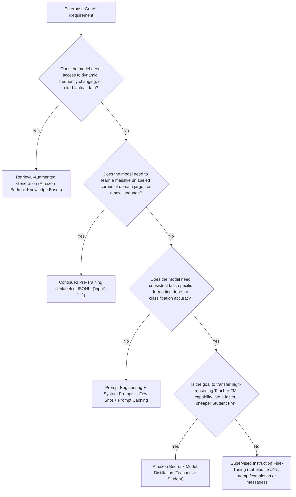
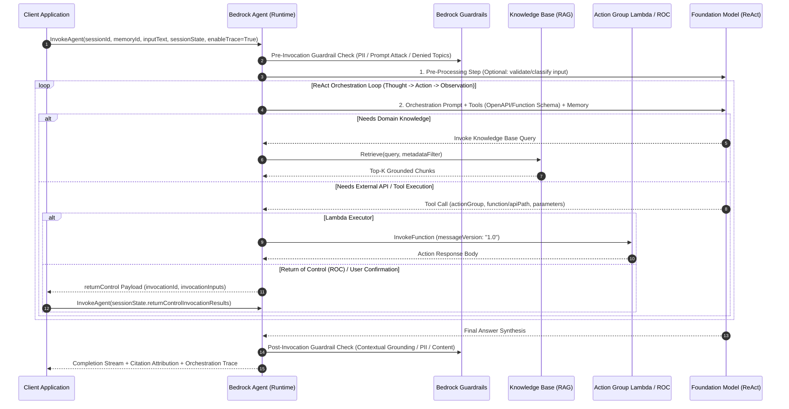
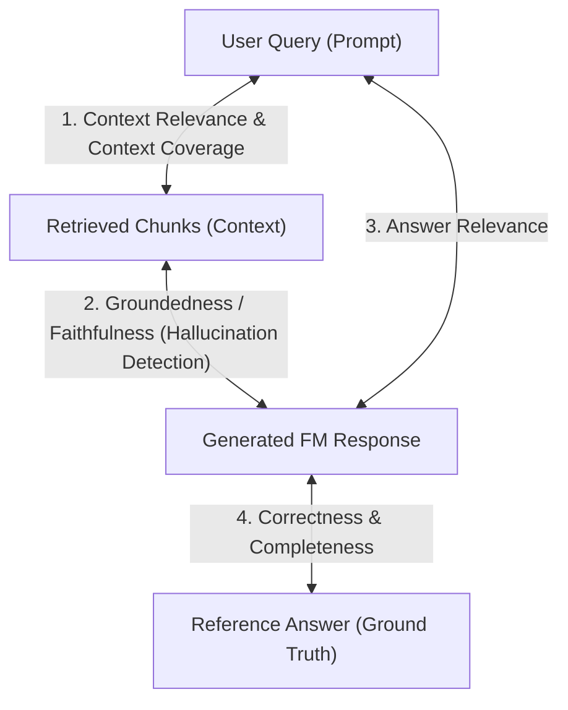

# AWS Certified Generative AI Developer – Professional (AIP-C01) Master Cheat Sheet

This high-density reference consolidates the critical decision matrices, foundation model customization rules, vector database architectures, chunking and retrieval patterns, agentic tool/MCP protocols, guardrail enforcement layers, token FinOps formulas, evaluation metrics, diagnostic trace structures, production `boto3` / CLI / JSON policy templates, and top exam traps tested on the **AWS Certified Generative AI Developer – Professional (`AIP-C01`)** exam.

---

## 1. Foundation Model Selection & Customization Matrix (Domain 1)

### 1.1 When to Use Prompt Engineering vs. RAG vs. Fine-Tuning vs. Continued Pre-Training vs. Distillation



| Customization Paradigm | Training Data Format & Volume | Primary Objective | Inference Billing Model on Bedrock | Key AIP-C01 Exam Trigger |
| :--- | :--- | :--- | :--- | :--- |
| **Prompt Engineering & In-Context Learning** | 0 training records; few-shot examples in prompt | Rapid iteration, structured output (`toolConfig`), zero training cost | **On-Demand** or **Cross-Region Inference** (plus **Prompt Caching** discount) | *"Fastest time-to-market with zero training overhead"* |
| **Retrieval-Augmented Generation (RAG)** | Unstructured/structured docs in S3, Confluence, SharePoint, RDS, Neptune | Grounding in dynamic data, source citations, document-level ACLs | **On-Demand** FM + Vector Store + Embedding tokens + Reranker calls | *"Frequently updated documents, strict citation requirements, zero hallucination on new policies"* |
| **Supervised Fine-Tuning (SFT)** | **Labeled** JSONL (`{"prompt": "...", "completion": "..."}` or `messages` array); $100\text{–}10,000+$ examples | Task-specific style, domain classification, specialized JSON/code syntax | Requires **Provisioned Throughput (Model Units)** (plus monthly custom model storage fee) | *"Consistent domain-specific tone/formatting; shorten massive few-shot prompts"* |
| **Continued Pre-Training (CPT)** | **Unlabeled** raw text JSONL (`{"input": "..."}`); millions/billions of tokens (up to 100K+ records) | Adapting base model weights to specialized industry vocabulary (biomedical, legal, aerospace, internal codebases) | Requires **Provisioned Throughput (Model Units)** (plus monthly custom model storage fee) | *"Large unlabeled corpus of proprietary domain literature and acronyms"* |
| **Bedrock Model Distillation** | Prompts-only JSONL in S3 OR historical **Bedrock Model Invocation Logs** (min 100 records) | Teacher FM (e.g., Claude 3.5 Sonnet / Nova Premier) generates synthetic responses to fine-tune a smaller Student FM (e.g., Haiku / Nova Micro / Lite) | Student custom model deployed on **Provisioned Throughput** (up to 75% cheaper & 5x faster than Teacher) | *"Match large teacher model accuracy on a narrow task while cutting latency and cost by >60%"* |
| **Custom Model Import (CMI)** | Model weights (`safetensors`, `config.json`, `tokenizer.json`) in S3 from SageMaker/EC2/on-prem (Llama, Mistral, Qwen, Flan) | Run externally trained open-weight models serverlessly via native Bedrock APIs | Billed per **Custom Model Unit (CMU)** active in 5-minute windows (scales down when idle or scales up with traffic) | *"Import existing HuggingFace/SageMaker fine-tuned Llama/Mistral weights (`safetensors`) into Bedrock without managing Provisioned Throughput commitments"* |

> [!IMPORTANT]
> **Critical Exam Rule on Custom Models vs. Custom Model Import:**
> * Models customized **inside** Amazon Bedrock (via Bedrock Fine-Tuning, Continued Pre-Training, or Model Distillation) **MUST** be deployed by purchasing **Provisioned Throughput (Model Units)**.
> * Models imported via **Amazon Bedrock Custom Model Import** (`safetensors` weights trained in SageMaker or externally) use **On-Demand Custom Model Units (CMUs)** billed in 5-minute active windows and do **not** require a long-term Provisioned Throughput commitment!

### 1.2 Foundation Model Inference Parameters Reference

| Parameter | Mathematical / Sampling Effect | Recommended Setting by Task |
| :--- | :--- | :--- |
| **`temperature`** ($0.0 \text{ to } 1.0$) | Scales logits ($z_i / T$) before Softmax. Lower values sharpen probability distribution toward the most likely token; `0.0` approaches greedy deterministic decoding. | **`0.0`:** RAG factual synthesis, SQL/code generation, JSON extraction, compliance classification.<br>**`0.5–0.8`:** Creative copywriting, brainstorming, diverse synthetic data generation. |
| **`topP` (Nucleus Sampling)** ($0.0 \text{ to } 1.0$) | Samples only from the smallest set of top tokens whose cumulative probability exceeds $P$. | Alter **either** `temperature` **or** `topP`, **not both** simultaneously. Set `topP = 0.9` for general dialogue, `0.1` for deterministic tasks. |
| **`topK`** ($1 \text{ to } 500$) | Truncates the candidate vocabulary to the $K$ highest-probability tokens at each decoding step. | Low $K$ (`1–10`) prevents long-tail hallucinated tokens in strict classification tasks. |
| **`maxTokens`** | Hard upper bound on generated output tokens. Directly impacts worst-case **Total Generation Latency** and **Throttling Quota Reservation**. | Size tightly to expected response length; oversized `maxTokens` can prematurely consume TPM burst quotas. |
| **`stopSequences`** | Array of strings (e.g., `["</json>", "\nObservation:"]`) that immediately halt token generation upon emission. | Essential for custom ReAct loops, XML tag extraction, and preventing runaway generation. |

---

## 2. Multimodal Data Pipelines & Chunking Strategies (Domain 1)

### 2.1 Amazon Bedrock Knowledge Base Chunking Strategies

| Chunking Strategy | Mechanism | Token / Size Limits | Ideal Workload & Exam Scenario |
| :--- | :--- | :--- | :--- |
| **Default Chunking** | Splits text into ~300-token chunks respecting sentence/paragraph boundaries | ~300 tokens default | General-purpose prose FAQs and simple articles. |
| **Fixed-Size Chunking** | Splits text strictly by configured `maxTokens` and `overlapPercentage` (e.g., 10%–20%) | `20` to `8,192` tokens (model dependent) | Uniformly structured logs or homogeneous text documents. |
| **Hierarchical Chunking (Parent-Child)** | Creates **two tiers**: small **Child Chunks** (for high-precision vector similarity matching) and larger **Parent Chunks** (returned to the FM at generation time for rich surrounding context) | Child: e.g., `300` tokens; Parent: e.g., `1,500` tokens | **Complex legal contracts, regulatory manuals, technical specifications** where matching requires pinpoint precision but generation requires full clause/section context. |
| **Semantic Chunking** | Computes embeddings per sentence and splits chunks only when cosine distance between adjacent sentence windows exceeds a `breakpointPercentileThreshold` (e.g., 95th percentile) | Configurable `maxTokens`, `bufferSize`, `breakpointPercentileThreshold` | Multi-topic transcripts, research papers, or long narrative documents where fixed boundaries cut across topic shifts. |
| **No Chunking (`NONE`)** | Each file in S3 is embedded as a single atomic vector | Must fit within embedding model max input tokens (e.g., 8,192 for Titan Embeddings V2) | Pre-chunked JSON documents, short SKU product descriptions, or code snippets already split upstream. |
| **Custom Transformation Lambda** | Invokes an AWS Lambda function during ingestion (`customTransformationConfiguration`) after parsing/chunking to inject custom metadata, redact PII, or apply custom splitting logic | Reads/writes intermediate chunks in an S3 staging bucket | Adding custom dynamic metadata tags, regex scrubbing, or AST-based source code chunking during Knowledge Base sync. |

### 2.2 Complex Document & Multimodal Parsing Options in Bedrock Knowledge Bases

1. **Default Text Parser**: Fast, free text extraction for plain text, Markdown, HTML, CSV, and simple text-based PDFs. Ignores images and scrambles complex multi-column tables.
2. **Amazon Bedrock Data Automation (BDA) Parser**: Managed multimodal parsing engine that extracts tables, figures, charts, embedded images, layout hierarchies, audio transcripts, and video scene descriptions into clean Markdown/JSON before chunking.
3. **Foundation Model as Parser (Multimodal FM Parsing)**: Uses a vision-capable FM (e.g., Claude 3.5 Sonnet, Amazon Nova Pro) to visually inspect scanned PDF pages, complex financial balance sheets, engineering blueprints, and diagrams, converting tables and charts into rich semantic descriptions prior to embedding.

---

## 3. Vector Store & Retrieval Architecture Comparison (Domain 1)

### 3.1 AWS Vector Store Decision Matrix

| Vector Store Service | Underlying Index / Algorithm | Scale & Latency Profile | Key Architectural Features & AIP-C01 Triggers |
| :--- | :--- | :--- | :--- |
| **Amazon OpenSearch Serverless (Vector Engine)** | NMSLIB, Faiss, or Lucene (`HNSW` / `IVF`) | Millions to tens of millions of vectors; ~10–50 ms latency; auto-scales in **OCUs** (min 2 OCUs = 1 indexing + 1 search with redundancy disabled, or 4 OCUs with HA redundancy) | **Default turnkey vector store** for Bedrock Knowledge Bases. Native **Hybrid Search (BM25 lexical + k-NN vector)** in a single query. |
| **Amazon Aurora PostgreSQL Serverless v2 (`pgvector`)** | `HNSW` (`m`, `ef_construction`, `ef_search`) or `IVFFlat` (`lists`, `probes`) | Millions of vectors; scales in **ACUs** (down to `0 ACU` auto-pause in dev/test); **Aurora Optimized Reads** uses local NVMe SSD cache to speed up vector queries by up to 9x when HNSW index exceeds RAM | Best when **combining relational SQL joins/ACID transactions with vector search**, or when existing PostgreSQL expertise and RDS Data API integration are required. |
| **Amazon S3 Vectors / LanceDB on S3** | Object-storage native compressed vector indexes | Hundreds of millions to **billions of vectors**; sub-second (100–500 ms) warm query latency; **up to 90% lower storage cost** than memory-resident vector DBs | Best for **massive archival RAG corpora, compliance archives, or infrequent queries** where keeping billions of vectors in RAM (OpenSearch/Aurora/MemoryDB) is cost-prohibitive. |
| **Amazon MemoryDB for Redis (Vector Search)** | In-memory `HNSW` or `FLAT` (exact search) with Multi-AZ durable transaction log | **Single-digit millisecond (< 5 ms)** latency; tens of thousands of QPS | Best for **ultra-low-latency real-time Semantic Caching**, high-throughput online recommendation engines, and real-time session context lookups. |
| **Amazon Neptune Analytics (GraphRAG)** | Property graph (`openCypher`) + built-in HNSW vector search index | Tens of millions of nodes/vectors in memory | **Native GraphRAG engine** for Bedrock Knowledge Bases. Automatically extracts entities and relationships from documents to answer **multi-hop relational questions** across disparate documents. |

### 3.2 HNSW vs. IVFFlat Index Tuning (`pgvector` & OpenSearch)

| Parameter | Index Type | Build Time & RAM Impact | Query Latency & Recall Impact |
| :--- | :---: | :--- | :--- |
| **`m`** (Max bidirectional links per node, default `16`) | `HNSW` | Higher `m` (`32–64`) $\rightarrow$ **larger RAM footprint** and slower index build time. | Higher `m` $\rightarrow$ **higher recall** on high-dimensional embeddings (`1024–1536` dims). |
| **`ef_construction`** (Candidate list size during graph build, default `64`) | `HNSW` | Higher `ef_construction` (`128–256`) $\rightarrow$ **slower index creation**, zero extra RAM. | Higher `ef_construction` $\rightarrow$ higher-quality graph and **higher recall** at query time. |
| **`ef_search`** (`hnsw.ef_search`, default `40`) | `HNSW` | **Runtime query parameter** (no index rebuild required!). | Higher `ef_search` (`100–200`) $\rightarrow$ **higher recall** at the cost of **higher query latency**. |
| **`lists`** (Number of Voronoi k-means centroids) | `IVFFlat` | Faster build and lower RAM than HNSW; rule of thumb: `rows / 1000` (up to 1M rows) or `sqrt(rows)`. | Requires rebuilding index if dataset grows $10\times$ (centroid drift). |
| **`probes`** (`ivfflat.probes`, default `1`) | `IVFFlat` | **Runtime query parameter** (no index rebuild required!). | Higher `probes` (`sqrt(lists)`) $\rightarrow$ searches more clusters, improving recall at higher latency. |

### 3.3 Retrieval Augmentation Patterns

* **Hybrid Search (`SEMANTIC` vs. `HYBRID`)**:
  * **Semantic (Dense Vector Only)**: Captures conceptual similarity (`cosine`, `l2`, `dotProduct`), but fails on exact part numbers (`SKU-9941-X`), error codes (`ERR_SSL_VERSION`), or rare proper nouns.
  * **Hybrid (Dense Vector + Lexical BM25)**: Executes both k-NN vector search and BM25 keyword search, merging ranks via **Reciprocal Rank Fusion (RRF)**:
    $$\text{RRF\_Score}(d) = \sum_{m \in \{\text{BM25}, \text{kNN}\}} \frac{1}{k + \text{rank}_m(d)}$$
  * *Exam Note*: Native `overrideSearchType='HYBRID'` in Bedrock Knowledge Bases is supported when backed by **Amazon OpenSearch Serverless** (or OpenSearch Managed Clusters).
* **Two-Stage Retrieval with Reranking (`Rerank` API)**:
  * **Stage 1 (Bi-Encoder Vector Search)**: Fast ANN search retrieves top $N=50$ candidate chunks.
  * **Stage 2 (Cross-Encoder Reranker)**: **Amazon Bedrock Rerank** (`Cohere Rerank 3.5` or `Amazon Rerank 1.0`) performs full cross-attention across `(query, candidate_chunk)` pairs and returns the top $K=5$ highest-relevance chunks to pass to the generator FM—drastically improving precision and reducing input token costs.
* **Metadata Pre-Filtering vs. Post-Filtering**:
  * **Pre-Filtering (Mandatory for Security & Multi-Tenancy)**: Applies metadata filter predicates (`equals`, `notEquals`, `in`, `notIn`, `greaterThan`, `lessThan`, `andAll`, `orAll`) **inside the vector index scan**. Guarantees the user receives $K$ authorized results and zero cross-tenant data leakage.
  * **Post-Filtering (Anti-Pattern)**: Retrieves top $K$ globally and drops unauthorized chunks afterward—can result in $0$ returned chunks if another tenant's documents dominate top-$K$, and risks side-channel leakage.

#### Production `boto3` Snippet: Knowledge Base `Retrieve` with Hybrid Search, Reranking & Pre-Filtering

```python
import boto3

agent_runtime = boto3.client("bedrock-agent-runtime", region_name="us-east-1")

def retrieve_tenant_context(kb_id: str, query: str, tenant_id: str, max_clearance: int) -> list[dict]:
    response = agent_runtime.retrieve(
        knowledgeBaseId=kb_id,
        retrievalQuery={"text": query},
        retrievalConfiguration={
            "vectorSearchConfiguration": {
                "numberOfResults": 25,
                "overrideSearchType": "HYBRID",
                "filter": {
                    "andAll": [
                        {"equals": {"key": "tenant_id", "value": tenant_id}},
                        {"lessThanOrEquals": {"key": "security_clearance", "value": max_clearance}},
                    ]
                },
                "rerankingConfiguration": {
                    "type": "BEDROCK_RERANKING_MODEL",
                    "bedrockRerankingConfiguration": {
                        "numberOfRerankedResults": 5,
                        "modelConfiguration": {
                            "modelArn": "arn:aws:bedrock:us-east-1::foundation-model/cohere.rerank-v3-5:0"
                        },
                    },
                },
            }
        },
    )
    return response["retrievalResults"]
```

---

## 4. Agentic AI, Multi-Agent Collaboration & Model Context Protocol (Domain 2)

### 4.1 Amazon Bedrock Agents Execution Lifecycle



### 4.2 Multi-Agent Collaboration Modes on Amazon Bedrock

| Collaboration Mode | Routing & Execution Mechanics | Latency & Token Cost | Primary AIP-C01 Use Case |
| :--- | :--- | :--- | :--- |
| **Supervisor Mode (`SUPERVISOR`)** | The **Supervisor Agent** breaks down complex multi-domain requests into sub-tasks, invokes multiple specialized **Collaborator Sub-Agents** (synchronously or in parallel), synthesizes their intermediate outputs, and maintains unified state. | Higher token consumption and latency (multiple orchestration hops) | Complex workflows spanning multiple domains in a single prompt (e.g., *"Analyze Q3 portfolio risk from the SQL sub-agent, verify SEC compliance with the Legal sub-agent, and draft a hedged trade order"*). |
| **Supervisor with Routing Mode (`SUPERVISOR_ROUTER`)** | A lightweight **Routing Classifier** first inspects the user intent. Simple single-domain intents are routed **directly** to the matching Sub-Agent (bypassing Supervisor orchestration overhead); ambiguous or multi-step requests fall back to full **Supervisor Mode**. | Lowest latency for single-domain queries; scales gracefully to complex queries | High-volume enterprise virtual assistants where 80% of queries belong to a single department (HR, IT Helpdesk, Billing) and 20% require cross-departmental coordination. |

### 4.3 Bedrock Agent State & Memory Primitives

* **`sessionAttributes` (String-to-String Map)**: Persists across turns within a session and **IS passed to Action Group Lambda functions** (NOT injected into the FM prompt automatically unless referenced). Ideal for passing `tenant_id`, `auth_token_ref`, or `account_tier` to backend Lambdas.
* **`promptSessionAttributes` (String-to-String Map)**: Persists for a single turn/session and **IS injected directly into the FM orchestration prompt** via `$prompt_session_attributes$`. Ideal for current date/time, user locale, or UI context.
* **Agent Memory (`memoryId` / `SESSION_SUMMARY`)**: Summarizes completed sessions and stores episodic memories across **multiple distinct `sessionId`s** for the same user (`memoryId = user_id`), configurable with a retention window (e.g., 30 to 365 days).

### 4.4 Mandatory Action Group Lambda Envelope Format (`messageVersion: "1.0"`)

```python
import json

def lambda_handler(event: dict, context) -> dict:
    # Extract secure context from sessionAttributes (never exposed to FM prompt)
    session_attrs = event.get("sessionAttributes", {})
    tenant_id = session_attrs.get("tenant_id", "unknown")

    action_group = event["actionGroup"]
    api_path = event.get("apiPath", "/orders")
    http_method = event.get("httpMethod", "POST")

    # Business logic execution
    result_payload = {"status": "CONFIRMED", "tenantId": tenant_id, "orderId": "ORD-90210"}

    return {
        "messageVersion": "1.0",
        "response": {
            "actionGroup": action_group,
            "apiPath": api_path,
            "httpMethod": http_method,
            "httpStatusCode": 200,
            "responseBody": {
                "application/json": {
                    "body": json.dumps(result_payload)
                }
            },
        },
        "sessionAttributes": session_attrs,
        "promptSessionAttributes": event.get("promptSessionAttributes", {}),
    }
```

### 4.5 Model Context Protocol (MCP) on AWS

* **Architecture**: Standardizes how GenAI clients discover and invoke external **Tools** (executable functions), **Resources** (read-only context URIs), and **Prompts** (reusable templates) via JSON-RPC 2.0.
* **Transports**:
  * `stdio`: Local subprocess communication (e.g., IDE extensions, local CLI agents).
  * **Streamable HTTP / SSE**: Remote enterprise MCP servers hosted on **AWS Lambda (with Response Streaming / API Gateway / ALB)** or **Amazon ECS Fargate**, secured with **IAM SigV4** or **Amazon Cognito OAuth 2.0 JWTs**.
* **Integration with Bedrock**: MCP client queries `tools/list` from remote MCP servers, maps JSON Schemas to Bedrock `Converse` `toolConfig.tools[].toolSpec` (or Strands Agents / Bedrock Agent Action Groups), and routes `stopReason == "tool_use"` calls to `tools/call` on the MCP server.

---

## 5. Model Deployment & Enterprise Integration (Domain 2)

### 5.1 Amazon SageMaker AI vs. Amazon Bedrock Deployment Models

| Deployment Option | Max Payload & Timeout | Scaling & Cold-Start Behavior | Ideal AIP-C01 Scenario |
| :--- | :--- | :--- | :--- |
| **Bedrock On-Demand + Cross-Region Inference (`us.`, `eu.`, `apac.`)** | 25 MB request; streaming token output | Instant serverless scaling; bursts dynamically across multiple AWS Regions in the geography | Default choice for production GenAI apps using supported foundation models with variable/spiky traffic. |
| **Bedrock Batch Inference** | S3 JSONL files (up to GBs / hundreds of thousands of prompts per job) | Asynchronous queue; **50% cost discount** over On-Demand; does **not** consume real-time On-Demand RPM/TPM quotas | Nightly document classification, bulk catalog enrichment, offline evaluation, backfilling embeddings. |
| **SageMaker Real-Time Endpoints + Inference Components (Multi-Adapter LoRA)** | Up to **6 MB** payload; **60-second** invocation timeout (supports token streaming via `InvokeEndpointWithResponseStream`) | Persistent GPU/Inferentia2 instances (`ml.g5`, `ml.g6e`, `ml.p5`, `ml.inf2`). **Inference Components** dynamically load dozens of lightweight **LoRA adapters** onto a shared base model in GPU VRAM | Serving 50+ tenant-specific fine-tuned LoRA adapters on a shared Llama/Mistral base model without paying for 50 separate GPU instances. |
| **SageMaker Asynchronous Inference** | Up to **1 GB** payload via S3 URI; up to **1-hour (3,600s)** processing timeout | Internal managed queue; **scales down to 0 instances (`MinCapacity=0`)** when queue is empty; publishes completion events to **Amazon SNS** | Processing large video/audio files, 500-page OCR/multimodal jobs, or long-running inference that exceeds 60 seconds and needs scale-to-zero GPU cost savings. |
| **SageMaker Serverless Inference** | Up to **4 MB** payload; **60-second** timeout; CPU only (up to 6 GB RAM) | Scales to zero automatically; experiences cold starts | Small custom BERT/RoBERTa classifiers, custom cross-encoder rerankers, or lightweight PII detection models with intermittent traffic. |

### 5.2 Real-Time Token Streaming Beyond API Gateway's 29-Second Limit

> [!WARNING]
> Standard synchronous **Amazon API Gateway Proxy Integrations** enforce a hard timeout (historically **29 seconds**), which causes HTTP `504 Gateway Timeout` errors during long Chain-of-Thought or 4,000-token LLM generations.

**Three Approved Architectural Solutions on AIP-C01:**
1. **AWS AppSync (GraphQL Subscriptions or AppSync Event APIs over WebSockets)**: Client submits prompt via mutation (`202 Accepted`), Lambda invokes `ConverseStream` asynchronously and publishes token chunks in real time to the client's WebSocket subscription channel.
2. **Amazon API Gateway REST Response Streaming / AWS Lambda Response Streaming (`InvokeMode: RESPONSE_STREAM`)**: Streams incremental HTTP chunks (`Transfer-Encoding: chunked`) directly from Lambda `awslambda.streamifyResponse` back to the client, supporting up to **15 minutes** and **20 MB** streamed payloads.
3. **Application Load Balancer (ALB) + ECS Fargate / EKS**: Supports long-lived SSE (`text/event-stream`) or WebSocket connections with configurable idle timeouts up to **4,000 seconds**.

---

## 6. AI Safety, Security & Governance Reference (Domain 3)

### 6.1 Amazon Bedrock Guardrails Policy Filter Matrix

| Guardrail Policy | What It Inspects | Configuration Knobs | Primary AIP-C01 Defense Scenario |
| :--- | :--- | :--- | :--- |
| **Content Filters** | Hate, Insults, Sexual, Violence, Misconduct (supports both **Text** and **Images**) | Input & Output strength: `NONE`, `LOW`, `MEDIUM`, `HIGH` | Blocking toxic, violent, or NSFW text and image uploads/generations. |
| **Prompt Attack Filter** | Direct jailbreaks (roleplay, encoding tricks) and **Indirect Prompt Injections** inside retrieved RAG documents or tool outputs | Input strength: `NONE`, `LOW`, `MEDIUM`, `HIGH` + **`guardContent` blocks** wrapping untrusted RAG chunks | Preventing malicious instructions hidden inside a PDF resume or external webpage from hijacking the FM or exfiltrating system instructions. |
| **Denied Topics** | Custom natural-language topic definitions + up to 5 sample phrases per topic | Topic description + example prompts | Blocking unauthorized domain advice (e.g., *"Do not provide personalized stock buy/sell advice, medical diagnoses, or competitor comparisons"*). |
| **Word Filters** | Exact keywords, competitor names, internal codewords, and managed Profanity list | Custom word/phrase list + Profanity toggle | Strictly blocking competitor brand names or internal project codenames. |
| **Sensitive Information Filters (PII)** | 30+ built-in PII entity types (`US_SOCIAL_SECURITY_NUMBER`, `CREDIT_DEBIT_CARD_NUMBER`, `EMAIL`, `AWS_ACCESS_KEY`, etc.) + **Custom Regex** | Action per entity: **`BLOCK`** (reject request/response) or **`ANONYMIZE`** (replace with `<SSN_1>`, `[REDACTED]`) | Redacting customer PII before it reaches the FM or masking accidental PII/internal employee IDs (`EMP-[0-9]{6}`) in FM outputs. |
| **Contextual Grounding Checks** | Compares FM output against `groundingSource` reference chunks in `Converse` or Knowledge Bases | **`GROUNDING` threshold** ($0.0\text{–}0.99$, detects unverified/hallucinated facts) + **`RELEVANCE` threshold** ($0.0\text{–}0.99$, detects off-topic answers) | Automatically blocking hallucinated numbers or fabricated contract clauses that are not supported by the retrieved RAG source chunks. |
| **Automated Reasoning Checks** | Neuro-symbolic formal logic engine that translates natural language into mathematical premises and verifies compliance against a formal **Automated Reasoning Policy** | Formal variables, logical rules/implications, deterministic satisfiability solver | **Mathematically proving** that an FM response adheres to complex HR eligibility rules, tax tables, or insurance coverage policies with zero logical contradiction. |

### 6.2 Guardrail Invocation Modes

* **Inline Guardrails**: Pass `guardrailConfig={'guardrailIdentifier': '...', 'guardrailVersion': '1', 'trace': 'enabled'}` inside `Converse`, `ConverseStream`, `InvokeModel`, `RetrieveAndGenerate`, or attach directly to a Bedrock Agent.
* **Streaming Guardrails (`streamProcessingMode`)**:
  * `SYNCHRONOUS` (default): Buffers token segments and validates them *before* emitting to the client (guarantees blocked tokens never reach the client UI).
  * `ASYNCHRONOUS`: Streams tokens immediately to the client for minimum TTFT while running Guardrail checks in parallel in the background; terminates the stream immediately if a violation is detected.
* **Standalone `ApplyGuardrail` API**: Evaluates arbitrary text/images (`source='INPUT'` or `source='OUTPUT'`) against a Bedrock Guardrail **without invoking a Bedrock FM**. Essential for protecting **SageMaker endpoints, self-hosted EKS models, third-party LLM APIs, or pre-screening database writes**.

### 6.3 Required Security Plane Policies for Bedrock + OpenSearch Serverless + KMS

To avoid `AccessDeniedException` during Knowledge Base creation or ingestion, **three distinct policy planes** must align:

1. **IAM Role Policy** (attached to `AmazonBedrockExecutionRoleForKnowledgeBase`):
   * `bedrock:InvokeModel` on the embedding model ARN.
   * `aoss:APIAccessAll` on the OpenSearch Serverless collection ARN.
   * `s3:GetObject`, `s3:ListBucket` on the data source S3 bucket.
   * `kms:Decrypt`, `kms:GenerateDataKey`, `kms:DescribeKey` on the S3 and AOSS KMS CMKs.
2. **OpenSearch Serverless Data Access Policy**:
   ```json
   [
     {
       "Rules": [
         {
           "Resource": ["collection/enterprise-rag-kb"],
           "Permission": ["aoss:CreateCollectionItems", "aoss:DeleteCollectionItems", "aoss:UpdateCollectionItems", "aoss:DescribeCollectionItems"],
           "ResourceType": "collection"
         },
         {
           "Resource": ["index/enterprise-rag-kb/*"],
           "Permission": ["aoss:CreateIndex", "aoss:DeleteIndex", "aoss:UpdateIndex", "aoss:DescribeIndex", "aoss:ReadDocument", "aoss:WriteDocument"],
           "ResourceType": "index"
         }
       ],
       "Principal": ["arn:aws:iam::111122223333:role/AmazonBedrockExecutionRoleForKnowledgeBase"]
     }
   ]
   ```
3. **IAM Policy Enforcing Mandatory Guardrail on All `InvokeModel` / `Converse` Calls**:
   ```json
   {
     "Version": "2012-10-17",
     "Statement": [
       {
         "Sid": "DenyBedrockInvocationWithoutApprovedGuardrail",
         "Effect": "Deny",
         "Action": [
           "bedrock:InvokeModel",
           "bedrock:InvokeModelWithResponseStream"
         ],
         "Resource": "arn:aws:bedrock:*::foundation-model/*",
         "Condition": {
           "StringNotEquals": {
             "bedrock:GuardrailIdentifier": "arn:aws:bedrock:us-east-1:111122223333:guardrail/gr-prod-sec01"
           }
         }
       }
     ]
   }
   ```

---

## 7. Operational Efficiency, Caching & FinOps Math (Domain 4)

### 7.1 Prompt Caching (`cachePoint`) vs. Semantic Caching

| Dimension | Amazon Bedrock Prompt Caching (`cachePoint`) | External Semantic Caching (MemoryDB / ElastiCache / OpenSearch) |
| :--- | :--- | :--- |
| **What Is Cached?** | The internal Transformer **KV-Cache (Key-Value attention states)** of a static prompt prefix inside Bedrock | The **final generated LLM completion text** indexed by the vector embedding of the user's question |
| **Matching Requirement** | **100% exact token-for-token prefix match** up to the `cachePoint` marker | **Semantic similarity match** (e.g., cosine similarity $\ge 0.95$) between new query embedding and cached query embedding |
| **Cost & Latency Impact** | Up to **90% discount** on cached input tokens; up to **85% reduction in Time to First Token (TTFT)**; still generates fresh output tokens for the user's question | **100% savings on both input and output FM tokens** on a cache hit; **< 15 ms total response latency** (bypasses FM invocation completely) |
| **TTL & Minimum Size** | **5-minute TTL** (automatically reset on every cache hit); minimum `1,024`–`4,096` tokens (model dependent) | Custom TTL (minutes to days) controlled in Redis/MemoryDB |
| **Correct Prompt Ordering Rule** | `[Static System Prompt] -> [Static Tool Definitions] -> [Static Large Context Document] -> {"cachePoint": {"type": "default"}} -> [Dynamic Conversation History & User Query]` | Embed `user_query` with Titan Text Embeddings V2 $\rightarrow$ `FT.SEARCH` in MemoryDB $\rightarrow$ if score $\ge 0.95$, return cached answer; else invoke Bedrock & write back. |

#### Production `boto3` Snippet: `Converse` with Prompt Caching (`cachePoint`), Guardrail `guardContent` & Latency Optimization

```python
import boto3

bedrock = boto3.client("bedrock-runtime", region_name="us-east-1")

response = bedrock.converse(
    modelId="us.anthropic.claude-3-5-sonnet-20241022-v2:0",
    system=[
        {"text": "You are an institutional compliance auditor. Follow all regulatory citations strictly... [4,000 static tokens]"},
        {"cachePoint": {"type": "default"}},  # Caches static system instructions
    ],
    messages=[
        {
            "role": "user",
            "content": [
                {"text": "Reference Policy Manual:\n" + large_static_manual_text},
                {"cachePoint": {"type": "default"}},  # Caches static document prefix
                {
                    "guardContent": {
                        "text": {
                            "text": untrusted_retrieved_rag_chunk,
                            "qualifiers": ["grounding_source", "guard_content"],
                        }
                    }
                },
                {"text": f"User question: {dynamic_user_question}"},
            ],
        }
    ],
    guardrailConfig={
        "guardrailIdentifier": "arn:aws:bedrock:us-east-1:111122223333:guardrail/gr-prod-01",
        "guardrailVersion": "2",
        "trace": "enabled",
    },
    performanceConfig={"latency": "optimized"},
    inferenceConfig={"temperature": 0.0, "maxTokens": 1024},
)
```

### 7.2 FinOps & Throughput Calculation Formulas

1. **Provisioned Throughput Break-Even vs. On-Demand**:
   $$\text{Monthly On-Demand Cost} = \left(\frac{\text{Total Input Tokens}}{1,000} \times P_{\text{in}}\right) + \left(\frac{\text{Total Output Tokens}}{1,000} \times P_{\text{out}}\right)$$
   $$\text{Monthly Provisioned Throughput Cost} = \text{Model Units (MUs)} \times \text{Hourly MU Rate} \times 730\text{ hours}$$
   * **Rule of Thumb**: Only purchase **Provisioned Throughput** when:
     1. You are deploying a **Bedrock fine-tuned, continued pre-trained, or distilled custom model** (mandatory), OR
     2. You have **high, predictable, sustained 24/7 traffic** where MU commitment cost is lower than On-Demand AND you require guaranteed reserved TPM/RPM capacity.
   * For **spiky or unpredictable traffic** on base FMs, use **Cross-Region Inference Profiles (`us.`, `eu.`, `apac.`)** + **Prompt Caching** + **Intelligent Prompt Routing** instead of over-provisioning idle Model Units!

2. **Multi-Tenant Token Chargeback Architecture**:
   * **Native AWS Billing Attribution**: Create one **Application Inference Profile** per tenant, business unit, or environment via `CreateInferenceProfile` and attach **AWS Cost Allocation Tags** (`Key=TenantId, Value=TenantA`). Route each tenant's `Converse` calls using their dedicated `inferenceProfileArn` to get native per-tenant line items in **AWS Cost Explorer** and **AWS Budgets**.
   * **Granular Per-Request Token Telemetry**: Extract `response['usage']['inputTokens']`, `outputTokens`, `cacheReadInputTokens`, and `cacheWriteInputTokens` from every `Converse` response and emit structured **CloudWatch Embedded Metric Format (EMF)** logs or stream to S3 via Firehose for Athena queries.

### 7.3 Key Amazon CloudWatch Metrics in `AWS/Bedrock` & `AWS/Bedrock/Guardrails`

| CloudWatch Metric | Namespace | Unit | Operational Meaning & Alarm Threshold |
| :--- | :--- | :---: | :--- |
| **`InvocationLatency`** | `AWS/Bedrock` | `Milliseconds` | Total server-side processing time from request receipt to final token emission. |
| **`InvocationThrottles`** | `AWS/Bedrock` | `Count` | Number of requests rejected with HTTP `429 ThrottlingException` (RPM or TPM quota exceeded). |
| **`InvocationServerErrors`** | `AWS/Bedrock` | `Count` | HTTP `5xx` internal model errors (`InternalServerException`, `ModelTimeoutException`). |
| **`InputTokenCount` / `OutputTokenCount`** | `AWS/Bedrock` | `Count` | Consumed input and generated output tokens per invocation (filterable by `ModelId` or `InferenceProfileId`). |
| **`CacheReadInputTokenCount`** | `AWS/Bedrock` | `Count` | Input tokens served from a warm **Prompt Cache** (`cachePoint` hit). |
| **`CacheWriteInputTokenCount`** | `AWS/Bedrock` | `Count` | Input tokens written into a new **Prompt Cache** entry (`cachePoint` miss/refresh). |
| **`InvocationsIntervened`** | `AWS/Bedrock/Guardrails` | `Count` | Number of guardrail evaluations where a policy filter (`CONTENT_POLICY`, `TOPICS_POLICY`, `WORD_POLICY`, `SENSITIVE_INFORMATION_POLICY`, `CONTEXTUAL_GROUNDING_POLICY`) blocked or masked content. |

---

## 8. GenAI Evaluation Metrics & Troubleshooting Matrix (Domain 5)

### 8.1 The RAG Evaluation Triad (Amazon Bedrock Knowledge Base Evaluations)



| Symptom Observed in Bedrock Evaluation | Root Cause | Concrete Architectural Fix |
| :--- | :--- | :--- |
| **Low Context Relevance** (retrieved chunks are unrelated to the query) | Dense vector search misses exact product IDs, acronyms, or domain terminology; or top-$k$ includes noisy chunks. | Enable **Hybrid Search (`HYBRID` = BM25 + k-NN)** on OpenSearch Serverless, add an **Amazon Bedrock Reranker (`Cohere Rerank 3.5`)**, and apply **Metadata Pre-Filtering**. |
| **Low Context Coverage / Recall** (chunks match the topic, but key clauses/table rows are cut off) | Fixed-size chunking split tables or multi-paragraph clauses across chunk boundaries. | Switch to **Hierarchical Chunking (Parent-Child)** or **Semantic Chunking**, increase `overlapPercentage`, and enable **Bedrock Data Automation (BDA)** or **FM Parser** for complex tables. |
| **High Context Relevance & Coverage, but Low Groundedness / Faithfulness** (model invents facts not in the retrieved chunks) | Generator FM is relying on parametric memory or high sampling randomness. | Set `temperature = 0.0`, harden the system prompt (`"Answer strictly using the provided context"`), and attach **Bedrock Guardrails with Contextual Grounding Checks**. |
| **High Groundedness, but Low Answer Completeness** | `maxTokens` is truncating the output, or `numberOfResults` ($k$) is too small to capture all facets of a multi-part question. | Increase `numberOfResults` in retrieval, enable **Query Decomposition** (splitting complex queries into sub-queries), and increase `maxTokens`. |

### 8.2 Common Bedrock API & Agent Exceptions Reference

| Exception / Failure | Common Root Cause | Remediation |
| :--- | :--- | :--- |
| `ThrottlingException` (HTTP 429) | Exceeded regional On-Demand RPM (Requests Per Minute) or TPM (Tokens Per Minute) quota. | Switch `modelId` to a **Cross-Region Inference Profile (`us.anthropic...`)**, configure `botocore.config.Config(retries={'mode': 'adaptive', 'max_attempts': 10})`, or buffer bursty jobs in SQS / Batch Inference. |
| `ValidationException` in `Converse` API | 1. Consecutive `user` messages without an intervening `assistant` message.<br>2. Missing `toolResult` block immediately following an `assistant` message with `stopReason == "tool_use"`.<br>3. Total tokens exceed model context window. | Enforce strict alternating `user` $\leftrightarrow$ `assistant` roles; ensure every `toolUseId` requested by the assistant is returned in the very next `user` message's `toolResult` content block. |
| `AccessDeniedException` during Knowledge Base `StartIngestionJob` | 1. Bedrock KB service role lacks `aoss:APIAccessAll` IAM permission.<br>2. **OpenSearch Serverless Data Access Policy** does not list the Bedrock KB role principal.<br>3. S3 or OpenSearch **KMS CMK Key Policy** does not grant `kms:Decrypt`/`kms:GenerateDataKey` to the KB role. | Update all **three** security planes: IAM Execution Role + OpenSearch Serverless Data Access Policy (`aoss:CreateIndex`, `aoss:WriteDocument`, `aoss:ReadDocument`) + KMS Key Policy. |
| Bedrock Agent fails to invoke Action Group Lambda (`AccessDeniedException` in `failureTrace`) | The Lambda function is missing a **Resource-Based Policy** allowing principal `bedrock.amazonaws.com` to call `lambda:InvokeFunction`. | Add `aws_lambda_permission` with `principal = "bedrock.amazonaws.com"` and `source_arn = aws_bedrockagent_agent.example.agent_arn`. |
| Action Group Lambda executes but Agent throws deserialization error | Lambda returned standard API Gateway status format (`{"statusCode": 200, "body": "..."}`) instead of the mandatory **Bedrock Agent Action Group response envelope**. | Return `{"messageVersion": "1.0", "response": {"actionGroup": event["actionGroup"], "apiPath": event["apiPath"], "httpMethod": event["httpMethod"], "httpStatusCode": 200, "responseBody": {"application/json": {"body": json.dumps(data)}}}}`. |

---

## 9. Top 30 High-Frequency AIP-C01 Exam Triggers & Reflexes

1. **"Prevent indirect prompt injection inside untrusted RAG documents or web scrapes"** $\rightarrow$ Wrap retrieved chunks in **`guardContent` blocks** inside the `Converse` API and enable **Bedrock Guardrails Prompt Attack Filter** + **Contextual Grounding Checks**.
2. **"Enforce safety controls on a model hosted on Amazon SageMaker or EKS"** $\rightarrow$ Call the standalone **`ApplyGuardrail`** API directly on input prompts and model outputs.
3. **"Mathematically prove zero policy violations against formal company rules (eligibility, tax, compliance)"** $\rightarrow$ **Amazon Bedrock Guardrails Automated Reasoning Checks**.
4. **"Multi-tenant SaaS sharing a single Bedrock Knowledge Base without cross-tenant data leakage"** $\rightarrow$ Extract `tenant_id` from validated Cognito JWT in backend Lambda and inject a mandatory **Metadata Pre-Filter (`equals: {"key": "tenant_id", "value": tenant_id}`)** into `Retrieve` / `RetrieveAndGenerate`. Never trust client-passed tenant IDs or post-filtering!
5. **"Agent must pause and obtain client-side confirmation or execute a tool inside the user's browser/VPC"** $\rightarrow$ Configure the Action Group with **Return of Control (`customControl: 'RETURN_CONTROL'`)** or enable **User Confirmation (`requireConfirmation: 'ENABLED'`)**.
6. **"Remember user preferences across multiple separate chat sessions over 90 days"** $\rightarrow$ Enable **Amazon Bedrock Agent Memory (`SESSION_SUMMARY`)** and pass a consistent `memoryId` across sessions.
7. **"Pass an authentication identifier or tenant ID to an Action Group Lambda without exposing it in the LLM prompt"** $\rightarrow$ Use **`sessionAttributes`** (NOT `promptSessionAttributes`).
8. **"Reduce input token costs by 80%+ for a 20,000-token system prompt + tool catalog called thousands of times per hour"** $\rightarrow$ Enable **Bedrock Prompt Caching (`cachePoint`)** and place all static system prompts, tools, and reference documents *before* the `cachePoint` and dynamic user messages *after* it.
9. **"Eliminate duplicate LLM invocations for semantically identical customer FAQ questions and achieve <15 ms latency"** $\rightarrow$ Implement a **Semantic Cache** using **Amazon MemoryDB for Redis** (or ElastiCache Valkey) with vector similarity search over **Titan Text Embeddings V2**.
10. **"Automatically route simple prompts to a cheaper/faster model (Haiku/Nova Lite) and complex prompts to a frontier model (Sonnet) under a single endpoint"** $\rightarrow$ **Amazon Bedrock Intelligent Prompt Routing**.
11. **"Track and charge back Bedrock token costs across 25 internal business units in AWS Cost Explorer"** $\rightarrow$ Create 25 **Application Inference Profiles** (`CreateInferenceProfile`), apply **Cost Allocation Tags** to each profile, and mandate each unit invoke Bedrock via its assigned `inferenceProfileArn`.
12. **"Process 2 million product reviews overnight at the lowest possible cost without hitting real-time throttling quotas"** $\rightarrow$ **Amazon Bedrock Batch Inference** (50% cost discount, S3 JSONL input/output).
13. **"Host 40 customer-specific LoRA fine-tuned adapters on a single shared Llama-3 70B base model to minimize GPU instance cost"** $\rightarrow$ **Amazon SageMaker Real-Time Endpoint with Inference Components** and multi-adapter LoRA routing.
14. **"Run a custom model with 500 MB medical imaging payloads taking 10 minutes per inference, scaling to zero GPUs at night"** $\rightarrow$ **Amazon SageMaker Asynchronous Inference** with S3 input/output, SNS completion notifications, and Auto Scaling `MinCapacity = 0`.
15. **"Import an externally fine-tuned Mistral/Llama model (`safetensors` in S3) into Bedrock without paying 24/7 Provisioned Throughput commitments"** $\rightarrow$ **Amazon Bedrock Custom Model Import (CMI)**.
16. **"Multi-hop reasoning across disconnected documents (e.g., connecting a supplier in Doc A to a component in Doc B to a recall in Doc C)"** $\rightarrow$ **GraphRAG using Amazon Bedrock Knowledge Bases with Amazon Neptune Analytics**.
17. **"Aurora PostgreSQL `pgvector` HNSW index exceeds instance memory, causing high disk I/O latency"** $\rightarrow$ Enable **Amazon Aurora Optimized Reads** (caches vector index pages on local NVMe SSD storage).
18. **"Force a foundation model in the `Converse` API to return output strictly conforming to a complex nested JSON Schema"** $\rightarrow$ Define a tool with the exact `inputSchema` JSON Schema in `toolConfig` and set **`toolChoice={"tool": {"name": "structured_output_tool"}}`**.
19. **"Stream real-time LLM responses to web/mobile clients for generations taking 45–90 seconds"** $\rightarrow$ **AWS AppSync (WebSockets / Event APIs)** or **Lambda Response Streaming (`RESPONSE_STREAM`)** — never standard synchronous API Gateway proxy integrations.
20. **"Audit every full prompt text and completion returned by Bedrock for SEC regulatory compliance with WORM immutability"** $\rightarrow$ Enable **Bedrock Model Invocation Logging** delivering to an **Amazon S3 bucket with S3 Object Lock (Compliance Mode)** and **KMS CMK encryption** (remember: CloudTrail only logs API metadata, NOT prompt/completion bodies!).
21. **"Transfer reasoning accuracy of Claude 3.5 Sonnet to Claude 3.5 Haiku using historical production logs"** $\rightarrow$ Enable **Bedrock Model Invocation Logging to S3**, then run an **Amazon Bedrock Model Distillation** job using those logs as the training source.
22. **"Improve RAG retrieval precision when top-25 vector results contain noisy chunks before calling an expensive generator FM"** $\rightarrow$ Configure two-stage retrieval with **Amazon Bedrock Rerank (`Cohere Rerank 3.5` / `Amazon Rerank 1.0`)** to narrow 25 candidates down to the top 5 chunks.
23. **"Parse scanned multi-column financial PDFs containing embedded charts, diagrams, and nested tables for a Bedrock Knowledge Base"** $\rightarrow$ Configure the Knowledge Base data source to use **Amazon Bedrock Data Automation (BDA)** or **Foundation Model as Parser** combined with **Hierarchical Chunking**.
24. **"Store 2 billion cold/warm document vectors at the lowest possible monthly storage cost with sub-second query latency"** $\rightarrow$ Use **Amazon S3 Vectors** (rather than keeping 2 billion vectors in RAM on OpenSearch Serverless or MemoryDB).
25. **"Verify whether an image uploaded by a user was generated by Amazon Titan Image Generator"** $\rightarrow$ Use **Amazon Bedrock Watermark Detection** (checks the invisible tamper-resistant watermark embedded in all Titan Image Generator outputs).
26. **"Route low-confidence or guardrail-flagged clinical summaries to a board-certified physician for manual correction before sending to the patient"** $\rightarrow$ Integrate **Amazon Augmented AI (Amazon A2I)** human review workflows orchestrated by **AWS Step Functions**.
27. **"Debug why a Bedrock Agent selected the wrong tool or failed a Guardrail check during a multi-step conversation"** $\rightarrow$ Set **`enableTrace=True`** in `InvokeAgent` and inspect `orchestrationTrace.rationale`, `invocationInput`, and `guardrailTrace`.
28. **"Prevent any IAM principal in a member account from invoking Bedrock models without an approved corporate Guardrail"** $\rightarrow$ Apply an **AWS Organizations Service Control Policy (SCP)** or IAM permission boundary denying `bedrock:InvokeModel*` when `bedrock:GuardrailIdentifier` does not match the corporate Guardrail ARN.
29. **"Update an existing Bedrock Embedding Model from 1,536 dimensions to 1,024 dimensions on a Knowledge Base"** $\rightarrow$ Vector index dimensions are **immutable** after index creation; you must create a **new vector index (and new Knowledge Base / data source mapping)** with `dimension: 1024` and re-run `StartIngestionJob`.
30. **"Reduce Time to First Token (TTFT) during streaming while still applying Bedrock Guardrails"** $\rightarrow$ Configure Guardrail `streamProcessingMode = 'ASYNCHRONOUS'` in `ConverseStream`.
