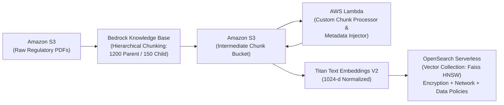
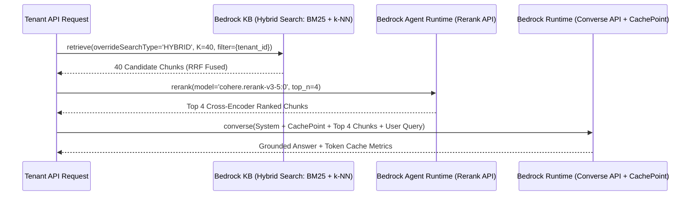
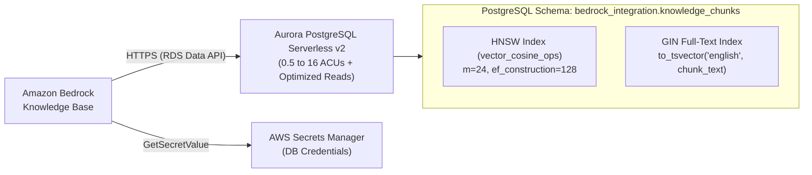
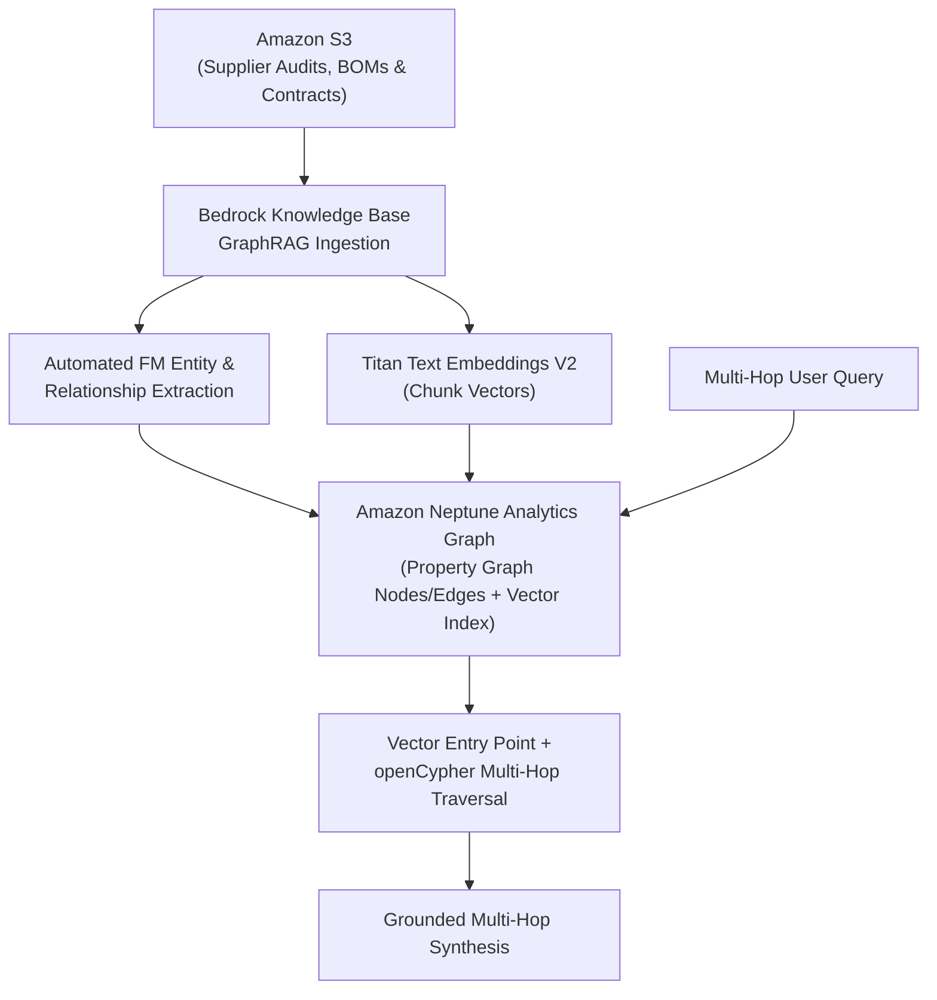
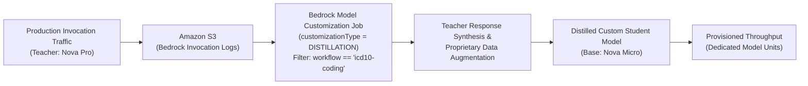
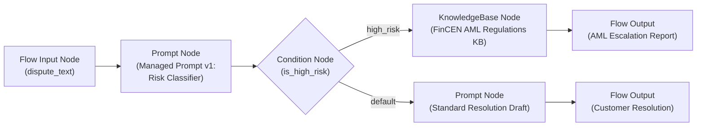

# Domain 1: Hands-On Production Exercises & Architectural Labs

This lab manual provides **6 production-grade engineering exercises** covering every task in **Domain 1 (Foundation Model Integration, Data Management, and Compliance)**. Every exercise includes an architecture diagram, complete infrastructure-as-code or SDK implementation, and verification steps.

---

## Exercise 1: End-to-End Bedrock Knowledge Base with Hierarchical Chunking, Custom Lambda Transformation, and OpenSearch Serverless Vector Engine

### Scenario & Architectural Objective
You are architecting a clinical regulatory RAG platform. Documents contain complex nested sections where retrieval requires high specificity (150-token child chunks) while generation requires broad surrounding context (1,200-token parent chunks). Furthermore, every chunk must be enriched with custom compliance classification metadata via an **AWS Lambda custom transformation** before being indexed into an **Amazon OpenSearch Serverless (`faiss` HNSW)** vector collection protected by Encryption, Network, and Data Access policies.



### Step 1: Custom Transformation AWS Lambda Handler (`chunk_enricher_lambda.py`)

```python
import json
import os
import re
import boto3
from typing import Dict, Any, List

s3_client = boto3.client("s3")


def classify_regulatory_tier(text: str) -> str:
    """Deterministically tags chunks with regulatory sensitivity tiers."""
    if re.search(r"\b(HIPAA|PHI|CFR\s*Part\s*11|FDA\s*21)\b", text, re.IGNORECASE):
        return "TIER_1_STRICT_REGULATORY"
    if re.search(r"\b(GDPR|SOX|ISO-27001)\b", text, re.IGNORECASE):
        return "TIER_2_COMPLIANCE"
    return "TIER_3_GENERAL"


def lambda_handler(event: Dict[str, Any], context: Any) -> Dict[str, Any]:
    """
    Amazon Bedrock Knowledge Base Custom Transformation Lambda contract.
    Reads pre-chunked objects from intermediate S3, enriches each chunk with
    custom metadata attributes, and writes the transformed JSON back to S3.
    """
    bucket_name = event["bucketName"]
    input_files: List[Dict[str, Any]] = event.get("inputFiles", [])
    output_files: List[Dict[str, Any]] = []

    for file_record in input_files:
        original_doc_uri = file_record.get("originalFileLocation", {}).get("s3_location", {}).get("uri", "")
        content_batches = file_record.get("contentBatches", [])
        transformed_batches = []

        for batch in content_batches:
            input_key = batch["key"]
            raw_obj = s3_client.get_object(Bucket=bucket_name, Key=input_key)
            payload = json.loads(raw_obj["Body"].read().decode("utf-8"))

            enriched_contents = []
            for item in payload.get("fileContents", []):
                content_body = item.get("contentBody", "")
                content_metadata = item.get("contentMetadata", {})

                # Inject custom chunk-level metadata for pre-filtering
                content_metadata["regulatory_tier"] = classify_regulatory_tier(content_body)
                content_metadata["char_length"] = len(content_body)
                content_metadata["processed_by"] = "custom-hierarchy-enricher-v1"

                enriched_contents.append(
                    {
                        "contentBody": content_body,
                        "contentType": item.get("contentType", "TEXT"),
                        "contentMetadata": content_metadata,
                    }
                )

            output_key = f"transformed/{input_key.lstrip('/')}"
            s3_client.put_object(
                Bucket=bucket_name,
                Key=output_key,
                Body=json.dumps({"fileContents": enriched_contents}).encode("utf-8"),
                ContentType="application/json",
            )
            transformed_batches.append({"key": output_key})

        output_files.append(
            {
                "originalFileLocation": file_record.get("originalFileLocation", {}),
                "fileMetadata": file_record.get("fileMetadata", {}),
                "contentBatches": transformed_batches,
            }
        )

    return {"outputFiles": output_files}
```

### Step 2: Terraform Configuration for AOSS Policies & Bedrock Knowledge Base (`main.tf`)

```hcl
terraform {
  required_version = ">= 1.6.0"
  required_providers {
    aws = {
      source  = "hashicorp/aws"
      version = ">= 5.80.0"
    }
  }
}

variable "region" {
  type    = string
  default = "us-east-1"
}

variable "collection_name" {
  type    = string
  default = "clinical-reg-vectors"
}

variable "kb_role_arn" {
  type        = string
  description = "IAM Role ARN assumed by Amazon Bedrock Knowledge Base"
}

variable "custom_lambda_arn" {
  type        = string
  description = "ARN of the chunk enrichment Lambda function"
}

variable "raw_docs_bucket_arn" {
  type = string
}

variable "intermediate_bucket_name" {
  type = string
}

# 1. OpenSearch Serverless Encryption Policy (Required)
resource "aws_opensearchserverless_security_policy" "encryption" {
  name = "${var.collection_name}-enc"
  type = "encryption"
  policy = jsonencode({
    Rules = [
      {
        Resource     = ["collection/${var.collection_name}"]
        ResourceType = "collection"
      }
    ]
    AWSOwnedKey = true
  })
}

# 2. OpenSearch Serverless Network Policy (Required)
resource "aws_opensearchserverless_security_policy" "network" {
  name = "${var.collection_name}-net"
  type = "network"
  policy = jsonencode([
    {
      Rules = [
        {
          Resource     = ["collection/${var.collection_name}"]
          ResourceType = "collection"
        }
      ]
      AllowFromPublic = false
      SourceServices  = ["bedrock.amazonaws.com"]
    }
  ])
}

# 3. OpenSearch Serverless Data Access Policy (Required)
resource "aws_opensearchserverless_access_policy" "data_access" {
  name = "${var.collection_name}-data"
  type = "data"
  policy = jsonencode([
    {
      Description = "Bedrock Knowledge Base Vector Index Access"
      Rules = [
        {
          Resource     = ["collection/${var.collection_name}"]
          Permission   = ["aoss:CreateCollectionItems", "aoss:UpdateCollectionItems", "aoss:DescribeCollectionItems"]
          ResourceType = "collection"
        },
        {
          Resource     = ["index/${var.collection_name}/*"]
          Permission   = ["aoss:CreateIndex", "aoss:UpdateIndex", "aoss:DescribeIndex", "aoss:ReadDocument", "aoss:WriteDocument"]
          ResourceType = "index"
        }
      ]
      Principal = [var.kb_role_arn]
    }
  ])
}

# 4. OpenSearch Serverless Vector Collection
resource "aws_opensearchserverless_collection" "vector_store" {
  name             = var.collection_name
  type             = "VECTORSEARCH"
  standby_replicas = "ENABLED"
  depends_on = [
    aws_opensearchserverless_security_policy.encryption,
    aws_opensearchserverless_security_policy.network,
    aws_opensearchserverless_access_policy.data_access
  ]
}

# 5. Bedrock Knowledge Base with Titan Text Embeddings V2
resource "aws_bedrockagent_knowledge_base" "clinical_kb" {
  name     = "clinical-regulatory-kb"
  role_arn = var.kb_role_arn

  knowledge_base_configuration {
    type = "VECTOR"
    vector_knowledge_base_configuration {
      embedding_model_arn = "arn:aws:bedrock:${var.region}::foundation-model/amazon.titan-embed-text-v2:0"
      embedding_model_configuration {
        bedrock_embedding_model_configuration {
          dimensions          = 1024
          embedding_data_type = "FLOAT32"
        }
      }
    }
  }

  storage_configuration {
    type = "OPENSEARCH_SERVERLESS"
    opensearch_serverless_configuration {
      collection_arn    = aws_opensearchserverless_collection.vector_store.arn
      vector_index_name = "clinical-hierarchy-index"
      field_mapping {
        vector_field   = "bedrock-knowledge-base-default-vector"
        text_field     = "AMAZON_BEDROCK_TEXT_CHUNK"
        metadata_field = "AMAZON_BEDROCK_METADATA"
      }
    }
  }
}

# 6. Data Source with Hierarchical Chunking + Custom Lambda Transformation
resource "aws_bedrockagent_data_source" "clinical_s3_source" {
  knowledge_base_id = aws_bedrockagent_knowledge_base.clinical_kb.id
  name              = "clinical-s3-hierarchical-source"

  data_source_configuration {
    type = "S3"
    s3_configuration {
      bucket_arn = var.raw_docs_bucket_arn
    }
  }

  vector_ingestion_configuration {
    chunking_configuration {
      chunking_strategy = "HIERARCHICAL"
      hierarchical_chunking_configuration {
        overlap_tokens = 40
        level_configuration {
          max_tokens = 1200 # Parent chunk size returned to FM
        }
        level_configuration {
          max_tokens = 150 # Child chunk size embedded for dense retrieval
        }
      }
    }

    custom_transformation_configuration {
      intermediate_storage {
        s3_location {
          uri = "s3://${var.intermediate_bucket_name}/intermediate/"
        }
      }
      transformation {
        step_to_apply = "POST_CHUNKING"
        transformation_function {
          transformation_lambda_configuration {
            lambda_arn = var.custom_lambda_arn
          }
        }
      }
    }
  }
}
```

### Verification Commands
```bash
# Trigger Knowledge Base ingestion job and verify chunk indexing
aws bedrock-agent start-ingestion-job \
  --knowledge-base-id "$KB_ID" \
  --data-source-id "$DS_ID" \
  --region us-east-1

# Query the Knowledge Base filtering by the custom Lambda-injected metadata field
aws bedrock-agent-runtime retrieve \
  --knowledge-base-id "$KB_ID" \
  --retrieval-query '{"text": "What are the electronic signature audit trail requirements?"}' \
  --retrieval-configuration '{
    "vectorSearchConfiguration": {
      "numberOfResults": 5,
      "overrideSearchType": "HYBRID",
      "filter": {
        "equals": {
          "key": "regulatory_tier",
          "value": "TIER_1_STRICT_REGULATORY"
        }
      }
    }
  }' \
  --region us-east-1
```

---

## Exercise 2: Hybrid Search + Two-Stage Reranking Pipeline (`Retrieve` + `Rerank` + `Converse`) with Tenant Metadata Pre-Filtering in `boto3`

### Scenario & Architectural Objective
You are building a multi-tenant B2B technical support copilot. Customers ask questions containing both exact hardware SKU codes (requiring lexical BM25 precision) and conceptual troubleshooting descriptions (requiring dense semantic matching). You must enforce zero-trust tenant isolation via metadata pre-filtering, retrieve Top $K = 40$ candidates via **Hybrid Search**, re-score those 40 candidates using the standalone **Amazon Bedrock `rerank` API** (`cohere.rerank-v3-5:0`) down to Top $N = 4$, and generate a response with **Prompt Caching** enabled.



### Complete Python Implementation (`hybrid_rerank_pipeline.py`)

```python
import boto3
from typing import Dict, Any, List

bedrock_agent_runtime = boto3.client("bedrock-agent-runtime", region_name="us-east-1")
bedrock_runtime = boto3.client("bedrock-runtime", region_name="us-east-1")

SYSTEM_POLICY_PROMPT = """You are a Principal Hardware Support Engineer AI.
Follow these strict operational constraints:
1. Answer the user's question using ONLY the facts inside <verified_chunks>.
2. Always include the exact SKU, firmware version, and source URI in brackets [source_uri].
3. If the answer cannot be verified from <verified_chunks>, respond with: 'UNVERIFIED_IN_TENANT_KB'.
"""


def execute_two_stage_rag(
    kb_id: str,
    tenant_id: str,
    min_security_clearance: int,
    user_query: str,
    stage1_k: int = 40,
    stage2_n: int = 4,
) -> Dict[str, Any]:
    """
    Runs Stage 1 Hybrid Search with strict tenant pre-filtering, Stage 2 standalone
    Cross-Encoder Reranking via Bedrock Rerank API, and Stage 3 Grounded Generation.
    """
    # 1. Stage 1: Hybrid Retrieval with Composite Pre-Filter
    pre_filter = {
        "andAll": [
            {"equals": {"key": "tenant_id", "value": tenant_id}},
            {"lessThanOrEquals": {"key": "required_clearance", "value": min_security_clearance}},
        ]
    }

    retrieve_resp = bedrock_agent_runtime.retrieve(
        knowledgeBaseId=kb_id,
        retrievalQuery={"text": user_query},
        retrievalConfiguration={
            "vectorSearchConfiguration": {
                "numberOfResults": stage1_k,
                "overrideSearchType": "HYBRID",
                "filter": pre_filter,
            }
        },
    )

    raw_candidates = retrieve_resp.get("retrievalResults", [])
    if not raw_candidates:
        return {"answer": "UNVERIFIED_IN_TENANT_KB", "reranked_sources": []}

    # 2. Stage 2: Standalone Bedrock Rerank API Call
    rerank_sources = []
    for candidate in raw_candidates:
        rerank_sources.append(
            {
                "type": "INLINE",
                "inlineDocumentSource": {
                    "type": "TEXT",
                    "textDocument": {"text": candidate["content"]["text"]},
                },
            }
        )

    rerank_resp = bedrock_agent_runtime.rerank(
        queries=[{"type": "TEXT", "textQuery": {"text": user_query}}],
        sources=rerank_sources,
        rerankingConfiguration={
            "type": "BEDROCK_RERANKING_MODEL",
            "bedrockRerankingConfiguration": {
                "numberOfResults": min(stage2_n, len(rerank_sources)),
                "modelConfiguration": {
                    "modelArn": "arn:aws:bedrock:us-east-1::foundation-model/cohere.rerank-v3-5:0"
                },
            },
        },
    )

    # Map reranked indices back to original candidate metadata
    top_chunks_xml: List[str] = []
    selected_sources: List[Dict[str, Any]] = []

    for rank_item in rerank_resp.get("results", []):
        orig_idx = rank_item["index"]
        relevance_score = rank_item["relevanceScore"]
        winner = raw_candidates[orig_idx]
        s3_uri = winner.get("location", {}).get("s3Location", {}).get("uri", "unknown")
        chunk_text = winner["content"]["text"]

        top_chunks_xml.append(
            f'<chunk source_uri="{s3_uri}" rerank_score="{relevance_score:.4f}">\n{chunk_text}\n</chunk>'
        )
        selected_sources.append(
            {"source_uri": s3_uri, "rerank_score": relevance_score, "original_rank": orig_idx + 1}
        )

    # 3. Stage 3: Converse API with Prompt Caching
    joined_chunks = "\n".join(top_chunks_xml)
    converse_resp = bedrock_runtime.converse(
        modelId="us.anthropic.claude-3-5-sonnet-20241022-v2:0",
        system=[
            {"text": SYSTEM_POLICY_PROMPT},
            {"cachePoint": {"type": "default"}},
        ],
        messages=[
            {
                "role": "user",
                "content": [
                    {
                        "text": (
                            f"<verified_chunks>\n{joined_chunks}\n</verified_chunks>\n\n"
                            f"Customer Question: {user_query}"
                        )
                    }
                ],
            }
        ],
        inferenceConfig={"maxTokens": 1024, "temperature": 0.0},
    )

    return {
        "answer": converse_resp["output"]["message"]["content"][0]["text"],
        "reranked_sources": selected_sources,
        "token_usage": converse_resp.get("usage", {}),
    }


if __name__ == "__main__":
    result = execute_two_stage_rag(
        kb_id="KB12345678",
        tenant_id="tenant-global-mfg",
        min_security_clearance=2,
        user_query="How do I resolve error code E-9042-TX on router SKU NX-7700-PRO after firmware 4.2 upgrade?",
    )
    print(result)
```

---

## Exercise 3: Aurora PostgreSQL Serverless v2 `pgvector` HNSW Tuning & Bedrock Knowledge Base Integration via RDS Data API

### Scenario & Architectural Objective
A financial analytics team needs a vector store for Amazon Bedrock Knowledge Bases that scales down to 0.5 ACU during off-hours to minimize dev/test and low-traffic costs while supporting high-recall HNSW vector search and full-text lexical search (`GIN` index) for Hybrid Search.



### Step 1: SQL Schema, `pgvector` HNSW Index, and GIN Index Setup (`aurora_pgvector_setup.sql`)

```sql
-- 1. Enable the pgvector extension (requires pgvector >= 0.5.0 for HNSW)
CREATE EXTENSION IF NOT EXISTS vector;
CREATE EXTENSION IF NOT EXISTS "uuid-ossp";

-- 2. Create dedicated schema and table matching Bedrock Knowledge Base contract
CREATE SCHEMA IF NOT EXISTS bedrock_integration;

CREATE TABLE IF NOT EXISTS bedrock_integration.knowledge_chunks (
    id uuid PRIMARY KEY DEFAULT uuid_generate_v4(),
    embedding vector(1024) NOT NULL,
    chunk_text text NOT NULL,
    metadata jsonb NOT NULL DEFAULT '{}'::jsonb,
    custom_tenant_id varchar(128)
);

-- 3. Create HNSW Index tuned for high recall on 1024-d Titan Embeddings V2 (cosine distance)
-- Maintenance work memory boosted for fast in-memory graph construction
SET maintenance_work_mem = '2GB';

CREATE INDEX IF NOT EXISTS idx_knowledge_chunks_embedding_hnsw
ON bedrock_integration.knowledge_chunks
USING hnsw (embedding vector_cosine_ops)
WITH (m = 24, ef_construction = 128);

-- 4. Create GIN Full-Text Index on chunk_text (REQUIRED by Bedrock KB for Hybrid Search on Aurora!)
CREATE INDEX IF NOT EXISTS idx_knowledge_chunks_text_gin
ON bedrock_integration.knowledge_chunks
USING gin (to_tsvector('english', chunk_text));

-- 5. Create GIN Index on JSONB metadata for fast pre-filtering
CREATE INDEX IF NOT EXISTS idx_knowledge_chunks_metadata_gin
ON bedrock_integration.knowledge_chunks
USING gin (metadata);
```

### Step 2: Python Script Executing SQL via RDS Data API & Registering the Aurora KB (`setup_aurora_kb.py`)

```python
import boto3

rds_data = boto3.client("rds-data", region_name="us-east-1")
bedrock_agent = boto3.client("bedrock-agent", region_name="us-east-1")


def tune_query_session_and_verify_hnsw(
    cluster_arn: str,
    secret_arn: str,
    database_name: str,
) -> dict:
    """
    Verifies pgvector installation and demonstrates setting hnsw.ef_search via RDS Data API.
    """
    sql_check = """
    SELECT extname, extversion
    FROM pg_extension
    WHERE extname = 'vector';
    """
    response = rds_data.execute_statement(
        resourceArn=cluster_arn,
        secretArn=secret_arn,
        database=database_name,
        sql=sql_check,
    )
    return response["records"]


def create_aurora_backed_knowledge_base(
    kb_name: str,
    kb_role_arn: str,
    aurora_cluster_arn: str,
    secret_arn: str,
    database_name: str,
) -> str:
    """
    Registers an Amazon Aurora PostgreSQL Serverless v2 cluster as the backing
    vector store for an Amazon Bedrock Knowledge Base.
    """
    response = bedrock_agent.create_knowledge_base(
        name=kb_name,
        roleArn=kb_role_arn,
        knowledgeBaseConfiguration={
            "type": "VECTOR",
            "vectorKnowledgeBaseConfiguration": {
                "embeddingModelArn": "arn:aws:bedrock:us-east-1::foundation-model/amazon.titan-embed-text-v2:0",
                "embeddingModelConfiguration": {
                    "bedrockEmbeddingModelConfiguration": {
                        "dimensions": 1024,
                        "embeddingDataType": "FLOAT32",
                    }
                },
            },
        },
        storageConfiguration={
            "type": "RDS",
            "rdsConfiguration": {
                "resourceArn": aurora_cluster_arn,
                "credentialsSecretArn": secret_arn,
                "databaseName": database_name,
                "tableName": "bedrock_integration.knowledge_chunks",
                "fieldMapping": {
                    "primaryKeyField": "id",
                    "vectorField": "embedding",
                    "textField": "chunk_text",
                    "metadataField": "metadata",
                },
            },
        },
    )
    return response["knowledgeBase"]["knowledgeBaseId"]
```

---

## Exercise 4: GraphRAG Architecture using Amazon Bedrock Knowledge Bases with Amazon Neptune Analytics

### Scenario & Architectural Objective
A pharmaceutical supply-chain resilience team needs to answer complex multi-hop questions across thousands of supplier audit reports, active pharmaceutical ingredient (API) manifests, and logistics contracts (e.g., *"Which EU drug manufacturing lines are indirectly exposed to raw material delays from Tier-3 chemical suppliers in Region X?"*). Standard vector similarity fails because the supplier relationship chain spans three separate documents. You will implement **GraphRAG** using **Amazon Bedrock Knowledge Bases with Amazon Neptune Analytics**.



### Complete Python Provisioning & Multi-Hop Query Script (`neptune_graphrag.py`)

```python
import time
import boto3
from typing import Dict, Any

neptune_graph = boto3.client("neptune-graph", region_name="us-east-1")
bedrock_agent = boto3.client("bedrock-agent", region_name="us-east-1")
bedrock_agent_runtime = boto3.client("bedrock-agent-runtime", region_name="us-east-1")


def provision_neptune_analytics_vector_graph(graph_name: str) -> str:
    """
    Creates an Amazon Neptune Analytics graph configured with a 1024-dimension
    vector search index for Bedrock GraphRAG integration.
    """
    create_resp = neptune_graph.create_graph(
        graphName=graph_name,
        provisionedMemory=16,  # 16 m-NCUs
        publicConnectivity=False,
        vectorSearchConfiguration={"dimension": 1024},
        deletionProtection=False,
        tags={"Purpose": "Bedrock-GraphRAG-SupplyChain"},
    )
    graph_id = create_resp["id"]
    graph_arn = create_resp["arn"]

    # Wait until graph transitions to AVAILABLE
    while True:
        status_resp = neptune_graph.get_graph(graphIdentifier=graph_id)
        state = status_resp["status"]
        if state == "AVAILABLE":
            break
        if state in ("FAILED", "DELETING"):
            raise RuntimeError(f"Neptune Analytics graph creation failed: {status_resp}")
        time.sleep(15)

    return graph_arn


def create_graphrag_knowledge_base(
    kb_name: str,
    kb_role_arn: str,
    neptune_graph_arn: str,
) -> str:
    """
    Creates an Amazon Bedrock Knowledge Base backed by Amazon Neptune Analytics (GraphRAG)
    with Context Enrichment enabled to traverse connected entity neighborhoods.
    """
    kb_resp = bedrock_agent.create_knowledge_base(
        name=kb_name,
        roleArn=kb_role_arn,
        knowledgeBaseConfiguration={
            "type": "VECTOR",
            "vectorKnowledgeBaseConfiguration": {
                "embeddingModelArn": "arn:aws:bedrock:us-east-1::foundation-model/amazon.titan-embed-text-v2:0",
            },
        },
        storageConfiguration={
            "type": "NEPTUNE_ANALYTICS",
            "neptuneAnalyticsConfiguration": {
                "graphArn": neptune_graph_arn,
                "fieldMapping": {
                    "textField": "text",
                    "metadataField": "metadata",
                },
            },
        },
    )
    return kb_resp["knowledgeBase"]["knowledgeBaseId"]


def create_graphrag_data_source_with_enrichment(
    kb_id: str,
    s3_bucket_arn: str,
) -> str:
    """
    Configures the data source to use Bedrock Foundation Model Context Enrichment
    to build the entity-relationship knowledge graph in Neptune Analytics.
    """
    ds_resp = bedrock_agent.create_data_source(
        knowledgeBaseId=kb_id,
        name="supply-chain-graphrag-source",
        dataSourceConfiguration={
            "type": "S3",
            "s3Configuration": {"bucketArn": s3_bucket_arn},
        },
        vectorIngestionConfiguration={
            "chunkingConfiguration": {
                "chunkingStrategy": "FIXED_SIZE",
                "fixedSizeChunkingConfiguration": {
                    "maxTokens": 300,
                    "overlapPercentage": 15,
                },
            },
            "contextEnrichmentConfiguration": {
                "type": "BEDROCK_FOUNDATION_MODEL",
                "bedrockFoundationModelConfiguration": {
                    "modelArn": "arn:aws:bedrock:us-east-1::foundation-model/anthropic.claude-3-haiku-20240307-v1:0",
                    "enrichmentStrategyConfiguration": {
                        "method": "CHUNK_ENTITY_EXTRACTION"
                    },
                },
            },
        },
    )
    return ds_resp["dataSource"]["dataSourceId"]


def query_supply_chain_graphrag(kb_id: str, multi_hop_question: str) -> Dict[str, Any]:
    """
    Executes RetrieveAndGenerate against the Neptune Analytics GraphRAG Knowledge Base.
    """
    response = bedrock_agent_runtime.retrieve_and_generate(
        input={"text": multi_hop_question},
        retrieveAndGenerateConfiguration={
            "type": "KNOWLEDGE_BASE",
            "knowledgeBaseConfiguration": {
                "knowledgeBaseId": kb_id,
                "modelArn": "arn:aws:bedrock:us-east-1::foundation-model/amazon.nova-pro-v1:0",
                "retrievalConfiguration": {
                    "vectorSearchConfiguration": {
                        "numberOfResults": 10,
                    }
                },
            },
        },
    )
    return {
        "answer": response["output"]["text"],
        "citations": response.get("citations", []),
    }
```

---

## Exercise 5: Bedrock Model Distillation Pipeline (Teacher-to-Student Fine-Tuning from Invocation Logs in S3) + Provisioned Throughput Deployment

### Scenario & Architectural Objective
Your production medical coding pipeline currently uses `amazon.nova-pro-v1:0` (Teacher), achieving 96% accuracy but exceeding your 400ms P95 latency SLA and monthly token budget at 5,000 RPM. You have enabled **Amazon Bedrock Model Invocation Logging** to S3 with `requestMetadata: {"workflow": "icd10-coding"}`. You will distill the Teacher's capabilities into `amazon.nova-micro-v1:0` (Student) and deploy the resulting custom student model onto **Provisioned Throughput**.



### Complete Python Implementation (`distill_and_deploy_student.py`)

```python
import time
import boto3

bedrock = boto3.client("bedrock", region_name="us-east-1")
bedrock_runtime = boto3.client("bedrock-runtime", region_name="us-east-1")


def configure_invocation_logging(s3_log_bucket: str, kms_key_arn: str) -> None:
    """
    Enables Amazon Bedrock Model Invocation Logging to S3 for capturing
    production Teacher prompt-response pairs.
    """
    bedrock.put_model_invocation_logging_configuration(
        loggingConfig={
            "s3Config": {
                "bucketName": s3_log_bucket,
                "keyPrefix": "bedrock-invocation-logs/",
                "encryptionKeyId": kms_key_arn,
            },
            "textDataDeliveryEnabled": True,
            "imageDataDeliveryEnabled": False,
            "embeddingDataDeliveryEnabled": False,
        }
    )


def run_distillation_and_provision_student(
    job_name: str,
    student_custom_model_name: str,
    execution_role_arn: str,
    s3_logs_uri: str,
    s3_output_uri: str,
    kms_key_arn: str,
) -> str:
    """
    Launches a Bedrock Model Distillation job from filtered S3 invocation logs,
    waits for completion, and provisions 1 Model Unit of Provisioned Throughput.
    """
    teacher_arn = "arn:aws:bedrock:us-east-1::foundation-model/amazon.nova-pro-v1:0"
    student_base_arn = "arn:aws:bedrock:us-east-1::foundation-model/amazon.nova-micro-v1:0:128k"

    job_resp = bedrock.create_model_customization_job(
        jobName=job_name,
        customModelName=student_custom_model_name,
        roleArn=execution_role_arn,
        baseModelIdentifier=student_base_arn,
        customizationType="DISTILLATION",
        customModelKmsKeyId=kms_key_arn,
        trainingDataConfig={
            "invocationLogsConfig": {
                "usePromptResponse": True,
                "invocationLogSource": {"s3Uri": s3_logs_uri},
                "requestMetadataFilters": {
                    "equals": {"workflow": "icd10-coding"}
                },
            }
        },
        outputDataConfig={"s3Uri": s3_output_uri},
        customizationConfig={
            "distillationConfig": {
                "teacherModelConfig": {
                    "teacherModelIdentifier": teacher_arn,
                    "maxResponseLengthForInference": 1024,
                }
            }
        },
    )
    job_arn = job_resp["jobArn"]

    # Poll until distillation job completes
    while True:
        status_resp = bedrock.get_model_customization_job(jobIdentifier=job_arn)
        status = status_resp["status"]
        if status == "Completed":
            custom_model_arn = status_resp["outputModelArn"]
            break
        if status in ("Failed", "Stopped"):
            raise RuntimeError(f"Distillation job {job_arn} failed: {status_resp.get('failureMessage')}")
        time.sleep(60)

    # Deploy the distilled Student model onto Provisioned Throughput (1 Model Unit)
    pt_resp = bedrock.create_provisioned_model_throughput(
        modelUnits=1,
        provisionedModelName=f"{student_custom_model_name}-pt",
        modelId=custom_model_arn,
        commitmentDuration="OneMonth",
    )
    return pt_resp["provisionedModelArn"]
```

---

## Exercise 6: Versioned Prompt Governance with Bedrock Prompt Management & Conditional Bedrock Prompt Flows

### Scenario & Architectural Objective
A fintech compliance organization prohibits hardcoded prompts inside application containers. All prompts must be stored in **Amazon Bedrock Prompt Management**, encrypted with a Customer Managed KMS Key, locked as immutable versions, and orchestrated through an **Amazon Bedrock Prompt Flow** that classifies incoming wire-transfer disputes and routes high-value disputes (`amount_usd > 10000`) to a specialized regulatory escalation branch.



### Complete Python Implementation (`governed_prompt_flow.py`)

```python
import boto3
from typing import Dict, Any

bedrock_agent = boto3.client("bedrock-agent", region_name="us-east-1")
bedrock_agent_runtime = boto3.client("bedrock-agent-runtime", region_name="us-east-1")


def create_versioned_managed_prompt(kms_key_arn: str) -> str:
    """
    Creates a KMS-encrypted prompt in Amazon Bedrock Prompt Management and publishes
    an immutable Version 1 for production governance.
    """
    draft_resp = bedrock_agent.create_prompt(
        name="wire-dispute-risk-classifier",
        description="Classifies wire dispute severity into HIGH_RISK or STANDARD.",
        customerEncryptionKeyArn=kms_key_arn,
        defaultVariant="v1-claude-haiku",
        variants=[
            {
                "name": "v1-claude-haiku",
                "modelId": "anthropic.claude-3-5-haiku-20241022-v1:0",
                "templateType": "CHAT",
                "inferenceConfiguration": {
                    "text": {
                        "temperature": 0.0,
                        "maxTokens": 128,
                    }
                },
                "templateConfiguration": {
                    "chat": {
                        "system": [
                            {
                                "text": (
                                    "You are a FinCEN Wire Fraud Classifier. Output ONLY the exact string "
                                    "'HIGH_RISK' if the wire exceeds $10,000 or involves international "
                                    "sanctions; otherwise output 'STANDARD'."
                                )
                            }
                        ],
                        "messages": [
                            {
                                "role": "user",
                                "content": [
                                    {
                                        "text": "Customer Tier: {{customer_tier}}\nDispute Details: {{dispute_text}}"
                                    }
                                ],
                            }
                        ],
                        "inputVariables": [
                            {"name": "customer_tier"},
                            {"name": "dispute_text"},
                        ],
                    }
                },
            }
        ],
    )
    prompt_id = draft_resp["id"]

    # Publish immutable Version 1
    version_resp = bedrock_agent.create_prompt_version(
        promptIdentifier=prompt_id,
        description="Production signed-off Version 1 for Q4 audit",
    )
    return version_resp["arn"]


def create_conditional_prompt_flow(
    flow_execution_role_arn: str,
    classifier_prompt_version_arn: str,
    aml_kb_id: str,
) -> Dict[str, str]:
    """
    Creates a declarative Amazon Bedrock Prompt Flow with Input, Managed Prompt,
    Condition, KnowledgeBase, and Output nodes, then publishes a version and alias.
    """
    flow_resp = bedrock_agent.create_flow(
        name="wire-dispute-triage-flow",
        executionRoleArn=flow_execution_role_arn,
        definition={
            "nodes": [
                {
                    "name": "FlowInput",
                    "type": "Input",
                    "outputs": [{"name": "document", "type": "Object"}],
                },
                {
                    "name": "RiskClassifierNode",
                    "type": "Prompt",
                    "configuration": {
                        "prompt": {
                            "sourceConfiguration": {
                                "resource": {"promptArn": classifier_prompt_version_arn}
                            }
                        }
                    },
                    "inputs": [
                        {
                            "name": "customer_tier",
                            "type": "String",
                            "expression": "$.data.customer_tier",
                        },
                        {
                            "name": "dispute_text",
                            "type": "String",
                            "expression": "$.data.dispute_text",
                        },
                    ],
                    "outputs": [{"name": "modelCompletion", "type": "String"}],
                },
                {
                    "name": "RiskRouterCondition",
                    "type": "Condition",
                    "configuration": {
                        "condition": {
                            "conditions": [
                                {
                                    "name": "HighRiskBranch",
                                    "expression": 'RiskFlag == "HIGH_RISK"',
                                },
                                {"name": "default"},
                            ]
                        }
                    },
                    "inputs": [
                        {
                            "name": "RiskFlag",
                            "type": "String",
                            "expression": "$.data",
                        }
                    ],
                },
                {
                    "name": "AMLKnowledgeBaseNode",
                    "type": "KnowledgeBase",
                    "configuration": {
                        "knowledgeBase": {
                            "knowledgeBaseId": aml_kb_id,
                            "modelId": "amazon.nova-pro-v1:0",
                        }
                    },
                    "inputs": [
                        {
                            "name": "retrievalQuery",
                            "type": "String",
                            "expression": "$.data.dispute_text",
                        }
                    ],
                    "outputs": [{"name": "modelCompletion", "type": "String"}],
                },
                {
                    "name": "FlowOutput",
                    "type": "Output",
                    "inputs": [
                        {
                            "name": "document",
                            "type": "String",
                            "expression": "$.data",
                        }
                    ],
                },
            ],
            "connections": [
                {
                    "name": "InputToClassifierTier",
                    "source": "FlowInput",
                    "target": "RiskClassifierNode",
                    "type": "Data",
                    "configuration": {
                        "data": {
                            "sourceOutput": "document",
                            "targetInput": "customer_tier",
                        }
                    },
                },
                {
                    "name": "InputToClassifierText",
                    "source": "FlowInput",
                    "target": "RiskClassifierNode",
                    "type": "Data",
                    "configuration": {
                        "data": {
                            "sourceOutput": "document",
                            "targetInput": "dispute_text",
                        }
                    },
                },
                {
                    "name": "ClassifierToCondition",
                    "source": "RiskClassifierNode",
                    "target": "RiskRouterCondition",
                    "type": "Data",
                    "configuration": {
                        "data": {
                            "sourceOutput": "modelCompletion",
                            "targetInput": "RiskFlag",
                        }
                    },
                },
                {
                    "name": "HighRiskToKB",
                    "source": "RiskRouterCondition",
                    "target": "AMLKnowledgeBaseNode",
                    "type": "Conditional",
                    "configuration": {
                        "conditional": {"condition": "HighRiskBranch"}
                    },
                },
                {
                    "name": "InputToKBQuery",
                    "source": "FlowInput",
                    "target": "AMLKnowledgeBaseNode",
                    "type": "Data",
                    "configuration": {
                        "data": {
                            "sourceOutput": "document",
                            "targetInput": "retrievalQuery",
                        }
                    },
                },
                {
                    "name": "KBToOutput",
                    "source": "AMLKnowledgeBaseNode",
                    "target": "FlowOutput",
                    "type": "Data",
                    "configuration": {
                        "data": {
                            "sourceOutput": "modelCompletion",
                            "targetInput": "document",
                        }
                    },
                },
            ],
        },
    )
    flow_id = flow_resp["id"]

    # Prepare and publish immutable Flow Version + Production Alias
    bedrock_agent.prepare_flow(flowIdentifier=flow_id)
    ver_resp = bedrock_agent.create_flow_version(flowIdentifier=flow_id)
    alias_resp = bedrock_agent.create_flow_alias(
        flowIdentifier=flow_id,
        name="prod-live",
        routingConfiguration=[{"flowVersion": ver_resp["version"]}],
    )
    return {"flow_id": flow_id, "alias_id": alias_resp["id"]}


def invoke_dispute_flow(flow_id: str, alias_id: str, tier: str, dispute_text: str) -> str:
    """Invokes the deployed Bedrock Prompt Flow and reads the streamed output event."""
    response = bedrock_agent_runtime.invoke_flow(
        flowIdentifier=flow_id,
        flowAliasIdentifier=alias_id,
        inputs=[
            {
                "content": {
                    "document": {
                        "customer_tier": tier,
                        "dispute_text": dispute_text,
                    }
                },
                "nodeName": "FlowInput",
                "nodeOutputName": "document",
            }
        ],
    )
    final_output = ""
    for event in response.get("responseStream", []):
        if "flowOutputEvent" in event:
            final_output = event["flowOutputEvent"]["content"]["document"]
    return final_output
```
