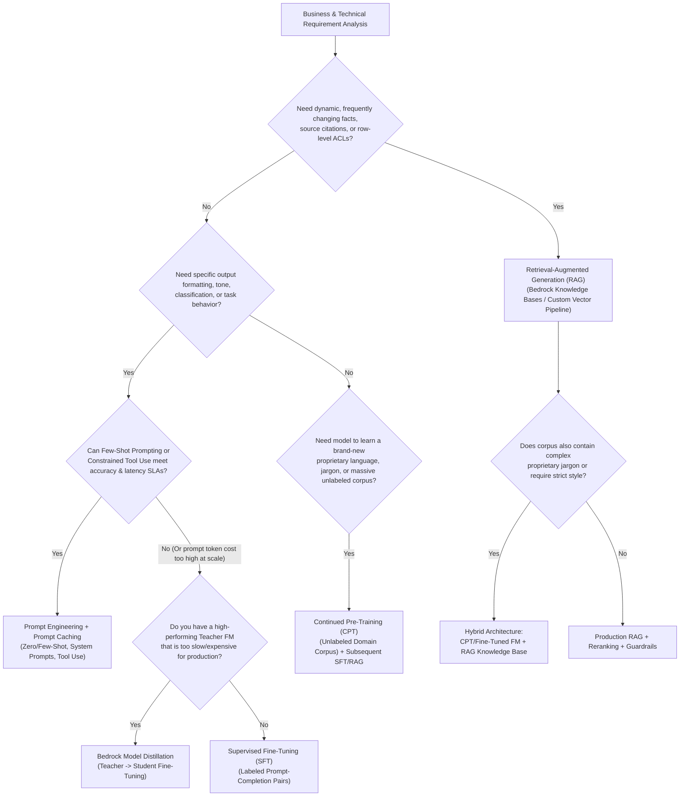
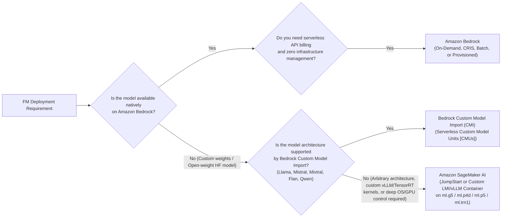
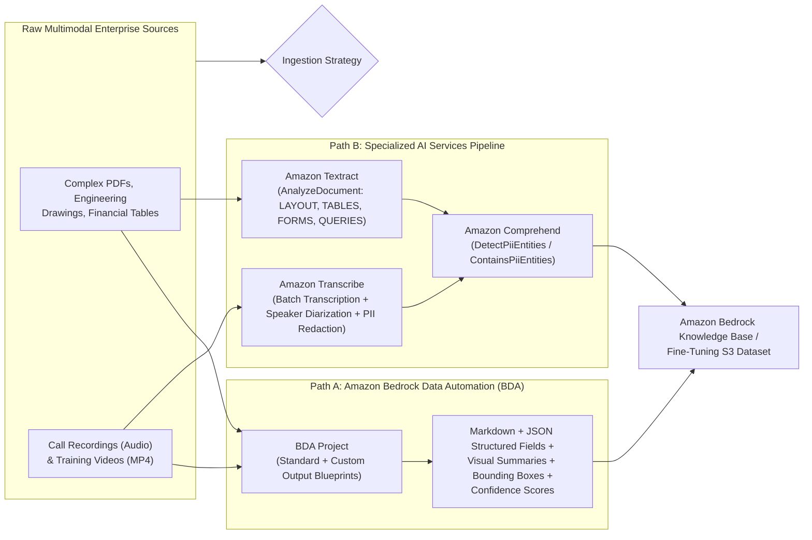
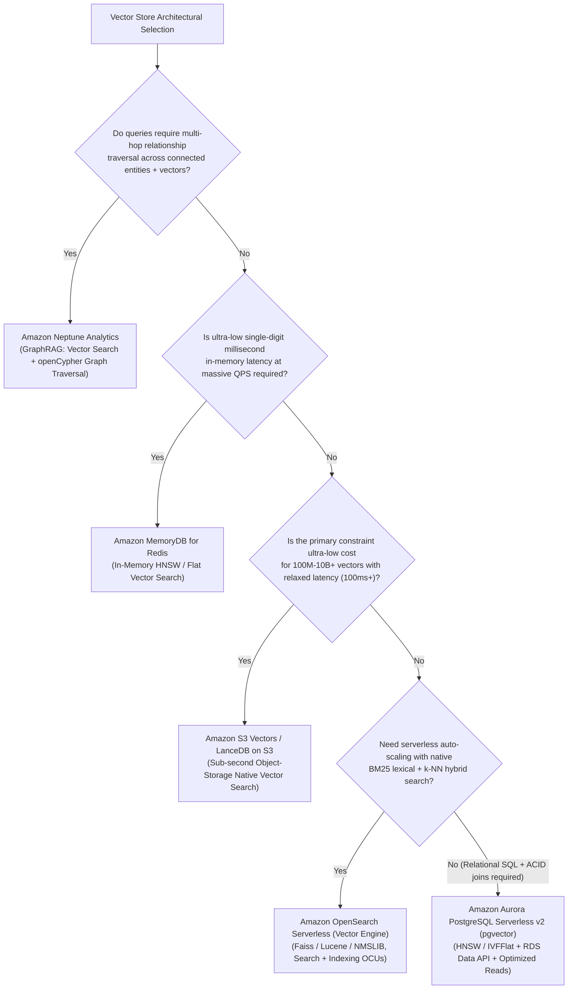
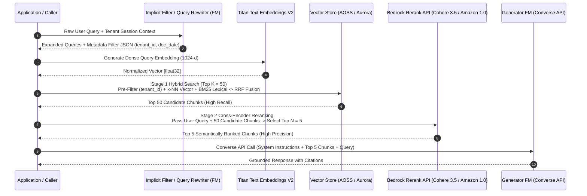
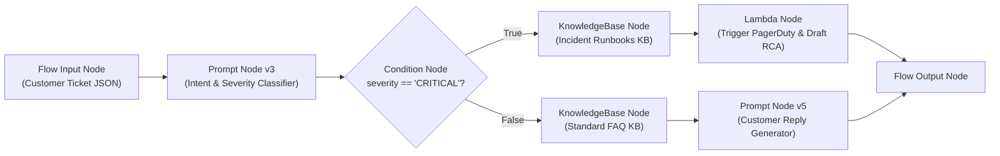

# Domain 1: Foundation Model Integration, Data Management, and Compliance (31%) — Deep-Dive Study Guide

## Overview & Exam Blueprint Weighting

Domain 1 accounts for **31% of the AWS Certified Generative AI Developer - Professional (AIP-C01)** exam—making it the single largest domain on the certification blueprint. At the Professional level, AWS tests your ability to make architectural trade-offs across foundation model (FM) selection, customization paradigms, multimodal data ingestion pipelines, enterprise vector database internals, multi-stage retrieval augmentation, and governed prompt orchestration.

| Task ID | Task Title | Core Architectural Focus |
| :--- | :--- | :--- |
| **Task 1.1** | Analyze Requirements & Design GenAI Solutions | Decision frameworks for Prompt Engineering vs. RAG vs. Fine-Tuning vs. Continued Pre-Training (CPT) vs. Model Distillation; modality alignment; latency, cost, and compliance matrices. |
| **Task 1.2** | Select & Configure Foundation Models (FMs) | Amazon Bedrock vs. SageMaker JumpStart vs. Custom Model Import; customization pipelines; inference parameters; Cross-Region Inference (CRIS) vs. Provisioned Throughput. |
| **Task 1.3** | Data Validation & Processing Pipelines for FM Consumption | Amazon Bedrock Data Automation (BDA); Textract + Comprehend PII redaction; AWS Glue & EMR Spark deduplication (MinHash LSH); Knowledge Base chunking architectures. |
| **Task 1.4** | Design & Implement Vector Store Solutions | OpenSearch Serverless Vector Engine (HNSW/IVF, Faiss/NMSLIB/Lucene, OCUs), Aurora PostgreSQL `pgvector` (HNSW, Optimized Reads), S3 Vectors, MemoryDB, Neptune Analytics (GraphRAG). |
| **Task 1.5** | Design Retrieval Mechanisms for FM Augmentation | Hybrid search with Reciprocal Rank Fusion (RRF), Two-Stage Retrieval with Bedrock Rerank API, metadata pre-filtering vs. post-filtering, HyDE, Multi-Query Expansion, Implicit Filtering. |
| **Task 1.6** | Prompt Engineering Strategies & Governance | Bedrock Prompt Management, Prompt Flows DAG orchestration, Converse API, XML structuring, Constrained Decoding via Tool Use (`toolConfig`), Chain-of-Thought, Extended Thinking. |

---

## Task 1.1: Analyze Requirements & Design GenAI Solutions

### 1. The FM Adaptation Spectrum: Architectural Decision Framework

Selecting the wrong adaptation paradigm is one of the most common pitfalls on the AIP-C01 exam. Architects must optimize along a spectrum of **operational complexity, data freshness, factual grounding, domain terminology adaptation, and inference unit economics**.



#### Comprehensive Comparison Matrix: Adaptation Approaches

| Dimension | Prompt Engineering (In-Context Learning) | Retrieval-Augmented Generation (RAG) | Supervised Fine-Tuning (SFT) | Continued Pre-Training (CPT) | Model Distillation (Teacher-Student) |
| :--- | :--- | :--- | :--- | :--- | :--- |
| **Primary Objective** | Steer model behavior, format, and reasoning at runtime using instructions and examples. | Ground responses in external, verifiable, mutable knowledge with source attribution. | Adapt task-specific style, structured formatting, edge-case classification, and tone. | Instill deep domain vocabulary, industry syntax, or non-public linguistic constructs. | Transfer task accuracy from a large frontier model (Teacher) to a smaller, faster model (Student). |
| **Training Data Format** | None (0 to $k$ runtime examples in prompt context). | Unstructured/structured documents chunked and embedded into a vector/graph store. | Labeled JSONL: `{"prompt": "...", "completion": "..."}` or Multi-turn Converse messages (100–10,000+ records). | Unlabeled raw text JSONL: `{"input": "..."}` across massive domain corpora (100M–10B+ tokens). | Teacher-generated synthetic responses from prompt datasets or Bedrock Invocation Logs. |
| **Knowledge Freshness** | Immediate (bounded by context window). | Near real-time (bounded only by ingestion/embedding pipeline latency). | Static (frozen at training time; requires retraining + new Provisioned Throughput). | Static (frozen at training time; computationally expensive to refresh). | Static (reflects Teacher behavior on the training distribution). |
| **Hallucination Mitigation** | Low (relies on parametric memory unless context is explicitly injected). | **Very High** (provides explicit passages, citations, and grounding checks). | **Low / Negative** (SFT teaches form/behavior; using SFT to inject facts often increases confident hallucinations). | Moderate for domain concepts, but still requires RAG for specific factual retrieval and citations. | Matches Teacher's task reliability on narrow distributions; still requires RAG for dynamic facts. |
| **Access Control (ACLs)** | Enforced by application before prompt assembly. | **Granular** (enforced at query time via vector metadata pre-filtering per tenant/role). | Coarse (model weights encode all training data; cannot isolate tenant data inside weights). | Coarse (all training data is baked into model parameters). | Coarse (Student weights encode Teacher knowledge across the training set). |
| **Inference Cost Profile** | On-Demand or Cris token pricing; high input token cost if few-shot prompts are massive (mitigated via **Prompt Caching**). | Embedding API cost + Vector DB hourly/OCU cost + extra retrieved input tokens per call. | **Requires Provisioned Throughput (Model Units)** billed hourly on Bedrock (plus custom model storage). | **Requires Provisioned Throughput (Model Units)** billed hourly on Bedrock (plus high training compute cost). | **Requires Provisioned Throughput** for the Student model, OR drastically lowers per-unit compute vs. Teacher. |
| **Latency Profile** | Baseline FM latency (TTFT increases with prompt length). | Higher (Embedding query ~20–50ms + Vector Search ~10–100ms + Reranker ~50–150ms + FM TTFT). | Lower than huge few-shot prompts (shorter system prompts needed). | Same as base model architecture of equivalent parameter count. | **Lowest** (e.g., distilling Claude 3.5 Sonnet or Nova Premier into Nova Micro / Haiku reduces latency by 60–80%). |

> [!IMPORTANT]
> **Exam Trap Alert — "Fine-Tuning for Dynamic Facts":** Whenever an exam scenario states that an enterprise needs a model to answer questions about *daily updated policies, quarterly financial filings, or customer-specific records with citations*, **Fine-Tuning and Continued Pre-Training are ALWAYS incorrect** as standalone solutions. Model weights cannot enforce row-level security or cite mutable documents. Always select **RAG** (or **CPT/Fine-Tuning + RAG** if both proprietary domain language and dynamic factual lookup are required).

---

### 2. Modality Selection & Architecture Alignment

Modern enterprise GenAI workloads span multiple input and output modalities. You must match the right FM family and preprocessing pipeline to the data modality:

1. **Text-Only Generation & Reasoning**:
   - *High-Complexity Reasoning, Code Generation, Agentic Planning*: Anthropic Claude 3.5 Sonnet v2 / Claude 3.7 Sonnet, Amazon Nova Pro / Nova Premier, DeepSeek-R1, Meta Llama 3.3 70B / Llama 3.1 405B.
   - *Low-Latency, High-Volume Classification, Summarization, Routing*: Amazon Nova Micro (text-only, ultra-fast), Anthropic Claude 3.5 Haiku, Meta Llama 3.2 3B/1B, Mistral Small.
2. **Multimodal Vision & Document Understanding (Text + Images/PDFs/Video)**:
   - *Native Multimodal FMs*: **Amazon Nova Lite** and **Amazon Nova Pro** accept text, images, and **video** inputs natively in the Bedrock Converse API (either via raw bytes up to payload limits or direct S3 URI references). **Anthropic Claude 3.5 Sonnet / Haiku** accept up to 20 images or native PDF pages per request to interpret charts, schematics, and handwritten forms without external OCR loss.
   - *When to use Native Multimodal FM vs. Textract*: If visual layout, spatial relationships in engineering diagrams, or chart trend lines are central to reasoning, pass the image/PDF directly to a multimodal FM (or use **Bedrock Data Automation**). If processing millions of standardized invoices/W-2 forms for deterministic key-value extraction into a relational database at minimum cost, use **Amazon Textract** (`AnalyzeExpense` / `AnalyzeDocument`).
3. **Dense & Multimodal Embeddings**:
   - **Amazon Titan Text Embeddings V2**: Supports configurable output dimensions (**1024, 512, or 256**), up to 8,192 input tokens, normalized vectors by default, and multilingual retrieval. Lowering dimensions from 1024 to 512 or 256 reduces vector storage footprint and memory bandwidth by 50–75% while retaining ~97–99% retrieval accuracy (Matryoshka Representation Learning).
   - **Cohere Embed v3 (English & Multilingual)**: 1024 dimensions, native `input_type` differentiation (`search_document`, `search_query`, `classification`, `clustering`), and support for **int8 / binary quantization** embeddings.
   - **Amazon Titan Multimodal Embeddings G1**: Embeds both text and images into a shared 1024- or 384-dimensional vector space for cross-modal search (e.g., searching a product image catalog using natural language text descriptions or vice versa).
   - **Amazon Nova Canvas & Nova Reel**: Purpose-built for high-resolution image generation/editing (Nova Canvas) and short-form video generation (Nova Reel) with built-in watermarking and safety controls.

---

### 3. Latency, Throughput, Cost, and Compliance Trade-Off Analysis

When designing production systems, you must reconcile four competing constraints:

- **Time to First Token (TTFT) vs. End-to-End Latency**:
  - TTFT is dominated by **input prompt processing (prefill phase)** and network/retrieval overhead. Long system prompts (e.g., 20,000 tokens of instructions and few-shot examples) cause high TTFT.
  - **Mitigation**: Enable **Amazon Bedrock Prompt Caching** (supported on Claude 3.5 Sonnet/Haiku, Claude 3.7 Sonnet, and Amazon Nova models), which caches the KV-cache prefix of static system prompts, tools, and large document contexts for 5 minutes—reducing TTFT by up to 85% and cached input token costs by up to 90%.
  - Use `ConverseStream` (`InvokeModelWithResponseStream`) so end users perceive sub-second responsiveness even when total output generation takes 10+ seconds.
- **Throughput Scaling & Quota Management**:
  - Standard **On-Demand** mode enforces regional account-level quotas measured in **Requests Per Minute (RPM)** and **Tokens Per Minute (TPM)**.
  - **Batch Inference** on Amazon Bedrock processes massive asynchronous workloads from S3 (JSONL inputs) at a **50% discount** compared to On-Demand pricing and operates on separate capacity pools that **do not consume your real-time On-Demand RPM/TPM quotas**.
- **Compliance, Data Residency, and Zero Data Retention**:
  - Amazon Bedrock **never** uses customer prompts or continuations to train base foundation models, nor is data shared with third-party model providers (Anthropic, Meta, Mistral, Cohere). All model weights run inside AWS-managed accounts within the target AWS Region.
  - However, **Cross-Region Inference (CRIS)** dynamically routes inference payloads across multiple AWS Regions within a geographic group (`us.`, `eu.`, `apac.`). If a strict regulatory mandate (e.g., single-country data sovereignty where data must never leave `eu-central-1` Frankfurt even transiently in memory during inference) applies, you must **disable Cross-Region Inference profiles** and use single-region On-Demand or single-region **Provisioned Throughput**.

---

## Task 1.2: Select & Configure Foundation Models (FMs)

### 1. Hosting & Execution Platforms: Bedrock vs. SageMaker JumpStart vs. Custom Model Import



| Feature / Architectural Dimension | Amazon Bedrock (Serverless) | Amazon Bedrock Custom Model Import (CMI) | Amazon SageMaker JumpStart / Real-Time Endpoints |
| :--- | :--- | :--- | :--- |
| **Infrastructure Management** | Fully serverless; zero instances, containers, or VPC endpoints to scale manually. | Serverless after import from S3 (`safetensors`); scales in **Custom Model Units (CMUs)** with scale-to-zero support after inactivity. | Customer-managed instance fleets (`ml.g5`, `ml.g6e`, `ml.p4d`, `ml.p5`, `ml.trn1`, `ml.inf2`), auto-scaling policies, and AMI/container patching. |
| **Supported Models** | Curated catalog (Anthropic Claude, Amazon Nova, Meta Llama, Mistral, Cohere, AI21, DeepSeek, Stability). | Supported architectures trained externally (e.g., Llama 2/3, Mistral, Mixtral, Qwen, Flan-T5) stored in S3 in HuggingFace `safetensors` format. | Hundreds of open-weight models on HuggingFace/JumpStart plus completely arbitrary custom PyTorch/vLLM/TensorRT-LLM architectures. |
| **Native Ecosystem Integration** | Direct integration with Bedrock Knowledge Bases, Agents, Guardrails, Prompt Flows, and Model Evaluation. | Integrates natively with Bedrock `InvokeModel`/`Converse`, Knowledge Bases, Guardrails, and Agents! | Requires custom orchestration code or custom Lambda connectors to integrate with Bedrock Agents/Knowledge Bases; supports **SageMaker Clarify** & **Model Monitor**. |
| **Billing Model** | Per-token (On-Demand / CRIS / Batch) or hourly commitment (Provisioned Throughput MUs). | Per **Custom Model Unit (CMU)** billed per minute while active (scales down when idle, billed in 5-minute active windows) + custom model storage. | Per instance-hour (`ml.*` instance uptime) regardless of request utilization (unless using SageMaker Serverless Inference, which does not support large GPU FMs). |
| **Network Isolation** | AWS PrivateLink (`com.amazonaws.<region>.bedrock-runtime`). | AWS PrivateLink (`bedrock-runtime`). | Deploys directly inside customer VPC subnets with custom Security Groups and `EnforceNetworkIsolation=True`. |

---

### 2. Bedrock Model Customization Deep Dive

#### A. Supervised Fine-Tuning (SFT)
- **Use Case**: Teaching a model specific output structures, classification taxonomies, domain-specific conversational personas, or specialized summarization formats.
- **Dataset Format**: JSONL stored in Amazon S3. Supports single-turn (`{"prompt": "<prompt>", "completion": "<completion>"}`) or multi-turn Converse format (`{"schemaVersion": "bedrock-conversation-2024", "system": [...], "messages": [...]}`).
- **Key Hyperparameters**:
  - `epochCount`: Number of complete passes through the training dataset (typically 1–5; setting too high on small datasets causes **overfitting** and catastrophic forgetting).
  - `batchSize`: Number of samples processed before updating internal adapter weights.
  - `learningRate`: Step size at each iteration (e.g., `0.00001` to `0.0001`).
  - `learningRateWarmupSteps`: Gradual ramp-up of learning rate at the start of training to prevent early gradient instability.

#### B. Continued Pre-Training (CPT)
- **Use Case**: Exposing a base foundation model (e.g., Amazon Titan Text, Amazon Nova, Meta Llama) to vast quantities of **unlabeled** domain text (e.g., biopharmaceutical research papers, proprietary legal statutes, legacy COBOL codebases) so the model learns domain-specific token distributions and concepts.
- **Dataset Format**: Unlabeled JSONL in S3 (`{"input": "Full raw document text..."}`).
- **Best Practice Pipeline**: Run **CPT** on unlabeled domain corpus $\rightarrow$ Run **SFT** on instruction-response pairs to restore instruction-following fidelity $\rightarrow$ Connect to **Bedrock Knowledge Base (RAG)** for live factual citations.

#### C. Amazon Bedrock Model Distillation
- **Architecture**: Automates the knowledge transfer from a large, highly capable **Teacher model** (e.g., `anthropic.claude-3-5-sonnet-20241022-v2:0` or `amazon.nova-premier-v1:0`) to a smaller, faster, lower-cost **Student model** (e.g., `anthropic.claude-3-5-haiku-20241022-v1:0`, `amazon.nova-micro-v1:0`, or `amazon.nova-lite-v1:0`).
- **Two Data Input Modes for Distillation**:
  1. **S3 Prompt Dataset**: Provide a JSONL file containing only prompts (or prompt-response pairs), and Bedrock automatically invokes the Teacher model to synthesize high-quality completions, applies proprietary data augmentation/synthesis, and fine-tunes the Student model.
  2. **Bedrock Model Invocation Logs**: Point the distillation job directly at your historical **Amazon Bedrock Model Invocation Logs** stored in Amazon S3, optionally filtering by `RequestMetadata` key-value pairs so only production traffic for a specific use case is distilled.
- **Deployment Requirement**: Just like SFT and CPT, a distilled custom model on Amazon Bedrock **must be deployed using Provisioned Throughput** (Model Units) before it can serve real-time inference requests.

---

### 3. Inference Parameters & Deterministic vs. Creative Control

| Parameter | Mathematical Mechanism | Impact of Lowering Value | Impact of Raising Value | Best Practice Recommendation |
| :--- | :--- | :--- | :--- | :--- |
| **`temperature`** | Scales logits ($z_i / T$) prior to the Softmax function $P(w_i) = \frac{\exp(z_i / T)}{\sum_j \exp(z_j / T)}$. | Sharpens probability distribution; as $T \to 0$, decoding approaches greedy argmax (deterministic). | Flattens probability distribution; gives lower-probability tokens a higher chance of being sampled. | Set `temperature = 0.0` for JSON extraction, SQL generation, classification, and factual RAG. Set `0.5–0.8` for creative writing or brainstorming. |
| **`top_p` (Nucleus Sampling)** | Sorts tokens by descending probability and samples only from the smallest cumulative set whose sum $\ge p$. | Restricts vocabulary to only the highest-confidence core tokens (e.g., `top_p = 0.1` considers only top 10% probability mass). | Includes the long tail of less probable candidate tokens (`top_p = 1.0` disables nucleus truncation). | **Modify `temperature` OR `top_p`, never both simultaneously.** Leave `top_p = 1.0` when tuning `temperature`. |
| **`top_k`** | Truncates candidate pool to the $k$ most likely next tokens regardless of cumulative probability mass. | Hard cap on candidate token count (e.g., `top_k = 1` is strictly greedy decoding). | Allows up to $k$ tokens into the sampling pool (e.g., `top_k = 250`). | Useful as a safety guardrail against extreme tail sampling when `temperature > 0`. |
| **`maxTokens`** | Hard upper bound on the number of generated completion tokens. | Prevents runaway generation cost and bounds worst-case completion latency; truncates with `stopReason: "max_tokens"`. | Allows longer outputs, chain-of-thought reasoning blocks, or full code files. | Always set an explicit ceiling matched to downstream parser expectations; inspect `stopReason` in code. |
| **`stopSequences`** | Array of strings (e.g., `["</json>", "\nHuman:"]`) that immediately halt generation upon emission. | N/A | N/A | Critical for XML/tag-delimited extraction and preventing models from hallucinating subsequent user turns. |

---

### 4. Cross-Region Inference (CRIS) vs. Provisioned Throughput

| Feature | On-Demand (Single Region) | Cross-Region Inference (CRIS) | Provisioned Throughput |
| :--- | :--- | :--- | :--- |
| **Model Identifier** | Base Model ID (e.g., `anthropic.claude-3-5-sonnet-20241022-v2:0`) | **Inference Profile ID / ARN** with geographic prefix (e.g., `us.anthropic.claude-3-5-sonnet-20241022-v2:0` or `eu.amazon.nova-pro-v1:0`) | **Provisioned Model ARN** created via `CreateProvisionedModelThroughput` |
| **Capacity & Traffic Routing** | Routed strictly within the single AWS Region where the API call is made. | Dynamically routes across multiple AWS Regions within the geography (`us.*`, `eu.*`, `apac.*`) based on real-time capacity availability. | Dedicated, reserved compute capacity in a single specified AWS Region measured in **Model Units (MUs)**. |
| **Quota & Burst Behavior** | Standard regional RPM/TPM quotas; prone to `ThrottlingException` (HTTP 429) during sudden traffic spikes. | Provides up to **2x higher burst quotas** and seamless failover across peer regions during regional capacity contention. | **Guaranteed throughput** (fixed input + output tokens per minute per Model Unit) with **zero noisy-neighbor throttling**. |
| **Pricing Structure** | Standard per-token pricing; zero idle cost. | **Same per-token price as On-Demand** in the source (calling) region; zero additional routing fee! | Fixed **hourly charge per Model Unit** (No-commitment, 1-month commitment, or 6-month commitment tiers) whether used or idle. |
| **Custom Model Support** | No (Base models only). | No (Base models only). | **Required** for serving Fine-Tuned, Continued Pre-Trained, and Distilled Bedrock models. |
| **IAM & Security Considerations** | Requires `bedrock:InvokeModel*` on the regional foundation-model ARN. | Requires `bedrock:InvokeModel*` on **BOTH** the `inference-profile/*` ARN in the calling region **AND** the `foundation-model/*` ARNs in **ALL** destination regions in the CRIS pool! | Requires `bedrock:InvokeModel*` on the `provisioned-model/*` ARN. |

#### Production Code: Creating a Distillation Job & Invoking with Cross-Region Inference (`boto3`)

```python
import json
import boto3
from botocore.config import Config
from botocore.exceptions import ClientError

# Configure adaptive retry mode for resilient FM invocation
bedrock_control = boto3.client("bedrock", region_name="us-east-1")
bedrock_runtime = boto3.client(
    "bedrock-runtime",
    region_name="us-east-1",
    config=Config(
        retries={"max_attempts": 5, "mode": "adaptive"},
        read_timeout=120,
        connect_timeout=10,
    ),
)


def start_model_distillation_from_logs(
    job_name: str,
    custom_model_name: str,
    role_arn: str,
    teacher_model_arn: str,
    student_base_model_arn: str,
    invocation_logs_s3_uri: str,
    output_s3_uri: str,
    kms_key_id: str,
) -> str:
    """
    Launches an Amazon Bedrock Model Distillation job using historical Teacher invocation logs
    filtered by RequestMetadata, encrypting model artifacts with a customer-managed KMS key.
    """
    response = bedrock_control.create_model_customization_job(
        jobName=job_name,
        customModelName=custom_model_name,
        roleArn=role_arn,
        baseModelIdentifier=student_base_model_arn,
        customizationType="DISTILLATION",
        customModelKmsKeyId=kms_key_id,
        trainingDataConfig={
            "invocationLogsConfig": {
                "usePromptResponse": True,
                "invocationLogSource": {
                    "s3Uri": invocation_logs_s3_uri
                },
                "requestMetadataFilters": {
                    "equals": {
                        "application": "claims-adjudication-prod",
                        "environment": "production",
                    }
                },
            }
        },
        outputDataConfig={
            "s3Uri": output_s3_uri
        },
        customizationConfig={
            "distillationConfig": {
                "teacherModelConfig": {
                    "teacherModelIdentifier": teacher_model_arn,
                    "maxResponseLengthForInference": 2048,
                }
            }
        },
    )
    return response["jobArn"]


def invoke_with_cris_and_prompt_caching(
    system_instructions: str,
    static_reference_context: str,
    user_query: str,
) -> dict:
    """
    Invokes a Cross-Region Inference Profile using the Bedrock Converse API with Prompt Caching
    checkpoints on both the system prompt and static context block.
    """
    response = bedrock_runtime.converse(
        modelId="us.anthropic.claude-3-5-sonnet-20241022-v2:0",
        system=[
            {"text": system_instructions},
            {"cachePoint": {"type": "default"}},
        ],
        messages=[
            {
                "role": "user",
                "content": [
                    {"text": f"<reference_corpus>\n{static_reference_context}\n</reference_corpus>"},
                    {"cachePoint": {"type": "default"}},
                    {"text": user_query},
                ],
            }
        ],
        inferenceConfig={
            "maxTokens": 1024,
            "temperature": 0.0,
            "stopSequences": ["</analysis>"],
        },
        requestMetadata={
            "application": "claims-adjudication-prod",
            "tenant_id": "tenant-8841",
        },
    )
    usage = response.get("usage", {})
    return {
        "output_text": response["output"]["message"]["content"][0]["text"],
        "stop_reason": response["stopReason"],
        "input_tokens": usage.get("inputTokens", 0),
        "output_tokens": usage.get("outputTokens", 0),
        "cache_read_input_tokens": usage.get("cacheReadInputTokens", 0),
        "cache_write_input_tokens": usage.get("cacheWriteInputTokens", 0),
    }
```

---

## Task 1.3: Data Validation & Processing Pipelines for FM Consumption

### 1. Multimodal Ingestion: Amazon Bedrock Data Automation (BDA) vs. Textract + Comprehend



#### Deep Dive: Amazon Bedrock Data Automation (BDA)
**Amazon Bedrock Data Automation (BDA)** is a unified, managed multimodal extraction and transformation feature designed specifically for GenAI RAG and automated document/media processing pipelines:
- **Supported Modalities**: Documents (PDFs, images, scanned forms, complex multi-column layouts), Images, Video, and Audio.
- **Standard Output vs. Custom Output (Blueprints)**:
  - **Standard Output**: Converts complex documents into clean, layout-aware Markdown or text, extracts tables, generates natural language descriptions of embedded figures/charts, and produces scene-by-scene video descriptions, transcripts, and audio summaries.
  - **Blueprints (Custom Output)**: Allows you to define a strict schema of fields, data types, and natural-language extraction instructions (or select from pre-built AWS blueprints for W-2s, bank statements, passports, medical claims). BDA outputs validated JSON along with **field-level confidence scores** and **visual grounding coordinates (bounding boxes)** for human-in-the-loop (Amazon A2I) review when confidence falls below a threshold.
- **Native Integration with Bedrock Knowledge Bases**: When configuring a Bedrock Knowledge Base data source, you can select **Bedrock Data Automation** (or **Foundation Models for parsing**, such as Claude 3.5 Sonnet / Nova Pro) instead of the default text parser to accurately extract embedded charts, nested tables, and complex layouts from PDFs.

#### Deep Dive: AWS Glue & Amazon EMR Spark for Corpus Preparation (CPT & SFT)
When preparing multi-terabyte datasets for Continued Pre-Training (CPT) or Fine-Tuning, raw enterprise data suffers from near-duplicate boilerplate, PII leakage, toxic content, and schema drift:
1. **Fuzzy Deduplication via MinHash LSH (Locality-Sensitive Hashing)**:
   - Exact hash matching (`SHA-256`) fails to catch near-duplicate documents (e.g., email threads, templated contracts with minor header changes).
   - Running **Spark MLlib `MinHashLSH`** on **Amazon EMR Serverless** or **AWS Glue** converts document $n$-gram shingles into compact signature vectors and buckets similar documents together with sub-quadratic complexity, calculating Jaccard distance to strip near-duplicates before tokenizing (reducing training cost by 20–40% and preventing memorization).
2. **PII Detection & Redaction at Scale**:
   - Use **AWS Glue PII Detection transforms** (built on Spark + regex/ML) or batch **Amazon Comprehend** (`StartPiiEntitiesDetectionJob` with `Mode="ONLY_REDACTION"` and `MaskCharacter="*"`) to scrub SSNs, credit cards, bank accounts, and PHI before writing training JSONL files or indexing into vector stores.

---

### 2. Advanced Chunking Strategies in Amazon Bedrock Knowledge Bases

Chunking directly determines the upper bound of your RAG system's retrieval precision and context completeness.

| Chunking Strategy | How It Works | Optimal Use Cases | Limitations & Exam Trade-Offs |
| :--- | :--- | :--- | :--- |
| **Default Chunking** | Splits text into ~300-token chunks while respecting sentence and paragraph boundaries where possible. | Quick prototypes, general knowledge articles with uniform paragraph lengths. | Cannot tune token size or overlap; may split wide tables or long code blocks mid-context. |
| **Fixed-Size Chunking** | Splits text strictly by a configured `maxTokens` limit (e.g., 200–2000 tokens) and `overlapPercentage` (e.g., 10–20%). | Uniform text logs, transcripts, or when using an embedding model with a strict small token window (e.g., 512 tokens). | Splits arbitrarily across semantic topic shifts if a topic exceeds `maxTokens`. |
| **Hierarchical Chunking (Parent-Child)** | Creates two tiers of chunks: **Small Child Chunks** (e.g., 128–300 tokens) used for high-precision dense vector embedding matching, linked to **Large Parent Chunks** (e.g., 1024–1500 tokens). At query time, matching child chunks are replaced by their parent chunk before passing to the FM! | Technical manuals, legal contracts, regulatory filings, and clinical guidelines where **retrieval needs pinpoint specificity** (child) **but generation requires surrounding context** (parent). | Higher storage footprint in the vector index; slightly larger context token consumption during generation. |
| **Semantic Chunking** | Embeds individual sentences, computes cosine similarity across sliding windows (`bufferSize`), and splits a chunk whenever similarity drops below a configured `breakpointPercentileThreshold` (e.g., 95th percentile). | Multi-topic documents, research papers, and meeting transcripts where topic boundaries vary unpredictably in length. | **Higher ingestion cost and latency** because every sentence must be embedded during the chunking phase before final chunk embedding. |
| **No Chunking** | Treats each entire file in S3 as a single chunk (up to the embedding model's max token limit, e.g., 8,192 tokens for Titan Embeddings V2). | Pre-chunked JSON/Markdown records, short FAQ tickets, or catalog item descriptions. | Fails if individual files exceed the embedding model's token limit. |
| **Custom Transformation (AWS Lambda)** | Bedrock invokes your custom **AWS Lambda function** during ingestion after parsing (or before/after standard chunking). The Lambda reads raw/chunked files from an intermediate S3 bucket, applies custom logic (e.g., AST code splitting, custom chunk-level metadata injection), and writes output back to S3. | Source code repositories (splitting by AST class/function boundaries), injecting dynamic chunk-level ACL tags, or enriching chunks with external database lookups. | You manage Lambda execution timeouts (max 15 mins) and intermediate S3 bucket permissions. |

---

## Task 1.4: Design & Implement Vector Store Solutions

### 1. Enterprise Vector Store Comparison Matrix



| Architectural Dimension | Amazon OpenSearch Serverless (AOSS) | Amazon Aurora PostgreSQL (`pgvector`) | Amazon Neptune Analytics (GraphRAG) | Amazon MemoryDB for Redis | Amazon S3 Vectors |
| :--- | :--- | :--- | :--- | :--- | :--- |
| **Primary Strength** | Turnkey serverless vector + lexical BM25 hybrid search at scale. | Transactional ACID compliance, relational SQL joins alongside vector similarity. | **GraphRAG**: Combines dense vector similarity with multi-hop knowledge graph traversal (`openCypher`). | **Lowest latency** (single-digit millisecond P99) in-memory vector search with durable Multi-AZ transaction log. | **Lowest storage cost** (up to 90% cheaper than RAM-backed vector DBs) for massive cold/warm vector corpora. |
| **Native Bedrock KB Support** | **Yes** (Default recommended vector store; supports Hybrid Search). | **Yes** (Requires **RDS Data API** enabled + AWS Secrets Manager). | **Yes** (Native **Bedrock Knowledge Bases GraphRAG** integration—automatically extracts entities/edges). | No native turnkey KB radio button (used via custom retrieval or LangChain/LlamaIndex). | **Yes** (Native integration with Bedrock Knowledge Bases & OpenSearch tiered storage). |
| **Indexing Algorithms** | **HNSW** and **IVF** across **Faiss**, **Lucene**, and **NMSLIB** engines. | **HNSW** (`m`, `ef_construction`) and **IVFFlat** (`lists`, `probes`). | HNSW vector index natively integrated into the in-memory graph engine (`m-NCUs`). | **HNSW** and **FLAT** (exact brute-force search). | Object-storage optimized partitioned vector indexes. |
| **Quantization & Memory Optimization** | Scalar Quantization (`fp16`, `int8`), Product Quantization (PQ), Binary vectors, Disk-based mode. | `halfvec` (`fp16`), `bit` (binary quantization), **Aurora Optimized Reads** (`db.r6gd` / `db.r8gd` NVMe cache). | Managed in-memory graph/vector capacity via Neptune Memory-Optimized NCUs (`m-NCUs`). | In-memory shards across Redis cluster nodes. | Native object-store layout; zero always-on RAM requirement for inactive indexes. |
| **Capacity & Cost Trap on Exam** | Billed in **OpenSearch Compute Units (OCUs)** (1 OCU = 6 GB RAM). Separate OCUs for Indexing and Search. Minimum **2 OCUs (12 GB)** with redundancy disabled (dev/test) or **4 OCUs (24 GB)** with HA redundancy enabled (~$350–$700+/mo minimum). | Can scale down to **0.5 ACU** (or **0 ACU** auto-pause in Serverless v2), making it far more cost-effective than AOSS for low-traffic or dev/test workloads! | Billed per **m-NCU hour** provisioned for the analytics graph. | High per-GB cost since all vectors reside in cluster RAM. | Pay-per-GB stored and per-query API request; eliminates idle compute costs. |

---

### 2. Deep Dive: Amazon OpenSearch Serverless (AOSS) Vector Engine Internals

When designing an OpenSearch Vector Engine index for Bedrock Knowledge Bases or custom pipelines, you must understand the three underlying k-NN engines and three required security policies:

#### A. k-NN Engines (`faiss` vs. `lucene` vs. `nmslib`)
1. **`faiss` (Facebook AI Similarity Search)**:
   - Supports **both HNSW and IVF** algorithms.
   - Supports **Product Quantization (PQ)**, **Scalar Quantization (`fp16`, `int8`)**, and **Binary quantization** for massive memory compression.
   - Supports **efficient metadata pre-filtering** (automatically switches between exact pre-filter scan and HNSW graph traversal during filtering depending on filter selectivity!).
   - **Recommended default engine** for large-scale production workloads in OpenSearch and Bedrock Knowledge Bases.
2. **`lucene`**:
   - Implemented in Java; supports **HNSW** with byte (`int8`) and bit quantization.
   - Historically excelled at native pre-filtering on smaller datasets because the k-NN index and inverted lexical index share the same Lucene segment lifecycle.
   - Does not support IVF or Product Quantization.
3. **`nmslib` (Non-Metric Space Library)**:
   - Legacy C++ HNSW implementation.
   - **CRITICAL EXAM TRAP**: `nmslib` **does NOT support efficient metadata pre-filtering** (requires post-filtering or painless script scoring) and is deprecated in newer OpenSearch versions in favor of `faiss` and `lucene`. Never choose `nmslib` when a scenario requires tenant metadata pre-filtering!

#### B. The Three Required Security Policies in OpenSearch Serverless
An OpenSearch Serverless collection **cannot be created or accessed** without configuring all three collection policies:
1. **Encryption Policy**: Defines whether the collection is encrypted with an AWS-owned key or a Customer Managed KMS Key (CMK).
2. **Network Policy**: Controls whether the collection endpoint (and OpenSearch Dashboards) is accessible via `Public` internet or restricted exclusively to **VPC Endpoints** (`aws:SourceVpce`).
3. **Data Access Policy**: Grants granular permissions (`aoss:CreateIndex`, `aoss:ReadDocument`, `aoss:WriteDocument`, `aoss:UpdateIndex`, `aoss:DescribeIndex`) to specific IAM Role ARNs (such as the Bedrock Knowledge Base Execution Role and the data ingestion role). *Note: Granting `aoss:*` in an IAM Identity Policy alone is insufficient; the IAM Role ARN MUST also be listed as a Principal inside the AOSS Data Access Policy!*

---

### 3. Deep Dive: Amazon Aurora PostgreSQL `pgvector` Optimization

When vector tables grow beyond available buffer pool RAM (`shared_buffers`), PostgreSQL HNSW index traversal suffers severe latency degradation (jumping from 15ms to >1,500ms) due to random I/O reads from Aurora network storage.

- **Index Choice (`hnsw` vs. `ivfflat`)**:
  - **`hnsw` (Hierarchical Navigable Small World)**: Multi-layered proximity graph. Offers **superior query recall-per-millisecond** and **handles dynamic inserts/updates gracefully without index rebuilds** (no training step required). Tuned via:
    - `m` (default 16): Maximum number of bidirectional links created per node per layer. Higher `m` (e.g., 24–64) improves recall on high-dimensional vectors at the cost of higher RAM consumption and slower index build times.
    - `ef_construction` (default 64): Size of the dynamic candidate list during graph construction. Higher values (e.g., 128–256) build a higher-quality graph (slower build, better recall).
    - `hnsw.ef_search` (runtime session parameter, default 40): Size of the dynamic candidate list during query execution. Increase at query time (`SET LOCAL hnsw.ef_search = 100;`) to trade slightly higher latency for higher recall without rebuilding the index.
  - **`ivfflat` (Inverted File with Flat Compression)**: Clusters vectors into Voronoi cells (`lists`) using $k$-means clustering and searches only `probes` cells at query time. Builds faster and uses less memory than HNSW, but ** suffers from recall drift** as new data distribution shifts away from the initial $k$-means centroids—requiring periodic `REINDEX` operations.
- **Aurora Optimized Reads**:
  - Enabling **Aurora Optimized Reads** (on instances or Serverless v2 configurations backed by local NVMe SSD storage) extends the database buffer cache onto **high-speed local NVMe SSDs** (tiered cache) and places temporary query objects on local NVMe. This delivers up to **8x–9x higher vector query throughput** when the `pgvector` HNSW index exceeds RAM capacity.
- **Bedrock Knowledge Base Integration Requirements**:
  - To connect an Aurora PostgreSQL cluster to Amazon Bedrock Knowledge Bases, you **MUST**:
    1. Enable the **RDS Data API** (`enable-http-endpoint`) on the Aurora PostgreSQL cluster.
    2. Store database credentials in **AWS Secrets Manager** and grant the Bedrock KB role `secretsmanager:GetSecretValue` and `rds-data:ExecuteStatement` / `rds-data:BatchExecuteStatement`.
    3. Create the `vector` extension (`CREATE EXTENSION IF NOT EXISTS vector;`) and index both the vector column (HNSW) and the text column (`GIN` index using `to_tsvector` if enabling Hybrid Search).

---

## Task 1.5: Design Retrieval Mechanisms for FM Augmentation

### 1. Multi-Stage Retrieval Architecture: Hybrid Search + Reranking + Pre-Filtering



### 2. Lexical vs. Semantic vs. Hybrid Search with Reciprocal Rank Fusion (RRF)

- **Dense Semantic Search (k-NN)**: Excels at capturing conceptual similarity, synonyms, and multilingual intent (e.g., matching *"cardiovascular hypertension guidelines"* to *"high blood pressure treatment protocols"*). However, dense embeddings often fail on **exact alphanumeric SKUs, part numbers, error codes (`ERR_SSL_PROTOCOL_ERROR`), acronyms, and proper nouns**.
- **Lexical Keyword Search (BM25)**: Uses inverted indexes, term frequency (TF), and inverse document frequency (IDF) with document length normalization. Excels at exact SKU/error-code matching, but fails when user vocabulary differs from document vocabulary.
- **Hybrid Search + Reciprocal Rank Fusion (RRF)**:
  - Runs both **BM25 lexical search** and **dense k-NN vector search** in parallel.
  - Because BM25 scores are unbounded $[0, \infty)$ and cosine similarity scores are bounded $[-1, 1]$ (or $[0, 1]$), raw score addition is brittle without score normalization.
  - **Reciprocal Rank Fusion (RRF)** combines the ranked lists based purely on each document's **rank position** in each retrieval list rather than raw score magnitude:
    $$\text{RRF\_Score}(d \in D) = \sum_{m \in \{\text{BM25}, \text{kNN}\}} \frac{1}{k + r_m(d)}$$
    where $r_m(d)$ is the 1-based rank of document $d$ in retrieval method $m$, and $k$ is a smoothing constant (typically $k = 60$) that dampens the impact of outlier top-1 rankings from a single retriever.
  - In Amazon Bedrock Knowledge Bases, enable Hybrid Search by setting `overrideSearchType="HYBRID"` inside `vectorSearchConfiguration`.

---

### 3. Two-Stage Retrieval: Bi-Encoders vs. Cross-Encoder Reranking

Why do production RAG pipelines retrieve $K = 25\text{–}100$ documents from the vector store and then pass them through the **Amazon Bedrock Rerank API** (`cohere.rerank-v3-5:0` or `amazon.rerank-v1:0`) to keep only the top $N = 3\text{–}10$?

| Architectural Property | Stage 1: Vector Embedding (Bi-Encoder) | Stage 2: Reranker (Cross-Encoder) |
| :--- | :--- | :--- |
| **Attention Mechanism** | Encodes the **Query** and **Document** independently into fixed-size vectors. No token-level cross-attention occurs between query tokens and document tokens! | Concatenates `[CLS] Query [SEP] Document [SEP]` and runs **full self-attention across every query token and every document token simultaneously**. |
| **Computational Complexity** | **Pre-computable** for all documents at ingestion time; query time is sub-linear $O(\log N)$ via HNSW. | **Cannot be pre-computed**; must evaluate query+document pairs dynamically at query time ($O(K)$ forward passes). |
| **Retrieval Goal** | Maximize **Recall@K** (rapidly narrow 10 million chunks down to 50 plausible candidates in <30ms). | Maximize **Precision@N / NDCG@N** (identify the exact 5 chunks that directly answer the nuanced query). |
| **Cost Impact on Downstream FM** | Passing all 50 chunks directly to Claude 3.5 Sonnet or Nova Pro wastes input tokens and triggers the **"Lost in the Middle" phenomenon** (degraded reasoning over noisy context). | Filtering 50 chunks down to 5 high-precision chunks **reduces downstream FM input token costs by up to 80–90%** and boosts answer accuracy. |

---

### 4. Metadata Pre-Filtering vs. Post-Filtering

When enforcing multi-tenant isolation (`tenant_id = "acme-corp"`) or access control lists (`clearance_level <= 3`):

- **Post-Filtering (Anti-Pattern for High-Selectivity Filters)**:
  - Runs the k-NN vector search across the **entire global vector graph first** to retrieve Top $K$ results, and *then* discards results that do not match the metadata filter.
  - **The Starvation Failure Mode**: Suppose `tenant_id = "acme-corp"` owns only 0.1% of the 10 million vectors in the index. If you run a global Top $K = 20$ vector search and post-filter for `acme-corp`, **0 out of the 20 results may belong to `acme-corp`**, returning an empty result set (`[]`) even though `acme-corp` has hundreds of relevant documents!
- **Pre-Filtering (Production Standard)**:
  - Evaluates the metadata filter predicate (`equals`, `in`, `andAll`, `orAll`, `greaterThanOrEquals`) **before or during** vector graph traversal, restricting candidate evaluation strictly to documents matching the filter.
  - Guarantee: Always returns up to $K$ valid results belonging to the authorized tenant without result starvation.
  - Supported natively in Bedrock Knowledge Bases (`RetrievalFilter`), OpenSearch (`faiss` and `lucene` engines), and Aurora `pgvector` (via HNSW iterative index scans in `pgvector` 0.8.0+ or partial indexes).

---

### 5. Advanced Query Transformation Patterns

1. **Query Reformulation / Decomposition**:
   - In Amazon Bedrock Knowledge Bases (`queryTransformationConfiguration` with `type="QUERY_DECOMPOSITION"`), a complex multi-part user prompt (e.g., *"Compare our Q1 EMEA cloud revenue growth against Q3 APAC churn rates and explain the root causes"*) is automatically broken down into atomic sub-queries executed in parallel against the vector store before aggregating the retrieved context.
2. **HyDE (Hypothetical Document Embeddings)**:
   - User queries are often short, poorly phrased questions (e.g., *"Why is my VPN dropping every 20 mins?"*), whereas indexed knowledge base chunks are written as declarative technical resolutions. Because questions and answers occupy slightly different regions of embedding space, direct query-to-document similarity can underperform.
   - **HyDE Mechanism**: Prompts a fast, lightweight FM (e.g., Nova Micro / Haiku) to generate a **hypothetical answer document** first (even if it contains unverified details), **embeds the hypothetical document**, and uses that embedding to search for real, verified documents in the vector store that share the same structural and semantic representation.
3. **Implicit Metadata Filtering**:
   - Uses an FM prior to vector retrieval to inspect the natural language query (e.g., *"Show me HR onboarding policies updated after January 2025 for Germany"*) and automatically synthesize a structured Bedrock Knowledge Base `filter` JSON object (`{"andAll": [{"equals": {"key": "country", "value": "DE"}}, {"greaterThanOrEquals": {"key": "updated_year", "value": 2025}}]}`).

#### Production Code: Two-Stage Hybrid Retrieval with Metadata Pre-Filtering & Reranking (`boto3`)

```python
import boto3
from typing import List, Dict, Any

bedrock_agent_runtime = boto3.client("bedrock-agent-runtime", region_name="us-east-1")
bedrock_runtime = boto3.client("bedrock-runtime", region_name="us-east-1")


def retrieve_and_rerank_tenant_knowledge(
    knowledge_base_id: str,
    user_query: str,
    tenant_id: str,
    allowed_departments: List[str],
    initial_k: int = 40,
    top_n: int = 5,
) -> Dict[str, Any]:
    """
    Executes Stage 1 Hybrid Search (BM25 + k-NN) with strict tenant metadata pre-filtering,
    followed by Stage 2 Cross-Encoder Reranking via Cohere Rerank 3.5 on Amazon Bedrock,
    and finally generates a grounded response using the Converse API.
    """
    # Construct composite metadata pre-filter
    metadata_filter = {
        "andAll": [
            {"equals": {"key": "tenant_id", "value": tenant_id}},
            {"in": {"key": "department", "value": allowed_departments}},
        ]
    }

    # Option A: Native Reranking directly inside the Knowledge Base Retrieve API call
    retrieve_response = bedrock_agent_runtime.retrieve(
        knowledgeBaseId=knowledge_base_id,
        retrievalQuery={"text": user_query},
        retrievalConfiguration={
            "vectorSearchConfiguration": {
                "numberOfResults": initial_k,
                "overrideSearchType": "HYBRID",
                "filter": metadata_filter,
                "rerankingConfiguration": {
                    "type": "BEDROCK_RERANKING_MODEL",
                    "bedrockRerankingConfiguration": {
                        "numberOfRerankedResults": top_n,
                        "modelConfiguration": {
                            "modelArn": "arn:aws:bedrock:us-east-1::foundation-model/cohere.rerank-v3-5:0"
                        },
                        "metadataConfiguration": {
                            "selectionMode": "SELECTIVE",
                            "selectiveModeConfiguration": {
                                "fieldsToInclude": [
                                    {"fieldName": "document_title"},
                                    {"fieldName": "effective_date"},
                                ]
                            },
                        },
                    },
                },
            }
        },
    )

    reranked_chunks = retrieve_response.get("retrievalResults", [])
    formatted_context = []
    citations = []

    for idx, chunk in enumerate(reranked_chunks, start=1):
        text = chunk["content"]["text"]
        s3_uri = chunk.get("location", {}).get("s3Location", {}).get("uri", "unknown")
        score = chunk.get("score", 0.0)
        formatted_context.append(
            f'<document index="{idx}" source="{s3_uri}" relevance_score="{score:.4f}">\n{text}\n</document>'
        )
        citations.append({"index": idx, "source": s3_uri, "score": score})

    context_block = "\n".join(formatted_context)

    # Generate grounded response using Converse API
    converse_response = bedrock_runtime.converse(
        modelId="us.amazon.nova-pro-v1:0",
        system=[
            {
                "text": (
                    "You are an enterprise compliance assistant. Answer the user query strictly using "
                    "the provided <documents>. Cite every factual claim using [index]. If the documents "
                    "do not contain sufficient evidence, state 'INSUFFICIENT_GROUNDED_CONTEXT'."
                )
            }
        ],
        messages=[
            {
                "role": "user",
                "content": [
                    {"text": f"<documents>\n{context_block}\n</documents>\n\nQuestion: {user_query}"}
                ],
            }
        ],
        inferenceConfig={"maxTokens": 1024, "temperature": 0.0},
    )

    return {
        "answer": converse_response["output"]["message"]["content"][0]["text"],
        "citations": citations,
    }
```

---

## Task 1.6: Prompt Engineering Strategies & Governance

### 1. Amazon Bedrock Prompt Management & Prompt Flows

Enterprise GenAI systems must decouple prompt templates and model configurations from application source code so prompts can be versioned, audited, encrypted, and promoted across environments (`dev` $\rightarrow$ `staging` $\rightarrow$ `prod`).

- **Amazon Bedrock Prompt Management**:
  - Stores **Prompt Templates** with dynamic `{{variable}}` placeholders, system instructions, target model IDs, inference parameters (`temperature`, `topP`, `maxTokens`), and `toolConfiguration`.
  - Supports **immutable numeric versions** (`1`, `2`, `3`, ..., alongside a mutable `DRAFT`) and **Customer Managed KMS Keys (CMK)** for encrypting sensitive prompt intellectual property at rest.
  - Can be invoked directly inside the Bedrock `Converse` or `InvokeModel` API by passing the **Prompt Version ARN** as the `modelId` alongside `promptVariables`!
- **Amazon Bedrock Prompt Flows**:
  - A declarative, visual, and API-driven **Directed Acyclic Graph (DAG)** orchestration engine for multi-step GenAI workflows without writing custom glue state-machine code.
  - **Supported Node Types**:
    - `Input` / `Output` nodes
    - `Prompt` nodes (inline or referencing versioned Prompt Management ARNs)
    - `KnowledgeBase` nodes (automated vector retrieval + generation or raw chunk output)
    - `Condition` nodes (branching logic based on structured expressions, e.g., `$.data.intent == "billing"`)
    - `Iterator` & `Collector` nodes (for map-reduce parallel processing over arrays of items)
    - `LambdaFunction` nodes (custom business logic or external API integration)
    - `Lex` nodes (NLU intent classification) and `Agent` nodes (delegating to a Bedrock Agent)
    - `Storage` (S3 read/write) nodes



---

### 2. Structured Outputs & Constrained Decoding via Tool Use (`toolConfig`)

Prompting an FM with *"Please respond only in valid JSON"* frequently fails in production because models prepend conversational filler (`"Here is the JSON you requested:\n\`\`\`json..."`) or hallucinate invalid JSON keys.

**The Production Pattern on Amazon Bedrock**:
To enforce strict **JSON Schema adherence** across Anthropic Claude 3.x and Amazon Nova models in the **Bedrock Converse API**:
1. Define your target output structure as a **JSON Schema** inside a single tool definition in `toolConfig.tools[].toolSpec.inputSchema.json`.
2. Force the model to invoke that exact tool by setting `toolConfig.toolChoice = {"tool": {"name": "<your_tool_name>"}}`!
3. Extract the guaranteed schema-validated JSON dictionary directly from `response["output"]["message"]["content"][0]["toolUse"]["input"]`.

---

### 3. Advanced Reasoning: Chain-of-Thought (CoT) vs. Extended Thinking

- **Standard Chain-of-Thought (CoT)**:
  - Prompting the model to think step-by-step inside XML tags (e.g., `<thinking>...</thinking><answer>...</answer>`) before emitting the final response.
  - You can parse out the `<thinking>` block in application code so the end user only sees `<answer>`, while preserving the intermediate autoregressive tokens that allow the transformer attention heads to resolve multi-step arithmetic, logic, or policy checks.
- **Extended Thinking (Reasoning Models on Bedrock)**:
  - Supported on models such as **Anthropic Claude 3.7 Sonnet**, **Claude Sonnet 4 / Opus 4**, and **DeepSeek-R1**.
  - Allocates a dedicated **`budget_tokens`** (e.g., `4096` to `32000` tokens) in `additionalModelRequestFields.thinking` where the model performs deep internal search, self-correction, and hypothesis testing inside a dedicated `reasoningContent` block before producing the final answer.
  - **Crucial API Constraints**:
    1. `budget_tokens` must be strictly less than `maxTokens`.
    2. When Extended Thinking is enabled on Claude models, **modifying `temperature`, `top_p`, or `top_k` is not permitted** (and forced tool choice `toolChoice: {"tool": ...}` cannot be combined with extended thinking—only `toolChoice: {"auto": {}}` or `{"any": {}}` depending on model version).

#### Production Code: Enforcing Strict JSON Schema via Converse API Forced `toolChoice` (`boto3`)

```python
import boto3
from typing import Dict, Any

bedrock_runtime = boto3.client("bedrock-runtime", region_name="us-east-1")


def extract_structured_contract_metadata(contract_text: str) -> Dict[str, Any]:
    """
    Guarantees strict JSON Schema conformance using the Bedrock Converse API
    with a forced toolChoice configuration.
    """
    contract_extraction_tool = {
        "toolSpec": {
            "name": "record_contract_analysis",
            "description": "Records structured legal metadata extracted from an enterprise MSA.",
            "inputSchema": {
                "json": {
                    "type": "object",
                    "properties": {
                        "counterparty_name": {
                            "type": "string",
                            "description": "Full legal entity name of the customer or vendor.",
                        },
                        "effective_date": {
                            "type": "string",
                            "description": "ISO-8601 effective date (YYYY-MM-DD).",
                        },
                        "liability_cap_usd": {
                            "type": "number",
                            "description": "Maximum aggregate liability cap converted to USD.",
                        },
                        "has_indemnification_clause": {
                            "type": "boolean",
                            "description": "True if mutual or unilateral indemnification is present.",
                        },
                        "governing_law_jurisdiction": {
                            "type": "string",
                            "enum": ["Delaware", "New York", "California", "England_and_Wales", "Other"],
                        },
                        "risk_flags": {
                            "type": "array",
                            "items": {"type": "string"},
                            "description": "List of non-standard clauses requiring legal escalation.",
                        },
                    },
                    "required": [
                        "counterparty_name",
                        "effective_date",
                        "liability_cap_usd",
                        "has_indemnification_clause",
                        "governing_law_jurisdiction",
                        "risk_flags",
                    ],
                }
            },
        }
    }

    response = bedrock_runtime.converse(
        modelId="us.anthropic.claude-3-5-sonnet-20241022-v2:0",
        system=[
            {
                "text": (
                    "You are a Principal Legal Operations AI. Analyze the contract inside <contract> tags "
                    "and invoke the record_contract_analysis tool with exact extracted values."
                )
            }
        ],
        messages=[
            {
                "role": "user",
                "content": [{"text": f"<contract>\n{contract_text}\n</contract>"}],
            }
        ],
        inferenceConfig={"maxTokens": 1024, "temperature": 0.0},
        toolConfig={
            "tools": [contract_extraction_tool],
            "toolChoice": {"tool": {"name": "record_contract_analysis"}},
        },
    )

    for content_block in response["output"]["message"]["content"]:
        if "toolUse" in content_block:
            return content_block["toolUse"]["input"]

    raise RuntimeError("Model did not return expected toolUse block.")
```

---

## Domain 1 Rapid-Fire Exam Review Checklist

1. **Dynamic Facts + Citations + Row-Level Security** $\rightarrow$ **Always RAG** (Bedrock Knowledge Bases with metadata pre-filtering), never SFT/CPT alone.
2. **Domain Jargon / Proprietary Unlabeled Corpus (10B tokens)** $\rightarrow$ **Continued Pre-Training (CPT)** followed by SFT and RAG.
3. **Transferring Frontier Teacher Model Quality to a Fast, Cheap Student Model** $\rightarrow$ **Amazon Bedrock Model Distillation** (from S3 prompt dataset or Bedrock Invocation Logs) + **Provisioned Throughput**.
4. **Importing Open-Weight `safetensors` Models (Llama/Mistral/Qwen) into Serverless Bedrock** $\rightarrow$ **Bedrock Custom Model Import (CMI)** billed in **Custom Model Units (CMUs)** with scale-to-zero after inactivity.
5. **High Burst Quotas + Multi-Region Resilience at Zero Extra Per-Token Cost** $\rightarrow$ **Cross-Region Inference (CRIS)** (`us.*`, `eu.*`, `apac.*` inference profile IDs). Remember that IAM policies must authorize the `inference-profile` in the source region AND `foundation-model` in all destination regions!
6. **50% Cost Discount for Non-Real-Time Bulk Inference without Touching Real-Time Quotas** $\rightarrow$ **Amazon Bedrock Batch Inference**.
7. **High-Precision Retrieval with Full Surrounding Context** $\rightarrow$ **Hierarchical Chunking** (small child chunks for embedding search, parent chunks returned to FM).
8. **OpenSearch Serverless Pre-Filtering Requirement** $\rightarrow$ Use **`faiss` or `lucene`** engine, **NEVER `nmslib`**. Remember all 3 AOSS policies (Encryption, Network, Data Access).
9. **Cost-Effective Vector Store that Scales Down in Dev/Low-Traffic + SQL Joins** $\rightarrow$ **Aurora PostgreSQL Serverless v2 with `pgvector`** + **RDS Data API** + **AWS Secrets Manager**. Use **Aurora Optimized Reads** (`r6gd`/`r8gd` NVMe) when HNSW indexes exceed RAM.
10. **Combining Exact SKU/Error-Code Matching with Semantic Meaning** $\rightarrow$ **Hybrid Search** (BM25 + k-NN fused via **Reciprocal Rank Fusion [RRF]**) + **Two-Stage Reranking** (`Cohere Rerank 3.5` / `Amazon Rerank 1.0`).
