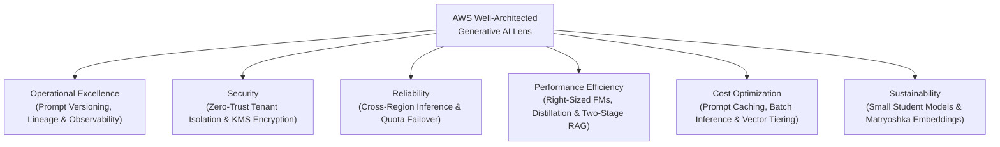

# Domain 1: Curated AWS Whitepapers, Prescriptive Guidance, and Well-Architected Lens

This document synthesizes the essential architectural patterns, official AWS Whitepapers, AWS Prescriptive Guidance publications, and **AWS Well-Architected Framework: Generative AI Lens** principles tested in **Domain 1 (Foundation Model Integration, Data Management, and Compliance — 31%)** of the **AWS Certified Generative AI Developer - Professional (AIP-C01)** exam.

---

## 1. AWS Well-Architected Framework: Generative AI Lens (`GENAI` Pillars)

The **Generative AI Lens** extends the six AWS Well-Architected pillars specifically for foundation model workloads. Below are the core design principles and architectural best practices directly mapped to Domain 1.

### A. Operational Excellence Pillar (`GENAI-OPS`)
- **Decouple Prompts and Configuration from Application Code**:
  - Store all system instructions, few-shot examples, model identifiers, and `toolConfig` schemas in **Amazon Bedrock Prompt Management** with immutable version numbers.
  - Deploy changes through CI/CD pipelines using **Amazon Bedrock Prompt Flows** aliases rather than redeploying container images.
- **Data Lineage & Corpus Governance**:
  - Maintain end-to-end lineage from raw S3 ingestion objects through **Amazon Bedrock Data Automation (BDA)** or **AWS Glue** transforms down to individual vector chunk metadata (`source_uri`, `document_version`, `ingestion_timestamp`, `commit_sha`).
  - When a source policy document is superseded in S3, trigger automated synchronization (`StartIngestionJob` with `dataDeletionPolicy="DELETE"`) so stale chunks are automatically purged from the vector index.
- **Continuous Evaluation of Retrieval and Generation Quality**:
  - Track retrieval metrics (**Context Precision**, **Context Recall**, **NDCG@K**, **MRR**) separately from generation metrics (**Faithfulness / Groundedness**, **Answer Relevance**) so regressions can be isolated to either the vector chunking/reranking tier or the FM prompt tier.

### B. Security Pillar (`GENAI-SEC`)
- **Enforce Tenant Isolation at the Vector Layer (Pre-Filtering, Never Rely on Prompt Instructions Alone)**:
  - *Anti-Pattern*: Retrieving chunks across all tenants and instructing the FM in the system prompt: *"Do not reveal information belonging to other customers."* This is trivially bypassed via indirect prompt injection.
  - *Well-Architected Pattern*: Authenticate the caller at the API Gateway / Lambda layer, extract the verified `tenant_id` from the signed JWT claims, and inject a mandatory **Metadata Pre-Filter** (`equals: {"key": "tenant_id", "value": verified_tenant_id}`) into the Bedrock Knowledge Base `Retrieve` or `RetrieveAndGenerate` API call—or allocate dedicated vector indexes/namespaces per high-security tenant.
- **End-to-End Encryption of Custom Models and Vector Indexes**:
  - Encrypt custom fine-tuned/distilled model weights, Bedrock Knowledge Base transient data, OpenSearch Serverless collections, and Prompt Management templates using **Customer Managed Keys (CMKs)** in **AWS KMS**.
- **Proactive PII Sanitization Before Training and Embedding**:
  - Scrub sensitive PII/PHI via **Amazon Comprehend** (`StartPiiEntitiesDetectionJob` with redaction) or **AWS Glue PII transforms** prior to running Continued Pre-Training (CPT), Supervised Fine-Tuning (SFT), or vector indexing so sensitive identifiers are never baked into model weights or dense vector representations.

### B.2 Multi-Tenant RAG Isolation Tier Matrix

| Isolation Tier | Vector Architecture Pattern | Blast Radius & Security Posture | Cost & Operational Profile |
| :--- | :--- | :--- | :--- |
| **Tier 1: Silo Model (Dedicated Collection/Cluster per Tenant)** | Separate OpenSearch Serverless Collection or Aurora Cluster per enterprise tenant with tenant-specific KMS CMK. | **Zero cross-tenant data path**; IAM and KMS policies enforce cryptographic separation at the AWS resource ARN level. | Highest cost (minimum OCUs/ACUs multiplied per tenant); reserved for regulated government/healthcare anchor tenants. |
| **Tier 2: Index/Schema Per Tenant (Bridge Model)** | Shared OpenSearch Collection or Aurora Cluster, with a dedicated vector index (`tenant_01_idx`) or PostgreSQL schema/table per tenant. | Strong logical isolation; OpenSearch Data Access Policies or PostgreSQL RBAC roles can scope access per index/table. | Moderate operational overhead; hits index/shard count limits if scaled beyond thousands of tenants per collection. |
| **Tier 3: Pooled Model with Metadata Pre-Filtering** | Single shared vector index with mandatory `tenant_id` metadata attribute enforced via `RetrievalFilter` pre-filtering (`faiss`/`lucene` or `pgvector`). | Relies on application middleware to inject verified `tenant_id` from JWT context into every `Retrieve` call. | **Lowest cost and highest scalability** (supports 10,000+ tenants without shard sprawl). |

### C. Reliability Pillar (`GENAI-REL`)
- **Multi-Region Capacity Resiliency with Cross-Region Inference (CRIS)**:
  - Use **System-Defined Cross-Region Inference Profiles** (`us.*`, `eu.*`, `apac.*`) or **Application Inference Profiles** to automatically absorb traffic spikes and route around regional capacity constraints without application-side failover orchestration.
- **Deterministic Quota Isolation for Mission-Critical Workloads**:
  - Separate synchronous customer-facing inference from asynchronous bulk back-office processing.
  - Route asynchronous bulk jobs to **Amazon Bedrock Batch Inference** (which uses separate quota pools at a 50% cost discount) or provision dedicated **Model Units (Provisioned Throughput)** for mission-critical, latency-bound production endpoints.

### D. Performance Efficiency Pillar (`GENAI-PERF`)
- **Right-Size Models via Teacher-Student Distillation**:
  - Start prototyping with a frontier model (e.g., Anthropic Claude 3.5 Sonnet v2 or Amazon Nova Pro/Premier) to establish a quality baseline.
  - Once prompt distributions stabilize in **Bedrock Model Invocation Logs**, use **Amazon Bedrock Model Distillation** to transfer task mastery into a smaller, low-latency student model (e.g., Amazon Nova Micro, Nova Lite, or Claude 3.5 Haiku).
- **Two-Stage Retrieval with Cross-Encoder Reranking**:
  - Combine high-recall **Hybrid Search** (BM25 + k-NN with Reciprocal Rank Fusion) retrieving $K = 50$ candidates with a second-stage **Cross-Encoder Reranker** (`Cohere Rerank 3.5` or `Amazon Rerank 1.0`) selecting Top $N = 5$. This simultaneously improves answer grounding and slashes downstream FM prefill latency.

### E. Cost Optimization & Sustainability Pillars (`GENAI-COST` & `GENAI-SUST`)
- **Exploit Prompt Caching for Repetitive Prefixes**:
  - Place static elements (system instructions, `toolConfig` schemas, few-shot examples, and shared reference documents) at the **beginning** of the prompt followed by a `cachePoint` checkpoint. This avoids recomputing transformer KV-cache states across requests, cutting input token costs by up to 90% and TTFT by up to 85%.
- **Dimensionality & Quantization Optimization for Vectors**:
  - Use **Amazon Titan Text Embeddings V2** at **512 or 256 dimensions** (Matryoshka embeddings) or enable **`int8` scalar quantization / binary quantization** in OpenSearch `faiss` or Aurora `pgvector` (`halfvec`) to cut memory-backed vector storage costs by 50–87%. For multi-billion vector archives with relaxed latency requirements, use **Amazon S3 Vectors**.

---

## 2. Core AWS Whitepapers & Prescriptive Guidance Summaries

### Whitepaper 1: *Customizing Foundation Models on AWS: Decision Guide (RAG vs. Fine-Tuning vs. Continued Pre-Training)*

#### Key Architectural Takeaways
1. **Orthogonality of RAG and Fine-Tuning**:
   - AWS Prescriptive Guidance emphasizes that **RAG and Model Customization solve orthogonal problems**:
     - **RAG** optimizes **external knowledge access** (non-parametric memory): currency of information, verifiable source citations, row-level access control, and hallucination reduction over mutable facts.
     - **Supervised Fine-Tuning (SFT)** optimizes **model behavior** (parametric adaptation): output syntax, tone, domain-specific task formatting, edge-case classification accuracy, and reducing prompt length (replacing 20 few-shot examples with zero-shot weights).
     - **Continued Pre-Training (CPT)** optimizes **domain vocabulary comprehension**: teaching the base model proprietary terminology, scientific notation, or non-public languages from massive **unlabeled** corpora (`{"input": "..."}`).
2. **The Total Cost of Ownership (TCO) Inflection Point**:
   - On Amazon Bedrock, custom fine-tuned, continued pre-trained, and distilled models require **Provisioned Throughput (Model Units)** billed hourly.
   - Therefore, SFT/CPT is only cost-effective when **either** (a) prompt engineering/RAG cannot achieve the required accuracy/format reliability, **or** (b) your steady-state request volume is high enough to saturate the hourly Model Unit commitment and offset the token savings from eliminating long few-shot prompts (or distilling into a cheaper Student architecture).

---

### Whitepaper 2: *Advanced Retrieval-Augmented Generation (RAG) Patterns on AWS*

#### Key Architectural Takeaways
1. **Context Window Saturation vs. Precision Retrieval ("Lost in the Middle")**:
   - Even when an FM supports a 200K or 300K token context window, stuffing an entire document repository into the prompt causes severe latency spikes, linear per-token cost explosion, and reasoning degradation on facts buried in the middle of the context.
   - Production architectures must use **Hierarchical Chunking** (matching against small 128–300 token child chunks for high cosine similarity specificity, while returning the 1024–1500 token parent chunk for coherent context) or **Semantic Chunking** paired with **Cross-Encoder Reranking**.
2. **When Standard Vector RAG Fails — Enter GraphRAG with Amazon Neptune Analytics**:
   - Dense vector similarity retrieves chunks that are semantically close to the query in embedding space, but fails on **global summarization queries** and **multi-hop relational queries** (e.g., *"How does a supply-chain delay at Tier-2 Supplier X impact the regulatory compliance milestones of Product Line Y across EU subsidiaries?"*).
   - **Amazon Bedrock Knowledge Bases with Amazon Neptune Analytics (GraphRAG)** automatically extracts entities and relationships from unstructured documents during ingestion to construct a property graph alongside vector embeddings. At query time, it combines vector entry-point lookup with `openCypher` multi-hop traversal to synthesize connected facts across disparate documents.

---

### Whitepaper 3: *Vector Engine Architecture & Performance Tuning Guide (OpenSearch Serverless vs. Aurora `pgvector`)*

#### Key Architectural Takeaways
1. **OpenSearch Serverless Vector Engine Sizing & Engine Selection**:
   - OpenSearch Serverless separates **Indexing OCUs** from **Search OCUs** (1 OCU = 6 GB RAM + vCPU + GP3 storage).
   - For high-scale vector workloads, select the **`faiss`** engine with **HNSW** (or IVF with Product Quantization / `fp16` scalar quantization).
   - **Never use `nmslib`** when metadata pre-filtering is required, as `nmslib` lacks efficient pre-filtering support and is deprecated.
2. **Aurora PostgreSQL `pgvector` Memory & HNSW Tuning**:
   - HNSW index build times and query recall are governed by `m` (links per node) and `ef_construction` (build candidate list size), while query-time accuracy vs. latency is dynamically controlled via `SET LOCAL hnsw.ef_search = <value>;`.
   - When the HNSW index size exceeds `shared_buffers` RAM, enable **Aurora Optimized Reads** (which uses local NVMe SSD storage as an ephemeral buffer pool extension) and consider **`halfvec` (16-bit float)** indexing to cut index memory footprint in half with negligible recall loss.

---

### Whitepaper 4: *Multimodal Document & Media Intelligence with Amazon Bedrock Data Automation (BDA)*

#### Key Architectural Takeaways
1. **Overcoming Traditional OCR Blind Spots**:
   - Standard text extractors strip layout hierarchy, flatten multi-header financial tables, and completely ignore charts, architectural blueprints, and embedded diagrams.
   - **Amazon Bedrock Data Automation (BDA)** and **Bedrock Knowledge Base FM Parsing** preserve structural hierarchies in Markdown, generate rich semantic descriptions of visual charts/diagrams, and support **Blueprints** with **field-level confidence scores** and **visual bounding-box coordinates** for auditability.
2. **Audio & Video Knowledge Ingestion**:
   - BDA processes video (`.mp4`, `.mov`) and audio files directly into timestamped scene descriptions, transcripts, and detected on-screen text (OCR in video frames), enabling multimodal RAG over enterprise town halls, surgical recordings, and field inspection videos without stitching together separate Transcribe, Rekognition, and FFmpeg microservices.

---

## 3. High-Frequency Exam Traps & Architectural Anti-Patterns

| Scenario / Requirement on the Exam | Common Distractor (Trap) | Correct AWS Architecture | Why the Distractor Fails |
| :--- | :--- | :--- | :--- |
| **"Enforce strict multi-tenant isolation in a shared Bedrock Knowledge Base."** | Use post-filtering in application code after retrieving Top $K=10$ results, or add tenant isolation rules in the System Prompt. | Use **Metadata Pre-Filtering** (`RetrievalFilter` with `equals` on verified `tenant_id`) backed by OpenSearch (`faiss`/`lucene`) or Aurora `pgvector`. | Post-filtering causes **result starvation** (0 results returned if tenant owns a small fraction of vectors). System prompts are vulnerable to prompt injection. |
| **"Minimize monthly idle cost for a dev/test or low-traffic Bedrock Knowledge Base vector store."** | Use Amazon OpenSearch Serverless (AOSS) with default settings. | Use **Amazon Aurora PostgreSQL Serverless v2 (`pgvector`)** configured with scale-down / auto-pause (0 to 0.5 ACU) or **Amazon S3 Vectors**. | OpenSearch Serverless requires a minimum of 2 to 4 always-on OCUs (~$350–$700+/month minimum floor even at zero queries). |
| **"Improve retrieval accuracy for queries containing exact 12-digit part numbers and error codes alongside natural language."** | Switch to a larger embedding model or increase HNSW `ef_construction`. | Enable **Hybrid Search (`overrideSearchType="HYBRID"`)** combining BM25 lexical search and dense k-NN embeddings via **Reciprocal Rank Fusion (RRF)**, plus **Bedrock Rerank**. | Dense embeddings compress text into continuous semantic vectors that lose exact character-level fidelity for arbitrary alphanumeric SKUs. |
| **"Guarantee 100% valid JSON output conforming to a nested schema from Claude 3.5 Sonnet or Nova Pro."** | Set `temperature=0.0` and append *"Output ONLY valid JSON with no markdown backticks"* to the prompt. | Use the **Converse API `toolConfig`** with the JSON Schema defined in `inputSchema` and force invocation via `toolChoice={"tool": {"name": "..."}}`. | Prompt instructions alone do not enforce grammar constraints during token sampling; forced `toolChoice` enforces schema structure. |
| **"Deploy a custom fine-tuned Llama 3.1 8B model stored as `safetensors` in S3 into Bedrock without managing EC2/SageMaker instances."** | Create a Bedrock Provisioned Throughput directly on the S3 bucket, or deploy a SageMaker JumpStart endpoint. | Use **Amazon Bedrock Custom Model Import (CMI)**, which imports the `safetensors` weights from S3 and serves them serverlessly via **Custom Model Units (CMUs)**. | Provisioned Throughput is for Bedrock-native base/customized models; CMI specifically imports external supported model weights into serverless CMUs. |
| **"Resolve `AccessDeniedException` when switching an application from a single-region Bedrock model ID to a Cross-Region Inference Profile (`us.anthropic...`)."** | Request a quota increase in Service Quotas or enable Provisioned Throughput. | Update the IAM Role policy to allow `bedrock:InvokeModel*` on **both** the `inference-profile/*` ARN in the calling region **and** the `foundation-model/*` ARNs in **all destination regions** in the CRIS profile. | Cross-Region Inference evaluates IAM authorization against both the regional inference profile resource and the underlying foundation model in the routed region. |
