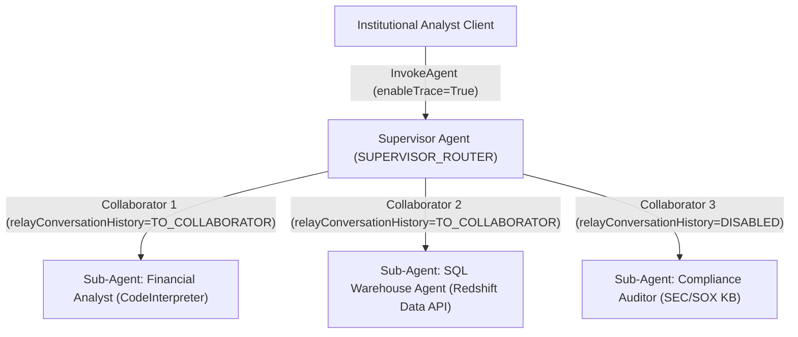
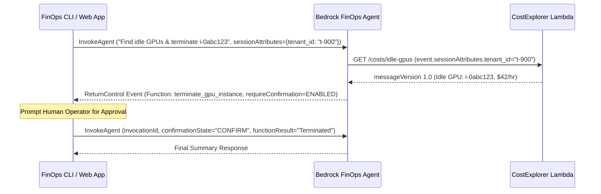
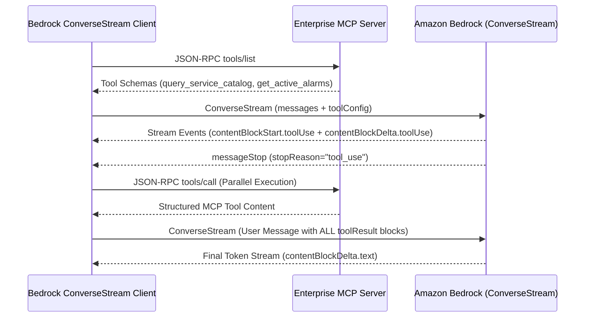
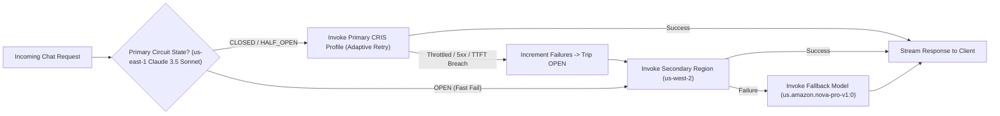
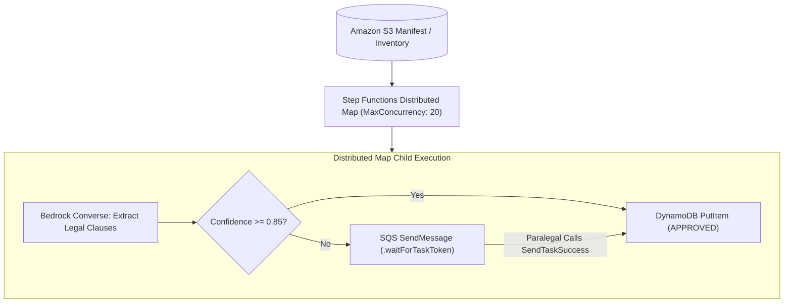
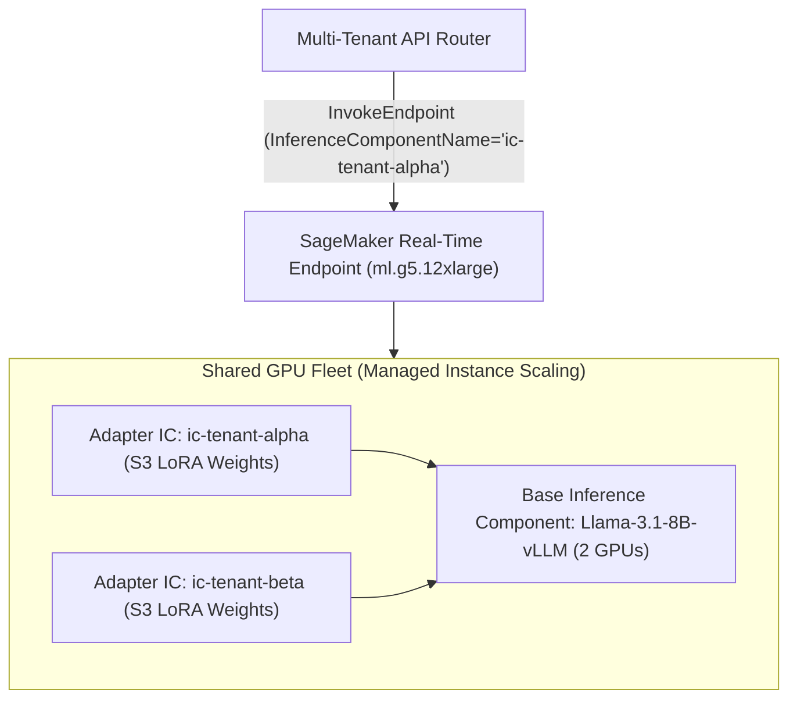

# Domain 2: Production Implementation & Integration Hands-On Exercises

> **Track**: AWS Certified Generative AI Developer - Professional (AIP-C01)  
> **Domain 2**: Implementation and Integration (26%)  
> **Scope**: 6 Complete Production-Grade Engineering Labs with Architecture Diagrams, Runnable `boto3` / OpenAPI / ASL / Terraform Code, and Verification Commands.

---

## Table of Contents

1. [Exercise 1: Multi-Agent Collaboration System on Amazon Bedrock (Supervisor Orchestrating Financial Analyst, SQL Query, and Compliance Sub-Agents)](#exercise-1-multi-agent-collaboration-system-on-amazon-bedrock)
2. [Exercise 2: Bedrock Agent Action Group with OpenAPI 3.0 Schema, Lambda Executor, User Confirmation, and Return of Control (ROC) Loop](#exercise-2-bedrock-agent-action-group-with-openapi-30-schema-lambda-executor-user-confirmation-and-return-of-control-roc-loop)
3. [Exercise 3: Model Context Protocol (MCP) Server on AWS Lambda/ECS Integrated with Bedrock ConverseStream Tool Use Loop](#exercise-3-model-context-protocol-mcp-server-on-aws-lambdaecs-integrated-with-bedrock-conversestream-tool-use-loop)
4. [Exercise 4: Resilient Multi-Region ConverseStream Client with Adaptive Retry, Circuit Breaker, and Cross-Region Inference Failover](#exercise-4-resilient-multi-region-conversestream-client-with-adaptive-retry-circuit-breaker-and-cross-region-inference-failover)
5. [Exercise 5: High-Throughput Asynchronous Document Summarization Pipeline with AWS Step Functions Distributed Map & Bedrock Batch Inference](#exercise-5-high-throughput-asynchronous-document-summarization-pipeline-with-aws-step-functions-distributed-map--bedrock-batch-inference)
6. [Exercise 6: Multi-LoRA Adapter Deployment on SageMaker Inference Components with Auto-Scaling & Canary Rollout](#exercise-6-multi-lora-adapter-deployment-on-sagemaker-inference-components-with-auto-scaling--canary-rollout)

---

## Exercise 1: Multi-Agent Collaboration System on Amazon Bedrock

### Scenario & Architecture
An institutional investment bank requires a **Multi-Agent Collaboration** system on Amazon Bedrock. A **Supervisor Agent** (`SUPERVISOR_ROUTER` mode) coordinates three specialized Sub-Agents:
1. **Financial Analyst Sub-Agent**: Computes portfolio ratios, variance decompositions, and discounted cash flows using `AMAZON.CodeInterpreter`.
2. **SQL Query Sub-Agent**: Queries an Amazon Redshift Serverless data warehouse via an Action Group.
3. **Compliance Auditor Sub-Agent**: Checks SEC/SOX regulatory policies via a Bedrock Knowledge Base and enforces trade restrictions.



### Complete Implementation (`multi_agent_setup.py`)

```python
import time
import uuid
import boto3
from typing import Dict

REGION = "us-east-1"
ACCOUNT_ID = boto3.client("sts").get_caller_identity()["Account"]
FOUNDATION_MODEL = "us.anthropic.claude-3-5-sonnet-20241022-v2:0"
AGENT_ROLE_ARN = f"arn:aws:iam::{ACCOUNT_ID}:role/BedrockMultiAgentExecutionRole"

bedrock_agent = boto3.client("bedrock-agent", region_name=REGION)
bedrock_runtime = boto3.client("bedrock-agent-runtime", region_name=REGION)


def wait_for_agent_status(agent_id: str, target_states: tuple = ("PREPARED", "NOT_PREPARED")) -> str:
    while True:
        resp = bedrock_agent.get_agent(agentId=agent_id)
        status = resp["agent"]["agentStatus"]
        if status in target_states:
            return status
        if status == "FAILED":
            raise RuntimeError(f"Agent {agent_id} entered FAILED state: {resp['agent'].get('failureReasons')}")
        time.sleep(3)


def create_and_prepare_sub_agent(name: str, instruction: str, enable_code_interpreter: bool = False) -> Dict[str, str]:
    create_resp = bedrock_agent.create_agent(
        agentName=name,
        foundationModel=FOUNDATION_MODEL,
        agentResourceRoleArn=AGENT_ROLE_ARN,
        instruction=instruction,
        idleSessionTTLInSeconds=900
    )
    agent_id = create_resp["agent"]["agentId"]
    wait_for_agent_status(agent_id, ("NOT_PREPARED", "PREPARED"))

    if enable_code_interpreter:
        bedrock_agent.create_agent_action_group(
            agentId=agent_id,
            agentVersion="DRAFT",
            actionGroupName="CodeInterpreterAction",
            parentActionGroupSignature="AMAZON.CodeInterpreter",
            actionGroupState="ENABLED"
        )

    bedrock_agent.prepare_agent(agentId=agent_id)
    wait_for_agent_status(agent_id, ("PREPARED",))

    alias_resp = bedrock_agent.create_agent_alias(
        agentId=agent_id,
        agentAliasName="prod-v1"
    )
    alias_id = alias_resp["agentAlias"]["agentAliasId"]
    alias_arn = alias_resp["agentAlias"]["agentAliasArn"]

    # Wait for alias to become PREPARED
    while True:
        a_status = bedrock_agent.get_agent_alias(agentId=agent_id, agentAliasId=alias_id)["agentAlias"]["agentAliasStatus"]
        if a_status == "PREPARED":
            break
        time.sleep(2)

    return {"agentId": agent_id, "aliasId": alias_id, "aliasArn": alias_arn}


def provision_multi_agent_system() -> Dict[str, str]:
    # 1. Create the 3 Specialized Sub-Agents
    fin_sub = create_and_prepare_sub_agent(
        name="sub-agent-financial-analyst",
        instruction=(
            "You are a Quantitative Financial Analyst sub-agent. Use Python Code Interpreter "
            "to compute exact portfolio Sharpe ratios, margin variances, and VaR metrics."
        ),
        enable_code_interpreter=True
    )

    sql_sub = create_and_prepare_sub_agent(
        name="sub-agent-sql-warehouse",
        instruction=(
            "You are an Enterprise Data Warehouse SQL sub-agent. Translate analytical questions "
            "into read-only Redshift SQL queries and return structured tabular metrics."
        )
    )

    comp_sub = create_and_prepare_sub_agent(
        name="sub-agent-compliance-auditor",
        instruction=(
            "You are a Financial Regulatory Compliance Auditor sub-agent. Evaluate all proposed "
            "trades and financial disclosures against SOX Section 404 and SEC Rule 10b-5."
        )
    )

    # 2. Create the Supervisor Agent with SUPERVISOR_ROUTER collaboration mode
    sup_resp = bedrock_agent.create_agent(
        agentName="institutional-wealth-supervisor",
        foundationModel=FOUNDATION_MODEL,
        agentResourceRoleArn=AGENT_ROLE_ARN,
        agentCollaboration="SUPERVISOR_ROUTER",
        instruction=(
            "You are the Managing Director Supervisor Agent. Route single-domain questions directly "
            "to the appropriate collaborator. For multi-domain questions spanning SQL data retrieval, "
            "quantitative modeling, and SOX/SEC compliance, coordinate all three sub-agents and "
            "synthesize a cohesive executive brief."
        )
    )
    sup_id = sup_resp["agent"]["agentId"]
    wait_for_agent_status(sup_id, ("NOT_PREPARED", "PREPARED"))

    # 3. Associate all three Collaborator Sub-Agents with the Supervisor
    collaborators = [
        {
            "name": "FinancialAnalystCollaborator",
            "arn": fin_sub["aliasArn"],
            "history": "TO_COLLABORATOR",
            "instruction": "Delegate quantitative calculations, Python modeling, and variance analysis here."
        },
        {
            "name": "SQLWarehouseCollaborator",
            "arn": sql_sub["aliasArn"],
            "history": "TO_COLLABORATOR",
            "instruction": "Delegate historical revenue, COGS, and trade ledger SQL queries here."
        },
        {
            "name": "ComplianceAuditorCollaborator",
            "arn": comp_sub["aliasArn"],
            "history": "DISABLED",
            "instruction": "Delegate SEC Rule 10b-5 and SOX 404 regulatory compliance verification here."
        }
    ]

    for collab in collaborators:
        bedrock_agent.associate_agent_collaborator(
            agentId=sup_id,
            agentVersion="DRAFT",
            agentDescriptor={"aliasArn": collab["arn"]},
            collaboratorName=collab["name"],
            collaborationInstruction=collab["instruction"],
            relayConversationHistory=collab["history"]
        )

    # 4. Prepare Supervisor Agent and create Production Alias
    bedrock_agent.prepare_agent(agentId=sup_id)
    wait_for_agent_status(sup_id, ("PREPARED",))

    sup_alias = bedrock_agent.create_agent_alias(
        agentId=sup_id,
        agentAliasName="supervisor-prod"
    )["agentAlias"]

    return {"supervisorAgentId": sup_id, "supervisorAliasId": sup_alias["agentAliasId"]}


def invoke_supervisor_with_trace(supervisor_id: str, alias_id: str, prompt: str) -> None:
    session_id = str(uuid.uuid4())
    response = bedrock_runtime.invoke_agent(
        agentId=supervisor_id,
        agentAliasId=alias_id,
        sessionId=session_id,
        inputText=prompt,
        enableTrace=True
    )

    for event in response["completion"]:
        if "trace" in event:
            trace_data = event["trace"]["trace"]
            if "orchestrationTrace" in trace_data:
                orch = trace_data["orchestrationTrace"]
                if "invocationInput" in orch and "agentCollaboratorInvocationInput" in orch["invocationInput"]:
                    collab_input = orch["invocationInput"]["agentCollaboratorInvocationInput"]
                    print(f"[TRACE -> DELEGATING TO SUB-AGENT]: {collab_input['agentCollaboratorName']}")
        elif "chunk" in event:
            print(event["chunk"]["bytes"].decode("utf-8"), end="", flush=True)


if __name__ == "__main__":
    deployment = provision_multi_agent_system()
    invoke_supervisor_with_trace(
        deployment["supervisorAgentId"],
        deployment["supervisorAliasId"],
        "Retrieve Q3 EMEA fixed-income trading PnL, compute the annualized Sharpe ratio assuming a 4.5% risk-free rate, and verify if our Q3 desk disclosures pass SOX 404 controls."
    )
```

---

## Exercise 2: Bedrock Agent Action Group with OpenAPI 3.0 Schema, Lambda Executor, User Confirmation, and Return of Control (ROC) Loop

### Scenario & Architecture
A Cloud FinOps Agent needs two distinct Action Groups:
1. **`CostExplorerActionGroup` (Lambda Executor with OpenAPI 3.0 Schema)**: Queries read-only department cloud spend, using `sessionAttributes` to enforce tenant isolation without exposing `tenant_id` in the LLM prompt.
2. **`EC2RemediationActionGroup` (Return of Control with User Confirmation)**: Terminates idle GPU instances only after returning control to the client application and receiving `"confirmationState": "CONFIRM"`.



### Complete Implementation (`action_group_roc_lab.py`)

```python
import json
import uuid
import boto3
from typing import Any, Dict

# ---------------------------------------------------------------------------
# PART 1: AWS Lambda Function Code for OpenAPI Action Group Executor
# ---------------------------------------------------------------------------
def cost_explorer_lambda_handler(event: Dict[str, Any], context: Any) -> Dict[str, Any]:
    """
    Compliant Bedrock Agent OpenAPI Action Group Executor.
    Reads tenant_id from sessionAttributes (never exposed to the LLM prompt).
    """
    action_group = event["actionGroup"]
    api_path = event["apiPath"]
    http_method = event["httpMethod"]
    session_attrs = event.get("sessionAttributes", {})
    prompt_attrs = event.get("promptSessionAttributes", {})

    tenant_id = session_attrs.get("tenant_id")
    if not tenant_id:
        return {
            "messageVersion": "1.0",
            "response": {
                "actionGroup": action_group,
                "apiPath": api_path,
                "httpMethod": http_method,
                "httpStatusCode": 403,
                "responseBody": {
                    "application/json": {
                        "body": json.dumps({"error": "Missing mandatory tenant_id in sessionAttributes"})
                    }
                }
            }
        }

    params = {p["name"]: p["value"] for p in event.get("parameters", [])}
    environment = params.get("environment", "prod")

    body_payload = {
        "tenantId": tenant_id,
        "environment": environment,
        "idleInstances": [
            {"instanceId": "i-0abc123456def7890", "instanceType": "p4d.24xlarge", "hourlyCostUsd": 32.77, "avgGpuUtilPct": 0.4}
        ]
    }

    return {
        "messageVersion": "1.0",
        "response": {
            "actionGroup": action_group,
            "apiPath": api_path,
            "httpMethod": http_method,
            "httpStatusCode": 200,
            "responseBody": {
                "application/json": {
                    "body": json.dumps(body_payload)
                }
            }
        },
        "sessionAttributes": session_attrs,
        "promptSessionAttributes": prompt_attrs
    }


# ---------------------------------------------------------------------------
# PART 2: Registering Both Action Groups & Running the ROC Confirmation Loop
# ---------------------------------------------------------------------------
OPENAPI_SCHEMA_JSON = json.dumps({
    "openapi": "3.0.1",
    "info": {"title": "FinOps Idle GPU Discovery API", "version": "1.0.0"},
    "paths": {
        "/costs/idle-gpus": {
            "get": {
                "operationId": "listIdleGpuInstances",
                "description": "Lists EC2 GPU instances with less than 2% utilization over the past 7 days.",
                "parameters": [
                    {
                        "name": "environment",
                        "in": "query",
                        "required": True,
                        "description": "Target environment tag (dev, staging, prod)",
                        "schema": {"type": "string"}
                    }
                ],
                "responses": {
                    "200": {
                        "description": "List of idle GPU instances",
                        "content": {"application/json": {"schema": {"type": "object"}}}
                    }
                }
            }
        }
    }
})


def configure_finops_action_groups(agent_id: str, lambda_arn: str) -> None:
    bedrock_agent = boto3.client("bedrock-agent", region_name="us-east-1")
    lambda_client = boto3.client("lambda", region_name="us-east-1")
    account_id = boto3.client("sts").get_caller_identity()["Account"]

    # 1. Grant Resource-Based Permission to bedrock.amazonaws.com on the Lambda function
    lambda_client.add_permission(
        FunctionName=lambda_arn,
        StatementId=f"AllowBedrockAgent-{agent_id}",
        Action="lambda:InvokeFunction",
        Principal="bedrock.amazonaws.com",
        SourceAccount=account_id,
        SourceArn=f"arn:aws:bedrock:us-east-1:{account_id}:agent/{agent_id}"
    )

    # 2. Create Action Group 1: OpenAPI + Lambda Executor
    bedrock_agent.create_agent_action_group(
        agentId=agent_id,
        agentVersion="DRAFT",
        actionGroupName="CostExplorerActionGroup",
        actionGroupExecutor={"lambda": lambda_arn},
        apiSchema={"payload": OPENAPI_SCHEMA_JSON},
        actionGroupState="ENABLED"
    )

    # 3. Create Action Group 2: Return of Control (ROC) + User Confirmation
    bedrock_agent.create_agent_action_group(
        agentId=agent_id,
        agentVersion="DRAFT",
        actionGroupName="EC2RemediationActionGroup",
        actionGroupExecutor={"customControl": "RETURN_CONTROL"},
        functionSchema={
            "functions": [
                {
                    "name": "terminate_gpu_instance",
                    "description": "Permanently terminates an idle EC2 GPU instance after human confirmation.",
                    "requireConfirmation": "ENABLED",
                    "parameters": {
                        "instance_id": {
                            "type": "string",
                            "description": "The EC2 instance ID to terminate (e.g., i-0abc123456def7890)",
                            "required": True
                        }
                    }
                }
            ]
        },
        actionGroupState="ENABLED"
    )

    bedrock_agent.prepare_agent(agentId=agent_id)


def run_finops_roc_session(agent_id: str, alias_id: str, operator_approved: bool = True) -> str:
    runtime = boto3.client("bedrock-agent-runtime", region_name="us-east-1")
    session_id = str(uuid.uuid4())

    initial_resp = runtime.invoke_agent(
        agentId=agent_id,
        agentAliasId=alias_id,
        sessionId=session_id,
        inputText="Check prod for idle GPUs and terminate any instance costing over $25/hr.",
        sessionState={
            "sessionAttributes": {"tenant_id": "tenant-enterprise-884"},
            "promptSessionAttributes": {"reporting_currency": "USD"}
        }
    )

    return_control_event = None
    output_buffer = ""

    for event in initial_resp["completion"]:
        if "chunk" in event:
            output_buffer += event["chunk"]["bytes"].decode("utf-8")
        elif "returnControl" in event:
            return_control_event = event["returnControl"]

    if not return_control_event:
        return output_buffer

    invocation_id = return_control_event["invocationId"]
    fn_input = return_control_event["invocationInputs"][0]["functionInvocationInput"]
    params = {p["name"]: p["value"] for p in fn_input.get("parameters", [])}
    instance_id = params["instance_id"]

    if operator_approved:
        confirmation_state = "CONFIRM"
        result_body = json.dumps({"instanceId": instance_id, "currentState": "shutting-down"})
    else:
        confirmation_state = "DENY"
        result_body = json.dumps({"instanceId": instance_id, "reason": "Operator denied termination during freeze window"})

    followup_resp = runtime.invoke_agent(
        agentId=agent_id,
        agentAliasId=alias_id,
        sessionId=session_id,
        sessionState={
            "invocationId": invocation_id,
            "returnControlInvocationResults": [
                {
                    "functionResult": {
                        "actionGroup": fn_input["actionGroup"],
                        "function": fn_input["function"],
                        "confirmationState": confirmation_state,
                        "responseState": "SUCCESS",
                        "responseBody": {"TEXT": {"body": result_body}}
                    }
                }
            ]
        }
    )

    final_text = ""
    for event in followup_resp["completion"]:
        if "chunk" in event:
            final_text += event["chunk"]["bytes"].decode("utf-8")
    return final_text
```

---

## Exercise 3: Model Context Protocol (MCP) Server on AWS Lambda/ECS Integrated with Bedrock `ConverseStream` Tool Use Loop

### Scenario & Architecture
An engineering platform team exposes internal CloudWatch Incident Diagnostics and DynamoDB Service Catalog lookups via a **Model Context Protocol (MCP)** server. We build:
1. A compliant **MCP Server** exposing tools via JSON Schema.
2. A **Bedrock `ConverseStream` MCP Client Bridge** that dynamically converts MCP tools into Bedrock `toolSpec` definitions, parses streaming `toolUse` delta blocks in real time, invokes the MCP server for parallel tool calls, and streams the final answer.



### Complete Implementation (`mcp_converse_stream_bridge.py`)

```python
import json
import boto3
from typing import Any, Callable, Dict, List

class EnterpriseMCPServer:
    """
    Production-grade in-process / Lambda-compatible MCP Server handler
    implementing JSON-RPC 2.0 `tools/list` and `tools/call`.
    """
    def __init__(self) -> None:
        self._tools: Dict[str, Dict[str, Any]] = {
            "query_service_catalog": {
                "name": "query_service_catalog",
                "description": "Looks up microservice ownership, tier criticality, and PagerDuty escalation policy.",
                "inputSchema": {
                    "type": "object",
                    "properties": {
                        "service_name": {
                            "type": "string",
                            "description": "Canonical microservice identifier (e.g., payments-ledger-service)"
                        }
                    },
                    "required": ["service_name"]
                }
            },
            "get_active_alarms": {
                "name": "get_active_alarms",
                "description": "Fetches currently firing CloudWatch alarms in a target AWS region.",
                "inputSchema": {
                    "type": "object",
                    "properties": {
                        "region": {
                            "type": "string",
                            "description": "AWS Region code, e.g., us-east-1"
                        }
                    },
                    "required": ["region"]
                }
            }
        }

    def handle_json_rpc(self, request: Dict[str, Any]) -> Dict[str, Any]:
        method = request.get("method")
        req_id = request.get("id", 1)
        params = request.get("params", {})

        if method == "tools/list":
            return {
                "jsonrpc": "2.0",
                "id": req_id,
                "result": {"tools": list(self._tools.values())}
            }

        if method == "tools/call":
            tool_name = params.get("name")
            arguments = params.get("arguments", {})
            if tool_name == "query_service_catalog":
                svc = arguments["service_name"]
                payload = {"service": svc, "tier": "TIER_0_CRITICAL", "ownerTeam": "Core-Payments-SRE"}
            elif tool_name == "get_active_alarms":
                reg = arguments["region"]
                payload = {"region": reg, "alarms": [{"name": "HighBedrockLatency-P99", "state": "ALARM"}]}
            else:
                return {
                    "jsonrpc": "2.0",
                    "id": req_id,
                    "result": {"isError": True, "content": [{"type": "text", "text": f"Unknown tool: {tool_name}"}]}
                }

            return {
                "jsonrpc": "2.0",
                "id": req_id,
                "result": {
                    "isError": False,
                    "content": [{"type": "text", "text": json.dumps(payload)}]
                }
            }

        raise ValueError(f"Unsupported MCP JSON-RPC method: {method}")


class BedrockMCPStreamOrchestrator:
    """
    Bridges any MCP Server into Amazon Bedrock's `ConverseStream` API,
    reassembling streamed toolUse JSON deltas and handling multi-tool turns.
    """
    def __init__(self, mcp_server: EnterpriseMCPServer, model_id: str = "us.anthropic.claude-3-5-sonnet-20241022-v2:0") -> None:
        self.mcp = mcp_server
        self.model_id = model_id
        self.bedrock = boto3.client("bedrock-runtime", region_name="us-east-1")

    def _discover_bedrock_tools(self) -> List[Dict[str, Any]]:
        rpc_resp = self.mcp.handle_json_rpc({"jsonrpc": "2.0", "id": 1, "method": "tools/list"})
        mcp_tools = rpc_resp["result"]["tools"]
        return [
            {
                "toolSpec": {
                    "name": t["name"],
                    "description": t["description"],
                    "inputSchema": {"json": t["inputSchema"]}
                }
            }
            for t in mcp_tools
        ]

    def run_streaming_agent(self, user_prompt: str, on_token: Callable[[str], None] = lambda s: print(s, end="", flush=True)) -> str:
        bedrock_tools = self._discover_bedrock_tools()
        messages: List[Dict[str, Any]] = [{"role": "user", "content": [{"text": user_prompt}]}]
        final_text_accumulator = ""

        while True:
            stream_resp = self.bedrock.converse_stream(
                modelId=self.model_id,
                messages=messages,
                toolConfig={"tools": bedrock_tools, "toolChoice": {"auto": {}}},
                inferenceConfig={"maxTokens": 2048, "temperature": 0.0}
            )

            assistant_content_blocks: List[Dict[str, Any]] = []
            current_text_buffer = ""
            current_tool_use: Dict[str, Any] = {}
            stop_reason = None

            for event in stream_resp["stream"]:
                if "contentBlockStart" in event:
                    start = event["contentBlockStart"]["start"]
                    if "toolUse" in start:
                        current_tool_use = {
                            "toolUseId": start["toolUse"]["toolUseId"],
                            "name": start["toolUse"]["name"],
                            "input_json_str": ""
                        }

                elif "contentBlockDelta" in event:
                    delta = event["contentBlockDelta"]["delta"]
                    if "text" in delta:
                        chunk = delta["text"]
                        current_text_buffer += chunk
                        on_token(chunk)
                    elif "toolUse" in delta:
                        current_tool_use["input_json_str"] += delta["toolUse"].get("input", "")

                elif "contentBlockStop" in event:
                    if current_text_buffer:
                        assistant_content_blocks.append({"text": current_text_buffer})
                        final_text_accumulator += current_text_buffer
                        current_text_buffer = ""
                    if current_tool_use:
                        raw_json = current_tool_use["input_json_str"]
                        parsed_input = json.loads(raw_json) if raw_json else {}
                        assistant_content_blocks.append({
                            "toolUse": {
                                "toolUseId": current_tool_use["toolUseId"],
                                "name": current_tool_use["name"],
                                "input": parsed_input
                            }
                        })
                        current_tool_use = {}

                elif "messageStop" in event:
                    stop_reason = event["messageStop"]["stopReason"]

            messages.append({"role": "assistant", "content": assistant_content_blocks})

            if stop_reason != "tool_use":
                return final_text_accumulator

            # Execute all MCP tool calls requested in this assistant turn
            tool_result_blocks: List[Dict[str, Any]] = []
            for block in assistant_content_blocks:
                if "toolUse" in block:
                    tu = block["toolUse"]
                    rpc_call = self.mcp.handle_json_rpc({
                        "jsonrpc": "2.0",
                        "id": tu["toolUseId"],
                        "method": "tools/call",
                        "params": {"name": tu["name"], "arguments": tu["input"]}
                    })
                    mcp_res = rpc_call["result"]
                    status = "error" if mcp_res.get("isError") else "success"
                    text_out = mcp_res["content"][0]["text"]
                    tool_result_blocks.append({
                        "toolResult": {
                            "toolUseId": tu["toolUseId"],
                            "content": [{"json": json.loads(text_out)}],
                            "status": status
                        }
                    })

            # Append all toolResult blocks inside a single user message turn
            messages.append({"role": "user", "content": tool_result_blocks})


if __name__ == "__main__":
    server = EnterpriseMCPServer()
    orchestrator = BedrockMCPStreamOrchestrator(server)
    orchestrator.run_streaming_agent(
        "Check active alarms in us-east-1 and look up ownership for payments-ledger-service."
    )
```

---

## Exercise 4: Resilient Multi-Region `ConverseStream` Client with Adaptive Retry, Circuit Breaker, and Cross-Region Inference Failover

### Scenario & Architecture
A Tier-1 customer service application requires sub-second Time-To-First-Token (TTFT) and 99.99% availability even during regional capacity brownouts. We engineer a Python client combining:
1. **`botocore.config.Config(retries={'mode': 'adaptive'})`** for client-side token-bucket rate limiting.
2. **Stateful Circuit Breaker (`CLOSED` $\rightarrow$ `OPEN` $\rightarrow$ `HALF_OPEN`)** tracking rolling failure counts and TTFT SLA breaches.
3. **3-Tier Failover Chain**: Primary Cross-Region Inference Profile (`us.anthropic.claude-3-5-sonnet-20241022-v2:0` in `us-east-1`) $\rightarrow$ Secondary Region (`us-west-2` Cross-Region Profile) $\rightarrow$ Fallback Model (`us.amazon.nova-pro-v1:0`).



### Complete Implementation (`resilient_bedrock_router.py`)

```python
import time
import threading
from dataclasses import dataclass
from typing import Dict, Generator, List, Optional
import boto3
from botocore.config import Config
from botocore.exceptions import BotoCoreError, ClientError


@dataclass
class EndpointTarget:
    name: str
    region: str
    model_id: str


class CircuitBreaker:
    """Thread-safe Circuit Breaker for FM Endpoints."""
    def __init__(self, failure_threshold: int = 3, recovery_timeout_sec: float = 30.0) -> None:
        self.failure_threshold = failure_threshold
        self.recovery_timeout_sec = recovery_timeout_sec
        self.state = "CLOSED"
        self.failure_count = 0
        self.last_failure_time = 0.0
        self._lock = threading.Lock()

    def allow_request(self) -> bool:
        with self._lock:
            if self.state == "CLOSED":
                return True
            if self.state == "OPEN":
                if (time.monotonic() - self.last_failure_time) >= self.recovery_timeout_sec:
                    self.state = "HALF_OPEN"
                    return True
                return False
            return True  # HALF_OPEN allows probe request

    def record_success(self) -> None:
        with self._lock:
            self.failure_count = 0
            self.state = "CLOSED"

    def record_failure(self) -> None:
        with self._lock:
            self.failure_count += 1
            self.last_failure_time = time.monotonic()
            if self.failure_count >= self.failure_threshold or self.state == "HALF_OPEN":
                self.state = "OPEN"


class ResilientBedrockStreamRouter:
    def __init__(self, targets: Optional[List[EndpointTarget]] = None) -> None:
        self.targets = targets or [
            EndpointTarget("primary-claude-east", "us-east-1", "us.anthropic.claude-3-5-sonnet-20241022-v2:0"),
            EndpointTarget("secondary-claude-west", "us-west-2", "us.anthropic.claude-3-5-sonnet-20241022-v2:0"),
            EndpointTarget("tertiary-nova-pro", "us-east-1", "us.amazon.nova-pro-v1:0"),
        ]
        self.circuits: Dict[str, CircuitBreaker] = {t.name: CircuitBreaker() for t in self.targets}
        self.clients: Dict[str, Any] = {}

        for target in self.targets:
            if target.region not in self.clients:
                cfg = Config(
                    region_name=target.region,
                    connect_timeout=3,
                    read_timeout=60,
                    retries={"max_attempts": 3, "mode": "adaptive"}
                )
                self.clients[target.region] = boto3.client("bedrock-runtime", config=cfg)

    def stream_chat(self, system_prompt: str, user_message: str) -> Generator[str, None, None]:
        last_exception: Optional[Exception] = None

        for target in self.targets:
            circuit = self.circuits[target.name]
            if not circuit.allow_request():
                continue

            client = self.clients[target.region]
            try:
                response = client.converse_stream(
                    modelId=target.model_id,
                    system=[{"text": system_prompt}],
                    messages=[{"role": "user", "content": [{"text": user_message}]}],
                    inferenceConfig={"maxTokens": 1024, "temperature": 0.2}
                )

                for event in response["stream"]:
                    if "contentBlockDelta" in event:
                        text_chunk = event["contentBlockDelta"]["delta"].get("text", "")
                        if text_chunk:
                            yield text_chunk

                circuit.record_success()
                return

            except (ClientError, BotoCoreError) as exc:
                circuit.record_failure()
                last_exception = exc
                continue

        raise RuntimeError(f"All failover targets exhausted. Last error: {last_exception}")
```

---

## Exercise 5: High-Throughput Asynchronous Document Summarization Pipeline with AWS Step Functions Distributed Map & Bedrock Batch Inference

### Scenario & Architecture
A legal-tech enterprise ingests 50,000 regulatory filings daily into Amazon S3. Filings flagged as `URGENT` require near-real-time multi-step extraction using **AWS Step Functions Distributed Map** (`MaxConcurrency: 20`) with a human-in-the-loop `.waitForTaskToken` escalation when confidence is below `0.85`. Non-urgent nightly archives (500,000+ records) are processed via **Amazon Bedrock Batch Inference** at a 50% token discount.



### Complete Step Functions ASL Definition & Batch Inference Job Script (`batch_and_sfn_pipeline.py`)

```python
import json
import boto3

# 1. Complete Amazon States Language (ASL) Definition with Distributed Map & waitForTaskToken
STEP_FUNCTIONS_ASL = {
    "Comment": "High-Concurrency Legal Document Extraction with Distributed Map and HITL Callback",
    "StartAt": "ProcessS3DocumentInventory",
    "States": {
        "ProcessS3DocumentInventory": {
            "Type": "Map",
            "MaxConcurrency": 20,
            "ItemReader": {
                "Resource": "arn:aws:states:::s3:listObjectsV2",
                "Parameters": {
                    "Bucket": "enterprise-legal-filings-us-east-1",
                    "Prefix": "urgent-incoming/"
                }
            },
            "ItemProcessor": {
                "ProcessorConfig": {
                    "Mode": "DISTRIBUTED",
                    "ExecutionType": "STANDARD"
                },
                "StartAt": "InvokeBedrockExtraction",
                "States": {
                    "InvokeBedrockExtraction": {
                        "Type": "Task",
                        "Resource": "arn:aws:states:::bedrock:invokeModel",
                        "Parameters": {
                            "ModelId": "anthropic.claude-3-5-sonnet-20241022-v2:0",
                            "ContentType": "application/json",
                            "Accept": "application/json",
                            "Body": {
                                "anthropic_version": "bedrock-2023-05-31",
                                "max_tokens": 1024,
                                "messages": [
                                    {
                                        "role": "user",
                                        "content": [
                                            {
                                                "type": "text",
                                                "text.$": "States.Format('Extract indemnity clauses and return JSON with confidenceScore (0.0-1.0) for S3 key: {}', $.Key)"
                                            }
                                        ]
                                    }
                                ]
                            }
                        },
                        "Retry": [
                            {
                                "ErrorEquals": [
                                    "Bedrock.ThrottlingException",
                                    "Bedrock.ServiceUnavailableException",
                                    "Bedrock.ModelTimeoutException"
                                ],
                                "IntervalSeconds": 2,
                                "MaxAttempts": 6,
                                "BackoffRate": 2.0,
                                "JitterStrategy": "FULL"
                            }
                        ],
                        "Next": "EvaluateConfidenceThreshold"
                    },
                    "EvaluateConfidenceThreshold": {
                        "Type": "Choice",
                        "Choices": [
                            {
                                "Variable": "$.Body.confidenceScore",
                                "NumericLessThan": 0.85,
                                "Next": "RequestHumanParalegalReview"
                            }
                        ],
                        "Default": "PersistVerifiedRecord"
                    },
                    "RequestHumanParalegalReview": {
                        "Type": "Task",
                        "Resource": "arn:aws:states:::sqs:sendMessage.waitForTaskToken",
                        "TimeoutSeconds": 86400,
                        "Parameters": {
                            "QueueUrl": "https://sqs.us-east-1.amazonaws.com/111122223333/paralegal-hitl-review-queue",
                            "MessageBody": {
                                "taskToken.$": "$$.Task.Token",
                                "extractionResult.$": "$.Body"
                            }
                        },
                        "Next": "PersistVerifiedRecord"
                    },
                    "PersistVerifiedRecord": {
                        "Type": "Task",
                        "Resource": "arn:aws:states:::dynamodb:putItem",
                        "Parameters": {
                            "TableName": "LegalClauseExtractions",
                            "Item": {
                                "DocumentKey": {"S.$": "$.Key"},
                                "Status": {"S": "COMPLETED"}
                            }
                        },
                        "End": True
                    }
                }
            },
            "End": True
        }
    }
}


# 2. Amazon Bedrock Batch Inference Job Submission (50% Cost Savings for Offline JSONL)
def submit_bedrock_batch_inference_job(
    job_name: str,
    input_s3_uri: str,
    output_s3_uri: str,
    role_arn: str
) -> str:
    """
    Submits an asynchronous Amazon Bedrock Model Invocation Job reading JSONL records
    formatted as: {"recordId": "DOC-0001", "modelInput": {...}}
    """
    bedrock_control = boto3.client("bedrock", region_name="us-east-1")
    response = bedrock_control.create_model_invocation_job(
        jobName=job_name,
        roleArn=role_arn,
        modelId="anthropic.claude-3-5-haiku-20241022-v1:0",
        inputDataConfig={
            "s3InputDataConfig": {
                "s3InputFormat": "JSONL",
                "s3Uri": input_s3_uri
            }
        },
        outputDataConfig={
            "s3OutputDataConfig": {
                "s3Uri": output_s3_uri
            }
        }
    )
    return response["jobArn"]
```

---

## Exercise 6: Multi-LoRA Adapter Deployment on SageMaker Inference Components with Auto-Scaling & Canary Rollout

### Scenario & Architecture
A multi-tenant B2B SaaS provider hosts a base **Meta Llama 3.1 8B Instruct** model on an `ml.g5.12xlarge` (4x NVIDIA A10G GPUs) endpoint using the **SageMaker Large Model Inference (LMI) vLLM container**. Two tenant-specific fine-tuned **LoRA adapters** (`tenant-alpha-lora` and `tenant-beta-lora`) are deployed as **SageMaker Inference Components** sharing the base model with independent Application Auto Scaling policies and a **Canary Deployment** guardrail.



### Complete Implementation (`sagemaker_multi_lora_ic.py`)

```python
import json
import boto3

REGION = "us-east-1"
sagemaker = boto3.client("sagemaker", region_name=REGION)
sm_runtime = boto3.client("sagemaker-runtime", region_name=REGION)
autoscaling = boto3.client("application-autoscaling", region_name=REGION)

ENDPOINT_CONFIG_NAME = "llama3-multi-lora-ep-config"
ENDPOINT_NAME = "llama3-multi-lora-prod-ep"
BASE_IC_NAME = "ic-base-llama3-8b-vllm"
TENANT_ALPHA_IC_NAME = "ic-tenant-alpha-lora"
EXECUTION_ROLE_ARN = "arn:aws:iam::111122223333:role/SageMakerLMIExecutionRole"
LMI_IMAGE_URI = f"763104351884.dkr.ecr.{REGION}.amazonaws.com/djl-inference:0.30.0-lmi12.0.0-cu124"


def deploy_multi_lora_inference_components() -> None:
    # 1. Create EndpointConfig with ManagedInstanceScaling (Required for Inference Components)
    sagemaker.create_endpoint_config(
        EndpointConfigName=ENDPOINT_CONFIG_NAME,
        ExecutionRoleArn=EXECUTION_ROLE_ARN,
        ProductionVariants=[
            {
                "VariantName": "AllTraffic",
                "InstanceType": "ml.g5.12xlarge",
                "InitialInstanceCount": 1,
                "ManagedInstanceScaling": {
                    "Status": "ENABLED",
                    "MinInstanceCount": 1,
                    "MaxInstanceCount": 4
                },
                "RoutingConfig": {
                    "RoutingStrategy": "LEAST_OUTSTANDING_REQUESTS"
                }
            }
        ]
    )

    # 2. Create the Real-Time Endpoint with Canary Deployment Guardrails
    sagemaker.create_endpoint(
        EndpointName=ENDPOINT_NAME,
        EndpointConfigName=ENDPOINT_CONFIG_NAME,
        DeploymentConfig={
            "BlueGreenUpdatePolicy": {
                "TrafficRoutingConfiguration": {
                    "Type": "CANARY",
                    "CanarySize": {"Type": "CAPACITY_PERCENT", "Value": 25},
                    "WaitIntervalInSeconds": 600
                },
                "TerminationWaitInSeconds": 300,
                "MaximumExecutionTimeoutInSeconds": 3600
            },
            "AutoRollbackConfiguration": {
                "Alarms": [{"AlarmName": "SageMaker-LMI-5XX-Errors-High"}]
            }
        }
    )

    # 3. Create the Base Model Inference Component (Allocates 2 GPUs out of 4 on ml.g5.12xlarge)
    sagemaker.create_inference_component(
        InferenceComponentName=BASE_IC_NAME,
        EndpointName=ENDPOINT_NAME,
        VariantName="AllTraffic",
        Specification={
            "Container": {
                "Image": LMI_IMAGE_URI,
                "Environment": {
                    "HF_MODEL_ID": "s3://enterprise-llm-artifacts/base/llama-3.1-8b-instruct/",
                    "OPTION_ROLLING_BATCH": "vllm",
                    "OPTION_TENSOR_PARALLEL_DEGREE": "2",
                    "OPTION_ENABLE_LORA": "true",
                    "OPTION_MAX_LORAS": "16",
                    "OPTION_MAX_CPU_LORAS": "64"
                }
            },
            "StartupParameters": {
                "ModelDataDownloadTimeoutInSeconds": 900,
                "ContainerStartupHealthCheckTimeoutInSeconds": 900
            },
            "ComputeResourceRequirements": {
                "NumberOfAcceleratorDevicesRequired": 2.0,
                "NumberOfCpuCoresRequired": 16.0,
                "MinMemoryRequiredInMb": 65536
            }
        },
        RuntimeConfig={"CopyCount": 1}
    )

    # 4. Create Tenant-Specific LoRA Adapter Inference Component linked to BaseInferenceComponentName
    sagemaker.create_inference_component(
        InferenceComponentName=TENANT_ALPHA_IC_NAME,
        EndpointName=ENDPOINT_NAME,
        Specification={
            "BaseInferenceComponentName": BASE_IC_NAME,
            "Container": {
                "ArtifactUrl": "s3://enterprise-llm-artifacts/adapters/tenant-alpha-lora.tar.gz"
            }
        }
    )

    # 5. Register Application Auto Scaling Policy on the Base Inference Component
    resource_id = f"inference-component/{BASE_IC_NAME}"
    autoscaling.register_scalable_target(
        ServiceNamespace="sagemaker",
        ResourceId=resource_id,
        ScalableDimension="sagemaker:inference-component:DesiredCopyCount",
        MinCapacity=1,
        MaxCapacity=6
    )

    autoscaling.put_scaling_policy(
        PolicyName="TargetTracking-InvocationsPerCopy",
        ServiceNamespace="sagemaker",
        ResourceId=resource_id,
        ScalableDimension="sagemaker:inference-component:DesiredCopyCount",
        PolicyType="TargetTrackingScaling",
        TargetTrackingScalingPolicyConfiguration={
            "PredefinedMetricSpecification": {
                "PredefinedMetricType": "SageMakerInferenceComponentInvocationsPerCopy"
            },
            "TargetValue": 50.0,
            "ScaleInCooldown": 300,
            "ScaleOutCooldown": 60
        }
    )


def invoke_tenant_lora_adapter(prompt: str) -> Dict[str, object]:
    """Invokes the specific tenant LoRA adapter by passing InferenceComponentName."""
    response = sm_runtime.invoke_endpoint(
        EndpointName=ENDPOINT_NAME,
        InferenceComponentName=TENANT_ALPHA_IC_NAME,
        ContentType="application/json",
        Body=json.dumps({
            "inputs": prompt,
            "parameters": {"max_new_tokens": 512, "temperature": 0.1}
        })
    )
    return json.loads(response["Body"].read().decode("utf-8"))
```

### Verification CLI Commands

```bash
# 1. Verify Bedrock Multi-Agent Collaborators
aws bedrock-agent list-agent-collaborators \
  --agent-id SUPERVISOR12 \
  --agent-version DRAFT \
  --region us-east-1

# 2. Verify SageMaker Inference Component Status & CopyCount
aws sagemaker describe-inference-component \
  --inference-component-name ic-tenant-alpha-lora \
  --region us-east-1

# 3. Invoke Tenant LoRA Inference Component via AWS CLI
aws sagemaker-runtime invoke-endpoint \
  --endpoint-name llama3-multi-lora-prod-ep \
  --inference-component-name ic-tenant-alpha-lora \
  --content-type application/json \
  --body '{"inputs": "Summarize Q4 covenant compliance.", "parameters": {"max_new_tokens": 256}}' \
  /tmp/lora_output.json && cat /tmp/lora_output.json
```
