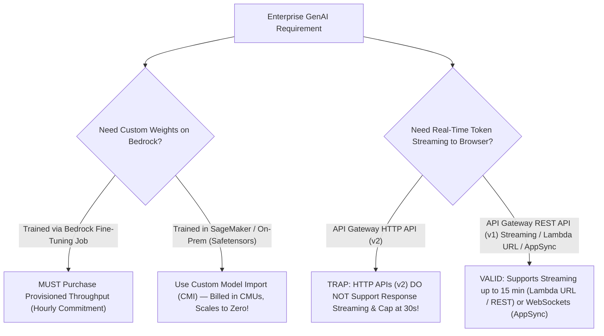

# Domain 2: Curated AWS Whitepapers, Prescriptive Guidance & Architectural Patterns

> **Track**: AWS Certified Generative AI Developer - Professional (AIP-C01)  
> **Domain 2**: Implementation and Integration (26%)

---

## Table of Contents

1. [Core AWS Whitepapers & Official Prescriptive Guidance](#1-core-aws-whitepapers--official-prescriptive-guidance)
   - [1.1 Building Agentic AI Systems on Amazon Bedrock](#11-building-agentic-ai-systems-on-amazon-bedrock)
   - [1.2 Model Context Protocol (MCP) Architecture on AWS](#12-model-context-protocol-mcp-architecture-on-aws)
   - [1.3 Optimizing Large Language Model Deployment on Amazon SageMaker AI](#13-optimizing-large-language-model-deployment-on-amazon-sagemaker-ai)
   - [1.4 Event-Driven & Asynchronous Generative AI Workflows](#14-event-driven--asynchronous-generative-ai-workflows)
   - [1.5 Resilient Multi-Region Foundation Model API Design](#15-resilient-multi-region-foundation-model-api-design)
   - [1.6 Enterprise DevSecOps, Infrastructure-as-Code & Amazon Q Developer](#16-enterprise-devsecops-infrastructure-as-code--amazon-q-developer)
2. [Reference Architecture Decision Matrices](#2-reference-architecture-decision-matrices)
   - [2.1 Bedrock vs. SageMaker AI Deployment Decision Matrix](#21-bedrock-vs-sagemaker-ai-deployment-decision-matrix)
   - [2.2 Real-Time Streaming Delivery Decision Matrix](#22-real-time-streaming-delivery-decision-matrix)
3. [High-Frequency Exam Traps & Architectural Anti-Patterns](#3-high-frequency-exam-traps--architectural-anti-patterns)

---

## 1. Core AWS Whitepapers & Official Prescriptive Guidance

### 1.1 Building Agentic AI Systems on Amazon Bedrock

- **Reference Documents**:
  - *AWS Prescriptive Guidance: Building Autonomous & Multi-Agent Systems with Amazon Bedrock*
  - *Amazon Bedrock User Guide: Automate Tasks in Your Application Using AI Agents*
- **Core Architectural Tenets**:
  - **Single-Agent vs. Multi-Agent Decomposition**:
    - A single Bedrock Agent performs optimally when scoped to a cohesive domain with fewer than 10–12 distinct Action Group operations and 1–3 Knowledge Bases.
    - When tool count grows beyond 15 or spans orthogonal security boundaries (e.g., HR Payroll, SQL Data Warehouse, and Cloud Security Operations), decompose into specialized Sub-Agents orchestrated by a **Supervisor Agent**.
  - **Choosing `SUPERVISOR` vs. `SUPERVISOR_ROUTER`**:
    - Use `SUPERVISOR_ROUTER` when a majority of user utterances are single-domain requests that can be routed directly to a sub-agent via a fast intent classifier, reserving full Supervisor ReAct synthesis only for compound cross-domain requests.
    - Use `SUPERVISOR` when every user request requires multi-agent task decomposition, cross-agent verification, or unified executive tone synthesis.
  - **Deterministic Control via Custom Orchestration**:
    - When regulatory policies mandate that Tool A *must* execute before Tool B regardless of model reasoning, replace the default orchestration loop with a **Custom Orchestration Lambda function** (`orchestrationType='CUSTOM_ORCHESTRATION'`).
  - **Zero-Trust State Isolation**:
    - Separate prompt-visible temporal variables (`promptSessionAttributes`) from hidden security context (`sessionAttributes`). Never inject raw OAuth bearer tokens, database credentials, or tenant isolation keys into the LLM prompt context.

---

### 1.2 Model Context Protocol (MCP) Architecture on AWS

- **Reference Documents**:
  - *AWS Architecture Blog: Building Standardized Agentic Tool Ecosystems with Model Context Protocol (MCP) and Strands Agents SDK*
  - *AWS Labs MCP Servers Reference Architecture (`awslabs/mcp`)*
- **Core Architectural Tenets**:
  - **Decoupling Tool Implementation from Agent Runtimes**:
    - MCP standardizes tool discovery (`tools/list`), tool execution (`tools/call`), contextual resource reading (`resources/read`), and prompt templates (`prompts/get`) over JSON-RPC 2.0.
  - **Transport Selection Matrix**:
    - **`stdio` Transport**: Deploy MCP servers as local subprocesses or sidecar containers within the same Amazon ECS Fargate task or EC2 instance when tools require ultra-low latency local filesystem or VPC access without network serialization overhead.
    - **Streamable HTTP / SSE Transport**: Deploy shared enterprise MCP servers on **AWS Lambda (with Response Streaming)** or **Amazon ECS Fargate behind an Application Load Balancer (ALB)** when exposing centralized tools across multiple teams and agent frameworks.
  - **Enterprise Security for MCP on AWS**:
    - Never expose remote MCP servers without authentication.
    - Use **AWS IAM SigV4** request signing (via API Gateway or Lambda Function URLs with `AWS_IAM` auth) for service-to-service agent calls.
    - Use **Amazon Cognito OAuth 2.0 Bearer Tokens** with user-scoped claims when tools execute on behalf of an interactive end user.

---

### 1.3 Optimizing Large Language Model Deployment on Amazon SageMaker AI

- **Reference Documents**:
  - *AWS Machine Learning Blog: Deploy Large Language Models at Scale with Amazon SageMaker Large Model Inference (LMI) Containers*
  - *AWS Whitepaper: Cost-Optimized Multi-Tenant LLM Serving with SageMaker Inference Components and Multi-Adapter LoRA*
- **Core Architectural Tenets**:
  - **Large Model Inference (LMI) Containers**:
    - Built on DJL Serving with **vLLM**, **TensorRT-LLM**, and **Transformers NeuronX** backends.
    - Always enable **Continuous Batching (`OPTION_ROLLING_BATCH=vllm` or `trtllm`)** and **PagedAttention** to maximize GPU KV-cache utilization and prevent Head-of-Line (HoL) blocking caused by long output sequences.
    - Configure **Tensor Parallelism (`OPTION_TENSOR_PARALLEL_DEGREE`)** to match the accelerator count needed to fit model weights plus KV cache in GPU HBM/VRAM.
    - Use **Speculative Decoding (`OPTION_SPECULATIVE_DRAFT_MODEL`)** to accelerate memory-bandwidth-bound autoregressive token generation on predictable structured outputs (JSON, code refactoring).
  - **SageMaker Inference Components & Multi-Adapter LoRA**:
    - Traditional Multi-Model Endpoints (MME) dynamically swap entire models between S3 and memory, causing severe cold-start latency spikes for multi-gigabyte LLMs.
    - **SageMaker Inference Components** assign dedicated GPU/accelerator fractions (`NumberOfAcceleratorDevicesRequired`) and maintain independent auto-scaling policies (including scale-to-zero with `MinCapacity=0`) on a shared endpoint instance fleet (`ManagedInstanceScaling="ENABLED"`).
    - For multi-tenant SaaS applications serving dozens or hundreds of fine-tuned models derived from a common base model (e.g., Llama 3.1 8B), deploy the **base model once** in an LMI container (`OPTION_ENABLE_LORA=true`) and attach each tenant's **LoRA adapter** as a lightweight Inference Component referencing `BaseInferenceComponentName`—achieving millisecond adapter switching in GPU memory.

---

### 1.4 Event-Driven & Asynchronous Generative AI Workflows

- **Reference Documents**:
  - *AWS Serverless Land: Event-Driven Generative AI Patterns with Amazon EventBridge, SQS, and AWS Step Functions*
- **Core Architectural Tenets**:
  - **Decoupling Long-Running FM Calls**:
    - Because LLM generation and multi-step agent loops take anywhere from 3 to 90+ seconds, synchronous REST chains frequently hit **Amazon API Gateway's 29-second default integration timeout** (unless API Gateway REST Response Streaming is explicitly configured) or exhaust downstream Bedrock RPM/TPM quotas.
  - **SQS Backpressure & Visibility Timeout Formula**:
    - Buffer bursty traffic in **Amazon SQS** with a **Dead-Letter Queue (DLQ)** (`maxReceiveCount = 3`).
    - Enforce `VisibilityTimeout >= 6 * Lambda Function Timeout` to prevent duplicate message delivery while the Lambda consumer waits for Bedrock `Converse` or `InvokeAgent` responses.
    - Set `ScalingConfig.MaximumConcurrency` on the Lambda SQS Event Source Mapping to match the target Bedrock token/request quota.
    - Enable `ReportBatchItemFailures` so partial batch throttling does not re-invoke successful LLM calls in the same batch.
  - **Step Functions Distributed Map vs. Bedrock Batch Inference**:
    - Use **Amazon Bedrock Batch Inference** (`CreateModelInvocationJob`) first whenever processing large volumes of offline prompts/documents stored in S3 JSONL files that require only a **single FM call per record**, capturing a **50% token cost discount** and bypassing real-time On-Demand quotas.
    - Use **AWS Step Functions Distributed Map** (`MaxConcurrency` controlled) when each S3 document requires a **multi-step stateful workflow** (e.g., Amazon Textract OCR $\rightarrow$ Bedrock `Converse` extraction $\rightarrow$ Guardrail validation $\rightarrow$ `.waitForTaskToken` human review on low confidence $\rightarrow$ DynamoDB persistence).

---

### 1.5 Resilient Multi-Region Foundation Model API Design

- **Reference Documents**:
  - *Amazon Builders' Library: Timeouts, Retries, and Backoff with Jitter*
  - *Amazon Bedrock User Guide: Cross-Region Inference (CRIS) and Intelligent Prompt Routing*
- **Core Architectural Tenets**:
  - **Client-Side Adaptive Rate Limiting**:
    - Configure `botocore.config.Config(retries={'max_attempts': 8, 'mode': 'adaptive'}, read_timeout=300)` to activate client-side token-bucket rate pacing and prevent premature 60-second socket disconnects on 100k+ token prompts.
  - **Cross-Region Inference Profiles (CRIS) & FinOps Tagging**:
    - Use System-Defined Inference Profiles (`us.*`, `eu.*`, `apac.*`) to pool burst capacity across multiple regions within a geography at zero extra cost.
    - Wrap System-Defined Inference Profiles inside customer-created **Application Inference Profiles** (`create_inference_profile`) to attach AWS Cost Allocation Tags for departmental chargebacks.
  - **Intelligent Prompt Routing**:
    - Route variable-complexity workloads through a managed Bedrock Prompt Router ARN to automatically dispatch simple prompts to fast/low-cost models (Haiku / Nova Lite) and complex prompts to flagship models (Sonnet / Nova Pro).

---

### 1.6 Enterprise DevSecOps, Infrastructure-as-Code & Amazon Q Developer

- **Reference Documents**:
  - *Amazon Q Developer User Guide: Customizing Amazon Q Developer for Enterprise Codebases*
- **Core Architectural Tenets**:
  - **Immutable Bedrock Agent Versioning**:
    - Never route production traffic to `TSTALIASID` (which tracks the mutable `DRAFT`).
    - Pin production traffic to a named **Agent Alias** pointing to an immutable numbered version (`1`, `2`, `3`...), and gate alias promotion in CI/CD behind automated Bedrock Evaluation / Ragas test suites.
  - **Amazon Q Developer Customizations**:
    - Requires **Amazon Q Developer Pro**, private repository connectivity (GitHub, GitLab, Bitbucket, or S3 with $\ge 10\text{–}20\text{ MB}$ of source code), validation of the **Customization Evaluation** score, and group assignment via **AWS IAM Identity Center**.

---

## 2. Reference Architecture Decision Matrices

### 2.1 Bedrock vs. SageMaker AI Deployment Decision Matrix

| Workload Profile | Optimal AWS Deployment Target | Key Technical Justification |
| :--- | :--- | :--- |
| Spiky production chat using Claude 3.5 Sonnet or Nova Pro within US geography | **Bedrock Cross-Region Inference Profile (`us.*`)** wrapped in an **Application Inference Profile** | Pools multi-region burst capacity at standard On-Demand pricing; Application Inference Profile enables FinOps cost tagging. |
| Custom fine-tuned Llama 3.1 / Mistral weights (`.safetensors` in S3) with intermittent daily traffic | **Bedrock Custom Model Import (CMI)** | Billed in **Custom Model Units (CMUs)** in 5-minute active windows; scales to zero when idle with no Provisioned Throughput commitment. |
| Fine-tuned Amazon Nova / Titan model trained natively via Bedrock Customization Job | **Bedrock Provisioned Throughput (PT)** | Native Bedrock fine-tuned models **require** Provisioned Throughput (Model Units) to be hosted and invoked. |
| Nightly classification/summarization of 1,000,000 S3 JSONL records | **Bedrock Batch Inference** | **50% token discount** and dedicated asynchronous batch queues that do not consume live On-Demand quotas. |
| 100 tenant-specific LoRA adapters sharing a single Llama 3.1 8B base model with sub-second switching | **SageMaker Real-Time Endpoint** with **Inference Components** + **LMI vLLM (`OPTION_ENABLE_LORA=true`)** | Loads base model into GPU VRAM once; swaps 100 MB tenant LoRA adapters in milliseconds. |
| 400 MB multimodal video/PDF payload requiring 15 minutes of GPU inference per item | **SageMaker Asynchronous Inference** (`MinCapacity=0` + SNS notifications) | Supports payloads up to **1 GB**, timeouts up to **1 hour**, GPU instances, and scale-to-zero when the queue is empty. |

---

### 2.2 Real-Time Streaming Delivery Decision Matrix

| Client & Governance Requirement | Optimal Streaming Architecture | Timeout & Payload Limits |
| :--- | :--- | :--- |
| Single-client HTTPS SSE streaming (>30s generation) requiring API Keys, Usage Plans, and Lambda Authorizers | **API Gateway REST API (`v1`) Response Streaming** (`ResponseTransferMode: STREAM`) + **Lambda (`RESPONSE_STREAM`)** | Up to **15 minutes** timeout; **10 MB** max payload. *(Note: HTTP API `v2` does NOT support streaming and caps at 30s!)* |
| Direct serverless HTTPS streaming (>30s generation, >10 MB output) with CloudFront + WAF at the edge | **CloudFront (OAC)** + **AWS Lambda Function URL (`InvokeMode: RESPONSE_STREAM`)** | Up to **15 minutes** timeout; **200 MB** max response stream. |
| Multi-client collaborative rooms, mobile apps on flaky networks, and real-time pub/sub fan-out | **AWS AppSync** (GraphQL Subscriptions or Event APIs over WebSockets) + Async Worker Lambda/ECS | **24-hour** WebSocket connection; **240 KB** per individual event frame; native Cognito/OIDC auth. |

---

## 3. High-Frequency Exam Traps & Architectural Anti-Patterns

| Exam Scenario / Trap | Why the Naive Choice Fails | The Correct AWS Principal Architecture |
| :--- | :--- | :--- |
| **Trap 1: Passing Tenant Secrets or OAuth Tokens to a Bedrock Agent Tool** | Placing JWT tokens or `tenant_id` in `inputText` or `promptSessionAttributes` injects them directly into the LLM prompt context, risking prompt injection extraction and wasting input tokens. | Pass sensitive execution metadata in **`sessionState.sessionAttributes`**. Bedrock forwards `sessionAttributes` directly to the Action Group Lambda `event['sessionAttributes']` **without** exposing them to the Foundation Model prompt. |
| **Trap 2: Serving a Custom Fine-Tuned Llama/Mistral Model with Spiky/Intermittent Traffic** | Fine-tuning natively in Bedrock requires purchasing 24x7 **Provisioned Throughput**; hosting on a standard SageMaker Real-Time Endpoint without Inference Components requires paying 24x7 for `ml.g5` instances. | Import the `.safetensors` weights into **Amazon Bedrock Custom Model Import (CMI)**. CMI bills per **Custom Model Unit (CMU)** in 5-minute active windows and automatically scales to zero when idle—requiring no Provisioned Throughput commitment. |
| **Trap 3: Bedrock Agent Lambda Returning `{"statusCode": 200, "body": "..."}`** | Bedrock Agents do **not** use the API Gateway proxy response format. Returning `statusCode`/`body` triggers a `DependencyFailedException` / `BadGatewayException`. | Return the exact Bedrock Agent envelope containing `"messageVersion": "1.0"` and `"response": {"actionGroup": ..., "functionResponse": ...}` (or `apiPath` + `httpMethod` + `httpStatusCode` for OpenAPI schemas). |
| **Trap 4: Handling Multiple Parallel `toolUse` Blocks in Bedrock `Converse`** | Sending a separate `user` message turn for each `toolResult` causes a `ValidationException` ("Expected toolResult blocks for all toolUse blocks in the previous assistant message"). | Execute all requested tools from the assistant turn and append **all** `toolResult` blocks inside the `content` array of a **single** `user` message before calling `Converse` again. |
| **Trap 5: Enforcing 100% Strict JSON Schema Output from `Converse`** | Prompting "Return ONLY valid JSON without markdown backticks" still fails intermittently under edge-case inputs when the LLM adds conversational preambles. | Define the target JSON schema inside a single tool's `inputSchema` in `toolConfig` and force its execution using **`toolChoice={"tool": {"name": "schema_extractor"}}`**. |
| **Trap 6: Streaming Tokens Through API Gateway HTTP API (`v2`)** | Amazon API Gateway **HTTP APIs (`v2`)** buffer the entire response payload, have a hard **30-second timeout**, and do **not** support response streaming. | Use **Amazon API Gateway REST API (`v1`) with Response Streaming (`ResponseTransferMode: STREAM`)**, **AWS Lambda Function URLs (`InvokeMode: RESPONSE_STREAM`)**, or **AWS AppSync Subscriptions / Event APIs**. |
| **Trap 7: Updating a Bedrock Agent Directly in Production** | Editing the `DRAFT` version and pointing production clients at `TSTALIASID` exposes end users to broken intermediate edits and unvalidated prompt changes. | Clients must invoke a named **Agent Alias** (`agentAliasId`). CI/CD pipelines update and `prepare_agent` on `DRAFT`, snapshot an immutable numbered version via `update_agent_alias` after automated evaluation passes, and roll back by re-pointing the alias to the prior version number. |
