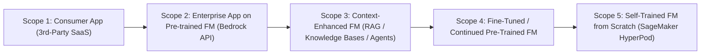
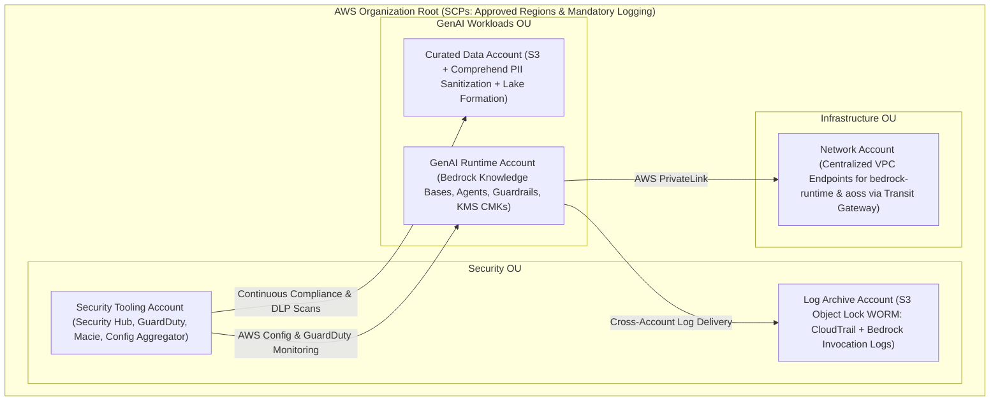

# Domain 3: Essential AWS Whitepapers, Frameworks, & Architectural Patterns

This reference synthesizes the official AWS security, governance, and compliance guidance required for **Domain 3 of the AWS Certified Generative AI Developer - Professional (AIP-C01)** exam:
1. **AWS Generative AI Security Scoping Matrix & Shared Responsibility Model**
2. **AWS Security Reference Architecture (AWS SRA) for Generative AI Multi-Account Topology**
3. **OWASP Top 10 for Large Language Model Applications — Mapped to Native AWS Controls**
4. **NIST AI Risk Management Framework (AI RMF 1.0) Mapped to AWS Services**
5. **Multi-Tenant SaaS Isolation Whitepaper Patterns for RAG on Amazon Bedrock**
6. **High-Frequency AIP-C01 Exam Traps & Anti-Patterns**

---

## 1. AWS Generative AI Security Scoping Matrix

AWS categorizes generative AI architectures into five distinct scopes based on how models are consumed, customized, or built. The shared responsibility boundary shifts significantly across scopes:

| Scope | Description | Customer Security Responsibilities | AWS Security Responsibilities |
| :--- | :--- | :--- | :--- |
| **Scope 1: Consumer AI Application** | Consuming an off-the-shelf SaaS assistant (e.g., Amazon Q Business / Q Developer). | Identity federation (IAM Identity Center), user/group ACL provisioning, DLP governance. | Model hosting, guardrails, infrastructure patching, encryption, and runtime isolation. |
| **Scope 2: Pre-Trained FM via API** | Invoking base models via `Converse` or `InvokeModel` without external knowledge stores. | Guardrail configuration, input/output PII filtering, IAM least privilege, VPC PrivateLink, Model Invocation Logging. | Stateless inference isolation, guaranteeing customer prompts never train base FMs, physical/hypervisor security. |
| **Scope 3: Context-Enhanced FM (RAG & Agents)** | Augmenting FMs with Bedrock Knowledge Bases, Vector DBs, and Action Group tools. | **All of Scope 2 PLUS:** Indirect prompt injection defense (`guardContent`), vector metadata tenant isolation, Action Group `sessionAttributes` vs `promptSessionAttributes`, User Confirmation (`requireConfirmation`), pre-ingestion PII redaction. | Managed orchestration container security, AOSS encryption/network policy enforcement. |
| **Scope 4: Fine-Tuned / Continued Pre-Trained FM** | Customizing model weights (`CreateModelCustomizationJob`) on proprietary S3 datasets. | **All of Scope 3 PLUS:** Pre-training dataset poisoning scans, SageMaker Clarify bias detection (`CI`, `DPL`), KMS CMK encryption of custom model weights, VPC-isolated training jobs. | Dedicated single-tenant storage of custom model adapters and Provisioned Throughput isolation. |
| **Scope 5: Self-Trained FM** | Training foundation models from scratch on SageMaker HyperPod / EKS. | Full ML lifecycle security: training container CVE scanning, checkpoint integrity, weight exfiltration prevention, custom red-teaming, and standalone `ApplyGuardrail` integration. | Underlying EC2/EFA compute, Nitro enclave attestation, and storage durability. |

---

## 2. AWS Security Reference Architecture (AWS SRA) for Generative AI

The **AWS Security Reference Architecture (AWS SRA)** prescribes a multi-account AWS Organizations layout that isolates generative AI workloads, centralizes security telemetry, and enforces preventative guardrails via Service Control Policies (SCPs) and Resource Control Policies (RCPs).

### Key AWS SRA Design Principles for Generative AI:
1. **Centralized Interface VPC Endpoints (Shared Services Network Account)**: Provision `bedrock-runtime`, `bedrock-agent-runtime`, and `aoss` Interface VPC Endpoints once in the central Network Account connected via AWS Transit Gateway and Route 53 Private Hosted Zones, attaching a centralized VPC Endpoint Policy (`aws:PrincipalOrgID`).
2. **Immutable Cross-Account Log Archive**: Deliver both AWS CloudTrail Organization Data Events (`AWS::Bedrock::*`) and Amazon Bedrock Model Invocation Logs into a dedicated **Log Archive Account** S3 bucket locked down with **S3 Object Lock in Compliance Mode** so application developers cannot alter or delete forensic records.
3. **Delegated Security Tooling Administration**: Delegate **Amazon Macie**, **Amazon GuardDuty**, **AWS Security Hub**, and **AWS Config** administration to the Security Tooling Account to continuously inspect Knowledge Base S3 buckets for unredacted PII and verify KMS CMK attachment across all member accounts.

---

## 3. OWASP Top 10 for LLM Applications Mapped to AWS Controls

| OWASP LLM Risk | Threat Mechanism | Primary AWS Preventive Control | Primary AWS Detective / Responsive Control |
| :--- | :--- | :--- | :--- |
| **LLM01: Prompt Injection** (Direct & Indirect) | Jailbreaks in user input or hidden instructions inside retrieved RAG chunks / web pages. | **Bedrock Guardrails `PROMPT_ATTACK` filter (`HIGH` input)** + tagging retrieved documents with `guardContent` qualifiers (`["guard_content"]`). | Bedrock Model Invocation Logging with `"trace": "enabled"` + CloudWatch Logs Insights query on `guardrail_intervened`. |
| **LLM02: Sensitive Information Disclosure** | PII, API keys, or proprietary data leaked in model completions or sent to FMs. | **Pre-ingestion**: Amazon Comprehend `DetectPiiEntities` + Amazon Macie. **Runtime**: Guardrail Sensitive Info Policy (`ANONYMIZE` or `BLOCK` for PII + Custom Regex). | Amazon Macie continuous S3 scanning on Knowledge Base source buckets and invocation log buckets. |
| **LLM03: Supply Chain Vulnerabilities** | Tampered third-party model weights, poisoned fine-tuning datasets, or unverified containers. | Prefer managed **Amazon Bedrock FMs** or signed **SageMaker JumpStart** hubs; scan custom inference containers with **Amazon ECR Enhanced Scanning (Inspector)**; verify S3 Object Lock on training datasets. | **SageMaker ML Lineage Tracking** & **SageMaker Model Registry** approval workflows. |
| **LLM04: Data and Model Poisoning** | Malicious examples injected into fine-tuning JSONL or RAG S3 buckets to skew outputs or implant backdoors. | S3 Bucket Policies with MFA Delete & Object Lock; **SageMaker Clarify** pre-training bias metrics (`KL`, `DPL`); **Guardrail `ApplyGuardrail`** pre-screening of ingested RAG chunks. | AWS CloudTrail S3 Data Events auditing every `PutObject` on training and RAG buckets. |
| **LLM05: Improper Output Handling** | Passing raw LLM output directly into SQL queries, shell commands, or browser DOM (`eval`, XSS, SSRF). | Treat all LLM outputs as untrusted user input; use parameterized queries (RDS Data API parameters), strict JSON schema validation, and sandboxed execution (**Bedrock Code Interpreter**). | AWS WAF inspecting downstream API calls and Guardrail Custom Regex blocking script/SQL patterns. |
| **LLM06: Excessive Agency** | An autonomous Bedrock Agent executing destructive database deletions or unauthorized wire transfers. | Scope Action Group Lambda IAM role to least privilege; enable **User Confirmation (`requireConfirmation: 'ENABLED'`)** on sensitive functions; pass auth scopes in `sessionAttributes`. | CloudTrail Data Events on `AWS::Bedrock::AgentAlias` and Lambda execution logs. |
| **LLM07: System Prompt Leakage** | Attackers tricking the model into repeating confidential rules, pricing logic, or credentials placed in the system prompt. | **Never store secrets, API keys, or tenant ACLs in system prompts or `promptSessionAttributes`**. Use Guardrail Custom Word/Regex filters on output to block internal codenames. | Guardrail output interventions monitored via CloudWatch Alarms. |
| **LLM08: Vector and Embedding Weaknesses** | Cross-tenant vector retrieval leakage or embedding inversion attacks. | Enforce server-side `retrievalConfiguration.vectorSearchConfiguration.filter` derived from verified Cognito JWT claims; encrypt AOSS collections with KMS CMKs. | OpenSearch Serverless audit logs & CloudTrail Data Events on `AWS::Bedrock::KnowledgeBase`. |
| **LLM09: Misinformation & Hallucination** | Generating fabricated citations, false financial figures, or policy-violating statements. | **Bedrock Guardrail Contextual Grounding Checks** (`GROUNDING` & `RELEVANCE` thresholds) + **Automated Reasoning Checks** for formal policy verification + **Amazon A2I** HITL review. | Bedrock Model Evaluation jobs and Grounding score distribution metrics. |
| **LLM10: Unbounded Consumption (Denial of Wallet)** | Attackers flooding GenAI endpoints with max-length prompts to exhaust Provisioned Throughput or run up token bills. | **AWS WAF Rate-Based Rules** + **API Gateway Usage Plans / Throttling** + strict `maxTokens` in `inferenceConfig` + token-budget admission control in DynamoDB. | **AWS Budgets** alerts + CloudWatch `InputTokenCount` / `OutputTokenCount` anomaly detection. |

---

## 4. NIST AI Risk Management Framework (AI RMF 1.0) Mapped to AWS Services

| NIST AI RMF Function | Core Objective | AWS Services & Implementation Mechanisms |
| :--- | :--- | :--- |
| **GOVERN** | Establish organizational policies, accountability, risk culture, and model inventory across the enterprise. | **AWS Organizations SCPs**, **Amazon SageMaker Model Cards**, **SageMaker Model Registry**, **AWS Config Conformance Packs**, **AWS IAM Access Analyzer**. |
| **MAP** | Categorize the AI system's context of use, data provenance, third-party dependencies, and potential demographic impacts. | **Amazon SageMaker ML Lineage Tracking**, **Amazon Macie** (sensitive data discovery), **AWS Glue Data Catalog**, **Amazon Titan / Nova C2PA Watermark Provenance**. |
| **MEASURE** | Quantitatively evaluate model accuracy, robustness, toxicity, grounding, fairness/bias, and explainability. | **Amazon Bedrock Model Evaluation Jobs** (Automatic & Human-based), **Amazon SageMaker Clarify** (Pre/Post-training bias metrics & Kernel SHAP), **Bedrock Guardrail Trace Analytics**. |
| **MANAGE** | Continuously monitor, mitigate, and respond to runtime AI incidents, drift, and safety boundary violations. | **Amazon Bedrock Guardrails** (runtime blocking/masking), **Amazon Augmented AI (A2I)** (HITL escalation), **Bedrock Model Invocation Logging**, **SageMaker Model Monitor** (bias & SHAP drift alerts). |

---

## 5. Multi-Tenant RAG Isolation Whitepaper Deep-Dive: Choosing the Right Filter & Policy Model

When implementing **Pooled Multi-Tenant RAG** in Amazon Bedrock Knowledge Bases using metadata filtering (`retrievalConfiguration.vectorSearchConfiguration.filter`), understand the supported filter operators and their security implications:

| Filter Operator | JSON Structure Example | Multi-Tenant Security Use Case |
| :--- | :--- | :--- |
| `equals` | `{"equals": {"key": "tenant_id", "value": "tenant-8841"}}` | Exact-match binding to the caller's single verified `tenant_id` claim. |
| `in` | `{"in": {"key": "group_id", "value": ["eng", "secops"]}}` | Role-based document access where a user's JWT contains an array of authorized Active Directory / IdP group memberships. |
| `lessThanOrEquals` | `{"lessThanOrEquals": {"key": "classification_tier", "value": 3}}` | Hierarchical security clearance models where a user with Level 3 clearance can read Level 1, 2, and 3 documents. |
| `andAll` / `orAll` | `{"andAll": [{"equals": {"key": "tenant_id", "value": "t1"}}, {"in": {"key": "dept", "value": ["hr", "legal"]}}]}` | Compound zero-trust isolation combining hard tenant boundary with intra-tenant departmental RBAC. |

---

## 6. High-Frequency AIP-C01 Exam Traps & Architectural Rules

> [!WARNING]
> **Trap 1: Using System Prompts for Access Control or Secret Storage**
> Putting `"The current user belongs to Tenant_A; do not show Tenant_B documents"` in the system prompt is **zero security**. Vector similarity search runs *before* the LLM reads the system prompt, meaning Tenant B's chunks are already fetched and vulnerable to prompt injection. Always filter at the **vector retrieval layer** (`vectorSearchConfiguration.filter`) or isolate by index/collection.

> [!WARNING]
> **Trap 2: Confusing `sessionAttributes` and `promptSessionAttributes` in Bedrock Agents**
> If an exam scenario asks how to pass a user's `jwt_token`, `employee_id`, or `database_role` to an Action Group Lambda function **without** exposing it to the foundation model, the answer is **`sessionAttributes`**. Anything placed in `promptSessionAttributes` is concatenated into the model's prompt context.

> [!WARNING]
> **Trap 3: Confusing CloudTrail Data Events with Bedrock Model Invocation Logging**
> - Need to know **who** (`PrincipalARN`, `sourceIPAddress`) called `InvokeModel` or `Retrieve`, **without** logging confidential prompt text? Use **AWS CloudTrail Data Events**.
> - Need to inspect or archive the **actual prompt text, images, model response, and guardrail trace**? Use **Amazon Bedrock Model Invocation Logging**.

> [!WARNING]
> **Trap 4: Protecting Non-Bedrock Models (SageMaker Endpoints, EKS, On-Premises) with Bedrock Guardrails**
> You do **not** need to migrate a custom model off SageMaker or EKS to use Amazon Bedrock Guardrails. Invoke the **`ApplyGuardrail` API** (`bedrock-runtime`) directly from your application orchestration layer with `source="INPUT"` before calling the model and `source="OUTPUT"` after receiving the model's generation.

> [!WARNING]
> **Trap 5: Contextual Grounding vs. Automated Reasoning Checks**
> - Use **Contextual Grounding Checks** when verifying that a RAG answer or document summary is factually supported by the retrieved passage (`grounding_source`) and relevant to the user `query`.
> - Use **Automated Reasoning Checks** when you must mathematically verify that a model's response adheres to formal, deterministic business logic or regulatory rules (e.g., eligibility criteria, underwriting formulas, compliance workflows) using theorem proving.
