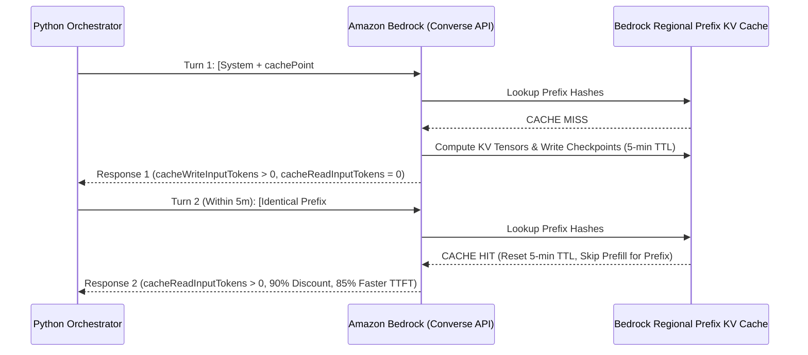
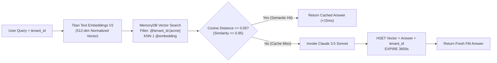
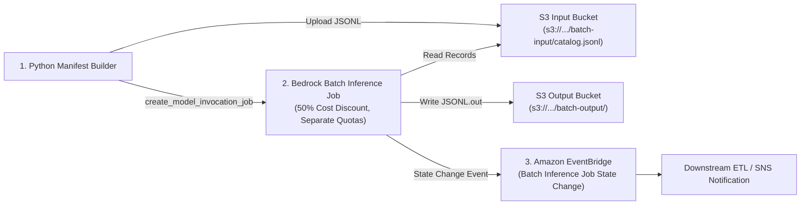
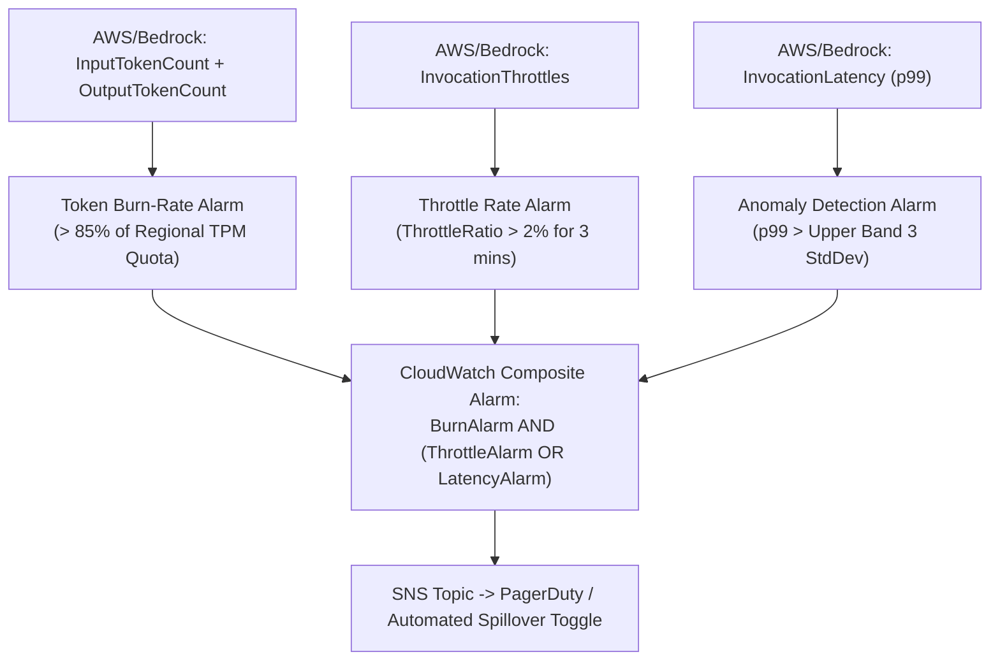

# Domain 4: Production Hands-On Exercises — Operational Efficiency & Optimization

These six production-grade engineering exercises cover all three tasks of Domain 4 (`Task 4.1: Cost Optimization`, `Task 4.2: Performance Optimization`, and `Task 4.3: Monitoring & FinOps Observability`). Every exercise includes an architecture diagram, complete runnable Python (`boto3`) or Infrastructure-as-Code templates, and verification steps.

---

## Exercise 1: Bedrock Prompt Caching (`cachePoint`) for System Prompts, Tool Schemas, and Multi-Turn RAG Context

### Objective
Eliminate redundant prefill computation and reduce input token costs by up to 90% (and TTFT by up to 85%) in a multi-turn financial regulatory assistant by placing `cachePoint` checkpoints after static system instructions, static tool definitions, and a large document context while keeping dynamic per-request variables strictly after the final checkpoint.



### Complete Implementation (`exercise_1_prompt_caching.py`)
```python
import json
import time
import boto3
from botocore.config import Config

bedrock_runtime = boto3.client(
    "bedrock-runtime",
    region_name="us-east-1",
    config=Config(retries={"max_attempts": 5, "mode": "adaptive"})
)

MODEL_ID = "us.anthropic.claude-3-5-sonnet-20241022-v2:0"

def build_static_system_prompt() -> list:
    """
    Constructs a static system prompt exceeding the 1,024-token minimum cache threshold
    with zero dynamic timestamps or session IDs before the cachePoint.
    """
    detailed_rubric = "\n".join([
        f"Control Domain {i}: Verify encryption-at-rest (KMS CMK), least-privilege IAM role scoping, "
        f"VPC endpoint isolation (PrivateLink), automated key rotation, and immutable CloudTrail audit "
        f"logging across all data plane and control plane operations for tier-{i} workloads."
        for i in range(1, 45)
    ])
    return [
        {
            "text": (
                "You are a Principal Cloud Security & Regulatory Auditor.\n"
                "Evaluate every architecture strictly against the following Mandatory Compliance Rubric:\n"
                f"{detailed_rubric}"
            )
        },
        {"cachePoint": {"type": "default"}}
    ]

def build_static_tool_config() -> dict:
    """
    Constructs static tool definitions followed by a cachePoint marker.
    """
    return {
        "tools": [
            {
                "toolSpec": {
                    "name": "record_audit_finding",
                    "description": "Records a formal compliance audit finding into AWS Security Hub.",
                    "inputSchema": {
                        "json": {
                            "type": "object",
                            "properties": {
                                "control_domain": {"type": "string"},
                                "compliance_status": {"type": "string", "enum": ["PASSED", "FAILED", "NEEDS_REVIEW"]},
                                "remediation_steps": {"type": "array", "items": {"type": "string"}}
                            },
                            "required": ["control_domain", "compliance_status", "remediation_steps"]
                        }
                    }
                }
            },
            {"cachePoint": {"type": "default"}}
        ]
    }

def run_multi_turn_cached_conversation() -> None:
    system_blocks = build_static_system_prompt()
    tool_config = build_static_tool_config()

    # Simulate a 3,000-token static architecture specification document
    static_architecture_doc = "<architecture_spec>\n" + (
        "Service: PaymentLedgerDB. Storage: Amazon Aurora PostgreSQL with KMS CMK encryption enabled. "
        "Networking: Deployed in isolated subnets with VPC Interface Endpoints for KMS and Bedrock. "
        "IAM: Execution role scoped to specific ARN resources with aws:SourceVpce condition keys.\n" * 65
    ) + "</architecture_spec>"

    messages = [
        {
            "role": "user",
            "content": [
                {"text": static_architecture_doc},
                # Cache the static architecture document before adding the dynamic user question
                {"cachePoint": {"type": "default"}},
                {"text": "Question 1: Does PaymentLedgerDB satisfy Control Domain 1 encryption and network rules?"}
            ]
        }
    ]

    # Turn 1: Expect Cache Write (Miss)
    t0 = time.perf_counter()
    resp1 = bedrock_runtime.converse(
        modelId=MODEL_ID,
        system=system_blocks,
        toolConfig=tool_config,
        messages=messages,
        inferenceConfig={"temperature": 0.0, "maxTokens": 512}
    )
    t1 = (time.perf_counter() - t0) * 1000.0
    print(f"--- Turn 1 Completed in {t1:.1f} ms ---")
    print(json.dumps(resp1["usage"], indent=2))

    # Append assistant response and Turn 2 User query, caching the conversation history
    messages.append(resp1["output"]["message"])
    messages.append({
        "role": "user",
        "content": [
            {"text": "Question 2: Summarize the IAM least-privilege posture of PaymentLedgerDB in 3 bullet points."}
        ]
    })

    # Turn 2: Expect Cache Read Hit on all 3 static checkpoints
    t2_start = time.perf_counter()
    resp2 = bedrock_runtime.converse(
        modelId=MODEL_ID,
        system=system_blocks,
        toolConfig=tool_config,
        messages=messages,
        inferenceConfig={"temperature": 0.0, "maxTokens": 512}
    )
    t2 = (time.perf_counter() - t2_start) * 1000.0
    print(f"--- Turn 2 Completed in {t2:.1f} ms ---")
    print(json.dumps(resp2["usage"], indent=2))

if __name__ == "__main__":
    run_multi_turn_cached_conversation()
```

---

## Exercise 2: Sub-15ms Tenant-Scoped Semantic Cache Layer with Amazon MemoryDB for Redis Vector Search & Titan Text Embeddings V2

### Objective
Build a multi-tenant semantic cache using **Amazon MemoryDB for Redis (or ElastiCache for Valkey)** vector search (`FT.CREATE` / `FT.SEARCH` HNSW index) and **Amazon Titan Text Embeddings V2**. Ensure strict tenant isolation via a mandatory `tenant_id` TAG pre-filter and enforce a Cosine Similarity threshold of $\ge 0.95$ (Cosine Distance $\le 0.05$).



### Complete Implementation (`exercise_2_semantic_cache.py`)
```python
import hashlib
import json
import struct
import boto3
import redis
from redis.commands.search.field import TagField, TextField, VectorField
from redis.commands.search.indexDefinition import IndexDefinition, IndexType
from redis.commands.search.query import Query

bedrock_runtime = boto3.client("bedrock-runtime", region_name="us-east-1")

# Connect to Amazon MemoryDB or ElastiCache for Valkey with TLS enabled
redis_client = redis.Redis(
    host="clustercfg.genai-semcache.xxxxxx.memorydb.us-east-1.amazonaws.com",
    port=6379,
    ssl=True,
    decode_responses=False
)

INDEX_NAME = "idx:semantic_cache"
EMBEDDING_DIM = 512
MAX_COSINE_DISTANCE = 0.05  # Equivalent to Cosine Similarity >= 0.95
CACHE_TTL_SECONDS = 3600

def ensure_vector_index() -> None:
    """Creates the HNSW vector index in MemoryDB if it does not already exist."""
    try:
        redis_client.ft(INDEX_NAME).info()
    except Exception:
        schema = (
            TagField("tenant_id"),
            TextField("prompt_text"),
            TextField("response_text"),
            VectorField(
                "embedding",
                "HNSW",
                {
                    "TYPE": "FLOAT32",
                    "DIM": EMBEDDING_DIM,
                    "DISTANCE_METRIC": "COSINE",
                    "M": 16,
                    "EF_CONSTRUCTION": 200
                }
            )
        )
        definition = IndexDefinition(prefix=["semcache:"], index_type=IndexType.HASH)
        redis_client.ft(INDEX_NAME).create_index(fields=schema, definition=definition)

def embed_query_bytes(text: str) -> bytes:
    """Generates a normalized 512-dimensional float32 vector via Titan Text Embeddings V2."""
    response = bedrock_runtime.invoke_model(
        modelId="amazon.titan-embed-text-v2:0",
        contentType="application/json",
        accept="application/json",
        body=json.dumps({
            "inputText": text,
            "dimensions": EMBEDDING_DIM,
            "normalize": True
        })
    )
    payload = json.loads(response["body"].read())
    vector = payload["embedding"]
    return struct.pack(f"{len(vector)}f", *vector)

def query_with_semantic_cache(tenant_id: str, user_prompt: str) -> dict:
    """
    Executes a tenant-isolated vector lookup in MemoryDB before falling back to Bedrock.
    """
    query_vec_bytes = embed_query_bytes(user_prompt)

    # Mandatory pre-filter on @tenant_id prevents cross-tenant data leakage
    redis_query = (
        Query(f"(@tenant_id:{{{tenant_id}}})=>[KNN 1 @embedding $vec AS vector_distance]")
        .sort_by("vector_distance")
        .return_fields("prompt_text", "response_text", "vector_distance")
        .dialect(2)
    )

    results = redis_client.ft(INDEX_NAME).search(
        redis_query, query_params={"vec": query_vec_bytes}
    )

    if results.docs:
        top_doc = results.docs[0]
        distance = float(top_doc.vector_distance)
        if distance <= MAX_COSINE_DISTANCE:
            return {
                "cache_hit": True,
                "cosine_similarity": round(1.0 - distance, 4),
                "matched_prompt": top_doc.prompt_text,
                "response": top_doc.response_text
            }

    # Cache Miss -> Invoke Foundation Model
    converse_resp = bedrock_runtime.converse(
        modelId="us.anthropic.claude-3-5-haiku-20241022-v1:0",
        messages=[{"role": "user", "content": [{"text": user_prompt}]}],
        inferenceConfig={"temperature": 0.0, "maxTokens": 512}
    )
    answer_text = converse_resp["output"]["message"]["content"][0]["text"]

    # Store in MemoryDB with tenant scope and TTL
    prompt_hash = hashlib.sha256(f"{tenant_id}:{user_prompt}".encode("utf-8")).hexdigest()[:24]
    cache_key = f"semcache:{tenant_id}:{prompt_hash}"
    redis_client.hset(
        cache_key,
        mapping={
            b"tenant_id": tenant_id.encode("utf-8"),
            b"prompt_text": user_prompt.encode("utf-8"),
            b"response_text": answer_text.encode("utf-8"),
            b"embedding": query_vec_bytes
        }
    )
    redis_client.expire(cache_key, CACHE_TTL_SECONDS)

    return {
        "cache_hit": False,
        "cosine_similarity": None,
        "matched_prompt": None,
        "response": answer_text
    }
```

---

## Exercise 3: Intelligent Prompt Routing + Latency-Optimized Cross-Region Inference (`performanceConfig`) with Asynchronous Guardrail Streaming

### Objective
Configure a low-latency streaming orchestrator that uses **Amazon Bedrock Intelligent Prompt Routing** (or a Cross-Region Inference profile) paired with `performanceConfig={"latency": "optimized"}` and `guardrailConfig={"streamProcessingMode": "ASYNCHRONOUS"}` to eliminate guardrail buffering pauses while logging which backing model the router selected.

### Complete Implementation (`exercise_3_low_latency_router_stream.py`)
```python
import time
import boto3

bedrock_runtime = boto3.client("bedrock-runtime", region_name="us-east-1")

# Default Anthropic Prompt Router ARN or Cross-Region Inference Profile ARN
PROMPT_ROUTER_ARN = "arn:aws:bedrock:us-east-1:123456789012:default-prompt-router/anthropic.claude:1"
GUARDRAIL_ID = "gr-prod-safety-01"
GUARDRAIL_VERSION = "2"

def stream_with_optimized_latency_and_async_guardrail(user_prompt: str) -> dict:
    """
    Streams tokens using Latency-Optimized Inference and Asynchronous Guardrail
    processing while measuring exact Time to First Token (TTFT) and Inter-Token Latency (ITL).
    """
    start_time = time.perf_counter()
    first_token_time = None
    output_chunks = []
    routed_model_id = "unknown"
    usage_stats = {}

    response = bedrock_runtime.converse_stream(
        modelId=PROMPT_ROUTER_ARN,
        messages=[{"role": "user", "content": [{"text": user_prompt}]}],
        performanceConfig={"latency": "optimized"},
        guardrailConfig={
            "guardrailIdentifier": GUARDRAIL_ID,
            "guardrailVersion": GUARDRAIL_VERSION,
            "streamProcessingMode": "ASYNCHRONOUS",
            "trace": "enabled"
        },
        inferenceConfig={"temperature": 0.2, "maxTokens": 800}
    )

    for event in response.get("stream", []):
        if "contentBlockDelta" in event:
            if first_token_time is None:
                first_token_time = time.perf_counter()
            chunk_text = event["contentBlockDelta"]["delta"].get("text", "")
            output_chunks.append(chunk_text)
            print(chunk_text, end="", flush=True)

        elif "metadata" in event:
            meta = event["metadata"]
            usage_stats = meta.get("usage", {})
            trace_data = meta.get("trace", {})
            if "promptRouter" in trace_data:
                routed_model_id = trace_data["promptRouter"].get("invokedModelId", "unknown")

    end_time = time.perf_counter()
    ttft_ms = ((first_token_time - start_time) * 1000.0) if first_token_time else 0.0
    total_ms = (end_time - start_time) * 1000.0
    out_tokens = usage_stats.get("outputTokens", 0)
    itl_ms = ((end_time - first_token_time) * 1000.0 / max(out_tokens - 1, 1)) if first_token_time else 0.0

    print("\n--- Stream Telemetry ---")
    telemetry = {
        "invokedModelId": routed_model_id,
        "ttft_ms": round(ttft_ms, 2),
        "itl_ms_per_token": round(itl_ms, 2),
        "total_duration_ms": round(total_ms, 2),
        "usage": usage_stats
    }
    print(telemetry)
    return telemetry

if __name__ == "__main__":
    stream_with_optimized_latency_and_async_guardrail(
        "Classify the sentiment of this customer review in one word: 'The shipment arrived two days early!'"
    )
```

---

## Exercise 4: High-Volume Cost Optimization Pipeline Using Amazon Bedrock Batch Inference (50% Discount)

### Objective
Process 50,000 nightly product catalog descriptions at a **50% cost discount** without consuming real-time On-Demand RPM/TPM quotas by generating a valid S3 JSONL batch input manifest, submitting a `create_model_invocation_job` request, and configuring an **Amazon EventBridge** rule to capture job completion events.



### Complete Implementation (`exercise_4_batch_inference.py`)
```python
import json
import uuid
import boto3

s3_client = boto3.client("s3", region_name="us-east-1")
bedrock_client = boto3.client("bedrock", region_name="us-east-1")
events_client = boto3.client("events", region_name="us-east-1")

BUCKET_NAME = "enterprise-genai-batch-pipeline-123456789012"
INPUT_KEY = "batch-input/nightly_catalog_enrichment.jsonl"
OUTPUT_PREFIX = "batch-output/nightly-run/"
BATCH_ROLE_ARN = "arn:aws:iam::123456789012:role/BedrockBatchInferenceServiceRole"
MODEL_ID = "anthropic.claude-3-5-haiku-20241022-v1:0"

def upload_batch_jsonl_manifest(catalog_items: list[dict]) -> str:
    """
    Formats records into Amazon Bedrock Batch Inference JSONL specification
    where each line contains a unique recordId and a valid modelInput payload.
    """
    jsonl_lines = []
    for item in catalog_items:
        record = {
            "recordId": item["sku_id"],
            "modelInput": {
                "anthropic_version": "bedrock-2023-05-31",
                "max_tokens": 256,
                "temperature": 0.0,
                "system": "Extract structured SEO tags and category taxonomy as strict JSON.",
                "messages": [
                    {
                        "role": "user",
                        "content": [
                            {"type": "text", "text": f"Product Description: {item['description']}"}
                        ]
                    }
                ]
            }
        }
        jsonl_lines.append(json.dumps(record))

    body_bytes = ("\n".join(jsonl_lines) + "\n").encode("utf-8")
    s3_client.put_object(Bucket=BUCKET_NAME, Key=INPUT_KEY, Body=body_bytes)
    return f"s3://{BUCKET_NAME}/{INPUT_KEY}"

def submit_batch_inference_job(input_s3_uri: str) -> str:
    """
    Submits an asynchronous Bedrock Batch Inference job (billed at 50% discount).
    """
    job_name = f"catalog-seo-batch-{uuid.uuid4().hex[:8]}"
    response = bedrock_client.create_model_invocation_job(
        jobName=job_name,
        roleArn=BATCH_ROLE_ARN,
        modelId=MODEL_ID,
        inputDataConfig={
            "s3InputDataConfig": {
                "s3InputFormat": "JSONL",
                "s3Uri": input_s3_uri
            }
        },
        outputDataConfig={
            "s3OutputDataConfig": {
                "s3Uri": f"s3://{BUCKET_NAME}/{OUTPUT_PREFIX}"
            }
        },
        timeoutDurationInHours=24,
        tags=[
            {"key": "Environment", "value": "Production"},
            {"key": "CostCenter", "value": "Merchandising-AI"}
        ]
    )
    return response["jobArn"]

def configure_eventbridge_batch_completion_rule(sns_topic_arn: str) -> None:
    """
    Creates an EventBridge rule that triggers immediately when a Bedrock Batch Inference
    job transitions to Completed, Failed, or PartiallyCompleted.
    """
    rule_name = "BedrockBatchJobCompletionRule"
    event_pattern = {
        "source": ["aws.bedrock"],
        "detail-type": ["Batch Inference Job State Change"],
        "detail": {
            "status": ["Completed", "Failed", "PartiallyCompleted"]
        }
    }
    events_client.put_rule(
        Name=rule_name,
        EventPattern=json.dumps(event_pattern),
        State="ENABLED",
        Description="Triggers downstream ingestion when Bedrock Batch Inference completes."
    )
    events_client.put_targets(
        Rule=rule_name,
        Targets=[{"Id": "NotifyBatchSNS", "Arn": sns_topic_arn}]
    )
```

---

## Exercise 5: Multi-Tenant GenAI FinOps Chargeback Using Application Inference Profiles, Cost Allocation Tags, and CloudWatch EMF

### Objective
Enable native **AWS Cost Explorer** chargeback and isolated `AWS/Bedrock` CloudWatch metrics for enterprise business units by creating tagged **Application Inference Profiles** wrapping a Cross-Region Inference profile, and emit **CloudWatch Embedded Metric Format (EMF)** logs for granular per-tenant cost accounting.

### Complete Implementation (`exercise_5_multi_tenant_finops.py`)
```python
import json
import time
import boto3

bedrock_control = boto3.client("bedrock", region_name="us-east-1")
bedrock_runtime = boto3.client("bedrock-runtime", region_name="us-east-1")

# Base System-Defined Cross-Region Inference Profile ARN in us-east-1
CRIS_SOURCE_ARN = (
    "arn:aws:bedrock:us-east-1:123456789012:inference-profile/"
    "us.anthropic.claude-3-5-sonnet-20241022-v2:0"
)

def create_tagged_application_inference_profile(
    department_name: str,
    cost_center_code: str
) -> str:
    """
    Creates a custom Application Inference Profile copying from the US Cross-Region
    Inference profile, attaching AWS Cost Allocation Tags for Cost Explorer & Budgets.
    """
    profile_name = f"app-profile-{department_name.lower()}-sonnet-v2"
    response = bedrock_control.create_inference_profile(
        inferenceProfileName=profile_name,
        description=f"Dedicated Bedrock Inference Profile for {department_name}",
        modelSource={"copyFrom": CRIS_SOURCE_ARN},
        tags=[
            {"key": "Department", "value": department_name},
            {"key": "CostCenter", "value": cost_center_code},
            {"key": "ManagedBy", "value": "PlatformFinOps"}
        ]
    )
    return response["inferenceProfileArn"]

def invoke_and_emit_emf_chargeback(
    app_profile_arn: str,
    department: str,
    sub_tenant_id: str,
    prompt: str
) -> dict:
    """
    Invokes Bedrock via the department's Application Inference Profile ARN and emits
    a structured CloudWatch EMF log entry for real-time cost and token dashboards.
    """
    t0 = time.perf_counter()
    response = bedrock_runtime.converse(
        modelId=app_profile_arn,
        messages=[{"role": "user", "content": [{"text": prompt}]}],
        inferenceConfig={"temperature": 0.0, "maxTokens": 400}
    )
    latency_ms = (time.perf_counter() - t0) * 1000.0

    usage = response.get("usage", {})
    in_tok = usage.get("inputTokens", 0)
    out_tok = usage.get("outputTokens", 0)
    cache_read = usage.get("cacheReadInputTokens", 0)
    cache_write = usage.get("cacheWriteInputTokens", 0)

    # Calculate exact USD cost ($3/1M input, $15/1M output, $0.30/1M cache read, $3.75/1M cache write)
    total_cost_usd = (
        (in_tok * 3.00 / 1_000_000)
        + (out_tok * 15.00 / 1_000_000)
        + (cache_read * 0.30 / 1_000_000)
        + (cache_write * 3.75 / 1_000_000)
    )

    emf_record = {
        "_aws": {
            "Timestamp": int(time.time() * 1000),
            "CloudWatchMetrics": [
                {
                    "Namespace": "GenAI/TenantFinOps",
                    "Dimensions": [["Department"]],
                    "Metrics": [
                        {"Name": "InputTokens", "Unit": "Count"},
                        {"Name": "OutputTokens", "Unit": "Count"},
                        {"Name": "CacheReadTokens", "Unit": "Count"},
                        {"Name": "InvocationCostUSD", "Unit": "None"},
                        {"Name": "EndToEndLatency", "Unit": "Milliseconds"}
                    ]
                }
            ]
        },
        "Department": department,
        "sub_tenant_id": sub_tenant_id,
        "inference_profile_arn": app_profile_arn,
        "InputTokens": in_tok,
        "OutputTokens": out_tok,
        "CacheReadTokens": cache_read,
        "InvocationCostUSD": round(total_cost_usd, 6),
        "EndToEndLatency": round(latency_ms, 2)
    }
    print(json.dumps(emf_record))
    return response
```

---

## Exercise 6: CloudWatch Anomaly Detection & Composite Burn-Rate Alarms for Bedrock Token Exhaustion, Latency Spikes, and `InvocationThrottles`

### Objective
Provision proactive observability guardrails in **Amazon CloudWatch** using **Metric Math** (calculating total token burn rate and prompt cache hit ratio), **Anomaly Detection**, and a **Composite Alarm** that pages the on-call SRE team only when high token consumption coincides with elevated `InvocationThrottles` or `InvocationLatency` p99 spikes.



### Complete CloudFormation Template (`exercise_6_cloudwatch_composite_alarms.yaml`)
```yaml
AWSTemplateFormatVersion: "2010-09-09"
Description: >
  Production CloudWatch Metric Math, Anomaly Detection, and Composite Alarms
  for Amazon Bedrock Inference Profiles (Domain 4 Task 4.3).

Parameters:
  InferenceProfileId:
    Type: String
    Default: "us.anthropic.claude-3-5-sonnet-20241022-v2:0"
    Description: The Bedrock ModelId or Application Inference Profile ID to monitor.
  TPMQuotaLimit:
    Type: Number
    Default: 400000
    Description: Regional or Profile Tokens-Per-Minute (TPM) quota ceiling.
  AlertSnsTopicArn:
    Type: String
    Description: SNS Topic ARN for critical SRE notifications.

Resources:
  # 1. Token Quota Burn-Rate Metric Math Alarm (> 85% of TPM Quota)
  BedrockTokenBurnRateAlarm:
    Type: AWS::CloudWatch::Alarm
    Properties:
      AlarmName: !Sub "Bedrock-HighTokenBurnRate-${InferenceProfileId}"
      AlarmDescription: "Triggers when combined Input + Output TPM exceeds 85% of quota."
      ComparisonOperator: GreaterThanThreshold
      EvaluationPeriods: 3
      DatapointsToAlarm: 2
      Threshold: ! !Ref TPMQuotaLimit
      TreatMissingData: notBreaching
      Metrics:
        - Id: m_in
          MetricStat:
            Metric:
              Namespace: AWS/Bedrock
              MetricName: InputTokenCount
              Dimensions:
                - Name: ModelId
                  Value: !Ref InferenceProfileId
            Period: 60
            Stat: Sum
          ReturnData: false
        - Id: m_out
          MetricStat:
            Metric:
              Namespace: AWS/Bedrock
              MetricName: OutputTokenCount
              Dimensions:
                - Name: ModelId
                  Value: !Ref InferenceProfileId
            Period: 60
            Stat: Sum
          ReturnData: false
        - Id: e_burn_utilization
          Expression: "(m_in + m_out) / 0.85"
          Label: "QuotaAdjustedTokenBurnPerMinute"
          ReturnData: true

  # 2. Throttle Percentage Metric Math Alarm (> 2% of total requests throttled)
  BedrockThrottleRatioAlarm:
    Type: AWS::CloudWatch::Alarm
    Properties:
      AlarmName: !Sub "Bedrock-HighThrottleRatio-${InferenceProfileId}"
      AlarmDescription: "Triggers when HTTP 429 InvocationThrottles exceed 2% of total traffic."
      ComparisonOperator: GreaterThanThreshold
      EvaluationPeriods: 3
      DatapointsToAlarm: 2
      Threshold: 2.0
      TreatMissingData: notBreaching
      Metrics:
        - Id: m_throttles
          MetricStat:
            Metric:
              Namespace: AWS/Bedrock
              MetricName: InvocationThrottles
              Dimensions:
                - Name: ModelId
                  Value: !Ref InferenceProfileId
            Period: 60
            Stat: Sum
          ReturnData: false
        - Id: m_invocations
          MetricStat:
            Metric:
              Namespace: AWS/Bedrock
              MetricName: Invocations
              Dimensions:
                - Name: ModelId
                  Value: !Ref InferenceProfileId
            Period: 60
            Stat: Sum
          ReturnData: false
        - Id: e_throttle_pct
          Expression: "100 * (m_throttles / (m_invocations + m_throttles + 0.0001))"
          Label: "ThrottlePercentage"
          ReturnData: true

  # 3. CloudWatch Anomaly Detection Alarm on p99 InvocationLatency
  BedrockLatencyAnomalyDetector:
    Type: AWS::CloudWatch::AnomalyDetector
    Properties:
      Namespace: AWS/Bedrock
      MetricName: InvocationLatency
      Stat: p99
      Dimensions:
        - Name: ModelId
          Value: !Ref InferenceProfileId

  BedrockLatencyAnomalyAlarm:
    Type: AWS::CloudWatch::Alarm
    Properties:
      AlarmName: !Sub "Bedrock-LatencyP99Anomaly-${InferenceProfileId}"
      AlarmDescription: "Triggers when p99 InvocationLatency exceeds 3 standard deviations."
      ComparisonOperator: GreaterThanUpperThreshold
      EvaluationPeriods: 3
      DatapointsToAlarm: 2
      ThresholdMetricId: ad_band
      TreatMissingData: notBreaching
      Metrics:
        - Id: m_lat_p99
          MetricStat:
            Metric:
              Namespace: AWS/Bedrock
              MetricName: InvocationLatency
              Dimensions:
                - Name: ModelId
                  Value: !Ref InferenceProfileId
            Period: 60
            Stat: p99
          ReturnData: true
        - Id: ad_band
          Expression: "ANOMALY_DETECTION_BAND(m_lat_p99, 3)"
          Label: "InvocationLatency (p99 Expected Band)"
          ReturnData: true

  # 4. Composite Alarm: Suppresses noise by firing only on correlated saturation + degradation
  BedrockCapacityDegradationCompositeAlarm:
    Type: AWS::CloudWatch::CompositeAlarm
    Properties:
      AlarmName: !Sub "Bedrock-CRITICAL-CapacityDegradation-${InferenceProfileId}"
      AlarmDescription: "Fires when high token burn rate coincides with throttling or p99 latency anomaly."
      AlarmRule: !Sub >
        ALARM("${BedrockTokenBurnRateAlarm}") AND
        (ALARM("${BedrockThrottleRatioAlarm}") OR ALARM("${BedrockLatencyAnomalyAlarm}"))
      AlarmActions:
        - !Ref AlertSnsTopicArn
```
