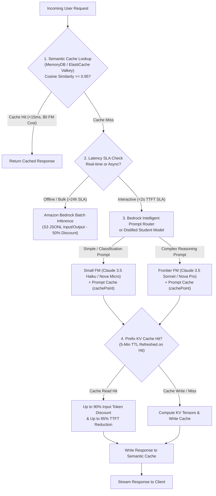
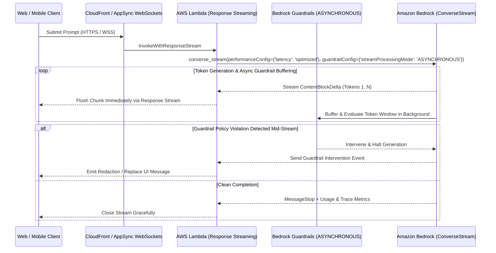

# Domain 4: Operational Efficiency and Optimization for GenAI Applications (12%) — Deep-Dive Study Guide

## Overview & Exam Blueprint

Domain 4 of the **AWS Certified Generative AI Developer - Professional (AIP-C01)** exam measures your ability to engineer cost-efficient, low-latency, high-throughput, and deeply observable generative AI workloads at production scale. While Domain 4 accounts for **12%** of the scored exam items, its architectural primitives—such as **Prompt Caching (`cachePoint`)**, **Cross-Region Inference (CRIS)**, **Intelligent Prompt Routing**, **Provisioned Throughput Model Units (MUs)**, **Latency-Optimized Inference**, and **Application Inference Profiles**—appear as deciding factors in distractors across all five exam domains.

| Task | Task Title | Core AWS Services & Capabilities |
| :--- | :--- | :--- |
| **Task 4.1** | Implement Cost Optimization & Resource Efficiency Strategies | Amazon Bedrock Prompt Caching (`cachePoint`), Semantic Caching (Amazon MemoryDB / ElastiCache for Valkey / OpenSearch Serverless), Intelligent Prompt Routing, Batch Inference, Provisioned Throughput FinOps Math, Bedrock Model Distillation, Token Budget Governance |
| **Task 4.2** | Optimize Application Performance | TTFT vs. ITL/TPS Latency Anatomy, Bedrock Latency-Optimized Inference (`performanceConfig`), Cross-Region Inference (CRIS) Profiles, End-to-End Streaming (`ConverseStream` + Lambda Response Streaming + AppSync), Asynchronous Guardrails, SageMaker LMI (`vLLM`, `TensorRT-LLM`, PagedAttention, Quantization, AWS Inferentia2 `ml.inf2`), Vector Index Tuning (`ef_search`, Aurora Optimized Reads) |
| **Task 4.3** | Implement Monitoring Systems for GenAI Applications | Amazon CloudWatch Bedrock Metrics (`InvocationLatency`, `InvocationThrottles`, `CacheReadInputTokenCount`, `CacheWriteInputTokenCount`), OpenTelemetry GenAI Semantic Conventions + AWS X-Ray / CloudWatch Application Signals, CloudWatch Embedded Metric Format (EMF) Multi-Tenant Token Accounting, Application Inference Profiles + AWS Cost Allocation Tags |

---

## Task 4.1: Implement Cost Optimization & Resource Efficiency Strategies

In production generative AI systems, inference token consumption is the single largest variable operating expense (OpEx). Unlike traditional microservices where CPU and memory scale sub-linearly with request payload size, Transformer-based Foundation Models (FMs) scale quadratically ($O(N^2)$) with attention context length during the prefill phase and linearly ($O(N)$) in Key-Value (KV) cache memory footprint during autoregressive decoding. Mastering Task 4.1 requires layering deterministic prefix caching, vector-based semantic caching, dynamic model routing, asynchronous batching, and model distillation.



---

### 1. Amazon Bedrock Prompt Caching (`cachePoint`)

#### Architectural Mechanics of Prefix KV-Caching
When an FM processes an input prompt, the **prefill phase** computes Key ($K$) and Value ($V$) attention matrices across every transformer layer for every input token. In multi-turn agent loops, RAG pipelines over large reference manuals, or complex few-shot extraction workflows, 80% to 95% of the prompt tokens (system instructions, JSON tool schemas, few-shot demonstrations, and static document context) remain completely identical across consecutive turns or requests.

**Amazon Bedrock Prompt Caching** allows you to insert explicit `cachePoint` markers into the `system`, `tools`, or `messages` arrays of the `Converse` / `ConverseStream` (or `InvokeModel`) APIs. When Bedrock encounters a `cachePoint`:
1. It computes a cryptographic hash of the **exact token prefix** from the very first token of the request up to the `cachePoint` boundary.
2. **Cache Miss (`CacheWriteInputTokenCount`)**: If no matching prefix exists in the regional cache cluster, Bedrock computes the KV tensors, stores them in high-speed distributed memory, and bills the tokens at the **Cache Write** rate (for Anthropic Claude models, a 25% premium over standard input token price; for Amazon Nova models, varying by tier).
3. **Cache Hit (`CacheReadInputTokenCount`)**: If an identical token prefix matches within the **5-minute Time-To-Live (TTL)** window, Bedrock bypasses prefill computation for the cached prefix, loads the precomputed KV tensors directly into accelerator HBM, resets the 5-minute TTL timer, reduces **Time to First Token (TTFT) by up to 85%**, and discounts those cached input tokens by **up to 90%**.

#### Minimum Token Thresholds & Constraints
Prompt caching is only activated if the token prefix preceding the `cachePoint` meets the model-specific minimum token threshold:

| Model Family | Minimum Cacheable Prefix Tokens | Cache TTL (Refreshed on Hit) | Max Cache Checkpoints per Request | Read Discount vs Base Input | Write Premium vs Base Input |
| :--- | :--- | :--- | :--- | :--- | :--- |
| **Anthropic Claude 3.5 Sonnet / Claude 3.7 Sonnet / Claude 3 Opus** | 1,024 tokens | 5 minutes | Up to 4 | **90% discount** (0.10x base) | **+25% premium** (1.25x base) |
| **Anthropic Claude 3.5 Haiku / Claude 3 Haiku** | 2,048 tokens | 5 minutes | Up to 4 | **90% discount** (0.10x base) | **+25% premium** (1.25x base) |
| **Amazon Nova Pro / Lite / Micro** | 1,024 tokens | 5 minutes | Up to 4 | **75%–90% discount** | **0%–25% premium** |

> [!IMPORTANT]
> **The Golden Rule of Prompt Structuring for `cachePoint`:**
> Prefix KV-caching requires **100% byte-for-byte token identity** from the beginning of the prompt up to the `cachePoint`. If you inject a dynamic timestamp (`Current Time: 2026-11-16T21:13:01Z`), a random `request_id`, or user-specific metadata at the top of the `system` prompt, **you invalidate the entire downstream cache prefix on every single call!** Always structure prompts strictly in order of **most static to most dynamic**:
> 1. Static System Instructions (`cachePoint #1`)
> 2. Static Tool Definitions (`cachePoint #2`)
> 3. Static Few-Shot Examples or Large Reference Document (`cachePoint #3`)
> 4. Multi-Turn Conversation History (`cachePoint #4` at the end of prior turns)
> 5. Dynamic Current User Query & Real-Time Metadata (After all `cachePoint` markers)

#### Break-Even Math for Prompt Caching
Let $P_{\text{in}}$ be the standard price per 1M input tokens, $N_{\text{prefix}}$ be the static prefix length, and $H$ be the number of requests hitting the cache within a single 5-minute TTL window (where $H=1$ is the initial write and $H-1$ are subsequent reads).
For Anthropic Claude models ($P_{\text{write}} = 1.25 \cdot P_{\text{in}}$, $P_{\text{read}} = 0.10 \cdot P_{\text{in}}$):

$$\text{Cost}_{\text{Uncached}}(H) = H \cdot N_{\text{prefix}} \cdot P_{\text{in}}$$

$$\text{Cost}_{\text{Cached}}(H) = N_{\text{prefix}} \cdot P_{\text{in}} \cdot \left(1.25 + 0.10 \cdot (H - 1)\right)$$

Setting $\text{Cost}_{\text{Cached}}(H) < \text{Cost}_{\text{Uncached}}(H)$:
$$1.25 + 0.10H - 0.10 < H \implies 1.15 < 0.90H \implies H > 1.277$$

Thus, **even a single cache read hit ($H \ge 2$) within 5 minutes makes Prompt Caching net-positive**, saving **32.5%** on 2 calls and **86.5%** at 25 calls per 5-minute window!

#### Production `boto3` Implementation of Multi-Checkpoint Prompt Caching
```python
import boto3
import json
from botocore.config import Config

bedrock_runtime = boto3.client(
    "bedrock-runtime",
    region_name="us-east-1",
    config=Config(retries={"max_attempts": 5, "mode": "adaptive"})
)

def invoke_with_multi_checkpoint_cache(
    static_policy_handbook: str,
    user_question: str,
    model_id: str = "us.anthropic.claude-3-5-sonnet-20241022-v2:0"
) -> dict:
    """
    Demonstrates optimal prompt ordering with cachePoint markers on both
    the static system prompt, static tool definitions, and large document context.
    """
    system_prompts = [
        {
            "text": (
                "You are a Principal Financial Compliance Auditor. Analyze all queries "
                "strictly against the provided Regulatory Policy Handbook. Cite exact "
                "section numbers and never extrapolate beyond documented controls."
            )
        },
        # Checkpoint 1: Cache static system persona & instructions (if >= min token threshold)
        {"cachePoint": {"type": "default"}}
    ]

    tool_config = {
        "tools": [
            {
                "toolSpec": {
                    "name": "flag_compliance_violation",
                    "description": "Logs a regulatory violation ticket in ServiceNow.",
                    "inputSchema": {
                        "json": {
                            "type": "object",
                            "properties": {
                                "control_id": {"type": "string", "description": "ISO/SOC2 control ID"},
                                "severity": {"type": "string", "enum": ["LOW", "MEDIUM", "HIGH", "CRITICAL"]},
                                "evidence_quote": {"type": "string", "description": "Verbatim quote from policy"}
                            },
                            "required": ["control_id", "severity", "evidence_quote"]
                        }
                    }
                }
            },
            # Checkpoint 2: Cache static tool catalog definitions
            {"cachePoint": {"type": "default"}}
        ]
    }

    messages = [
        {
            "role": "user",
            "content": [
                {
                    "text": f"<regulatory_handbook>\n{static_policy_handbook}\n</regulatory_handbook>"
                },
                # Checkpoint 3: Cache the 40,000-token static handbook BEFORE the dynamic question
                {"cachePoint": {"type": "default"}},
                {
                    "text": f"Dynamic Audit Query: {user_question}"
                }
            ]
        }
    ]

    response = bedrock_runtime.converse(
        modelId=model_id,
        system=system_prompts,
        toolConfig=tool_config,
        messages=messages,
        inferenceConfig={"temperature": 0.0, "maxTokens": 1024}
    )

    usage = response.get("usage", {})
    print(json.dumps({
        "inputTokens_uncached": usage.get("inputTokens", 0),
        "cacheWriteInputTokens": usage.get("cacheWriteInputTokens", 0),
        "cacheReadInputTokens": usage.get("cacheReadInputTokens", 0),
        "outputTokens": usage.get("outputTokens", 0)
    }, indent=2))
    return response
```

---

### 2. Semantic Caching

#### How Semantic Caching Differs from Prompt Caching
| Dimension | Amazon Bedrock Prompt Caching (`cachePoint`) | Semantic Caching (MemoryDB / ElastiCache Valkey / OpenSearch) |
| :--- | :--- | :--- |
| **What is Cached?** | Attention Key-Value ($K, V$) tensors of the **input prefix** inside Bedrock | The **entire generated output response** in your own vector store |
| **Matching Mechanism** | Exact cryptographic token match on prefix | Approximate $k$-NN vector similarity (e.g., Cosine Similarity $\ge 0.95$) on query embeddings |
| **Model Invocation on Hit** | FM is still invoked (decodes output tokens, billed at 10% input + 100% output) | **FM is completely bypassed** (0 input tokens, 0 output tokens billed) |
| **Latency on Hit** | Reduces TTFT by up to 85%; full ITL decoding time remains | **Sub-15ms total response latency** (embedding generation + Redis vector search) |
| **Best Use Case** | Shared system prompt, tool definitions, or 50K-token document across varied questions | High-frequency, repetitive user queries phrased slightly differently (e.g., customer FAQ, support bots) |

#### Designing a Production Semantic Cache
1. **Embedding Normalization**: Generate a normalized vector embedding (e.g., using **Amazon Titan Text Embeddings V2** configured with `dimensions=512` or `1024` and `normalize=True`) for the incoming user query.
2. **Tenant & Context Isolation (Critical Security Boundary)**: Never perform an unfiltered global vector search across a multi-tenant semantic cache! Doing so creates cross-tenant data leakage if Tenant A asks *"What is our Q4 revenue target?"* and Tenant B asks *"Tell me our Q4 revenue target"*. Always partition the vector query using a **pre-filter tag** containing `tenant_id`, `role_entitlement_hash`, and `knowledge_base_version`.
3. **Similarity Threshold Tuning**:
   - **Threshold Too Low (e.g., $0.82$)**: High cache hit rate, but severe **false-positive cache poisoning** (e.g., *"How do I cancel my Basic plan?"* returns the cached answer for *"How do I upgrade my Enterprise plan?"*).
   - **Threshold Too High (e.g., $0.995$)**: Virtually zero false positives, but degrades into an exact-string cache with low hit rate.
   - **Production Sweet Spot**: Cosine similarity threshold between **$0.94$ and $0.97$** (or vector distance $\le 0.03\text{–}0.06$), paired with an entity/intent verification check for transactional queries.
4. **TTL & Event-Driven Cache Invalidation**: Assign a Redis key `EXPIRE` TTL aligned with data freshness requirements (e.g., 3,600 seconds for product catalog pricing), and subscribe an AWS Lambda function to S3/DynamoDB update events to evict cached vector entries whose `source_doc_id` metadata tag was modified.

---

### 3. Amazon Bedrock Intelligent Prompt Routing

#### Dynamic Routing Within a Model Family
In enterprise chat and assistant workloads, traffic typically follows a Pareto distribution: 60%–75% of incoming prompts are simple summarization, classification, formatting, or straightforward FAQ lookups that a smaller model (such as **Anthropic Claude 3.5 Haiku** or **Meta Llama 3.3 8B Instruct**) can answer with parity accuracy, while only 25%–40% require deep multi-step reasoning or complex code synthesis from a frontier model (**Claude 3.5 Sonnet** or **Llama 3.3 70B Instruct**).

**Amazon Bedrock Intelligent Prompt Routing** provides a managed router ARN that evaluates the semantic complexity and structural characteristics of each incoming prompt in real time (adding negligible single-digit millisecond overhead) and automatically dispatches the request to the optimal model within the same family:
- **Anthropic Router**: Routes between Claude 3.5 Sonnet and Claude 3.5 Haiku.
- **Meta Llama Router**: Routes between Llama 3.1/3.3 70B and Llama 3.1/3.2 8B.
- **Cost & Latency Impact**: Reduces overall inference spend by **up to 30%–50%** and lowers average latency without requiring custom classifier training or application-side routing heuristics.
- **Response Observability**: The `Converse` or `InvokeModel` response metadata (and CloudWatch logs) records the exact underlying backing model that executed the request under the `trace.promptRouter.invokedModelId` field.

---

### 4. Batch Inference vs. On-Demand vs. Provisioned Throughput FinOps Math

Choosing the right consumption model in Amazon Bedrock is a classic exam calculation scenario:

| Consumption Mode | Pricing Model | Discount / Commitment | Throughput Guarantee | Ideal Workload Profile |
| :--- | :--- | :--- | :--- | :--- |
| **On-Demand** | Pay per 1,000 input/output tokens | Base rate, $0/hr commitment | Subject to regional RPM/TPM quotas (bursty calls may hit `ThrottlingException`) | Variable, unpredictable, or spiky interactive traffic |
| **Cross-Region Inference (CRIS)** | Pay per 1,000 input/output tokens | **No extra routing cost** (billed at source region On-Demand rate) | Up to **2x+ higher effective quotas** by pooling capacity across regions | Spiky, high-volume interactive production apps needing quota elasticity |
| **Batch Inference** | Pay per 1,000 input/output tokens | **50% flat discount** off On-Demand input & output token prices | Asynchronous job queue; completes within 24 hours (no real-time SLA) | Nightly catalog enrichment, bulk PII redaction, large-scale eval benchmarks |
| **Provisioned Throughput** | Pay per **Model Unit (MU)** per hour (`$/MU/hr`) | **No-Commit**, **1-Month Commit**, or **6-Month Commit** (steepest hourly discount) | Dedicated guaranteed Input TPM & Output TPM capacity | Steady, high-utilization 24x7 workloads or **Custom Fine-Tuned / Continued Pre-Trained Models** |

#### FinOps Break-Even Formula for Provisioned Throughput vs. On-Demand
Suppose an enterprise application uses a Foundation Model with:
- On-Demand prices: $P_{\text{in}} = \$3.00 / 1\text{M input tokens}$, $P_{\text{out}} = \$15.00 / 1\text{M output tokens}$.
- 1 Model Unit (MU) on a 1-Month Commitment costs $C_{\text{MU}} = \$45.00 / \text{hour}$ ($=\$32,400 / \text{month}$ for a 720-hour month) and guarantees $T_{\text{in\_cap}} = 120,000 \text{ input TPM}$ and $T_{\text{out\_cap}} = 24,000 \text{ output TPM}$.

1. **Calculate Expected Monthly On-Demand Spend ($\text{Spend}_{\text{OD}}$)**:
   Given an average sustained traffic rate of $R_{\text{req}}$ requests/second over $H_{\text{active}}$ active hours per month, with average input tokens $I_{\text{avg}}$ and output tokens $O_{\text{avg}}$:
   $$\text{Tokens}_{\text{in, month}} = R_{\text{req}} \times 3,600 \times H_{\text{active}} \times I_{\text{avg}}$$
   $$\text{Tokens}_{\text{out, month}} = R_{\text{req}} \times 3,600 \times H_{\text{active}} \times O_{\text{avg}}$$
   $$\text{Spend}_{\text{OD}} = \left(\frac{\text{Tokens}_{\text{in, month}}}{10^6} \times P_{\text{in}}\right) + \left(\frac{\text{Tokens}_{\text{out, month}}}{10^6} \times P_{\text{out}}\right)$$

2. **Determine Required Model Units ($N_{\text{MU}}$)**:
   Because Provisioned Throughput enforces both input TPM and output TPM ceilings per MU, you must size for **peak sustained TPM** across both dimensions:
   $$N_{\text{MU}} = \max\left( \left\lceil \frac{\text{Peak Input TPM}}{T_{\text{in\_cap}}} \right\rceil, \; \left\lceil \frac{\text{Peak Output TPM}}{T_{\text{out\_cap}}} \right\rceil \right)$$

3. **Compare Total Monthly Cost & Utilization Ratio**:
   $$\text{Spend}_{\text{PT}} = N_{\text{MU}} \times C_{\text{MU}} \times 720$$
   - **Rule of Thumb**: Provisioned Throughput is only cost-effective over On-Demand when **sustained 24x7 utilization exceeds ~60%–70%** of the provisioned MU capacity.
   - **Hybrid Spillover Pattern**: For workloads with a steady baseline (e.g., 100,000 TPM 24x7) plus daytime peaks (up to 350,000 TPM for 3 hours/day), purchase **Provisioned Throughput for the baseline** (1 MU) and catch `ThrottlingException` (or monitor token rate) to **spill over excess peak traffic to a Cross-Region Inference (CRIS) On-Demand profile**.
   - **Custom Models**: Note that Custom Models created via Fine-Tuning or Model Distillation (for certain model families) *require* Provisioned Throughput (or Custom Model Import on-demand where supported) to host inference endpoints.

---

### 5. Model Distillation & Right-Sizing

**Amazon Bedrock Model Distillation** automates the transfer of task-specific intelligence from a large, expensive **Teacher Model** (e.g., Anthropic Claude 3.5 Sonnet, Amazon Nova Premier/Pro, or Meta Llama 3.1 405B) to a smaller, faster **Student Model** (e.g., Claude 3.5 Haiku, Amazon Nova Micro/Lite, or Llama 3.1 8B):
1. **Synthetic Data Generation & Teacher Labeling**: You provide an S3 dataset of unlabeled prompts (minimum 100 prompts, typically 1,000–10,000 domain-specific prompts) or historical invocation logs captured via **Bedrock Model Invocation Logging**.
2. **Data Augmentation**: Bedrock optionally synthesizes diverse prompt variations and invokes the Teacher model to generate high-quality "golden" responses (including Chain-of-Thought reasoning traces).
3. **Student Fine-Tuning**: Bedrock fine-tunes the Student model weights on the Teacher-generated input-output pairs.
4. **Operational Outcome**: The distilled Student model achieves **95%–99% of the Teacher model's task accuracy** at **up to 75% lower inference cost** and **3x–5x lower latency (higher TPS)**.

---

### 6. Context Pruning & Token Budget Governance

Because output tokens typically cost **3x to 5x more** than input tokens (and drive 80%+ of total request latency), governing both input context bloat and output verbosity is essential:
- **Sliding Window + Hierarchical Conversation Summarization**: Instead of appending all 50 historical chat turns to every `Converse` call (which causes linear token growth per turn and $O(T^2)$ cumulative billing across a session), keep the **last $K$ turns verbatim** (e.g., $K=4$) and asynchronously summarize older turns ($1 \dots T-K$) into a compact 250-token `<conversation_summary>` block using a fast model (Nova Micro / Haiku).
- **RAG Context Compression & Reranking**: Rather than retrieving `top_k=25` chunks (e.g., 12,500 tokens) and stuffing all of them into a frontier model prompt, retrieve `top_k=25` candidates from the vector store and pass them through **Amazon Bedrock Rerank** (Cohere Rerank 3.5 or Amazon Rerank 1.0) to filter down to the **top 3–5 highest-relevance chunks** (1,500 tokens), cutting RAG input token costs by 80%+.
- **Output Token Governance**:
  - Set `maxTokens` strictly to the business ceiling required by the downstream consumer.
  - Provide explicit conciseness constraints in the system prompt (e.g., *"Respond strictly with a JSON object matching the schema; omit conversational preamble and markdown explanations"*).
  - Use `stopSequences` (e.g., `["</json>", "\n\nHuman:"]`) to halt generation immediately once the structured payload closes.

---

## Task 4.2: Optimize Application Performance

### 1. Latency Anatomy: TTFT vs. ITL / TPS

Understanding the two distinct phases of LLM inference is critical for diagnosing latency bottlenecks on the exam:

$$\text{Total End-to-End Request Latency} = \text{Network/Guardrail Overhead} + \text{TTFT} + \left(\text{ITL} \times (N_{\text{output}} - 1)\right)$$

| Metric | Full Name | Phase of Inference | Hardware Bottleneck | Primary Drivers | Top AWS Optimization Levers |
| :--- | :--- | :--- | :--- | :--- | :--- |
| **TTFT** | **Time to First Token** | **Prefill Phase** (Parallel processing of all input tokens to build KV cache) | **Compute-Bound** (GPU/Neuron Tensor Core FLOPs) | Total **input token count** ($N_{\text{input}}$), attention complexity, synchronous pre-inference Guardrails, cold starts | 1. **Prompt Caching (`cachePoint`)** (up to 85% TTFT reduction)<br/>2. **RAG Reranking / Context Pruning** (fewer input tokens)<br/>3. **Parallelizing RAG retrieval + Guardrails** |
| **ITL / TPS** | **Inter-Token Latency** (ms/token) / **Tokens Per Second** | **Decode Phase** (Sequential autoregressive generation of each output token) | **Memory-Bandwidth-Bound** (Loading model weights + KV cache from HBM for *every* single token) | **Model parameter size** (70B vs 8B), **output token count** ($N_{\text{output}}$), batch size contention | 1. **Bedrock Latency-Optimized Inference** (`performanceConfig`)<br/>2. **Model Distillation / Smaller FM** (Haiku / Nova Micro)<br/>3. **Speculative Decoding & Quantization (FP8/AWQ)** on SageMaker<br/>4. **Response Streaming (`ConverseStream`)** (reduces *perceived* latency to TTFT) |

---

### 2. Amazon Bedrock Latency-Optimized Inference

For interactive, latency-critical workloads (such as real-time voice agents, customer service chat, and IDE code completion), Amazon Bedrock offers **Latency-Optimized Inference** for supported models (such as Anthropic Claude 3.5 Haiku, Meta Llama 3.1 405B/70B, and IBM Granite models).
- **Configuration**: Pass `performanceConfig={"latency": "optimized"}` inside `converse`, `converse_stream`, `invoke_model`, or `invoke_model_with_response_stream`.
- **How It Works**: Bedrock routes the request to specialized hardware configurations and optimized inference compilation paths (leveraging custom speculative decoding, tensor parallelism, and AWS Trainium2/Inferentia2 or high-bandwidth GPU clusters) without changing model weights or accuracy.
- **No Code Refactoring**: Unlike SageMaker endpoint tuning, `performanceConfig` requires zero infrastructure management and works seamlessly with On-Demand and Cross-Region Inference profiles.

---

### 3. Cross-Region Inference (CRIS)

#### Solving Regional Quota Exhaustion (`ThrottlingException`)
Every AWS account has regional On-Demand quotas for each model measured in **Requests Per Minute (RPM)** and **Tokens Per Minute (TPM)**. During traffic spikes, product launches, or regional capacity contention, calling a single regional model ID (e.g., `anthropic.claude-3-5-sonnet-20241022-v2:0` in `us-east-1`) can trigger HTTP 429 `ThrottlingException`.

**Cross-Region Inference (CRIS)** uses **System-Defined Inference Profiles** prefixed by geographic area:
- `us.` (e.g., `us.anthropic.claude-3-5-sonnet-20241022-v2:0` — routes across `us-east-1`, `us-east-2`, `us-west-2`)
- `eu.` (e.g., `eu.anthropic.claude-3-5-sonnet-20241022-v2:0` — routes across `eu-central-1`, `eu-west-1`, `eu-west-3`, etc., keeping all inference strictly within EU data residency boundaries)
- `apac.` (e.g., `apac.anthropic.claude-3-5-sonnet-20241022-v2:0` — routes across APAC regions)

#### Architectural Characteristics of CRIS
1. **Up to 2x+ Higher Quota Ceiling**: CRIS dynamically distributes traffic across multiple regions in the geography, providing double (or more) the baseline On-Demand RPM/TPM quota of a single region.
2. **Zero Additional Routing Charge**: Calls made through a CRIS Inference Profile are billed at the **exact On-Demand token price of the calling (source) region**, with no cross-region data transfer fee for the inference payload.
3. **Control Plane vs. Data Plane**: All IAM authorization, CloudWatch metrics (`AWS/Bedrock`), CloudTrail audit logs, and Bedrock Model Invocation Logs are still recorded in the **source region** where your application invoked the API, even when the compute executes in a peer destination region.
4. **Data Residency Awareness**: If an organization is bound by strict single-region sovereignty mandates (e.g., data must never leave `ca-central-1` even ephemerally in memory), **do not use CRIS**; use a regional model ARN with Provisioned Throughput instead. If the mandate is geographic (e.g., GDPR EU-only residency), the `eu.` CRIS profile satisfies the boundary.

---

### 4. Streaming & Perceived Latency Optimization

Even if a 1,000-token response takes 12 seconds of total wall-clock generation time, a user staring at a blank spinner for 12 seconds perceives the application as broken. By streaming tokens as they are generated, the user begins reading at **TTFT (~400ms–800ms)**.



#### Key Streaming Optimization Techniques
1. **End-to-End Streaming Transport**:
   - **Amazon API Gateway REST APIs**: Historically buffered responses up to 10 MB before returning (though response streaming support has expanded, **AWS Lambda Function URLs with `RESPONSE_STREAM`**, **Amazon CloudFront + Lambda Response Streaming**, or **AWS AppSync Events / GraphQL Subscriptions over WebSockets** remain the premier low-overhead patterns for real-time token streaming).
2. **Asynchronous Guardrail Streaming (`streamProcessingMode='ASYNCHRONOUS'`)**:
   - In `SYNCHRONOUS` mode, Bedrock buffers chunks of generated tokens and waits for Guardrail evaluation to complete *before* releasing those tokens to your `ConverseStream` client, introducing noticeable pauses ("stuttering") during streaming.
   - In `ASYNCHRONOUS` mode, Bedrock streams generated tokens to your application **immediately without waiting** while evaluating buffered token segments in parallel in the background. If a violation occurs, Bedrock immediately terminates the stream and emits a guardrail intervention message so the client UI can retract or replace the offending output.
3. **Speculative Parallelization of Pre-Inference Steps**:
   - Do not run Input Guardrail validation, Query Embedding generation, User Profile lookup (DynamoDB), and Vector Search sequentially. Execute them concurrently using `asyncio.gather()` or `concurrent.futures.ThreadPoolExecutor`. If the Input Guardrail rejects the prompt, cancel the in-flight vector search before invoking the FM.

---

### 5. Amazon SageMaker Inference Optimization (LMI, vLLM, TensorRT-LLM, Inferentia2)

When hosting open-weight models (Llama 3.3, Mistral, DeepSeek, Qwen) on **Amazon SageMaker Real-Time Endpoints** using **AWS Deep Learning Containers for Large Model Inference (LMI)**:

| Optimization Technique | Underlying Problem Solved | Mechanism & Impact |
| :--- | :--- | :--- |
| **PagedAttention (`vLLM`)** | Traditional contiguous KV-cache allocation wastes 60%–80% of GPU HBM due to internal/external memory fragmentation and over-reservation for `max_seq_len`. | Partitions the KV cache into non-contiguous fixed-size memory blocks ("pages") managed via a block table (like OS virtual memory). Increases concurrent batch size and **boosts throughput by 2x–4x**. |
| **Continuous Batching (Iteration-Level Scheduling)** | Static batching waits for the longest sequence in a batch to finish generating before accepting new requests, leaving GPUs idle ("bubble time"). | Evicts completed sequences from the batch at the end of *every token iteration* and immediately injects waiting requests into the in-flight batch. |
| **Speculative Decoding** | Autoregressive decoding is memory-bandwidth bound because full 70B model weights are loaded from HBM to generate 1 token at a time. | Uses a tiny **Draft Model** (or Medusa heads) to rapidly propose $K$ candidate tokens (e.g., 4–5 tokens), and uses the large **Target Model** to verify all $K$ tokens in a **single parallel forward pass**. Achieves **2x–3x faster TPS with 100% mathematically identical output distribution**. |
| **Quantization (`FP8`, `INT8 SmoothQuant`, `AWQ` / `GPTQ` `INT4`)** | A 70B parameter model in `FP16`/`BF16` requires $70 \times 2 = 140\text{ GB}$ just for weights, exceeding a single 80GB A100/H100 GPU. | Compresses weights (and optionally activations) from 16-bit to 8-bit (`FP8`/`INT8` $\approx 70\text{ GB}$) or 4-bit (`AWQ` $\approx 35\text{ GB}$), cutting memory bandwidth bottleneck in half and allowing the model to fit on fewer GPUs with minimal perplexity loss. |
| **Tensor Parallelism vs. Pipeline Parallelism** | Models too large for a single accelerator's memory or needing lower ITL. | **Tensor Parallelism (`option.tensor_parallel_degree`)** shards individual weight matrices across GPUs within a single node over high-speed NVLink/NeuronLink, directly **reducing Inter-Token Latency (ITL)**. |
| **AWS Inferentia2 (`ml.inf2`) & SageMaker Neo / Neuron SDK** | High cost and scarcity of NVIDIA GPU instances (`ml.g5`, `ml.p4d`, `ml.p5`). | Compiles models into execution graphs optimized for AWS NeuronCores (`torch-neuronx`). Delivers up to **40%–50% better price-performance** than comparable GPU instances for steady inference workloads. |
| **SageMaker Inference Component Caching & Warm Pools** | Multi-minute cold-start times when auto-scaling 100GB+ model weights from S3 onto new EC2 instances. | Uses **Amazon EBS Snapshot / S3 Express One Zone fast model loading** and SageMaker Inference Components with pre-warmed capacity to reduce scale-out latency from 10+ minutes to seconds. |

---

### 6. Vector Store Latency Optimization

In RAG architectures, vector retrieval latency must stay under 20–50ms so it does not dominate TTFT:
1. **HNSW Index Tuning (`m`, `ef_construction`, `ef_search`)**:
   - **Build-Time Parameters**: `m` (bi-directional links per node, typically 16–64) and `ef_construction` (candidate list size during index build, typically 128–512). Higher values increase index RAM footprint and ingestion time but improve graph quality.
   - **Query-Time Parameter (`ef_search` / `hnsw.ef_search`)**: Controls the dynamic candidate queue size explored during $k$-NN search. **Lowering `ef_search` directly reduces query latency and CPU utilization** at the cost of slightly lower recall. You can tune `SET LOCAL hnsw.ef_search = 40;` per transaction in `pgvector` without rebuilding the index!
2. **Amazon Aurora PostgreSQL Optimized Reads (`db.r6gd` / `db.r7gd` / `db.r8gd`)**:
   - Standard HNSW indexes degrade rapidly (10x–50x latency spike) when the vector index size exceeds RDS `shared_buffers` RAM and begins paging from network-attached Aurora storage.
   - Enabling **Aurora Optimized Reads** places a second-tier cache on local **NVMe SSD ephemeral storage**, delivering up to **8x–9x faster vector query latency** for large `pgvector` indexes that exceed instance memory.
3. **Vector Quantization (Scalar `SQ8` / Binary Quantization)**:
   - Compressing 32-bit float (`FP32`) vectors in OpenSearch or `pgvector` (`halfvec` `FP16` or `bit` binary quantization with oversampling + rescoring) reduces index RAM footprint by **50% to 96%**, keeping the entire HNSW graph resident in memory.

---

## Task 4.3: Implement Monitoring Systems for GenAI Applications

```mermaid
flowchart LR
    App["GenAI App / Orchestrator<br/>(OTel SDK + CloudWatch EMF)"] -->|Invoke via Application Inference Profile ARN| AIP["Bedrock Application Inference Profile<br/>(Tagged: tenant=acme, env=prod)"]
    AIP --> CRIS["System Cross-Region Profile / FM"]
    AIP -->|Automatic Native Metrics| CWMetrics["CloudWatch Namespace: AWS/Bedrock<br/>(Dimension: ModelId = App Profile ID)"]
    AIP -->|Cost Allocation Tags| CostExp["AWS Cost Explorer & AWS Budgets<br/>(Per-Tenant / Per-Dept Chargeback)"]
    App -->|OTel Spans (gen_ai.*)| XRay["AWS X-Ray & CloudWatch Application Signals"]
    App -->|Structured JSON EMF Logs| CWLogs["CloudWatch Logs -> Custom Metrics<br/>(TenantId, Feature, CostUSD, CacheHitRatio)"]
    CWMetrics --> Alarms["CloudWatch Composite & Anomaly Alarms<br/>(Throttles + Token Burn Rate + TTFT p99)"]
```

---

### 1. Amazon CloudWatch Metrics for Amazon Bedrock (`AWS/Bedrock`)

Amazon Bedrock automatically emits standard operational metrics to the `AWS/Bedrock` namespace at 1-minute intervals, dimensioned by `ModelId` (which can be a base Foundation Model ID, a System-Defined CRIS Profile ID, or a custom **Application Inference Profile ID**):

| Metric Name | Unit | Description & Operational Interpretation | Recommended Statistic |
| :--- | :--- | :--- | :--- |
| `Invocations` | Count | Total number of API requests sent to the model/profile that succeeded or failed cleanly. | `Sum`, `SampleCount` |
| `InvocationLatency` | Milliseconds | Total server-side processing time inside Bedrock from request receipt to the final response byte (or final stream chunk). | `p50`, `p90`, `p99`, `Average` |
| `InvocationClientErrors` | Count | HTTP 4xx errors (e.g., `ValidationException` from exceeding context window, malformed JSON tool schema, `AccessDeniedException`). Does *not* include 429 throttles. | `Sum` |
| `InvocationServerErrors` | Count | HTTP 5xx errors (`InternalServerException`, `ServiceUnavailableException`). | `Sum` |
| `InvocationThrottles` | Count | HTTP 429 `ThrottlingException` responses when RPM or TPM quotas are exceeded. | `Sum` |
| `InputTokenCount` | Count | Uncached input tokens processed by the model. | `Sum` (for quota/cost), `Average` (for prompt bloat detection) |
| `OutputTokenCount` | Count | Generated output tokens returned by the model. | `Sum`, `Average`, `p95` |
| `CacheReadInputTokenCount` | Count | Input tokens served from a Prompt Cache hit (billed at up to 90% discount). | `Sum` |
| `CacheWriteInputTokenCount` | Count | Input tokens written to initialize/refresh a Prompt Cache checkpoint. | `Sum` |
| `LegacyModelInvocations` | Count | Invocations made against models approaching End-of-Life (EOL) deprecation; critical for proactive migration alarms. | `Sum` |

#### Calculating Key Derived Observability KPIs (CloudWatch Metric Math)
- **Prompt Cache Hit Rate (%)**:
  $$\text{CacheHitRatio} = \frac{\text{SUM(CacheReadInputTokenCount)}}{\text{SUM(InputTokenCount)} + \text{SUM(CacheReadInputTokenCount)} + \text{SUM(CacheWriteInputTokenCount)}} \times 100$$
- **Throttle Rate (%)**:
  $$\text{ThrottleRate} = \frac{\text{SUM(InvocationThrottles)}}{\text{SUM(Invocations)} + \text{SUM(InvocationThrottles)}} \times 100$$

---

### 2. Distributed Tracing & OpenTelemetry for GenAI

In a multi-step agentic or RAG pipeline, a single user click might trigger:
`API Gateway -> Lambda -> Titan Embeddings -> OpenSearch Serverless k-NN -> Bedrock Rerank -> Claude 3.5 Sonnet (Turn 1: Tool Call) -> Lambda Tool Execution (RDS Query) -> Claude 3.5 Sonnet (Turn 2: Final Synthesis) -> Bedrock Guardrails`.

If end-to-end latency spikes from 2.5s to 11.0s, standard `AWS/Bedrock` metrics only show individual model calls—they cannot link those calls to a single user request or reveal whether the bottleneck was OpenSearch, RDS, or Turn 2 TTFT.

#### Instrumenting with OpenTelemetry GenAI Semantic Conventions & AWS X-Ray
Using the **AWS Distro for OpenTelemetry (ADOT)** and **Amazon CloudWatch Application Signals**, instrument every orchestration step with OpenTelemetry spans adhering to the `gen_ai.*` semantic conventions:
- `gen_ai.system`: `"aws.bedrock"`
- `gen_ai.request.model`: `"us.anthropic.claude-3-5-sonnet-20241022-v2:0"`
- `gen_ai.request.temperature`: `0.0`
- `gen_ai.request.max_tokens`: `1024`
- `gen_ai.usage.input_tokens`: `4512`
- `gen_ai.usage.output_tokens`: `318`
- `gen_ai.usage.cache_read_input_tokens`: `4096`
- `gen_ai.server.time_to_first_token_ms`: `415.2`

```python
import time
import boto3
from opentelemetry import trace
from opentelemetry.trace import Status, StatusCode

tracer = trace.get_tracer("genai.orchestrator.service")
bedrock_runtime = boto3.client("bedrock-runtime", region_name="us-east-1")

def traced_converse_stream(
    tenant_id: str,
    feature_name: str,
    inference_profile_arn: str,
    messages: list
) -> str:
    """
    Wraps Bedrock ConverseStream in an OpenTelemetry span capturing
    exact TTFT, ITL, token counts, and tenant attribution for AWS X-Ray.
    """
    with tracer.start_as_current_span("bedrock.converse_stream") as span:
        span.set_attribute("gen_ai.system", "aws.bedrock")
        span.set_attribute("gen_ai.request.model", inference_profile_arn)
        span.set_attribute("app.tenant.id", tenant_id)
        span.set_attribute("app.feature.name", feature_name)

        start_time = time.perf_counter()
        first_token_time = None
        collected_text = []

        try:
            response = bedrock_runtime.converse_stream(
                modelId=inference_profile_arn,
                messages=messages,
                performanceConfig={"latency": "optimized"}
            )

            for event in response.get("stream", []):
                if "contentBlockDelta" in event:
                    if first_token_time is None:
                        first_token_time = time.perf_counter()
                        ttft_ms = (first_token_time - start_time) * 1000.0
                        span.set_attribute("gen_ai.server.time_to_first_token_ms", round(ttft_ms, 2))
                    delta_text = event["contentBlockDelta"]["delta"].get("text", "")
                    collected_text.append(delta_text)

                elif "metadata" in event:
                    meta = event["metadata"]
                    usage = meta.get("usage", {})
                    in_tok = usage.get("inputTokens", 0)
                    out_tok = usage.get("outputTokens", 0)
                    cache_read = usage.get("cacheReadInputTokens", 0)
                    cache_write = usage.get("cacheWriteInputTokens", 0)

                    total_ms = (time.perf_counter() - start_time) * 1000.0
                    span.set_attribute("gen_ai.usage.input_tokens", in_tok)
                    span.set_attribute("gen_ai.usage.output_tokens", out_tok)
                    span.set_attribute("gen_ai.usage.cache_read_input_tokens", cache_read)
                    span.set_attribute("gen_ai.usage.cache_write_input_tokens", cache_write)
                    span.set_attribute("gen_ai.server.total_duration_ms", round(total_ms, 2))

                    if first_token_time and out_tok > 1:
                        decode_ms = (time.perf_counter() - first_token_time) * 1000.0
                        itl_ms = decode_ms / (out_tok - 1)
                        span.set_attribute("gen_ai.server.inter_token_latency_ms", round(itl_ms, 2))

            span.set_status(Status(StatusCode.OK))
            return "".join(collected_text)

        except Exception as exc:
            span.record_exception(exc)
            span.set_status(Status(StatusCode.ERROR, str(exc)))
            raise
```

---

### 3. Multi-Tenant Token Accounting & FinOps Chargeback

A frequent enterprise requirement on the AIP-C01 exam is attributing Amazon Bedrock costs across multiple internal business units, environments, or SaaS tenants.

#### Pattern A: Application Inference Profiles + AWS Cost Allocation Tags (Native Billing Chargeback)
Base Foundation Model ARNs (e.g., `arn:aws:bedrock:us-east-1::foundation-model/anthropic.claude-3-5-sonnet-20241022-v2:0`) and System-Defined CRIS Profiles are global AWS resources—**you cannot attach custom AWS resource tags directly to a base Foundation Model ARN**.

To track costs natively in **AWS Cost Explorer**, **AWS Budgets**, and **AWS Cost and Usage Reports (CUR)** per department, project, or tenant:
1. Call `bedrock.create_inference_profile()` to create an **Application Inference Profile** that wraps either a regional Foundation Model ARN or a System-Defined CRIS Profile ARN (`modelSource={'copyFrom': '...'}`).
2. Attach **AWS Cost Allocation Tags** (e.g., `CostCenter=RetailBanking`, `TenantTier=Enterprise`, `Application=LoanUnderwriter`) to the Application Inference Profile.
3. Activate those tag keys in the AWS Billing and Cost Management console.
4. Instruct that department's application to pass the **Application Inference Profile ARN** as the `modelId` in all `Converse`, `InvokeModel`, `RetrieveAndGenerate`, or Bedrock Agent calls.
5. **Dual Benefit**:
   - **AWS Cost Explorer** automatically breaks down exact Bedrock token charges by the Application Inference Profile's tags.
   - **Amazon CloudWatch (`AWS/Bedrock`)** emits separate `InputTokenCount`, `OutputTokenCount`, `Invocations`, and `InvocationLatency` time series where the `ModelId` dimension is the Application Inference Profile ID!

#### Pattern B: CloudWatch Embedded Metric Format (EMF) for High-Cardinality SaaS Tenants
When a B2B SaaS platform has **50,000 individual customer tenants**, creating 50,000 separate Application Inference Profiles or high-cardinality CloudWatch metric dimensions can exceed service quotas or incur excessive custom metric charges.
- **Architectural Solution**: Group tenants into tier-level Application Inference Profiles (`Free`, `Pro`, `Enterprise`) for AWS Billing, and emit structured **CloudWatch Embedded Metric Format (EMF)** JSON logs from your orchestration tier containing high-cardinality attributes (`tenant_id`, `user_id`, `conversation_id`, `calculated_cost_usd`).
- Query per-tenant token consumption and cost on-demand using **CloudWatch Logs Insights** or stream the logs via **Amazon Data Firehose** to **Amazon S3 (Apache Iceberg / Parquet)** and query with **Amazon Athena** for exact customer invoicing.

```python
import json
import time

def emit_finops_emf_log(
    tenant_id: str,
    tier: str,
    feature_name: str,
    model_id: str,
    input_tokens: int,
    output_tokens: int,
    cache_read_tokens: int,
    cache_write_tokens: int,
    ttft_ms: float
) -> None:
    """
    Emits a zero-latency CloudWatch Embedded Metric Format (EMF) JSON payload to stdout.
    Low-cardinality dimensions (Tier, FeatureName, ModelId) become real-time CloudWatch Metrics,
    while high-cardinality attributes (tenant_id) remain queryable in CloudWatch Logs Insights.
    """
    # Example Claude 3.5 Sonnet pricing per token ($3/1M in, $15/1M out, $0.30/1M cache read, $3.75/1M cache write)
    cost_usd = (
        (input_tokens * 3.00 / 1_000_000)
        + (output_tokens * 15.00 / 1_000_000)
        + (cache_read_tokens * 0.30 / 1_000_000)
        + (cache_write_tokens * 3.75 / 1_000_000)
    )

    emf_payload = {
        "_aws": {
            "Timestamp": int(time.time() * 1000),
            "CloudWatchMetrics": [
                {
                    "Namespace": "EnterpriseGenAI/FinOps",
                    "Dimensions": [["Tier", "FeatureName", "ModelId"]],
                    "Metrics": [
                        {"Name": "InputTokens", "Unit": "Count"},
                        {"Name": "OutputTokens", "Unit": "Count"},
                        {"Name": "CacheReadTokens", "Unit": "Count"},
                        {"Name": "EstimatedCostUSD", "Unit": "None"},
                        {"Name": "TimeToFirstToken", "Unit": "Milliseconds"}
                    ]
                }
            ]
        },
        "Tier": tier,
        "FeatureName": feature_name,
        "ModelId": model_id,
        "tenant_id": tenant_id,  # High-cardinality property preserved for Logs Insights / Athena
        "InputTokens": input_tokens,
        "OutputTokens": output_tokens,
        "CacheReadTokens": cache_read_tokens,
        "EstimatedCostUSD": round(cost_usd, 6),
        "TimeToFirstToken": round(ttft_ms, 2)
    }
    print(json.dumps(emf_payload))
```

---

## Domain 4 Architecture Decision Matrix (Exam Cheat Sheet)

| Scenario / Symptom | Root Cause | Optimal AWS Architectural Solution |
| :--- | :--- | :--- |
| Multi-turn agent sends a 25,000-token system prompt + tool catalog on every turn; TTFT is 4.5s and input token costs are excessive. | Redundant prefill KV computation on static prefix tokens. | Place static system instructions and tool definitions first, followed by a **Bedrock Prompt Cache (`cachePoint`)** before the dynamic user history. |
| Customer support chatbot receives 500,000 daily FAQ questions where 65% are semantically equivalent ("How do I reset my password?" vs "Forgot my login passcode"). | Invoking the FM for repetitive questions that have already been answered. | Implement a **Semantic Cache** using **Amazon MemoryDB** or **ElastiCache for Valkey** with **Titan Text Embeddings V2** (cosine similarity $\ge 0.95$, scoped by `tenant_id`). |
| General-purpose enterprise assistant uses Claude 3.5 Sonnet for all prompts, including simple 1-sentence greetings and basic text formatting. | Over-provisioning frontier model intelligence for simple prompts. | Switch the `modelId` to an **Amazon Bedrock Intelligent Prompt Router** ARN to dynamically route between Claude 3.5 Sonnet and Claude 3.5 Haiku. |
| Nightly compliance job analyzes 2 million call transcripts stored in S3; results are only needed by 8:00 AM the next morning. | Using synchronous On-Demand API calls for non-urgent bulk workloads, causing throttling and paying full price. | Format transcripts as JSONL in S3 and run an **Amazon Bedrock Batch Inference** job for a **50% cost discount** and dedicated asynchronous queue execution. |
| Interactive application experiences `ThrottlingException` (HTTP 429) during unpredictable marketing campaign spikes in `us-east-1`. | Exhausting single-region On-Demand RPM/TPM quotas. | Switch from the regional model ID to a **System-Defined Cross-Region Inference (CRIS) Profile** (`us.anthropic...`) to pool capacity across multiple US regions at no extra cost. |
| Real-time voice agent requires the lowest possible Inter-Token Latency (ITL) on Bedrock without managing SageMaker GPUs. | Default inference routing prioritizes standard cluster utilization over minimum single-request latency. | Enable **Amazon Bedrock Latency-Optimized Inference** by passing `performanceConfig={'latency': 'optimized'}` in `ConverseStream`. |
| Streaming response freezes for 1–2 seconds periodically whenever Bedrock Guardrails are attached to `ConverseStream`. | Guardrails default to `SYNCHRONOUS` buffering mode during streaming. | Set `guardrailConfig={'streamProcessingMode': 'ASYNCHRONOUS'}` so tokens stream immediately while Guardrails evaluate chunks in parallel. |
| Self-hosted Llama 3.1 70B on SageMaker `ml.p4d.24xlarge` runs out of GPU memory at concurrency $>8$ and exhibits poor throughput. | Unquantized FP16 weights and contiguous KV-cache fragmentation. | Use the **SageMaker LMI (`vLLM` / `TensorRT-LLM`)** container with **AWQ/FP8 quantization**, **PagedAttention**, **continuous batching**, and **tensor parallelism**. |
| FinOps team needs native AWS Cost Explorer chargeback and isolated CloudWatch metrics for 12 internal business units sharing Claude 3.5 Sonnet. | Base Foundation Model ARNs cannot be tagged per business unit. | Create 12 **Application Inference Profiles** (`create_inference_profile`), attach **AWS Cost Allocation Tags** to each profile, and enforce invocation via IAM policy. |
| Aurora PostgreSQL `pgvector` HNSW query latency jumps from 12ms to 450ms after index size grows from 20 GB to 95 GB on a 64 GB RAM instance. | HNSW graph traversal pages heavily from network storage when index exceeds `shared_buffers`. | Migrate to an **Aurora Optimized Reads** instance (`db.r6gd` / `db.r7gd` / `db.r8gd`) with local NVMe SSD caching and/or apply half-precision (`halfvec`) quantization and tune `hnsw.ef_search`. |
