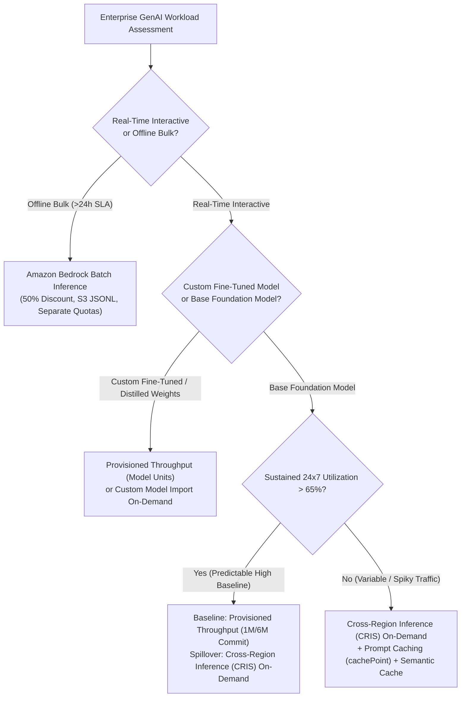

# Domain 4: Authoritative White Papers, Architecture Guides & Exam Traps

This curated reference synthesizes the architectural guidance from the **AWS Well-Architected Framework: Generative AI Lens** (specifically the **Cost Optimization** and **Performance Efficiency** pillars), official Amazon Bedrock engineering deep dives, and high-frequency exam traps encountered on the **AWS Certified Generative AI Developer - Professional (AIP-C01)** exam.

---

## 1. AWS Well-Architected Framework: Generative AI Lens — Cost Optimization Pillar

### Core Design Principles
1. **Right-Size Intelligence to Task Complexity (`GENAI-COST-01`)**:
   - Never default to the largest frontier model for an entire multi-step pipeline.
   - Decompose workflows so deterministic extraction, classification, and routing run on compact models (**Amazon Nova Micro**, **Claude 3.5 Haiku**, or **Distilled Student Models**), reserving frontier models (**Claude 3.5 Sonnet**, **Nova Pro**) strictly for complex synthesis or ambiguous reasoning.
   - Use **Amazon Bedrock Intelligent Prompt Routing** when a single endpoint receives heterogeneous prompt complexity within the same model family.
2. **Eliminate Redundant Computation at Every Layer (`GENAI-COST-02`)**:
   - **Layer 1 (Application Edge / API)**: Deduplicate identical requests via deterministic hash caching.
   - **Layer 2 (Semantic Cache)**: Intercept semantically equivalent user queries ($\text{Cosine Similarity} \ge 0.95$) using **Amazon MemoryDB** or **Amazon ElastiCache for Valkey** before invoking any Foundation Model.
   - **Layer 3 (Prefix KV Cache)**: Use **Amazon Bedrock Prompt Caching (`cachePoint`)** to reuse precomputed attention Key-Value tensors for static system prompts, tool schemas, few-shot examples, and multi-turn document contexts.
3. **Align Consumption Pricing with Workload SLA (`GENAI-COST-03`)**:
   - **Interactive & Spiky**: Use **On-Demand** with **Cross-Region Inference (CRIS)** profiles.
   - **Asynchronous & Bulk ($\ge 24\text{h}$ SLA)**: Use **Amazon Bedrock Batch Inference** for an immediate **50% cost reduction** and isolation from real-time RPM/TPM quotas.
   - **Steady High-Utilization 24x7 ($\ge 65\%$ Utilization) or Custom Fine-Tuned Models**: Purchase **Provisioned Throughput Model Units (MUs)** on 1-month or 6-month commitments, using On-Demand CRIS as an elastic spillover tier for peak bursts.
4. **Enforce Token Budget Governance & Attribution (`GENAI-COST-04`)**:
   - Compress RAG contexts using **Amazon Bedrock Rerank** to pass only the top $3\text{–}5$ chunks rather than raw vector top-$25$ results.
   - Attribute every token to a business unit or tenant using **Application Inference Profiles** with **AWS Cost Allocation Tags** and **CloudWatch Embedded Metric Format (EMF)** telemetry.

---

## 2. AWS Well-Architected Framework: Generative AI Lens — Performance Efficiency Pillar

### Core Design Principles
1. **Optimize Time to First Token (TTFT) and Inter-Token Latency (ITL) Independently (`GENAI-PERF-01`)**:
   - **TTFT** is compute-bound on input prefill. Reduce TTFT by minimizing input tokens, placing `cachePoint` markers after static prefixes, and executing pre-inference steps (embeddings, vector retrieval, input guardrails, session state fetches) concurrently via asynchronous I/O.
   - **ITL / TPS** is memory-bandwidth-bound on output token decoding. Reduce ITL by enabling **Bedrock Latency-Optimized Inference (`performanceConfig={'latency': 'optimized'}`)**, selecting smaller/distilled models, constraining output verbosity, or deploying **Speculative Decoding** and **FP8/AWQ Quantization** on **SageMaker LMI (`vLLM` / `TensorRT-LLM`)**.
2. **Design for Perceived Latency via Non-Blocking Streaming (`GENAI-PERF-02`)**:
   - Stream tokens end-to-end using `ConverseStream` paired with **AWS Lambda Response Streaming** or **AWS AppSync WebSockets**.
   - Configure **Amazon Bedrock Guardrails** with `streamProcessingMode='ASYNCHRONOUS'` during streaming so token delivery is never blocked by synchronous guardrail chunk buffering.
3. **Build Quota-Resilient Multi-Region Topologies (`GENAI-PERF-03`)**:
   - Adopt **System-Defined Cross-Region Inference (CRIS)** profiles (`us.`, `eu.`, `apac.`) as the default invocation target for production On-Demand workloads to pool regional capacity and prevent HTTP 429 `ThrottlingException` errors during traffic surges.
4. **Right-Size Vector Store Memory & Compute (`GENAI-PERF-04`)**:
   - Keep HNSW vector graphs resident in memory or high-speed NVMe cache (**Aurora PostgreSQL Optimized Reads** on `db.r6gd`/`db.r7gd`/`db.r8gd` instances, or **OpenSearch Serverless** with vector scalar/binary quantization) and tune query-time `ef_search` to balance recall against single-digit millisecond latency.

---

## 3. Deep-Dive Architecture Reference Matrix

| White Paper / Architectural Topic | Key Technical Specifications & Operational Rules |
| :--- | :--- |
| **Amazon Bedrock Prompt Caching (`cachePoint`)** | • **Minimum Prefix Length**: 1,024 tokens (Claude 3.5 Sonnet, Claude 3 Opus, Nova Pro/Lite/Micro) or 2,048 tokens (Claude 3.5 Haiku). • **TTL**: 5 minutes, automatically reset on every cache hit. • **Checkpoints**: Up to 4 `cachePoint` blocks per request across `system`, `tools`, and `messages`. • **Ordering Rule**: Any dynamic variable (timestamp, UUID, user name) placed *before* a `cachePoint` changes the prefix token hash and invalidates the cache. |
| **Cross-Region Inference (CRIS) vs. Application Inference Profiles** | • **System-Defined CRIS Profile**: AWS-managed (`us.anthropic...`, `eu.anthropic...`). Routes across regions in a geography; cannot have custom AWS Cost Allocation Tags directly attached. • **Application Inference Profile**: Customer-created via `CreateInferenceProfile`. Can wrap either a single-region FM ARN *or* a System-Defined CRIS Profile ARN. Supports **AWS Cost Allocation Tags** and emits isolated `AWS/Bedrock` CloudWatch metrics under its own Profile ID. |
| **Amazon Bedrock Batch Inference** | • **Discount**: 50% off On-Demand input and output token prices. • **Quotas**: Uses separate Batch Inference quotas; **does not consume real-time On-Demand RPM/TPM quotas**. • **Input Format**: JSONL files stored in Amazon S3 (`recordId` + `modelInput`). • **Completion SLA**: Asynchronous processing targeted within 24 hours; monitor state transitions (`Completed`, `Failed`, `PartiallyCompleted`) via **Amazon EventBridge**. |
| **SageMaker Large Model Inference (LMI) & AWS Inferentia2** | • **vLLM / TensorRT-LLM**: Support PagedAttention, continuous batching, tensor parallelism, and speculative decoding. • **AWS Inferentia2 (`ml.inf2`)**: Equipped with NeuronLink for high-speed inter-chip communication. Requires compiling models with the **AWS Neuron SDK (`torch-neuronx`)** specifying exact `batch_size`, `sequence_length`, and `tp_degree` (`tensor_parallel_degree`) at compile time. |
| **CloudWatch Metrics & OpenTelemetry GenAI Observability** | • **Native Metrics (`AWS/Bedrock`)**: `Invocations`, `InvocationLatency`, `InvocationThrottles`, `InvocationClientErrors`, `InvocationServerErrors`, `InputTokenCount`, `OutputTokenCount`, `CacheReadInputTokenCount`, `CacheWriteInputTokenCount`, `LegacyModelInvocations`. • **Model Invocation Logging**: Opt-in per region/account to deliver full request/response payloads, token counts, and guardrail traces to **Amazon S3** and/or **Amazon CloudWatch Logs** (never enabled by default). |

---

## 4. Essential AWS White Papers & Engineering Guides Checklist

1. **AWS Well-Architected Framework: Generative AI Lens (`GENAI-COST-01` through `GENAI-PERF-05`)**:
   - Defines standard patterns for token budget governance, tiered model routing, semantic vs. prefix caching, and observability telemetry across multi-agent architectures.
   - Recommends establishing automated cost anomaly guardrails using **AWS Cost Anomaly Detection** scoped to Application Inference Profile cost allocation tags.
2. **Amazon Bedrock Prompt Caching Architecture Guide**:
   - Details multi-turn `cachePoint` placement strategies, prefix hash computation across `system`, `tools`, and `messages` blocks, and CloudWatch monitoring using `CacheReadInputTokenCount` vs. `CacheWriteInputTokenCount`.
   - Explains why static tool definitions should always be sorted deterministically (e.g., alphabetically by tool name) so dictionary serialization order in Python/Node.js never alters the token prefix hash.
3. **Scaling Generative AI Workloads with Amazon Bedrock Cross-Region Inference (CRIS)**:
   - Explains how regional control-plane logging (`CloudTrail`, `CloudWatch`, `Model Invocation Logging`) remains anchored in the calling region while stateless inference compute bursts across geographic peer regions (`us.`, `eu.`, `apac.`) at zero additional routing cost.
   - Details IAM policy requirements: the caller's IAM role must allow `bedrock:InvokeModel*` on both the **Inference Profile ARN** in the source region and the underlying **Foundation Model ARNs** in all destination regions mapped to that profile.
4. **High-Performance LLM Serving on Amazon SageMaker with LMI & AWS Inferentia2**:
   - Benchmarks continuous batching, PagedAttention, FP8/INT4 AWQ quantization, Speculative Decoding, and NeuronCore tensor parallelism (`ml.inf2.48xlarge` vs. `ml.g5.48xlarge` and `ml.p4d.24xlarge`).
   - Provides sizing formulas for KV cache memory per concurrent sequence:
     $$\text{KV Cache Bytes per Token} = 2 \times n_{\text{layers}} \times n_{\text{kv\_heads}} \times d_{\text{head}} \times \text{BytesPerElement}$$
5. **Multi-Tenant SaaS FinOps & Cost Attribution on Amazon Bedrock**:
   - Contrasts coarse-grained native billing attribution (**Application Inference Profiles + AWS Cost Allocation Tags**) with fine-grained high-cardinality tenant accounting (**CloudWatch Embedded Metric Format [EMF]** + **Amazon Data Firehose** + **Amazon Athena**).

---

## 5. High-Frequency AIP-C01 Exam Traps (Domain 4)

> [!WARNING]
> **Exam Trap #1: Dynamic Timestamps Invalidate `cachePoint`**
> Whenever an exam scenario states that an engineering team added `{"cachePoint": {"type": "default"}}` after a 15,000-token system prompt, yet CloudWatch shows `CacheWriteInputTokenCount > 0` on every request and `CacheReadInputTokenCount == 0`, look at the beginning of the system prompt! Injecting `current_timestamp`, `session_id`, or `user_id` at the top of the system prompt mutates the token prefix on every invocation.
> - **Correct Remediation**: Move all dynamic metadata to the final `user` message *after* the last `cachePoint`.

> [!WARNING]
> **Exam Trap #2: Global Unfiltered Semantic Cache in Multi-Tenant RAG**
> If a scenario proposes caching RAG answers in Amazon MemoryDB or ElastiCache using only the vector embedding of the user's question, this is a **critical security vulnerability** if different users have different document entitlements.
> - **Correct Remediation**: Always include a mandatory metadata pre-filter (`tenant_id`, `access_group_id`) in the vector search query so cache hits only occur within the same security boundary.

> [!WARNING]
> **Exam Trap #3: Tagging Base Foundation Model ARNs for Cost Explorer Chargeback**
> Distractors frequently suggest *"Attach AWS Cost Allocation Tags directly to the `anthropic.claude-3-5-sonnet` Foundation Model ARN for each department."* Base Foundation Model ARNs are shared AWS-owned resources and cannot be tagged per department.
> - **Correct Remediation**: Create one **Application Inference Profile** per department (`create_inference_profile`), tag the Application Inference Profile, and scope each department's IAM role to invoke only its assigned Application Inference Profile ARN.

> [!WARNING]
> **Exam Trap #4: Confusing TTFT Bottlenecks with ITL Bottlenecks**
> - If a prompt has **60,000 input tokens** and produces a **10-token classification label**, the latency bottleneck is **TTFT (Prefill)**—streaming (`ConverseStream`) will *not* make the first token arrive any faster! You must use **Prompt Caching (`cachePoint`)** or **Context Pruning / Reranking**.
> - Conversely, if a prompt has **300 input tokens** and generates a **3,000-token essay**, the bottleneck is **ITL / Decode time**—Prompt Caching will fail to meet the minimum 1,024-token threshold and won't speed up output decoding. You must use **Response Streaming (`ConverseStream`)** for perceived latency, **Latency-Optimized Inference (`performanceConfig`)**, or **Model Distillation** to a smaller student model.

> [!WARNING]
> **Exam Trap #5: Purchasing Provisioned Throughput for Short, Infrequent Traffic Spikes**
> If an application runs at 5% utilization for 22 hours a day and spikes for 2 hours, purchasing 24x7 Provisioned Throughput Model Units (MUs) for the peak is a massive FinOps anti-pattern.
> - **Correct Remediation**: Use **Cross-Region Inference (CRIS)** On-Demand profiles for elastic quota scaling, or use **Batch Inference** if the spiky workload is asynchronous.

> [!WARNING]
> **Exam Trap #6: Synchronous Guardrail Stuttering During Streaming**
> When an application uses `ConverseStream` with Amazon Bedrock Guardrails and users complain that text appears in choppy bursts every 2–3 seconds rather than smoothly token-by-token, the cause is the default `SYNCHRONOUS` Guardrail stream processing mode.
> - **Correct Remediation**: Set `guardrailConfig={'streamProcessingMode': 'ASYNCHRONOUS'}` so tokens stream immediately while Guardrails validate buffered chunks in parallel.

> [!WARNING]
> **Exam Trap #7: Missing Destination-Region IAM Permissions for Cross-Region Inference (CRIS)**
> When switching from a single-region model ID (`anthropic.claude-3-5-sonnet-20241022-v2:0`) to a System-Defined CRIS profile (`us.anthropic.claude-3-5-sonnet-20241022-v2:0`), calls fail with `AccessDeniedException` if the IAM policy restricts `Resource` strictly to `arn:aws:bedrock:us-east-1::foundation-model/*`.
> - **Correct Remediation**: Grant `bedrock:InvokeModel*` on both the CRIS Inference Profile ARN in the source region AND the underlying Foundation Model ARNs in all destination regions covered by the profile (`us-east-1`, `us-east-2`, `us-west-2`), and ensure no AWS Organizations SCP blocks those peer regions.
