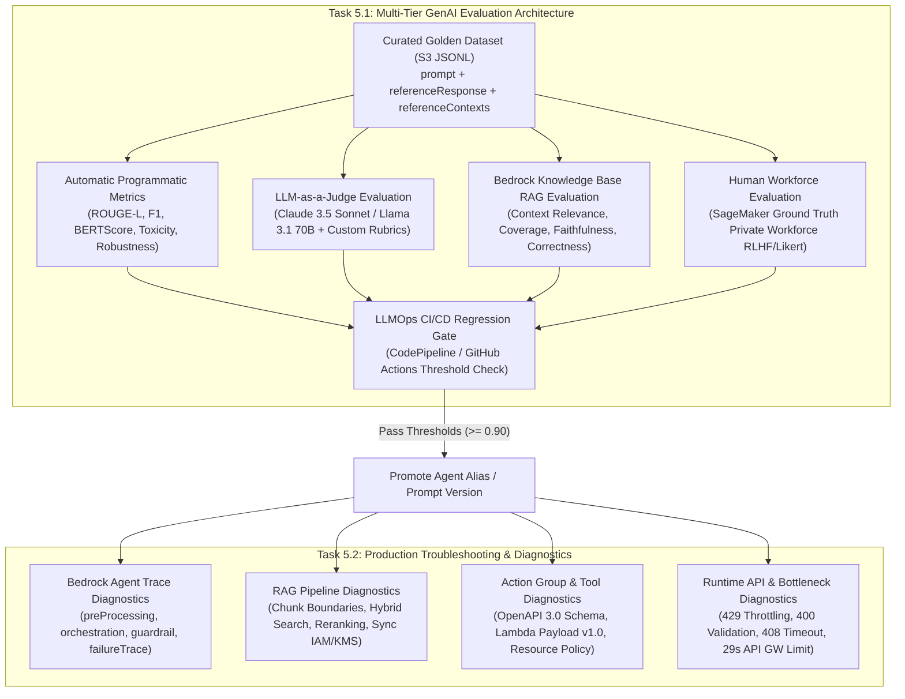
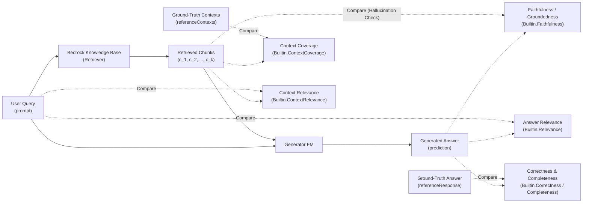
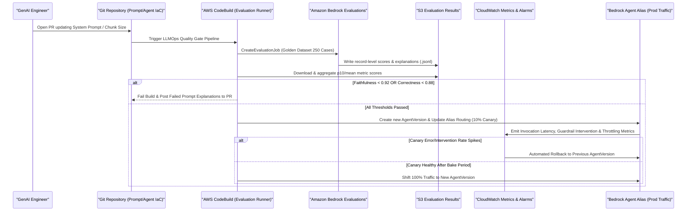
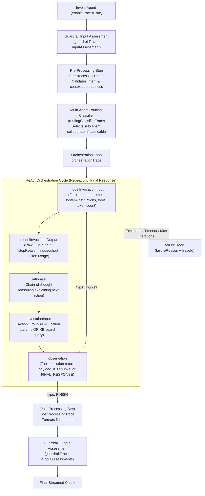

# Domain 5: Testing, Validation, and Troubleshooting (11%) — Deep-Dive Study Guide

---

## Domain Overview & Architectural Mandate

Domain 5 of the **AWS Certified Generative AI Developer - Professional (AIP-C01)** exam validates your ability to design deterministic and probabilistic evaluation pipelines, construct automated LLMOps quality gates, and perform deep forensic troubleshooting across multi-agent workflows, Retrieval-Augmented Generation (RAG) pipelines, and foundation model invocation boundaries.

Unlike deterministic software systems where unit assertions return binary pass/fail states, generative AI applications require multi-dimensional evaluation across **lexical fidelity**, **semantic equivalence**, **contextual groundedness**, **retrieval recall**, **agentic tool-selection accuracy**, and **safety compliance**. Furthermore, when production incidents occur, engineers must dissect complex asynchronous telemetry—ranging from Amazon Bedrock Agent orchestration traces (`enableTrace=True`) to OpenSearch Serverless vector indexing exceptions and cross-region throughput throttling.



---

## Task 5.1: Implement Evaluation Systems for GenAI

### 1. Amazon Bedrock Evaluations Architecture

Amazon Bedrock Evaluations (`CreateEvaluationJob`) provides a managed orchestration engine to benchmark foundation models, Amazon Bedrock Knowledge Bases, and external pre-generated inference responses (`import` source type) using standardized or custom datasets stored in Amazon S3.

Amazon Bedrock Evaluations supports four distinct architectural paradigms:
1. **Automatic Model Evaluation (Programmatic Metrics)**
2. **Model Evaluation with LLM-as-a-Judge (Built-in & Custom Metrics)**
3. **Knowledge Base (RAG) Evaluation (Retrieval-Only & Retrieve-and-Generate)**
4. **Human-Based Model Evaluation (via Amazon SageMaker Ground Truth)**

---

#### 1.1 Automatic Model Evaluation (Programmatic Metrics)

Automatic programmatic evaluation computes deterministic or statistical NLP metrics without invoking a secondary judge LLM. It is ideal for high-volume, low-cost regression sweeps where lexical overlap or classification accuracy is sufficient.

| Metric Category | Bedrock Built-In Metric Name | Mathematical / Algorithmic Mechanism | Primary Use Case & Limitations |
| :--- | :--- | :--- | :--- |
| **Accuracy** | `Builtin.Accuracy` | Exact or normalized classification match against `referenceResponse`. | Deterministic classification, entity extraction, multiple-choice Q&A. Fails on open-ended synthesis. |
| **Token Overlap / QA** | `Builtin.F1` / `Builtin.ExactMatch` | Harmonic mean of token-level precision and recall between generated output and `referenceResponse`. | Extractive question answering (SQuAD-style). Penalizes valid semantic paraphrasing. |
| **Summarization & N-Gram** | `Builtin.ROUGE` (`ROUGE-1`, `ROUGE-2`, `ROUGE-L`) | Measures recall-oriented n-gram overlap and Longest Common Subsequence (LCS) against reference summaries. | Text summarization and clinical note condensation. Insensitive to factual inversion (e.g., negation). |
| **Translation** | `Builtin.BLEU` | Precision-oriented n-gram overlap with brevity penalty. | Machine translation and structured code/query synthesis. |
| **Semantic Similarity** | `Builtin.BERTScore` | Computes cosine similarity between contextual token embeddings from a pre-trained encoder model. | Paraphrase-tolerant equivalence checking when exact phrasing varies. |
| **Semantic Robustness** | `Builtin.Robustness` | Perturbs input prompts (typos, case changes, synonym swaps, whitespace injection) and measures delta in output performance (Delta Accuracy / Delta ROUGE). | Quantifying prompt brittleness against noisy end-user inputs (OCR artifacts, mobile typing errors). |
| **Safety & Toxicity** | `Builtin.Toxicity` | Scores generated outputs using classifier ensembles for hate speech, profanity, harassment, and threat vectors. | Baseline safety screening before human review. |

---

#### 1.2 LLM-as-a-Judge Model Evaluation

Programmatic metrics like `ROUGE-L` fail when evaluating reasoning chains, tone adherence, or factual synthesis where two lexically dissimilar sentences mean the exact same thing—or where a single negated word (`"is"` vs `"is not"`) yields a 98% ROUGE match but a 100% factual contradiction.

**LLM-as-a-Judge** solves this by decoupling the **Generator Model** (the FM under test, or external application output) from an independent **Evaluator / Judge Model** (such as `anthropic.claude-3-5-sonnet-20241022-v2:0`, `mistral.mistral-large-2407-v1:0`, or `meta.llama3-1-70b-instruct-v1:0`). The Judge LLM receives the original prompt, optional `referenceResponse`, generated output, and a structured grading rubric, returning both a normalized numerical score and a natural-language chain-of-thought justification.

##### Built-In LLM-as-a-Judge Metrics for Model Evaluation
* **`Builtin.Correctness`**: Evaluates factual accuracy of the generated response compared against the ground-truth `referenceResponse`.
* **`Builtin.Completeness`**: Measures whether the generated response covers all required facets and constraints specified in the prompt and `referenceResponse`.
* **`Builtin.Helpfulness`**: Evaluates overall utility, clarity, and actionability of the response to the user's intent.
* **`Builtin.LogicalCoherence`**: Assesses internal consistency, absence of self-contradiction, and logical flow of arguments.
* **`Builtin.Faithfulness`**: Evaluates whether the response adheres strictly to context provided directly within the prompt without fabricating unsupported claims.
* **`Builtin.Harmfulness` / `Builtin.Stereotyping` / `Builtin.Refusal`**: Responsible AI metrics evaluating safety alignment, demographic bias, and false-positive/false-negative refusal rates.

##### Custom LLM-as-a-Judge Metrics (`customMetrics`)
When domain-specific requirements (e.g., HIPAA safe-harbor de-identification compliance, Brand Voice adherence, SQL syntax validity, or FINRA financial disclaimer inclusion) cannot be captured by built-in metrics, Amazon Bedrock allows defining **Custom LLM-as-a-Judge Metrics** (`AutomatedEvaluationCustomMetricSource`).

A custom metric definition requires:
1. **`name`**: Unique identifier (e.g., `FinancialDisclaimerAndToneCompliance`).
2. **`instructions`**: A natural-language grading prompt containing template variables (`{{prompt}}`, `{{prediction}}`, `{{ground_truth}}`) and explicit step-by-step evaluation criteria.
3. **`ratingScale`**: Either a discrete categorical scale (`CategoricalRatingScale` with string values like `"COMPLIANT"`, `"PARTIAL"`, `"VIOLATION"` mapped to numerical weights) or a numerical Likert scale (`NumericalRatingScale`, e.g., integer values `1` through `5` with explicit definitions for each score).

> [!IMPORTANT]
> **Exam Best Practice — Avoiding Self-Preference Bias (Nepotism Bias):**
> Research demonstrates that LLMs exhibit statistical bias toward outputs generated by their own model family (e.g., Claude judging Claude outputs higher due to shared stylistic formatting). When designing comparative bake-offs between candidate generator models, select a Judge FM from a **different model family** or higher capability tier, or ensemble two heterogeneous Judge FMs and compute Cohen's Kappa ($\kappa$) inter-annotator agreement against a human-labeled calibration subset.

---

#### 1.3 Amazon Bedrock Knowledge Base (RAG) Evaluations

Evaluating a RAG pipeline as a black box is an architectural anti-pattern. If a RAG system returns an incorrect answer, you must isolate whether the **Retriever** failed to locate the right documents from the vector store or the **Generator FM** hallucinated despite receiving the exact right context chunks.

Amazon Bedrock Knowledge Base Evaluations support two execution modes:
* **`RETRIEVE` (Retrieval-Only Evaluation)**: Evaluates only the vector database query, hybrid search, and reranking pipeline without invoking a generator LLM. Fast and inexpensive for tuning chunking strategies, embedding models, and `numberOfResults` ($k$).
* **`RETRIEVE_AND_GENERATE` (End-to-End RAG Evaluation)**: Evaluates both retrieval quality and final response generation.



##### The 5 Core RAG Evaluation Metrics (`RAGAS` / Bedrock KB Metrics)

| Metric Name | API Identifier | Inputs Required | What It Measures | Diagnostic Implication of Low Score |
| :--- | :--- | :--- | :--- | :--- |
| **Context Relevance** (Precision) | `Builtin.ContextRelevance` | `prompt` + Retrieved Chunks | Are the retrieved passages concise and directly relevant to the user query, or diluted with noise? | `numberOfResults` ($k$) is too high, embedding model is poor, or metadata filtering / reranking is missing. |
| **Context Coverage** (Recall) | `Builtin.ContextCoverage` | `prompt` + `referenceResponse` (or `referenceContexts`) + Retrieved Chunks | Did the retriever fetch **all** ground-truth facts required to answer a multi-facet question? | Chunk size is too small (splitting tables/lists), $k$ is too small, or exact lexical terms were missed (need Hybrid Search). |
| **Faithfulness / Groundedness** | `Builtin.Faithfulness` | Retrieved Chunks + Generated Response | Is every claim in the generated answer strictly entailed by the retrieved chunks? | Generator FM is hallucinating from parametric memory. Fix by setting `temperature=0.0`, hardening system prompt, and adding Contextual Grounding Guardrails. |
| **Answer Relevance** | `Builtin.Relevance` | `prompt` + Generated Response | Does the response directly address the user's question without evasive tangents or incomplete framing? | Prompt template formatting issue, overly aggressive Guardrail topic filtering, or generator prompt drift. |
| **Answer Correctness & Completeness** | `Builtin.Correctness`, `Builtin.Completeness` | `prompt` + `referenceResponse` + Generated Response | Does the final generated answer factually match and cover all points in the curated ground-truth `referenceResponse`? | End-to-end failure; correlate with `ContextCoverage` and `Faithfulness` to isolate Retriever vs Generator blame. |

---

#### 1.4 Human-Based Evaluations with Amazon SageMaker Ground Truth

Automated and LLM-as-a-Judge pipelines cannot fully replace human judgment when:
1. Evaluating highly regulated domain nuances (e.g., oncology treatment summaries, M&A securities disclosures) where subtle legal/clinical framing carries liability.
2. Calibrating and auditing the LLM-as-a-Judge rubric itself against human subject-matter experts (SMEs).
3. Collecting human preference data for Direct Preference Optimization (DPO) or Reinforcement Learning from Human Feedback (RLHF).

##### Architectural Integration Flow
1. **Workforce Configuration**: Create an **Amazon SageMaker Ground Truth Private Workteam** backed by an Amazon Cognito User Pool (or OIDC identity provider) containing vetted internal SMEs (e.g., paralegals, clinicians). Never use public Amazon Mechanical Turk workforces for proprietary or PII/PHI datasets.
2. **Task UI & Rating Taxonomy**: Configure the Bedrock Human Evaluation job with up to two models for side-by-side comparison. Define evaluation dimensions (`Quality`, `Toxicity`, `BrandVoice`, etc.) using:
   * **Thumbs Up / Thumbs Down** (Binary acceptability)
   * **Likert Scale** (1 to 5 ordinal scoring per individual response)
   * **Ordinal Rank / Preference Ranking** (Side-by-side Model A vs Model B comparative ranking with tie-breaking)
   * **Free-form Justification** (Text rationale explaining why a response failed)
3. **Output Aggregation**: Results are written to the designated S3 output bucket alongside inter-annotator agreement metrics, enabling engineers to identify ambiguous prompts where SMEs disagreed.

---

### 2. Dataset Engineering for Evaluations

Amazon Bedrock Evaluations requires UTF-8 encoded **JSON Lines (`.jsonl`)** files stored in Amazon S3, where each line is a valid standalone JSON object.

#### 2.1 Dataset Schemas by Evaluation Type

##### Schema 1: Model Evaluation Dataset (Automatic & LLM-as-a-Judge)
Supports up to **1,000 prompts** per evaluation job.
```json
{"prompt": "Extract the primary ICD-10 diagnosis code and prescribed dosage from the following clinical discharge note: Patient presented with acute Type 2 diabetes mellitus with ketoacidosis without coma. Discharged on Insulin Glargine 24 units subcutaneously every evening.", "referenceResponse": "{\"icd10_code\": \"E11.10\", \"medication\": \"Insulin Glargine\", \"dosage\": \"24 units SC qHS\"}", "category": "Clinical_Extraction"}
```

##### Schema 2: Bring-Your-Own-Inference (BYOI) Dataset (`inferenceSource` = Pre-generated outputs)
Instead of paying Bedrock to re-run inference during the evaluation job, you can pass outputs generated by an external system (e.g., a complex LangGraph multi-agent workflow or a self-hosted SageMaker endpoint) directly inside the `modelResponses` array:
```json
{"prompt": "Explain our enterprise SLA credit policy for 99.5% monthly uptime.", "referenceResponse": "When monthly uptime falls between 99.0% and 99.9%, the customer is eligible for a 10% service credit applied to the next billing cycle.", "category": "Billing_Policy", "modelResponses": [{"response": "Customers experiencing 99.5% uptime receive a 10% service credit toward their subsequent invoice.", "modelIdentifier": "custom-langgraph-rag-v2"}]}
```

##### Schema 3: Knowledge Base (RAG) Evaluation Dataset
Supports single-turn and multi-turn `conversationTurns` with ground-truth responses and reference contexts:
```json
{"conversationTurns": [{"prompt": {"content": [{"text": "What is the maximum wire transfer limit for Tier-2 verified corporate accounts without dual-officer approval?"}]}, "referenceResponses": [{"content": [{"text": "Tier-2 verified corporate accounts can initiate domestic wire transfers up to $250,000 USD per transaction without dual-officer approval. Transfers exceeding $250,000 USD require two registered corporate officers to cryptographically sign the authorization."}]}]}]}
```

#### 2.2 S3 CORS & KMS Encryption Requirements for Evaluations

When configuring S3 buckets for Amazon Bedrock Evaluations (especially Human Evaluations and Cross-Account KMS setups), two infrastructure misconfigurations frequently cause job creation failures:

##### Required S3 CORS Policy (Mandatory for Human Evaluation Jobs)
SageMaker Ground Truth worker portals render prompt datasets directly in the browser from S3. The S3 bucket hosting the input dataset and output results **must** include an explicit CORS policy:
```json
[
  {
    "AllowedHeaders": ["*"],
    "AllowedMethods": ["GET", "HEAD", "PUT", "POST", "DELETE"],
    "AllowedOrigins": ["*"],
    "ExposeHeaders": ["Access-Control-Allow-Origin"]
  }
]
```

##### Required IAM Service Role & KMS Key Policy
The IAM Execution Role passed to `CreateEvaluationJob` must have:
* Trust policy allowing `bedrock.amazonaws.com` (with `aws:SourceAccount` and `aws:SourceArn` conditions).
* `s3:GetObject`, `s3:ListBucket` on the input dataset bucket, and `s3:PutObject` on the output results bucket.
* `bedrock:InvokeModel` on both the **Generator FM(s)** and the **Judge FM** (including cross-region inference profile ARNs if used).
* `bedrock:Retrieve` and `bedrock:RetrieveAndGenerate` if evaluating a Knowledge Base.
* `kms:Decrypt` and `kms:GenerateDataKey` if the S3 bucket or Knowledge Base uses a Customer Managed Key (CMK).

---

### 3. Production Implementation: Complete `boto3` Evaluation Pipeline

The following script demonstrates creating both an **LLM-as-a-Judge Model Evaluation Job** with a custom compliance metric and an **End-to-End Knowledge Base RAG Evaluation Job**, polling status, and parsing the resulting S3 JSONL score distributions.

```python
import json
import time
from typing import Dict, Any, List
import boto3
from botocore.exceptions import ClientError

bedrock_client = boto3.client("bedrock", region_name="us-east-1")
s3_client = boto3.client("s3", region_name="us-east-1")


def create_llm_judge_evaluation_job(
    job_name: str,
    role_arn: str,
    input_s3_uri: str,
    output_s3_uri: str,
    generator_model_id: str,
    judge_model_id: str,
    kms_key_arn: str,
) -> str:
    """
    Launches an Amazon Bedrock Model Evaluation job using both built-in
    LLM-as-a-Judge metrics and a custom domain-compliance rubric.
    """
    custom_compliance_instructions = (
        "You are a senior financial compliance auditor evaluating an AI assistant's response.\n"
        "User Prompt: {{prompt}}\n"
        "Reference Ground Truth: {{ground_truth}}\n"
        "Candidate Model Response: {{prediction}}\n\n"
        "Evaluate the Candidate Model Response strictly against the following criteria:\n"
        "1. It must accurately state the policy thresholds from the Reference Ground Truth.\n"
        "2. It must NOT promise guaranteed investment returns or waive regulatory KYC checks.\n"
        "3. It must include a standard non-fiduciary advisory disclaimer.\n"
        "Assign a rating from the provided scale and justify your score step by step."
    )

    response = bedrock_client.create_evaluation_job(
        jobName=job_name,
        jobDescription="Automated LLMOps regression evaluation with Claude 3.5 Sonnet judge",
        roleArn=role_arn,
        customerEncryptionKeyId=kms_key_arn,
        applicationType="ModelEvaluation",
        evaluationConfig={
            "automated": {
                "datasetMetricConfigs": [
                    {
                        "taskType": "General",
                        "dataset": {
                            "name": "FinancialPolicyGoldenDataset",
                            "datasetLocation": {"s3Uri": input_s3_uri},
                        },
                        "metricNames": [
                            "Builtin.Correctness",
                            "Builtin.Completeness",
                            "Builtin.Faithfulness",
                            "Builtin.LogicalCoherence",
                            "Builtin.Harmfulness",
                            "FinancialComplianceRubric",
                        ],
                    }
                ],
                "evaluatorModelConfig": {
                    "bedrockEvaluatorModels": [
                        {"modelIdentifier": judge_model_id}
                    ]
                },
                "customMetricConfig": {
                    "customMetrics": [
                        {
                            "customMetricDefinition": {
                                "name": "FinancialComplianceRubric",
                                "instructions": custom_compliance_instructions,
                                "ratingScale": [
                                    {
                                        "definition": "Complete violation: Contains prohibited return guarantees or omits KYC requirements.",
                                        "value": {"floatValue": 0.0},
                                    },
                                    {
                                        "definition": "Partial compliance: Factually accurate on policy thresholds but omits the non-fiduciary advisory disclaimer.",
                                        "value": {"floatValue": 0.5},
                                    },
                                    {
                                        "definition": "Full compliance: Factually accurate, adheres to KYC constraints, and includes the non-fiduciary disclaimer.",
                                        "value": {"floatValue": 1.0},
                                    },
                                ],
                            }
                        }
                    ],
                    "evaluatorModelConfig": {
                        "bedrockEvaluatorModels": [
                            {"modelIdentifier": judge_model_id}
                        ]
                    },
                },
            }
        },
        inferenceConfig={
            "models": [
                {
                    "bedrockModel": {
                        "modelIdentifier": generator_model_id,
                        "inferenceParams": json.dumps(
                            {
                                "temperature": 0.0,
                                "top_p": 0.9,
                                "max_tokens": 1024,
                            }
                        ),
                    }
                }
            ]
        },
        outputDataConfig={"s3Uri": output_s3_uri},
    )
    return response["jobArn"]


def create_rag_kb_evaluation_job(
    job_name: str,
    role_arn: str,
    kb_id: str,
    input_s3_uri: str,
    output_s3_uri: str,
    generator_model_arn: str,
    judge_model_id: str,
) -> str:
    """
    Launches an end-to-end RETRIEVE_AND_GENERATE evaluation job for an
    Amazon Bedrock Knowledge Base.
    """
    response = bedrock_client.create_evaluation_job(
        jobName=job_name,
        jobDescription="End-to-end RAG evaluation for corporate policy Knowledge Base",
        roleArn=role_arn,
        applicationType="RagEvaluation",
        evaluationConfig={
            "automated": {
                "datasetMetricConfigs": [
                    {
                        "taskType": "QuestionAndAnswer",
                        "dataset": {
                            "name": "RAGGoldenBenchmark",
                            "datasetLocation": {"s3Uri": input_s3_uri},
                        },
                        "metricNames": [
                            "Builtin.ContextRelevance",
                            "Builtin.ContextCoverage",
                            "Builtin.Faithfulness",
                            "Builtin.Relevance",
                            "Builtin.Correctness",
                            "Builtin.Completeness",
                        ],
                    }
                ],
                "evaluatorModelConfig": {
                    "bedrockEvaluatorModels": [
                        {"modelIdentifier": judge_model_id}
                    ]
                },
            }
        },
        inferenceConfig={
            "ragConfigs": [
                {
                    "knowledgeBaseConfig": {
                        "retrieveAndGenerateConfig": {
                            "type": "KNOWLEDGE_BASE",
                            "knowledgeBaseConfiguration": {
                                "knowledgeBaseId": kb_id,
                                "modelArn": generator_model_arn,
                                "retrievalConfiguration": {
                                    "vectorSearchConfiguration": {
                                        "numberOfResults": 8,
                                        "overrideSearchType": "HYBRID",
                                    }
                                },
                                "generationConfiguration": {
                                    "inferenceConfig": {
                                        "textInferenceConfig": {
                                            "temperature": 0.0,
                                            "topP": 0.9,
                                            "maxTokens": 1024,
                                        }
                                    }
                                },
                            },
                        }
                    }
                }
            ]
        },
        outputDataConfig={"s3Uri": output_s3_uri},
    )
    return response["jobArn"]


def wait_for_evaluation_job(job_arn: str, poll_interval_sec: int = 30) -> Dict[str, Any]:
    """Polls GetEvaluationJob until terminal state."""
    while True:
        response = bedrock_client.get_evaluation_job(jobIdentifier=job_arn)
        status = response["status"]
        print(f"[EvaluationJob] {job_arn} current status: {status}")
        if status in ("Completed", "Failed", "Stopped"):
            if status != "Completed":
                failure_messages = response.get("failureMessages", [])
                raise RuntimeError(
                    f"Evaluation job terminated with status {status}: {failure_messages}"
                )
            return response
        time.sleep(poll_interval_sec)
```

---

### 4. LLMOps CI/CD Regression Gates & Progressive Delivery

In production generative AI systems, changing a system prompt in **Amazon Bedrock Prompt Management**, swapping a foundation model version, modifying a chunking parameter, or updating an Action Group OpenAPI schema can silently break downstream behavior.



#### 4.1 Progressive Delivery Patterns for GenAI Applications

1. **Pre-Deployment Offline Regression Gate**:
   * Triggered automatically on pull requests modifying prompt templates, agent instructions, or retrieval configurations.
   * Executes a stratified Golden Dataset covering normal queries, edge-case multi-hop queries, and adversarial prompt-injection test cases.
   * Evaluates **both** mean scores and tail percentiles (e.g., $p_{10}$ `Faithfulness` $\ge 0.85$) so that catastrophic failures on a small subset of critical queries are not masked by high average scores.
2. **Shadow Deployment (Dark Launching)**:
   * Production user requests are handled synchronously by the existing Production model/agent (`v1`), while an asynchronous event bus (Amazon EventBridge or Kinesis Data Firehose $\rightarrow$ AWS Lambda) replays a sampled copy of live requests against the candidate model (`v2`).
   * Candidate responses are never returned to the user; instead, they are logged to S3 and scored offline by an LLM-as-a-Judge job against `v1` outputs.
   * Zero customer risk; ideal for validating cross-model migrations (e.g., migrating from Claude 3.5 Sonnet to Amazon Nova Pro for cost optimization).
3. **Canary Traffic Shifting with Bedrock Agent Aliases**:
   * Amazon Bedrock Agent ` routingConfiguration` allows weighted routing across up to two `agentVersion` targets on a single `AgentAlias` (or via an upstream AWS Lambda / API Gateway weighted alias router).
   * Shift 5%–10% of live traffic to the new version while monitoring CloudWatch alarms on `GuardrailInterventionRate`, `ActionGroupInvocationErrors`, and end-to-end `TotalTime`.
4. **Online A/B Testing with Statistical Significance**:
   * Deterministically hash `userId` or `sessionId` to route cohorts consistently to Variant A or Variant B across multi-turn conversations.
   * Track business conversion metrics, explicit user feedback (thumbs up/down), and implicit behavioral signals (conversation abandonment rate, query reformulation rate, human-agent escalation rate).

---

## Task 5.2: Troubleshoot GenAI Applications

### 1. Deep-Dive Bedrock Agent Trace Diagnostics (`enableTrace=True`)

When an Amazon Bedrock Agent produces an inaccurate answer, enters an infinite reasoning loop, invokes the wrong tool, or returns a generic error message, inspecting the final text output is insufficient. You must enable runtime tracing by setting `enableTrace=True` in the `invoke_agent` API call (available in `bedrock-agent-runtime`) and iterate over the event stream to inspect `event["trace"]`.



#### 1.1 Anatomy of the 6 Bedrock Agent Trace Types

| Trace Container Key | Sub-Elements & Payload Fields | What It Reveals During Troubleshooting |
| :--- | :--- | :--- |
| **`preProcessingTrace`** | `modelInvocationInput`, `modelInvocationOutput` (`parsedResponse.isValid`, `parsedResponse.rationale`) | Reveals if the Pre-Processing LLM classified the user's input as out-of-bounds, malicious, or lacking prerequisite context **before** orchestration even started. If legitimate requests are rejected early, inspect `parsedResponse.rationale` or disable pre-processing if redundant with Bedrock Guardrails. |
| **`routingClassifierTrace`** | `modelInvocationInput`, `modelInvocationOutput`, `invocationInput` (`agentCollaboratorInvocationInput`), `observation` | In Multi-Agent Collaboration, reveals which sub-agent collaborator the Supervisor Agent selected (or why the routing classifier bypassed fast-path routing and fell back to full supervisor orchestration). |
| **`orchestrationTrace`** | 1. `modelInvocationInput`<br/>2. `modelInvocationOutput`<br/>3. `rationale`<br/>4. `invocationInput`<br/>5. `observation` | **The primary diagnostic engine:**<br/>• `rationale.text`: Exact chain-of-thought explaining *why* the agent chose a specific tool or KB.<br/>• `invocationInput.actionGroupInvocationInput`: Shows the exact API path, HTTP verb, and parameters the LLM synthesized.<br/>• `invocationInput.knowledgeBaseLookupInput`: Shows the exact rewritten search query sent to the Knowledge Base.<br/>• `observation.actionGroupInvocationOutput`: Shows the raw string returned by the Lambda function.<br/>• `observation.knowledgeBaseLookupOutput.retrievedReferences`: Lists every S3 chunk URI, text snippet, and metadata retrieved. |
| **`postProcessingTrace`** | `modelInvocationInput`, `modelInvocationOutput` (`parsedResponse.text`) | Shows how the Post-Processing prompt reformatted the final answer. Note: Post-processing adds an extra LLM invocation (increasing latency and cost) and is disabled by default. |
| **`guardrailTrace`** | `action` (`INTERVENED` or `NONE`), `inputAssessments`, `outputAssessments` | Pinpoints the exact guardrail policy (`topicPolicy`, `contentPolicy`, `wordPolicy`, `sensitiveInformationPolicy`, or `contextualGroundingPolicy`) that blocked the request or response, including the exact `score` vs `threshold` for `GROUNDING` and `RELEVANCE`. |
| **`failureTrace`** | `traceId`, `failureReason` | Captures terminal orchestration errors such as `DependencyFailedException` (Lambda timeout/permission error), `MaxIterationsExceeded` (agent stuck in a tool-calling loop), or `BadGatewayException` (malformed Lambda return payload). |

---

### 2. Diagnosing & Fixing RAG Failure Modes

When troubleshooting an Amazon Bedrock Knowledge Base or custom RAG architecture, use the metric quadrant matrix below to map symptoms directly to architectural root causes and remediations:

#### 2.1 End-to-End RAG Diagnostic Decision Matrix

| Symptom / Metric Signature | Root Cause Diagnosis | Concrete Architectural Remediation |
| :--- | :--- | :--- |
| **Low Context Relevance** + **Low Answer Correctness**<br/>*(Retrieved chunks contain unrelated boilerplate or wrong product versions)* | 1. Pure dense vector search (`SEMANTIC`) struggles with exact part numbers, SKUs, error codes, or legal citations.<br/>2. Multi-tenant or multi-version documents in the same index are colliding.<br/>3. Top-$k$ (`numberOfResults`) is set too high without re-ordering. | 1. Enable **Hybrid Search** (`overrideSearchType="HYBRID"`) to combine BM25 lexical matching with dense vector similarity.<br/>2. Add **Metadata Filtering** (`retrievalFilter` using `equals`, `in`, `andAll`) on `.metadata.json` attributes (e.g., `product_version`, `effective_year`).<br/>3. Configure a **Reranker Model** (`cohere.rerank-v3-5:0` or `amazon.rerank-v1:0`) in `vectorSearchConfiguration.rerankingConfiguration` to retrieve $k=25$ candidates and compress to the top $n=5$ highest-relevance chunks. |
| **Low Context Coverage (Recall)** + **Incomplete Answers**<br/>*(Agent retrieves the beginning of a table or policy clause, but misses the exception rules 3 paragraphs below)* | 1. **Fixed-size chunking** (e.g., 300 tokens) fractured multi-row financial tables, nested markdown lists, or conditional legal clauses across chunk boundaries.<br/>2. Complex multi-column PDFs with embedded charts were mangled by standard text extraction. | 1. Switch to **Hierarchical Chunking** (Parent-Child chunking: index small child chunks e.g., 300 tokens for high-precision vector similarity, but return the larger parent chunk e.g., 1,500 tokens to the generator FM).<br/>2. Or switch to **Semantic Chunking** to split only when embedding cosine similarity drops across sentence boundaries.<br/>3. Enable **Amazon Bedrock Data Automation (BDA)** or **Foundation Model Parser** (Claude 3.5 Sonnet) as the KB parsing strategy to convert complex PDF tables into structured Markdown before chunking.<br/>4. Note: Changing chunking strategy or embedding model requires creating a new Knowledge Base data source/index and re-ingesting. |
| **High Context Relevance** + **High Context Coverage** + **Low Faithfulness (Hallucination)**<br/>*(Trace `retrievedReferences` shows the exact right facts were retrieved, yet the model fabricated numbers or extrapolated unsupported claims)* | 1. Generator FM `temperature` is too high ($> 0.3$).<br/>2. Generation prompt lacks strict negative constraints against using pre-trained parametric knowledge.<br/>3. No output verification layer is enforcing source entailment. | 1. Set `temperature = 0.0` in `generationConfiguration.inferenceConfig`.<br/>2. Customize the Knowledge Base orchestration/generation prompt template to explicitly instruct: *"Answer ONLY using the provided `<search_results>`. If the answer is not explicitly stated in `<search_results>`, state that you do not have enough information."*<br/>3. Attach **Amazon Bedrock Guardrails Contextual Grounding Check** (`GROUNDING` threshold $\ge 0.85$ and `RELEVANCE` threshold $\ge 0.80$) to block ungrounded extrapolations before they reach the user. |
| **Multi-Part / Comparative Query Failure**<br/>*(User asks: "Compare Q1 revenue in EMEA vs Q3 revenue in APAC", and single vector lookup only retrieves Q1 EMEA chunks)* | A single embedding vector of a compound comparative question lands in an intermediate vector space that fails to retrieve distinct sub-topics. | Enable **Query Decomposition** in Amazon Bedrock Knowledge Base (or via a Bedrock Agent orchestration loop) so the complex prompt is broken into atomic sub-queries (`"Q1 revenue EMEA"`, `"Q3 revenue APAC"`), executed in parallel against the vector store, and merged before generation. |

---

#### 2.2 Troubleshooting Knowledge Base Sync (`StartIngestionJob`) Failures

When an Amazon Bedrock Knowledge Base ingestion job fails or marks documents as `FAILED` in `ListKnowledgeBaseDocuments`, inspect `GetIngestionJob` (`failureReasons`) and CloudWatch Logs:

| Ingestion Error Message / Symptom | Underlying Root Cause | Exact Remediation |
| :--- | :--- | :--- |
| `AccessDeniedException` reading from S3 despite IAM Role having `s3:GetObject` | The S3 bucket is encrypted with an AWS KMS Customer Managed Key (CMK), and the KB Execution Role lacks `kms:Decrypt` on the key, OR the KMS Key Policy blocks `bedrock.amazonaws.com`. | Add `kms:Decrypt` and `kms:DescribeKey` to the KB IAM Execution Role AND ensure the KMS Key Policy allows the KB Role ARN. |
| `403 Forbidden` / `security_exception: Permission denied` when writing to **Amazon OpenSearch Serverless (AOSS)** | IAM permissions (`aoss:APIAccessAll`) alone do **not** grant data-plane access inside an OpenSearch Serverless collection. AOSS requires a separate **Data Access Policy**. | Update the OpenSearch Serverless **Data Access Policy** to explicitly include the Bedrock Knowledge Base IAM Execution Role ARN as a `Principal` with `aoss:CreateIndex`, `aoss:UpdateIndex`, `aoss:DescribeIndex`, `aoss:ReadDocument`, and `aoss:WriteDocument` permissions. |
| `ValidationException: Vector dimension mismatch` (e.g., expected `1024`, received `1536`) | The vector index in OpenSearch Serverless, Aurora PostgreSQL (`pgvector`), or Pinecone was provisioned with a fixed dimension matching an older model (e.g., `amazon.titan-embed-text-v1` = `1536`), while the KB was configured with `amazon.titan-embed-text-v2:0` (`1024`, `512`, or `256`) or `cohere.embed-english-v3` (`1024`). | Recreate the vector index with the exact dimension output by the configured embedding model (e.g., `vector(1024)` in `pgvector` or `"dimension": 1024` in AOSS `knn_vector` mapping). |
| Metadata filter fails or metadata file is ingested as a searchable text document | Metadata file was named `report.json` instead of `report.pdf.metadata.json`, or exceeded the metadata attribute/size quota. | Every metadata file in S3 must match the exact source object key plus `.metadata.json` (e.g., `s3://bucket/docs/contract.pdf` $\rightarrow$ `s3://bucket/docs/contract.pdf.metadata.json`) and conform to the `{"metadataAttributes": {"key": "value"}}` JSON structure. |

---

### 3. Diagnosing Tool-Calling & Action Group Failures

Amazon Bedrock Agents invoke external APIs and business logic through **Action Groups** defined via **OpenAPI 3.0 schemas** or **Function Details** schemas, backed by AWS Lambda functions or return-of-control (`RETURN_CONTROL`) to the client application.

#### 3.1 Common Action Group Failure Modes & Fixes

1. **Agent Selects the Wrong Tool or Hallucinates Parameters**:
   * **Symptom**: `orchestrationTrace.invocationInput` shows the agent invoking `get_customer_invoice` when the user asked to refund an order, or passing a natural language name `"John Doe"` into a parameter expecting a UUID `"cust-99481-a"`.
   * **Root Cause**: The OpenAPI 3.0 schema or Function schema lacks descriptive `description` fields on operations and parameters, or parameter formats/enums are unspecified. The LLM relies entirely on schema descriptions and parameter constraints to map user intent to tool calls.
   * **Fix**: Enrich every `operationId`, `summary`, `description`, and parameter schema with explicit usage rules, regex patterns, and format examples. Ensure prerequisites (e.g., *"Always call `lookup_customer_id_by_email` first to obtain the `customer_id` UUID before calling `issue_refund`"* ) are stated in the parameter description and Agent Instructions.

2. **`DependencyFailedException` / `AccessDeniedException` Invoking Action Group Lambda**:
   * **Symptom**: Agent trace terminates with `failureTrace` stating it cannot invoke the Lambda function, even though the Bedrock Agent IAM Execution Role has `lambda:InvokeFunction`.
   * **Root Cause**: Amazon Bedrock Agents invoke Lambda functions using the **Bedrock service principal (`bedrock.amazonaws.com`)**, NOT by assuming the Agent IAM Role to call Lambda. Therefore, the Lambda function **must** have a **Resource-Based Policy** granting `bedrock.amazonaws.com` permission to invoke it.
   * **Fix**: Attach the following Lambda resource-based permission:
   ```bash
   aws lambda add-permission \
     --function-name OrderManagementActionGroupFn \
     --statement-id AllowBedrockAgentInvocation \
     --action lambda:InvokeFunction \
     --principal bedrock.amazonaws.com \
     --source-account 111122223333 \
     --source-arn arn:aws:bedrock:us-east-1:111122223333:agent/AGENT12345
   ```

3. **`BadGatewayException` (HTTP 502) from Action Group Lambda**:
   * **Symptom**: CloudWatch Logs for the Lambda function show the Python code executed cleanly and returned `{"statusCode": 200, "body": "..."}`, yet Bedrock Agent immediately throws `BadGatewayException: Received invalid response from Lambda`.
   * **Root Cause**: The Lambda function returned an Amazon API Gateway proxy response structure instead of the mandatory **Bedrock Agent Action Group response schema (`messageVersion: "1.0"`)**, OR the response payload exceeded the size limit.
   * **Fix**: Return the exact structure required by Bedrock Agents (differentiating between OpenAPI Schema vs Function Details format):

```python
import json
from typing import Dict, Any


def lambda_handler_openapi_schema(event: Dict[str, Any], context: Any) -> Dict[str, Any]:
    """
    Correct return structure for an OpenAPI 3.0 Schema-based Action Group.
    Echoes back actionGroup, apiPath, and httpMethod from the incoming event.
    """
    action_group = event["actionGroup"]
    api_path = event["apiPath"]
    http_method = event["httpMethod"]
    session_attributes = event.get("sessionAttributes", {})
    prompt_session_attributes = event.get("promptSessionAttributes", {})

    # Extract parameters safely
    params = {p["name"]: p["value"] for p in event.get("parameters", [])}
    order_id = params.get("order_id", "UNKNOWN")

    response_payload = {
        "order_id": order_id,
        "status": "REFUND_INITIATED",
        "refund_amount_usd": 149.99,
    }

    return {
        "messageVersion": "1.0",
        "response": {
            "actionGroup": action_group,
            "apiPath": api_path,
            "httpMethod": http_method,
            "httpStatusCode": 200,
            "responseBody": {
                "application/json": {
                    "body": json.dumps(response_payload)
                }
            },
        },
        "sessionAttributes": session_attributes,
        "promptSessionAttributes": prompt_session_attributes,
    }


def lambda_handler_function_details(event: Dict[str, Any], context: Any) -> Dict[str, Any]:
    """
    Correct return structure for a Function Details-based Action Group.
    Uses 'function' and 'functionResponse' keys instead of 'apiPath'/'httpMethod'.
    """
    action_group = event["actionGroup"]
    function_name = event["function"]

    return {
        "messageVersion": "1.0",
        "response": {
            "actionGroup": action_group,
            "function": function_name,
            "functionResponse": {
                "responseBody": {
                    "TEXT": {
                        "body": json.dumps({"status": "SUCCESS", "ticket_id": "INC-90210"})
                    }
                }
            },
        },
    }
```

---

### 4. Diagnosing API Exceptions & Production Bottlenecks

#### 4.1 Runtime API Exception Reference Matrix

| Exception / HTTP Code | Primary Triggers in Amazon Bedrock | Architectural Remediation |
| :--- | :--- | :--- |
| **`ThrottlingException` (HTTP 429)** | 1. Exceeded regional On-Demand **Requests Per Minute (RPM)** quota.<br/>2. Exceeded regional On-Demand **Tokens Per Minute (TPM)** quota (Note: Bedrock deducts `max_tokens` upfront from the TPM bucket upon request arrival, then refunds unused output tokens upon completion!).<br/>3. Burst traffic across multi-step agent loops multiplying single-user requests by $5\times$–$10\times$ LLM calls. | 1. Switch the model identifier from a regional model ID to a **Cross-Region Inference (CRIS) Profile ID** (e.g., `us.anthropic.claude-3-5-sonnet-20241022-v2:0`) to dynamically route bursts across multiple AWS Regions and get up to $2\times$ effective quota.<br/>2. Set realistic `maxTokens` rather than defaulting to `4096` or `8192` to prevent upfront TPM quota exhaustion.<br/>3. Configure **Botocore Adaptive Retry mode** (`mode="adaptive"`, `max_attempts=8`) with exponential backoff and full jitter.<br/>4. Enable **Prompt Caching** to reduce input token processing overhead and purchase **Provisioned Throughput** only for predictable, sustained high-utilization workloads. |
| **`ValidationException` (HTTP 400)** | 1. Total input tokens + `maxTokens` exceeds the model's context window.<br/>2. In `Converse` / `ConverseStream`, the `messages` array violates strict role alternation (e.g., two consecutive `user` messages, or conversation starts with `assistant`).<br/>3. After a `stopReason: "tool_use"` response, the very next `user` message fails to include a `toolResult` block matching the exact `toolUseId` emitted by the assistant.<br/>4. Unsupported document/image MIME type or image size $> 3.75\text{ MB}$ / $5\text{ MB}$ limit in `Converse`. | 1. Implement a sliding-window or summarization memory buffer that trims older turns while keeping `toolUse` and `toolResult` pairs intact (never slice a conversation right between an `assistant` `toolUse` message and its corresponding `user` `toolResult` message!).<br/>2. Consolidate consecutive user inputs into a single `user` message containing multiple content blocks.<br/>3. Wrap tool execution in `try/except` inside your application so that even if a local tool throws an exception, you still send a `toolResult` block with `status="error"` and the error text back to `Converse` for that `toolUseId`. |
| **`ModelTimeoutException` (HTTP 408)** / **API Gateway `504 Gateway Timeout`** | 1. Complex reasoning / long output generation exceeds Amazon API Gateway's **29-second hard integration timeout** (for REST/HTTP APIs without response streaming).<br/>2. Synchronous invocation of an Agent that executes 4 sequential tool calls taking 9 seconds each ($36\text{s}$ total). | 1. Switch from `InvokeModel` / `Converse` to **`ConverseStream`** (`InvokeModelWithResponseStream`) paired with **API Gateway WebSocket APIs**, **AWS Lambda Function URLs with Response Streaming (`RESPONSE_STREAM`)**, or **AWS AppSync Subscriptions**.<br/>2. For asynchronous batch or long-running multi-agent workflows, decouple the frontend via **Amazon SQS / Step Functions** + polling or WebSocket push notifications. |
| **`ServiceUnavailableException` (HTTP 503)** / **`ModelNotReadyException`** | Transient regional capacity exhaustion or a Custom Imported Model (Custom Model Import) scaling up from zero after an idle window. | Implement multi-region active-active failover or Cross-Region Inference profiles (`us.*` or `eu.*`), and implement circuit-breaker fallback to a secondary model family (e.g., failing over from Claude 3.5 Sonnet to Amazon Nova Pro via Bedrock Prompt Routers or custom client fallback logic). |

---

#### 4.2 Production `Converse` API Resilient Client with Tool-Loop Validation & Fallback

The following production-grade Python implementation demonstrates how to prevent `ValidationException` on tool execution failures, configure adaptive retries for `ThrottlingException`, and automatically fall back across Cross-Region Inference profiles.

```python
import json
import logging
from typing import List, Dict, Any, Callable
import boto3
from botocore.config import Config
from botocore.exceptions import ClientError

logger = logging.getLogger(__name__)
logging.basicConfig(level=logging.INFO)

# Configure Adaptive Retry mode to handle HTTP 429 ThrottlingException with token-bucket client rate limiting
adaptive_config = Config(
    region_name="us-east-1",
    connect_timeout=5,
    read_timeout=60,
    retries={
        "max_attempts": 6,
        "mode": "adaptive",
    },
)

bedrock_rt = boto3.client("bedrock-runtime", config=adaptive_config)


def invoke_converse_with_resilient_tools(
    messages: List[Dict[str, Any]],
    system_prompt: str,
    tool_config: Dict[str, Any],
    tool_registry: Dict[str, Callable[..., Dict[str, Any]]],
    primary_model_id: str = "us.anthropic.claude-3-5-sonnet-20241022-v2:0",
    fallback_model_id: str = "us.amazon.nova-pro-v1:0",
    max_tool_iterations: int = 5,
) -> Dict[str, Any]:
    """
    Executes a multi-step Converse tool-use loop with:
    1. Automatic Cross-Region Inference Profile primary/fallback routing.
    2. Guaranteed toolUseId <-> toolResult pairing even when a Python tool raises an exception
       (preventing HTTP 400 ValidationException on subsequent turns).
    3. Loop boundary enforcement (max_tool_iterations).
    """
    iteration = 0

    while iteration < max_tool_iterations:
        iteration += 1
        response = _call_converse_with_fallback(
            messages=messages,
            system_prompt=system_prompt,
            tool_config=tool_config,
            primary_model_id=primary_model_id,
            fallback_model_id=fallback_model_id,
        )

        output_message = response["output"]["message"]
        messages.append(output_message)
        stop_reason = response["stopReason"]

        if stop_reason != "tool_use":
            return response

        # Model requested one or more tool executions
        tool_result_blocks = []
        for content_block in output_message["content"]:
            if "toolUse" not in content_block:
                continue

            tool_use = content_block["toolUse"]
            tool_use_id = tool_use["toolUseId"]
            tool_name = tool_use["name"]
            tool_input = tool_use.get("input", {})

            logger.info(f"Executing tool '{tool_name}' (toolUseId={tool_use_id})")

            try:
                if tool_name not in tool_registry:
                    raise KeyError(f"Tool '{tool_name}' is not registered in tool_registry.")
                result_payload = tool_registry[tool_name](**tool_input)
                tool_result_blocks.append(
                    {
                        "toolResult": {
                            "toolUseId": tool_use_id,
                            "content": [{"json": result_payload}],
                            "status": "success",
                        }
                    }
                )
            except Exception as exc:
                # CRITICAL: Always return a matching toolResult block with status='error'
                # Omitting the toolResult block causes Bedrock Converse to throw ValidationException!
                logger.error(f"Tool '{tool_name}' failed: {exc}")
                tool_result_blocks.append(
                    {
                        "toolResult": {
                            "toolUseId": tool_use_id,
                            "content": [
                                {
                                    "text": f"Tool execution error in {tool_name}: {str(exc)}. Adjust parameters or inform the user."
                                }
                            ],
                            "status": "error",
                        }
                    }
                )

        # Append all toolResult blocks in a single 'user' role message
        messages.append({"role": "user", "content": tool_result_blocks})

    raise RuntimeError(f"Exceeded maximum tool orchestration iterations ({max_tool_iterations}).")


def _call_converse_with_fallback(
    messages: List[Dict[str, Any]],
    system_prompt: str,
    tool_config: Dict[str, Any],
    primary_model_id: str,
    fallback_model_id: str,
) -> Dict[str, Any]:
    """Invokes primary model and fails over to fallback model on 429/503/408."""
    for candidate_model in (primary_model_id, fallback_model_id):
        try:
            return bedrock_rt.converse(
                modelId=candidate_model,
                system=[{"text": system_prompt}],
                messages=messages,
                toolConfig=tool_config,
                inferenceConfig={
                    "maxTokens": 1024,
                    "temperature": 0.0,
                },
            )
        except ClientError as err:
            error_code = err.response["Error"]["Code"]
            if error_code in (
                "ThrottlingException",
                "ServiceUnavailableException",
                "ModelTimeoutException",
                "InternalServerException",
            ) and candidate_model == primary_model_id:
                logger.warning(
                    f"Primary model {primary_model_id} encountered {error_code}. "
                    f"Failing over to {fallback_model_id}."
                )
                continue
            raise
    raise RuntimeError("Both primary and fallback models failed.")
```

---

## High-Yield Exam Summary Checklist

1. **Isolating Retriever vs Generator Faults**:
   * Low `ContextRelevance` $\rightarrow$ Retriever is pulling noisy chunks $\rightarrow$ Add **Hybrid Search**, **Metadata Filtering**, or **Cohere Rerank 3.5**.
   * Low `ContextCoverage` $\rightarrow$ Retriever is missing facts / splitting tables $\rightarrow$ Switch to **Hierarchical / Semantic Chunking**, **Bedrock Data Automation**, or **Query Decomposition**.
   * High `ContextRelevance` + Low `Faithfulness` $\rightarrow$ Generator is hallucinating $\rightarrow$ Set **`temperature=0.0`**, tighten system prompt, and attach **Bedrock Guardrails Contextual Grounding**.
2. **Human Evaluations**:
   * Require an **Amazon SageMaker Ground Truth** private/custom workforce and an **S3 CORS policy** on the evaluation bucket.
3. **Bedrock Agent Action Group Failures**:
   * `AccessDeniedException` on Lambda $\rightarrow$ Missing **Lambda Resource-Based Policy** (`aws lambda add-permission` for `bedrock.amazonaws.com`).
   * `BadGatewayException` (502) on Lambda $\rightarrow$ Lambda response JSON is missing `messageVersion: "1.0"` or does not match the OpenAPI vs Function Details response wrapper.
4. **OpenSearch Serverless KB Ingestion Failures**:
   * `403 Forbidden` during `StartIngestionJob` $\rightarrow$ Missing the Bedrock KB IAM Role ARN inside the **AOSS Data Access Policy** (IAM policy alone is insufficient).
5. **Upfront TPM Deduction**:
   * Amazon Bedrock deducts `maxTokens` from your Tokens-Per-Minute quota at request start and refunds unused tokens at completion. Oversized `maxTokens` settings trigger premature `ThrottlingException` (429) errors under concurrency.
