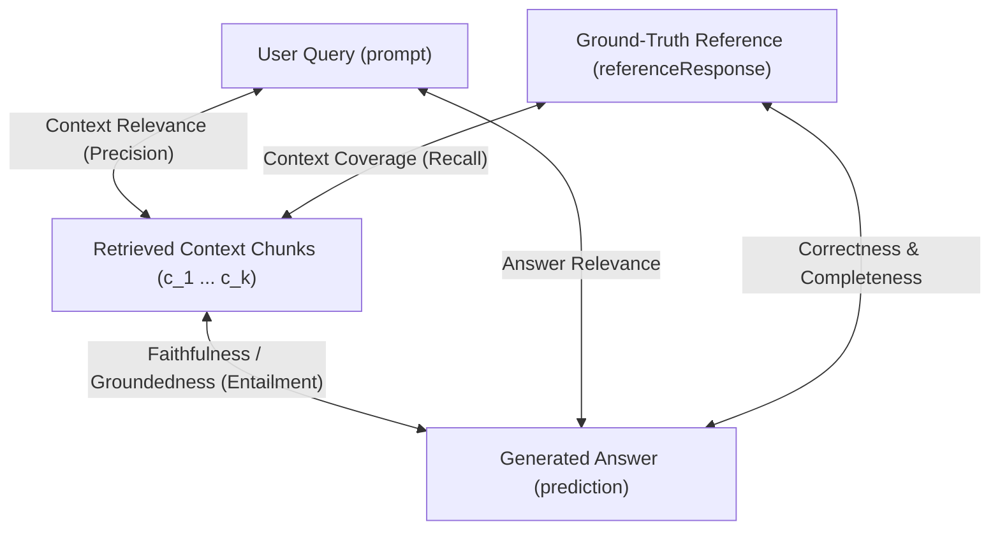

# Domain 5: White Papers, Prescriptive Guidance & Diagnostic Reference Matrices

---

## 1. AWS Prescriptive Guidance: Evaluating Generative AI Applications on AWS

### Architectural Summary
Traditional software testing validates deterministic input-output mappings ($f(x) = y$), whereas generative AI outputs exist in a high-dimensional semantic space where multiple distinct token sequences can be equally valid—or where a single token change invalidates safety and compliance. AWS Prescriptive Guidance establishes a **Three-Horizon Evaluation Framework**:

```mermaid
flowchart LR
    subgraph H1["Horizon 1: Pre-Commit & Dev Loop"]
        Unit["Deterministic Schema & Syntax Checks<br/>(JSON Schema, SQL AST, Regex)"]
        FastMetric["Programmatic Metrics<br/>(BERTScore, ROUGE-L, ExactMatch)"]
    end

    subgraph H2["Horizon 2: Pre-Production CI/CD Gate"]
        Judge["LLM-as-a-Judge Evaluation<br/>(Correctness, Completeness, Custom Rubrics)"]
        RAG["Bedrock KB RAG Evaluation<br/>(Context Relevance, Coverage, Faithfulness)"]
        RedTeam["Adversarial Red-Teaming<br/>(Robustness, Prompt Injection, Guardrail Bypass)"]
    end

    subgraph H3["Horizon 3: Production Canary & Audit"]
        Shadow["Shadow Traffic / Canary Replay"]
        Ground["Online Guardrail Contextual Grounding"]
        SME["SageMaker Ground Truth SME Audit<br/>(Calibrating Judge FM vs Human Experts)"]
    end

    H1 --> H2 --> H3
```

### Core Engineering Principles
1. **Decouple Generator and Evaluator Families**:
   * Never use the exact same foundation model as both the candidate generator and the sole LLM-as-a-Judge in model selection benchmarks due to **self-preference bias** (models favor their own verbosity and formatting conventions).
   * Calibrate your Judge FM against a 50–100 sample human SME golden set until inter-annotator agreement (Cohen's $\kappa$ or Spearman rank correlation $\rho$) exceeds $0.80$.
2. **Stratify Golden Evaluation Datasets**:
   * A golden evaluation dataset must not consist solely of "happy-path" single-fact lookups. Stratify test cases across:
     * **Single-Hop Extractive Queries** (30%)
     * **Multi-Hop Synthesis & Cross-Document Queries** (25%)
     * **Unanswerable / Out-of-Scope Queries** (15% — tests whether the RAG pipeline properly abstains rather than hallucinating)
     * **Noisy / Perturbed User Queries** (15% — typos, abbreviations, colloquial phrasing)
     * **Adversarial / Policy-Boundary Prompts** (15% — prompt injection, PII extraction attempts)
3. **Evaluate Tail Percentiles, Not Just Means**:
   * An average `Faithfulness` score of $0.93$ across 500 prompts can conceal 25 catastrophic hallucinations scoring $0.10$. Enforce CI/CD quality gates on both the **mean** (e.g., $\mu \ge 0.92$) and the **10th percentile** ($p_{10} \ge 0.80$).

---

## 2. Deep-Dive White Paper: Optimizing & Troubleshooting RAG on Amazon Bedrock Knowledge Bases

### The RAG Diagnostic Triangle
AWS defines three interdependent pillars of RAG quality—the **RAG Diagnostic Triangle**:
1. **Context Relevance** (*Query $\leftrightarrow$ Retrieved Chunks*): Measures retrieval precision.
2. **Faithfulness / Groundedness** (*Retrieved Chunks $\leftrightarrow$ Generated Answer*): Measures hallucination resistance.
3. **Answer Relevance & Correctness** (*Query / Ground Truth $\leftrightarrow$ Generated Answer*): Measures end-to-end utility.

### Comprehensive RAG Failure & Remediation Reference Matrix

| Failure Pattern | Observed Bedrock Evaluation Metrics | Underlying Architectural Cause | AWS-Recommended Remediation Strategy |
| :--- | :--- | :--- | :--- |
| **Pattern A: Lexical Miss on Exact Identifiers** | `ContextRelevance`: **0.32** `ContextCoverage`: **0.28** `Faithfulness`: **0.95** *(model politely says it cannot find the SKU)* | Dense embedding models compress semantic meaning into continuous vectors, losing exact alphanumeric token fidelity for serial numbers, error codes (`ERR_SSL_9042`), or statute citations. | Configure `overrideSearchType="HYBRID"` in `vectorSearchConfiguration` (supported on Amazon OpenSearch Serverless and OpenSearch Managed Clusters) to fuse BM25 keyword scores with vector cosine similarity using Reciprocal Rank Fusion (RRF). |
| **Pattern B: Context Window Dilution ("Lost in the Middle")** | `ContextCoverage`: **0.91** `ContextRelevance`: **0.41** `Correctness`: **0.62** | Retrieving $k=25$ chunks guarantees the answer is present (`ContextCoverage` is high), but burying 2 relevant chunks inside 23 irrelevant chunks degrades LLM attention in the middle of the prompt and inflates token costs. | Add an **Amazon Bedrock Reranker** (`cohere.rerank-v3-5:0` or `amazon.rerank-v1:0`) to score all 25 retrieved candidates against the query with a cross-encoder and pass only the top $n=5$ chunks to the generator FM. |
| **Pattern C: Fractured Table / Clause Context** | `ContextRelevance`: **0.88** `ContextCoverage`: **0.44** `Completeness`: **0.49** | Standard fixed-size chunking split a 40-row fee schedule table or a multi-page contract addendum into isolated 300-token slices, separating column headers or conditional clauses from the row values. | 1. Use **Bedrock Data Automation (BDA)** or **Foundation Model Parsing** during ingestion to preserve table structures in Markdown. 2. Use **Hierarchical Chunking** so vector search matches the granular 300-token child chunk, while the KB injects the full 1,500-token parent chunk into the generator prompt. |
| **Pattern D: Unfaithful Parametric Extrapolation** | `ContextRelevance`: **0.94** `ContextCoverage`: **0.92** `Faithfulness`: **0.51** | The retriever delivered the exact right chunks, but the generator FM blended retrieved enterprise policy with outdated public knowledge from its pre-training weights, or guessed missing figures due to high `temperature`. | 1. Set `temperature = 0.0`. 2. Update the KB generation prompt template with strict abstention instructions. 3. Enable **Bedrock Guardrails Contextual Grounding** (`GROUNDING` and `RELEVANCE` filters) to intercept and block unfaithful responses at runtime. |
| **Pattern E: Cross-Tenant / Stale Document Bleed** | `ContextRelevance`: **0.75** `Correctness`: **0.35** *(returns 2022 policy instead of 2026 policy)* | Multiple chronological versions or department-specific policies share high semantic similarity, causing older documents to outrank current ones. | Populate `.metadata.json` sidecar files in S3 (`{"metadataAttributes": {"year": 2026, "status": "ACTIVE"}}`) and pass a mandatory `retrievalFilter` in `RetrieveAndGenerate` calls. |

---

## 3. AWS Architecture Guide: Debugging Amazon Bedrock Agents & Multi-Agent Systems

### Trace Inspection Workflow for Production Incidents

When investigating a Bedrock Agent failure, inspect the `InvokeAgent` trace stream (`enableTrace=True`) in the following deterministic order:

1. **Check `guardrailTrace` First**:
   * Did `action == "INTERVENED"` occur on `inputAssessment` or `outputAssessments`?
   * If `contextualGroundingPolicy` intervened, examine the trace's `score` vs `threshold`. If valid summaries are being blocked, your `GROUNDING` threshold (e.g., `0.99`) may be overly strict for abstractive summarization tasks; lower it to `0.80`–`0.85`.
   * If `sensitiveInformationPolicy` intervened unexpectedly on business identifiers (such as 10-digit NPI numbers or internal order IDs), inspect `piiEntities[].type` to see which built-in PII category collided and replace it with a context-anchored custom regex.
2. **Check `preProcessingTrace`**:
   * Inspect `modelInvocationOutput.parsedResponse.isValid`. If `false`, the pre-processing classifier rejected the prompt before orchestration.
   * Review `parsedResponse.rationale` to see why the pre-processing prompt rejected the user turn.
3. **Check `routingClassifierTrace` (Multi-Agent Collaboration)**:
   * Verify whether the supervisor's routing classifier dispatched the request to the intended sub-agent collaborator (`agentCollaboratorInvocationInput.agentCollaboratorName`).
   * If it routed to the wrong specialist agent, refine the `collaboratorInstruction` description on the sub-agent association to explicitly list included and excluded topics.
4. **Check `orchestrationTrace` (`rationale` $\rightarrow$ `invocationInput` $\rightarrow$ `observation`)**:
   * Compare `rationale.text` against `invocationInput`.
   * If `invocationInput` is missing required API fields or passing a user-friendly string where a UUID is required, inspect your OpenAPI 3.0 schema's `required` array, `pattern` regex, and parameter `description` fields.
   * Inspect `observation.actionGroupInvocationOutput.text` to verify what the Lambda function actually returned to the agent.
   * Inspect `observation.knowledgeBaseLookupOutput.retrievedReferences` to inspect the exact S3 URIs and chunk texts returned by the Knowledge Base.
5. **Check `failureTrace`**:
   * Look up `failureReason` and correlate `traceId` with AWS CloudWatch Logs and AWS CloudTrail (`InvokeModel`, `Retrieve`, `InvokeFunction` events).

### Bedrock Agent Trace & Action Group Diagnostic Matrix

| Observed Exception / Trace Symptom | Trace Location | Root Cause | Exact Remediation |
| :--- | :--- | :--- | :--- |
| `DependencyFailedException: Access denied while invoking Lambda function` | `failureTrace.failureReason` | Missing Resource-Based Policy on the Action Group Lambda function. | Execute `aws lambda add-permission` granting `lambda:InvokeFunction` to principal `bedrock.amazonaws.com` with `--source-arn` set to the Bedrock Agent ARN. |
| `BadGatewayException: Received invalid response from API execution` | `failureTrace.failureReason` | Action Group Lambda returned an API Gateway proxy dict (`statusCode`, `body`) instead of the Bedrock Agent v1.0 envelope. | Return `{"messageVersion": "1.0", "response": {"actionGroup": ..., "apiPath": ..., "httpMethod": ..., "httpStatusCode": 200, "responseBody": ...}}`. |
| `MaxIterationsExceeded` | `failureTrace.failureReason` | Agent repeatedly calls a search tool with guessed parameters after receiving empty results `[]`. | Add explicit instructions in the Agent prompt and tool schema to ask the user for clarification when a lookup returns empty results instead of guessing. |
| Empty `citations` list in `RetrieveAndGenerate` response | API Response `citations: []` | Custom `promptTemplate` deleted the mandatory `$output_format_instructions$` placeholder. | Restore `$output_format_instructions$` alongside `$search_results$` in the Knowledge Base generation prompt template. |

---

## 4. High-Frequency AIP-C01 Exam Traps & Anti-Patterns (Domain 5)

| Common Exam Trap / Distractor | Why It Fails Architecturally | Correct AWS Architecture |
| :--- | :--- | :--- |
| *"Fine-tune the foundation model weekly to fix hallucinations in a RAG pipeline where `ContextRelevance` is 0.95 and `Faithfulness` is 0.55."* | Fine-tuning updates model weights for style/domain adaptation; it does not enforce runtime adherence to retrieved context chunks and incurs massive unnecessary cost and operational overhead. | Lower `temperature` to `0.0`, harden the system prompt grounding instructions, and attach **Amazon Bedrock Guardrails Contextual Grounding checks**. |
| *"Use `ROUGE-L` and `BLEU` scores in CodePipeline to validate whether an agent's multi-step reasoning rationale is logically sound."* | N-gram lexical overlap metrics (`ROUGE`, `BLEU`) cannot measure logical coherence, factual entailment, or reasoning validity when phrasing varies. | Use **Amazon Bedrock Evaluations with LLM-as-a-Judge** (`Builtin.LogicalCoherence`, `Builtin.Faithfulness`, `Builtin.Correctness`). |
| *"Attach an IAM policy with `aoss:*` to the Bedrock Knowledge Base role to fix a `403 Forbidden` error during OpenSearch Serverless ingestion."* | `aoss:APIAccessAll` in IAM only grants permission to reach the AOSS endpoint; OpenSearch Serverless enforces data-plane authorization via its own **Data Access Policy**. | Add the Bedrock Knowledge Base IAM Execution Role ARN to the **Amazon OpenSearch Serverless Data Access Policy** with index and document read/write permissions. |
| *"Update the Bedrock Agent IAM Execution Role with `lambda:InvokeFunction` to fix `AccessDeniedException` when the Agent invokes an Action Group Lambda."* | Bedrock Agents invoke Action Group Lambdas via the `bedrock.amazonaws.com` service principal, which requires a **Lambda Resource-Based Policy**, not an IAM execution role permission. | Run `aws lambda add-permission` granting `lambda:InvokeFunction` to principal `bedrock.amazonaws.com` scoped with `--source-arn` of the Bedrock Agent. |
| *"Increase API Gateway REST API integration timeout to 120 seconds to fix `504 Gateway Timeout` errors during long Bedrock Agent runs."* | Amazon API Gateway REST/HTTP synchronous integrations have a **29-second default limit** (and even where quota increases exist for regional REST APIs, holding synchronous HTTP connections open without streaming degrades UX and load balancers). | Implement **Response Streaming** (`InvokeAgent` / `ConverseStream`) over **API Gateway WebSockets**, **Lambda Function URLs with `RESPONSE_STREAM`**, or an asynchronous **EventBridge/SQS + polling/WebSocket** pattern. |
| *"Change the chunk size on an existing Amazon Bedrock Knowledge Base data source in-place without re-indexing."* | Chunking boundaries and embedding vectors are computed at ingestion time and persisted in the vector index. | Update the chunking configuration (or create a new data source/vector index when changing embedding dimensions) and run `StartIngestionJob` to re-chunk and re-embed the corpus. |
