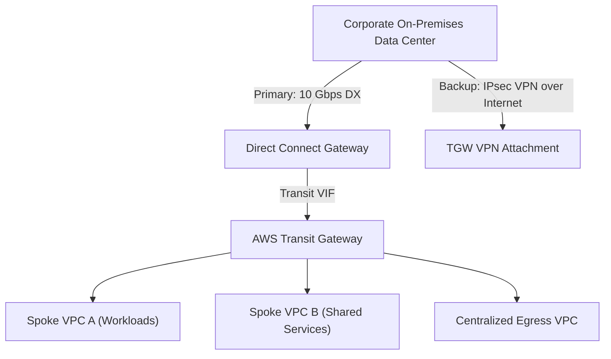

# Domain 1: Design for Organizational Complexity — Architecture Exercises & Solutions

## Exercise 1: Hybrid Networking with AWS Direct Connect, Transit Gateway & Active/Passive Failover
Design a high-availability Direct Connect architecture connecting on-premises data centers to a multi-account Transit Gateway with IPsec VPN backup.

### Routing Precedence Configuration
1. Direct Connect advertises AWS prefixes via BGP.
2. On-premises advertises corporate prefixes with AS-PATH prepending on the backup VPN link (e.g., 3 extra AS hops) or by tagging BGP communities (`7224:7100` for low preference, `7224:7300` for high preference).
3. Transit Gateway route table installs Direct Connect routes over VPN because DX routes have higher priority when prefix lengths are equal.
