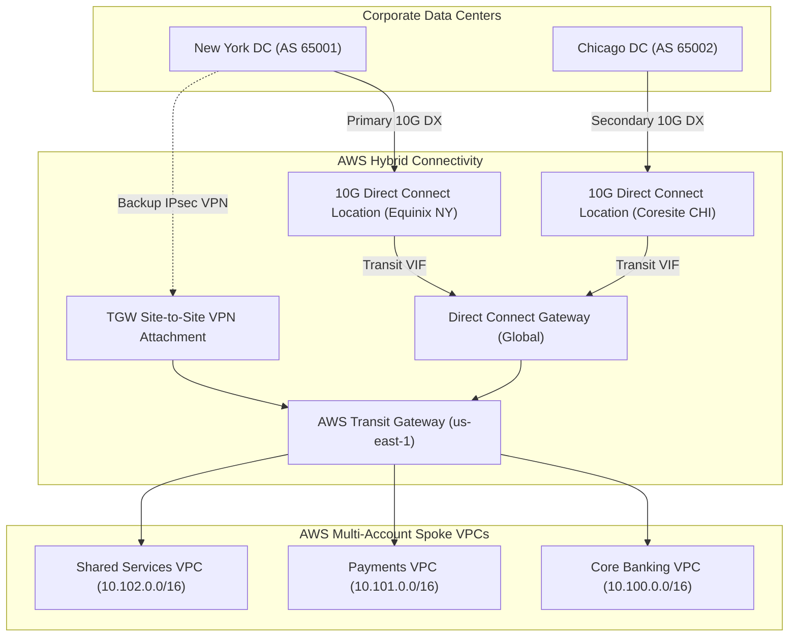
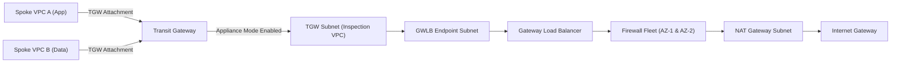
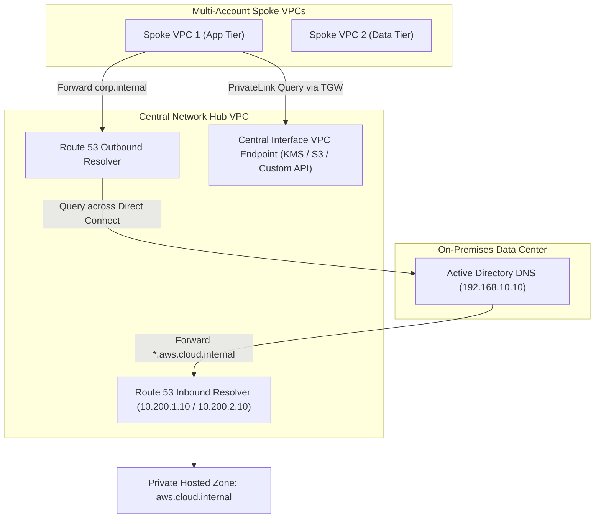

# Domain 1: Design Solutions for Organizational Complexity — Architecture Exercises & Solutions

## Exercise 1: Dual-Region Direct Connect with BGP Failover & IPsec VPN Backup
### Enterprise Context & Objective
A global financial enterprise operates primary and secondary on-premises data centers in New York and Chicago. The architecture mandates 10 Gbps dedicated interconnectivity into a centralized AWS Transit Gateway (TGW) deployed in `us-east-1`, with automatic sub-minute failover to a secondary Direct Connect (DX) link in `us-west-2`, and a fallback Site-to-Site IPsec VPN over the public Internet.



### Complete Implementation & BGP Routing Precedence
1. **Direct Connect Gateway & Transit VIF Provisioning:**
   - Create a Direct Connect Gateway (`DXGW-Global`).
   - Associate `DXGW-Global` with the Transit Gateway in `us-east-1`. In the association, declare allowed prefixes: `10.100.0.0/14`.
   - Provision Transit Virtual Interfaces (Transit VIFs) from both New York and Chicago DX connections, attaching them to `DXGW-Global`.
2. **Inbound Traffic Steering (AWS to On-Premises):**
   - On-premises routers advertise corporate prefixes (e.g., `192.168.0.0/16`).
   - To make New York the primary path, advertise `192.168.0.0/16` with BGP community `7224:7300` (High Local Preference: 7300 = preference 300).
   - From Chicago, advertise `192.168.0.0/16` with BGP community `7224:7200` (Medium Local Preference: 7200 = preference 200).
   - From the Site-to-Site VPN, advertise `192.168.0.0/16` via BGP. AWS TGW automatically prefers Direct Connect over VPN routes when prefix lengths are identical.
3. **Outbound Traffic Steering (On-Premises to AWS):**
   - Direct Connect Gateway advertises the VPC CIDRs (`10.100.0.0/14`).
   - Configure local BGP routers:
     - New York router sets Local Preference = 300 for routes received via DX_NY.
     - Chicago router sets Local Preference = 200 for routes received via DX_CHI.
     - On-premises firewall sets Local Preference = 100 for routes received via VPN.
4. **Failure Detection & BFD Configuration:**
   - Enable Bidirectional Forwarding Detection (BFD) on all BGP peering sessions with a 300 ms transmission interval and detection multiplier of 3 (900 ms sub-second link failure detection).

---

## Exercise 2: Centralized Network Firewall & Gateway Load Balancer Inspection VPC with Appliance Mode
### Enterprise Context & Objective
Mandate all inter-VPC (East-West) and Internet egress (North-South) traffic across 50 AWS accounts be inspected by a stateful fleet of third-party firewalls or AWS Network Firewall deployed in a centralized Inspection VPC.



### Complete Implementation
1. **Enable Transit Gateway Appliance Mode:**
   ```bash
   aws ec2 modify-transit-gateway-vpc-attachment      --transit-gateway-attachment-id tgw-attach-0123456789abcdef0      --appliance-mode-support enable
   ```
   *Why this is mandatory:* Without Appliance Mode, Transit Gateway routes return traffic to any available AZ in the VPC based on flow hashes, causing stateful firewalls in the return AZ to drop the TCP connection because they never saw the SYN packet.
2. **Subnet Architecture in Inspection VPC:**
   - `TGW-Subnet-A` (`10.200.0.0/28`) & `TGW-Subnet-B` (`10.200.0.16/28`)
   - `GWLBE-Subnet-A` (`10.200.0.32/28`) & `GWLBE-Subnet-B` (`10.200.0.48/28`)
   - `FW-Subnet-A` (`10.200.0.64/28`) & `FW-Subnet-B` (`10.200.0.80/28`)
   - `NAT-Subnet-A` (`10.200.0.96/28`) & `NAT-Subnet-B` (`10.200.0.112/28`)
3. **Route Table Routing Chains:**
   - `TGW-Subnet-Route-Table`: `0.0.0.0/0` -> Target: `GWLBE-Subnet-A` (or matching AZ).
   - `GWLBE-Subnet-Route-Table`: `10.0.0.0/8` -> Target: `TGW-Attachment`; `0.0.0.0/0` -> Target: `NAT-Gateway-A`.
   - `Spoke-VPC-Route-Tables`: `0.0.0.0/0` and `10.0.0.0/8` -> Target: `TGW`.

---

## Exercise 3: Hybrid DNS Architecture with Route 53 Resolver Endpoints & Centralized PrivateLink
### Enterprise Context & Objective
Unify internal domain resolution between corporate active directory (`corp.internal`) and AWS private hosted zones (`aws.cloud.internal`), and share an AWS PrivateLink endpoint across all spoke VPCs without deploying endpoints in every VPC.



### Complete Implementation
1. **Route 53 Resolver Inbound Endpoints:**
   - Provision 2 ENIs in distinct AZs inside the Hub VPC (`10.200.1.10`, `10.200.2.10`).
   - On on-premises Windows DNS / BIND: create conditional forwarder for `aws.cloud.internal` -> `10.200.1.10`, `10.200.2.10`.
2. **Route 53 Resolver Outbound Endpoints & Rules:**
   - Provision 2 Outbound ENIs in the Hub VPC.
   - Create Route 53 Resolver Rule: Type `FORWARD`, Domain Name `corp.internal`, Target IPs: `192.168.10.10`, `192.168.10.11`.
   - Associate the Resolver Rule with all Spoke VPCs using AWS RAM (Resource Access Manager).
3. **Centralized PrivateLink Architecture:**
   - Deploy Interface VPC Endpoints into the Hub VPC with `PrivateDnsEnabled: false`.
   - In a centralized Private Hosted Zone (`kms.us-east-1.amazonaws.com`), create Alias A records pointing to the Hub VPC Interface Endpoint ENIs.
   - Associate this Private Hosted Zone with all Spoke VPCs across the AWS Organization.

---

## Exercise 4: VPC Lattice Multi-Account Service Mesh vs Cross-Account PrivateLink
### Enterprise Context & Objective
Decouple 100+ microservices spanning 25 AWS accounts. Compare latency, management overhead, and access governance between traditional VPC Peering/PrivateLink and AWS VPC Lattice.

### Architecture Comparison Matrix
| Architectural Feature | VPC Peering / PrivateLink | AWS VPC Lattice |
| :--- | :--- | :--- |
| **CIDR Overlap Handling** | Peering fails on overlapping CIDRs; PrivateLink requires NLBs | Native L7 proxy; completely immune to overlapping CIDRs |
| **Authentication & Authorization**| Security Groups (L4 IP/Port only) | Native IAM SigV4 Auth Policies at service and network level |
| **Multi-Account Sharing** | Complex per-service endpoint provisioning | Share Service Network across accounts via AWS RAM |
| **Protocol Support** | TCP/TLS/HTTP | HTTP/1.1, HTTP/2, gRPC |

### Implementation Blueprint for VPC Lattice
1. In Central Services Account:
   - Create a **Service Network** (`PaymentMesh`).
   - Attach IAM Auth Policy enforcing authenticated principal org:
     ```json
     {
       "Version": "2012-10-17",
       "Statement": [{
         "Effect": "Allow",
         "Principal": "*",
         "Action": "vpc-lattice-svcs:Invoke",
         "Resource": "*",
         "Condition": {
           "StringEquals": { "aws:PrincipalOrgID": "o-enterprise123" }
         }
       }]
     }
     ```
2. Share `PaymentMesh` via AWS RAM with the entire AWS Organization.
3. In Spoke Accounts: Associate local VPCs with the shared Service Network. Spoke workloads now resolve microservice DNS names directly without Transit Gateways or CIDR planning.

---

## Exercise 5: Enterprise Multi-Tier Service Control Policies (SCPs) & Resource Control Policies (RCPs)
### Enterprise Context & Objective
Enforce non-negotiable security guardrails organization-wide: block regional expansion, prevent CloudTrail tampering, enforce encryption, and prevent data exfiltration using new Resource Control Policies (RCPs).

### Production Multi-Tier SCP Architecture
```json
{
  "Version": "2012-10-17",
  "Statement": [
    {
      "Sid": "EnforceRegionDenyExceptApproved",
      "Effect": "Deny",
      "NotAction": [
        "a4b:*", "iam:*", "organizations:*", "route53:*",
        "cloudfront:*", "wafv2:*", "sts:*", "support:*"
      ],
      "Resource": "*",
      "Condition": {
        "StringNotEquals": {
          "aws:RequestedRegion": ["us-east-1", "us-west-2", "eu-west-1"]
        }
      }
    },
    {
      "Sid": "ProtectSecurityServicesAndTrails",
      "Effect": "Deny",
      "Action": [
        "cloudtrail:StopLogging",
        "cloudtrail:DeleteTrail",
        "config:DeleteConfigRule",
        "guardduty:DeleteDetector",
        "securityhub:DisableSecurityHub"
      ],
      "Resource": "*"
    },
    {
      "Sid": "BlockPublicS3AndIAMAccessKeyCreation",
      "Effect": "Deny",
      "Action": [
        "s3:PutBucketPublicAccessBlock",
        "s3:DeleteBucketPublicAccessBlock",
        "iam:CreateAccessKey"
      ],
      "Resource": "*"
    }
  ]
}
```

### Resource Control Policy (RCP) for Data Perimeter:
Attach an RCP to the organization root ensuring S3 buckets can only be accessed from principals inside the company's AWS Organization, blocking insider exfiltration to external personal AWS accounts:
```json
{
  "Version": "2012-10-17",
  "Statement": [{
    "Sid": "EnforceOrgDataPerimeter",
    "Effect": "Deny",
    "Principal": "*",
    "Action": "s3:*",
    "Resource": "*",
    "Condition": {
      "StringNotEquals": { "aws:PrincipalOrgID": "o-enterprise123" }
    }
  }]
}
```

---

## Exercise 6: Cross-Account AWS RAM VPC Sharing & Federated Attribute-Based Access Control (ABAC)
### Enterprise Context & Objective
Design an enterprise multi-account landing zone where the central Network Team owns VPC subnets, while application teams deploy workloads into their own accounts within shared subnets, isolated strictly by Attribute-Based Access Control (ABAC) tags.

### Implementation Blueprint
1. In Central Networking Account:
   - Create VPC `10.50.0.0/16`. Subnet `App-Subnet-A` (`10.50.1.0/24`) tagged with `Environment: Production`, `Department: Finance`.
   - Share `App-Subnet-A` with OU `ou-workloads-prod` using AWS RAM.
2. In Workload Account:
   - Workload developers see `App-Subnet-A` in their console/API.
   - Developers create EC2 instances or EKS worker nodes inside `App-Subnet-A`.
   - Developers create their own local Security Groups; Network Account cannot modify local SG rules.
3. IAM ABAC Policy for Developers:
   ```json
   {
     "Version": "2012-10-17",
     "Statement": [{
       "Effect": "Allow",
       "Action": ["ec2:RunInstances", "ec2:StartInstances", "ec2:StopInstances"],
       "Resource": "*",
       "Condition": {
         "StringEquals": {
           "aws:RequestTag/Department": "${aws:PrincipalTag/Department}",
           "aws:RequestTag/Environment": "${aws:PrincipalTag/Environment}"
         }
       }
     }]
   }
   ```
