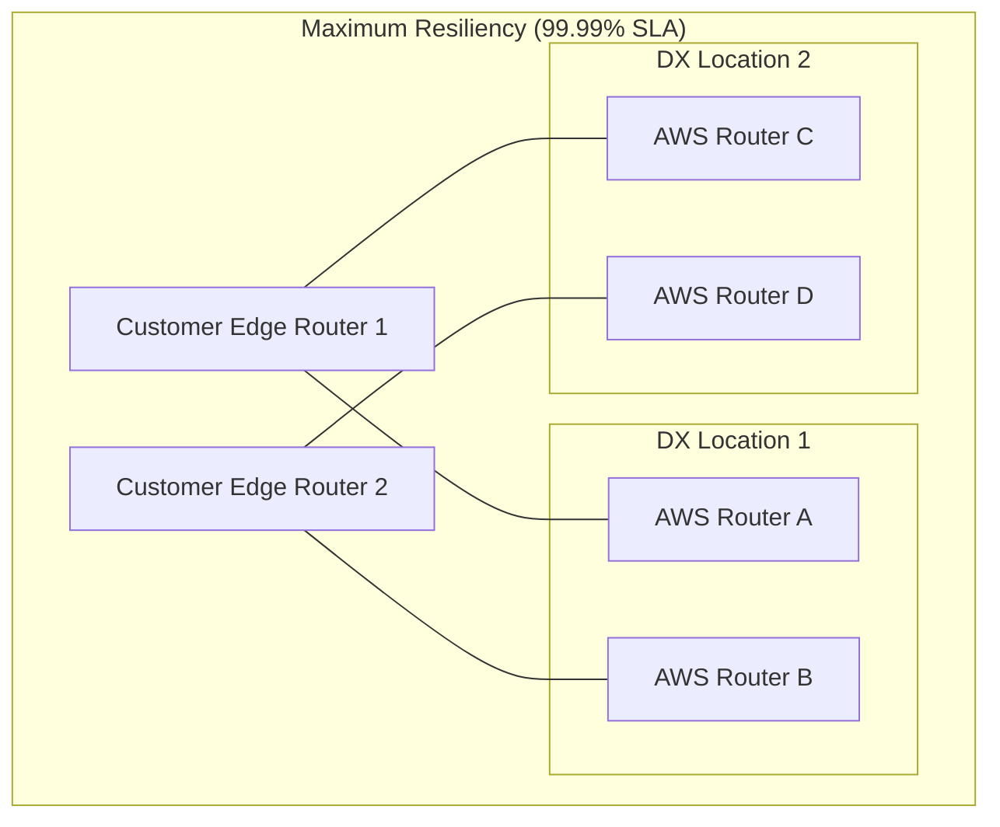
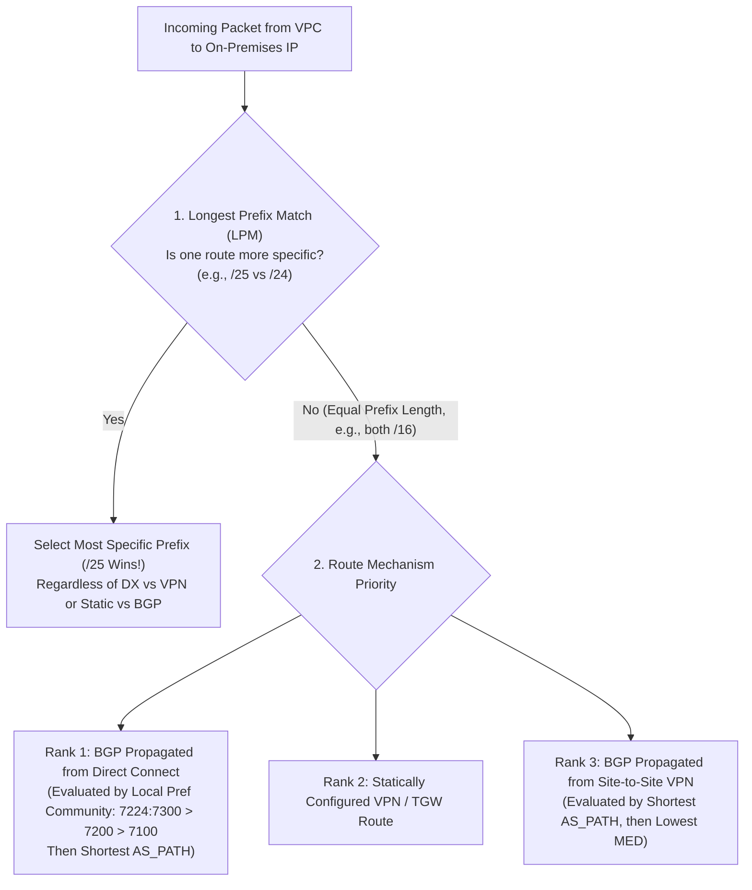
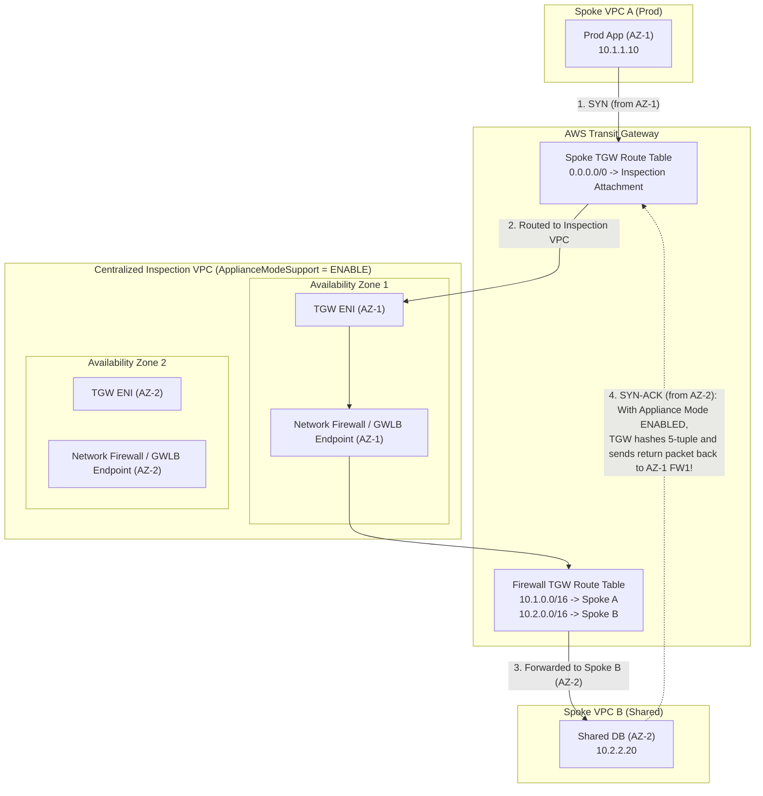
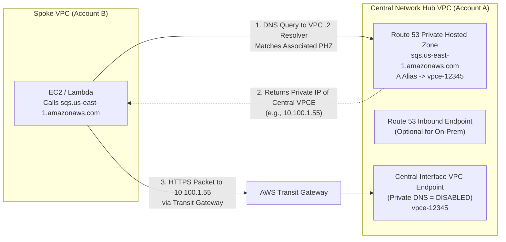
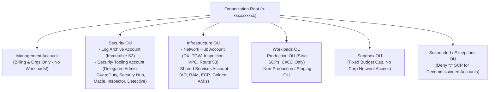

# Domain 1: Design Solutions for Organizational Complexity (26%) — Deep-Dive Study Guide

Domain 1 accounts for **26% of the AWS Certified Solutions Architect – Professional (`SAP-C02`)** exam. It tests your ability to architect enterprise-scale hybrid networking, multi-region/multi-VPC routing topologies, BGP traffic engineering, centralized network inspection, hybrid DNS resolution, multi-account governance with AWS Organizations and Control Tower, federated identity management, cross-account resource sharing, and cloud financial management (FinOps).

---

## 1. Hybrid & Multi-VPC Enterprise Networking

### 1.1 AWS Direct Connect (DX) Architecture & Connection Models

**AWS Direct Connect** establishes a dedicated physical fiber-optic network connection between an on-premises data center/colocation facility and an AWS Direct Connect Location (Point of Presence / PoP). Traffic traverses the private AWS global backbone rather than the public internet, delivering consistent network throughput, lower latency, and reduced outbound data transfer rates (`$/GB`).

#### Dedicated Connections vs. Hosted Connections vs. Hosted VIFs

* **Physical Port Speeds**
  * **Dedicated Connection:** **1 Gbps, 10 Gbps, 100 Gbps, 400 Gbps**
  * **Hosted Connection:** **50 Mbps to 25 Gbps** (`50M, 100M, 200M, 300M, 400M, 500M, 1G, 2G, 5G, 10G, 25G`)
  * **Hosted VIF (Legacy / Partner):** Shares partner's physical port bandwidth
* **Provisioning Method**
  * **Dedicated Connection:** Ordered by customer in AWS Console; AWS issues a **LOA-CFA (Letter of Authorization and Connecting Facility Assignment)** for cross-connect at PoP
  * **Hosted Connection:** Provisioned on-demand by an **AWS Direct Connect Delivery Partner** over pre-established partner NNI ports
  * **Hosted VIF (Legacy / Partner):** Partner creates a single VIF and shares it into your AWS Account
* **Max VIFs Supported**
  * **Dedicated Connection:** **50 VIFs** per physical connection
  * **Hosted Connection:** **1 VIF** (`50M`–`5G` connections) or **multiple VIFs** on higher-capacity partner tiers depending on capability; typically 1 Private/Public/Transit VIF (`1G+` required for Transit VIF)
  * **Hosted VIF (Legacy / Partner):** **1 VIF** only (cannot create additional VIFs yourself)
* **Link Aggregation (LAG)**
  * **Dedicated Connection:** **Supported** (combine up to 4 connections of the same speed at the same PoP using LACP `802.3ad`)
  * **Hosted Connection:** **Not supported**
  * **Hosted VIF (Legacy / Partner):** **Not supported**
* **MACsec (802.1AE) Support**
  * **Dedicated Connection:** **Yes** (on **10 Gbps** and **100 Gbps** Dedicated Connections at supported locations)
  * **Hosted Connection:** **No**
  * **Hosted VIF (Legacy / Partner):** **No**

#### AWS Direct Connect Resiliency Toolkit & SLA Models

> [!IMPORTANT]
> A single Direct Connect connection has **0% SLA** and is a Single Point of Failure (SPOF). Even two connections at the *same* DX location on the *same* router can fail simultaneously during fiber cuts or maintenance.



1. **Maximum Resiliency (99.99% SLA)**:
   * Requires **4 separate Dedicated Connections** distributed across **2 distinct Direct Connect Locations** (2 connections per location terminating on physically separate AWS devices and separate customer routers).
   * Designed for mission-critical enterprise production workloads.
2. **High Resiliency (99.9% SLA)**:
   * Requires **2 separate Dedicated Connections** distributed across **2 distinct Direct Connect Locations** (1 connection per location terminating on separate customer routers).
   * Designed for production workloads requiring fault tolerance against a complete PoP or carrier outage.
3. **Development and Test (No SLA)**:
   * Uses **1 connection** at a single location (or 2 connections in a single location for device redundancy only).
   * **Cost-Effective Production Backup Pattern**: When an exam scenario states *"the company has 1 Direct Connect connection and needs a cost-effective backup for High Availability without waiting weeks for a second physical circuit,"* always pair the single Direct Connect connection with an **AWS Site-to-Site VPN over the public internet** terminating on the same VGW or Transit Gateway!

---

### 1.2 Virtual Interfaces (VIFs), Direct Connect Gateway (DXGW) & SiteLink

Every Direct Connect physical connection requires an **802.1Q VLAN** tag to segment traffic into one or more **Virtual Interfaces (VIFs)**:

* **Private VIF**
  * **Target AWS Resource:** **1 Virtual Private Gateway (VGW)** (same or cross-account) OR **1 Direct Connect Gateway (DXGW)**
  * **Max MTU:** **1500** or **9001** (Jumbo Frames)
  * **Routing Scope & Exam Rules:** Connects to private IPv4/IPv6 CIDR blocks inside VPCs. A DXGW connected via Private VIF can attach to **up to 20 VGWs** across any commercial AWS Region and any AWS Account. **Cannot** attach to a Transit Gateway!
* **Transit VIF**
  * **Target AWS Resource:** **1 Direct Connect Gateway (DXGW)** ONLY
  * **Max MTU:** **1500** or **8500** (Jumbo Frames)
  * **Routing Scope & Exam Rules:** Required to connect Direct Connect to **AWS Transit Gateway (TGW)**. A single DXGW can associate with **up to 6 Transit Gateways** in any AWS Region. **Requires a minimum 1 Gbps DX connection** (or Hosted Connection $\ge 1\text{ Gbps}$).
* **Public VIF**
  * **Target AWS Resource:** **AWS Public IP Space** (S3, DynamoDB, SQS, CloudFront origins, Public VPN Endpoints)
  * **Max MTU:** **1500** (No Jumbo Frames)
  * **Routing Scope & Exam Rules:** Uses public `/31` IP addresses and exchanges public BGP prefixes with AWS. Can filter received routes via BGP community tags (`7224:9100` Local Region, `7224:9200` Continent, `7224:9300` Global).

#### Direct Connect Gateway (DXGW) Architecture & Allowed Prefixes

* **Global Control Plane / Regional Data Plane**: A Direct Connect Gateway is a **global logical resource** that allows a single Private VIF or Transit VIF in one location (e.g., Equinix Ashburn near `us-east-1`) to reach VGWs or TGWs in any other AWS Region (e.g., `us-west-2`, `eu-central-1`, `ap-northeast-1`).
* **Allowed Prefixes List (`AllowedPrefixes`)**: When associating a Transit Gateway (or VGW) with a Direct Connect Gateway, you configure the **Allowed Prefixes** list. This list controls which CIDR blocks AWS advertises over BGP to your on-premises routers:
  * **Quota**: A DXGW supports a maximum of **200 prefixes total** across all associated Transit Gateways. If you have 300 VPCs (`10.1.0.0/16`, `10.2.0.0/16`, etc.), you **must summarize** them in the DXGW Allowed Prefixes list (e.g., `10.0.0.0/8`) rather than listing 300 individual `/16` CIDRs!
  * **Default Route Advertisement (`0.0.0.0/0`)**: If on-premises branches need to route all internet-bound traffic through a Centralized Egress VPC in AWS, add `0.0.0.0/0` to the DXGW Allowed Prefixes list for the TGW association!
* **No Native Transitive Routing Through DXGW Alone**:
  * Two VGWs attached to the same DXGW **cannot** send traffic directly to each other through the DXGW.
  * Two on-premises data centers connected via two Private VIFs to the same DXGW **cannot** talk to each other unless **AWS Direct Connect SiteLink** is explicitly enabled on both VIFs.

#### AWS Direct Connect SiteLink

* **What It Solves**: Historically, if a company had an on-premises office in New York (connected to DX PoP Ashburn) and a factory in Munich (connected to DX PoP Frankfurt), routing traffic between New York and Munich over AWS required hair-pinning through VPCs/TGWs inside AWS Regions.
* **How SiteLink Works**: Enabling **SiteLink** on two or more Private or Transit VIFs attached to the same **Direct Connect Gateway** allows on-premises prefixes advertised from New York to be re-advertised directly to Munich across the high-speed private AWS global fiber backbone between DX PoPs—**completely bypassing AWS Regions and VPCs**!
* **SiteLink BGP Communities**:
  * **`7224:7400`** (or standard `NO_EXPORT`): Do **not** redistribute this on-premises prefix to other SiteLink-enabled VIFs.
  * **`7224:7500`**: Redistribute this prefix only to SiteLink-enabled VIFs in the same continent.

---

### 1.3 Encrypting Traffic Over AWS Direct Connect

By default, AWS Direct Connect is a private, dedicated physical circuit, **NOT encrypted in transit**. Regulated workloads (PCI-DSS, HIPAA, Defense, Banking) frequently require encryption over Direct Connect:

* **AWS Direct Connect MACsec (`802.1AE`)**
  * **OSI Layer:** **Layer 2** (Data Link)
  * **Supported DX Connections & VIFs:** **10 Gbps and 100 Gbps Dedicated Connections ONLY** (at supported PoPs)
  * **Bandwidth & Architectural Trade-Offs:** Line-rate hardware encryption (`10G`/`100G`) with near-zero latency overhead. **Hop-by-hop only** (encrypts the physical fiber between your router and the AWS DX cage router; not end-to-end into the VPC).
* **Site-to-Site VPN over a Transit VIF**
  * **OSI Layer:** **Layer 3** (IPsec)
  * **Supported DX Connections & VIFs:** Any $\ge 1\text{ Gbps}$ DX with a **Transit VIF** > DXGW > **Transit Gateway**
  * **Bandwidth & Architectural Trade-Offs:** Create a TGW VPN Attachment whose Customer Gateway IP is reachable over the private Transit VIF IP space. Each VPN tunnel is capped at **1.25 Gbps**; use **ECMP (Equal-Cost Multi-Path)** across multiple VPN attachments to aggregate bandwidth (e.g., 4 tunnels = 5 Gbps).
* **Site-to-Site VPN over a Public VIF**
  * **OSI Layer:** **Layer 3** (IPsec)
  * **Supported DX Connections & VIFs:** Any DX speed (`50 Mbps` to `100 Gbps`) using a **Public VIF**
  * **Bandwidth & Architectural Trade-Offs:** The Public VIF advertises AWS public VPN endpoint IPs over BGP. Your on-prem router establishes an IPsec tunnel over the Public VIF to a **VGW** or **TGW**. Works even on sub-1G Hosted Connections that cannot use Transit VIFs!
* **Self-Managed IPsec Virtual Appliances on EC2**
  * **OSI Layer:** **Layer 3** (IPsec)
  * **Supported DX Connections & VIFs:** Private VIF or Transit VIF
  * **Bandwidth & Architectural Trade-Offs:** Deploy Cisco/Palo Alto/StrongSwan EC2 instances in a VPC (behind GWLB or in an edge subnet) to terminate higher-bandwidth IPsec tunnels (`5–20+ Gbps`) over a Private VIF. High operational overhead.

---

### 1.4 BGP Routing Precedence, Communities & Active/Passive Failover

#### Complete AWS Route Selection Order (VGW and Transit Gateway)

When AWS (either a Virtual Private Gateway or a Transit Gateway) has multiple paths to reach an on-premises destination CIDR, it evaluates routes in this **exact deterministic sequence**:



> [!WARNING]
> **Classic SAP-C02 Exam Trap — Asymmetric Routing via Longest Prefix Match**:
> Suppose a company has a **10 Gbps Direct Connect** advertising a summarized `10.0.0.0/16` route to AWS, and a **backup Site-to-Site VPN** advertising two more specific `/17` routes (`10.0.0.0/17` and `10.0.128.0/17`).
> * **What happens?** All traffic from AWS to on-premises will ignore the 10 Gbps Direct Connect and flow over the slow 1.25 Gbps VPN because **`/17` is a longer prefix match than `/16`**!
> * **The Fix**: Advertise the **exact same prefix lengths** (`10.0.0.0/17` and `10.0.128.0/17`, or `10.0.0.0/16`) across both Direct Connect and the backup Site-to-Site VPN so AWS evaluates mechanism priority (DX BGP > VPN BGP) cleanly!

#### Engineering Active/Active vs. Active/Passive Across Dual Direct Connect Connections

1. **Same-Region Dual DX Connections (Active/Active ECMP)**:
   * Advertise the exact same prefixes from on-premises with the **same BGP Local Preference community** (default `7224:7200`) and **identical `AS_PATH` length** over both VIFs. AWS will perform **ECMP (Equal-Cost Multi-Path)** load balancing across both links.
2. **Multi-Region Dual DX Connections via DXGW (Active/Passive)**:
   * *The Trap*: If a VPC in `us-east-1` is attached via DXGW to `DX-1` (in `us-east-1`) and `DX-2` (in `us-west-2`), AWS naturally prefers `DX-1` because it is in the **same Region** as the VPC, **even if you prepend `AS_PATH` on `DX-1`**!
   * *The Solution*: To override Regional affinity or enforce deterministic Active/Passive routing across any DX connections on a DXGW, apply **BGP Local Preference Community Tags** on the on-premises routers:
     * Primary VIF: Tag outbound BGP route advertisements with **`7224:7300` (High Local Preference)**.
     * Secondary VIF: Tag outbound BGP route advertisements with **`7224:7100` (Low Local Preference)**.
   * For traffic in the opposite direction (**On-Premises > AWS**), configure your on-premises router's inbound route-map to set a higher local `LOCAL_PREF` (e.g., `200` on Primary, `100` on Secondary) or match AWS Scope Communities (`7224:9100`).

#### Bidirectional Forwarding Detection (BFD) for Sub-Second Failover

* **Default BGP Timers**: Standard BGP keepalive is **30 seconds** with a **Hold Timer of 90 seconds**. If a carrier fiber fails without dropping the local optical link state, BGP can take up to **90 seconds** to tear down the session and fail over to a secondary DX or VPN!
* **Asynchronous BFD on Direct Connect**:
  * AWS Direct Connect automatically enables **Asynchronous BFD** on AWS's side of every VIF (`300 ms` minimum TX/RX interval $\times$ `3` failure multiplier = **~900 milliseconds** detection time).
  * You only need to enable BFD on your **on-premises customer router** (`bfd interval 300 min_rx 300 multiplier 3`) and bind it to the BGP neighbor session to reduce failover time from **90 seconds to under 1 second**!

---

### 1.5 AWS Transit Gateway (TGW), Segmentation & Centralized Inspection

**AWS Transit Gateway (TGW)** is a regional, highly scalable cloud router that interconnects thousands of VPCs, Direct Connect Gateways, and Site-to-Site VPNs in a hub-and-spoke topology.

#### Transit Gateway Route Tables: Associations vs. Propagations

* **Association (1-to-1)**: Every TGW Attachment (VPC, VPN, DXGW, Peering) can be **associated with at most ONE TGW Route Table**. When a packet enters the TGW from that attachment, the TGW looks up the destination IP in that attachment's **associated** route table.
* **Propagation (1-to-Many)**: A single TGW Attachment can **propagate its CIDR routes into MULTIPLE TGW Route Tables**.
* **Enterprise Network Segmentation Pattern**:
  * Create a **`Dev-Isolated-RT`**: Associate all 20 Dev VPC attachments with `Dev-Isolated-RT`. Do **NOT** propagate Dev VPC CIDRs into `Dev-Isolated-RT`! Instead, propagate only the **Shared Services VPC** (`10.100.0.0/16`) and add a static `0.0.0.0/0` route pointing to the **Inspection/Egress VPC**.
  * *Result*: Dev VPCs cannot talk to each other (`Dev-A` $\nleftrightarrow$ `Dev-B`) or Prod VPCs, even though they share one Transit Gateway, while all Dev VPCs can reach Shared Services and Egress!

#### Centralized Inspection VPC with AWS Network Firewall / Gateway Load Balancer (GWLB)

In complex multi-account organizations, security teams inspect all **East-West** (VPC-to-VPC), **North-South Egress** (VPC-to-Internet), and **Hybrid** (VPC-to-On-Premises) traffic through a dedicated **Inspection VPC** running either **AWS Network Firewall** or third-party appliances behind a **Gateway Load Balancer (GWLB)** using GENEVE encapsulation (UDP port `6081`).



> [!CAUTION]
> **Why `ApplianceModeSupport: enable` is Mandatory for Stateful Inspection**:
> 1. Suppose `Instance-A` in **Spoke VPC A (`us-east-1a`)** sends a TCP `SYN` packet to `Instance-B` in **Spoke VPC B (`us-east-1b`)**.
> 2. By default (`ApplianceModeSupport: disable`), Transit Gateway preserves Availability Zone affinity to minimize Cross-AZ latency. The forward `SYN` packet enters the Inspection VPC in **`us-east-1a`** and is inspected by **`Firewall-Node-AZ1`** (which records the TCP connection state in its local session table).
> 3. `Instance-B` in **`us-east-1b`** replies with a `SYN-ACK`. When that packet reaches the Transit Gateway in `us-east-1b`, default AZ affinity routes it into the Inspection VPC in **`us-east-1b`** (`Firewall-Node-AZ2`)!
> 4. Because **`Firewall-Node-AZ2`** never saw the initial TCP `SYN`, it treats the `SYN-ACK` as an invalid out-of-state packet and **silently drops it**!
> 5. **The Fix**: Run `aws ec2 modify-transit-gateway-vpc-attachment --transit-gateway-attachment-id tgw-attach-xxx --options ApplianceModeSupport=enable` on the **Inspection VPC attachment**. Transit Gateway then uses a symmetric 5-tuple hash to guarantee that both directions of a network flow always traverse the **exact same Availability Zone** in the Inspection VPC!

---

### 1.6 AWS Cloud WAN vs. Transit Gateway

**AWS Cloud WAN** provides a managed global wide-area network service that unifies VPCs, on-premises branch offices (SD-WAN appliances via Tunnel-less BGP or IPsec), and Direct Connect Gateways under a single **Global Network** and declarative JSON **Core Network Policy**:

* **Core Network Edges (CNEs)**: Managed regional routers (under the hood powered by AWS Transit Gateway fabric) automatically peered across all configured AWS Regions.
* **Network Segments**: Global routing domains (e.g., `Prod`, `Dev`, `SharedServices`) defined once in the Core Network Policy. Instead of managing 10 regional TGW route tables and 45 inter-region peering associations manually, you tag a VPC attachment with `Segment=Prod` and Cloud WAN automatically places it in the global `Prod` segment across all Regions!
* **Service Insertion**: Cloud WAN Core Network Policy natively supports global/regional service insertion actions (`send-via` and `send-to`) to steer inter-segment or internet-bound traffic through centralized inspection firewalls.

---

### 1.7 Solving Overlapping CIDRs & Service Connectivity: PrivateLink vs. VPC Lattice

When mergers, acquisitions, or SaaS integrations result in two VPCs having **identical or overlapping IPv4 CIDR blocks** (e.g., both use `10.0.0.0/16`), standard Layer 3 routing (VPC Peering or Transit Gateway) fails without complex Private NAT Gateways. AWS offers two purpose-built service-level abstractions:

* **OSI Layer & Protocols**
  * **AWS PrivateLink (Interface VPC Endpoints):** **Layer 4 (`TCP` only)**
  * **Amazon VPC Lattice:** **Layer 7 (`HTTP/1.1`, `HTTPS`, `HTTP/2`, `gRPC`, plus `TCP` pass-through)**
* **Directionality**
  * **AWS PrivateLink (Interface VPC Endpoints):** **Unidirectional**: Consumer VPC > Interface ENI > Provider **NLB** (or GWLB)
  * **Amazon VPC Lattice:** **Bidirectional Service Mesh**: Any service in the **Service Network** can call any other authorized service
* **Supported Compute Targets**
  * **AWS PrivateLink (Interface VPC Endpoints):** Requires a **Network Load Balancer (NLB)** in the provider VPC
  * **Amazon VPC Lattice:** Directly targets **EC2, ECS, EKS (via AWS Gateway API Controller), AWS Lambda functions, and ALB/NLB** without requiring an NLB in front of every service!
* **Authentication & Authorization**
  * **AWS PrivateLink (Interface VPC Endpoints):** Network-level only (Security Groups on Endpoint ENIs + VPC Endpoint Policies for AWS services)
  * **Amazon VPC Lattice:** Native **IAM Auth Policies** (fine-grained SigV4 identity & context rules per HTTP path/method) + Security Groups
* **Traffic Routing Features**
  * **AWS PrivateLink (Interface VPC Endpoints):** Layer 4 TCP load balancing
  * **Amazon VPC Lattice:** Layer 7 **Path-based routing**, **Header-based routing**, and **Weighted Blue/Green traffic shifting** (e.g., 90% ECS, 10% Lambda)
* **Overlapping IPv4 CIDRs?**
  * **AWS PrivateLink (Interface VPC Endpoints):** **Supported natively**
  * **Amazon VPC Lattice:** **Supported natively** (assigns link-local `169.254.x.x` / IPv6 proxy addresses transparently)

---

### 1.8 Centralized Interface VPC Endpoints (Hub-and-Spoke PrivateLink)

In a 100-account AWS Organization, deploying an Interface VPC Endpoint (e.g., `com.amazonaws.us-east-1.sqs`, `kms`, `ssm`, `ecr.api`) in every single VPC across 3 AZs costs:

$$100\text{ VPCs} \times 3\text{ AZs} \times \$7.30/\text{month} = \$2,190/\text{month per endpoint!}$$

For 10 endpoints, that is **$\$21,900/\text{month}$** just in hourly ENI charges!

#### The SAP-C02 Centralized VPC Endpoint Pattern



1. **Create the Interface VPC Endpoint ONCE** inside the **Central Network Hub VPC** (connected to all Spoke VPCs via AWS Transit Gateway).
2. **Disable `Private DNS`** on the central Interface VPC Endpoint (because built-in Private DNS only works within the single VPC where the endpoint resides, and prevents you from creating a custom Private Hosted Zone with the same domain name in that VPC unless disabled or self-managed).
3. **Create a Central Route 53 Private Hosted Zone (PHZ)** for the exact service domain name (e.g., `sqs.us-east-1.amazonaws.com`) and create an **`A` Alias record** pointing to the regional DNS name of the central Interface VPC Endpoint (`vpce-xxxx.sqs.us-east-1.vpce.amazonaws.com`).
4. **Resolution Options for Spoke VPCs & On-Premises**:
   * **Option A (Cross-Account PHZ Association)**: Associate the `sqs.us-east-1.amazonaws.com` PHZ with all Spoke VPCs (or use **Route 53 Profiles** shared via AWS RAM to attach multiple PHZs and Resolver rules to Spoke VPCs in one step!).
   * **Option B (Central Outbound/Inbound Resolver Forwarding)**: Create a Route 53 Resolver Forwarding Rule for `amazonaws.com` (shared via RAM) forwarding queries to an **Inbound Resolver Endpoint** in the Hub VPC where the PHZ is associated.

---

## 2. Hybrid DNS Architecture with Amazon Route 53 Resolver

Every AWS VPC has an implicit **Route 53 Resolver** located at the **`VPC_CIDR + 2`** address (e.g., `10.0.0.2` or `169.254.169.253`). By default, only workloads *inside* that VPC can query its `+2` resolver.

### 2.1 Inbound vs. Outbound Resolver Endpoints

* **Route 53 Resolver Inbound Endpoint**
  * **Traffic Direction:** **On-Premises > AWS**
  * **Architecture & AWS RAM Sharing Rules:** Creates 2+ ENIs with private IPs in your Hub VPC. Configure your **on-premises DNS servers** (BIND, Windows DNS, Infoblox) with a conditional forwarder for `*.aws.corp.internal` pointing to the Inbound Endpoint IPs over Direct Connect / VPN.
* **Route 53 Resolver Outbound Endpoint + Forwarding Rules**
  * **Traffic Direction:** **AWS VPCs > On-Premises**
  * **Architecture & AWS RAM Sharing Rules:** Creates 2+ ENIs in your Hub VPC that send DNS queries out over DX/VPN to your on-premises DNS server IPs based on **Resolver Forwarding Rules** (e.g., `corp.onprem.local` > `172.16.1.53`).

> [!TIP]
> **Exam Cost & Scale Rule for Hybrid DNS**:
> **NEVER deploy Outbound or Inbound Resolver Endpoints in every Spoke VPC!**
> * Deploy **1 Inbound Endpoint** and **1 Outbound Endpoint** inside the **Central Network Hub VPC** (which has DX/TGW connectivity).
> * For **AWS > On-Premises**: Create the **Resolver Forwarding Rules** in the Network Hub Account and **share the Forwarding Rules across the entire AWS Organization via AWS Resource Access Manager (RAM)**. Associate those shared rules with all 100 Spoke VPCs. The Spoke VPCs do not even need network connectivity to the Hub VPC for DNS forwarding—Route 53 Resolver routes the DNS query over the AWS control plane to the Hub VPC's Outbound Endpoint, which sends it over Direct Connect to on-premises!
> * For **On-Premises > AWS**: Associate the Spoke VPCs' **Private Hosted Zones (PHZs)** with the **Central Network Hub VPC** (using cross-account `create-vpc-association-authorization` + `associate-vpc-with-hosted-zone`, or **Route 53 Profiles**). On-premises DNS servers query the single Inbound Endpoint in the Hub VPC, which resolves all associated PHZs!

### 2.2 Route 53 Resolver DNS Firewall

* Protects outbound DNS queries originating from VPCs against **DNS data exfiltration** and **command-and-control (C2) domain resolution**.
* Evaluates queries against **Domain Lists** (AWS Managed Threat Lists for malware/botnets or Custom Domain Lists).
* **Rule Actions**: `ALLOW`, `ALERT` (log to CloudWatch Logs / S3 / Firehose), or `BLOCK` (return `NXDOMAIN`, `NODATA`, or a custom `OVERRIDE` CNAME/IP).
* **Failure Mode (`FirewallFailOpen`)**: Can be configured to **Fail Open** (allow DNS queries if DNS Firewall experiences an internal failure, prioritizing availability) or **Fail Closed** (block queries, prioritizing strict security).
* Can be centrally deployed across all VPCs in an AWS Organization using **AWS Firewall Manager** or **Route 53 Profiles**.

---

## 3. Multi-Account Governance, AWS Organizations & Identity

### 3.1 AWS Organizations Recommended OU Hierarchy

Following the **AWS Security Reference Architecture (AWS SRA)**, enterprise multi-account environments are structured into functional Organizational Units (OUs) rather than mirroring internal HR org charts:



* **Delegated Administrator Pattern**: Never run operational security tools or workloads from the **Management Account**. Register the **Security Tooling Account** as the **Delegated Administrator** for Amazon GuardDuty, AWS Security Hub, Amazon Detective, Amazon Macie, Amazon Inspector, AWS Config Aggregator, AWS Firewall Manager, and IAM Access Analyzer!

---

### 3.2 Service Control Policies (SCPs) Deep Dive

**Service Control Policies (SCPs)** define the maximum permission guardrails for all IAM Users, IAM Roles, and even the **Member Account Root User** within attached OUs or accounts.

#### Golden Rules of SCPs on the SAP-C02 Exam

1. **SCPs NEVER grant permissions**: Attaching `FullAWSAccess` (`Allow *:*`) to an account does not give an IAM user any rights; the user still requires an IAM Identity-based or Resource-based policy.
2. **The Management Account is 100% Immune to SCPs**: SCPs attached to the Organization Root or the Management Account itself **never** restrict principals inside the Management Account. (This is why no workloads should ever run in the Management Account!).
3. **Service-Linked Roles are Immune to SCPs**: AWS services acting via `AWSServiceRoleFor*` (such as Auto Scaling, GuardDuty, or Config) bypass SCP restrictions.
4. **Inheritance & Evaluation Strategies**:
   * **Deny List Strategy (Default & Recommended)**: Keep the default `FullAWSAccess` (`Allow *:*`) attached to the Root, Every OU, and Every Account, and attach targeted explicit `Deny` SCPs where needed.
   * **Allow List Strategy**: Remove `FullAWSAccess` and explicitly list only the services (`ec2:*`, `s3:*`) allowed at *every single level* of the hierarchy from Root down to the Account (`Root` $\cap$ `Parent OU` $\cap$ `Child OU` $\cap$ `Account`). If an intermediate OU omits `sqs:*`, no child account below it can ever use SQS!

#### High-Yield Production SCP Examples

##### 1. Region Restriction SCP (With Mandatory Global Service Exemptions!)
If you restrict `aws:RequestedRegion` to `us-east-1` and `eu-west-1` using `Action: "*"`, calls to global services like **IAM, STS, Route 53, CloudFront, Support, and Budgets** will fail because their control planes reside globally or in `us-east-1`. You **must** use **`NotAction`**!

```json
{
  "Version": "2012-10-17",
  "Statement": [
    {
      "Sid": "DenyAllOutsideApprovedRegionsExceptGlobalServices",
      "Effect": "Deny",
      "NotAction": [
        "a4b:*",
        "acm:*",
        "aws-marketplace-management:*",
        "aws-marketplace:*",
        "aws-portal:*",
        "budgets:*",
        "ce:*",
        "Chatbot:*",
        "chime:*",
        "cloudfront:*",
        "config:*",
        "cur:*",
        "directconnect:*",
        "ec2:DescribeRegions",
        "ec2:DescribeTransitGateways",
        "ec2:DescribeVpnGateways",
        "fms:*",
        "globalaccelerator:*",
        "health:*",
        "iam:*",
        "importexport:*",
        "kms:*",
        "mobileanalytics:*",
        "networkmanager:*",
        "organizations:*",
        "pricing:*",
        "route53:*",
        "route53domains:*",
        "route53-recovery-cluster:*",
        "route53-recovery-control-config:*",
        "route53-recovery-readiness:*",
        "s3:GetAccountPublicAccessBlock",
        "s3:ListAllMyBuckets",
        "s3:PutAccountPublicAccessBlock",
        "shield:*",
        "sts:*",
        "support:*",
        "trustedadvisor:*",
        "waf-regional:*",
        "waf:*",
        "wafv2:*",
        "wellarchitected:*"
      ],
      "Resource": "*",
      "Condition": {
        "StringNotEquals": {
          "aws:RequestedRegion": [
            "us-east-1",
            "eu-west-1"
          ]
        },
        "ArnNotLike": {
          "aws:PrincipalArn": [
            "arn:aws:iam::*:role/AWSControlTowerExecution"
          ]
        }
      }
    }
  ]
}
```

##### 2. Protecting Security Guardrails & Preventing Internet Access (`aws:PrincipalArn` Exemption)
```json
{
  "Version": "2012-10-17",
  "Statement": [
    {
      "Sid": "PreventSecurityToolingTampering",
      "Effect": "Deny",
      "Action": [
        "cloudtrail:DeleteTrail",
        "cloudtrail:StopLogging",
        "cloudtrail:UpdateTrail",
        "guardduty:DeleteDetector",
        "guardduty:DisassociateFromMasterAccount",
        "guardduty:UpdateDetector",
        "config:DeleteConfigurationRecorder",
        "config:StopConfigurationRecorder",
        "securityhub:DisableSecurityHub",
        "ec2:AttachInternetGateway",
        "ec2:CreateInternetGateway",
        "s3:PutAccountPublicAccessBlock"
      ],
      "Resource": "*",
      "Condition": {
        "ArnNotLike": {
          "aws:PrincipalArn": [
            "arn:aws:iam::*:role/SecOpsPlatformAdminRole",
            "arn:aws:iam::*:role/AWSControlTowerExecution"
          ]
        }
      }
    }
  ]
}
```

---

### 3.3 Tag Policies, Backup Policies & AWS Control Tower

#### Tag Policies vs. SCPs for Mandatory Tagging (Critical Exam Distinction!)

> [!WARNING]
> **Exam Trap**: **AWS Organizations Tag Policies DO NOT prevent resources from being created without tags!**
> * **What a Tag Policy Does**: Standardizes the **case and allowed values** of a tag *when* that tag is applied (e.g., if someone tags an instance `CostCenter=999`, a Tag Policy can reject it if only `CostCenter=100` or `200` are allowed). However, if a user launches an EC2 instance with **zero tags**, a Tag Policy alone **allows** the launch!
> * **How to Enforce Mandatory Tagging on Creation**: Combine an **AWS Organizations Tag Policy** (to enforce allowed values `Prod`, `Dev`) WITH a **Service Control Policy (SCP)** that denies `ec2:RunInstances` or `ec2:CreateVolume` if `Null: {"aws:RequestTag/CostCenter": "true"}`!

#### AWS Control Tower

* Orchestrates AWS Organizations, AWS IAM Identity Center, AWS Config, AWS CloudTrail, and Service Catalog to provision a secure multi-account **Landing Zone**.
* **Three Categories of Control Tower Controls (Guardrails)**:
  1. **Preventive Controls**: Implemented via **SCPs** (or RCPs) — disallow actions before they occur (`Disallow internet connection through RDP`).
  2. **Detective Controls**: Implemented via **AWS Config Rules** — detect non-compliant resources after creation (`Detect whether EBS optimization is enabled`).
  3. **Proactive Controls**: Implemented via **AWS CloudFormation Hooks** — inspect CloudFormation resource properties *before* provisioning and block non-compliant stack deployments!
* **Account Factory & Customization Frameworks**:
  * **Customizations for AWS Control Tower (CfCT)**: Uses a declarative manifest (`manifest.yaml`) triggered by Control Tower **`CreateManagedAccount` lifecycle events** in EventBridge to automatically deploy custom CloudFormation StackSets and SCPs into newly vended accounts.
  * **Account Factory for Terraform (AFT)**: Terraform-native pipeline for vending and customizing Control Tower accounts via GitOps.

---

### 3.4 AWS IAM Identity Center (Successor to AWS SSO) & ABAC

**AWS IAM Identity Center** provides centralized workforce authentication and multi-account authorization across all accounts in an AWS Organization.

* **Identity Source Options**:
  1. **External Identity Provider (Entra ID / Azure AD, Okta, Ping, OneLogin)**: Connect via **SAML 2.0** for authentication and **SCIM v2.0 (System for Cross-domain Identity Management)** for automatic user/group provisioning and de-provisioning.
  2. **Active Directory**: Connect natively to **AWS Managed Microsoft AD** or on-premises AD via **AD Connector**.
  3. **Identity Center Directory**: Built-in cloud user store when no external IdP exists.
* **Permission Sets**:
  * Templates stored in IAM Identity Center (or Delegated Admin account). When assigned to a User/Group for Target Account X, Identity Center automatically creates a corresponding **IAM Role (`AWSReservedSSO_...`)** inside Target Account X and attaches the specified AWS Managed Policies, Customer Managed Policies (by name), Inline Policies, and Permissions Boundary!
* **Attribute-Based Access Control (ABAC) with Session Tags**:
  * Instead of creating 50 separate Permission Sets (`ProjectAlphaRole`, `ProjectBetaRole`, etc.), enable **Attributes for Access Control** in IAM Identity Center to pass IdP attributes (e.g., `Department`, `CostCenter`, `Project`) as **`aws:PrincipalTag`** session tags in the SAML assertion.
  * Write **ONE single Permission Set** with a condition:
    `"StringEquals": {"aws:ResourceTag/Project": "${aws:PrincipalTag/Project}"}`.
  * When an engineer moves from Project Alpha to Project Beta in Okta/Entra ID, their AWS resource access updates automatically on next login with **zero IAM policy edits**!

---

### 3.5 Cross-Account IAM, KMS & Permission Boundaries

#### Cross-Account KMS Encrypted S3 Access (The 3-Lock Rule)

When an IAM Role in **Account A** needs to read or write objects encrypted with **SSE-KMS** in an S3 bucket owned by **Account B**:

1. **Must Use a Customer Managed Key (CMK)**: AWS Managed Keys (`alias/aws/s3`) have immutable key policies and **can NEVER be used for cross-account encryption/decryption**!
2. **Account B's S3 Bucket Policy**: Must allow `s3:GetObject` / `s3:PutObject` to Account A's IAM Role ARN (or `aws:PrincipalOrgID`).
3. **Account B's KMS Key Policy**: Must allow `kms:Decrypt`, `kms:GenerateDataKey*`, and `kms:DescribeKey` to Account A's IAM Role ARN.
4. **Account A's IAM Role Identity Policy**: Must explicitly allow both the `s3:*` actions on the bucket AND the `kms:*` actions on Account B's CMK ARN! *(Unlike same-account KMS where the Key Policy alone can suffice, cross-account KMS ALWAYS requires explicit `Allow` in BOTH the target Key Policy and the caller's Identity Policy!).*

#### IAM Role Chaining & Session Duration Trap

* When an IAM User or Federated IdP assumes an IAM Role directly, the maximum configurable session duration is **up to 12 hours** (`43,200 seconds`).
* **Role Chaining**: When **IAM Role A** calls `sts:AssumeRole` to assume **IAM Role B** (e.g., an EC2 Instance Profile assuming a cross-account deployment role), AWS STS enforces a **hard maximum session limit of 1 hour (3,600 seconds)**! If an exam scenario describes a 4-hour batch script failing after exactly 60 minutes with `ExpiredTokenException`, it is caused by Role Chaining (solve by periodically refreshing credentials via the SDK `STSAssumeRoleSessionCredentialsProvider` or assuming the target role directly without chaining).

---

### 3.6 Consolidated Billing, FinOps & Chargeback Governance

* **Consolidated Billing Benefits**:
  1. **One Bill** across all member accounts in the AWS Organization.
  2. **Combined Volume Discounts**: Usage of S3 data transfer, S3 storage tiers, etc., is aggregated across all accounts to reach lower pricing tiers faster.
  3. **Reserved Instance (RI) & Savings Plans Discount Sharing**: By default, unused hourly RI and Savings Plans commitments purchased in *any* account automatically float to cover matching On-Demand usage in other member accounts!
     * **FinOps Caveat**: Always purchase RIs and Savings Plans in a **dedicated FinOps member account (or Management Account with sharing enabled)** and disable RI/SP creation in workload accounts via SCP (`Deny savingsplans:CreateSavingsPlan`, `ec2:PurchaseReservedInstancesOffering`). You can also turn off RI/SP discount sharing for specific accounts in the Billing Console if strict isolation is required.
* **Granular Chargeback & Showback Architecture**:
  * **AWS Cost Categories**: Group accounts, Cost Allocation Tags, and services into business hierarchy rules (e.g., `Engineering`, `Retail`, `Shared-Infra`) and define **Split Charge Rules** (proportionally, fixed %, or even split) to allocate shared costs (like the Network Hub Account's Direct Connect and Transit Gateway costs) back to consuming business units!
  * **AWS Cost and Usage Report (CUR) + Amazon Athena + Amazon QuickSight**:
    * **AWS Cost Explorer** provides high-level visualization and 12-month forecasting via API/UI, but lacks resource-level hourly line-item SQL customization.
    * For **resource-level, hourly granular chargeback dashboards**, configure **AWS CUR** (or Data Exports) to deliver **Apache Parquet** files into a central S3 bucket, catalog them automatically with an **AWS Glue Crawler**, query via **Amazon Athena**, and visualize executive dashboards in **Amazon QuickSight**!
  * **Automated Sandbox Budget Enforcement**:
    * Configure **AWS Budgets** with **Budget Actions** that automatically attach an IAM Policy or **move the account to a Restricted OU / attach a `Deny *` SCP** when actual or forecasted spend exceeds 100% of the monthly threshold!

---

## 4. Advanced Multi-Account & Hybrid Architecture Deep Dives

### 4.1 AWS Resource Access Manager (RAM) — Shared VPCs (Subnet Sharing)

In large enterprises, managing hundreds of separate VPCs can waste IPv4 address space and increase NAT Gateway / Interface Endpoint costs. **Shared VPCs** allow a central **Network Host Account** to create a VPC and share specific **Subnets** with **Participant Accounts** in the same AWS Organization via **AWS RAM**:

* **Ownership Separation:** **Host Account** owns the VPC, Subnets, Route Tables, Internet Gateway, NAT Gateways, VGW/TGW attachments, and Network ACLs. **Participant Accounts** own the EC2 instances, RDS databases, ALBs/NLBs, Lambda ENIs, and Security Groups they launch inside those shared subnets.
* **Security Group Referencing:** Participant Accounts **CAN** reference Security Group IDs belonging to the Host Account or other Participant Accounts sharing the same VPC (`sg-xxxx`) directly in their inbound/outbound rules!
* **Availability Zone ID Mapping:** AWS randomizes AZ names (`us-east-1a`, `us-east-1b`) across different AWS accounts! When sharing subnets via AWS RAM, always use **AZ IDs** (e.g., `use1-az1`, `use1-az2`) to ensure deterministic physical AZ alignment across Host and Participant accounts.
* **Billing & Cost Allocation:** Each Participant Account pays for the compute/EBS/ALB resources it launches AND the **data transfer** generated by its resources (including data processed by the Host Account's NAT Gateway!). The Host Account pays the hourly fee (`$0.045/hr`) of the NAT Gateway.
* **Participant Restrictions:** Participants **cannot** modify route tables, NACLs, or subnets, and **cannot** delete a shared subnet while participant ENIs still exist inside it.

---

### 4.2 Dual-Stack IPv6 Enterprise VPC & Transit Gateway Design

As enterprises exhaust RFC 1918 IPv4 space (`10.0.0.0/8`), `SAP-C02` heavily tests **Dual-Stack (IPv4 + IPv6)** and **IPv6-Only** subnet architectures:

1. **IPv6 Addressing Fundamentals in AWS**:
   * AWS assigns a `/56` IPv6 CIDR block to a VPC (either from Amazon's pool or **BYOIPv6**, or via **Amazon VPC IP Address Manager - IPAM**).
   * Each subnet receives a fixed **`/64` IPv6 CIDR block** (allowing up to 256 subnets per `/56` VPC).
   * **All IPv6 addresses in AWS are globally unique and routable** (or Unique Local Addresses / ULA via IPAM for private networks). There is **no NAT required** for standard IPv6 internet egress!
2. **Egress-Only Internet Gateway (EOIGW)**:
   * Because IPv6 addresses are public by default, routing `::/0` from a private subnet directly to an **Internet Gateway (IGW)** would make those instances publicly reachable from the internet (if Security Groups/NACLs allowed it).
   * An **Egress-Only Internet Gateway (EOIGW)** is a stateful, horizontally scaled, redundant VPC component for **IPv6 traffic only**: it allows instances in private subnets to initiate outbound IPv6 connections (`::/0` > `eigw-xxxx`) to the internet while **blocking all unsolicited inbound IPv6 connections** from the internet!
   * **Free of Charge**: Unlike NAT Gateways (`$0.045/hr` + `$0.045/GB`), **Egress-Only Internet Gateways have `$0.00` hourly and `$0.00` per-GB data processing charges**!
3. **DNS64 and NAT64 for IPv6-Only Subnets**:
   * Workloads running in **IPv6-only subnets** occasionally need to communicate with legacy IPv4-only endpoints (on-premises or public internet).
   * Enable **DNS64** on the subnet (`EnableDns64: true`): Route 53 Resolver synthesizes an IPv6 `AAAA` record by prepending the well-known prefix **`64:ff9b::/96`** to the target's IPv4 `A` record.
   * Route **`64:ff9b::/96`** in the subnet route table to a **NAT Gateway**, which automatically performs **NAT64** translation from IPv6 to IPv4!

---

### 4.3 Amazon VPC IP Address Manager (IPAM)

**Amazon VPC IPAM** automates IP address planning, tracking, and auditing across multi-region, multi-account AWS Organizations:

* **Hierarchical Pools**: Create a Top-Level Global Pool (e.g., `10.0.0.0/8`) > Regional Pools (`10.0.0.0/12` for `us-east-1`, `10.16.0.0/12` for `eu-west-1`) > Environment Sub-Pools (`Prod` vs `Dev`) shared with specific OUs via **AWS RAM**.
* **Automated CIDR Allocation**: When developers create a VPC in CloudFormation or Terraform using `Ipv4IpamPoolId` and `Ipv4NetmaskLength`, IPAM automatically assigns a non-overlapping CIDR block—eliminating manual spreadsheets and overlapping CIDR mistakes!
* **Proactive Compliance & Auditing**: Automatically detects overlapping CIDRs across existing VPCs, tracks IP utilization percentages (triggering CloudWatch Alarms before a subnet runs out of IPs), and retains historical IP-to-ENI assignment audit records for up to 3 years (answering *"Which EC2 instance owned IP `10.4.22.19` six months ago during a security incident?"*).

---

### 4.4 Resource Control Policies (RCPs) & The AWS Data Perimeter

To prevent unauthorized data exfiltration or unintended external access across an entire AWS Organization, Senior Solutions Architects combine **SCPs**, **RCPs**, and **VPC Endpoint Policies** into a unified **Data Perimeter**:

* **1. Identity Perimeter** (*Only my trusted identities can access my resources*)
  * **Policy Type:** **Resource Control Policy (RCP)** or Resource Policy
  * **Condition Keys Used:** `Deny` when `aws:PrincipalOrgID != "o-myorgid"` and `aws:PrincipalIsAWSService == "false"`
* **2. Resource Perimeter** (*My identities can only access my trusted resources*)
  * **Policy Type:** **Service Control Policy (SCP)** or VPC Endpoint Policy
  * **Condition Keys Used:** `Deny` when `aws:ResourceOrgID != "o-myorgid"` and `aws:PrincipalIsAWSService == "false"`
* **3. Network Perimeter** (*My identities and resources can only be used from my expected networks*)
  * **Policy Type:** **SCP + RCP + IAM Role Trust Policy**
  * **Condition Keys Used:** `Deny` when `aws:SourceIp` is not corporate CIDR AND `aws:SourceVpc` / `aws:SourceVpce` is not in organization VPCs AND `aws:ViaAWSService == "false"`

---

## 5. Domain 1 Rapid Exam Review Checklist

Before moving to the Domain 1 Architecture Exercises and Quizzes, verify you can immediately answer these core architectural questions:

1. **How do you guarantee a 99.99% SLA vs. a 99.9% SLA on AWS Direct Connect?**
   * **99.99% SLA**: 4 Dedicated connections across 2 DX locations (2 per location).
   * **99.9% SLA**: 2 Dedicated connections across 2 DX locations (1 per location).
2. **Which VIF type is required to connect Direct Connect to a Transit Gateway, and what is its Jumbo Frame MTU?**
   * **Transit VIF** (connected via a Direct Connect Gateway); supports **1500** or **8500 MTU** (whereas Private VIF supports up to **9001 MTU**).
3. **Why does a stateful firewall in a centralized TGW Inspection VPC drop TCP sessions when workloads sit in different Availability Zones?**
   * Asymmetric routing across AZs; fix by enabling **`ApplianceModeSupport: enable`** on the Inspection VPC's Transit Gateway attachment.
4. **If a `/24` prefix is advertised over a 10 Gbps Direct Connect BGP session and a `/25` subnet of that block is advertised over a backup Site-to-Site VPN, which path does AWS choose?**
   * The **Site-to-Site VPN**, because **Longest Prefix Match (`/25` > `/24`) ALWAYS takes precedence** over connection type!
5. **How do you share Route 53 Outbound DNS resolution across 100 VPCs in an AWS Organization without deploying 100 Outbound Endpoints?**
   * Deploy **1 Outbound Endpoint** in the central Network Hub VPC, create **Resolver Forwarding Rules**, and **share the Forwarding Rules via AWS RAM** (or **Route 53 Profiles**).
6. **Why does a Tag Policy alone fail to prevent users from launching untagged EC2 instances?**
   * Tag Policies only validate tag values/case *when* a tag key is present; you must pair the Tag Policy with an **SCP** using a `Null` condition on `aws:RequestTag/<TagKey>` during `ec2:RunInstances`.
