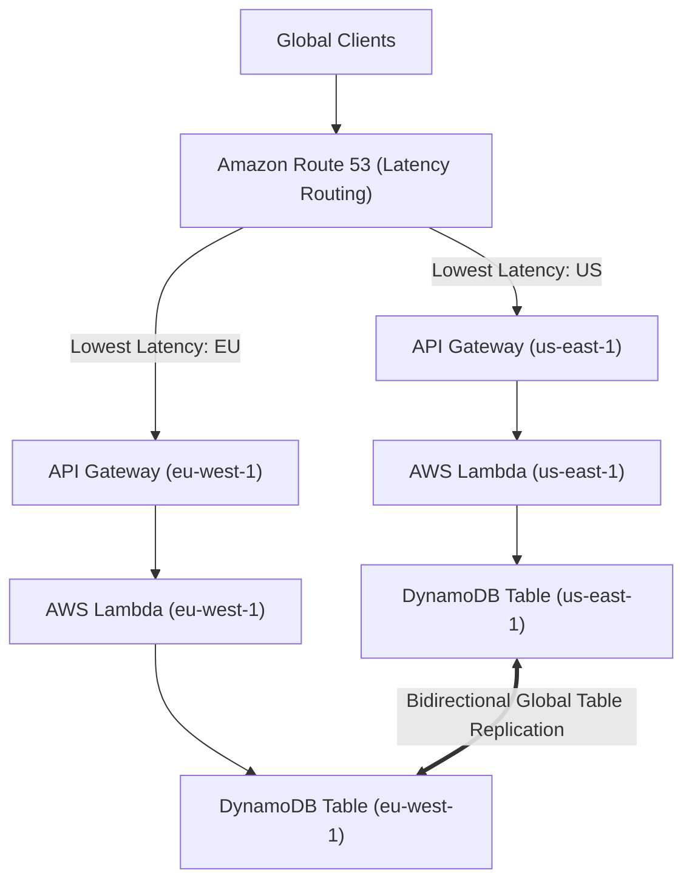

# Domain 2: Design for New Solutions — Architecture Exercises & Solutions

## Exercise 1: Multi-Region Active-Active Serverless Architecture with DynamoDB Global Tables
### Architecture Overview
Deploy a globally distributed API across `us-east-1` and `eu-west-1` with Route 53 Latency-based routing, API Gateway, Lambda, and DynamoDB Global Tables.



---

## Exercise 2: Amazon Aurora Global Database Planned Switchover with Zero Data Loss (`RPO = 0`)
1. Create Aurora Global Database with primary in `us-east-1` and secondary in `us-west-2`.
2. Execute managed planned failover via CLI:
   ```bash
   aws rds failover-global-cluster        --global-cluster-identifier enterprise-global-db        --target-db-cluster-identifier arn:aws:rds:us-west-2:111111111111:cluster:enterprise-db-west2
   ```
3. Verify secondary becomes writer and replication reverses automatically.
