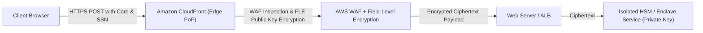
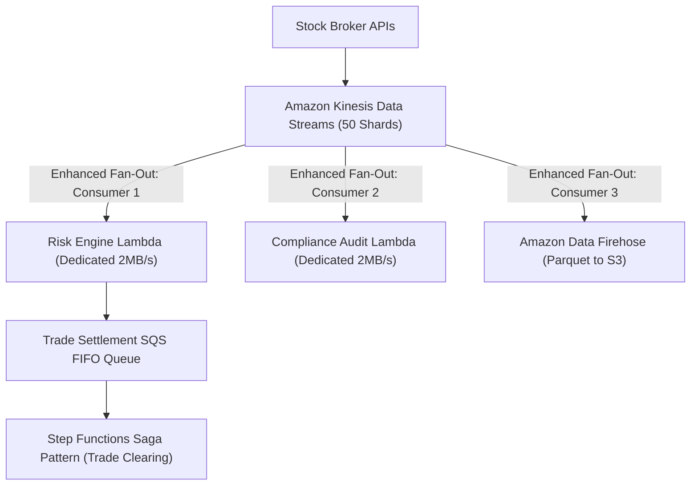

# Domain 2: Design for New Solutions — Architecture Exercises & Solutions

## Exercise 1: Multi-Region Active-Active with Route 53 ARC, Global Accelerator & Aurora Global Database
### Enterprise Context & Objective
Architect an active-active e-commerce platform across `us-east-1` and `eu-west-1` with $RPO < 1$ second and $RTO < 30$ seconds. Traffic routing must support automated health checks, graceful evacuation, and instant failover without DNS caching delays.

```mermaid
flowchart TD
    Users["Global Shoppers"] --> GA["AWS Global Accelerator (Static Anycast IPs)"]
    GA -->|Primary Path (US)| ALB_US["ALB (us-east-1)"]
    GA -->|Primary Path (EU)| ALB_EU["ALB (eu-west-1)"]

    ALB_US --> ECS_US["ECS Fargate Fleet (us-east-1)"]
    ALB_EU --> ECS_EU["ECS Fargate Fleet (eu-west-1)"]

    ECS_US --> Aurora_Primary["Aurora Global DB Primary Writer (us-east-1)"]
    ECS_EU --> Aurora_Replica["Aurora Global DB Read Replica (eu-west-1)"]
    ECS_EU -.->|Write Forwarding over AWS Backbone| Aurora_Primary

    Aurora_Primary ==>|Physical Storage Replication <1s| Aurora_Replica

    ARC["Route 53 Application Recovery Controller (ARC)"] --> GA
```

### Complete Implementation
1. **Global Accelerator Routing Controls:**
   - Provision an AWS Global Accelerator with dual Anycast static IPv4 addresses.
   - Add two endpoint groups: `us-east-1` (Traffic dial: 100) and `eu-west-1` (Traffic dial: 100).
   - If an entire region degrades, dial down the impaired region to 0; traffic instantly reroutes within 2 seconds across AWS edge PoPs, bypassing local client DNS cache TTL limits.
2. **Aurora Global Database & Write Forwarding:**
   - Create cluster `aurora-global-store` with writer in `us-east-1` and cross-region replica in `eu-west-1`.
   - Enable **Managed Write Forwarding** on the secondary cluster:
     ```bash
     aws rds modify-db-cluster        --db-cluster-identifier aurora-eu-cluster        --enable-global-write-forwarding
     ```
   - Application in `eu-west-1` sends write statements to its local writer endpoint; Aurora automatically tunnels writes to `us-east-1` and synchronizes read-after-write consistency.
3. **Route 53 Application Recovery Controller (ARC) Readiness Checks:**
   - Create ARC Resource Set monitoring ECS CPU targets, ASG capacity, and Aurora replication lag metrics in both regions.
   - Configure Routing Control switches grouped under an ARC Control Panel for 5-region quorum-enforced automated failover.

---

## Exercise 2: Zero-Trust Edge Security with CloudFront Field-Level Encryption & AWS WAF
### Enterprise Context & Objective
A healthcare fintech processes credit card numbers and Social Security Numbers (SSNs). The security architecture mandates that sensitive fields must be cryptographically encrypted at the edge (CloudFront) before transiting origins, and decrypted only inside an isolated Payment HSM enclave.



### Complete Implementation
1. Generate RSA 2048-bit key pair on security HSM.
2. In CloudFront:
   - Upload public key: `aws cloudfront create-public-key --public-key-config ...`
   - Create Field-Level Encryption Profile specifying fields: `cardNumber`, `cvv`, `ssn`.
   - Create Field-Level Encryption Configuration binding the profile to the POST query pattern.
3. Associate with CloudFront Distribution cache behavior.
4. When client submits JSON payload, CloudFront encrypts `cardNumber` with the public key. The ALB and application servers log and store only ciphertext; only the backend payment processor with the private key can decrypt.

---

## Exercise 3: Cross-Account Data Mesh Governance with AWS Lake Formation & Glue Data Catalog
### Enterprise Context & Objective
A multi-tenant healthcare enterprise manages petabyte genomic data lakes across 10 business units. The architecture requires column-level and row-level masking without creating duplicate S3 buckets or data pipelines.

### Implementation Blueprint
1. **Central Governance Account (Data Lake Hub):**
   - Register central S3 Data Lake bucket with AWS Lake Formation.
   - Crawl data with AWS Glue to create centralized schema catalog (`genomics_db.patient_data`).
2. **Lake Formation Permissions Delegation:**
   - Grant cross-account access via Tag-Based Access Control (TBAC):
     - Attach LF-Tag `Classification: PII` to columns `patient_ssn`, `patient_name`, `dob`.
     - Attach LF-Tag `Classification: Clinical` to columns `diagnosis_code`, `treatment_id`.
3. **Granting Access to Spoke Research Account:**
   - Share `genomics_db` via AWS RAM with Research Account `222222222222`.
   - In Lake Formation, configure Row & Column Filters for Research Role:
     - Allow access to `diagnosis_code`, `treatment_id`.
     - Mask `patient_ssn` (replace with SHA-256 hash or `XXXX`).
     - Row Filter: `WHERE country = 'US' AND consent_status = 'GRANTED'`.
   - Researchers query Athena in Account 2; Lake Formation dynamically filters rows and columns at query runtime without duplicating S3 storage.

---

## Exercise 4: High-Throughput Event Streaming: Kinesis Data Streams Enhanced Fan-Out + SQS FIFO + Step Functions
### Enterprise Context & Objective
Ingest 50,000 transactions per second (TPS) of stock trades. Ten independent analytics and auditing consumer engines must process each trade with $<100$ ms latency and strict message ordering.



### Complete Implementation
1. **Kinesis Data Streams Configuration:**
   - 50 Shards provisioned (50 MB/s ingress, 100 MB/s egress standard).
   - Register **Enhanced Fan-Out (EFO)** consumers (`aws kinesis register-stream-consumer`). EFO provisions a dedicated 2 MB/s read pipe per shard over HTTP/2 push for each consumer, eliminating the standard 2 MB/s shared throughput limit.
2. **SQS FIFO & Deduplication:**
   - Configure `MessageDeduplicationId` using SHA-256 hash of `TradeID + Timestamp`.
   - Configure `MessageGroupId` using `AccountID` to ensure strict in-order sequential processing per trading account while parallelizing across accounts.
3. **Step Functions Saga Pattern:**
   - Orchestrates compensation transactions (rollback trade, release escrow, notify trader) if validation or clearing fails mid-pipeline.

---

## Exercise 5: Immutable Ransomware Defense: S3 Object Lock & AWS Backup Vault Lock in Compliance Mode
### Enterprise Context & Objective
Design an immutable, write-once-read-many (WORM) storage architecture for electronic records to satisfy SEC Rule 17a-4 and guarantee survival against rogue administrator attacks or ransomware.

### Implementation Blueprint
1. **S3 Object Lock in Compliance Mode:**
   - Create bucket with Object Lock enabled:
     ```bash
     aws s3api create-bucket --bucket sec-financial-records-vault        --object-lock-enabled-for-bucket
     ```
   - Set Default Retention:
     ```bash
     aws s3api put-object-lock-configuration        --bucket sec-financial-records-vault        --object-lock-configuration '{"ObjectLockConfiguration": {"ObjectLockRule": {"DefaultRetention": {"Mode": "COMPLIANCE", "Days": 2555}}}}'
     ```
   - *Security Invariant:* In **COMPLIANCE** mode, retention CANNOT be decreased, and objects cannot be deleted by ANY user, including the AWS root account, until the 7-year retention period expires.
2. **AWS Backup Vault Lock:**
   - Create Backup Vault `WORM-Vault`.
   - Apply Vault Lock Policy in Compliance Mode with mandatory cooling-off period (3 days). Once the cooling period passes, the lock is irreversible.

---

## Exercise 6: Multi-Tenant Enterprise Amazon EKS Architecture with Karpenter Just-In-Time Provisioning
### Enterprise Context & Objective
Operate a 500-microservice multi-tenant Kubernetes platform on AWS. Eliminate Auto Scaling Group bin-packing delays, reduce EC2 compute costs by 60% with Spot instances, and enforce strict namespace isolation.

### Implementation Blueprint
1. **Karpenter NodePool Architecture (`nodepool.yaml`):**
   ```yaml
   apiVersion: karpenter.sh/v1
   kind: NodePool
   metadata:
     name: general-compute
   spec:
     template:
       spec:
         requirements:
           - key: "karpenter.sh/capacity-type"
             operator: In
             values: ["spot", "on-demand"]
           - key: "karpenter.k8s.aws/instance-family"
             operator: In
             values: ["c6i", "c7i", "m6i", "m7i"]
           - key: "kubernetes.io/arch"
             operator: In
             values: ["amd64", "arm64"]
         nodeClassRef:
           group: karpenter.k8s.aws
           kind: EC2NodeClass
           name: default
     disruption:
       consolidationPolicy: WhenEmptyOrUnderutilized
       consolidateAfter: 30s
   ```
2. **EKS Pod Identity (Successor to IRSA):**
   - Attach IAM permissions directly to Kubernetes ServiceAccounts without configuring complex OIDC federation trust policies in IAM roles.
