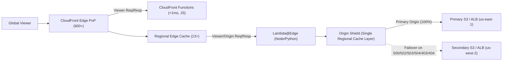
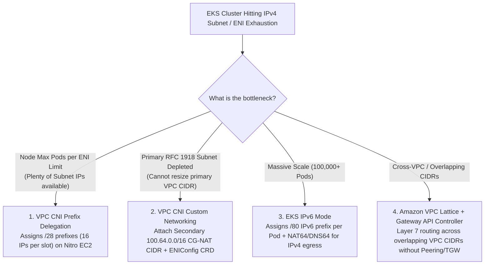
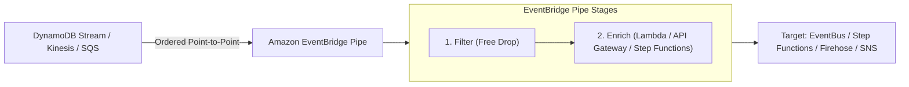
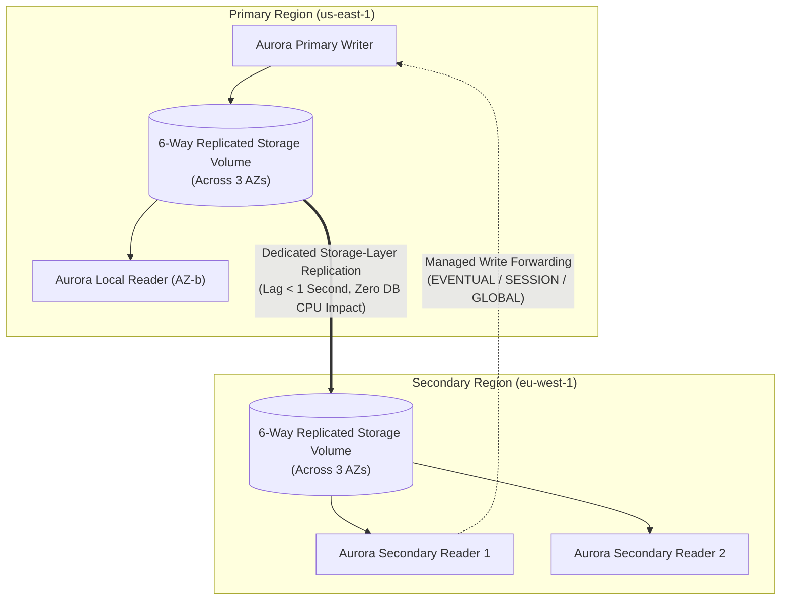
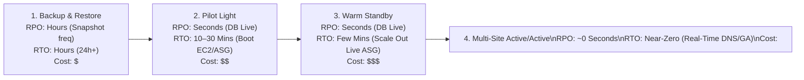

# Domain 2: Design for New Solutions (29%) — Deep-Dive Study Guide

Domain 2 accounts for **29% of the AWS Certified Solutions Architect – Professional (`SAP-C02`)** exam—making it the **highest-weighted domain** on the entire test. It evaluates your ability to design greenfield, cloud-native, resilient, and globally distributed systems across global edge delivery, modern container and serverless compute, event-driven integration, multi-region databases, high-performance storage, and enterprise disaster recovery architectures.

---

## 1. Global Edge & Content Delivery Architectures

### 1.1 Amazon CloudFront vs. AWS Global Accelerator

Both services improve global end-user performance using the AWS global network backbone, but they operate at different OSI layers and solve fundamentally different architectural problems:

* **Amazon CloudFront**
  * **OSI Layer & Protocols:** **Layer 7** (`HTTP/1.1`, `HTTP/2`, `HTTP/3` over QUIC, `WebSocket`, `gRPC`).
  * **Caching & Edge Termination:** Terminates TLS and caches static and dynamic HTTP responses across **600+ Edge Locations (PoPs)** and **13+ Regional Edge Caches (RECs)**.
  * **IP Addressing Model:** Uses dynamically resolved Anycast/Geo-DNS IP sets (`d111111abcdef8.cloudfront.net`), or Dedicated IP Custom SSL (`$600/mo` legacy option). Does **not** provide free static IPv4 addresses for strict corporate firewall allowlisting (though customers can use the AWS-managed prefix list `com.amazonaws.global.cloudfront.origin-facing` on origin Security Groups).
  * **Client IP Preservation:** Terminates the viewer TCP connection at the Edge PoP and connects to the origin using CloudFront's IP address. Passes the original viewer IP in the HTTP **`X-Forwarded-For`** and **`CloudFront-Viewer-Address`** headers.
  * **Failover Mechanism:** **CloudFront Origin Groups** fail over immediately on configurable HTTP status codes (`400, 403, 404, 500, 502, 503, 504`) or origin connection timeouts.
  * **Primary SAP-C02 Use Cases:** Global web applications, SPAs, REST/GraphQL APIs, S3 static/media hosting with **Origin Access Control (OAC)**, Signed URLs/Cookies, Field-Level Encryption, and edge compute (`CloudFront Functions` / `Lambda@Edge`).
* **AWS Global Accelerator**
  * **OSI Layer & Protocols:** **Layer 4** (**TCP and UDP**).
  * **Caching & Edge Termination:** **Zero caching**. Ingests traffic at the nearest AWS Edge Location via BGP Anycast and routes packets over the congestion-free private AWS global backbone directly to regional endpoints (**Application Load Balancers, Network Load Balancers, EC2 Instances, or Elastic IPs**).
  * **IP Addressing Model:** Assigns **2 Static Anycast IPv4 addresses** (plus optional dual-stack IPv6 or **BYOIP** `/24` ranges) that are advertised globally from every edge location and never change.
  * **Client IP Preservation:** **Natively preserves the client's true source IP address** at Layer 3 for **Application Load Balancer (ALB)** and **EC2 Instance** endpoints (using an internal VPC ENI tunnel). For **NLB** and **Elastic IP** endpoints, client IP preservation is supported only if the NLB has an internal/target routing path configured or via Proxy Protocol v2.
  * **Failover Mechanism:** Continuous health checks against regional endpoints; achieves **deterministic sub-10-second global failover** without relying on client DNS cache TTL expiration! Supports **Traffic Dials** (`0%–100%` per Endpoint Group/Region) and **Endpoint Weights** (`0–255` per endpoint).
  * **Primary SAP-C02 Use Cases:** Multiplayer gaming (`UDP`), VoIP/SIP media streaming, IoT (`MQTT` over TCP), financial trading protocols, non-HTTP legacy TCP apps, and scenarios where B2B clients require **fixed static IPv4 addresses** for firewall whitelisting across multi-region active/active or active/passive ALBs.

---

### 1.2 CloudFront Origin Groups, Origin Shield & Continuous Deployment



* **CloudFront Origin Groups (Active-Passive Origin Failover)**:
  * Groups a **Primary Origin** and a **Secondary Origin** under a single Cache Behavior.
  * If the Primary Origin times out or returns configured HTTP failure codes (`500`, `502`, `503`, `504`, `403`, `404`), CloudFront transparently retries the exact same request against the Secondary Origin before returning a response to the user—achieving **zero-RTO request-level failover**.
  * **Exam Constraint**: Origin Group failover is only supported for idempotent HTTP methods (**`GET`, `HEAD`, and `OPTIONS`**). It does **not** automatically retry `POST`, `PUT`, `PATCH`, or `DELETE` requests on failure!
* **CloudFront Origin Shield**:
  * Adds an optional, centralized caching layer in the AWS Region closest to your origin (e.g., `us-east-1` in front of an S3 bucket or on-premises server connected via Direct Connect in `us-east-1`).
  * Consolidates cache misses from all 13+ Regional Edge Caches into a **single origin request**, collapsing duplicate concurrent requests and reducing origin load by up to 90%.
* **CloudFront Continuous Deployment (Blue/Green Edge Testing)**:
  * Allows testing changes to CDN configurations (new cache behaviors, WAF rules, or CloudFront Functions/Lambda@Edge versions) safely in production by associating a **Staging Distribution** with a **Production Distribution** without changing DNS:
    1. **Single-Header Policy**: Routes requests containing `aws-cf-cd-<header>: <value>` to the staging distribution.
    2. **Single-Weight Policy**: Routes a configurable percentage (up to `15%`) of live viewer traffic to the staging distribution with optional session stickiness cookies.

---

### 1.3 Edge Compute: CloudFront Functions vs. Lambda@Edge

* **CloudFront Functions**
  * **Execution Location:** **600+ CloudFront Edge Locations (PoPs)** directly adjacent to the viewer.
  * **Supported Lifecycle Triggers:** **Viewer Request** and **Viewer Response** ONLY.
  * **Runtime & Process Model:** Lightweight JavaScript (`cloudfront-js-1.0` / `cloudfront-js-2.0` ECMAScript 2020) running in a process-isolated V8 VM (not container-based; **zero cold starts**).
  * **Max Execution Time & Memory:** **$< 1\text{ ms}$** execution time; **$2\text{ MB}$** max memory; **$10\text{ KB}$** maximum code package size.
  * **Network, Disk & HTTP Body Access:** **NO outbound network access**, no file system access, and **NO access to the HTTP request/response body**. Can read a local edge **CloudFront KeyValueStore** (`< 5 MB` globally replicated key-value data for feature flags, A/B mappings, or URL redirect tables).
  * **Pricing & Scale:** Roughly **1/6th the cost** of Lambda@Edge; scales instantaneously to **10,000,000+ requests per second**.
  * **Primary SAP-C02 Use Cases:** High-volume URL rewrites/redirects, HTTP security header injection (`HSTS`, `CSP`, `CORS`), cache-key normalization, cookie manipulation, and stateless **JWT token signature validation** at the edge.
* **AWS Lambda@Edge**
  * **Execution Location:** **13+ Regional Edge Caches (RECs)** (deployed in `us-east-1` and replicated globally).
  * **Supported Lifecycle Triggers:** **Viewer Request**, **Origin Request**, **Origin Response**, and **Viewer Response**.
  * **Runtime & Process Model:** **Node.js** and **Python** running in microVM execution environments.
  * **Max Execution Time & Memory:**
    * **Viewer Request / Response:** **$5\text{ seconds}$** timeout, **$128\text{ MB}$** memory, **$1\text{ MB}$** deployment package.
    * **Origin Request / Response:** **$30\text{ seconds}$** timeout, up to **$10\text{ GB}$** memory, **$50\text{ MB}$** deployment package.
  * **Network, Disk & HTTP Body Access:** **Full outbound internet/AWS network access** (can query DynamoDB Global Tables, S3, Secrets Manager, or external APIs), `/tmp` disk access, and **read/write access to the HTTP request body** (`includeBody: true`, up to `40 KB` on Viewer Request or `1 MB` on Origin Request).
  * **Primary SAP-C02 Use Cases:** Dynamic origin routing based on database/API lookups, on-the-fly image resizing/WebP conversion on `Origin Response`, Server-Side Rendering (SSR), OAuth login handshakes with external IdPs, and inspecting/modifying POST request payloads.

---

### 1.4 Securing CloudFront Origins: S3 OAC (with SSE-KMS) & ALB Origins

#### Pattern A: Amazon S3 Origin with Origin Access Control (OAC) & SSE-KMS

> [!IMPORTANT]
> Legacy **Origin Access Identity (OAI)** does **NOT** support S3 buckets encrypted with **AWS KMS (`SSE-KMS`)**, does not support dynamic `PUT`/`POST` uploads, and lacks short-lived `SigV4` credential signing. For `SAP-C02`, **always select Origin Access Control (OAC)** when securing S3 origins behind CloudFront!

When an S3 bucket uses **SSE-KMS (`aws:kms`)** with a Customer Managed Key (CMK), you must grant `cloudfront.amazonaws.com` access in **BOTH the S3 Bucket Policy AND the KMS Key Policy**, scoped via the `AWS:SourceArn` condition key (Confused Deputy protection):

```json
{
  "Version": "2012-10-17",
  "Statement": [
    {
      "Sid": "AllowCloudFrontServicePrincipalS3ReadWrite",
      "Effect": "Allow",
      "Principal": {
        "Service": "cloudfront.amazonaws.com"
      },
      "Action": [
        "s3:GetObject",
        "s3:PutObject"
      ],
      "Resource": "arn:aws:s3:::prod-secure-assets-bucket/*",
      "Condition": {
        "StringEquals": {
          "AWS:SourceArn": "arn:aws:cloudfront::111122223333:distribution/EDFDVBD6EXAMPLE"
        }
      }
    },
    {
      "Sid": "AllowCloudFrontServicePrincipalKMSDecrypt",
      "Effect": "Allow",
      "Principal": {
        "Service": "cloudfront.amazonaws.com"
      },
      "Action": [
        "kms:Decrypt",
        "kms:GenerateDataKey*"
      ],
      "Resource": "arn:aws:kms:us-east-1:111122223333:key/1234abcd-12ab-34cd-56ef-1234567890ab",
      "Condition": {
        "StringEquals": {
          "AWS:SourceArn": "arn:aws:cloudfront::111122223333:distribution/EDFDVBD6EXAMPLE"
        }
      }
    }
  ]
}
```

#### Pattern B: Securing an Application Load Balancer (ALB) Origin Behind CloudFront

Because S3 OAC only supports S3 (and Lambda Function URLs / MediaStore / MediaPackage), securing an internet-facing **Application Load Balancer** so users cannot bypass CloudFront (and AWS WAF) requires a **two-layer defense**:
1. **Network Layer (Managed Prefix List)**: Configure the ALB's Security Group to allow inbound HTTPS (`443`) **only** from the AWS-managed prefix list **`com.amazonaws.global.cloudfront.origin-facing`**.
2. **Application Layer (Secret Custom Header)**: Configure CloudFront to inject a custom Origin Header (`X-Origin-Verify: <random-secret>`), configure an ALB Listener Rule that forwards requests **only** if `HttpHeader X-Origin-Verify` matches the secret (returning `403 Fixed Response` otherwise), and automate periodic rotation of the secret across CloudFront and the ALB using **AWS Secrets Manager + AWS Lambda**!

*(Note: Alternatively, **CloudFront VPC Origins** now allow CloudFront to route directly to an **Internal ALB, Internal NLB, or private EC2 instance** inside a private subnet without exposing any public IP addresses on the origin!)*

---

### 1.5 Amazon Route 53 Routing Policies & Application Recovery Controller (ARC)

#### Route 53 Routing Policies Decision Matrix

* **Simple Routing:** Single resource or multiple IP values returned randomly; **does not support Route 53 Health Checks**.
* **Weighted Routing:** Splits traffic by weight (`0–255`). Weight `0` stops sending traffic. Ideal for blue/green canary releases (`95%` / `5%`).
* **Latency-Based Routing:** Routes users to the AWS Region that provides the **lowest network round-trip latency** relative to the viewer's DNS resolver.
* **Failover Routing (Active-Passive):** Routes `100%` of traffic to a Primary record while healthy, failing over to a Secondary record when the Primary's Route 53 Health Check fails.
* **Geolocation Routing:** Routes traffic based on exact geographic boundaries (**Continent, Country, or US State**). Mandatory for **data sovereignty / GDPR / digital rights compliance** where users outside allowed countries must be routed to a static compliance page (using a Default `*` record for unmatched locations).
* **Geoproximity Routing:** Routes traffic based on physical distance between users and resources, with a configurable **Bias (`-99` to `+99`)** to expand or shrink a region's geographic catchment radius.
* **IP-Based Routing:** Routes queries based on the **client's CIDR block** (e.g., routing specific ISP networks to dedicated endpoints).
* **Multi-Value Answer Routing:** Returns up to **8 healthy IP records** at random in response to DNS queries (**client-side load balancing with health checks**; not a substitute for an ELB).

#### Amazon Route 53 Application Recovery Controller (ARC)

> [!CAUTION]
> Standard Route 53 DNS updates (such as editing record sets via API or Console) rely on the **Route 53 Control Plane**, which resides in a single region (`us-east-1`). During a catastrophic event affecting `us-east-1`, control-plane API calls may be throttled or unavailable. **Route 53 ARC Routing Control** operates completely on the **highly available Data Plane** across **5 globally isolated cluster endpoints**!

* **1. Readiness Checks**:
  * Continuously audits your multi-region recovery architecture **before** an outage occurs.
  * Inspects AWS Service Quotas (vCPU limits, ENI limits), Auto Scaling group max capacity, DynamoDB throughput, RDS instance classes, and Network/IAM parity between Primary and Recovery regions.
* **2. Routing Control (Multi-Region Failover)**:
  * Exposes `ON`/`OFF` health-check switches hosted on **5 globally distributed ARC Cluster Endpoints** (using Paxos consensus).
  * To fail over from `us-east-1` to `us-west-2`, operators or automated runbooks connect to any surviving regional cluster endpoint via the AWS CLI and flip the routing control states:
    ```bash
    aws route53-recovery-cluster update-routing-control-states \
      --endpoint-url https://host-12345.us-west-2.arc-cluster.amazonaws.com \
      --update-routing-control-states-entries '[
        {"RoutingControlArn": "arn:aws:route53-recovery-control::111122223333:controlpanel/cp1/routingcontrol/rc-east", "RoutingControlState": "Off"},
        {"RoutingControlArn": "arn:aws:route53-recovery-control::111122223333:controlpanel/cp1/routingcontrol/rc-west", "RoutingControlState": "On"}
      ]'
    ```
  * Includes **Safety Rules** (Assertion Rules & Gating Rules), such as *"Prevent turning OFF the last active region unless at least 1 other region is ON."*
* **3. Zonal Shift & Zonal Autoshift (Intra-Region Gray Failure Mitigation)**:
  * When a single Availability Zone experiences a "gray failure" (packet loss, elevated latency, or partial dependency degradation where instances still pass basic HTTP `/health` checks), **ARC Zonal Shift** immediately removes the impaired AZ's IP node from your **ALB or NLB** DNS resolution and stops cross-zone routing to that AZ.
  * **Zonal Autoshift** automates this entirely: AWS monitors internal telemetry and automatically shifts traffic away from an impaired AZ without human intervention, using scheduled **Practice Runs** (with pre-configured CloudWatch capacity/error alarms) to continuously verify that your remaining AZs can handle the extra load!

---

## 2. Modern Compute, Containers & Event-Driven Architectures

### 2.1 Container & Serverless Compute Selection Matrix

* **Amazon ECS on AWS Fargate**
  * **Control Plane & Data Plane:** AWS-managed orchestration + AWS-managed serverless microVM data plane (no EC2 patching or cluster capacity management).
  * **Storage & Scaling:** `20 GB` ephemeral storage included (expandable up to **`200 GB`**) + native **Amazon EFS** mounts. Supports **AWS Fargate Spot** (up to 70% discount for fault-tolerant tasks).
  * **Primary SAP-C02 Scenario:** Teams wanting native AWS container orchestration (ALB, IAM Roles for Tasks, CloudWatch, Service Connect) with **lowest operational overhead** and no Kubernetes mandate.
* **Amazon ECS on EC2 (or ECS Managed Instances)**
  * **Control Plane & Data Plane:** AWS-managed control plane + customer-managed EC2 Auto Scaling Capacity Providers.
  * **Storage & Scaling:** Supports **GPU instances** (`p4d`, `g5`), EBS volumes, high-density bin-packing (`binpack` vs `spread`), and Daemon scheduling.
  * **Primary SAP-C02 Scenario:** Workloads requiring specialized GPU hardware, custom kernel modules, or strict bin-packing on existing EC2 Reserved Instances.
* **Amazon EKS (Elastic Kubernetes Service)**
  * **Control Plane & Data Plane:** AWS-managed Kubernetes control plane across 3 AZs + Managed Node Groups, **Karpenter** (just-in-time node provisioning), Fargate profiles, or **EKS Auto Mode**.
  * **Storage & Scaling:** Supports **EBS CSI Driver**, **EFS CSI Driver**, **FSx for Lustre CSI Driver**, and **Mountpoint for Amazon S3 CSI Driver**.
  * **Primary SAP-C02 Scenario:** Multi-cloud/hybrid portability (`EKS Anywhere`), existing Kubernetes Helm/CRD ecosystems, or complex service mesh architectures.
* **AWS App Runner**
  * **Control Plane & Data Plane:** Fully managed PaaS built on Fargate + envoy/load-balancing. Deploys directly from a **GitHub source repository** or **Amazon ECR container image**.
  * **Storage & Scaling:** Auto-scales concurrently based on incoming HTTP request volume down to baseline warm instances; connects to private VPC RDS/ElastiCache via an **App Runner VPC Connector**.
  * **Primary SAP-C02 Scenario:** *"Fastest path to run a containerized web app or API with automatic HTTPS, load balancing, and request-concurrency auto-scaling with zero infrastructure configuration."*

---

### 2.2 Solving Amazon EKS IPv4 Exhaustion at Scale

By default, the **Amazon VPC CNI plugin** assigns a routable VPC secondary IPv4 address from the node's subnet to every Kubernetes Pod. In constrained `/24` or `/22` RFC 1918 subnets, nodes quickly exhaust available IPs or hit EC2 instance ENI IP limits. `SAP-C02` tests four architectural solutions:



1. **VPC CNI Prefix Delegation (`ENABLE_PREFIX_DELEGATION=true`)**:
   * **How It Works**: Instead of assigning individual `/32` secondary IPv4 addresses to each ENI slot on a Nitro EC2 instance, the VPC CNI assigns a **`/28` IPv4 prefix (16 IP addresses)** to each slot.
   * **Impact**: Increases maximum pod density on a smaller instance (e.g., `m5.large` with 3 ENIs $\times$ 10 slots goes from `29` max pods to **`110+` pods** without needing larger EC2 instances!).
2. **VPC CNI Custom Networking (`AWS_VPC_K8S_CNI_CUSTOM_NETWORK_CFG=true`)**:
   * **How It Works**: Associate a non-routable secondary CIDR block (such as **`100.64.0.0/16` CG-NAT** or `198.19.0.0/16`) with the VPC, create dedicated Pod Subnets in that secondary range, and deploy **`ENIConfig` custom resources** per Availability Zone.
   * **Impact**: Node primary ENIs remain on the small corporate `10.x.x.x` subnet, while all Pod ENIs consume IPs exclusively from the massive `100.64.0.0/16` secondary CIDR (using SNAT for external traffic).
3. **EKS IPv6 Cluster Mode**:
   * Assigns globally unique IPv6 addresses to Pods from a `/80` prefix delegated per node while using DNS64/NAT64 to reach legacy IPv4 dependencies.
4. **Amazon VPC Lattice**:
   * Provides an application-layer (Layer 7) **Service Network** integrated with IAM Auth policies and the **AWS Gateway API Controller** for EKS. Allows EKS microservices, ECS tasks, and Lambda functions in different VPCs—**even with completely overlapping IPv4 CIDRs**—to communicate securely over HTTP/HTTPS/gRPC without Transit Gateway or VPC Peering!

---

### 2.3 AWS Lambda Performance, Storage & Concurrency Architecture

* **Lambda SnapStart vs. Provisioned Concurrency**:
  * **Lambda SnapStart (Java, Python, and .NET Managed Runtimes)**:
    * When you publish a new function version, Lambda initializes your execution environment, runs the `INIT` phase (loading frameworks like Spring Boot), takes an encrypted **Firecracker microVM snapshot** of memory and disk state, and caches it for low-latency retrieval.
    * **Cost**: **No additional hourly cost** beyond standard execution duration and restore charges!
    * **Exam Caveat (State Uniqueness)**: Because multiple concurrent invocations restore from the exact same memory snapshot, pseudo-random number generators (PRNGs), UUIDs, or pre-established network sockets baked into `INIT` can collide or go stale. Always use **`beforeCheckpoint` and `afterRestore` runtime hooks** (CRaC) to re-seed randomness and refresh ephemeral credentials/connections after restore!
  * **Provisioned Concurrency (All Runtimes & Container Images)**:
    * Pre-warms a requested number of execution environments (`N`) that remain continuously initialized and ready to respond with **zero cold start** across *any* runtime (Node.js, Go, Rust, Ruby, Custom Runtime, Container Images up to `10 GB`).
    * Can be scaled dynamically via **Application Auto Scaling** (Target Tracking on `ProvisionedConcurrencyUtilization` or Scheduled Scaling ahead of predictable flash sales).
* **Lambda Storage Options Comparison**:
  * **Ephemeral `/tmp` Storage:** Configurable from **`512 MB` (free) up to `10,240 MB` (`10 GB`)**. Local to a single execution environment; **not shared** across concurrent Lambda invocations. Ideal for downloading and unzipping a temporary `4 GB` video file during a single invocation.
  * **Amazon EFS for Lambda:** Mounts a POSIX file system inside a VPC (`NFSv4`) via an **EFS Access Point**. **Shared concurrently across thousands of Lambda instances** with strong locking and byte-level read/write appends.
  * **Mountpoint for Amazon S3 (or S3 SDK):** Lambda cannot run a FUSE kernel driver without custom privileges, so Lambda accesses S3 via SDK (or ECS/EKS uses Mountpoint for S3 for high-throughput sequential reads).
* **Lambda Recursive Loop Detection**:
  * Automatically detects and halts infinite loops (after **16 recursive invocations**) when a Lambda function writes back to the exact same **S3 bucket, SQS queue, or SNS topic** that triggered it, sending a notification and sending the event to a DLQ.

---

### 2.4 Event-Driven Integration: EventBridge, SQS FIFO & Step Functions



#### Amazon EventBridge Deep Dive (Event Bus vs. Pipes vs. Scheduler)

* **EventBridge Event Bus (Many-to-Many Router)**:
  * Routes JSON events from AWS services, custom applications, or **3rd-party SaaS Partners** (Datadog, Zendesk, Shopify, Auth0) to up to **5 targets per rule** based on content-based JSON pattern filtering.
  * **Archive & Replay**: Captures historical events matching a filter pattern for a retention period (or indefinitely) so you can **replay events** into a fixed microservice after a bug deployment!
  * **API Destinations**: Invokes external HTTPS webhooks (e.g., ServiceNow, Slack, PagerDuty) with built-in **OAuth / Basic / API-Key credential management** (stored in Secrets Manager), configurable **invocation rate limiting (`1–300+ RPS`)**, and automatic retries for up to 24 hours.
* **Amazon EventBridge Pipes (Point-to-Point Ordered Integrator)**:
  * Connects **1 event source** (`DynamoDB Streams`, `Kinesis`, `SQS`, `Amazon MQ`, `MSK`) to **1 target** with optional **Event Filtering** (so you don't pay for unneeded enrichments or target invocations!), **Batching**, and synchronous **Enrichment** (calling a Lambda function, API Gateway, or Step Functions Express workflow mid-flight) while **preserving strict source ordering** without writing glue Lambda code!
* **Amazon EventBridge Scheduler**:
  * Serverless cron/rate/one-time scheduler supporting **millions of individual schedules** (e.g., *"Remind each of 5 million users 24 hours before their specific appointment in their local timezone with automatic Daylight Saving Time adjustment"*), built-in retry policies, DLQs, and **Universal Targets** (`270+` AWS services / `6,000+` API actions directly).

#### Amazon SQS Standard vs. SQS FIFO & High-Throughput Mode

* **SQS Standard Queue**:
  * **Unlimited TPS**, **At-Least-Once Delivery** (occasional duplicates possible), and **Best-Effort Ordering**.
* **SQS FIFO Queue (`*.fifo`)**:
  * **Strictly Ordered** within each **`MessageGroupId`** and **Exactly-Once Processing** (deduplicates identical messages sent within a fixed **5-minute deduplication interval** using either an explicit `MessageDeduplicationId` or **Content-Based Deduplication** SHA-256 hash).
  * **Quota & High-Throughput Mode**: Standard FIFO allows `300 TPS` (or `3,000 TPS` with batching of 10). Enabling **FIFO High-Throughput Mode** (which sets `DeduplicationScope = messageGroup` and `FifoThroughputLimit = perMessageGroupId`) scales up to **`7,000–70,000+ TPS`** (depending on region) across distinct `MessageGroupId` values!
  * **Message Group Head-of-Line Blocking Trap**: In SQS FIFO, if a single `MessageGroupId` (`OrderCustomerA`) is used for all messages, only **1 consumer thread** can process that group at a time to preserve order. Always partition `MessageGroupId` by high-cardinality entity ID (`CustomerId`, `DeviceId`, `OrderId`) so thousands of Lambda/ECS consumers can process different groups in parallel!

#### AWS Step Functions: Standard vs. Express Workflows

* **Standard Workflows**
  * **Max Execution Duration:** **Up to 1 Year**.
  * **Execution Semantics:** **Exactly-Once** workflow execution; full visual step-by-step execution history persisted in Step Functions (and integrable with EventBridge).
  * **Max Start Rate & Pricing:** `2,000` workflow starts/sec; priced per **State Transition** (`$0.025` per 1,000 transitions).
  * **Supported Integration Patterns:** Supports Request-Response, **Run a Job (`.sync`)**, and **Wait for a Callback with Task Token (`.waitForTaskToken`)** (pausing up to 1 year for human email approval or long-running external batch jobs).
* **Express Workflows (Asynchronous & Synchronous)**
  * **Max Execution Duration:** **Up to 5 Minutes**.
  * **Execution Semantics:** **At-Least-Once** (Asynchronous Express) or **At-Most-Once** (Synchronous Express—ideal behind API Gateway for microservices orchestration!). Logs execution history to **CloudWatch Logs** to maximize throughput.
  * **Max Start Rate & Pricing:** **`100,000+` workflow starts/sec**; priced by **Number of Executions and Memory Duration (`GB-seconds`)**—typically **10x–20x cheaper** than Standard Workflows for high-volume IoT, mobile backend, or streaming data enrichment!
  * **Supported Integration Patterns:** Does **NOT** support `.sync` (Run a Job) or `.waitForTaskToken` callbacks.
* **Distributed Map State**:
  * Iterates over **millions of S3 objects** (or huge CSV/JSON/Parquet manifests in S3) in parallel by spawning up to **10,000 concurrent child Express/Standard workflow executions** directly from Step Functions!

---

## 3. Enterprise Database & Storage Architecture

### 3.1 Amazon Aurora Global Database & RDS Multi-AZ Topologies



* **Amazon Aurora Global Database Architecture**:
  * Uses dedicated **storage-layer replication** (`RPO < 1 second`) from 1 Primary Region to **up to 5 Secondary Regions** with zero CPU impact on the database writer instance.
  * Each Secondary Region can scale up to **16 local Aurora Read Replicas** (or run in **Headless Mode** with **0 compute instances** provisioned—paying only for storage and replication IO until a disaster triggers instance creation, yielding a true low-cost Pilot Light DR!).
  * **Managed Write Forwarding**: Regional applications connected to a Secondary Region reader can execute SQL `INSERT`/`UPDATE`/`DELETE` statements. Aurora forwards the write over the AWS backbone to the Primary Writer and returns consistency based on your session setting:
    * `EVENTUAL`: Reads in the secondary region reflect current local replica state (fastest).
    * `SESSION`: Guarantees **Read-Your-Own-Writes** consistency for the client session that issued the forwarded write.
    * `GLOBAL`: Waits until the secondary region replica catches up to the latest commit across *all* sessions globally.
  * **Planned Switchover vs. Unplanned Failover (Critical Exam Distinction)**:
    * **Managed Planned Switchover**: Used for **DR testing, compliance rotation, or planned maintenance**. Synchronizes all secondary clusters with the primary before promoting the chosen secondary region to the new Primary Writer. Guarantees **`RPO = 0` (Zero Data Loss)** and leaves the old primary intact as a new secondary region!
    * **Unplanned Failover (Detach and Promote)**: Used when the Primary Region suffers a sudden catastrophic outage. Promotes the secondary region in **`< 1 minute` RTO** with **`RPO < 1 second`**.
* **Amazon RDS Multi-AZ Instance vs. RDS Multi-AZ DB Cluster**:
  * **RDS Multi-AZ DB Instance (1 Standby)**: Provisions 1 Primary and 1 non-readable synchronous Standby in a second AZ. Failover takes `60–120 seconds`. **Standby CANNOT serve read traffic.**
  * **RDS Multi-AZ DB Cluster (2 Readable Standbys)**: Available for RDS PostgreSQL and RDS MySQL. Uses a 3-AZ quorum with local NVMe SSD transaction logs to provide **1 Writer + 2 Readable Standby Instances** that **CAN serve read traffic**, provides up to **2x higher write throughput**, and cuts automated failover time down to **`~25–35 seconds`**!

---

### 3.2 Amazon DynamoDB Advanced Architecture & Global Tables

* **DynamoDB Global Tables (Multi-Region Active-Active)**:
  * Replicates data bi-directionally across multiple AWS Regions using **DynamoDB Streams** (`RPO < 1 second`, `RTO ≈ 0`).
  * **Conflict Resolution**: Uses **Last-Writer-Wins (LWW)** based on item-level timestamps.
  * **Consistency & Transactions Caveat**: **Strongly Consistent Reads** (`ConsistentRead: true`) and **ACID Transactions** (`TransactWriteItems` / `TransactGetItems`) are guaranteed **only within the single region** where the operation is executed; replication to other regions in the Global Table is always **eventually consistent**!
* **GSI Throttling Backpressure vs. LSI**:
  * **Local Secondary Index (LSI)**: Must be created at table creation time; shares the base table's Partition Key and WCU/RCU capacity; supports Strongly Consistent reads; enforces a **strict `10 GB` maximum item collection size per Partition Key value**.
  * **Global Secondary Index (GSI)**: Can be added/deleted at any time; has its own Partition Key, Sort Key, and separate WCU/RCU throughput; supports **Eventually Consistent reads only**.
  * **GSI Write Backpressure Trap**: Updates from the base table to a GSI are replicated asynchronously, **BUT if a GSI has insufficient Write Capacity Units (WCUs) and exhausts its buffer queue, DynamoDB will throttle ALL writes (`ProvisionedThroughputExceededException`) on the BASE TABLE itself!** Always size GSI WCUs $\ge$ Base Table WCUs (or use On-Demand mode).
* **DynamoDB Streams vs. Kinesis Data Streams for DynamoDB**:
  * **DynamoDB Streams**: Native **24-hour retention**, strict ordering per item key, zero extra cost for stream reads by up to **2 concurrent consumers** (e.g., 1 Lambda trigger + Global Table replication).
  * **Kinesis Data Streams for DynamoDB**: Retains item-level change events for **up to 365 days**, supports **up to 20 Enhanced Fan-Out consumers** (plus Amazon Data Firehose delivery directly to S3 Apache Parquet data lakes), at the cost of no strictly guaranteed per-item ordering across shards during resharding.
* **DynamoDB Cost & Resiliency Features**:
  * **DynamoDB Standard-Infrequent Access (`Standard-IA`) Table Class**: Cuts storage costs by **60%** (with slightly higher read/write unit prices) for tables storing long-term historical orders, logs, or audit records where storage cost exceeds 50% of total table spend.
  * **Point-in-Time Recovery (PITR)**: Continuous backups for the preceding **35 days** with **1-second recovery granularity** and zero performance impact on production traffic.

---

### 3.3 Amazon S3 Object Lambda, Strong Consistency & FSx Storage Family

* **Amazon S3 Strong Consistency**:
  * All `GET`, `PUT`, and `LIST` operations (as well as Object Tags and ACLs) on Amazon S3 are **Strongly Consistent** (`Read-After-Write` for new objects AND `Read-After-Update`/`Delete` for overwrites!). There is zero eventual consistency lag when listing or reading newly written objects in S3.
* **Amazon S3 Object Lambda**:
  * Allows you to attach an AWS Lambda function to an **S3 Object Lambda Access Point** in front of a standard S3 Access Point.
  * When an application calls `s3:GetObject`, S3 invokes your Lambda function inline, which transforms the object on the fly and streams it back to the caller using the **`WriteGetObjectResponse` API**—without storing duplicate mutated copies in S3!
  * **Primary SAP-C02 Scenario**: *"A single S3 bucket stores medical records or customer invoices. Analytics scripts need PII (SSN/credit cards) dynamically redacted on read, while Marketing needs images dynamically watermarked or converted from XML to JSON without duplicating storage."*

#### Amazon FSx Managed File Systems Decision Matrix

* **Amazon FSx for NetApp ONTAP**
  * **Protocols Supported:** **Multi-protocol (`NFSv3/v4`, `SMB`, and `iSCSI` block storage)** simultaneously.
  * **Key Enterprise Features:** Native NetApp ONTAP OS, **SnapMirror** (efficient block-level replication from on-premises NetApp arrays or cross-region DR), **FlexClone** (instant, zero-capacity writable clones for Dev/Test), inline deduplication/compression, and **Capacity Pool Tiering** (automatically tiers cold blocks to low-cost storage while keeping metadata on SSD).
  * **Primary SAP-C02 Use Case:** Lift-and-shift of on-premises NetApp storage, multi-protocol Linux + Windows shared storage, or instant zero-space database cloning.
* **Amazon FSx for Windows File Server**
  * **Protocols Supported:** **Native Windows `SMB`** (`v2.0–v3.1.1`).
  * **Key Enterprise Features:** Built on Windows Server NTFS; native integration with **AWS Managed Microsoft AD** or on-premises Active Directory; supports **DFS Namespaces** (scaling across multiple file systems), **DFS Replication**, Multi-AZ high availability, Volume Shadow Copies, and data deduplication.
  * **Primary SAP-C02 Use Case:** Shared Windows `.NET` enterprise applications, SQL Server Failover Cluster Instances (FCI) shared witness/storage, and corporate user home directories.
* **Amazon FSx for Lustre**
  * **Protocols Supported:** **POSIX-compliant parallel file system** (`Lustre` client on Linux).
  * **Key Enterprise Features:** Delivers **hundreds of GB/s of throughput and millions of sub-millisecond IOPS**. Supports **Scratch** (unreplicated, high-burst temporary processing) and **Persistent** (SSD or HDD with automatic disk replacement) deployments. Features bidirectional **Data Repository Associations (DRA)** with **Amazon S3**—presenting S3 prefixes as lazy-loaded POSIX files and exporting computed results back to S3!
  * **Primary SAP-C02 Use Case:** High-Performance Computing (HPC), distributed Machine Learning training (`SageMaker` / `EKS`), financial Monte Carlo simulations, and seismic/genomic processing.
* **Amazon FSx for OpenZFS**
  * **Protocols Supported:** **`NFS` (`v3, v4.0, v4.1, v4.2`)**.
  * **Key Enterprise Features:** Up to `1,000,000+` IOPS with `< 500 microsecond` latency, ZFS **Copy-on-Write (CoW)** architecture, instant in-place point-in-time snapshots, and instant clones.
  * **Primary SAP-C02 Use Case:** Migrating on-premises ZFS or high-IOPS Linux NFS workloads (EDA chip design, media rendering, Git repositories) that do not require SMB or iSCSI.

---

## 4. Disaster Recovery & Multi-Region Resilience

### 4.1 The 4 AWS Disaster Recovery Tiers Deep Breakdown



* **1. Backup and Restore (`RPO: Hours`, `RTO: 4–24+ Hours`, Lowest Cost)**
  * **Architecture:** Data is backed up periodically in the Primary Region and copied across regions using **AWS Backup Cross-Region Copy** (EBS Snapshots, RDS Snapshots, EFS Backups) and **S3 Cross-Region Replication (CRR)**. Zero compute or database instances run in the recovery region during normal operations.
  * **Failover Workflow:** Trigger **AWS CloudFormation** (or Terraform) templates in the DR region to provision VPC infrastructure, restore databases from the latest snapshot, launch EC2/ECS compute, and cut over Route 53 DNS.
* **2. Pilot Light (`RPO: Seconds`, `RTO: 10–30 Minutes`, Low-Medium Cost)**
  * **Architecture:** The **data layer is live and continuously replicating** into the DR region (e.g., **Aurora Global Database** with a single small reader or headless cluster, **DynamoDB Global Table**, or **AWS Elastic Disaster Recovery - DRS** staging disks), while **all application compute instances are turned OFF** (stopped EC2 instances, or Auto Scaling Groups with `Min=0, Desired=0`, and pre-baked Golden AMIs).
  * **Failover Workflow:** Promote the database replica to standalone writer, update ASG desired capacity from `0` to `N` (or launch DRS recovery instances), and flip Route 53 / Global Accelerator traffic.
* **3. Warm Standby (`RPO: Seconds`, `RTO: 1–5 Minutes`, Medium-High Cost)**
  * **Architecture:** Both the data layer AND a **scaled-down but fully functional copy of the application compute stack** (e.g., minimum 2 small EC2 instances or ECS tasks across 2 AZs behind a live ALB) are **always running** in the DR region. The DR stack can process synthetic canary transactions or health checks continuously.
  * **Failover Workflow:** Promote the database, flip Route 53 ARC Routing Control / Global Accelerator endpoint weights, and allow Auto Scaling to scale out the already-running Warm Standby tier to full production capacity.
* **4. Multi-Site Active/Active (`RPO: Near-Zero`, `RTO: Near-Zero / Seconds`, Highest Cost)**
  * **Architecture:** Full production-sized compute and active-active data layers (**DynamoDB Global Tables**, or **Aurora Global Database** with regional reads + **Write Forwarding** for low-write ratios) run simultaneously in 2+ regions behind **Route 53 Latency/Geolocation Routing** or **AWS Global Accelerator**.
  * **Failover Workflow:** Automated health checks immediately drain unhealthy regional endpoints in seconds while the surviving active region absorbs `100%` of global traffic without cold-boot delays.

---

### 4.2 Ransomware Protection with AWS Backup Vault Lock (WORM)

To protect enterprise backups against malicious insider deletion, compromised root credentials, or ransomware encryption, configure **AWS Backup** with **Cross-Account, Cross-Region Copy** into a dedicated Security Backup Account and enable **AWS Backup Vault Lock**:

* **WORM (Write-Once-Read-Many) Immutability**: Prevents any user—**including the AWS Account Root User and IAM Administrators**—from deleting recovery points or shortening retention periods once locked.
* **Governance Mode vs. Compliance Mode**:
  * **Governance Mode**: Protects backups from standard admins, **but users granted the specific IAM permission `backup:PutBackupVaultLockConfiguration` can still modify or disable the lock** (useful for testing retention policies).
  * **Compliance Mode**: **Strictly immutable**. Once the configurable **Cooling-Off Grace Period (`3 to 72 hours / 365 days`)** expires, **NO ONE (not even the Root User or AWS Support)** can unlock the vault, delete backups, or reduce retention periods until the retention timer expires!
* **Logically Air-Gapped Vault**: An AWS Backup vault type that stores encrypted copies using AWS-owned keys, enables Compliance Vault Lock by default, and allows direct **Cross-Account Sharing via AWS RAM** so recovery workloads can restore directly in a clean recovery account without copying data over the network first!

---

## 5. High-Yield SAP-C02 Exam Traps & Rapid Review Checklist

> [!WARNING]
> Review these classic Domain 2 traps before attempting the practice exams:

1. **Trap: S3 Transfer Acceleration vs. Amazon CloudFront for Global Uploads / Downloads**:
   * For **uploading large multi-gigabyte files (`PUT`/`POST`)** from globally dispersed users directly into a centralized S3 bucket, use **S3 Transfer Acceleration** paired with **S3 Multipart Upload**.
   * For **serving cached read-heavy static assets or accelerating dynamic REST API calls (`GET`/`POST`/`PUT` `< 20 GB`)** to an ALB or S3 origin, use **Amazon CloudFront**.
2. **Trap: CloudFront Origin Failover with `POST` Requests**:
   * CloudFront Origin Groups only fail over on **`GET`, `HEAD`, and `OPTIONS`** methods. If an exam question requires active-passive automatic failover for **state-changing `POST` / `PUT` REST API mutations** across two regions, use **Route 53 Failover / ARC** or **AWS Global Accelerator** in front of regional ALBs/API Gateways!
3. **Trap: Preserving Client Source IP on NLB vs. ALB Behind AWS Global Accelerator**:
   * AWS Global Accelerator natively preserves the client's source IP address on **ALB and EC2 Instance** endpoints. On **CloudFront**, the source IP is never preserved at Layer 3; you must inspect the **`X-Forwarded-For`** (or `CloudFront-Viewer-Address`) HTTP header.
4. **Trap: Aurora Global Database Planned Switchover vs. Unplanned Failover**:
   * If a question mentions *"annual DR compliance test with zero data loss (`RPO = 0`)"*, always choose **Aurora Global Database Managed Planned Switchover**. If it mentions *"sudden catastrophic outage in `us-east-1`"*, choose **Failover (Detach and Promote)** (`RPO < 1s`, `RTO < 1m`).
5. **Trap: DynamoDB Base Table Throttling Despite Low Utilization**:
   * Two root causes appear on `SAP-C02`:
     1. **Hot Partition Key**: A single partition key exceeds the hard physical partition limit of **`1,000 WCUs` or `3,000 RCUs` per second** (even in On-Demand mode!). Solve via write sharding or DAX/ElastiCache for reads.
     2. **GSI Write Backpressure**: An attached Global Secondary Index (GSI) is under-provisioned on WCUs, throttling all writes to the base table!
6. **Trap: Step Functions Standard vs. Express for High-Volume Microservices**:
   * If a synchronous API Gateway endpoint invokes a workflow at **`10,000 requests/second`** that finishes in **`3 seconds`**, using a **Standard Workflow** will be throttled and prohibitively expensive. Always select a **Synchronous Express Workflow**! Conversely, if a workflow must pause for **7 days** awaiting human manager approval via email link, you **must** use a **Standard Workflow** with the **`.waitForTaskToken` Callback Pattern**.
