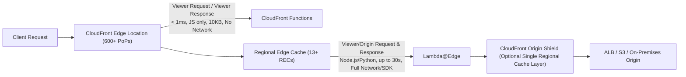
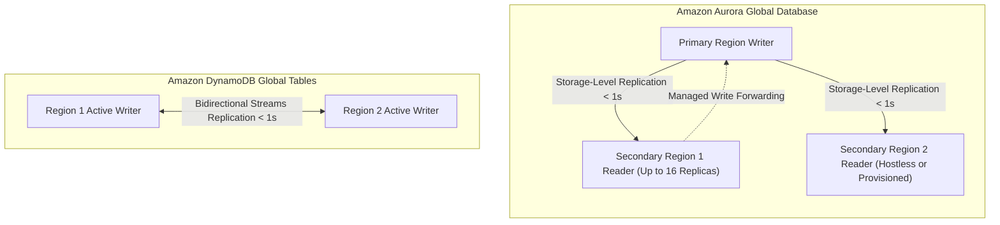
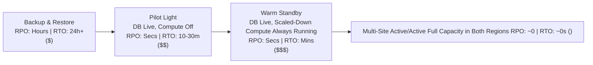

# Domain 2: Design for New Solutions — In-Depth Master Study Guide

**Exam Weight:** 29% of SAP-C02 (The Highest-Weighted Domain on the Exam!)  
**Target Mastery:** Global Edge Acceleration (CloudFront vs Global Accelerator, Lambda@Edge vs CloudFront Functions, Origin Shield), Multi-Region Data Persistence (Aurora Global Database vs DynamoDB Global Tables vs RDS Multi-AZ DB Cluster), Streaming & Analytics (Kinesis vs MSK vs Firehose, Lake Formation, Redshift Data Sharing), Decoupled Event-Driven Architectures (EventBridge, SQS FIFO, Step Functions), and Disaster Recovery (Pilot Light vs Warm Standby vs Multi-Site Active/Active, Route 53 ARC).

---

## 1. Global Edge Acceleration: Amazon CloudFront vs AWS Global Accelerator

| Architectural Dimension | Amazon CloudFront | AWS Global Accelerator |
|---|---|---|
| **OSI Layer** | **Layer 7 (HTTP/HTTPS/WebSocket/gRPC)** | **Layer 4 (TCP/UDP)** |
| **Caching Mechanism** | Caches static & dynamic web content across 600+ PoPs & Regional Edge Caches. | **NO Caching**. Direct network transport acceleration over the AWS global backbone. |
| **IP Addressing** | Dynamic Anycast/Geo DNS IPs (`d123.cloudfront.net`). | **2 Static Anycast IPv4 addresses** (or BYOIP) that never change. |
| **Client IP Preservation** | Passes client IP via `X-Forwarded-For` (`CloudFront-Viewer-Address`) header. | **Preserves original client source IP** natively for ALB and EC2 Instance endpoints! |
| **Failover Speed** | Origin Groups fail over instantaneously on HTTP `5xx`/`4xx` status codes. | **Sub-10-second automated health-check failover** across regions via BGP Anycast. |
| **Ideal Scenarios** | Static/dynamic web apps, S3 Origin Access Control (OAC), signed URLs/cookies, field-level encryption. | Gaming (UDP), VoIP/SIP, IoT MQTT, non-HTTP TCP financial feeds, strict corporate firewall IP allowlists. |

### 1.1 Edge Compute: CloudFront Functions vs Lambda@Edge

| Feature | CloudFront Functions | Lambda@Edge |
|---|---|---|
| **Execution Location** | 600+ Edge Locations (PoPs) | 13+ Regional Edge Caches |
| **Supported Triggers** | **Viewer Request** & **Viewer Response** ONLY | **Viewer Req/Resp** AND **Origin Req/Resp** |
| **Runtime & Max Duration** | JavaScript (ECMAScript 5.1 / 2020), **$< 1\text{ ms}$** | Node.js & Python, **$5\text{s}$** (Viewer) / **$30\text{s}$** (Origin) |
| **Memory & Package Size** | $2\text{ MB}$ memory, $10\text{ KB}$ code size | Up to $10\text{ GB}$ memory, $1\text{ MB}$ (Viewer) / $50\text{ MB}$ (Origin) |
| **Network & File System Access** | **NO network access**, no disk access, no body inspection (headers/URLs/cookies only). | **Full network access** (can call DynamoDB, S3, external APIs) and read/modify request body. |
| **Primary Exam Use Cases** | URL rewrites/redirects, header manipulation, JWT validation at edge, A/B cookie normalization. | Dynamic origin selection based on DynamoDB lookup, SSR, image resizing on Origin Response, HTML body rewriting. |

### 1.2 Securing Origins: Origin Access Control (OAC) vs Custom Headers
- **S3 Origins:** Always use **Origin Access Control (OAC)** (the modern replacement for legacy OAI). OAC supports **SSE-KMS encrypted S3 buckets**, `PUT`/`POST` uploads, and AWS Signature Version 4 (`SigV4`) dynamic short-lived credentials.
- **ALB / EC2 Origins:** Because S3 OAC cannot be attached to an Application Load Balancer, secure an internet-facing ALB behind CloudFront by:
  1. Restricting the ALB Security Group inbound rules to the **AWS-managed CloudFront Prefix List (`com.amazonaws.global.cloudfront.origin-facing`)**, AND
  2. Configuring CloudFront to inject a custom HTTP header (`X-Origin-Verify: <secret-rotated-by-Secrets-Manager>`) and an ALB Listener Rule that drops any request missing that exact header value.

---

## 2. Multi-Region Data Persistence & Global Databases

### 2.1 Comparative Matrix: Aurora Global vs DynamoDB Global Tables vs RDS Multi-AZ DB Cluster

| Requirement | Amazon Aurora Global Database | Amazon DynamoDB Global Tables | Amazon RDS Multi-AZ DB Cluster (2 Readable Standbys) |
|---|---|---|---|
| **Data Model** | Relational SQL (PostgreSQL & MySQL). Full ACID transactions. | NoSQL Key-Value / Document. | Relational SQL (MySQL & PostgreSQL) within a **Single Region**. |
| **Write Topology** | **Single Primary Writer** + up to 5 secondary read-only regions. Supports **Write Forwarding** from secondary regions to primary. | **Multi-Region Active-Active**. Every region accepts local reads and local writes concurrently. | **Single Region** (1 Writer + 2 Readable Standby instances across 3 AZs using semi-synchronous transaction log replication). |
| **Replication Lag** | Storage-layer physical replication ($< 1\text{ second}$). | DynamoDB Streams asynchronous replication ($< 1\text{ second}$). | Sub-second intra-region NVMe local storage commit. |
| **Conflict Resolution** | Serialized at primary writer (Read Consistency modes: `EVENTUAL`, `SESSION`, `GLOBAL` for forwarded writes). | **Last-Writer-Wins (LWW)** based on item timestamp. Strong consistency is only single-region. | Synchronous quorum commit (at least 1 standby confirms before commit). |
| **Disaster Recovery** | **Managed Switchover (Planned):** `RPO = 0`, $< 1\text{ min}$ RTO. **Failover / Detach & Promote (Unplanned):** `RPO < 1s`, $< 1\text{ min}$ RTO. | Active-Active (`RTO ≈ 0`, `RPO < 1s`). | Intra-region automated failover in $\approx 25\text{–}35\text{ seconds}$ (`RPO = 0`). |

---

## 3. Enterprise Disaster Recovery Strategies & Route 53 ARC

- **Pilot Light vs Warm Standby (Classic SAP-C02 Distinction):**
  - **Pilot Light:** Data layer (Aurora Global secondary / RDS Read Replica / DRS staging) is actively replicating, **but application compute (EC2/ECS/EKS) is turned OFF (stopped or ASG desired=0)** and only launched when a disaster occurs.
  - **Warm Standby:** Data layer is actively replicating **AND a minimal scaled-down copy of the entire application stack is always running and able to serve live health checks/smoke tests**, scaling out horizontally upon failover.
- **Amazon Route 53 Application Recovery Controller (ARC):**
  - **Readiness Checks:** Continuously audits cross-region resource quotas, ASG limits, DynamoDB capacity, and IAM policies prior to an outage to guarantee the recovery region can actually absorb production traffic.
  - **Routing Control:** Uses 5 globally distributed data-plane cluster endpoints (independent of the Route 53 control plane!) to flip DNS traffic between regions reliably even during a major AWS control-plane degradation.
  - **Zonal Shift / Zonal Autoshift:** Immediately shifts ALB/NLB traffic away from an impaired Availability Zone within a single region without waiting for instances to fail health checks.

---

## 4. Real-Time Streaming, Event-Driven Microservices & Lakehouse

### 4.1 Streaming Selection: Kinesis Data Streams vs Amazon MSK vs Kinesis Data Firehose

| Service | Architecture & Scaling | Retention & Replay | Primary SAP-C02 Trigger Keywords |
|---|---|---|---|
| **Kinesis Data Streams (KDS)** | Provisioned Shards ($1\text{ MB/s}$ in, $2\text{ MB/s}$ out per shard; Enhanced Fan-Out gives dedicated $2\text{ MB/s}$ per consumer) or On-Demand. | 24h to **365 days**. Supports cursor replay. | *"Real-time sub-second processing"*, *"Enhanced Fan-Out"*, *"Ordering per partition key"*, *"Replay stream events"*. |
| **Amazon MSK (Managed Kafka)** | Provisioned brokers or MSK Serverless. | Unlimited (with MSK Tiered Storage on S3). | *"Lift-and-shift existing Apache Kafka producers/consumers"*, *"Kafka Connect / Debezium CDC"*, *"Payloads $> 1\text{ MB}$"*. |
| **Kinesis Data Firehose** | Fully serverless delivery stream. Buffers by size ($1\text{–}128\text{ MB}$) or interval ($0\text{–}900\text{s}$). | **No retention / no replay** (delivery pipe only). | *"Near real-time delivery to S3/Redshift/OpenSearch/Splunk"*, *"Zero operational overhead"*, *"Convert JSON to Apache Parquet/ORC inline"*. |

### 4.2 Decoupled Messaging: SQS FIFO vs SNS FIFO vs EventBridge

- **SQS Standard vs SQS FIFO:**
  - **SQS FIFO** guarantees strict ordering **within a `MessageGroupId`** and **Exactly-Once Processing** (5-minute deduplication interval via `MessageDeduplicationId` or content-based SHA-256 hash). With **High Throughput mode**, SQS FIFO supports up to 70,000+ TPS per region across message groups.
- **SNS + SQS Fan-Out Pattern:**
  - When a single order event must be processed independently by Billing, Fulfillment, and Fraud microservices with guaranteed durability and backpressure buffering, publish once to an **SNS Topic** and subscribe three **SQS Queues** (with SNS Message Filtering policies if subscribers only need subsets of events).
- **Amazon EventBridge:**
  - Serverless event bus supporting **Schema Registry** discovery, **Archive and Replay** of historical events, **API Destinations** (rate-limited webhook calls with OAuth/API-key auth to third-party SaaS like Stripe/Datadog/PagerDuty), and native SaaS Partner integrations.

### 4.3 Modern Data Lakehouse Governance
- **AWS Lake Formation:** Centralizes fine-grained permissions (**database, table, column, row, and cell-level filtering** via **LF-Tags**) across S3 Data Lakes queried by Athena, Redshift Spectrum, and EMR—eliminating the need to maintain hundreds of complex IAM and S3 bucket policies.
- **Amazon Redshift Data Sharing:** Enables live, transactional read access to Redshift datasets across different Redshift clusters/Workgroups and **across AWS accounts/regions** without copying or ETL-moving data.

---

## 5. High-Yield SAP-C02 Exam Traps (Domain 2)

1. **Trap:** *"Preserve client IP address on an Application Load Balancer behind AWS Global Accelerator vs CloudFront."*
   - **Truth:** Global Accelerator natively preserves the true client source IP packet header when targeting an **ALB or EC2 instance** in the same or different region (using Client IP Preservation). CloudFront never preserves Layer 3 source IP; it appends `X-Forwarded-For`.
2. **Trap:** *"S3 Transfer Acceleration vs CloudFront for global API uploads."*
   - **Truth:** For large multi-part file uploads (`PUT`/`POST` $> 1\text{ GB}$) directly to an S3 bucket from global clients, use **S3 Transfer Acceleration** (often paired with **S3 Multipart Upload**). For caching and serving read-heavy assets or routing dynamic REST APIs to an ALB, use **CloudFront**.
3. **Trap:** *"Lambda function in a VPC cannot reach S3 or DynamoDB without NAT Gateway costs."*
   - **Truth:** Provision a free **Gateway VPC Endpoint** for S3 and DynamoDB! Unlike Interface Endpoints (PrivateLink), Gateway Endpoints have **zero hourly cost and zero per-GB data processing charges**.
