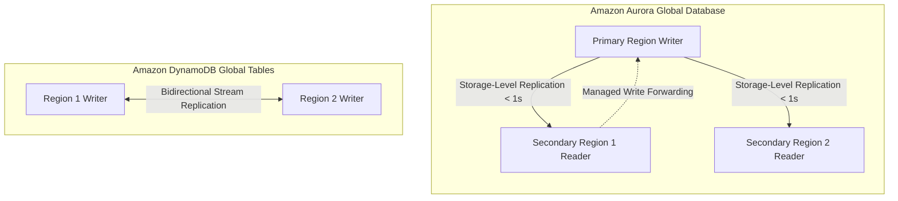
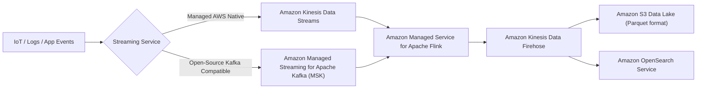

# Domain 2: Design for New Solutions — In-Depth Master Study Guide

**Exam Weight:** 29% of SAP-C02 (The highest-weight domain on the exam!)  
**Target Mastery:** Multi-tier resilient architectures, Global Edge Services (Amazon CloudFront vs AWS Global Accelerator), Global Data Persistence (Aurora Global Database vs DynamoDB Global Tables), Streaming architectures (Amazon Kinesis vs Amazon MSK), Enterprise Data Lakehouse (AWS Lake Formation, Redshift Serverless, Athena), and Serverless Decoupled Microservices.

---

## 1. Global Edge Acceleration: Amazon CloudFront vs AWS Global Accelerator

| Architectural Dimension | Amazon CloudFront | AWS Global Accelerator |
|---|---|---|
| **OSI Layer** | **Layer 7 (HTTP/HTTPS/WebSocket)** | **Layer 4 (TCP/UDP)** |
| **Caching Mechanism** | Caches static & dynamic web content across 600+ edge locations. | **NO Caching**. Direct network transport acceleration over AWS global fiber. |
| **IP Addressing** | Anycast domain names (e.g. `d123.cloudfront.net`). | **2 Static Anycast IPv4 addresses** that never change. |
| **Client IP Preservation** | Relies on `X-Forwarded-For` HTTP header. | **Preserves original client IP** natively at the backend ALB/EC2! |
| **Failover Speed** | Governed by DNS TTL expiration (seconds to minutes). | **Sub-10 second automated health-check failover** via BGP Anycast withdrawal. |
| **Ideal Scenarios** | Static websites, dynamic APIs, video on demand, TLS offload, WAF protection. | UDP/Gaming, VoIP, IoT MQTT ingestion, legacy non-HTTP protocols, fixed firewall IP allowlists. |

---

## 2. Multi-Region Data Persistence & Global Databases

### Comparative Analysis: Aurora Global vs DynamoDB Global Tables

| Requirement | Amazon Aurora Global Database | Amazon DynamoDB Global Tables |
|---|---|---|
| **Data Structure** | Relational SQL (PostgreSQL & MySQL compatible). ACID transactions across tables. | NoSQL Key-Value / Document store. Single-table design patterns. |
| **Write Model** | **Single-Writer, Multi-Reader**. Writes in secondary regions can be forwarded automatically via `EnableGlobalWriteForwarding`. | **Multi-Active / Multi-Writer**. All regions accept concurrent reads and writes. |
| **Replication Latency** | Typical latency $< 1$ second via dedicated storage replication. | Asynchronous continuous replication via DynamoDB Streams (sub-second). |
| **Conflict Resolution** | Single writer ensures serialized transactional consistency. | **Last-Writer-Wins (LWW)** based on timestamp reconciliation. |
| **Disaster Recovery (DR)** | **Planned Failover (Switchover):** `RPO = 0` (zero data loss, topology preserved). **Unplanned Failover (Detach):** Promotes secondary region to standalone cluster in $< 1$ minute (`RPO < 1s`). | Instant multi-region active-active failover (`RTO = 0`, `RPO = 0`). Client shifts traffic seamlessly via Route 53. |

---

## 3. Real-Time Streaming & Big Data Architectures

### Kinesis Data Streams vs Amazon MSK vs Kinesis Data Firehose

| Service | Architecture & Partitioning | Retention Window | Ingestion / Processing Capabilities |
|---|---|---|---|
| **Kinesis Data Streams (KDS)** | Shard-based (Provisioned: 1MB/s or 1000 records/s per shard; On-Demand: autoscaling). | 24 hours default, configurable up to **365 days**. | Real-time ordering per partition key, replayable, consumed by Lambda, KCL, or Flink. |
| **Amazon MSK** | Apache Kafka clusters (Managed or Serverless). Topics split across partitions. | Configurable to unlimited (backed by EBS and Tiered Storage). | Native Kafka API compatibility, large payload support ($> 1$ MB), complex event streaming. |
| **Kinesis Data Firehose** | Serverless near real-time delivery stream. No shards. | Ephemeral buffer (does not retain data). | Buffers by size (1–128 MB) or time (60–900s). Natively converts JSON to Parquet/ORC and delivers to S3, Redshift, OpenSearch, Datadog, Splunk. |

---

## 4. Modern Lakehouse Architecture & Governance

- **AWS Lake Formation:**
  - Provides centralized access control across S3 data lakes.
  - Granular security: Enforces **row-level, column-level, and cell-level security** using LF-Tags.
  - Cross-Account Sharing: Shares catalog databases and tables across AWS Organizations accounts without replicating physical data.
- **Amazon Redshift Serverless & Data Sharing:**
  - Automatically provisions and scales warehouse capacity (measured in Redshift Processing Units - RPUs).
  - **Redshift Data Sharing:** Enables instant, secure, live read-only data access across Redshift clusters and cross-account without data movement.
