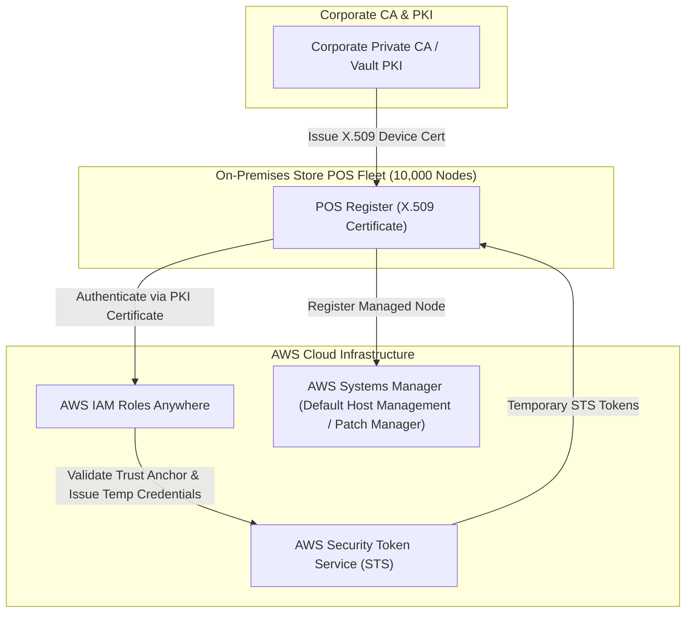
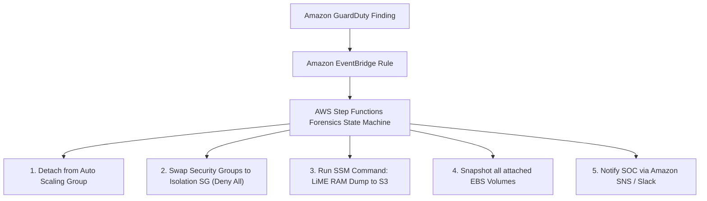
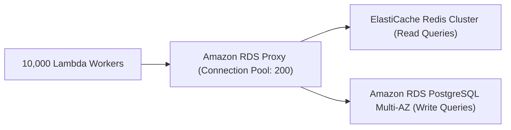

# Domain 3: Continuous Improvement for Existing Solutions — Architecture Exercises & Solutions

## Exercise 1: Zero-Trust Fleet Patching & Hybrid Identity with Systems Manager & IAM Roles Anywhere
### Enterprise Context & Objective
A multinational retail chain operates 10,000 on-premises Point-of-Sale (POS) registers and 5,000 AWS EC2 instances. The security mandate forbids hardcoding long-lived AWS IAM access keys on POS machines while requiring automated security patching, inventory auditing, and remote triage.



### Complete Implementation
1. **IAM Roles Anywhere Trust Anchor Setup:**
   - Export root/intermediate CA certificate from corporate PKI.
   - Create Trust Anchor in AWS IAM Roles Anywhere.
   - Create Profile mapping X.509 certificate CN/SAN attributes to an IAM Role granting `AmazonSSMManagedInstanceCore`.
2. **SSM Default Host Management Configuration (DHMC):**
   - Enable DHMC at the organization level:
     ```bash
     aws ssm update-service-setting        --setting-id "arn:aws:ssm:us-east-1:111111111111:servicesetting/ssm/managed-instance/default-ec2-instance-management-role"        --setting-value "AWSSystemsManagerDefaultEC2InstanceManagementRole"
     ```
   - All EC2 instances are automatically managed by SSM without attaching individual instance profiles.
3. **Patch Manager Automated Baseline:**
   - Define Patch Baseline approving Critical and Security updates within 48 hours of release.
   - Schedule Maintenance Windows applying patches via `AWS-RunPatchBaseline` with automated reboot rollback.

---

## Exercise 2: Automated Incident Forensics: Event-Driven EC2 Isolation & Volatile Memory Capture
### Enterprise Context & Objective
When Amazon GuardDuty detects cryptocurrency mining (`CryptoCurrency:EC2/BitcoinTool.B!DNS`) or active command-and-control beaconing, an automated incident response pipeline must immediately isolate the instance, dump RAM for forensics, and capture volume snapshots without alerting the adversary.



### Complete Implementation
1. **Isolation Security Group:**
   - SG `sg-forensic-quarantine`: Revoke all inbound rules; revoke all outbound rules.
2. **Step Functions Workflow Execution:**
   - `aws autoscaling detach-instances --instance-ids i-012345 --auto-scaling-group-name WebASG --no-should-decrement-desired-capacity`
   - `aws ec2 modify-instance-attribute --instance-id i-012345 --groups sg-forensic-quarantine`
   - Send SSM Run Command executing LiME (Linux Memory Extractor) to stream physical `/dev/fmem` directly to an air-gapped forensic S3 bucket encrypted with a KMS CMK.
   - `aws ec2 create-snapshots --instance-specification InstanceId=i-012345,Description="Forensic Snapshot"`

---

## Exercise 3: Database Performance Optimization: Amazon RDS Proxy Multiplexing & ElastiCache Tiering
### Enterprise Context & Objective
A flash-sale ticketing platform crashes under 100,000 concurrent serverless AWS Lambda invocations due to PostgreSQL connection exhaustion (`FATAL: remaining connection slots are reserved for non-replication superuser connections`).

### Architecture Transformation


### Implementation Blueprint
1. **Deploy Amazon RDS Proxy:**
   - Configure connection pool: `MaxConnectionsPercent = 90`, `IdleClientTimeout = 1800s`.
   - RDS Proxy multiplexes thousands of transient Lambda client connections over a persistent pool of 200 physical database connections.
   - Stores DB credentials securely in AWS Secrets Manager; Lambda authenticates to RDS Proxy via IAM authentication (`rds-db:connect`).
2. **ElastiCache Redis Read-Aside Caching:**
   - Seat availability queries hit Redis cluster first (sub-millisecond latency).
   - Database handles only state mutations (booking seat, processing payment).

---

## Exercise 4: High-Performance Computing (HPC): Elastic Fabric Adapter (EFA) & FSx for Lustre
### Enterprise Context & Objective
A computational fluid dynamics (CFD) workload running across 64 EC2 instances requires sub-microsecond inter-node communication and parallel shared file access delivering $>100$ GB/s throughput.

### Implementation Blueprint
1. **Cluster Placement Group & EFA:**
   - Launch `c6i.32xlarge` instances inside a single **Cluster Placement Group** (guarantees low-latency non-blocking 100 Gbps network fabric).
   - Attach Elastic Fabric Adapter (EFA) network interfaces utilizing Scalable Reliable Datagram (SRD) protocol with OS-bypass (Libfabric / OpenMPI).
2. **Amazon FSx for Lustre Parallel Storage:**
   - Deploy FSx for Lustre file system with Persistent storage type, SSD drives, delivering 1,000 MB/s per TB baseline.
   - Link FSx for Lustre directly to an Amazon S3 bucket for automated data hydration and export.

---

## Exercise 5: Enterprise Cloud FinOps Refactoring: NAT Gateway Optimization & Compute Savings Plans
### Enterprise Context & Objective
Audit an enterprise monthly AWS invoice showing \$85,000 in NAT Gateway data processing fees and \$140,000 in On-Demand EC2 compute waste.

### Remediation Blueprint
1. **Eliminate NAT Gateway Data Transfer Traps:**
   - Audit VPC Flow Logs via Athena: identify destination IPs consuming NAT Gateway bandwidth.
   - Findings: 80% of NAT data processing is internal application traffic downloading container images from Amazon ECR and writing backup objects to Amazon S3.
   - *Fix:* Deploy **S3 Gateway VPC Endpoint** (free of charge) and **ECR Interface VPC Endpoints** (`com.amazonaws.us-east-1.ecr.api` and `com.amazonaws.us-east-1.ecr.dkr`). All S3 and ECR traffic routes privately within AWS, cutting NAT fees by \$68,000/month immediately.
2. **Compute Savings Plans Optimization:**
   - Run AWS Compute Optimizer to right-size over-provisioned EC2 fleets (converting oversized `m5.4xlarge` at 8% CPU to `m5.large`).
   - Purchase 3-Year All-Upfront **Compute Savings Plans** covering steady-state baseline usage (providing up to 66% discount applicable dynamically across EC2, Fargate, and Lambda).

---

## Exercise 6: Zero-Downtime Blue/Green Database & Application Deployment with Amazon ECS & RDS
### Enterprise Context & Objective
Execute major version upgrades (PostgreSQL 12 to 16) and microservice application deployments with zero seconds of planned downtime and instant rollback capabilities.

### Implementation Blueprint
1. **Amazon RDS Blue/Green Deployments:**
   - Create Blue/Green Deployment:
     ```bash
     aws rds create-blue-green-deployment        --blue-green-deployment-name pg-upgrade        --source arn:aws:rds:us-east-1:111111111111:db:prod-db        --target-engine-version 16.2
     ```
   - AWS automatically provisions Green environment, upgrades engine, and establishes logical replication to keep Green in sync with Blue.
   - Run integration tests against Green database.
2. **Zero-Downtime Switchover:**
   - Switchover:
     ```bash
     aws rds switchover-blue-green-deployment        --blue-green-deployment-identifier bgd-0123456789        --switchover-timeout 30
     ```
   - RDS renames endpoints transparently within seconds without data loss.
