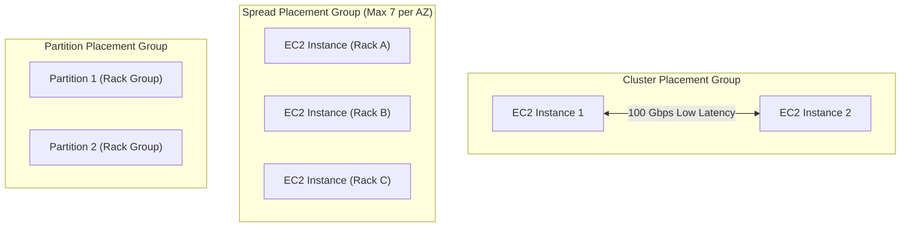

# Domain 3: Continuous Improvement for Existing Solutions — In-Depth Master Study Guide

**Exam Weight:** 25% of SAP-C02  
**Target Mastery:** Operational Excellence, Security Enhancements, Cost Optimization (Compute Savings Plans, Spot, S3 Intelligent-Tiering), Performance Optimization (Placement Groups, EFA, RDS Proxy, DAX), and High Availability Architecture Refactoring.

---

## 1. Enterprise FinOps: AWS Compute Savings Plans & Purchasing Models

### Comprehensive Savings Plan & RI Comparison Matrix

| Commitment Type | Scope & Flexibility | Term | Discount Level | Best Use Case |
|---|---|---|---|---|
| **Compute Savings Plans** | Automatically applies to **EC2 (any family, size, region, OS)**, **AWS Fargate**, and **AWS Lambda**. | 1 or 3 Years | Up to **66%** | Dynamic containerized and serverless environments with changing architectures. |
| **EC2 Instance Savings Plans** | Locked to a **specific instance family in a specific region** (e.g. `m6i` in `us-east-1`). Size, OS, and tenancy can change. | 1 or 3 Years | Up to **72%** | Stable monolithic workloads with predictable regional capacity. |
| **Standard Reserved Instances** | Locked to instance type and region. **Can be bought and sold on the AWS RI Marketplace**. | 1 or 3 Years | Up to **72%** | Steady-state legacy EC2 workloads. |
| **Convertible Reserved Instances** | Can be exchanged for different instance types, OS, or tenancies within the same region. | 1 or 3 Years | Up to **54%** | Workloads needing EC2 flexibility before Savings Plans were adopted. |

---

## 2. High-Performance Compute & Low-Latency Placement Groups

### Placement Groups Selection Guide
1. **Cluster Placement Group:**
   - Single Availability Zone only.
   - Instances packed into a tight physical hardware cluster.
   - Enables **100 Gbps non-blocking network throughput** and single-digit microsecond latency.
   - Ideal for: HPC, AI/ML distributed model training, low-latency financial order routing.
2. **Spread Placement Group:**
   - Spreads instances across distinct underlying hardware racks (separate network and power).
   - Maximum of **7 instances per AZ**.
   - Ideal for: Small fleets of mission-critical single points of failure (e.g., active/standby database pairs).
3. **Partition Placement Group:**
   - Divides an AZ into logical partitions (racks). Instances in one partition do not share hardware with instances in other partitions.
   - Ideal for: Large distributed Big Data engines (Hadoop, Kafka, Cassandra) where consumer pods must be aware of hardware fault domains.

---

## 3. Resolving Database Connection Exhaustion with Amazon RDS Proxy

Serverless architectures (Lambda) can scale to thousands of concurrent executions in seconds. Each Lambda execution establishing its own PostgreSQL/MySQL connection quickly exhausts the database `max_connections` limit, causing application-wide outages.

### RDS Proxy Architectural Advantages:
1. **Connection Pooling & Multiplexing:** Pools thousands of concurrent Lambda connections into a few dozen persistent connections to the DB.
2. **Secrets Manager Integration:** Lambda authenticates to RDS Proxy via IAM; RDS Proxy retrieves database credentials securely from Secrets Manager.
3. **Failover Speed:** Reduces Multi-AZ failover time by up to **66%** by preserving client connections while switching traffic to the standby DB instance.
