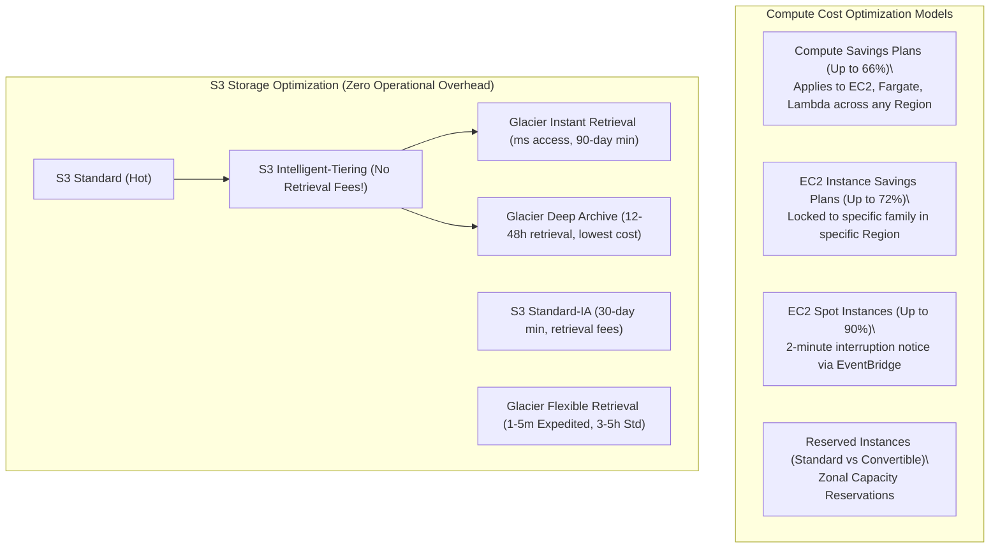
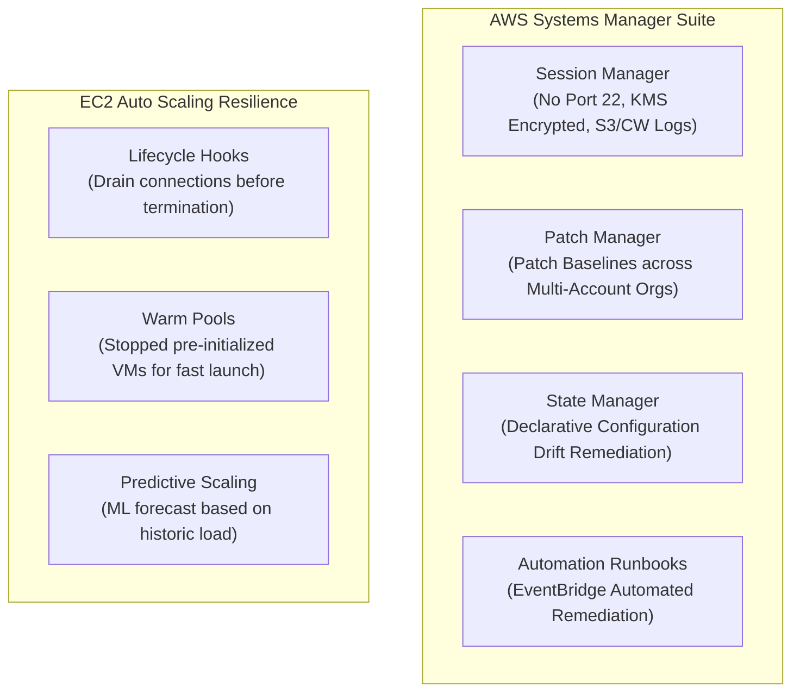
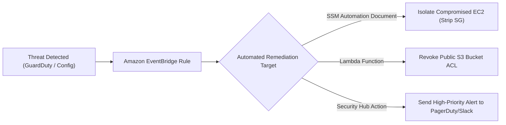

# Domain 3: Continuous Improvement for Existing Solutions — In-Depth Master Study Guide

> [!IMPORTANT]
> **Exam Weighting & Core Architecture Focus:** Domain 3 accounts for **25% of the AWS Certified Solutions Architect - Professional (SAP-C02)** examination. Questions test your mastery of continuous operational excellence, automated infrastructure remediation (Systems Manager, AWS Config, EventBridge), security modernization (GuardDuty, Security Hub CSPM, AWS WAF & Shield Advanced, Macie), cloud FinOps (Savings Plans vs. RIs, S3 Intelligent-Tiering, Gateway Endpoints vs. NAT Gateways), and performance optimization across compute, storage, and database layers (Placement Groups, ENA Express, EFA, RDS Proxy, ElastiCache, EBS io2 Block Express).

---

## 1. Enterprise FinOps: Compute Purchasing Models & Storage Tiering



### 1.1 Comprehensive Savings Plan & Reserved Instance Comparison

* **Compute Savings Plans**
  * **Scope & Architectural Flexibility:** Automatically applies across **EC2 (any instance family, size, OS, tenancy, or AWS Region)**, **AWS Fargate**, and **AWS Lambda**.
  * **Term:** 1 or 3 Years.
  * **Discount:** Up to **66%**.
  * **Ideal SAP-C02 Scenario:** Modernizing from EC2 to EKS/ECS Fargate or Serverless Lambda, or shifting workloads across AWS regions without losing financial commitments.

* **EC2 Instance Savings Plans**
  * **Scope & Architectural Flexibility:** Locked to a **specific instance family in a specific region** (e.g., `c7g` in `us-east-1`). Flexible across size (`large` to `4xlarge`), OS (Linux/Windows), and tenancy.
  * **Term:** 1 or 3 Years.
  * **Discount:** Up to **72%**.
  * **Ideal SAP-C02 Scenario:** Steady-state EC2 fleets committed to a specific instance family and region.

* **Standard Reserved Instances (RIs)**
  * **Scope & Architectural Flexibility:** Locked to family, region, and instance type (or Zonal RI with capacity reservation). **Can be bought and sold on the AWS RI Marketplace**.
  * **Term:** 1 or 3 Years.
  * **Discount:** Up to **72%**.
  * **Ideal SAP-C02 Scenario:** Workloads requiring **Zonal Capacity Reservation** alongside a discount guarantee.

* **EC2 Spot Instances & Spot Fleets**
  * **Scope & Architectural Flexibility:** Spare EC2 compute capacity offered at up to **90% discount** off on-demand pricing.
  * **Interruption Notice:** **2-minute warning** emitted via CloudWatch Events / EventBridge (`EC2 Spot Instance Interruption Warning`) and EC2 instance metadata (`http://169.254.169.254/latest/meta-data/spot/instance-action`).
  * **Spot Fleet Allocation Strategies:** Use `price-capacity-optimized` (launches instances into the lowest-cost pools that also offer the lowest probability of interruption) combined with mixed instance types across multiple AZs.

### 1.2 Amazon S3 Storage Class Optimization & Lifecycle Governance

* **S3 Standard:** Hot frequently accessed objects. No minimum storage duration; no retrieval fees.
* **S3 Intelligent-Tiering:**
  * **Core Mechanism:** Automatically monitors access patterns at the object level and moves data between access tiers (**Frequent**, **Infrequent**, **Archive Instant**, and optional **Archive / Deep Archive** tiers).
  * **Key Exam Facts:** **Zero retrieval fees!** No minimum storage duration for the base tier (monitoring fee applies per 1,000 objects $>128\text{ KB}$).
  * **Primary SAP-C02 Trigger:** *Unpredictable, unknown, or rapidly changing access patterns* where administrative overhead of manual lifecycle rules must be eliminated.
* **S3 Standard-IA:** Infrequent access. Minimum storage duration: **30 days**. Minimum billable object size: **128 KB**. Read retrieval fees apply.
* **S3 One Zone-IA:** Stored in a single AZ ($99.5\%$ availability). **30-day minimum**. Ideal for easily reproducible secondary thumbnails or on-premises backup duplicates.
* **S3 Glacier Instant Retrieval:** Accessed once per quarter with **millisecond retrieval latency**. **90-day minimum**.
* **S3 Glacier Flexible Retrieval:** Standard archive. Retrieval options: Expedited ($1\text{–}5\text{ min}$), Standard ($3\text{–}5\text{ hours}$), or Bulk ($5\text{–}12\text{ hours}$ free). **90-day minimum**.
* **S3 Glacier Deep Archive:** Lowest cost storage in the cloud (\~\$0.00099/GB/month). Retrieval options: Standard ($12\text{ hours}$) or Bulk ($48\text{ hours}$). **180-day minimum**.

### 1.3 Data Transfer Cost Optimization

```
Data Transfer Path                                             Cost per GB
─────────────────────────────────────────────────────────────────────────────
Inbound Data Transfer to AWS from Internet                    $0.00 (Free)
Outbound Data Transfer to Internet (first 100 GB/month)       $0.00 (Free)
Outbound Data Transfer to Internet (>100 GB)                  $0.09 / GB
Inter-Region Data Transfer (e.g., us-east-1 to us-west-2)     $0.02 / GB
Cross-AZ Data Transfer within same Region (EC2 to EC2)        $0.01 / GB each way ($0.02 round-trip)
Same-AZ Data Transfer using Private RFC 1918 IPs              $0.00 (Free)
VPC Gateway Endpoint (S3 / DynamoDB)                          $0.00 (Free routing, eliminates NAT GW)
VPC Interface Endpoint (PrivateLink)                          $0.01 / GB data processed + $0.01/hr
NAT Gateway Data Processing Fee                               $0.045 / GB processed + hourly fee
```

* **High-Impact SAP-C02 Architectural Rule:** Replacing a NAT Gateway with a **VPC Gateway Endpoint for S3 and DynamoDB** drops data processing fees from $\$0.045/\text{GB}$ to **$\$0.00$**, providing instant five-figure monthly savings for data lakes.

---

## 2. Operational Excellence & Automated Fleet Management



### 2.1 AWS Systems Manager (SSM) Suite

* **Session Manager:**
  * Grants interactive shell and port forwarding access to EC2 instances, on-premises servers, and edge devices via the SSM Agent.
  * **Zero Inbound Ports:** Requires **zero open inbound security group rules** (no port 22 or 3389) and **no public IP addresses**.
  * **Audit & Encryption:** Commands and full terminal sessions are encrypted using **Cloud KMS CMEK** and streamed directly to S3 buckets or CloudWatch Logs for compliance auditability.
* **Patch Manager:**
  * Automates patching of operating systems (Linux, Windows Server) and applications across multi-account AWS Organizations.
  * Uses **Patch Baselines** to define auto-approval rules for patches by classification (Security, Critical, Bugfix) and severity, with configurable approval delays (e.g., approve security patches 7 days after release).
* **Parameter Store vs. Secrets Manager:**
  * **Parameter Store (Standard & Advanced):** Key-value store for configuration strings and passwords. Standard tier is free. Advanced tier supports parameters up to 8 KB and parameter policies (TTL, expiration notifications).
  * **Secrets Manager:** Purpose-built for sensitive database credentials and API keys. Features **native automated rotation** using AWS Lambda (seamlessly rotating RDS, Aurora, DocumentDB, and Redshift passwords without application downtime). Multi-region secret replication with primary-replica synchronization.

### 2.2 EC2 Auto Scaling Advanced Features

* **Lifecycle Hooks:**
  * Pauses instance launch or termination transitions (`autoscaling:EC2_INSTANCE_LAUNCHING` or `autoscaling:EC2_INSTANCE_TERMINATING`).
  * Emits an EventBridge event allowing custom Lambda functions or SSM Runbooks to perform pre-launch initialization (fetching secrets, warming caches) or pre-termination graceful connection draining before the instance is detached from target groups and terminated.
* **Warm Pools:**
  * Maintains a pool of pre-initialized EC2 instances in a `Stopped` (or `Running`) state alongside the Auto Scaling Group.
  * Reduces instance scale-out time from 5–10 minutes (cold OS boot and container pulling) to **under 30 seconds**.
* **Predictive Scaling:**
  * Utilizes machine learning models that analyze historical weekly traffic patterns to schedule capacity increases **in advance of predicted daily spikes**, eliminating reactive lag during sudden morning flash crowds.

---

## 3. Security Modernization & Automated Incident Remediation



### 3.1 Security Monitoring & CSPM Services

* **Amazon GuardDuty:**
  * Intelligent threat detection service that continuously monitors AWS CloudTrail Event Logs, VPC Flow Logs, DNS Query Logs, EKS Audit Logs & Runtime activity, and RDS Login Events.
  * Employs machine learning and anomaly detection to identify compromised credentials, unauthorized cryptocurrency mining, Tor exit node access, and unusual S3 data exfiltration calls.
* **AWS Security Hub:**
  * Cloud Security Posture Management (CSPM) platform that aggregates and prioritizes security findings from GuardDuty, Macie, Inspector, IAM Access Analyzer, and AWS Firewall Manager.
  * Continuously evaluates compliance against industry benchmarks (CIS AWS Foundations Benchmark, PCI-DSS, NIST SP 800-53).
* **AWS Config & Conformance Packs:**
  * Continuously records configuration changes to AWS resources and evaluates them against declarative desired-state rules (e.g., `s3-bucket-public-read-prohibited`, `encrypted-volumes`).
  * **Automated Remediation:** Integrates with AWS Systems Manager Automation documents to automatically remediate non-compliant resources (e.g., immediately applying an S3 block public access policy when a non-compliant bucket is detected).
* **Amazon Macie:**
  * Machine learning-powered sensitive data discovery service. Automatically scans S3 buckets to discover, classify, and protect Personally Identifiable Information (PII), payment card data (PCI), and AWS access credentials.

### 3.2 AWS WAF & AWS Shield Advanced

* **AWS WAF (Web Application Firewall):**
  * Sits directly on CloudFront, Application Load Balancers, API Gateway, and AWS AppSync.
  * Inspects Layer 7 HTTP/HTTPS traffic. Rulesets include rate-based rules (e.g., block client IPs exceeding 500 requests per 5 minutes), Geo-match statements, and AWS Managed Rules (OWASP Top 10, SQLi, XSS, Bot Control).
* **AWS Shield Standard vs. Shield Advanced:**
  * **Shield Standard:** Automatic, perimeter-wide Layer 3 and Layer 4 DDoS protection (SYN floods, UDP reflection) enabled by default at zero cost.
  * **Shield Advanced:**
    * Enterprise DDoS defense with **24/7 access to the AWS Shield Response Team (SRT)**.
    * **Automatic Layer 7 DDoS Mitigation:** Automatically writes and deploys custom WAF rules during active application attacks.
    * **DDoS Cost Protection:** Financial safeguard that reimburses scaling charges incurred on EC2, CloudFront, or ALB due to spikes caused by DDoS attacks.
    * Route 53 health check integration to prioritize healthy backend traffic during an attack.

---

## 4. Performance Optimization Across Compute, Storage & Database

### 4.1 Compute & Network Acceleration

* **EC2 Placement Groups:**
  * **Cluster Placement Group:** Packs instances tightly inside the same Availability Zone. Delivers **low-latency ($<10\,\mu\text{s}$) 100+ Gbps network throughput**. Used for HPC, tightly coupled MPI applications, and ultra-fast inter-node communication.
  * **Spread Placement Group:** Places each instance on distinct physical hardware racks with independent power and network switches (maximum **7 instances per AZ per group**). Used for mission-critical instances that must never share physical hardware failure points.
  * **Partition Placement Group:** Divides the group into logical partitions; instances in one partition do not share racks with other partitions (up to **7 partitions per AZ**). Used for distributed data platforms (Hadoop, Kafka, Cassandra).
* **Elastic Fabric Adapter (EFA):**
  * Custom network interface designed for high-performance computing (HPC) and distributed machine learning training (PyTorch, TensorFlow).
  * Uses the **Scalable Reliable Datagram (SRD)** protocol to bypass the operating system kernel (OS bypass), enabling direct user-space communication with line-rate parallel transfers and minimal jitter.
* **ENA Express:**
  * Enhances standard Elastic Network Adapter (ENA) using AWS SRD protocol.
  * **Reduces $p99$ tail latency by up to 50%** and maximizes single-flow throughput (up to 25 Gbps per flow). Configurable with a single toggle on supported EC2 instances without code changes.

### 4.2 Storage IOPS & Throughput Tuning

* **EBS Volume Types:**
  * **`gp3` (General Purpose SSD):** Baseline 3,000 IOPS and 125 MB/s throughput **independent of volume capacity**. Can be scaled up to 16,000 IOPS and 1,000 MB/s. Cost-effective default for enterprise workloads.
  * **`io2 Block Express` (Provisioned IOPS SSD):** Sub-millisecond latency; scales up to **256,000 IOPS** and **4,000 MB/s throughput** per volume with **99.999% durability (five nines)**. Ideal for mission-critical SAP HANA, Oracle, and Microsoft SQL Server workloads.
* **Amazon EFS Performance Modes & Throughput:**
  * **Performance Modes:** **General Purpose** (lowest latency, recommended for web serving, home directories) vs. **Max I/O** (higher latency, scales to massive aggregate IOPS for big data parallel compute).
  * **Throughput Modes:** **Elastic Throughput** (automatically scales throughput based on workload demand; ideal for spiky or unpredictable applications) vs. **Provisioned Throughput**.
* **Amazon S3 Horizontal Request Scaling:**
  * S3 supports **3,500 PUT/POST/DELETE** requests per second and **5,500 GET/HEAD** requests per second per partitioned prefix.
  * For extreme scale, partition object keys horizontally (`/bucket/prefix1/...`, `/bucket/prefix2/...`) and use **Byte-Range Fetches** (parallelizing multi-gigabyte object GETs across separate threads).

### 4.3 Database Optimization: RDS Proxy & ElastiCache Caching

* **Amazon RDS Proxy:**
  * Fully managed, highly available database proxy for Aurora and RDS (MySQL, PostgreSQL).
  * **Connection Pooling:** Multiplexes thousands of client connections (e.g., from serverless AWS Lambda functions) into a small pool of database connections, preventing database memory exhaustion.
  * **Failover Acceleration:** Reduces Multi-AZ database failover times by **up to 66%** (from 30–60s down to $<3\text{ seconds}$) by automatically preserving client connections and routing traffic to the promoted standby replica without dropping sockets.
  * **Security:** Enforces IAM authentication on database connections and stores master credentials securely in Secrets Manager.
* **Amazon ElastiCache Architecture:**
  * **Redis (Cluster Mode Enabled):** In-memory key-value store with horizontal sharding, sub-millisecond read/write latency, multi-AZ failover, and Redis Pub/Sub, sorted sets, and Geospatial indexing.
  * **Caching Strategies:**
    * **Lazy Loading (Cache-Aside):** Application queries the cache first; on a cache miss, it reads from the database, writes the result to the cache with a **Time-To-Live (TTL)**, and returns data. Prevents cache bloat from unread data.
    * **Write-Through:** Application writes to the database and cache simultaneously. Ensures data is always fresh, but increases write latency and caches rarely read data unless paired with an eviction policy.
