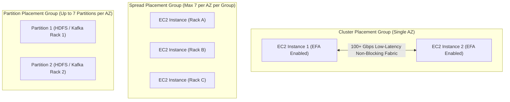

# Domain 3: Continuous Improvement for Existing Solutions — In-Depth Master Study Guide

**Exam Weight:** 25% of SAP-C02  
**Target Mastery:** Operational Excellence & Automated Remediation (Systems Manager, Config, EventBridge), Security Modernization (KMS Multi-Region Keys, Macie, GuardDuty, Secrets Manager Rotation, WAF/Shield Advanced), FinOps & Cost Optimization (Compute Savings Plans, S3 Intelligent-Tiering, Gateway Endpoints, Compute Optimizer), Performance Optimization (Placement Groups, EFA, RDS Proxy, ElastiCache vs DAX), and Reliability Refactoring.

---

## 1. Enterprise FinOps: Compute Purchasing Models & Storage Tiering

### 1.1 Comprehensive Savings Plan & Reserved Instance Comparison Matrix

| Commitment Type | Scope & Architectural Flexibility | Term | Discount | Ideal SAP-C02 Scenario |
|---|---|---|---|---|
| **Compute Savings Plans** | Automatically applies across **EC2 (any instance family, size, OS, tenancy, or AWS Region)**, **AWS Fargate**, and **AWS Lambda**. | 1 or 3 Yr | Up to **66%** | Modernizing from EC2 to EKS/ECS Fargate or Serverless Lambda, or shifting workloads across regions. |
| **EC2 Instance Savings Plans** | Locked to a **specific instance family in a specific region** (e.g., `c7g` in `us-east-1`). Flexible across size (`large` to `4xlarge`), OS, and tenancy. | 1 or 3 Yr | Up to **72%** | Steady-state EC2 fleets committed to a specific family/region. |
| **Standard Reserved Instances** | Locked to family, region (or Zonal RI with capacity reservation). **Can be sold on the AWS RI Marketplace**. | 1 or 3 Yr | Up to **72%** | Legacy workloads or when **Zonal Capacity Reservation** is required alongside a discount. |
| **Convertible Reserved Instances** | Can be exchanged for different instance families, OS, or tenancies of equal/greater value within the same region. | 1 or 3 Yr | Up to **66%** | Legacy flexible commitments. |
| **EC2 Spot Instances / Spot Fleet** | Spare EC2 capacity with a **2-minute interruption notice** (`EC2 Spot Instance Interruption Warning` + `Rebalance Recommendation` via EventBridge). | Hourly/Sec | Up to **90%** | Stateless batch jobs, CI runners, EMR task nodes, containerized web tiers with diversified instance pools (`price-capacity-optimized`). |

### 1.2 Amazon S3 Storage Class Optimization (`S3 Intelligent-Tiering` vs Lifecycle Policies)

| S3 Storage Class | Availability / AZs | Min Storage Duration | Retrieval Fee? | Primary SAP-C02 Trigger Keywords |
|---|---|---|---|---|
| **S3 Standard** | $99.99\%$ ($\ge 3$ AZs) | None | No | Frequently accessed hot objects. |
| **S3 Intelligent-Tiering** | $99.9\%$ ($\ge 3$ AZs) | **None** | **No retrieval fees!** (Small monthly monitoring fee per 1,000 objects $> 128\text{ KB}$) | *"Unpredictable or changing access patterns"*, *"No operational overhead"*, *"Zero retrieval fees"*, optional Archive Instant/Deep Archive tiers. |
| **S3 Standard-IA** | $99.9\%$ ($\ge 3$ AZs) | **30 Days** ($128\text{ KB}$ min charge) | Yes (per GB) | Infrequently accessed data requiring millisecond access and multi-AZ resilience. |
| **S3 One Zone-IA** | $99.5\%$ (**1 AZ only**) | **30 Days** ($128\text{ KB}$ min charge) | Yes (per GB) | **Reconstructable / easily reproducible** secondary thumbnails or on-premises backup copies. |
| **S3 Glacier Instant Retrieval** | $99.9\%$ ($\ge 3$ AZs) | **90 Days** ($128\text{ KB}$ min charge) | Yes (higher per GB) | Medical images or quarterly archives accessed once per quarter requiring **millisecond retrieval**. |
| **S3 Glacier Flexible Retrieval** | $99.99\%$ ($\ge 3$ AZs) | **90 Days** | Yes | Archives allowing Expedited ($1\text{–}5\text{ min}$), Standard ($3\text{–}5\text{ hr}$), or Bulk ($5\text{–}12\text{ hr}$ free) retrieval. |
| **S3 Glacier Deep Archive** | $99.99\%$ ($\ge 3$ AZs) | **180 Days** | Yes | 7–10 year regulatory compliance archives with $12\text{–}48\text{ hr}$ retrieval time and **lowest storage cost**. |

> [!WARNING]
> **S3 Small Object Trap:** Objects smaller than **$128\text{ KB}$** are **never** transitioned to `Intelligent-Tiering` Infrequent Access tiers (and incur a $128\text{ KB}$ minimum billable size charge in `Standard-IA` and `Glacier`). If a data lake has hundreds of millions of $10\text{ KB}$ JSON files, compact them into larger **Apache Parquet** files using **AWS Glue** or **Kinesis Data Firehose** before transitioning to IA/Glacier!

---

## 2. Compute & Network Performance Optimization

### 2.1 Placement Groups & Elastic Fabric Adapter (EFA)
1. **Cluster Placement Group + EFA:**
   - Packs instances tightly in a **single Availability Zone** for maximum network throughput and lowest latency.
   - **Elastic Fabric Adapter (EFA)** uses **OS-bypass** (`libfabric`) so HPC and distributed ML workloads (MPI, NCCL) communicate directly with the Nitro network card without Linux kernel TCP/IP context-switch overhead.
2. **Spread Placement Group:**
   - Places every instance on a **distinct physical hardware rack** with isolated power and network switches.
   - Strictly limited to **7 running instances per Availability Zone** per group.
3. **Partition Placement Group:**
   - Scales to **hundreds of EC2 instances** divided into up to 7 isolated hardware partitions per AZ. Exposes partition numbers via Instance Metadata (`IMDSv2`) for topology-aware distributed systems (Kafka, Cassandra, HDFS).

---

## 3. Database & Caching Layer Optimization

### 3.1 Resolving Connection Exhaustion with Amazon RDS Proxy
Serverless functions (AWS Lambda) scaling to thousands of concurrent executions can rapidly exhaust relational database connection limits (`max_connections`), triggering `FATAL: remaining connection slots are reserved` outages.
- **RDS Proxy** sits inside your VPC subnets and pools/multiplexes thousands of short-lived Lambda connections into a small, warm pool of persistent DB connections.
- **Failover Acceleration:** During an RDS/Aurora Multi-AZ failover, RDS Proxy holds client connections open and routes transactions to the newly promoted writer without relying on client-side DNS caching, cutting failover times by up to **66%**.
- **IAM Authentication & Secrets Manager:** Lambda authenticates to RDS Proxy using short-lived IAM DB Auth tokens while RDS Proxy centrally manages database credentials stored in AWS Secrets Manager.

### 3.2 Caching Selection: DynamoDB Accelerator (DAX) vs ElastiCache (Redis / Valkey / Memcached)

| Caching Requirement | Amazon DynamoDB Accelerator (DAX) | Amazon ElastiCache for Redis / Valkey | Amazon ElastiCache for Memcached |
|---|---|---|---|
| **Target Backend** | **Amazon DynamoDB ONLY** | Any database (RDS, Aurora, DynamoDB, On-Prem) | Any database |
| **Integration Pattern** | **Write-Through** inline cache. Drop-in SDK client replacement (zero application logic rewrite). | **Lazy Loading (Cache-Aside)** or Write-Through managed by application code. | Lazy Loading managed by application code. |
| **Capabilities** | Item Cache + Query/Scan Cache with microsecond latency. | Sorted Sets (Leaderboards), Pub/Sub, Geospatial, Lua scripts, Multi-AZ Auto-Failover, **Global Datastore** (cross-region replication), hipaa/PCI encryption. | Simple multi-threaded in-memory key-value store; **NO persistence, NO Multi-AZ failover**. |

---

## 4. Security & Operational Excellence Improvements

### 4.1 Zero-SSH Fleet Management with AWS Systems Manager (SSM)
When an exam scenario asks to eliminate bastion hosts (`SSH port 22` / `RDP port 3389`), remove inbound security group rules, and audit every interactive command executed on EC2 or on-premises servers:
- Deploy the **SSM Agent** with an IAM Instance Profile (`AmazonSSMManagedInstanceCore`).
- Ensure outbound HTTPS (`443`) access to SSM endpoints (either via NAT Gateway or **3 VPC Interface Endpoints**: `ssm`, `ec2messages`, and `ssmmessages` for fully private isolated subnets).
- Use **SSM Session Manager** to gain interactive shells with IAM access control and stream all session keystrokes to encrypted **S3** and **CloudWatch Logs**.
- Use **SSM Patch Manager** with Maintenance Windows to automate OS patching and report compliance to **AWS Security Hub**.

### 4.2 Automated Secret Rotation & KMS Multi-Region Keys
- **Secrets Manager Multi-User Alternating Rotation Strategy:** When rotating credentials for a zero-downtime production database without dropping active application connections, configure Secrets Manager with the **Alternating Users (Two-User) Lambda rotation template** (`UserA` is active while `UserB`'s password is rotated; new connections pick up `UserB` while existing connections on `UserA` finish gracefully).
- **AWS KMS Multi-Region Keys:** Standard KMS keys are strictly regional. When encrypting client-side data or replicating S3 objects/DynamoDB Global Tables/Aurora Global backups across regions where the ciphertext must be decrypted in Region B without cross-region KMS network calls, use **KMS Multi-Region Primary and Replica Keys** (which share the exact same key ID and cryptographic material across regions).
