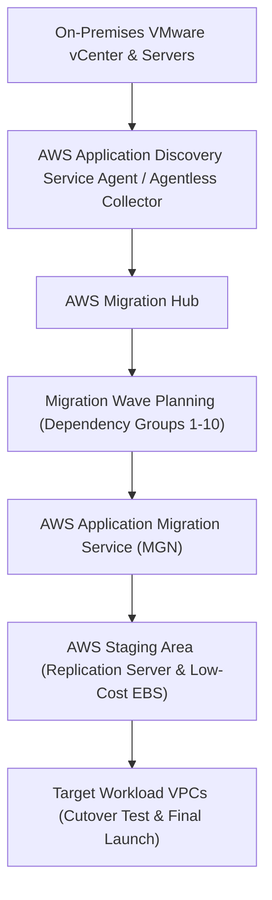

# Domain 4: Accelerate Workload Migration and Modernization — Architecture Exercises & Solutions

## Exercise 1: Large-Scale Cloud Discovery, Dependency Mapping & AWS MGN Wave Planning
### Enterprise Context & Objective
Plan and execute the migration of 1,200 VMware virtual machines and bare-metal Windows/Linux servers across 3 data centers to AWS with minimal business disruption.



### Complete Implementation
1. **Discovery & Dependency Mapping:**
   - Deploy AWS Application Discovery Agentless Collector on VMware vCenter.
   - For physical servers: deploy Application Discovery Agent to track network connection dependencies (`netstat`, port bindings).
   - In AWS Migration Hub: group inter-dependent tiers (App, Web, DB) into cohesive Migration Waves to prevent splitting chatty microservices across hybrid links.
2. **AWS Application Migration Service (MGN) Replication:**
   - Install AWS Replication Agent on source servers.
   - Agent establishes outbound TLS port 443 connection to AWS MGN and continuously replicates block-level data to lightweight EC2 replication servers in a designated Staging Area subnet.
3. **Automated Cutover Testing:**
   - Launch test instances in isolated subnets without disrupting continuous replication.
   - Validate application health, execute automated tests, and mark servers as "Ready for Cutover".
   - Final Cutover: Stop source server, complete final sync, launch production EC2 instances with converted network and storage drivers.

---

## Exercise 2: Heterogeneous 60 TB Oracle to Aurora PostgreSQL Migration via Snowball Edge & DMS CDC
### Enterprise Context & Objective
Migrate a mission-critical 60 TB Oracle Exadata database to Amazon Aurora PostgreSQL. Available network bandwidth is constrained to a saturated 100 Mbps link. Migration must incur $< 15$ minutes of total cutover downtime.

```mermaid
flowchart TD
    Oracle["On-Premises 60 TB Oracle Exadata"] --> SCT["AWS Schema Conversion Tool (SCT)"]
    SCT --> Snowball["AWS Snowball Edge Device (Physical Appliance)"]
    Snowball -->|Shipped to AWS| S3["Amazon S3 Import Bucket"]
    S3 --> Aurora["Amazon Aurora PostgreSQL (Initial Load)"]
    Oracle -->|Continuous Change Data Capture (CDC) via VPN/DX| DMS["AWS Database Migration Service (DMS)"]
    DMS --> Aurora
```

### Implementation Blueprint
1. **Schema & Code Conversion:**
   - Run AWS Schema Conversion Tool (SCT) on the Oracle schema.
   - SCT converts 85% of PL/SQL tables, indexes, and views automatically to PL/pgSQL; refactor remaining proprietary features (e.g., Oracle Autonomous Virtual Private Database) into PostgreSQL Row-Level Security (RLS).
2. **Bulk Data Transfer via Snowball Edge:**
   - Order AWS Snowball Edge Storage Optimized device.
   - Use AWS SCT data extraction agents to extract table data directly onto the Snowball device.
   - Ship device to AWS; AWS imports raw files into Amazon S3.
   - Use `aws_s3` PostgreSQL extension to execute parallel bulk load into Aurora PostgreSQL.
3. **Delta Synchronization with AWS DMS CDC:**
   - Configure AWS DMS replication instance.
   - Set up CDC starting from the Oracle System Change Number (SCN) captured during the initial Snowball export.
   - DMS reads Oracle redo logs and streams continuous insert/update/delete transactions into Aurora until replication lag is under 1 second.
4. **Final Cutover ($<10$ mins):**
   - Point application connection pools from Oracle to Aurora PostgreSQL writer endpoint.

---

## Exercise 3: Petabyte-Scale NAS Data Center Migration via AWS DataSync & Amazon FSx for NetApp ONTAP
### Enterprise Context & Objective
Migrate 800 TB of file shares across 50 million files from on-premises NetApp and Dell EMC storage systems to Amazon FSx for NetApp ONTAP over an active 10 Gbps Direct Connect connection.

### Implementation Blueprint
1. **Deploy AWS DataSync Agents:**
   - Deploy 4 AWS DataSync agent virtual machines in on-premises VMware cluster.
   - DataSync parallelizes directory metadata walking and data transfers across agents.
2. **Configure DataSync Task:**
   - Source: On-premises NFS/SMB shares.
   - Target: Amazon FSx for NetApp ONTAP multi-AZ file system.
   - Task options: Enable file metadata preservation (POSIX permissions, ownership, timestamps), enable verification (`VerifyMode: ONLY_FILES_TRANSFERRED`), and set bandwidth limit to 6 Gbps during business hours.
3. **Incremental Sync & Cutover:**
   - Run initial baseline sync (takes ~12 days).
   - Execute daily delta synchronization tasks (takes ~20 minutes).
   - Final weekend cutover: Set on-premises shares to read-only, run final DataSync pass, update DFS namespaces / DNS CNAMEs to point to Amazon FSx mount targets.

---

## Exercise 4: Microservices Decomposition: The Strangler Fig Pattern with AWS Migration Hub Refactor Spaces
### Enterprise Context & Objective
Decompose an on-premises monolithic e-commerce application into cloud-native AWS Lambda and ECS microservices without disrupting existing client API consumers or changing client URLs.

```mermaid
flowchart TD
    Clients["Client Mobile & Web Apps"] --> API_GW["Amazon API Gateway (Managed by Refactor Spaces)"]
    API_GW -->|Path: /api/v1/orders/*| Service_Orders["New Orders Microservice (ECS Fargate)"]
    API_GW -->|Path: /api/v1/checkout/*| Service_Checkout["New Checkout Microservice (AWS Lambda)"]
    API_GW -->|Default: /* (Catch-All)| Monolith["Legacy On-Premises Monolith (via Direct Connect)"]
```

### Complete Implementation
1. **Create Refactor Spaces Environment:**
   - Refactor Spaces automates cross-account Transit Gateway attachments, API Gateway HTTP APIs, and Network Load Balancers.
2. **Register Default Service (The Monolith):**
   - Configure endpoint pointing to the legacy monolith IP address across Direct Connect.
   - Route `/*` defaults to legacy monolith.
3. **Progressive Strangler Fig Migration:**
   - Create new service for `Orders` hosted in a modern AWS account on ECS Fargate.
   - Add Route in Refactor Spaces: Path `/api/v1/orders/*` -> Forward to `Orders` ECS service.
   - API Gateway immediately routes all order traffic to modern cloud microservice while all remaining traffic flows to legacy monolith.

---

## Exercise 5: Secure Enterprise File Transfers: AWS Transfer Family Custom IdP & Mainframe Blu Age
### Enterprise Context & Objective
A commercial bank migrates legacy mainframe COBOL batch processing to AWS Blu Age while supporting 2,000 external corporate partners uploading encrypted financial statements via SFTP/FTPS.

### Implementation Blueprint
1. **AWS Transfer Family with Custom Identity Provider:**
   - Provision an AWS Transfer Family SFTP server with VPC internet-facing endpoint.
   - Integrate with Custom Identity Provider using an AWS Lambda function backed by corporate Active Directory / Okta via Secrets Manager.
   - Map SFTP users dynamically to private S3 bucket home directories (`s3://bank-statements/{username}/`) using logical directories and dynamic IAM session policies.
2. **Mainframe Modernization via AWS Blu Age:**
   - Legacy COBOL and CICS workloads refactored automatically into Java/Spring Boot containerized applications running on Amazon ECS or EKS.
   - JCL batch jobs translated into AWS Step Functions workflows orchestrating automated file processing upon S3 object creation events.

---

## Exercise 6: Automated Legacy App Containerization with AWS App2Container & Aurora Babelfish
### Enterprise Context & Objective
Modernize 50 legacy Microsoft .NET Framework and SQL Server applications running on Windows Server 2012 VMs into Linux-based Amazon ECS containers backed by Amazon Aurora PostgreSQL.

### Implementation Blueprint
1. **Containerize .NET via AWS App2Container (A2C):**
   - Install App2Container CLI on source Windows Server.
   - Run `app2container inventory` and `app2container analyze --application-id app-01`.
   - Run `app2container extract` and `app2container containerize`: A2C extracts IIS application files, packages them into a Windows or Linux container image, builds the Dockerfile, and registers the image in Amazon ECR.
   - Generate ECS Task Definitions and CloudFormation deployment pipelines automatically.
2. **Database Modernization via Aurora PostgreSQL Babelfish:**
   - Deploy Amazon Aurora PostgreSQL with **Babelfish for Aurora PostgreSQL** enabled.
   - Babelfish understands Microsoft SQL Server wire protocol (TDS) and T-SQL dialect.
   - Update application connection strings: point `.NET` applications to Aurora Babelfish port 1433 without rewriting SQL Server queries, stored procedures, or transaction semantics.
