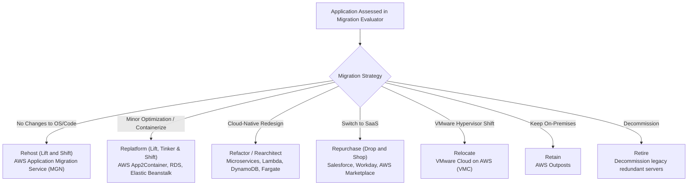
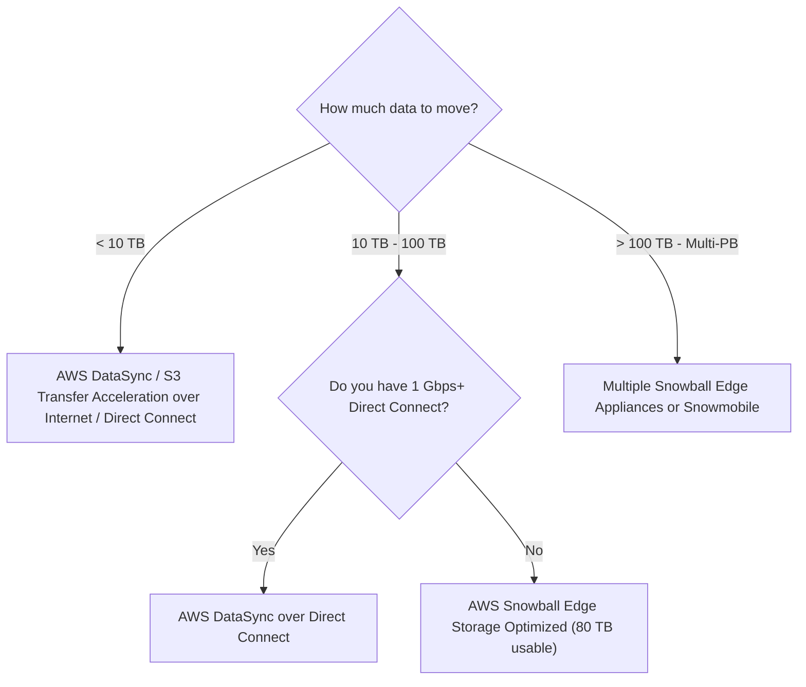

# Domain 4: Migration & Modernization — In-Depth Master Study Guide

**Exam Weight:** 20% of SAP-C02  
**Target Mastery:** The 7 Rs of Migration, AWS Application Migration Service (MGN), AWS Database Migration Service (DMS) & SCT, Large-Scale Data Transfer (DataSync, Storage Gateway, Snowball Edge), Application Modernization with Refactor Spaces (Strangler Fig), and AWS Mainframe Modernization.

---

## 1. The 7 Rs Migration Decision Framework

---

## 2. Server Migration: AWS Application Migration Service (MGN)

AWS MGN is the primary AWS tool for automated lift-and-shift server migrations from physical, virtual, or cloud environments.

### MGN Architecture & Lifecycle
1. **Replication Agent Installation:** Installed on source servers (Windows or Linux).
2. **Continuous Block-Level Replication:** Compresses and encrypts disk blocks, replicating them to low-cost **Staging Area Subnet** EC2 instances and EBS volumes in the target AWS account.
3. **Test Cutover:** Launches temporary test instances in target VPC without disrupting ongoing replication.
4. **Final Cutover:** Final delta sync, shuts down source server, launches target production EC2 instances, and updates DNS.

---

## 3. Database Migration: AWS DMS & AWS Schema Conversion Tool (SCT)

### Homogeneous vs Heterogeneous Migrations
- **Homogeneous (Same Engine, e.g. Oracle to Oracle RDS):** AWS DMS alone handles full load and Change Data Capture (CDC).
- **Heterogeneous (Different Engine, e.g. Oracle to Aurora PostgreSQL):**
  - **Step 1:** Use **AWS Schema Conversion Tool (SCT)** to convert schema, views, stored procedures, and triggers.
  - **Step 2:** Use **AWS DMS** to perform the initial bulk data load.
  - **Step 3:** Use **AWS DMS CDC (Change Data Capture)** to continuously replicate ongoing transactional deltas.
  - **Step 4:** Cut over client traffic once replication lag reaches near-zero.

---

## 4. Large Data Transfer Decision Guide

### Snow Family Comparison Matrix
- **AWS Snowcone:** 8 TB usable SSD/HDD. Ultra-portable (4.5 lbs), battery-powered, edge computing.
- **AWS Snowball Edge Storage Optimized:** 80 TB or 210 TB NVMe usable. High-capacity local block/object storage.
- **AWS Snowball Edge Compute Optimized:** 104 vCPUs, 416 GB RAM, optional GPU for edge ML processing.
