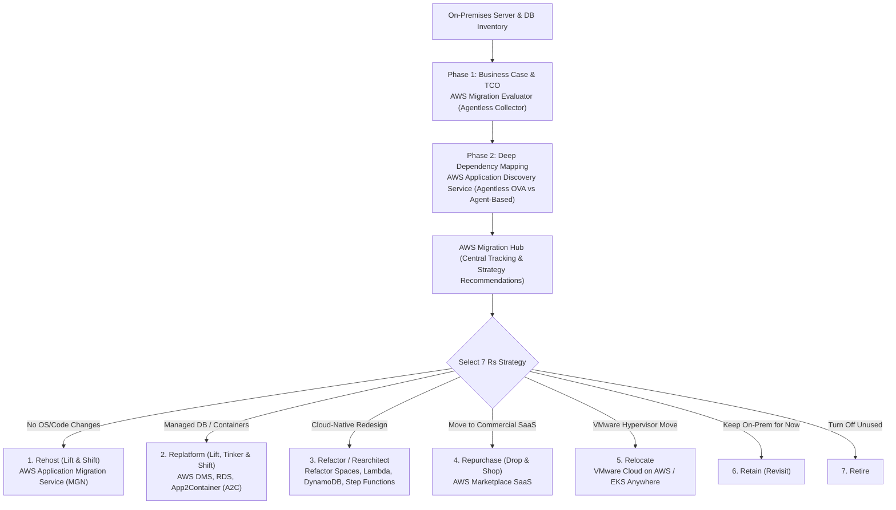
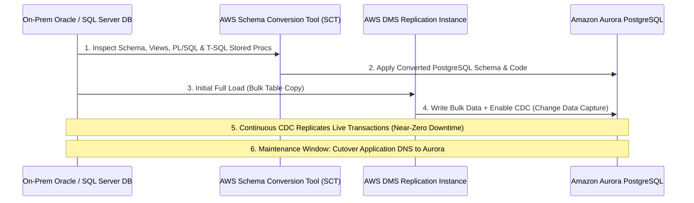

# Domain 4: Accelerate Workload Migration and Modernization — In-Depth Master Study Guide

**Exam Weight:** 20% of SAP-C02  
**Target Mastery:** Migration Portfolio Discovery (Migration Evaluator vs Application Discovery Service, Migration Hub), The 7 Rs Framework, Server Migration & DR (AWS MGN vs AWS Elastic Disaster Recovery DRS), Database Migration (AWS DMS, SCT, Babelfish for Aurora PostgreSQL), Large-Scale Data Transfer (DataSync vs Storage Gateway vs Snow Family vs Transfer Family), Strangler-Fig Modernization (Migration Hub Refactor Spaces, App2Container), and Mainframe Modernization.

---

## 1. Portfolio Discovery & The 7 Rs Migration Framework

### 1.1 Discovery Tool Selection Matrix

| Discovery Tool | Agent Required? | What It Collects | Primary SAP-C02 Scenario |
|---|---|---|---|
| **AWS Migration Evaluator** | No | CPU/RAM/Storage inventory to build an executive **Data-Driven Business Case / TCO comparison** (including Bring-Your-Own-License SQL/Windows optimization). | *"Build a financial business case and right-sized TCO projection for executives before starting migration."* |
| **Application Discovery Service (Agentless Connector)** | No (VMware vCenter OVA) | VM hostnames, CPU/RAM/disk utilization profiles, static configuration (**NO network TCP process dependencies**). | *"VMware vSphere environment where security policies prohibit installing agents on individual VMs."* |
| **Application Discovery Service (Agent-Based)** | Yes (Windows/Linux Agent) | Everything in Agentless **PLUS running OS processes and live TCP/UDP network connection dependencies** (`System performance + Network visualization in Migration Hub`). | *"Identify hidden inter-server communication dependencies to group servers into cohesive migration waves."* |

---

## 2. Server Migration & Disaster Recovery: AWS MGN vs AWS DRS

| Dimension | AWS Application Migration Service (MGN) | AWS Elastic Disaster Recovery (DRS) |
|---|---|---|
| **Primary Purpose** | **One-way production migration** (Rehost / Lift-and-Shift) into AWS EC2. | **Continuous Disaster Recovery** (On-Premises $\to$ AWS, or Cross-Region AWS $\to$ AWS) with **Failback** support. |
| **Replication Mechanics** | Continuous asynchronous block-level replication into a low-cost **Staging Area Subnet** (lightweight EC2 replication servers + cheap `gp3`/`st1` staging EBS volumes). | Identical continuous block-level Staging Area architecture, plus automated point-in-time recovery (PITR) snapshots for ransomware/corruption recovery. |
| **Post-Migration Modernization** | Built-in post-launch actions (auto-install SSM Agent, CloudWatch Agent, convert RHEL/Windows licenses, or trigger Disaster Recovery setup). | Supports automated non-disruptive DR drills and reverse replication back to on-premises VMware/physical hosts after an incident. |

---

## 3. Database Migration: AWS DMS, SCT & Babelfish for Aurora PostgreSQL

### 3.1 Homogeneous vs Heterogeneous Database Migrations

- **AWS DMS Key Operational Nuances (High-Yield Exam Facts):**
  1. **AWS DMS only migrates basic table schemas and primary keys.** It does **NOT** automatically migrate secondary indexes, foreign keys, default values, or stored procedures! You **must** use **AWS Schema Conversion Tool (SCT)** (or native engine tools like `pg_dump`/`mysqldump` for homogeneous migrations) to create schemas, stored procedures, and secondary indexes.
  2. **Large Objects (LOBs):** During DMS migrations of tables with multi-megabyte BLOBs/CLOBs:
     - **Limited LOB mode** is much faster (truncates LOBs exceeding a specified max size and allocates memory inline), whereas **Full LOB mode** is slow but handles arbitrarily large LOBs when size is unknown. **Inline LOB mode** combines both by transferring small LOBs inline and large LOBs via Full LOB lookup.
  3. **SCT Data Extraction Agents:** When migrating multi-terabyte data warehouses (e.g., Teradata, Netezza, Oracle DW, Greenplum) to **Amazon Redshift**, deploy **AWS SCT Data Extraction Agents** on-premises to extract, compress, and upload data in parallel to Amazon S3 (or Snowball Edge), which SCT then loads into Redshift via `COPY`.

### 3.2 Accelerating Microsoft SQL Server Migrations with **Babelfish for Aurora PostgreSQL**
- **Scenario:** A company wants to migrate off expensive commercial Microsoft SQL Server licenses to open-source **Amazon Aurora PostgreSQL** with the **LEAST application code refactoring**.
- **Solution:** Enable **Babelfish for Aurora PostgreSQL**. Babelfish adds a native **Tabular Data Stream (TDS)** wire-protocol listener (port `1433`) and **T-SQL** dialect interpreter directly to Aurora PostgreSQL so existing `.NET` applications written for SQL Server can connect and execute T-SQL stored procedures without rewriting application queries or changing database drivers!

---

## 4. Large-Scale Storage & File Migration

### 4.1 Network vs Physical Appliance Transfer Math

$$\text{Transfer Time (seconds)} = \frac{\text{Total Data Size (Bits)}}{\text{Available Bandwidth (Bits/sec)} \times \text{Link Utilization Factor}}$$

- **Rule of Thumb ($1\text{ TB} \approx 8\text{ Terabits}$):**
  - Over a **$100\text{ Mbps}$** link at 80% utilization ($80\text{ Mbps}$): $1\text{ TB}$ takes $\approx 28\text{ hours}$; **$50\text{ TB}$ takes $\approx 58\text{ days}$**.
  - Over a **$1\text{ Gbps}$** link at 80% utilization ($800\text{ Mbps}$): $1\text{ TB}$ takes $\approx 2.8\text{ hours}$; **$50\text{ TB}$ takes $\approx 5.8\text{ days}$**.
  - **SAP-C02 Decision Rule:** If network transfer over existing WAN/Direct Connect exceeds the allowed migration window (or consumes $>80\%$ of corporate bandwidth needed for production), order **AWS Snowball Edge** ($80\text{ TB}$ Storage Optimized / $210\text{ TB}$ NVMe) and use **AWS DataSync** after the Snowball import completes to sync ongoing incremental deltas over the network!

### 4.2 File & Hybrid Storage Service Selection

| Service | Protocol / Backing Storage | Caching / Local Access | Primary SAP-C02 Scenario |
|---|---|---|---|
| **AWS DataSync** | NFS, SMB, HDFS, Object Storage $\to$ S3, EFS, FSx (Windows, Lustre, NetApp ONTAP, OpenZFS). | Scheduled / Continuous encrypted network transfer with automatic checksum verification and bandwidth throttling. | *"Migrate 40 TB of on-premises NFS/SMB shares to Amazon FSx for Windows File Server while preserving NTFS ACLs and POSIX permissions."* |
| **S3 File Gateway** | NFS / SMB $\to$ **Amazon S3 Objects** | Local on-premises VM/hardware cache of recently accessed files; full dataset lives as native S3 objects. | *"On-premises legacy applications or lab instruments write via NFS/SMB, and data must be immediately queryable in S3 by Athena/EMR."* |
| **FSx File Gateway** | SMB $\to$ **Amazon FSx for Windows File Server** | Local on-premises low-latency cache for remote branch offices; full native Active Directory & Windows shadow copy support. | *"Eliminate on-premises Windows file servers across branch offices while keeping low-latency local LAN caching of shared SMB folders."* |
| **Volume Gateway (Cached vs Stored)** | **iSCSI Block Volumes** $\to$ S3 + EBS Snapshots | **Cached Mode:** Primary data in S3, frequent blocks cached locally. **Stored Mode:** Full dataset on-premises, async EBS snapshots to S3. | *"Present cloud-backed iSCSI block LUNs to legacy on-premises servers."* |
| **AWS Transfer Family** | **SFTP, FTPS, FTP, AS2** $\to$ Amazon S3 or Amazon EFS | Serverless managed endpoint (Public or VPC Internal with Elastic IPs). Supports custom identity providers (Okta/AD via Lambda/API Gateway). | *"External B2B partners upload daily financial CSVs via SFTP using existing SSH keys without changing client workflows."* |

---

## 5. Application Modernization Patterns

### 5.1 Strangler-Fig Pattern with **AWS Migration Hub Refactor Spaces**
When decomposing a monolithic application running on EC2 (or on-premises) into new serverless Lambda or EKS microservices across multiple AWS accounts:
- **AWS Migration Hub Refactor Spaces** automatically provisions:
  1. An **Amazon API Gateway** and **VPC Link** acting as the unified external front door.
  2. **AWS Transit Gateway** and **Resource Access Manager (RAM)** cross-account networking between the Environment Owner account, the Legacy Monolith account, and the new Microservice accounts.
- You initially route $100\%$ of traffic (`/*`) to the monolith, and incrementally add path-based routes (e.g., `/api/v2/payments`) pointing to new Lambda/ECS microservices with **zero changes to client DNS or frontend URLs**.

### 5.2 Containerizing Legacy VMs with **AWS App2Container (A2C)**
- **Scenario:** Migrate existing Java (Tomcat/JBoss/Spring Boot) on Linux or `.NET` (IIS) web applications on Windows Server VMs into **Amazon ECS** or **Amazon EKS** without access to original CI build pipelines or source code changes.
- **Solution:** Run **AWS App2Container (A2C)** on the application server. A2C analyzes running processes, extracts application binaries and runtime dependencies, generates a `Dockerfile`, builds the container image, pushes it to **Amazon ECR**, and generates the **CloudFormation / ECS Task Definition / EKS Deployment YAML** artifacts automatically.

### 5.3 AWS Mainframe Modernization
- **Automated Refactor (Blu Age):** Automatically converts legacy **COBOL / PL/I / RPG / JCL / VSAM** mainframe code into a modern **Java Spring Boot** application backed by Aurora PostgreSQL (preserving functional equivalence).
- **Replatform (Micro Focus):** Keeps existing compiled COBOL/PL/I source code intact and runs it on a managed AWS Mainframe Modernization runtime environment.
