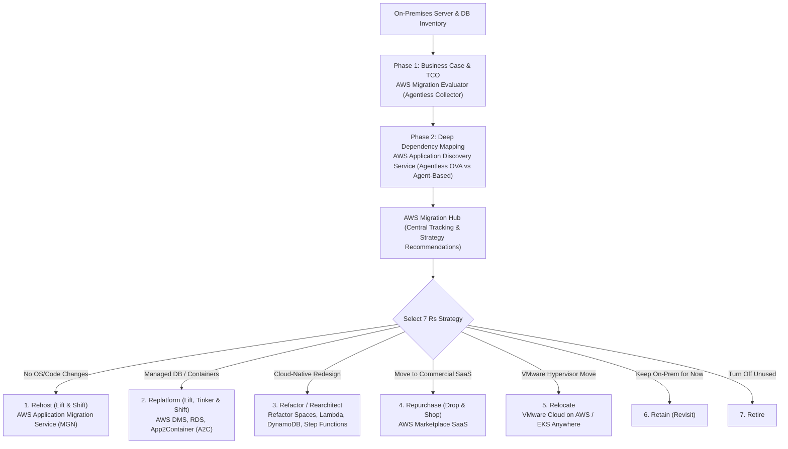
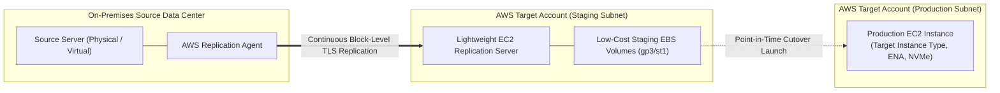
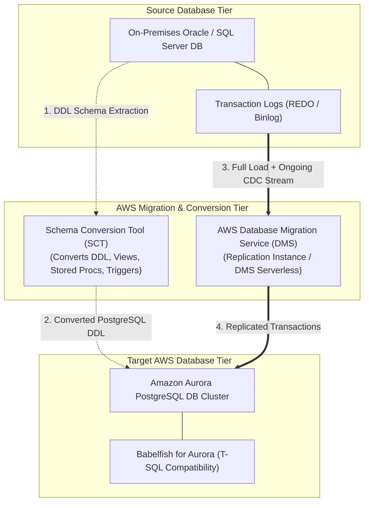
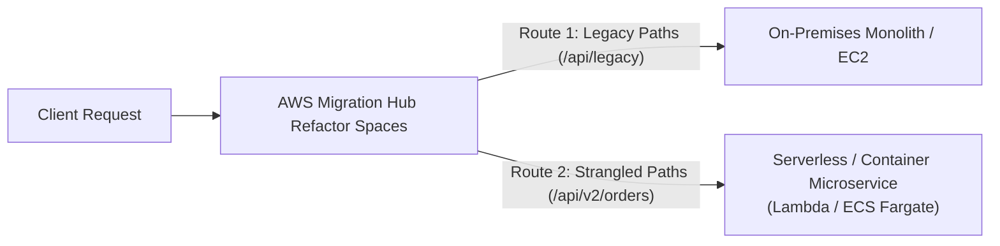

# Domain 4: Accelerate Workload Migration and Modernization — In-Depth Master Study Guide

> [!IMPORTANT]
> **Exam Weighting & Core Architecture Focus:** Domain 4 accounts for **20% of the AWS Certified Solutions Architect - Professional (SAP-C02)** examination. Questions test your mastery of enterprise portfolio discovery (Migration Evaluator vs. Application Discovery Service, Migration Hub), server migration and disaster recovery (AWS MGN vs. AWS DRS), database migrations (AWS DMS, SCT, Babelfish for Aurora PostgreSQL), large-scale data transfer (Snow Family, DataSync, Storage Gateway family, Transfer Family), Strangler Fig application decomposition with Refactor Spaces, and Mainframe Modernization.

---

## 1. Portfolio Discovery & The 7 Rs Migration Framework



### 1.1 Discovery Tool Selection Matrix

* **AWS Migration Evaluator (formerly Quick Starts / TSO Logic)**
  * **Agent Required?** No.
  * **What It Collects:** High-level hypervisor CPU, RAM, and storage utilization profiles to build an executive **Data-Driven Business Case / TCO Projection**. Models cost optimizations including right-sizing compute and Bring-Your-Own-License (BYOL) savings for Microsoft SQL Server and Windows Server.
  * **Primary SAP-C02 Scenario:** *"Build an executive financial business case and right-sized AWS TCO projection before commencing migration planning."*

* **AWS Application Discovery Service (Agentless Connector)**
  * **Agent Required?** No (Deployed as an OVA virtual appliance on VMware vCenter).
  * **What It Collects:** VM hostnames, IP/MAC addresses, CPU/RAM/disk allocations, and average utilization metrics. **Does NOT collect network TCP process dependencies**.
  * **Primary SAP-C02 Scenario:** *"Rapid assessment of a VMware vSphere environment where corporate security policies strictly prohibit installing agents on individual production VMs."*

* **AWS Application Discovery Service (Agent-Based Discovery Agent)**
  * **Agent Required?** Yes (Installed directly on Windows and Linux guest OS).
  * **What It Collects:** Host performance profiles **PLUS all active OS processes and live inbound/outbound TCP/UDP network communication dependencies**.
  * **Primary SAP-C02 Scenario:** *"Identify hidden inter-server network communications and database connections to group distributed workloads into cohesive, low-risk migration waves in AWS Migration Hub."*

---

## 2. Server Migration & Disaster Recovery: AWS MGN vs. AWS DRS



* **AWS Application Migration Service (MGN)**
  * **Primary Purpose:** **One-way permanent production migration** (Rehost / Lift-and-Shift) into Amazon EC2.
  * **Replication Mechanics:** The AWS Replication Agent reads block-level disk changes directly from the source operating system and streams encrypted data over TLS to a low-cost **Staging Area Subnet** in AWS.
  * **Staging Area Architecture:** Employs small, lightweight EC2 replication servers attached to inexpensive staging EBS volumes (`gp3` or `st1`). Production-grade compute instances are **only launched during test and cutover windows**, minimizing migration running costs.
  * **Launch Lifecycle:**
    1. **Test Launch:** Spins up a cloned instance in the target subnet to validate application functionality without interrupting continuous replication or touching the on-premises source server.
    2. **Cutover Launch:** Stops on-premises services, flushes final block deltas to AWS, and boots the production EC2 instance with custom Launch Templates and post-launch modernization actions (auto-installing SSM Agent, CloudWatch Agent, or converting Windows/RHEL licenses).

* **AWS Elastic Disaster Recovery (DRS)**
  * **Primary Purpose:** **Continuous business continuity and Disaster Recovery** (On-Premises $\to$ AWS, or Cross-Region AWS $\to$ AWS) with automated **Failback** support.
  * **Key Differentiator:** While MGN is designed for one-way migrations, DRS is designed for ongoing disaster recovery drills, continuous RPO monitoring ($<1\text{ second}$), and reverse replication back to on-premises VMware/physical hardware once primary data center power is restored.

---

## 3. Database Migration: AWS DMS, SCT & Babelfish for Aurora PostgreSQL



### 3.1 Homogeneous vs. Heterogeneous Database Migrations

* **Homogeneous Migration (Same Engine):**
  * Migrating Oracle $\to$ RDS for Oracle, or MySQL $\to$ Aurora MySQL.
  * Schema structures, data types, and stored procedures are identical. Native engine tools (Oracle Data Pump, MySQL `mysqldump`, PostgreSQL `pg_dump`) or AWS DMS Full Load + CDC are used directly without schema transformation.

* **Heterogeneous Migration (Different Engine Modernization):**
  * Migrating legacy proprietary databases (Oracle, Microsoft SQL Server) $\to$ open-source cloud-native databases (Amazon Aurora PostgreSQL, DynamoDB).
  * **AWS Schema Conversion Tool (SCT):** Scans the source database and automatically converts table schemas, views, stored procedures, functions, and triggers into the target SQL dialect. Flags incompatible procedural code for manual refactoring.
  * **AWS Database Migration Service (DMS):** Migrates the actual table data using:
    1. **Full Load:** Migrates existing table snapshots. *Exam Best Practice:* Drop secondary indexes and foreign keys during Full Load to maximize write throughput; re-enable them before CDC begins.
    2. **Ongoing Change Data Capture (CDC):** Continuously reads database transaction logs (Oracle Redo Logs, SQL Server Transaction Logs) to replicate changes in near-real-time until cutover.

### 3.2 Handling Large Objects (LOBs) in AWS DMS

* **Limited LOB Mode (Recommended Default):** DMS truncates LOB data exceeding a user-defined max LOB size (e.g., 32 KB). Delivers the **fastest migration performance**.
* **Full LOB Mode:** DMS migrates complete LOB objects regardless of size. Migrates LOBs in multiple piece-wise round-trips; significantly slower than Limited LOB mode.
* **Inline LOB Mode:** Combines the speed of Limited LOB mode with the completeness of Full LOB mode by transferring small LOBs inline and large LOBs out-of-band.

### 3.3 Babelfish for Aurora PostgreSQL

* **Core Value Proposition:** Accelerates Microsoft SQL Server migrations to Amazon Aurora PostgreSQL **without rewriting database queries or application data access layers**.
* **Wire-Protocol Emulation:** Babelfish understands the SQL Server wire-protocol (**TDS - Tabular Data Stream**) and T-SQL dialect natively. Applications configured to connect to Microsoft SQL Server simply point their connection strings to the Babelfish port (`1433`) on Aurora PostgreSQL, avoiding years of application rewrite costs.

---

## 4. Large-Scale Data Transfer & Hybrid Storage Architectures

When moving petabytes of on-premises data to AWS, selecting the optimal transfer mechanism depends on data volume, available network bandwidth, and ongoing synchronization requirements:

```
Mechanism                   Transfer Protocol / Medium       Max Capacity & Characteristics
─────────────────────────────────────────────────────────────────────────────────────────────
AWS Snowcone                Physical Ruggedized Appliance    8 TB HDD / 14 TB SSD; edge compute
AWS Snowball Edge Storage   Physical Appliance (10/25 GbE)   80 TB or 210 TB NVMe; raw data ingest
AWS Snowball Edge Compute   Physical Appliance (GPU/Compute) 42 TB / 104 vCPUs; edge processing
AWS DataSync                Automated Network Agent (TLS)    Online data transfer; up to 10 Gbps;
                                                             integrates with S3, EFS, FSx
AWS S3 File Gateway         NFS / SMB Local Storage Gateway  Local cache backed by S3 objects
AWS FSx File Gateway        SMB File Storage Gateway         Local cache backed by FSx for Windows
AWS Volume Gateway (Cached) iSCSI Block Storage Gateway      Primary data in S3; local cached blocks
AWS Volume Gateway (Stored) iSCSI Block Storage Gateway      Full primary data local; S3 snapshots
AWS Tape Gateway (VTL)      iSCSI Virtual Tape Library       Replaces physical tapes with Glacier
AWS Transfer Family         SFTP, FTPS, AS2 Endpoints        Fully managed; backed by S3 or EFS
```

### 4.1 AWS DataSync vs. Storage Gateway vs. Snow Family

* **AWS DataSync:**
  * Purpose-built for **high-speed automated network data migration**. Transfers data between on-premises storage systems (NFS, SMB, HDFS, object stores) and AWS services (Amazon S3, Amazon EFS, Amazon FSx for Windows / NetApp ONTAP / Lustre).
  * Automatically handles network encryption (TLS), bandwidth throttling, scheduled recurring syncs, and **cryptographic end-to-end data integrity verification**.

* **AWS Storage Gateway Family:**
  * Purpose-built for **ongoing hybrid cloud integration**, providing on-premises servers with seamless, low-latency access to virtually unlimited AWS cloud storage.
  * **S3 File Gateway:** Exposes file shares via NFS (v3/v4.1) or SMB. Files written to the share are stored natively as standard objects in S3 buckets. Local caching enables fast read/write access. Use the `RefreshCache` API (or EventBridge automation) when objects are modified directly in S3.
  * **Volume Gateway (Cached vs. Stored):**
    * **Cached Volumes:** Primary storage is Amazon S3; frequently accessed data is retained in the on-premises cache. Reduces on-premises storage footprint.
    * **Stored Volumes:** Full dataset is stored locally on-premises with low-latency access; asynchronous point-in-time snapshots are backed up to S3 as EBS snapshots.

* **AWS Snow Family Calculation Rule:**
  * When network transfer would take **more than one week** over available bandwidth, use physical Snowball appliances:
    $$T = \frac{\text{Data Size (Bytes)}}{\text{Available Network Bandwidth (Bytes/sec)}}$$
  * *Example:* Transferring $100\text{ TB}$ over a saturated $100\text{ Mbps}$ uplink takes $>95\text{ days}$. A Snowball Edge appliance shipped and loaded on-site completes the transfer in days.

---

## 5. Application Modernization & Strangler Fig Architecture



### 5.1 The Strangler Fig Pattern with AWS Refactor Spaces

* **AWS Migration Hub Refactor Spaces:**
  * Multi-account modernization orchestrator that automates the Strangler Fig pattern across AWS accounts.
  * Automatically provisions and configures:
    1. An **AWS Transit Gateway** connecting the legacy application VPC to new microservice VPCs.
    2. An **Amazon API Gateway** (or Application Load Balancer) acting as the centralized routing facade.
    3. **AWS Network Firewall / VPC peering** rules governing cross-account traffic.
  * Allows architects to route specific URI endpoints incrementally from the legacy monolith to new serverless microservices with zero client configuration changes.

### 5.2 Mainframe Modernization: Blu Age vs. Micro Focus

* **AWS Mainframe Modernization Automated Refactor (AWS Blu Age):**
  * Automatically analyzes and transforms legacy mainframe applications (COBOL, PL/I, JCL) into modern cloud-native **Java and Spring-based microservices** running on AWS.
* **AWS Mainframe Modernization Replatform (Micro Focus):**
  * Preserves legacy application source code with minimal modifications by emulating the mainframe execution environment on modern Amazon EC2 compute instances.
