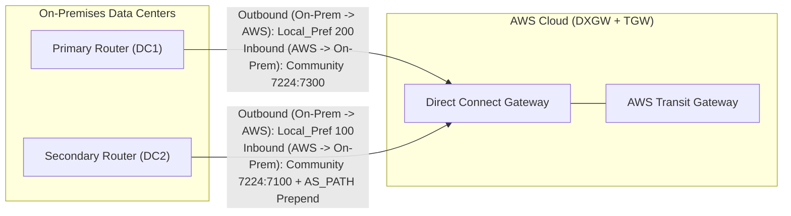

# AWS Certified Solutions Architect – Professional (SAP-C02) Master Cheat Sheet

This high-density reference consolidates the critical decision matrices, routing precedence rules, cryptographic boundaries, disaster recovery RTO/RPO pairings, bandwidth formulas, FinOps equations, service limits, and top exam traps tested on the **AWS Certified Solutions Architect – Professional (`SAP-C02`)** exam.

---

## 1. Hybrid Networking, Direct Connect & BGP Precedence Matrix

### 1.1 AWS VGW & Transit Gateway Route Evaluation Order (Highest to Lowest Priority)

> [!IMPORTANT]
> **Longest Prefix Match (LPM) ALWAYS wins first!** A `/25` route over a slow Site-to-Site VPN BGP connection will ALWAYS beat a `/24` route over a 100 Gbps Direct Connect connection. The priority list below only applies when comparing **identical prefix lengths** (e.g., two `/16` routes).

| Priority Rank | Route Source / Type | Mechanism & Tie-Breaking Notes |
| :---: | :--- | :--- |
| **1 (Highest)** | **Most Specific Prefix (Longest Prefix Match)** | `/32` > `/28` > `/24` > `/16` > `0.0.0.0/0` regardless of connection type (DX vs VPN, Static vs BGP). |
| **2** | **BGP Propagated from AWS Direct Connect** | Routes learned via BGP over Private VIF or Transit VIF. Evaluated further by Local Preference communities (`7224:7300` > `7224:7200` > `7224:7100`), then shortest `AS_PATH`. |
| **3** | **Static Routes (VPN Static or TGW Static)** | Manually configured static routes on a VGW or TGW route table. *(Note: On VGW, DX BGP beats Static VPN; on TGW route tables, Static routes beat propagated BGP routes of the same prefix unless both are propagated).* |
| **4** | **BGP Propagated from Site-to-Site VPN** | Dynamic BGP routes advertised over IPsec VPN tunnels. Evaluated by shortest `AS_PATH`, then `MED` (Multi-Exit Discriminator, lowest wins). |

### 1.2 Bidirectional Traffic Engineering Summary (AWS $\leftrightarrow$ On-Premises)

* **Controlling AWS $\rightarrow$ On-Premises Traffic (Return Path from AWS)**:
  1. **First Choice (Across any AWS Region via DXGW)**: Advertise prefixes from on-premises with **BGP Local Preference Communities** (`7224:7300` High on Primary VIF, `7224:7100` Low on Secondary VIF).
  2. **Second Choice (Same Region or VPN fallback)**: Use **`AS_PATH` Prepending** on the secondary router (e.g., prepend ASN `65001 65001 65001` so the path looks longer to AWS). *Caveat*: For Direct Connect VIFs terminating in different AWS Regions connected to a DXGW, AWS prefers the **locally connected Region** before evaluating `AS_PATH` length unless BGP community tags (`7224:7300`) are used!
  3. **Last Resort (Emergency Failover)**: Advertise a more specific subnet (`/25` instead of `/24`) over the primary link, and a summary `/24` over the backup link.
* **Controlling On-Premises $\rightarrow$ AWS Traffic (Forward Path from On-Prem)**:
  1. Configure **higher BGP Local Preference** (e.g., `LOCAL_PREF 200` vs `100`) on your internal on-premises routers for routes learned from the Primary DX VIF.
  2. Filter or match based on AWS Scope Communities (`7224:9100` Local Region vs `7224:9300` Global).

### 1.3 AWS Direct Connect BGP Community Tags Reference

| BGP Community Tag | Direction | Meaning / Architectural Effect |
| :--- | :---: | :--- |
| **`7224:7100`** | On-Prem $\rightarrow$ AWS | **Low Local Preference**: Marks this DX VIF as backup/passive for traffic returning from AWS to on-premises. |
| **`7224:7200`** | On-Prem $\rightarrow$ AWS | **Medium Local Preference (Default)**: Standard priority; enables ECMP active/active load balancing if multiple VIFs in the same Region advertise equal `AS_PATH` and community. |
| **`7224:7300`** | On-Prem $\rightarrow$ AWS | **High Local Preference**: Marks this DX VIF as primary/active for traffic returning from AWS to on-premises. Beats `7224:7200` and `7224:7100` even if `AS_PATH` is longer! |
| **`7224:9100`** | AWS $\rightarrow$ On-Prem | **Local Zone / Home Region Scope**: Prefix originated in the local AWS Direct Connect point of presence. |
| **`7224:9200`** | AWS $\rightarrow$ On-Prem | **Continent / Regional Scope**: Prefix originated within the same continent (e.g., North America or Europe). |
| **`7224:9300`** | AWS $\rightarrow$ On-Prem | **Global Scope**: Prefix advertised globally across all AWS Regions via Direct Connect Gateway. |
| **`NO_EXPORT`** | On-Prem $\rightarrow$ AWS | Prevents AWS from re-advertising the prefix to other DX locations even if SiteLink is enabled. |

### 1.4 Direct Connect Virtual Interfaces (VIFs) & Encryption Matrix

| VIF Type | Target Connectivity | Max Payload MTU | Encryption Options & Architectural Rules |
| :--- | :--- | :---: | :--- |
| **Private VIF** | **1 VGW** (1 VPC) OR **1 Direct Connect Gateway (DXGW)** (up to 20 VGWs across Regions/Accounts) | **1500** or **9001** (Jumbo Frames) | Does NOT support TGW. To encrypt: use **MACsec** (Layer 2 on 10G/100G Dedicated DX) or terminate IPsec on EC2 virtual appliances. |
| **Transit VIF** | **1 Direct Connect Gateway (DXGW)** $\rightarrow$ up to **6 Transit Gateways (TGWs)** across Regions | **1500** or **8500** (Jumbo Frames) | Required for TGW connectivity. Requires **1 Gbps+** DX connection. Supports **IPsec Site-to-Site VPN over Transit VIF** (attaching VPN to TGW) or **MACsec**. |
| **Public VIF** | All AWS Public IP Ranges (S3, DynamoDB, SQS, Public VPN Endpoints, EC2 Elastic IPs) | **1500** only (No Jumbo Frames) | Requires a public `/31` or `/30` IP block + BGP. **Exam Classic**: Run **AWS Site-to-Site VPN over a Public VIF** to get an encrypted IPsec tunnel to a VGW or TGW without needing a Transit VIF! |

### 1.5 Direct Connect Resiliency Models & Quotas

| Resiliency Model | SLA | Required Topology |
| :--- | :---: | :--- |
| **Maximum Resiliency** | **99.99%** | **4 Dedicated Connections** across **2 separate Direct Connect Locations** (2 connections per location on distinct AWS devices) terminating on redundant customer routers. |
| **High Resiliency** | **99.9%** | **2 Dedicated Connections** across **2 separate Direct Connect Locations** (1 connection per location). |
| **Development & Test** | **No SLA** | 1 Connection in 1 Location (or 2 connections in the *same* location—still no 99.9% SLA against location failure!). |

* **Key Direct Connect Quotas to Memorize**:
  * **Transit VIF Prefix Quota (AWS $\rightarrow$ On-Prem via DXGW)**: Maximum **200 prefixes** across all Transit Gateways attached to a DXGW (`Allowed Prefixes` list must summarize VPC CIDRs if you have $>200$ VPCs!).
  * **BGP Prefixes Advertised (On-Prem $\rightarrow$ AWS)**: Maximum **100 prefixes** per Private/Transit VIF (up to 1,000 on Public VIF); summarize on-premises routes if exceeding 100!
  * **Site-to-Site VPN Single Tunnel Bandwidth**: Maximum **1.25 Gbps** per tunnel (use **Transit Gateway + Accelerated VPN + ECMP** across multiple VPN attachments with equal BGP attributes to scale horizontally beyond 1.25 Gbps, up to 50 Gbps).

### 1.6 VPC Connectivity & Inspection Comparison Matrix

| Solution | OSI Layer | Overlapping IPv4 CIDRs? | Transitive? | Bandwidth / Limits | Primary SAP-C02 Use Case |
| :--- | :---: | :---: | :---: | :--- | :--- |
| **VPC Peering** | Layer 3 | **No** (Unless paired via IPv6 or NAT) | **No** | Full VPC fabric (100+ Gbps), no per-GB processing fee (only Cross-AZ/Region transfer) | High-throughput, low-cost point-to-point mesh between a small number of VPCs (`<10`) with massive data volume. |
| **AWS Transit Gateway (TGW)** | Layer 3 | **No** (Requires Private NAT GW in egress/inspection VPC) | **Yes** (Hub-and-Spoke) | 50 Gbps burst per AZ per VPC attachment | Enterprise hub-and-spoke connecting 10s–1000s of VPCs, DXGW, and VPNs with segmented route tables and Centralized Inspection. |
| **AWS Cloud WAN** | Layer 3 | **No** | **Yes** (Global Mesh) | Global AWS backbone | Declarative, policy-driven global WAN connecting VPCs and SD-WAN branches across multiple Regions without manual TGW peering tables. |
| **AWS PrivateLink** | Layer 4 (TCP) | **Yes!** | **No** (Unidirectional Consumer $\rightarrow$ Provider) | Scales to 100 Gbps per AZ behind NLB | Exposing a specific TCP service (via NLB) or third-party appliance (via GWLB) across accounts/overlapping CIDRs with zero route table conflicts. |
| **Amazon VPC Lattice** | Layer 7 (HTTP/HTTPS/gRPC) | **Yes!** | **Service Network** abstraction | Managed proxy mesh | Modern microservice-to-microservice communication across VPCs/accounts (EKS, ECS, Lambda, EC2) with overlapping CIDRs, IAM Auth Policies, and path/weight routing. |

> [!CAUTION]
> **Stateful Inspection VPC Trap (`ApplianceModeSupport`)**: Whenever traffic traverses a Transit Gateway through a Centralized Inspection VPC (hosting **AWS Network Firewall** or **Gateway Load Balancer**) between two spoke VPCs in different AZs, TGW defaults to keeping traffic in the originating AZ. Return traffic may hit a firewall node in a different AZ, which drops the packet because it never saw the TCP `SYN`! **You MUST enable Appliance Mode (`--options ApplianceModeSupport=enable`) on the Inspection VPC's TGW attachment** so TGW hashes the 5-tuple and pins both forward and return flows to the exact same AZ!

---

## 2. Multi-Account Governance, IAM & Security Matrix

### 2.1 IAM Policy Evaluation & Boundary Intersection Logic

An IAM principal gets access **ONLY** if the action lies within the **intersection** ($\cap$) of all applicable policy types and has **zero explicit `Deny` statements**:

$$\text{Effective Permissions} = (\text{SCP} \cap \text{RCP} \cap \text{Permissions Boundary} \cap \text{Session Policy} \cap (\text{Identity Policy} \cup \text{Same-Account Resource Policy})) - \text{Explicit Deny}$$

| Policy Mechanism | Grants Permissions? | Scope / Target | Key SAP-C02 Nuances & Exceptions |
| :--- | :---: | :--- | :--- |
| **Service Control Policy (SCP)** | **No** (Guardrail only) | AWS Organization Root, OUs, or Member Accounts | **Never affects the Management Account**. **Does NOT affect Service-Linked Roles**. Affects Member Account Root user. Restricts maximum available permissions for principals in member accounts. |
| **Resource Control Policy (RCP)** | **No** (Guardrail only) | Resources in Member Accounts (S3, KMS, SQS, Secrets Manager, STS) | Enforces organization-wide data perimeter controls on **resources** regardless of which external principal calls them. Never affects Management Account. |
| **IAM Permissions Boundary** | **No** (Guardrail only) | Specific IAM User or IAM Role | Used for **Delegated Administration** (allowing developers to create new IAM roles for Lambda/EC2 without privilege escalation by requiring an `iam:PermissionsBoundary` condition on `iam:CreateRole`). |
| **Identity-Based Policy** | **Yes** | IAM Users, Groups, Roles, Permission Sets | For **Cross-Account** access, BOTH the calling account's Identity Policy AND the target account's Resource-Based Policy (or Role Trust Policy) must explicitly allow the action. |
| **Session Policy** | **No** (Filter only) | Passed inline during `AssumeRole` / `GetFederationToken` | Further restricts the permissions of the assumed role for that specific temporary session only. |

### 2.2 High-Value IAM & SCP Condition Keys Reference

| Condition Key | Purpose & Exam Scenario |
| :--- | :--- |
| **`aws:PrincipalOrgID`** | Used in S3 Bucket Policies, KMS Key Policies, EventBridge Buses, and IAM Role Trust Policies to allow access **only to principals belonging to your AWS Organization** (`o-xxxxxxxxxx`). |
| **`aws:ResourceOrgID`** | Used in SCPs/RCPs to prevent principals inside your Organization from writing data to S3 buckets or SQS queues owned by external AWS accounts (Data Exfiltration prevention). |
| **`aws:PrincipalOrgPaths`** | Restricts access to principals belonging to specific **Organizational Units (OUs)** (e.g., `o-xxx/r-xxx/ou-xxx-prod/*`). |
| **`aws:PrincipalArn`** | Used in `StringNotLike` inside an SCP `Deny` statement to **exempt a specific administrative/CI-CD IAM Role** or Control Tower execution role from an organization-wide restriction. |
| **`aws:RequestedRegion`** | Restricts API calls to approved AWS Regions (e.g., `us-east-1`, `eu-west-1`). **Must pair with `NotAction`** for global services (`iam:*`, `sts:*`, `route53:*`, `cloudfront:*`, `support:*`). |
| **`aws:ViaAWSService`** / **`kms:ViaService`** | Allows KMS key usage only when invoked indirectly by a specific AWS service (e.g., `s3.us-east-1.amazonaws.com`) rather than direct `kms:Decrypt` API calls. |
| **`aws:SourceVpce`** / **`aws:SourceVpc`** | Enforces a **Network Data Perimeter** so S3 buckets or KMS keys can only be accessed via specific VPC Endpoints or VPCs. |
| **`aws:CalledVia`** | Restricts direct access to a backend resource (like S3 or KMS) unless the request was made through an upstream service (like `athena.amazonaws.com` or `cloudformation.amazonaws.com`). |

### 2.3 AWS Resource Access Manager (RAM) Shareable vs. Non-Shareable Resources

| Shareable via AWS RAM (No Duplication!) | NOT Shareable via AWS RAM (Common Exam Distractors!) |
| :--- | :--- |
| **VPC Subnets** (Shared VPCs within the same AWS Organization only) | **Entire VPCs** or **Internet Gateways / NAT Gateways directly** (you share the *Subnets*, and participants use the host VPC's IGW/NAT/VGW/TGW) |
| **AWS Transit Gateways** & **Cloud WAN Core Networks** | **IAM Roles or IAM Policies** (use Cross-Account Role Assumption or IAM Identity Center instead) |
| **Route 53 Resolver Forwarding Rules** & **DNS Firewall Rule Groups** | **Route 53 Resolver Inbound / Outbound Endpoints directly** (share the *Rules* via RAM; endpoints stay in the Network Hub VPC) |
| **Amazon Aurora DB Clusters** (Cloning only), **AWS Private CA**, **License Manager Configs** | **Amazon S3 Buckets** or **KMS Keys** (shared via Bucket Policies / KMS Key Policies, NOT AWS RAM) |
| **Customer-Managed Prefix Lists**, **Network Firewall Policies**, **EC2 Capacity Reservations**, **Outposts** | **Application Load Balancers / Network Load Balancers** (participants in a shared VPC cannot view/modify another account's ALB unless targeting instances) |

### 2.4 Eliminating Long-Lived Credentials Across Hybrid Environments

| Scenario / Workload Location | Recommended Zero-Key Architecture | Why It Wins on SAP-C02 |
| :--- | :--- | :--- |
| **On-Premises Servers Needing General AWS API Access (S3, SQS, DynamoDB, KMS)** | **IAM Roles Anywhere** + **AWS Private CA (or External X.509 PKI)** | Servers use `aws_signing_helper` with local X.509 client certificates to authenticate against a **Trust Anchor** and assume an IAM Role via **Profile** for temporary STS tokens. Zero static IAM access keys! |
| **On-Premises Servers Needing Patching, Inventory, or Shell Access** | **AWS Systems Manager (SSM) Hybrid Activations** | Registers non-EC2 VMs (`mi-xxxxxx`) with SSM using an Activation Code/ID, automatically rotating temporary credentials for SSM Agent operations. |
| **Human Workforce Users (Developers, Admins, Analysts)** | **AWS IAM Identity Center** + **External IdP (Entra ID / Okta via SAML 2.0 & SCIM)** | Centralized multi-account SSO using **Permission Sets** and **ABAC (`aws:PrincipalTag`)** to scale access dynamically across hundreds of accounts. |
| **Mobile / Web End-Users Needing Direct S3 Upload or DynamoDB Access** | **Amazon Cognito User Pools** + **Cognito Identity Pools** | User Pool authenticates user (JWT) $\rightarrow$ Identity Pool exchanges JWT for scoped temporary STS credentials with fine-grained IAM policy variables (`${cognito-identity.amazonaws.com:sub}`). |
| **CI/CD Pipelines (GitHub Actions, GitLab CI, Kubernetes Pods)** | **IAM OIDC Identity Provider** + `sts:AssumeRoleWithWebIdentity` | Exchanges short-lived OIDC JWT tokens directly with AWS STS for temporary IAM role credentials without storing AWS secrets in Git repositories. |

---

## 3. Edge, High Availability & Disaster Recovery Matrix

### 3.1 CloudFront vs. AWS Global Accelerator

| Feature / Dimension | Amazon CloudFront | AWS Global Accelerator |
| :--- | :--- | :--- |
| **Core Mechanism** | Global CDN with **Edge Caching** (600+ PoPs & Regional Edge Caches) | Global Network Layer 4 Proxy with **2 Static Anycast IPv4/IPv6 Addresses** |
| **Supported Protocols** | **HTTP / HTTPS / WebSocket / gRPC** only | **Any TCP or UDP protocol** (HTTP, Gaming UDP, VoIP, MQTT, custom TCP ports) |
| **Caching Capability** | **Yes** — caches static & dynamic responses at the edge | **No caching** — every packet traverses the AWS global fiber backbone to the origin |
| **IP Address Behavior** | Dynamic IP pool (changes frequently; cannot whitelist single IP at corporate firewalls unless using Managed Prefix List on origin) | **2 Fixed Static Anycast IPs** (ideal for legacy clients or strict B2B partner firewall allowlists that forbid DNS CNAMEs) |
| **Failover Speed** | Origin Groups fail over on HTTP 4xx/5xx per request; DNS updates depend on client TTL | **Deterministic <30-second health-check failover** across Regions without relying on client DNS cache behavior |
| **Client IP Preservation** | Passes client IP via `X-Forwarded-For` HTTP header | Native **Client IP Preservation** at network layer for ALB and EC2 origins |

### 3.2 CloudFront Functions vs. Lambda@Edge

| Attribute | CloudFront Functions | Lambda@Edge |
| :--- | :--- | :--- |
| **Execution Location** | **218+ CloudFront Edge Locations (PoPs)** (closest to viewer) | **13+ Regional Edge Caches** |
| **Supported Triggers** | **Viewer Request** and **Viewer Response** ONLY | **Viewer Request**, **Origin Request**, **Origin Response**, **Viewer Response** |
| **Runtime & Max Duration** | Lightweight JavaScript (ECMAScript 5.1 / ES6+); **$< 1\text{ ms}$** execution limit | Node.js or Python; **5 seconds** (Viewer triggers) / **30 seconds** (Origin triggers) |
| **Memory & Package Size** | 2 MB memory; **10 KB** max code size | 128 MB to 10 GB memory; **1 MB** (Viewer) / **50 MB** (Origin) code size |
| **Network / File / Body Access** | **No network access**, no filesystem, **no HTTP request body access** (KeyValueStore supported for fast edge lookups) | **Full network access** (can call DynamoDB, S3, external IdPs), filesystem `/tmp`, **full HTTP body access** |
| **Cost & Scale** | ~1/6th the cost of Lambda@Edge; scales to 10,000,000+ req/sec instantaneously | Higher cost; suited for heavy compute or cache-miss origin processing |
| **Primary Exam Use Cases** | URL rewrites/redirects, HTTP header manipulation, simple JWT validation, A/B cookie normalization | Dynamic origin routing based on DynamoDB lookup, image resizing on cache miss, SSR, complex external OAuth calls |

### 3.3 Disaster Recovery (DR) Tiers & Database Pairing Matrix

| DR Strategy | Target RTO | Target RPO | Infrastructure State in DR Region | Ideal Database & Storage Architecture |
| :--- | :---: | :---: | :--- | :--- |
| **Backup & Restore** | **Hours to Days** (2–24h) | **Hours** (Last backup snapshot) | Nothing running; backups replicated cross-region; provisioned via CloudFormation/IaC on disaster | **AWS Backup** cross-region copy, **RDS Automated Snapshots**, **S3 Cross-Region Replication (CRR)** to Glacier/Standard-IA. |
| **Pilot Light** | **10s of Minutes** (10–30m) | **Seconds to Minutes** | **Data layer is live and continuously replicating** (RDS/Aurora Replica or DRS staging); compute/app tier is **off (AMI/Launch Templates at 0 capacity)** | **Aurora Global Database** (headless secondary cluster or smallest instance), **RDS Cross-Region Read Replica**, **AWS Elastic Disaster Recovery (DRS)**. |
| **Warm Standby** | **Minutes** (1–5m) | **Seconds** | **Full functional stack is running 24/7 at minimum scale** (e.g., 1 small ECS task/EC2 per AZ); scales out on failover | **Aurora Global Database**, **DynamoDB Global Tables**, **ElastiCache Global Datastore**, ALB + ASG min=1/2. |
| **Multi-Site Active/Active** | **Near-Zero / Seconds** ($<30\text{s}$) | **Near-Zero** ($\approx 0\text{–}1\text{s}$) | **Full production scale in 2+ Regions** serving live traffic concurrently via Route 53 Latency/Geolocation or Global Accelerator | **DynamoDB Global Tables** (Multi-Active), **Aurora Global Database with Write Forwarding** (or Managed Failover via **Route 53 ARC**), **S3 Multi-Region Access Points (MRAP)**. |

### 3.4 Enterprise Database High Availability & Scaling Comparison

| Database Feature | Architecture Mechanics | Failover RTO / RPO | SAP-C02 Decision Trigger |
| :--- | :--- | :---: | :--- |
| **RDS Multi-AZ DB Instance** | 1 Primary + 1 synchronous Standby in another AZ (Standby is **NOT readable**). | RTO: 60–120s \| RPO: 0 | Standard HA for Oracle, SQL Server, PostgreSQL, MySQL when extra read capacity is not required. |
| **RDS Multi-AZ DB Cluster** | 1 Writer + **2 readable Standbys** across 3 AZs using local NVMe SSD transaction logs + quorum commit. | RTO: **~35s** \| RPO: 0 | Requires **MySQL or PostgreSQL**, **readable standbys**, up to **2x faster write latency**, and predictable `<35s` failover without refactoring to Aurora. |
| **Aurora High Availability & Replicas** | Shared storage volume automatically striped across **6 copies in 3 AZs** (4/6 write quorum, 3/6 read quorum) + up to **15 low-lag (`<10ms`) Aurora Replicas**. | RTO: **~30s** \| RPO: 0 | Use **Aurora Custom Endpoints** to isolate heavy BI analytics/reporting queries onto dedicated large instances away from OLTP reader instances. |
| **Aurora Global Database** | Storage-level replication from Primary Region to up to **5 Secondary Regions** (`<1s` typical lag). | Unplanned: `<1m` RTO, `~1s` RPO \| Managed Planned: **0 RPO** | Multi-region relational DR, local low-latency global reads, and **Write Forwarding** so secondary regions can forward occasional writes to the primary. |
| **Amazon RDS Proxy** | Managed connection pooler sitting between compute and RDS/Aurora. | Reduces failover time by **up to 66%** | Mandatory when **thousands of AWS Lambda functions or Fargate tasks** cause database connection exhaustion (`too many connections`) or stale DNS caching during failover. |

---

## 4. Storage, Data Transfer & Migration Decision Matrix

### 4.1 Shared File Systems Comparison (EFS vs. FSx Portfolio)

| Service | Protocol(s) | Max Performance | Key Capabilities & SAP-C02 Selection Trigger |
| :--- | :---: | :--- | :--- |
| **Amazon EFS** | **NFSv4** (Linux only) | Tens of GB/s; `Elastic`, `Provisioned`, or `Bursting` throughput | Serverless Linux shared storage for EC2, ECS, EKS, and **AWS Lambda**. Supports EFS Intelligent-Tiering (Standard, IA, Archive). |
| **FSx for Windows File Server** | **SMB** | Multi-GB/s (SSD or HDD) | Native Windows storage: **Active Directory integration**, NTFS ACLs, **DFS Namespaces/Replication**, SQL Server Failover Cluster Instances (FCI), **FSx File Gateway** for branch caching. |
| **FSx for Lustre** | **POSIX** (Linux) | **Hundreds of GB/s**, millions of IOPS, sub-ms latency | **HPC, Machine Learning training, financial modeling, genomics**. Native bi-directional **S3 Data Repository Association** (lazy-loads S3 objects as POSIX files and exports results back to S3). Offers `Scratch` (temporary, cheaper) vs `Persistent` deployments. |
| **FSx for NetApp ONTAP** | **NFS, SMB, iSCSI** (Multiprotocol) | Tens of GB/s + NVMe cache | **Multiprotocol (Linux + Windows + Block)** access to the same dataset. Supports **NetApp SnapMirror** (hybrid migration from on-prem NetApp), **FlexClone** (instant zero-space clones for DB dev/test), inline deduplication/compression/compaction, and intelligent tiering to capacity pool. |
| **FSx for OpenZFS** | **NFS** (v3/v4) | Up to 1,000,000+ IOPS, `<0.5ms` latency | Lift-and-shift for on-premises **ZFS** workloads requiring ZFS snapshots, clones, and ultra-low latency NFS. |

### 4.2 S3 Storage Classes & Compliance Matrix

| S3 Storage Class | Availability Zones | Min Storage Duration | Min Billable Object Size | Retrieval Fee / Time | Ideal SAP-C02 Scenario |
| :--- | :---: | :---: | :---: | :--- | :--- |
| **S3 Standard** | $\ge 3$ AZs | None | None | None / Milliseconds | Active, frequently accessed hot data, static websites, dynamic data lakes. |
| **S3 Express One Zone** | 1 AZ (Directory Bucket) | 1 Hour | None (40 KB metadata overhead) | Lower per-request fee / **Single-digit milliseconds** | High-performance ML training, interactive analytics, financial modeling co-located in the same AZ as compute. |
| **S3 Intelligent-Tiering** | $\ge 3$ AZs | None | None (**Objects $<128\text{ KB}$ stay in Frequent Access and are not monitored**) | **Zero retrieval fees!** (Small monthly per-object monitoring fee) | **Unpredictable or changing access patterns**; automatically moves objects between Frequent, Infrequent (30d), Archive Instant (90d), and optional async Archive (90–730d) / Deep Archive (180–730d). |
| **S3 Standard-IA** | $\ge 3$ AZs | **30 Days** | **128 KB** | Per-GB fee / Milliseconds | Infrequently accessed data (`<1/month`) requiring high durability and immediate millisecond retrieval. |
| **S3 One Zone-IA** | **1 AZ** | **30 Days** | **128 KB** | Per-GB fee / Milliseconds | Easily **re-creatable** infrequent data (e.g., secondary image thumbnails or on-prem backup copies where AZ loss is acceptable). |
| **S3 Glacier Instant Retrieval** | $\ge 3$ AZs | **90 Days** | **128 KB** | Higher per-GB fee / **Milliseconds** | Medical images, news media archives accessed once per quarter but requiring **instant millisecond access** when requested. |
| **S3 Glacier Flexible Retrieval** | $\ge 3$ AZs | **90 Days** | 40 KB metadata | **Expedited** (`1–5 min`), **Standard** (`3–5 hr`), **Bulk** (`5–12 hr`, **Free!**) | Annual compliance archives where a few minutes to several hours of retrieval delay is acceptable. |
| **S3 Glacier Deep Archive** | $\ge 3$ AZs | **180 Days** | 40 KB metadata | **Standard** (`12 hr`), **Bulk** (`48 hr`) | Lowest-cost long-term retention (7–10 years financial/healthcare regulatory archives replacing magnetic tape). |

### 4.3 Online vs. Offline Data Transfer Crossover Math

> [!TIP]
> **Memorize the SAP-C02 Bandwidth Rule of Thumb**:
> * **$100\text{ Mbps}$ link** (at 80% utilization) $\approx 10\text{ MB/s} \approx \mathbf{860\text{ GB/day}} \approx \mathbf{8.6\text{ TB in 10 days}}$
> * **$1\text{ Gbps}$ link** (at 80% utilization) $\approx 100\text{ MB/s} \approx \mathbf{8.6\text{ TB/day}} \approx \mathbf{86\text{ TB in 10 days}}$
> * **$10\text{ Gbps}$ link** (at 80% utilization) $\approx 1\text{ GB/s} \approx \mathbf{86\text{ TB/day}} \approx \mathbf{860\text{ TB in 10 days}}$

$$\text{Transfer Time (Days)} = \frac{\text{Total Data Size (Bits)}}{\text{Available Bandwidth (bps)} \times \text{Utilization Factor} \times 86,400\text{ seconds/day}}$$

| Scenario | Recommended Migration Pattern | Architectural Reasoning |
| :--- | :--- | :--- |
| **50 TB over a 10 Gbps Direct Connect (30% free capacity = 3 Gbps) with a 7-day deadline** | **AWS DataSync** (Online over Direct Connect) | $3\text{ Gbps} \approx 25.8\text{ TB/day}$. $50\text{ TB}$ finishes in **~2 days** online — faster and simpler than shipping physical Snowball devices! |
| **500 TB over a 1 Gbps WAN (20% free capacity = 200 Mbps) with a 30-day deadline and active daily file changes** | **Two-Phase Hybrid: Multiple AWS Snowball Edge Storage Optimized devices + AWS DataSync** | Online $200\text{ Mbps} \approx 1.7\text{ TB/day}$ would take **~294 days**! Ship **7 Snowball Edge Storage Optimized (80 TB usable each)** for the initial baseline seed, import to S3/FSx, then run **AWS DataSync** over the WAN to sync only the incremental delta changes before cutover. |
| **60 TB Oracle DB to Aurora PostgreSQL over a 500 Mbps link with `<15 minute` cutover downtime** | **AWS SCT + Snowball Edge + Amazon S3 + AWS DMS (CDC)** | Use **SCT Data Extraction Agents** to dump the 60 TB schema/data onto a **Snowball Edge**, ship to S3, load into Aurora via DMS, and use **AWS DMS Change Data Capture (CDC)** over the network from the exact Oracle SCN to catch up and cut over with near-zero downtime. |

### 4.4 Application Migration & Modernization Service Selection

| Legacy Source / Problem | Target AWS Solution | Why It Wins on SAP-C02 |
| :--- | :--- | :--- |
| **Unknown server dependencies & network conversations across 1,000+ VMs and physical servers** | **AWS Application Discovery Service (Agent-based)** + **S3 / Athena / QuickSight** | Only the **Agent-based** collector captures **process-level details and TCP/UDP network connection dependencies** across both physical and virtual servers (Agentless OVA only works on VMware and lacks process/network dependency mapping). |
| **Lift-and-shift (Rehost) 500 physical/virtual Linux & Windows servers with minimal downtime** | **AWS Application Migration Service (MGN)** | Continuous block-level replication into a low-cost **Staging Area Subnet**; non-disruptive test launches and automated post-launch modernization (SSM agent, license conversion). |
| **Migrate 300 VMware VMs to AWS in 2 weeks WITHOUT changing IP addresses or re-architecting** | **VMware Cloud on AWS** + **VMware HCX (Layer 2 Network Extension & vMotion)** | Relocate (Hypervisor lift): stretches on-premises Layer 2 VLANs into AWS and performs live **vMotion** with zero IP changes or OS modifications. |
| **Containerize legacy Java (Tomcat/JBoss) on Linux or .NET (IIS) on Windows VMs without source code changes** | **AWS App2Container (A2C)** | Inspects running VM processes, extracts application artifacts and dependencies into a Docker image, pushes to **Amazon ECR**, and generates **ECS / EKS / App Runner** deployments. |
| **Decompose a monolithic application into microservices incrementally using the Strangler Fig pattern** | **AWS Migration Hub Refactor Spaces** | Provisions a multi-account **Transit Gateway + API Gateway + VPC Link** fabric that routes `/*` to the monolith and incrementally shifts specific URL paths (`/orders`, `/cart`) to new Lambda/ECS microservices seamlessly. |
| **Modernize an IBM z/OS Mainframe (COBOL / CICS / VSAM / DB2) into cloud-native Java microservices** | **AWS Mainframe Modernization – Automated Refactor (AWS Blu Age)** | Automatically converts legacy COBOL/PL1/RPG into modern **Java Spring Boot** applications and migrates VSAM/DB2 to **Aurora PostgreSQL** (choose **Micro Focus Replatform** instead if the requirement says *"preserve existing COBOL source code"*). |
| **Migrate SQL Server to Aurora PostgreSQL WITHOUT rewriting thousands of lines of C# T-SQL & Stored Procedures** | **Babelfish for Aurora PostgreSQL** | Enables Aurora PostgreSQL to natively understand the **Microsoft SQL Server wire protocol (TDS)** and **T-SQL** dialect alongside native PostgreSQL connections. |

---

## 5. Data Analytics, Streaming & Serverless Integration Matrix

### 5.1 Real-Time Streaming & Ingestion Comparison

| Service | Scaling & Retention | Transformation & Delivery | SAP-C02 Selection Trigger |
| :--- | :--- | :--- | :--- |
| **Amazon Kinesis Data Streams (KDS)** | Provisioned Shards (`1 MB/s` in, `2 MB/s` out) or **On-Demand**; retention **24 hours to 365 days** | Custom consumers (Lambda, KCL, Flink, Firehose); **Enhanced Fan-Out** (`2 MB/s` dedicated per consumer via HTTP/2) | Required when **multiple independent consumers** must read the same stream concurrently, when **message replay** (up to 1 year) is needed, or when sub-100ms processing is required. |
| **Amazon Data Firehose** | Serverless auto-scaling; **No retention / replay** (buffers `1–128 MB` or `0–900 seconds`) | Built-in Lambda transformation, **Parquet/ORC format conversion**, **Dynamic Partitioning** (by JSON keys) | **Zero-administration ingestion** directly into **S3, Redshift, OpenSearch, or Splunk** with automatic columnar Parquet conversion and S3 prefix partitioning (`s3://bucket/year=.../customer_id=...`). |
| **Amazon Managed Service for Apache Flink** | Serverless auto-scaling KPUs | Stateful stream processing (SQL, Java, Python, Scala), **sliding/tumbling windows**, stream-to-stream joins | Real-time **stateful anomaly detection**, 5-minute rolling averages, or joining clickstream events with reference data in flight between two Kinesis/MSK streams. |
| **Amazon EventBridge Pipes** | Serverless point-to-point | Native **Filtering**, **Enrichment** (via Lambda/API Gateway/Step Functions), and **Target Delivery** | Connecting a single stream/queue source (DynamoDB Streams, Kinesis, SQS, MSK) to a target while **preserving strict message ordering** and filtering out 80% of unneeded events before invoking compute to save costs. |

### 5.2 Serverless Orchestration & Messaging Comparison

| Service / Feature | Ordering & Delivery Guarantees | Throughput & Duration Limits | Primary SAP-C02 Pattern |
| :--- | :--- | :--- | :--- |
| **SQS Standard Queue** | **Best-effort ordering** \| **At-least-once** delivery | **Nearly unlimited TPS**; max 14-day retention; 256 KB max payload (up to 2 GB via Extended Client Library + S3) | Decoupling high-scale asynchronous workers; configure a **Dead-Letter Queue (DLQ)** with `maxReceiveCount` to isolate poison-pill messages. |
| **SQS FIFO Queue** | **Strict FIFO ordering per `MessageGroupId`** \| **Exactly-once** processing (5-min deduplication) | 300 TPS (3,000 with batching); **High-Throughput Mode** scales to **70,000+ TPS** across multiple `MessageGroupId` values | Financial transactions, order state updates, or sequential customer events. **Exam Trap**: Using a single `MessageGroupId` for all messages creates a head-of-line bottleneck; always shard `MessageGroupId` by `CustomerID` or `OrderID`! |
| **Step Functions Standard Workflow** | **Exactly-once** workflow execution | Max duration: **1 Year**; 2,000 executions/sec; **billed per state transition** | Long-running orchestration, sagas, human approval workflows using **Task Tokens (`.waitForTaskToken`)**, and **Distributed Map** over millions of S3 objects. |
| **Step Functions Express Workflow** | **At-least-once** (Async) or **At-most-once** (Sync) | Max duration: **5 Minutes**; **100,000+ executions/sec**; **billed by execution count & memory-duration** | High-volume, short-duration IoT data ingestion, synchronous microservice API orchestration behind API Gateway, or streaming data enrichment. |

---

## 6. FinOps & Cost Optimization Formulas

### 6.1 Compute Purchasing Models Comparison

| Model | Max Discount | Commitment Type | Flexibility Across Attributes |
| :--- | :---: | :--- | :--- |
| **Compute Savings Plans** | **Up to 66%** | `$/hour` for 1 or 3 years | **Maximum Flexibility**: Automatically applies across **EC2 (any instance family, size, OS, tenancy), AWS Fargate, and AWS Lambda** across **any AWS Region**! |
| **EC2 Instance Savings Plans** | **Up to 72%** | `$/hour` for 1 or 3 years | Locked to a **specific Instance Family in a specific Region** (e.g., `m6i` in `us-east-1`), but flexible across **Instance Size, OS (Windows/Linux), AZ, and Tenancy**. |
| **Standard Reserved Instances (RIs)** | **Up to 72%** | Specific instance attributes for 1 or 3 years | Regional RI gives size flexibility within a Linux family (no OS changes); **Zonal RI** provides an explicit **Capacity Reservation** in that AZ (Savings Plans do NOT reserve capacity by default; pair Savings Plans with On-Demand Capacity Reservations if needed). |
| **Convertible Reserved Instances** | **Up to 66%** | 1 or 3 years | Can exchange for a different instance family, OS, or tenancy of equal or greater value, but does NOT cover Fargate or Lambda (Compute Savings Plans are almost always preferred on `SAP-C02`). |
| **EC2 Spot Instances** | **Up to 90%** | No commitment (2-min interruption notice) | Ideal for stateless, fault-tolerant batch, CI/CD, EMR task nodes, and containerized workloads using **Capacity-Optimized** allocation strategy and **EC2 Instance Rebalance Recommendations**. |

### 6.2 High-Yield Networking Cost Formulas

1. **S3 & DynamoDB Gateway VPC Endpoint Rule**:
   * **NAT Gateway Data Processing + Hourly Charge**: $\$0.045/\text{GB}$ processed + $\$0.045/\text{hour}$ per AZ.
   * **Gateway VPC Endpoint (S3 & DynamoDB only)**: **$\$0.00/\text{GB}$** and **$\$0.00/\text{hour}$**!
   * *Exam Rule*: If private EC2/ECS/Lambda workloads in a VPC transfer terabytes of data to/from **S3 or DynamoDB in the same Region** and incur huge NAT Gateway bills, **ALWAYS deploy a Gateway VPC Endpoint** and update the private subnet route tables!
2. **Interface VPC Endpoint (PrivateLink) vs. NAT Gateway Break-Even**:
   * **Interface VPC Endpoint**: $\$0.01/\text{hour}$ per AZ ($\approx \$7.30/\text{month/AZ}$) + $\$0.01/\text{GB}$ data processed.
   * For high-volume private traffic (`>500 GB/month`) to AWS services like ECR, Kinesis, KMS, SSM, Secrets Manager, or CloudWatch Logs, **Interface VPC Endpoints save ~$0.035/GB** (77% cheaper data processing) compared to hair-pinning through a NAT Gateway!
   * In a Multi-Account environment with 50+ VPCs, **centralize Interface VPC Endpoints in a Shared Network Hub VPC** connected via Transit Gateway + Route 53 Private Hosted Zones to avoid paying $\$7.30/\text{month/AZ}$ multiplied by 50 VPCs!

---

## 7. Critical AWS Quotas & Hard Architectural Limits (`SAP-C02` Must-Knows)

| Service / Component | Hard Limit / Quota | Architectural Workaround When Exceeded |
| :--- | :--- | :--- |
| **IAM Role Chaining Session Duration** | **1 Hour maximum** (when Role A assumes Role B via CLI/SDK) | Do not chain roles for jobs $>1\text{ hr}$; assume the target role directly from the compute/IdP (supports up to **12 hours**). |
| **S3 Single PUT Object Size** | **5 GB maximum** per single `PUT` request (5 TB max total object size) | Use **S3 Multipart Upload** (recommended for $>100\text{ MB}$, mandatory for $>5\text{ GB}$, up to 10,000 parts). |
| **S3 Prefix Request Rate** | **3,500 `PUT/COPY/POST/DELETE`** and **5,500 `GET/HEAD`** req/sec per prefix | Partition across multiple S3 prefixes (e.g., hash or date/customer prefixes) or place **CloudFront** in front of S3 reads. |
| **SQS Message Payload Size** | **256 KB maximum** | Use **Amazon SQS Extended Client Library for Java/Python** to store payloads up to **2 GB** in Amazon S3 and pass the S3 pointer through SQS. |
| **SNS / SQS Message Retention** | **14 Days maximum** (SQS: 60s to 14 days) | If longer retention/replay is needed, use **EventBridge Archive & Replay** (indefinite) or **Kinesis Data Streams** (up to 365 days). |
| **AWS Lambda Execution Timeout** | **15 Minutes (900 seconds) maximum** | Migrate longer jobs to **AWS Fargate (ECS Batch)**, **AWS Batch**, or split into iterations orchestrated by **AWS Step Functions**. |
| **API Gateway Integration Timeout** | **29 Seconds hard limit** (REST/HTTP APIs; regional REST supports quota increase in specific cases, but exam treats 29s as the architectural boundary) | Return an immediate `HTTP 202 Accepted` with a job ID via **SQS / Step Functions**, and poll status or push results via **WebSocket API / AppSync**. |
| **DynamoDB Single Partition Throughput** | **1,000 WCU/sec** or **3,000 RCU/sec** per physical partition key value | Avoid low-cardinality partition keys; apply **Write Sharding** (append random suffix `1..N`) or use **DAX** to absorb hot read spikes. |
| **DynamoDB Item Size** | **400 KB maximum** (including attribute names) | Compress attributes with gzip or store large blobs in **Amazon S3** and store only the S3 object URI in DynamoDB. |
| **VPC Peering Connections per VPC** | **125 maximum** (active peering connections per VPC; degrades route table management well before 125) | Migrate full-mesh VPC Peering (`N(N-1)/2` connections) to **AWS Transit Gateway** or **AWS Cloud WAN** when exceeding 10–15 VPCs. |

---

## 8. Top 50 SAP-C02 "If You See X, Think Y" Exam Triggers & Classic Traps

1. **"Stateful firewall (AWS Network Firewall or Gateway Load Balancer) in a central Inspection VPC drops intermittent return traffic when source and destination workloads are in different Availability Zones"** $\rightarrow$ Enable **Appliance Mode (`ApplianceModeSupport: enable`)** on the Inspection VPC's Transit Gateway attachment.
2. **"Two VPCs or on-premises networks have overlapping IPv4 CIDR blocks (`10.0.0.0/16`) and must communicate without re-IPing"** $\rightarrow$ Use **AWS PrivateLink** (Interface VPC Endpoint + NLB for TCP) or **Amazon VPC Lattice** (Service Network for HTTP/HTTPS/gRPC across accounts/VPCs).
3. **"Ensure AWS Direct Connect connection in `us-east-1` is ALWAYS preferred over a backup Direct Connect connection in `us-west-2` for traffic returning from AWS to on-premises"** $\rightarrow$ Tag prefixes advertised from on-premises over the primary VIF with BGP community **`7224:7300` (High Local Preference)** and the backup VIF with **`7224:7100` (Low Local Preference)**.
4. **"Detect Direct Connect link failure and fail over BGP to a backup DX or VPN in under 1 second instead of waiting 90 seconds"** $\rightarrow$ Enable **Bidirectional Forwarding Detection (BFD)** on the Direct Connect VIF (300ms interval $\times$ 3 multiplier = ~900ms detection).
5. **"Route traffic directly between two on-premises data centers in London and Tokyo using the AWS global network without traversing an AWS Region/VPC"** $\rightarrow$ Enable **AWS Direct Connect SiteLink** on the Private or Transit VIFs connected to the same Direct Connect Gateway.
6. **"Encrypt traffic over an existing 1 Gbps AWS Direct Connect connection to a Transit Gateway"** $\rightarrow$ Create a **Transit VIF**, attach it to a **Direct Connect Gateway**, and create an **AWS Site-to-Site VPN attachment** on the Transit Gateway running over the Transit VIF (or use a Public VIF + Site-to-Site VPN). *(Note: MACsec requires 10 Gbps or 100 Gbps Dedicated connections).*
7. **"50 spoke VPCs across an AWS Organization need to resolve on-premises `corp.internal` DNS records with minimal cost and operational overhead"** $\rightarrow$ Create **1 Route 53 Resolver Outbound Endpoint** and Conditional Forwarding Rules in a central Network Hub VPC, and **share the Forwarding Rules across the Organization using AWS RAM** (do NOT deploy Outbound Endpoints in all 50 VPCs!).
8. **"Centralize Interface VPC Endpoints (e.g., `sqs.us-east-1.amazonaws.com`) in a Network Hub VPC so 50 Spoke VPCs over Transit Gateway use them without changing application SDK URLs"** $\rightarrow$ Disable automatic Private DNS on the central Interface Endpoint, create a manual **Route 53 Private Hosted Zone** named `sqs.us-east-1.amazonaws.com` with an `A` Alias record pointing to the central Endpoint, and **associate the PHZ with all Spoke VPCs** (or resolve via central Inbound Endpoint).
9. **"Prevent any user—including Account Administrators—from disabling GuardDuty, CloudTrail, or AWS Config across all member accounts, except for an approved CI/CD pipeline role"** $\rightarrow$ Attach a **Service Control Policy (SCP)** to the Organization Root/OUs with an explicit `Deny` on `guardduty:DeleteDetector`, `cloudtrail:StopLogging`, etc., combined with a `StringNotLike` condition on **`aws:PrincipalArn`** for the pipeline role.
10. **"Restrict all member accounts to operate only in `us-east-1` and `eu-west-1` via SCP, but IAM and Route 53 suddenly break"** $\rightarrow$ Global services (`iam:*`, `sts:*`, `route53:*`, `cloudfront:*`, `waf:*`, `support:*`, `budgets:*`) execute in `us-east-1` or globally; a Region-restriction SCP using `StringNotEquals` on `aws:RequestedRegion` **MUST include a `NotAction` exemption list** for global AWS services.
11. **"Allow developers to create IAM Roles for Lambda functions, but prevent them from creating admin roles (Privilege Escalation)"** $\rightarrow$ Create an **IAM Permissions Boundary** limiting maximum permissions, and attach an IAM policy to the developers that allows `iam:CreateRole` and `iam:AttachRolePolicy` **ONLY if the `iam:PermissionsBoundary` condition equals that boundary ARN**.
12. **"Eliminate long-lived IAM User access keys stored on 200 on-premises Linux servers that upload files to S3; servers already have certificates from a corporate PKI"** $\rightarrow$ Use **IAM Roles Anywhere**, register the corporate CA as a **Trust Anchor**, create a **Profile**, and use `aws_signing_helper` on the servers to obtain temporary STS credentials.
13. **"Cross-account S3 access fails with `AccessDenied` when Account A's role copies SSE-KMS encrypted objects from Account B's S3 bucket"** $\rightarrow$ AWS Managed Keys (`aws/s3`) **cannot** be shared cross-account! Account B must encrypt objects with a **Customer Managed Key (CMK)**, grant Account A's role `kms:Decrypt` in the **KMS Key Policy**, AND Account A's IAM Role must have an **Identity Policy** allowing `kms:Decrypt` on that CMK ARN.
14. **"Encrypt sensitive credit card fields (`CVV`, `PAN`) at the CDN edge so that even web application servers in the VPC cannot read them—only a specific microservice with a private key can decrypt them"** $\rightarrow$ Configure **Amazon CloudFront Field-Level Encryption** using an uploaded RSA public key.
15. **"Inspect and rewrite URL paths or normalize HTTP headers on 5 million requests per second at the lowest possible cost; no network calls or body inspection needed"** $\rightarrow$ Use **CloudFront Functions** (NOT Lambda@Edge).
16. **"Dynamically route cache-miss requests to different S3 buckets based on a user attribute stored in DynamoDB, or inspect the HTTP POST body"** $\rightarrow$ Use **Lambda@Edge** on the **Origin Request** trigger (CloudFront Functions cannot make network calls or read the request body).
17. **"Global gaming or financial UDP/TCP application requires 2 static IP addresses for partner firewall whitelisting, client IP preservation, and sub-30-second regional failover"** $\rightarrow$ Use **AWS Global Accelerator** pointing to Regional ALBs/NLBs/EC2 instances.
18. **"Ensure that an S3 bucket backing a CloudFront distribution cannot be accessed directly via S3 URLs, while supporting SSE-KMS encryption and PUT/POST requests"** $\rightarrow$ Use **CloudFront Origin Access Control (OAC)** (replaces legacy OAI, which did not support SSE-KMS or dynamic PUT/POST requests) and restrict the S3 Bucket Policy to `cloudfront.amazonaws.com` with a `aws:SourceArn` condition.
19. **"Relational database requires Multi-Region Disaster Recovery with RPO < 1 second and RTO < 1 minute, plus low-latency local reads in secondary regions"** $\rightarrow$ Use **Amazon Aurora Global Database** (supports **Write Forwarding** for occasional secondary-region writes and **Managed Planned Failover** for RPO = 0).
20. **"Active-Active multi-region application needs a highly reliable mechanism to shift DNS traffic away from an impaired region even if the Route 53 control plane itself is unreachable"** $\rightarrow$ Use **Amazon Route 53 Application Recovery Controller (ARC) Routing Controls** (uses a 5-node global quorum data plane cluster).
21. **"Strict regulatory compliance mandate requires that backups cannot be deleted by anyone—including the AWS Account Root User or an attacker with full admin access—for 7 years"** $\rightarrow$ Use **AWS Backup Vault Lock in Compliance Mode** (or **S3 Object Lock in Compliance Mode** with Versioning enabled) after the cooling-off period expires.
22. **"Serverless application with 3,000 concurrent AWS Lambda functions causes `MaxConnectionsError` on an Amazon RDS database during traffic spikes"** $\rightarrow$ Place **Amazon RDS Proxy** between the Lambda functions and the RDS instance/cluster inside the VPC.
23. **"Java or .NET AWS Lambda function experiences 6-second cold-start latency during unpredictable traffic bursts; the company wants to eliminate cold starts without paying for idle Provisioned Concurrency"** $\rightarrow$ Enable **AWS Lambda SnapStart** (caches an encrypted Firecracker microVM snapshot after initialization; for Node.js/Python or strict sub-10ms SLA without SnapStart, use **Provisioned Concurrency**).
24. **"Ingest 50,000 JSON events/sec from IoT devices, convert them to Apache Parquet, partition them in S3 by `device_type` and `date`, and query them via SQL with the LEAST operational overhead"** $\rightarrow$ Use **Amazon Data Firehose** with **Dynamic Partitioning** and built-in **Parquet format conversion** (via a Glue Data Catalog table schema), delivering to S3, queried by **Amazon Athena**.
25. **"Enforce fine-grained Column-Level, Row-Level, and Cell-Level security across a petabyte-scale S3 Data Lake queried by Athena, Redshift, and EMR across 20 AWS accounts without duplicating S3 buckets"** $\rightarrow$ Use **AWS Lake Formation** with **LF-Tags (Tag-Based Access Control)**, Data Cells Filters, and cross-account sharing via **AWS RAM**.
26. **"Share live analytics tables from a producer Amazon Redshift cluster to a consumer department's Redshift Serverless workgroup in another AWS account without copying or moving data"** $\rightarrow$ Use **Amazon Redshift Data Sharing** (authorized via AWS Lake Formation / AWS RAM).
27. **"Orchestrate a distributed microservice workflow that pauses and waits up to 14 days for a human manager to click an approval link in an email"** $\rightarrow$ Use **AWS Step Functions Standard Workflow** with a **Task Token callback pattern (`.waitForTaskToken`)**.
28. **"SQS FIFO queue processing order events is throttling at 300 messages/sec even with High-Throughput Mode enabled"** $\rightarrow$ All messages are being sent with the **same `MessageGroupId`**! Change the producer to use a high-cardinality `MessageGroupId` (such as `CustomerID` or `AccountID`) so SQS FIFO can parallelize across partitions while preserving per-customer order.
29. **"Automatically rotate database credentials every 30 days with zero application downtime during rotation"** $\rightarrow$ Use **AWS Secrets Manager** configured with the **Alternating Users (Dual-User) rotation strategy** (`AWSCURRENT` and `AWSPREVIOUS`).
30. **"Eliminate SSH port 22, RDP port 3389, and public Bastion Hosts across all EC2 instances while logging every command executed by administrators to S3 and CloudWatch Logs"** $\rightarrow$ Use **AWS Systems Manager Session Manager** (requires SSM Agent + IAM Instance Profile with `AmazonSSMManagedInstanceCore` + Interface VPC Endpoints for `ssm`, `ssmmessages`, `ec2messages` if in isolated subnets).
31. **"Automatically deploy a baseline IAM role and GuardDuty configuration to every new AWS account created in an Organizational Unit"** $\rightarrow$ Use **AWS CloudFormation StackSets** with **`SERVICE_MANAGED` permissions** and **Automatic Deployment** enabled for the target OUs.
32. **"Stream all Amazon CloudWatch metrics from 100 AWS accounts to a third-party observability platform (Datadog / Splunk / New Relic) in near-real time with minimal API polling cost"** $\rightarrow$ Use **Amazon CloudWatch Metric Streams** delivering to **Amazon Data Firehose** (far faster and cheaper than third-party API polling `GetMetricData`).
33. **"Heavy BI reporting queries running on an Aurora cluster slow down customer-facing OLTP read queries because both hit the default Reader Endpoint"** $\rightarrow$ Create an **Aurora Custom Endpoint** comprising 2 dedicated large Aurora Replicas for the BI team, and exclude those instances from the OLTP Custom Reader Endpoint.
34. **"DynamoDB table with plenty of provisioned WCU capacity throws `ProvisionedThroughputExceededException` whenever a flash sale occurs for a single popular product ID"** $\rightarrow$ **Hot Partition Key** (a single partition key exceeds the `1,000 WCU/sec` or `3,000 RCU/sec` physical partition limit). Fix by **Write Sharding** (appending a random number `1..10` or hash suffix to the Partition Key) or placing **DAX / ElastiCache** in front of reads.
35. **"HPC cluster running tightly coupled MPI simulations across 64 EC2 instances suffers from high network latency and jitter"** $\rightarrow$ Launch the instances inside a single-AZ **Cluster Placement Group** and attach an **Elastic Fabric Adapter (EFA)** to each instance.
36. **"Critical distributed NoSQL database (Cassandra/HBase/Kafka) across 6 instances needs a guarantee that no two instances ever share the same underlying physical hardware rack"** $\rightarrow$ Use a **Spread Placement Group** (for $\le 7$ instances per AZ) or a **Partition Placement Group** (for large clusters with $>7$ instances per AZ).
37. **"Newly restored Amazon EBS volume from a snapshot exhibits severe I/O latency for the first several hours of production traffic (Lazy Loading penalty)"** $\rightarrow$ Enable **EBS Fast Snapshot Restore (FSR)** on the snapshot before restoring the volume.
38. **"Clustered Linux application requires a single high-performance block storage volume simultaneously attached to 4 EC2 instances in the same AZ with sub-millisecond latency"** $\rightarrow$ Use **Amazon EBS `io2 Block Express` with Multi-Attach enabled** and a cluster-aware file system (e.g., GFS2 or OCFS2; standard ext4/XFS will corrupt data!).
39. **"Unpredictable access patterns on a 500 TB S3 bucket where objects are heavily accessed for a few weeks and then rarely touched, with a strict requirement for zero retrieval fees"** $\rightarrow$ Use **Amazon S3 Intelligent-Tiering** (automatically moves objects $>128\text{ KB}$ between Frequent, Infrequent, and Archive Instant tiers with **zero retrieval fees**).
40. **"Company uses EC2 in `us-east-1`, plans to migrate 50% of workloads to AWS Fargate and AWS Lambda in `eu-west-1` next quarter, and wants maximum commitment discount flexibility"** $\rightarrow$ Purchase a **Compute Savings Plan** (covers EC2, Fargate, and Lambda across all Regions, families, and OS types).
41. **"Discover 800 on-premises physical Linux servers and VMware VMs, including exact inbound/outbound TCP network dependencies to group servers into migration waves"** $\rightarrow$ Install the **AWS Application Discovery Agent** on all servers, export data to S3, and query dependency graphs with **Amazon Athena** (Agentless Discovery Connector cannot discover physical servers or process/network dependencies).
42. **"Migrate a 20 TB Oracle database to Amazon Aurora PostgreSQL with minimal downtime"** $\rightarrow$ Heterogeneous migration: use **AWS Schema Conversion Tool (SCT)** to convert the schema/PL-SQL first, then use **AWS DMS** with **Full Load + CDC** to replicate data and cut over.
43. **"Replace on-premises SFTP servers with a managed AWS service backed by S3 while keeping existing partner usernames/passwords stored in an internal Active Directory or custom SQL database"** $\rightarrow$ Use **AWS Transfer Family for SFTP** integrated with a **Custom Identity Provider** via **Amazon API Gateway + AWS Lambda** (or AWS Directory Service).
44. **"On-premises legacy application writes files over NFS to an S3 File Gateway, and an AWS Lambda function is triggered by `s3:ObjectCreated:*` to upload processed results back to the same S3 bucket, but the on-premises server cannot see the new files"** $\rightarrow$ Configure an EventBridge/Lambda rule to invoke the **`RefreshCache` API** on the **AWS Storage Gateway (S3 File Gateway)** whenever objects are added directly to S3 outside the gateway!
45. **"Incrementally strangle a legacy monolithic Java application in Account A by routing `/api/v2/payments` to a new serverless microservice in Account B without changing the public domain or client code"** $\rightarrow$ Use **AWS Migration Hub Refactor Spaces** (automatically sets up the cross-account Transit Gateway, API Gateway, and VPC Link path routing).
46. **"Protect an Application Load Balancer, API Gateway, and CloudFront distributions across 60 AWS accounts against DDoS attacks with 24/7 access to the AWS Shield Response Team (SRT) and automatic cost protection against DDoS scaling spikes"** $\rightarrow$ Subscribe to **AWS Shield Advanced** and use **AWS Firewall Manager** to automatically enforce Shield Advanced and WAF policies across all accounts in the Organization.
47. **"Ensure that objects replicated across AWS Regions via S3 Cross-Region Replication (CRR) are guaranteed to arrive within 15 minutes with a contractual SLA and CloudWatch replication metrics"** $\rightarrow$ Enable **S3 Replication Time Control (S3 RTC)** on the replication rule (provides a 99.9% SLA that 99.99% of objects replicate within 15 minutes).
48. **"Client-side or KMS-encrypted records in DynamoDB Global Tables or S3 CRR need to be decrypted in a secondary Region using the exact same Key ID and key material without re-encrypting ciphertext during cross-region replication"** $\rightarrow$ Use **AWS KMS Multi-Region Keys** (primary key in Region A replicated to a Multi-Region replica key in Region B sharing the same Key ID and cryptographic material).
49. **"Auto Scaling group instances are terminated during scale-in before finishing in-flight batch jobs or before uploading final application logs to S3"** $\rightarrow$ Configure an **EC2 Auto Scaling Termination Lifecycle Hook** that places terminating instances into the `Terminating:Wait` state and triggers an **EventBridge rule $\rightarrow$ SSM Run Command / draining script**, calling `CompleteLifecycleAction` once finished.
50. **"Migrate an on-premises Microsoft SQL Server Enterprise fleet using Bring Your Own License (BYOL) with per-physical-core licensing while preventing VMs from launching on unlicensed hardware"** $\rightarrow$ Allocate **Amazon EC2 Dedicated Hosts**, track core/socket rules in **AWS License Manager**, and share the host resource group across the AWS Organization via **AWS RAM**.
