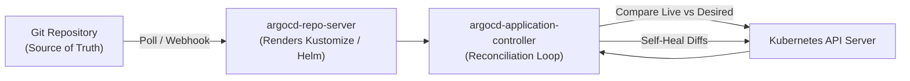
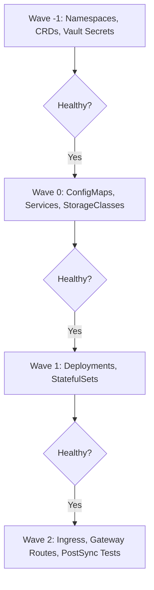
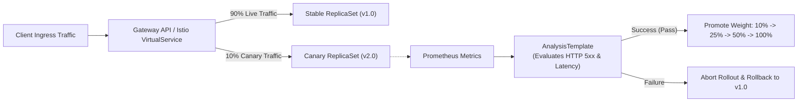

# Domain 1: GitOps & Continuous Delivery — In-Depth Master Study Guide

> [!IMPORTANT]
> **Exam Weighting & Core Architecture Focus:** Domain 1 accounts for **25% of the Certified Cloud Native Platform Engineer (CNPE)** examination. Questions test your mastery of production GitOps delivery: internal Argo CD controller architectures, declarative `Application` and `AppProject` CRDs, Sync Waves and Hooks, resolving HPA/webhook conflicts with `ignoreDifferences`, multi-cluster fleet orchestration with `ApplicationSet` generators and progressive rolling syncs, advanced canary and blue/green rollouts with Argo Rollouts and `AnalysisTemplate` Prometheus health gates, and Flux CD v2 controller design.

---

## 1. GitOps Core Principles & Declarative Delivery

The OpenGitOps CNCF working group defines four canonical principles of cloud-native GitOps:
1. **Declarative:** The entire desired state of the platform must be expressed declaratively.
2. **Versioned and Immutable:** Desired state is stored in Git, guaranteeing an audit trail and single source of truth.
3. **Pulled Automatically:** Software agents running inside the cluster pull desired state from Git rather than external CI systems pushing credentials into the cluster.
4. **Continuously Reconciled:** Continuous reconciliation loops identify drift between desired state (Git) and observed state (cluster) and self-heal automatically.



---

## 2. Argo CD Deep Dive: Architecture & Resource Models

### 2.1 Internal Controller Architecture

* **`argocd-server`:** Stateless API server and Web UI. Manages authentication (OIDC/Dex), validates RBAC against projects, and processes client requests.
* **`argocd-repo-server`:** Clones Git repositories, runs rendering tools (Kustomize, Helm, Config Management Plugins), and outputs pure rendered Kubernetes manifests to Redis.
* **`argocd-application-controller`:** The core reconciliation engine. Compares live state from the Kubernetes API server with rendered manifests and triggers sync operations.
* **Redis Cache:** High-performance in-memory cache storing rendered manifests, repository revision trees, and live cluster state to prevent Git/API server rate limiting.

### 2.2 Advanced Synchronization Options & HPA Conflict Resolution

```yaml
apiVersion: argoproj.io/v1alpha1
kind: Application
metadata:
  name: payment-service
  namespace: argocd
spec:
  project: production-platform
  source:
    repoURL: https://github.com/enterprise/gitops-manifests.git
    targetRevision: main
    path: apps/payment/overlays/prod
  destination:
    server: https://kubernetes.default.svc
    namespace: payments
  syncPolicy:
    automated:
      prune: true
      selfHeal: true
      allowEmpty: false
    syncOptions:
      - CreateNamespace=true
      - ServerSideApply=true
      - PrunePropagationPolicy=foreground
      - PruneLast=true
      - RespectIgnoreDifferences=true
  ignoreDifferences:
    # Critical Platform Engineering Pattern: Allow HPA / KEDA to manage replicas
    - group: apps
      kind: Deployment
      name: payment-service
      jsonPointers:
        - /spec/replicas
    # Ignore webhook-injected mutation annotations (e.g. Istio or Vault)
    - group: ""
      kind: Pod
      jqPathExpressions:
        - .metadata.annotations["sidecar.istio.io/status"]
```

* **`RespectIgnoreDifferences=true`:** When automated self-healing is active (`automated.selfHeal: true`), Argo CD by default reverts any live change. Enabling `RespectIgnoreDifferences=true` instructs the controller to ignore the specified paths during automated sync, preventing infinite fight-and-revert loops with HPA or mutating admission webhooks.

### 2.3 Sync Waves & Sync Hooks

Sync Waves dictate the strict operational sequence of resource creation during a deployment:



* **Annotation:** `argocd.argoproj.io/sync-wave: "1"` (supports negative integers; lowest waves execute first).
* **Sync Hooks:**
  * `PreSync`: Executed before any manifests are synced (e.g., database schema backup, migration dry-run).
  * `Sync`: Executed alongside main manifest application.
  * `PostSync`: Executed after all wave resources reach `Healthy` status (e.g., Slack notifications, integration smoke tests).
  * `SyncFail`: Executed if any phase of the synchronization fails (e.g., emergency alerts, automated rollback triggers).
* **Hook Deletion Policies:** `argocd.argoproj.io/hook-delete-policy: BeforeHookCreation,HookSucceeded`.

---

## 3. Fleet Multi-Cluster Orchestration with `ApplicationSet`

The `ApplicationSet` controller automates the generation and lifecycle of hundreds of Argo CD `Application` resources across heterogeneous clusters.

### 3.1 Matrix Generator (Multi-Cluster $\times$ Multi-App)

The Matrix Generator combines the output of two generators (e.g., Cluster Generator $\times$ Git Directory Generator):

```yaml
apiVersion: argoproj.io/v1alpha1
kind: ApplicationSet
metadata:
  name: fleet-platform-addons
  namespace: argocd
spec:
  generators:
    - matrix:
        generators:
          # Generator 1: Discover all production clusters in the fleet
          - clusters:
              selector:
                matchLabels:
                  environment: production
          # Generator 2: Discover all add-ons in the Git repository
          - git:
              repoURL: https://github.com/enterprise/platform-addons.git
              revision: main
              directories:
                - path: addons/*
  template:
    metadata:
      name: "{{name}}-{{path.basename}}"
    spec:
      project: default
      source:
        repoURL: https://github.com/enterprise/platform-addons.git
        targetRevision: main
        path: "{{path}}"
      destination:
        server: "{{server}}"
        namespace: "{{path.basename}}"
      syncPolicy:
        automated:
          prune: true
          selfHeal: true
```

### 3.2 Progressive Fleet Rollouts (`RollingSync`)

When updating platform components across hundreds of clusters, updating all clusters simultaneously creates massive blast radius risk. Progressive syncs roll out changes in controlled batches:

```yaml
spec:
  strategy:
    type: RollingSync
    rollingSync:
      steps:
        - matchExpressions:
            - key: environment
              operator: In
              values: [canary]
          maxUpdate: 100%
        - matchExpressions:
            - key: environment
              operator: In
              values: [staging]
          maxUpdate: 50%
        - matchExpressions:
            - key: environment
              operator: In
              values: [production]
          maxUpdate: 20%
```

---

## 4. Progressive Delivery with Argo Rollouts

Argo Rollouts provides advanced deployment capabilities (Canary, Blue/Green, Automated Metric Analysis) that replace standard Kubernetes `Deployment` resources.



### 4.1 Production Canary `Rollout` Specification

```yaml
apiVersion: argoproj.io/v1alpha1
kind: Rollout
metadata:
  name: order-service
  namespace: production
spec:
  replicas: 10
  strategy:
    canary:
      canaryService: order-service-canary
      stableService: order-service-stable
      trafficRouting:
        gatewayAPI:
          httpRoute: order-service-route
      analysis:
        templates:
          - templateName: prometheus-error-rate-check
        args:
          - name: service-name
            value: order-service
      steps:
        - setWeight: 10
        - pause: { duration: 10m }
        - setWeight: 25
        - pause: { duration: 30m }
        - setWeight: 50
        - pause: { duration: 15m }
  template:
    metadata:
      labels:
        app: order-service
    spec:
      containers:
        - name: app
          image: us-central1-docker.pkg.dev/proj/repo/order-api:v2.0.0
```

### 4.2 Automated Health Gating with `AnalysisTemplate`

```yaml
apiVersion: argoproj.io/v1alpha1
kind: AnalysisTemplate
metadata:
  name: prometheus-error-rate-check
  namespace: production
spec:
  args:
    - name: service-name
  metrics:
    - name: success-rate
      interval: 1m
      count: 5
      failureLimit: 1
      successCondition: result[0] <= 0.01
      provider:
        prometheus:
          address: http://prometheus-k8s.monitoring.svc:9090
          query: |
            sum(rate(http_requests_total{service="{{args.service-name}}",status=~"5.*"}[2m]))
            /
            sum(rate(http_requests_total{service="{{args.service-name}}"}[2m]))
```

---

## 5. Flux CD v2 Controller Architecture & Comparison

* **Source Controller:** Continuously tracks and pulls Git repositories (`GitRepository`), OCI artifacts (`OCIRepository`), and Helm charts (`HelmRepository`), validating GPG/Cosign signatures.
* **Kustomize Controller:** Reconciles the desired state from Kustomize overlays, executing atomic server-side apply operations and post-build variable substitutions.
* **Helm Controller:** Declaratively manages the release lifecycle of Helm charts (`HelmRelease`), handling automated rollback on failed upgrades.
* **Argo CD vs. Flux CD v2 Architectural Comparison:**
  * **Argo CD:** Centralized control-plane model with a rich enterprise UI, built-in RBAC, multi-tenancy project governance, and unified SSO/OIDC integration.
  * **Flux CD v2:** Composable, modular, headless Kubernetes-native controllers built strictly around CRDs and Kubernetes RBAC. Minimal memory footprint; ideal for edge and air-gapped clusters.
