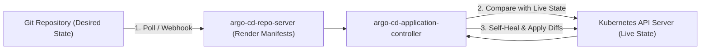
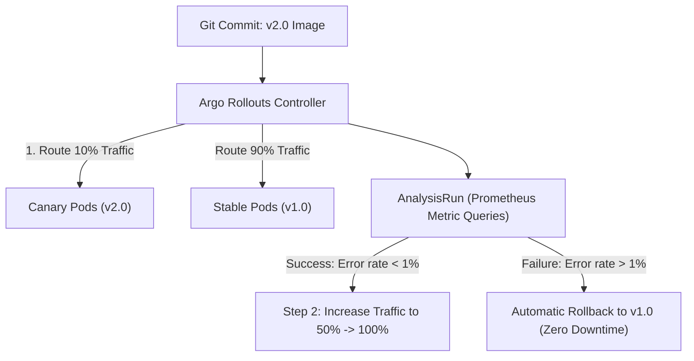

# Domain 1: GitOps & Continuous Delivery — In-Depth Master Study Guide

**Exam Weight:** 25% of the CNPE Exam  
**Target Mastery:** Argo CD architecture (Application, ApplicationSet, AppProject), multi-cluster deployment, sync policies, drift detection and self-healing, Progressive Delivery with Argo Rollouts (Canary, Blue/Green, AnalysisTemplate, MetricProviders), Flux CD v2 controllers, and GitOps multi-tenancy.

---

## 1. GitOps Core Principles & Declarative Delivery

The OpenGitOps CNCF working group defines four canonical principles:
1. **Declarative:** The entire desired state of the platform must be expressed declaratively.
2. **Versioned and Immutable:** Desired state is stored in Git, guaranteeing a complete audit trail and single source of truth.
3. **Pulled Automatically:** Software agents running inside the cluster pull desired state from Git rather than external CI systems pushing credentials into the cluster.
4. **Continuously Reconciled:** Continuous reconciliation loops identify drift between desired state (Git) and observed state (cluster) and self-heal automatically.



---

## 2. Argo CD Deep Dive

### 2.1 Internal Architecture
- **`argocd-server`:** API server and Web UI; authenticates users via OIDC/Dex, validates RBAC, and manages credentials.
- **`argocd-repo-server`:** Clones Git repositories, runs template engines (Helm, Kustomize, plugins), and outputs rendered JSON/YAML manifests.
- **`argocd-application-controller`:** Continuous reconciliation daemon. Compares live cluster state with rendered Git manifests and executes sync tasks.
- **`argocd-dex-server`:** Embedded OpenID Connect identity provider for LDAP, GitHub, Okta, and Google auth.

### 2.2 Advanced Synchronization Options
- **`CreateNamespace=true`:** Automatically creates target namespace if missing.
- **`PrunePropagationPolicy=foreground`:** Ensures child resources (e.g. Pods) are deleted before parent resources (e.g. Deployments).
- **`PruneLast=true`:** Prunes orphaned resources at the very end of the sync process, preventing downtime.
- **`Replace=true`:** Executes `kubectl replace`/`create` instead of `kubectl apply` for resources that exceed annotation length limits or immutable fields.
- **`RespectIgnoreDifferences=true`:** Tells Argo CD to respect `ignoreDifferences` during automated sync so external mutation webhooks (e.g. Istio sidecar injection, Kyverno) do not cause sync loops.

```yaml
spec:
  syncPolicy:
    automated:
      prune: true
      selfHeal: true
    syncOptions:
      - CreateNamespace=true
      - PruneLast=true
      - RespectIgnoreDifferences=true
  ignoreDifferences:
    - group: apps
      kind: Deployment
      jsonPointers:
        - /spec/replicas # Allows HPA / KEDA to scale replicas without Argo reverting!
```

### 2.3 ApplicationSet Generators
The `ApplicationSet` controller automates multi-cluster and multi-tenant deployments:

1. **List Generator:** Static list of cluster/environment parameters.
2. **Cluster Generator:** Queries Argo CD secret-managed clusters by labels.
3. **Git Generator:** Scans directories or files inside Git repos.
4. **Matrix Generator:** Combines two generators (e.g. Deploy every app directory from Git across all production clusters).
5. **Pull Request Generator:** Creates ephemeral review environments for open PRs.

---

## 3. Progressive Delivery with Argo Rollouts

Standard Kubernetes Deployments support only basic RollingUpdate or Recreate strategies. **Argo Rollouts** provides advanced traffic management and automated canary analysis:



### 3.1 Canary Strategy Configuration with Inline Analysis
```yaml
apiVersion: argoproj.io/v1alpha1
kind: Rollout
metadata:
  name: payment-engine
  namespace: finance
spec:
  replicas: 8
  strategy:
    canary:
      canaryService: payment-canary-svc
      stableService: payment-stable-svc
      trafficRouting:
        nginx:
          stableIngress: payment-ingress
      steps:
        - setWeight: 20
        - pause: { duration: 5m }
        - setWeight: 50
        - pause: { duration: 10m }
      analysis:
        templates:
          - templateName: http-error-rate
        args:
          - name: service
            value: payment-canary-svc
```

---

## 4. Flux CD v2 Architecture

Flux v2 is composed of specialized composable controllers:
- **`source-controller`:** Fetches Git, Helm, OCI, and S3 repositories and artifacts.
- **`kustomize-controller`:** Reconciles Kustomize overlays and plain manifests.
- **`helm-controller`:** Declaratively manages HelmRelease lifecycles.
- **`notification-controller`:** Handles incoming webhooks from Git and emits notifications (Slack, Teams, PagerDuty).
- **`image-automation-controller`:** Scans container registries for new image tags and automatically commits updates back to Git!
