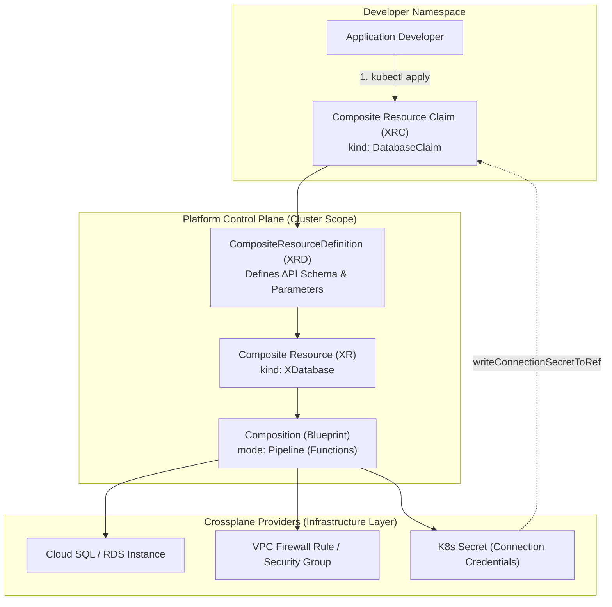
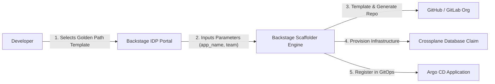
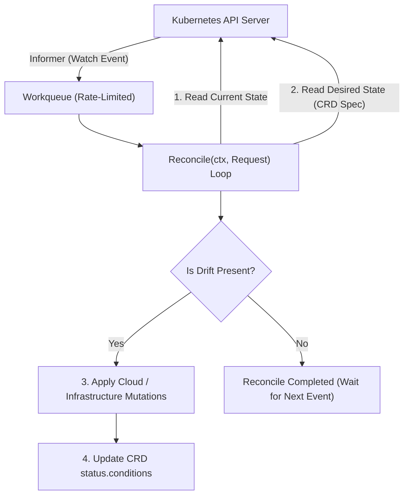
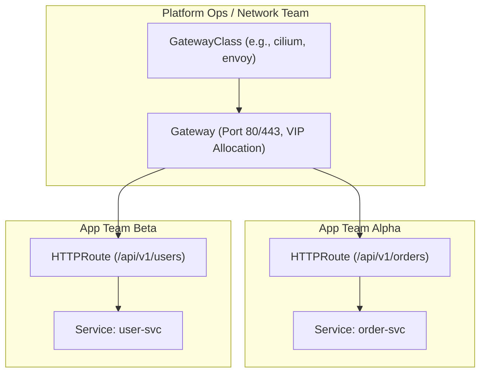

# Domain 2: Self-Service Platform APIs & Automation — In-Depth Master Study Guide

> [!IMPORTANT]
> **Exam Weighting & Core Architecture Focus:** Domain 2 accounts for **25% of the Certified Cloud Native Platform Engineer (CNPE)** examination. Questions test your mastery of platform self-service automation: Crossplane v1.16+ control plane architecture (Managed Resources, XRDs, Compositions, Composition Functions, EnvironmentConfigs), the Kubernetes Operator pattern (controller-runtime loops, CRD CEL validations, finalizers), Spotify Backstage developer portals (Software Templates, Catalog entities), and Kubernetes Gateway API topologies.

---

## 1. Crossplane: The Universal Cloud Control Plane

Crossplane extends Kubernetes into a cloud control plane, allowing platform teams to compose infrastructure across multiple clouds (AWS, GCP, Azure, DigitalOcean) into clean, high-level, developer-friendly APIs.



### 1.1 Crossplane Resource Taxonomy

* **Managed Resource (MR):** A 1:1 declarative Kubernetes representation of a single cloud resource (e.g., `Instance.rds.aws.crossplane.io` or `DatabaseCluster.do.crossplane.io`).
* **Provider:** An in-cluster controller that authenticates to a cloud provider and continuously reconciles Managed Resources.
* **`ProviderConfig`:** Stores authentication credentials (e.g., IAM role ARN via Workload Identity or API token) used by a Provider.
* **CompositeResourceDefinition (XRD):** Defines a new custom API type (the OpenAPI v3 schema), specifying the fields exposed to developers.
* **Composition:** The infrastructure blueprint defining which underlying Managed Resources to create when an XRD is instantiated.
* **Composite Resource (XR):** The cluster-scoped resource generated when an XRD is satisfied.
* **Composite Resource Claim (XRC):** The namespaced, developer-facing claim that requests an XR (e.g., `kind: DatabaseClaim`).

### 1.2 Management Policies & Deletion Policies

* **`deletionPolicy`:**
  * `Delete` (Default): Deleting the Managed Resource deletes the underlying physical cloud infrastructure.
  * `Orphan`: Deleting the Managed Resource deletes the Kubernetes object while leaving the physical cloud infrastructure running.
* **`managementPolicies`:** Enables granular control over what Crossplane can do to a cloud resource:
  * `["Observe"]`: Read-only. Crossplane discovers and monitors external infrastructure without modifying it.
  * `["Create", "Update"]`: Provisions and mutates infrastructure, but prevents deletion (`Delete` omitted).
  * `["*"]`: Full management.

---

## 2. Compositions & Composition Functions (`mode: Pipeline`)

Modern Crossplane (v1.14+) has transitioned from legacy YAML `patch-and-transform` to **Composition Functions (`mode: Pipeline`)**, running modular containers that dynamically render infrastructure:

```yaml
apiVersion: apiextensions.crossplane.io/v1
kind: Composition
metadata:
  name: xdatabases.postgres.production
spec:
  compositeTypeRef:
    apiVersion: platform.enterprise.io/v1alpha1
    kind: XDatabase
  mode: Pipeline
  pipeline:
    # Function 1: Core declarative patch and transform logic
    - step: patch-and-transform
      functionRef:
        name: function-patch-and-transform
      input:
        apiVersion: pt.fn.crossplane.io/v1beta1
        kind: Resources
        resources:
          - name: postgresql-cluster
            base:
              apiVersion: databases.do.crossplane.io/v1alpha1
              kind: DatabaseCluster
              spec:
                forProvider:
                  engine: pg
                  region: nyc3
                writeConnectionSecretToRef:
                  namespace: crossplane-system
            patches:
              - type: FromCompositeFieldPath
                fromFieldPath: spec.storageGB
                toFieldPath: spec.forProvider.size
              - type: FromCompositeFieldPath
                fromFieldPath: spec.nodeCount
                toFieldPath: spec.forProvider.numNodes
              - type: ToCompositeFieldPath
                fromFieldPath: status.atProvider.uri
                toFieldPath: status.connectionUri

    # Function 2: Automatically marks XR as Ready when all MRs are healthy
    - step: auto-ready
      functionRef:
        name: function-auto-ready
```

---

## 3. Spotify Backstage Internal Developer Portal (IDP)

Backstage serves as the single pane of glass for developers, standardizing software catalog discovery and automated repository scaffolding.



### 3.1 Backstage Software Catalog Entity Model

* **`Component`:** A piece of running software (a service, website, or library).
* **`API`:** The boundary between components (OpenAPI, gRPC, GraphQL).
* **`Resource`:** Infrastructure required by a component (e.g., PostgreSQL DB, S3 bucket, Pub/Sub topic).
* **`System`:** A collection of related Components and Resources that fulfill a business capability.
* **`Domain`:** High-level business grouping spanning multiple Systems.
* **`Group` / `User`:** Teams and individual engineers owning components.

### 3.2 Declarative Software Template (`scaffolder.backstage.io/v1beta3`)

```yaml
apiVersion: scaffolder.backstage.io/v1beta3
kind: Template
metadata:
  name: microservice-golden-path
  title: Production-Grade Golang Microservice
  description: Scaffolds a production-ready Go service with CI/CD, Crossplane DB, and Argo CD
spec:
  owner: platform-core-team
  type: service
  parameters:
    - title: Service Configuration
      required: [serviceName, ownerTeam]
      properties:
        serviceName:
          type: string
          description: Unique kebab-case name of the microservice
        ownerTeam:
          type: string
          description: Owning engineering team slug
  steps:
    - id: fetch-base-template
      name: Fetching Template Files
      action: fetch:template
      input:
        url: ./skeleton
        values:
          serviceName: ${{ parameters.serviceName }}
          owner: ${{ parameters.ownerTeam }}

    - id: publish-github-repo
      name: Creating GitHub Repository
      action: publish:github
      input:
        allowedHosts: ["github.com"]
        description: Service repo for ${{ parameters.serviceName }}
        repoUrl: github.com?owner=my-org&repo=${{ parameters.serviceName }}

    - id: register-argocd
      name: Registering in Argo CD GitOps Fleet
      action: argocd:create-resources
      input:
        appName: ${{ parameters.serviceName }}
        namespace: production
```

---

## 4. Kubernetes Operator Pattern & Controller Reconciliation

Platform engineers build custom operators to encode operational domain knowledge into software.



### 4.1 Key Controller Architectural Components

* **Informer & Reflector:** Continuously watches the Kubernetes API server for events (`Add`, `Update`, `Delete`) on specific resource types and updates the in-memory **Lister Cache**.
* **Workqueue:** Stores namespaced keys (`namespace/name`) of resources requiring reconciliation, featuring exponential backoff retries.
* **Reconciliation Loop:** Must be **idempotent and level-triggered** (reacts to the current state of the world, rather than historical edge transitions).
* **Finalizers:** Prevents immediate deletion of a custom resource. When a user runs `kubectl delete`, Kubernetes adds `metadata.deletionTimestamp`. The controller executes external cleanup tasks (e.g., deleting an AWS S3 bucket), and then removes the finalizer string from `metadata.finalizers` to allow garbage collection to proceed.

---

## 5. Kubernetes Gateway API Architecture

The Gateway API replaces legacy `Ingress` with a modern, role-oriented, expressive routing framework.



* **Role Separation:**
  * **`GatewayClass`:** Managed by Cloud Provider or Infrastructure SRE (defines controller implementation).
  * **`Gateway`:** Managed by Central Platform Team (requests external IP addresses and TLS certificates).
  * **`HTTPRoute` / `GRPCRoute`:** Managed by Application Teams (defines routing rules, path prefixes, header matches, and canary weights).
* **Cross-Namespace Security (`ReferenceGrant`):** A Gateway in namespace `infra` cannot route traffic to a Service in namespace `payments` unless the `payments` namespace explicitly creates a `ReferenceGrant` allowing cross-namespace forwarding.
