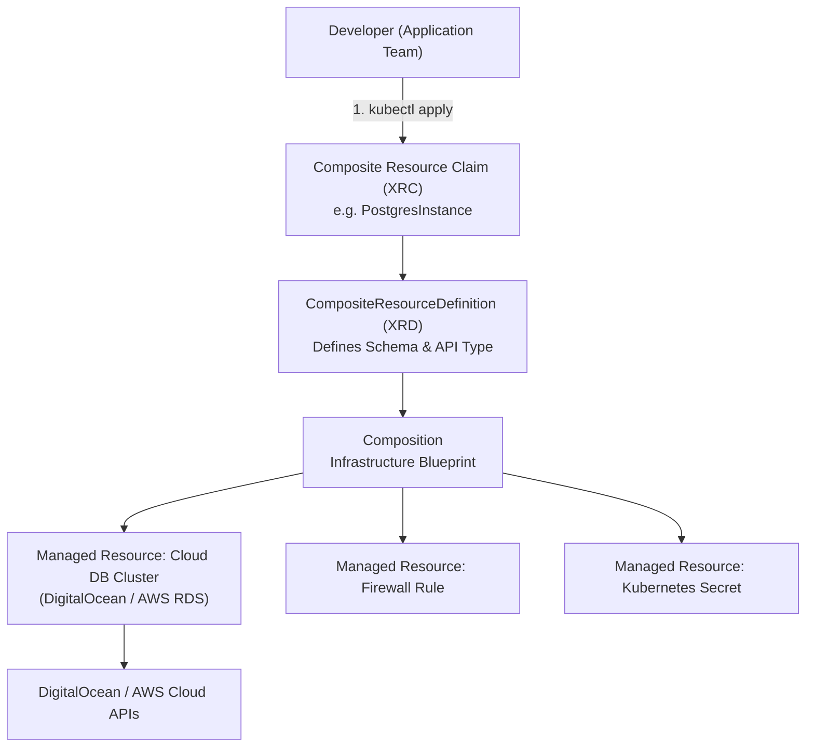
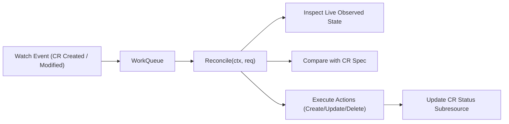

# Domain 2: Self-Service Platform APIs & Automation — In-Depth Master Study Guide

**Exam Weight:** 25% of the CNPE Exam  
**Target Mastery:** Crossplane control plane architecture (Managed Resources, XRDs, Compositions, Composition Functions, Claims), Kubernetes Operator Pattern (CRDs, controller-runtime reconciliation), Backstage Developer Portals (Software Templates, Catalog entities), and Self-Service IDP interfaces.

---

## 1. Crossplane: Extending Kubernetes into a Universal Cloud Control Plane

Crossplane transforms a Kubernetes cluster into an API-driven control plane capable of provisioning and managing infrastructure across AWS, DigitalOcean, GCP, and Azure using native declarative Kubernetes manifests.



### 1.1 Crossplane Resource Taxonomy
1. **Managed Resource (MR):** A 1:1 declarative representation of a single cloud resource (e.g. `DatabaseCluster.do.crossplane.io` or `Instance.ec2.aws.crossplane.io`).
2. **Provider:** A containerized Kubernetes controller that authenticates to a specific cloud provider and reconciles MRs.
3. **CompositeResourceDefinition (XRD):** Defines a new custom API type (the OpenAPI v3 schema), specifying the fields exposed to developers.
4. **Composition:** The implementation template that defines which underlying Managed Resources to create when an XRD is instantiated.
5. **Composite Resource (XR):** The cluster-scoped custom resource generated when an XRD is satisfied.
6. **Composite Resource Claim (XRC):** The namespaced, developer-facing claim that requests an XR (e.g. `kind: PostgresInstance`).

### 1.2 Defining a CompositeResourceDefinition (XRD)
```yaml
apiVersion: apiextensions.crossplane.io/v1
kind: CompositeResourceDefinition
metadata:
  name: xdatabases.platform.corp
spec:
  group: platform.corp
  names:
    kind: XDatabase
    plural: xdatabases
  claimNames:
    kind: DatabaseClaim
    plural: databaseclaims
  versions:
    - name: v1alpha1
      served: true
      referenceable: true
      schema:
        openAPIV3Schema:
          type: object
          properties:
            spec:
              type: object
              required: [engine, storageGB]
              properties:
                engine:
                  type: string
                  enum: ["postgres", "mysql"]
                storageGB:
                  type: integer
                  minimum: 10
                  maximum: 500
```

### 1.3 Authoring Compositions with Patching & Transforms
```yaml
apiVersion: apiextensions.crossplane.io/v1
kind: Composition
metadata:
  name: xdatabase.digitalocean.postgres
  labels:
    provider: digitalocean
    engine: postgres
spec:
  compositeTypeRef:
    apiVersion: platform.corp/v1alpha1
    kind: XDatabase
  resources:
    - name: do-postgres-cluster
      base:
        apiVersion: database.do.crossplane.io/v1alpha1
        kind: DatabaseCluster
        spec:
          forProvider:
            engine: pg
            version: "16"
            region: nyc3
            size: db-s-1vcpu-1gb
      patches:
        - type: FromCompositeFieldPath
          fromFieldPath: spec.storageGB
          toFieldPath: spec.forProvider.size
          transforms:
            - type: map
              map:
                10: "db-s-1vcpu-1gb"
                50: "db-s-2vcpu-4gb"
                100: "db-s-4vcpu-8gb"
```

---

## 2. The Kubernetes Operator Pattern

An **Operator** combines custom resource definitions (CRDs) with a custom controller that implements the continuous reconciliation loop:



### 2.1 Core Invariants of Controller Runtime
1. **Level-Triggered, Not Edge-Triggered:** The reconciler must observe the current state of the world, compare it against the desired state in the spec, and take actions to reconcile. It must not rely on tracking every discrete intermediate event.
2. **Idempotence:** Running `Reconcile()` multiple times with the same input must produce the exact same outcome without duplicate resource creation.
3. **Status Subresource:** Never modify `spec` from inside a controller. Write observed conditions, timestamps, and readiness indicators strictly to `status` via `r.Status().Update()`.

---

## 3. Backstage Developer Portal & Software Templates

Spotify's open-source **Backstage** (CNCF Incubation) is the industry-standard frontend for Internal Developer Platforms (IDPs).

### 3.1 Software Template Structure (`template.yaml`)
A Backstage Software Template allows developers to self-serve scaffolding with built-in golden paths:

```yaml
apiVersion: scaffolder.backstage.io/v1beta3
kind: Template
metadata:
  name: springboot-microservice-template
  title: Production Spring Boot Microservice
  description: Scaffolds a hardened Spring Boot microservice with GitOps Argo CD and Kyverno manifests
spec:
  owner: platform-core
  type: service

  parameters:
    - title: Service Details
      required: [component_id, owner_team]
      properties:
        component_id:
          title: Service Identifier
          type: string
          description: Lowercase hyphenated unique name
        owner_team:
          title: Owning Team
          type: string
          enum: [checkout, billing, logistics]

  steps:
    - id: template
      name: Render Template Files
      action: fetch:template
      input:
        url: ./skeleton
        values:
          name: ${{ parameters.component_id }}
          owner: ${{ parameters.owner_team }}

    - id: publish
      name: Create GitHub Repository
      action: publish:github
      input:
        allowedHosts: ['github.com']
        description: Service ${{ parameters.component_id }}
        repoUrl: github.com?owner=enterprise&repo=${{ parameters.component_id }}

    - id: register
      name: Register in Software Catalog
      action: catalog:register
      input:
        repoContentsUrl: ${{ steps.publish.output.repoContentsUrl }}
        catalogInfoPath: '/catalog-info.yaml'
```
