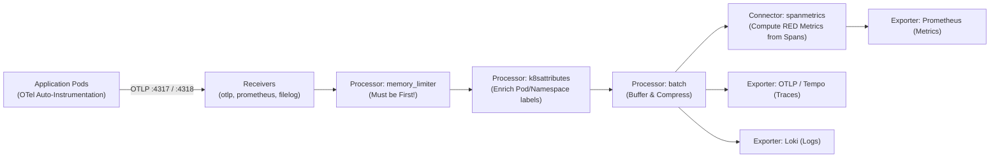
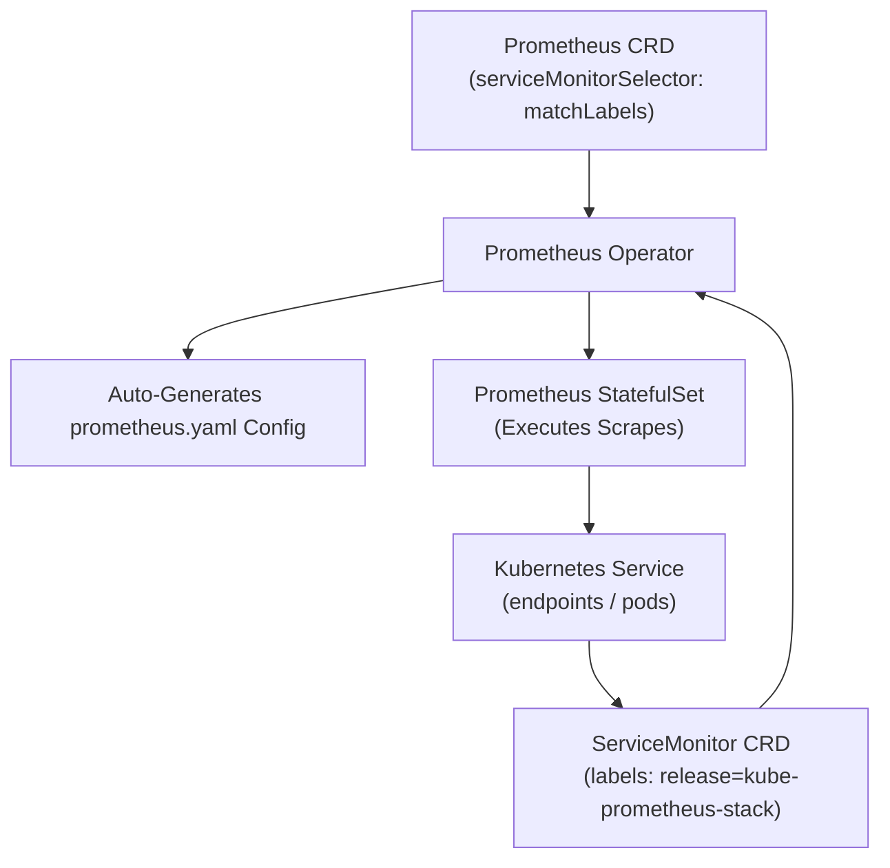

# Domain 3: Observability & Operations — In-Depth Master Study Guide

> [!IMPORTANT]
> **Exam Weighting & Core Architecture Focus:** Domain 3 accounts for **20% of the Certified Cloud Native Platform Engineer (CNPE)** examination. Questions test your mastery of production telemetry pipelines: OpenTelemetry (OTel) Collector architecture (Receivers, Processors, Exporters, Connectors), OTel Operator zero-code auto-instrumentation, Prometheus Operator CRDs (`ServiceMonitor`, `PodMonitor`, `PrometheusRule`), the `serviceMonitorSelector` matching trap, Alertmanager routing trees, Grafana Loki log aggregation with LogQL, and long-term metric federation with Thanos and Mimir.

---

## 1. OpenTelemetry (OTel) Collector Pipeline Architecture

OpenTelemetry standardizes telemetry collection across metrics, logs, and distributed traces through vendor-neutral pipelines.



### 1.1 Core Collector Components & Pipeline Order

* **Receivers:** Ingest data into the collector (`otlp` on gRPC `:4317` / HTTP `:4318`, `prometheus`, `filelog`, `hostmetrics`).
* **Processors (Order Matters Strictly!):**
  1. **`memory_limiter`:** **MUST ALWAYS BE THE FIRST PROCESSOR IN THE PIPELINE**. Monitors collector process memory and drops data or applies backpressure when thresholds are breached, preventing Linux kernel OOM killer crashes.
  2. **`k8sattributes`:** Queries the local kubelet or API server to enrich raw telemetry with Kubernetes metadata (`k8s.pod.name`, `k8s.namespace.name`, `k8s.node.name`).
  3. **`transform`:** Employs the OpenTelemetry Transformation Language (OTTL) to scrub PII (e.g., masking credit cards, removing authorization headers) and standardize attribute naming conventions.
  4. **`batch`:** Groups telemetry data into batches before network transmission to reduce I/O overhead and improve compression.
* **Exporters:** Translates and dispatches telemetry to backends (Mimir, Prometheus, Tempo, Datadog).
* **Connectors:** Bridges distinct pipelines. The `spanmetrics` connector computes Request, Error, and Duration (RED) metrics directly from distributed tracing spans.

### 1.2 OpenTelemetry Operator Auto-Instrumentation

The OpenTelemetry Operator injects SDKs directly into application pods via mutating admission webhooks without requiring code modifications:

```yaml
apiVersion: opentelemetry.io/v1alpha1
kind: Instrumentation
metadata:
  name: platform-instrumentation
  namespace: default
spec:
  exporter:
    endpoint: http://otel-collector.observability.svc:4317
  propagators:
    - tracecontext
    - baggage
  java:
    image: ghcr.io/open-telemetry/opentelemetry-java-instrumentation:v2.5.0
  nodejs:
    image: ghcr.io/open-telemetry/opentelemetry-js:v0.52.0
  python:
    image: ghcr.io/open-telemetry/opentelemetry-python:v1.25.0
```

* **Workload Activation:** Annotate the target Deployment Pod template:
  `instrumentation.opentelemetry.io/inject-java: "true"`

---

## 2. Prometheus Operator & Custom Resource Definitions

The Prometheus Operator automates the deployment, configuration, and target discovery of Prometheus monitoring instances using declarative CRDs.



### 2.1 The #1 CNPE Exam Failure Point: `serviceMonitorSelector`

When creating a `ServiceMonitor`, engineers frequently report that Prometheus fails to scrape their service endpoints:
* **The Root Cause:** The `Prometheus` resource defines a **`serviceMonitorSelector`** and optional **`serviceMonitorNamespaceSelector`**.
* If the `Prometheus` CRD specifies:
  ```yaml
  serviceMonitorSelector:
    matchLabels:
      release: kube-prometheus-stack
  ```
* Every `ServiceMonitor` in the cluster **MUST** have the exact label `release: kube-prometheus-stack` in its `metadata.labels`! If omitted, Prometheus will silently ignore the `ServiceMonitor`.

### 2.2 Production `ServiceMonitor` Specification

```yaml
apiVersion: monitoring.coreos.com/v1
kind: ServiceMonitor
metadata:
  name: order-api-monitor
  namespace: orders
  labels:
    release: kube-prometheus-stack # Critical selector match!
spec:
  selector:
    matchLabels:
      app: order-api # Matches the target Kubernetes Service selector
  endpoints:
    - port: metrics # Matches the port name in the Service definition
      interval: 15s
      path: /metrics
      metricRelabelings:
        - action: keep
          sourceLabels: [__name__]
          regex: "http_requests_.*|jvm_memory_.*"
```

### 2.3 Alerting Rules with `PrometheusRule`

```yaml
apiVersion: monitoring.coreos.com/v1
kind: PrometheusRule
metadata:
  name: order-service-slo-alerts
  namespace: orders
  labels:
    role: alert-rules
    release: kube-prometheus-stack
spec:
  groups:
    - name: slo.rules
      rules:
        - alert: HighHttpErrorRate
          expr: |
            sum(rate(http_requests_total{status=~"5.*"}[5m]))
            /
            sum(rate(http_requests_total[5m])) > 0.05
          for: 2m
          labels:
            severity: critical
          annotations:
            summary: "Service {{ $labels.service }} error rate exceeds 5%"
            description: "Current error rate is {{ $value | humanizePercentage }}"
```

---

## 3. High-Scale Logging with Grafana Loki & LogQL

Grafana Loki is a horizontally scalable, multi-tenant log aggregation system inspired by Prometheus:
* **Index-Free Architecture:** Unlike Elasticsearch, Loki **does not index full-text log bodies**. It indexes only metadata labels (`namespace`, `app`, `container`), storing raw compressed log chunks in cloud object storage (S3, GCS).

### 3.1 LogQL Query Syntax Patterns

* **Stream Selector:** `{namespace="production", app="order-service"}`
* **Line Filter:** `{app="order-service"} |= "error" != "timeout"`
* **JSON Parser & Structured Filtering:**
  ```logql
  {app="order-service"}
  | json
  | status >= 500
  | duration > 2s
  ```
* **Log Metric Aggregation (Computing Rate from Logs):**
  ```logql
  sum(rate({app="order-service"} |= "panic" [5m])) by (pod)
  ```

---

## 4. Multi-Cluster Long-Term Metric Storage: Thanos vs. Mimir

* **Thanos:**
  * Uses a **Sidecar** deployed alongside Prometheus instances.
  * Uploads historical Prometheus TSDB blocks to object storage (S3/GCS) every 2 hours.
  * **Thanos Query:** Provides a global, unified query view across multi-region clusters with deduplication.
  * **Thanos Compactor:** Applies downsampling ($5\text{m}$ and $1\text{h}$ resolutions) and retention policies to historical metrics.
* **Grafana Mimir:**
  * Dedicated, multi-tenant distributed time-series database.
  * Prometheus instances use `remote_write` to stream metrics continuously to Mimir ingesters.
  * Supports petabyte-scale horizontal query scaling with isolated tenant IDs (`X-Scope-OrgID`).
