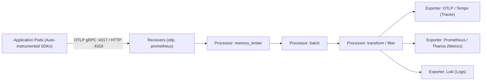
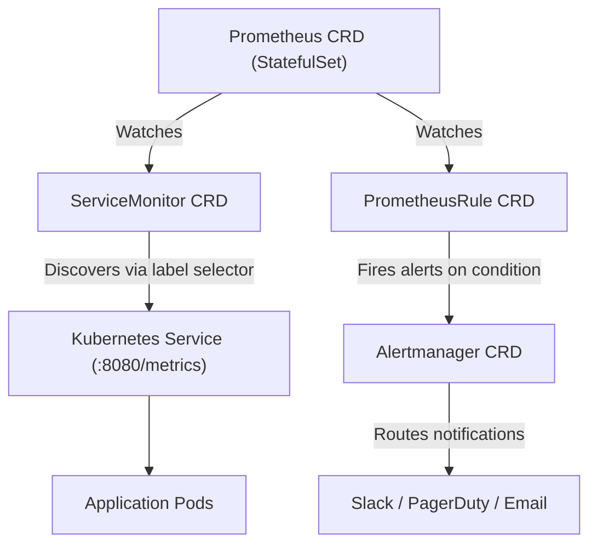

# Domain 3: Observability & Operations — In-Depth Master Study Guide

**Exam Weight:** 20% of the CNPE Exam  
**Target Mastery:** OpenTelemetry (OTel) Collector pipelines, OTel Operator & auto-instrumentation, Prometheus Operator (ServiceMonitor, PodMonitor, PrometheusRule), Alertmanager notification routing, Grafana declarative provisioning, SLO calculation, and automated remediation.

---

## 1. OpenTelemetry (OTel) Collector Pipeline Architecture

OpenTelemetry provides a vendor-agnostic framework for collecting, processing, and exporting the three pillars of observability: **Traces, Metrics, and Logs**.



### 1.1 Core Collector Components
1. **Receivers:** How data gets into the collector (e.g. `otlp`, `prometheus`, `jaeger`, `filelog`).
2. **Processors:** Manipulates data between receive and export. Order matters!
   - `memory_limiter`: Drops or back-pressures data when memory usage exceeds configured thresholds, preventing OOM crashes.
   - `batch`: Groups telemetry events into batches to optimize network throughput and compression.
   - `transform`: Uses OpenTelemetry Transformation Language (OTTL) to scrub PII or rename attributes.
3. **Exporters:** Translates and sends data to downstream backends (Tempo, Prometheus, Mimir, Datadog).
4. **Connectors:** Bridges pipelines (e.g. `spanmetrics` connector computes RED metrics from incoming trace spans).

### 1.2 OpenTelemetry Operator Auto-Instrumentation
The OpenTelemetry Operator injects SDKs directly into application pods via an annotation without requiring code recompilation:

```yaml
apiVersion: opentelemetry.io/v1alpha1
kind: Instrumentation
metadata:
  name: auto-instrumentation
  namespace: default
spec:
  exporter:
    endpoint: http://platform-otel-collector.observability.svc:4317
  propagators:
    - tracecontext
    - baggage
  java:
    image: ghcr.io/open-telemetry/opentelemetry-java-instrumentation:v2.5.0
  nodejs:
    image: ghcr.io/open-telemetry/opentelemetry-js:v0.52.0
```

To enable auto-instrumentation on a workload, add the pod annotation:
`instrumentation.opentelemetry.io/inject-java: "true"`

---

## 2. Prometheus Operator & Custom Resources

The **Prometheus Operator** provides declarative management of Prometheus instances and monitoring targets via CRDs:



### 2.1 ServiceMonitor Configuration
```yaml
apiVersion: monitoring.coreos.com/v1
kind: ServiceMonitor
metadata:
  name: payment-service-monitor
  namespace: payments
  labels:
    release: prometheus-stack # Must match the Prometheus CR's serviceMonitorSelector!
spec:
  selector:
    matchLabels:
      app: payment-api
  endpoints:
    - port: metrics # Refers to port NAME inside the target Service, not port number!
      interval: 15s
      path: /actuator/prometheus
```

### 2.2 PrometheusRule Alerting Manifest (Multi-Burn-Rate SLO Alerts)
```yaml
apiVersion: monitoring.coreos.com/v1
kind: PrometheusRule
metadata:
  name: platform-slo-alerts
  namespace: monitoring
  labels:
    role: alert-rules
spec:
  groups:
    - name: api-availability-slo
      rules:
        - alert: APIHighErrorRateCritical
          expr: |
            (
              sum(rate(http_requests_total{status=~"5.."}[5m]))
              /
              sum(rate(http_requests_total[5m]))
            ) > 0.05
          for: 2m
          labels:
            severity: critical
            team: platform
          annotations:
            summary: "High API Error Rate on {{ $labels.service }}"
            description: "Error rate is {{ $value | humanizePercentage }} over 5m."
```

---

## 3. Declarative Grafana Provisioning

In cloud-native platforms, dashboards must be maintained as code in Git, not hand-crafted in the UI.

### Provisioning Dashboards via ConfigMap
When using the Grafana Helm chart or Grafana Operator, configure dashboard discovery using labeled ConfigMaps:
```yaml
apiVersion: v1
kind: ConfigMap
metadata:
  name: kubernetes-cluster-overview-dashboard
  namespace: monitoring
  labels:
    grafana_dashboard: "1" # Grafana sidecar automatically imports this!
data:
  cluster-overview.json: |
    {
      "annotations": {},
      "editable": false,
      "title": "Kubernetes Fleet Overview",
      "panels": [ ... ]
    }
```
