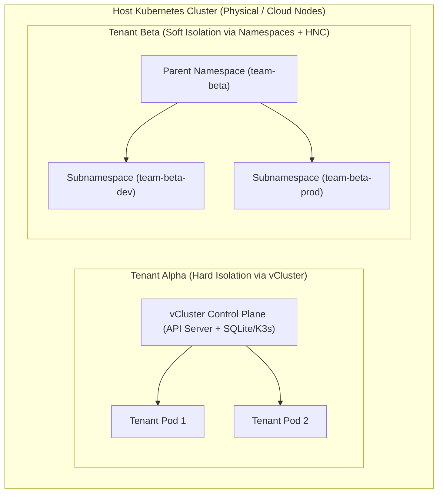
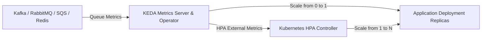
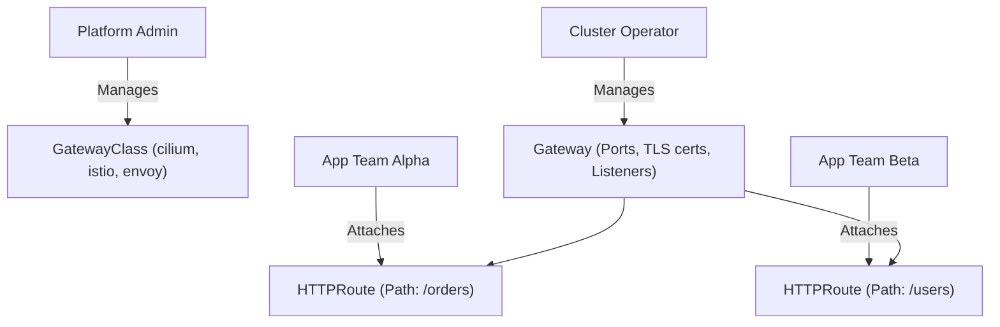

# Domain 4: Platform Architecture & Scalability — In-Depth Master Study Guide

**Exam Weight:** 15% of the CNPE Exam  
**Target Mastery:** Multi-tenancy models (Soft vs Hard, vCluster virtual control planes, HNC), Autoscaling engines (HPA v2, VPA, KEDA ScaledObjects/ScaledJobs), Node autoscaling (Karpenter v1.0+ NodePool & NodeClass vs Cluster Autoscaler), Gateway API (Gateway, HTTPRoute, ReferenceGrant), and Cluster API (CAPI).

---

## 1. Multi-Tenancy Architecture: Soft vs Hard Multi-Tenancy

Platform teams must isolate disparate tenant teams on shared physical infrastructure without incurring the massive financial and operational overhead of thousands of independent control planes.



### 1.1 Soft Multi-Tenancy (Namespaces, RBAC, NetworkPolicies, Quotas)
- **Use Case:** Trusted teams within the same enterprise.
- **Components:**
  1. `ResourceQuota`: Restricts total CPU, memory, storage, and object counts per namespace.
  2. `LimitRange`: Enforces minimum/maximum requests and limits per container, preventing pods without requests from monopolizing nodes.
  3. `NetworkPolicy`: Isolates traffic at L3/L4. Default-deny ingress and egress must be established.
  4. `Hierarchical Namespace Controller (HNC)`: Enables subnamespaces and cascades RBAC roles, LimitRanges, and NetworkPolicies from parent namespaces to child namespaces.

### 1.2 Hard Multi-Tenancy with vCluster
- **Use Case:** Untrusted tenants, independent CI/CD pipelines needing cluster-scoped permissions (`CRDs`, `ClusterRoles`, `Namespaces`), or multi-tenant SaaS platforms.
- **Architecture:**
  - A vCluster runs as an internal StatefulSet inside a host namespace.
  - Tenants connect to the virtual API server with full `cluster-admin` privileges.
  - Virtual worker pods are synchronized ("synced") to the host namespace by the vCluster syncer controller.
  - Host cluster control plane, etcd, and CRDs are completely hidden and isolated from the tenant.

```yaml
# vcluster.yaml configuration
apiVersion: v1
kind: ConfigMap
metadata:
  name: vcluster-config
  namespace: team-alpha
data:
  config.yaml: |
    sync:
      nodes:
        enabled: true
        syncAllNodes: false
      persistentvolumes:
        enabled: true
      ingresses:
        enabled: true
    isolation:
      enabled: true
      networkPolicy:
        enabled: true
      resourceQuota:
        enabled: true
```

---

## 2. Advanced Workload Autoscaling: KEDA & HPA

### 2.1 KEDA (Kubernetes Event-driven Autoscaling) Architecture
Standard HPA v2 relies solely on resource utilization metrics (CPU/Memory) or external metrics via cumbersome metric adapters. KEDA introduces an event-driven model that can scale workloads **from zero to $N$ replicas** and back to zero based on external event queues.



#### ScaledObject Manifest (Kafka Consumer Lag):
```yaml
apiVersion: keda.sh/v1alpha1
kind: ScaledObject
metadata:
  name: kafka-consumer-scaler
  namespace: streaming
spec:
  scaleTargetRef:
    apiVersion: apps/v1
    kind: Deployment
    name: order-consumer
  minReplicaCount: 0
  maxReplicaCount: 50
  cooldownPeriod: 300
  pollingInterval: 15
  triggers:
    - type: kafka
      metadata:
        bootstrapServers: kafka.streaming.svc.cluster.local:9092
        topic: orders.incoming
        consumerGroup: order-processor-v1
        lagThreshold: "100"
        offsetResetPolicy: latest
```

#### ScaledJobs for Batch Workloads
For tasks that do not run as long-lived HTTP servers (e.g., video transcode jobs, database migrations), KEDA `ScaledJob` launches run-to-completion `Job` resources directly for every $N$ queue messages.

---

## 3. Modern Node Autoscaling: Karpenter v1.0+

Cluster Autoscaler operates on static Cloud Provider Auto Scaling Groups (ASGs / Node Pools), introducing 3–5 minute spin-up delays and rigid instance sizing. **Karpenter** bypasses node groups by communicating directly with cloud APIs (AWS EC2, Azure, DigitalOcean) to evaluate pending pod resource requirements and launch right-sized instances in 30–45 seconds.

### 3.1 Core Karpenter CRDs (v1.0 API)
1. **`NodePool`:** Defines scheduling constraints, taints, capacity limits, and disruption budgets.
2. **`EC2NodeClass` / `NodeClass`:** Defines cloud-specific instance properties (AMI, subnets, security groups, block storage, user data).

```yaml
apiVersion: karpenter.sh/v1
kind: NodePool
metadata:
  name: default-compute
spec:
  template:
    spec:
      requirements:
        - key: kubernetes.io/arch
          operator: In
          values: ["amd64", "arm64"]
        - key: karpenter.sh/capacity-type
          operator: In
          values: ["spot", "on-demand"]
        - key: karpenter.k8s.aws/instance-category
          operator: In
          values: ["c", "m", "r"]
      nodeClassRef:
        group: karpenter.k8s.aws
        kind: EC2NodeClass
        name: default-linux
  limits:
    cpu: "1000"
    memory: 2000Gi
  disruption:
    consolidationPolicy: WhenEmptyOrUnderutilized
    consolidateAfter: 1m
    budgets:
      - nodes: 10%
```

### 3.2 Karpenter Consolidation & Cost Optimization
- **`WhenEmpty`:** Terminates nodes that host no pods.
- **`WhenEmptyOrUnderutilized`:** Calculates whether pods scattered across multiple underutilized nodes can be packed onto fewer, cheaper nodes, automatically cordoning, draining, and replacing instances.

---

## 4. Kubernetes Gateway API Architecture

Ingress v1 is limited by non-standard vendor annotations and single-namespace coupling. **Gateway API** decomposes ingress into role-oriented, declarative resources:



### 4.1 Cross-Namespace Routing & ReferenceGrant
To prevent unauthorized teams from attaching routes to a platform Gateway or cross-routing secrets across namespaces, Gateway API requires explicit `ReferenceGrant` approval:

```yaml
apiVersion: gateway.networking.k8s.io/v1beta1
kind: ReferenceGrant
metadata:
  name: allow-gateway-cross-namespace
  namespace: shared-gateway-ns
spec:
  from:
    - group: gateway.networking.k8s.io
      kind: HTTPRoute
      namespace: payments-team
  to:
    - group: ""
      kind: Service
      name: payment-backend
```
