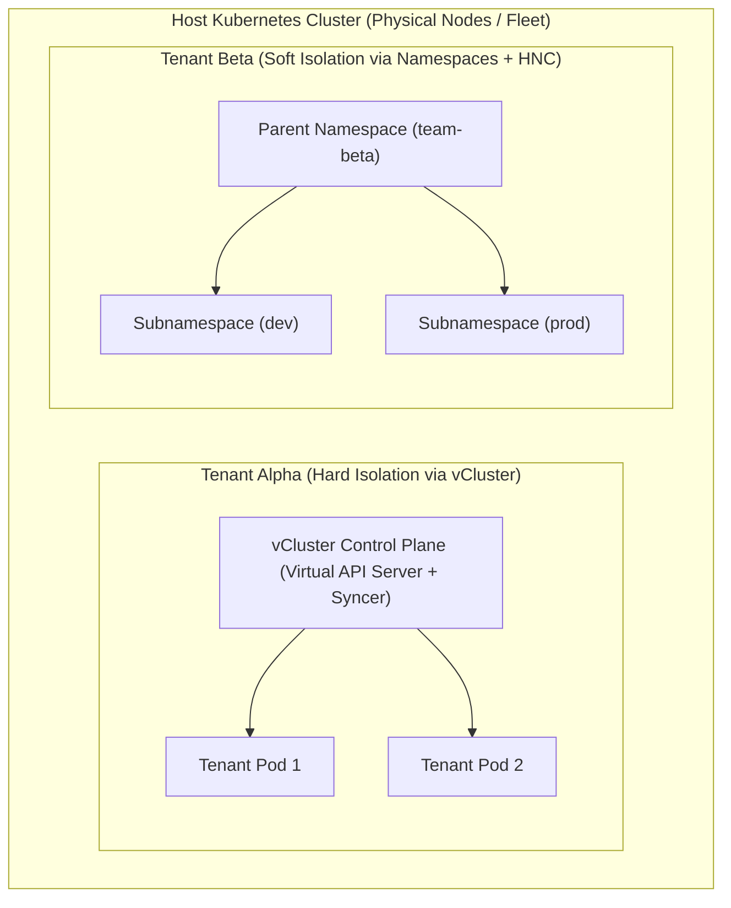
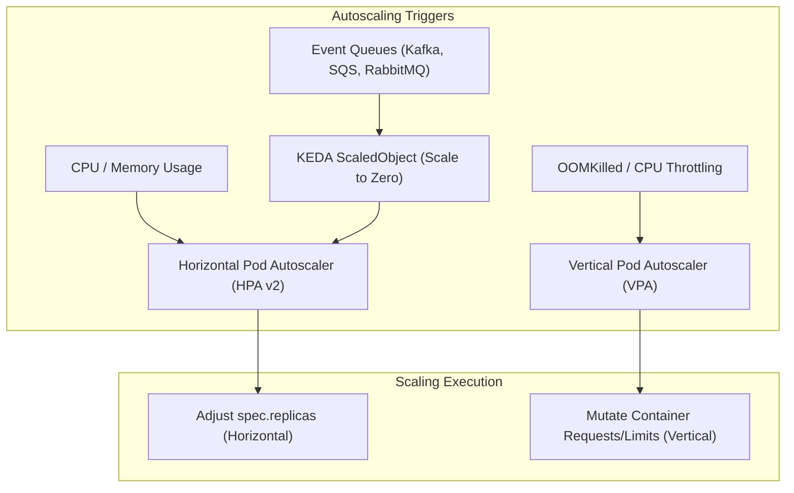

# Domain 4: Platform Architecture & Scalability — In-Depth Master Study Guide

> [!IMPORTANT]
> **Exam Weighting & Core Architecture Focus:** Domain 4 accounts for **15% of the Certified Cloud Native Platform Engineer (CNPE)** examination. Questions test your mastery of platform scalability: multi-tenancy architectures (soft namespace isolation vs. hard virtual control planes with vCluster), comprehensive autoscaling engines (HPA v2, VPA, KEDA ScaledObjects/ScaledJobs), high-performance group-less node autoscaling with Karpenter v1.0+ (`NodePool` and consolidation policies), Pod topology spread constraints, and Cilium eBPF service mesh networking.

---

## 1. Multi-Tenancy Architecture: Soft vs. Hard Isolation

Platform engineering teams must isolate disparate tenant teams on shared physical infrastructure without incurring the financial and operational overhead of provisioning thousands of independent physical clusters.



### 1.1 Soft Multi-Tenancy (Namespaces & HNC)

* **Scope:** Trusted engineering teams within the same organization.
* **Core Enforcers:**
  * **`ResourceQuota`:** Restricts aggregate CPU, memory, storage, and object counts per namespace.
  * **`LimitRange`:** Enforces default/min/max requests and limits per container to prevent runaway pods from starving nodes.
  * **`NetworkPolicy`:** Enforces L3/L4 default-deny segmentation.
  * **Hierarchical Namespace Controller (HNC):** Creates parent-child namespace hierarchies that automatically cascade RBAC roles, LimitRanges, and NetworkPolicies downward.

### 1.2 Hard Multi-Tenancy with vCluster

* **Scope:** Untrusted tenants, independent CI/CD teams requiring cluster-scoped permissions (`ClusterRoles`, `CRDs`, `Namespaces`), or multi-tenant SaaS.
* **Architecture:**
  * Runs as an internal StatefulSet inside a host namespace.
  * Tenants connect to a **virtual API server** (backed by SQLite or K3s) with full `cluster-admin` privileges.
  * The **vCluster Syncer** syncs low-level execution resources (Pods, Services, PVCs) down to the host cluster while keeping CRDs, namespaces, and cluster roles completely virtualized and isolated.

---

## 2. Workload Autoscaling: HPA v2, VPA & KEDA



### 2.1 Horizontal Pod Autoscaler (HPA v2) Behavior Policies

HPA v2 allows fine-grained stabilization windows to eliminate scaling thrashing:

```yaml
apiVersion: autoscaling/v2
kind: HorizontalPodAutoscaler
metadata:
  name: order-api-hpa
  namespace: production
spec:
  scaleTargetRef:
    apiVersion: apps/v1
    kind: Deployment
    name: order-api
  minReplicas: 3
  maxReplicas: 50
  metrics:
    - type: Resource
      resource:
        name: cpu
        target:
          type: Utilization
          averageUtilization: 75
  behavior:
    scaleDown:
      stabilizationWindowSeconds: 300 # Prevent flapping on transient drops
      policies:
        - type: Percent
          value: 10
          periodSeconds: 60
    scaleUp:
      stabilizationWindowSeconds: 0 # Burst immediately on traffic spikes
      policies:
        - type: Percent
          value: 100
          periodSeconds: 15
```

### 2.2 The HPA vs. VPA Conflict Rule (Critical Platform Rule)

* **Cardinal Rule:** **NEVER configure HPA and VPA together on the same resource metric (CPU or Memory)!**
* *The Failure Loop:* If CPU usage spikes, HPA attempts to add more Pods while VPA attempts to increase the CPU requests on the existing Pods. This causes container restarts, scheduling deadlocks, and thrashing.
* *Valid Combination:* Use HPA for scaling on custom business metrics (e.g., requests per second or queue depth) while using VPA in `mode: "Off"` (recommendation-only mode) to generate right-sizing recommendations.

### 2.3 Event-Driven Autoscaling with KEDA

KEDA drives autoscaling based on external event brokers and enables **scaling to zero (`minReplicaCount: 0`)**:

```yaml
apiVersion: keda.sh/v1alpha1
kind: ScaledObject
metadata:
  name: order-kafka-scaler
  namespace: orders
spec:
  scaleTargetRef:
    name: order-worker
  minReplicaCount: 0 # Scales completely down to zero when queue is empty!
  maxReplicaCount: 100
  cooldownPeriod: 300
  triggers:
    - type: kafka
      metadata:
        bootstrapServers: kafka.infra.svc:9092
        topic: incoming-orders
        consumerGroup: order-processors
        lagThreshold: "50"
```

---

## 3. Node Autoscaling: Karpenter v1.0+ vs. Cluster Autoscaler

* **Legacy Cluster Autoscaler Limitations:**
  * Coupled tightly to cloud provider node groups (AWS ASGs, GCP MIGs).
  * Takes 3–8 minutes to launch instances; cannot easily select arbitrary instance types or spot availability dynamically.
* **Karpenter v1.0+ Architecture:**
  * **Group-less, high-velocity node autoscaler**.
  * Directly queries cloud EC2/GCE APIs to evaluate pending unscheduled Pods and provisions exact right-sized instance types in seconds.

```yaml
apiVersion: karpenter.sh/v1
kind: NodePool
metadata:
  name: general-compute
spec:
  template:
    spec:
      requirements:
        - key: karpenter.sh/capacity-type
          operator: In
          values: ["spot", "on-demand"]
        - key: kubernetes.io/arch
          operator: In
          values: ["amd64", "arm64"]
        - key: node.kubernetes.io/instance-type
          operator: In
          values: ["c6g.2xlarge", "c7g.2xlarge", "c6i.2xlarge"]
      nodeClassRef:
        group: karpenter.k8s.aws
        kind: EC2NodeClass
        name: default
  limits:
    cpu: 1000
    memory: 4000Gi
  disruption:
    consolidationPolicy: WhenEmptyOrUnderutilized # Actively packs nodes to save costs
    consolidateAfter: 1m
```

---

## 4. Advanced Scheduling & Topology Spread Constraints

To guarantee multi-AZ resilience, platform engineers enforce **`topologySpreadConstraints`**:

```yaml
spec:
  topologySpreadConstraints:
    - maxSkew: 1
      topologyKey: topology.kubernetes.io/zone
      whenUnsatisfiable: DoNotSchedule # Hard enforcement
      labelSelector:
        matchLabels:
          app: order-api
```

* **`maxSkew`:** The maximum permitted difference in pod count between any two topology zones. `maxSkew: 1` ensures perfectly balanced zonal distribution.
* **`PodDisruptionBudget` (PDB):** Guarantees minimum availability during voluntary disruptions (e.g., node upgrades, draining):
  ```yaml
  apiVersion: policy/v1
  kind: PodDisruptionBudget
  metadata:
    name: order-api-pdb
  spec:
    minAvailable: 80%
    selector:
      matchLabels:
        app: order-api
  ```
