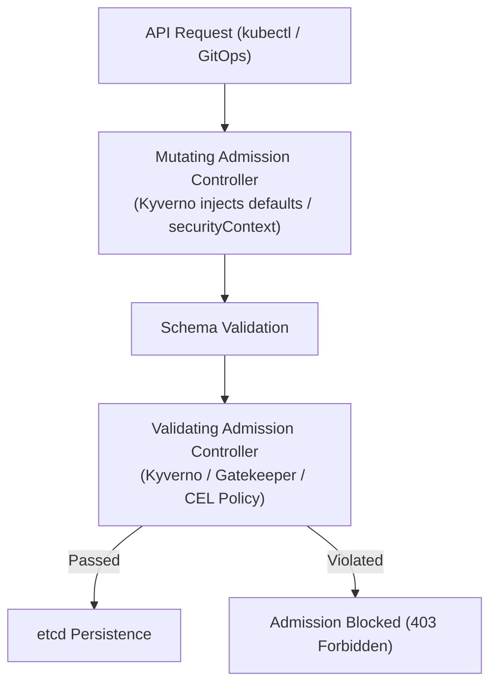

# Domain 5: Security, Governance & Policy Enforcement — In-Depth Master Study Guide

> [!IMPORTANT]
> **Exam Weighting & Core Architecture Focus:** Domain 5 accounts for **15% of the Certified Cloud Native Platform Engineer (CNPE)** examination. Questions test your mastery of platform policy enforcement: Kyverno declarative policies (validation, mutation, resource generation, and image signing verification), OPA Gatekeeper vs. Kubernetes native `ValidatingAdmissionPolicy` (CEL in v1.30+), External Secrets Operator (ESO) integration with enterprise vaults, automated TLS issuance with cert-manager, Cilium L7 network security, and FinOps cost allocation.

---

## 1. Kubernetes Policy Engines: Kyverno vs. OPA Gatekeeper vs. ValidatingAdmissionPolicy

Cloud-native platform engineers enforce enterprise governance and compliance guardrails using dynamic admission controllers:



### 1.1 Kyverno: Declarative Kubernetes-Native Policies

Kyverno is a CNCF-graduated policy engine that expresses rules using native Kubernetes YAML syntax without requiring custom programming languages:

* **Validation Rules:** Enforces security constraints or audits violations (`validationFailureAction: Enforce | Audit`).
* **Mutation Rules:** Dynamically injects securityContexts, nodeSelectors, or sidecar proxies.
* **Generation Rules:** Automatically provisions standard resources when a trigger occurs (e.g., generating a default `NetworkPolicy` and `ResourceQuota` whenever a developer creates a new `Namespace`).
* **Image Verification Rules (`verifyImages`):** Directly verifies Sigstore/Cosign cryptographic signatures and SLSA attestations before container pods are admitted.

```yaml
apiVersion: kyverno.io/v1
kind: ClusterPolicy
metadata:
  name: generate-default-network-policy
spec:
  rules:
    - name: auto-generate-deny-ingress
      match:
        any:
          - resources:
              kinds:
                - Namespace
      generate:
        apiVersion: networking.k8s.io/v1
        kind: NetworkPolicy
        name: default-deny-all
        namespace: "{{request.object.metadata.name}}"
        synchronize: true # Keeps generated policy in sync with template!
        data:
          spec:
            podSelector: {}
            policyTypes:
              - Ingress
```

### 1.2 Kubernetes Native `ValidatingAdmissionPolicy` (CEL Engine)

Kubernetes v1.30+ introduced native **`ValidatingAdmissionPolicy`** using the Common Expression Language (CEL):
* **Zero Webhook Latency:** Evaluated directly in-process inside `kube-apiserver`, eliminating external webhook network round-trips, timeout failures, and certificate bootstrapping overhead!

```yaml
apiVersion: admissionregistration.k8s.io/v1
kind: ValidatingAdmissionPolicy
metadata:
  name: "require-non-root.platform.corp"
spec:
  failurePolicy: Fail
  matchConstraints:
    resourceRules:
      - apiGroups: [""]
        apiVersions: ["v1"]
        operations: ["CREATE", "UPDATE"]
        resources: ["pods"]
  validations:
    - expression: "object.spec.securityContext.runAsNonRoot == true || object.spec.containers.all(c, has(c.securityContext) && c.securityContext.runAsNonRoot == true)"
      message: "Containers must strictly enforce runAsNonRoot: true"
---
apiVersion: admissionregistration.k8s.io/v1
kind: ValidatingAdmissionPolicyBinding
metadata:
  name: "require-non-root-binding"
spec:
  policyName: "require-non-root.platform.corp"
  validationActions: [Deny]
  matchResources:
    namespaceSelector:
      matchExpressions:
        - key: environment
          operator: In
          values: [production]
```

---

## 2. Secrets Governance: External Secrets Operator (ESO)

Storing secrets directly in Git (even in private repositories) violates GitOps security principles. The **External Secrets Operator (ESO)** synchronizes credentials from enterprise vaults directly into native Kubernetes `v1/Secret` objects.

```mermaid
flowchart LR
    Vault["External Vault<br>(AWS Secrets Manager / HashiCorp Vault / GCP)"]
    
    subgraph K8s["Kubernetes Cluster"]
        CSS["ClusterSecretStore<br>(Authenticates to Vault via IAM/WIF)"]
        ES["ExternalSecret CRD<br>(Defines which keys to fetch)"]
        Sec["Kubernetes v1/Secret<br>(Native In-Memory Secret)"]
        Pod["Workload Pod"]
    end

    Vault <==|"Syncs every 1h"| CSS --> ES --> Sec --> Pod
```

### 2.1 Production `ExternalSecret` Specification

```yaml
apiVersion: external-secrets.io/v1beta1
kind: ExternalSecret
metadata:
  name: database-credentials
  namespace: production
spec:
  refreshInterval: 1h # Polling interval for secret rotation
  secretStoreRef:
    name: enterprise-vault
    kind: ClusterSecretStore
  target:
    name: app-db-secret # Target Kubernetes Secret name
    creationPolicy: Owner
  data:
    - secretKey: DB_PASSWORD # Key name inside the Kubernetes Secret
      remoteRef:
        key: production/order-service/database # Path in Vault
        property: password
```

---

## 3. Automated Certificate Lifecycle with Cert-Manager

Cert-manager automates the issuance and renewal of X.509 TLS certificates from Let's Encrypt (ACME), HashiCorp Vault, or private enterprise CAs:

```yaml
apiVersion: cert-manager.io/v1
kind: ClusterIssuer
metadata:
  name: letsencrypt-production
spec:
  acme:
    server: https://acme-v02.api.letsencrypt.org/directory
    email: platform-alerts@enterprise.com
    privateKeySecretRef:
      name: letsencrypt-prod-account-key
    solvers:
      - dns01:
          cloudflare:
            apiTokenSecretRef:
              name: cloudflare-api-token
              key: api-token
---
apiVersion: cert-manager.io/v1
kind: Certificate
metadata:
  name: wildcard-platform-tls
  namespace: ingress-gateway
spec:
  secretName: wildcard-platform-tls-cert
  issuerRef:
    name: letsencrypt-production
    kind: ClusterIssuer
  commonName: "*.enterprise.com"
  dnsNames:
    - "*.enterprise.com"
```

* **Automatic Renewal:** Cert-manager checks certificate validity daily and automatically initiates ACME renewal **30 days before certificate expiration**.

---

## 4. Zero-Trust Network Security: Cilium L7 Network Policies

Standard Kubernetes `NetworkPolicy` operates only at Layer 3 and Layer 4 (IPs and TCP/UDP ports). **Cilium** leverages eBPF in the Linux kernel to enforce application-layer (Layer 7) filtering:

```yaml
apiVersion: cilium.io/v2
kind: CiliumNetworkPolicy
metadata:
  name: secure-payment-api
  namespace: production
spec:
  endpointSelector:
    matchLabels:
      app: payment-api
  ingress:
    - fromEndpoints:
        - matchLabels:
            app: web-frontend
      toPorts:
        - ports:
            - port: "8080"
              protocol: TCP
          rules:
            http:
              # Allow GET /api/v1/payments and POST /api/v1/checkout only!
              - method: "GET"
                path: "/api/v1/payments"
              - method: "POST"
                path: "/api/v1/checkout"
```
