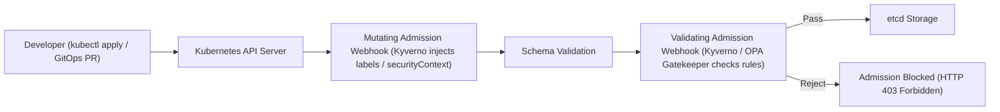
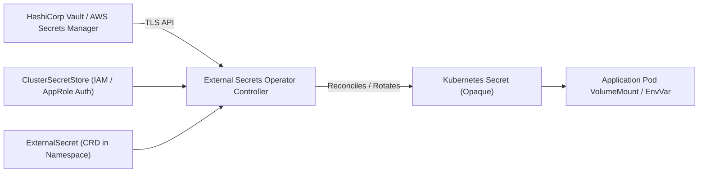
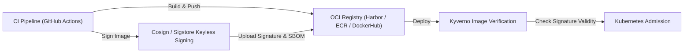

# Domain 5: Security, Governance & Policy Enforcement — In-Depth Master Study Guide

**Exam Weight:** 15% of the CNPE Exam  
**Target Mastery:** Dynamic admission control (Validating / Mutating Webhooks), Kyverno & OPA Gatekeeper policy engines, Pod Security Standards (PSS / PSA), External Secrets Operator (ESO), Supply Chain Security (Sigstore/Cosign image verification, Trivy, SBOMs), and Zero-Trust Network Security (Cilium L7 NetworkPolicies, SPIFFE/SPIRE mTLS).

---

## 1. Kubernetes Policy Engines: Kyverno vs OPA Gatekeeper

Cloud-native platform engineers enforce enterprise guardrails via admission controllers. The two industry-standard CNCF policy engines are **Kyverno** and **OPA Gatekeeper**.



### 1.1 Kyverno Architecture
Kyverno is a Kubernetes-native policy engine that uses declarative Kubernetes YAML without requiring a separate domain-specific language (DSL).
- **Validation:** Blocks or audits non-compliant resources.
- **Mutation:** Injects defaults, sidecars, or security contexts.
- **Generation:** Automatically provisions resources (e.g. creating a default `NetworkPolicy` or `SecretCopy` whenever a new `Namespace` is created).
- **Image Verification:** Directly validates Cosign / Sigstore signatures and attestations.

#### Production Kyverno ClusterPolicy Example (Disallow Privileged Containers):
```yaml
apiVersion: kyverno.io/v1
kind: ClusterPolicy
metadata:
  name: disallow-privileged-containers
  annotations:
    policies.kyverno.io/title: Disallow Privileged Containers
    policies.kyverno.io/category: Pod Security Standards (Restricted)
    policies.kyverno.io/severity: high
spec:
  validationFailureAction: Enforce
  background: true
  rules:
    - name: check-privileged-flag
      match:
        any:
          - resources:
              kinds:
                - Pod
      validate:
        message: "Running privileged containers is strictly forbidden in production clusters."
        pattern:
          spec:
            containers:
              - securityContext:
                  privileged: "!true"
```

### 1.2 OPA Gatekeeper Architecture
OPA Gatekeeper uses the Open Policy Agent declarative query language (**Rego**).
- **`ConstraintTemplate`:** Defines the parameterized logic (Rego code) and schema for the constraint.
- **`Constraint`:** Instantiates the template with specific parameters, namespace match criteria, and enforcement actions (`deny`, `dryrun`, `warn`).

---

## 2. Pod Security Admission (PSA) & Standards (PSS)

Built directly into the Kubernetes API server (replacing deprecated PodSecurityPolicies), PSA classifies pods into three security profiles:

1. **Privileged:** Unrestricted. Allows host namespaces, privileged flag, host ports, host paths.
2. **Baseline:** Minimally restrictive. Prevents known privilege escalations while allowing default configurations.
3. **Restricted:** Hardened. Requires running as non-root, dropping `ALL` capabilities (adding only `NET_BIND_SERVICE`), read-only root filesystems, and strict seccomp profiles.

### Namespace Label Configuration:
```yaml
apiVersion: v1
kind: Namespace
metadata:
  name: payments-production
  labels:
    pod-security.kubernetes.io/enforce: restricted
    pod-security.kubernetes.io/enforce-version: latest
    pod-security.kubernetes.io/audit: restricted
    pod-security.kubernetes.io/warn: restricted
```

---

## 3. External Secrets Operator (ESO) Architecture

Storing raw secrets in Git repositories (even base64-encoded) violates zero-trust principles. The **External Secrets Operator** synchronizes secrets from external management systems (HashiCorp Vault, AWS Secrets Manager, Azure Key Vault, Google Secret Manager) into native Kubernetes `Secret` resources.



### 3.1 ClusterSecretStore (HashiCorp Vault via Kubernetes Auth):
```yaml
apiVersion: external-secrets.io/v1beta1
kind: ClusterSecretStore
metadata:
  name: vault-backend
spec:
  provider:
    vault:
      server: "https://vault.internal.corp:8200"
      path: "secret"
      version: "v2"
      auth:
        kubernetes:
          mountPath: "kubernetes"
          role: "platform-workload"
          serviceAccountRef:
            name: eso-auth-sa
            namespace: external-secrets
```

### 3.2 ExternalSecret Manifest:
```yaml
apiVersion: external-secrets.io/v1beta1
kind: ExternalSecret
metadata:
  name: database-credentials
  namespace: order-service
spec:
  refreshInterval: "1h"
  secretStoreRef:
    name: vault-backend
    kind: ClusterSecretStore
  target:
    name: db-secret-synced
    creationPolicy: Owner
  data:
    - secretKey: DB_PASSWORD
      remoteRef:
        key: production/order-service/db
        property: password
```

---

## 4. Supply Chain Security & Container Signing (Cosign / Sigstore)

Securing the software supply chain requires cryptographic provenance verification at admission time.



### 4.1 Keyless Signing Mechanics
Cosign keyless signing uses an OpenID Connect (OIDC) identity token issued by an identity provider (e.g. GitHub, GitLab, Google) to request a short-lived x509 certificate from the **Fulcio** certificate authority. The signature event is recorded in the **Rekor** transparency log.

### 4.2 Kyverno Image Verification Policy:
```yaml
apiVersion: kyverno.io/v1
kind: ClusterPolicy
metadata:
  name: verify-trusted-images
spec:
  validationFailureAction: Enforce
  webhookTimeoutSeconds: 30
  rules:
    - name: verify-signature
      match:
        any:
          - resources:
              kinds:
                - Pod
      verifyImages:
        - imageReferences:
            - "ghcr.io/enterprise/*"
          attestors:
            - entries:
                - keyless:
                    issuer: "https://token.actions.githubusercontent.com"
                    subject: "https://github.com/enterprise/*"
                    rekor:
                      url: "https://rekor.sigstore.dev"
```

---

## 5. Zero-Trust Network Security: Cilium L7 Policies

Traditional Kubernetes `NetworkPolicy` is restricted to IP CIDRs and TCP/UDP ports (L3/L4). Cilium uses eBPF to enforce application-layer (L7) rules, restricting HTTP methods, paths, and DNS names.

```yaml
apiVersion: "cilium.io/v2"
kind: CiliumNetworkPolicy
metadata:
  name: secure-payment-egress
  namespace: payments
spec:
  endpointSelector:
    matchLabels:
      app: payment-api
  egress:
    # Allow DNS resolution
    - toEndpoints:
        - matchLabels:
            k8s:io.kubernetes.pod.namespace: kube-system
            k8s-app: kube-dns
      toPorts:
        - ports:
            - port: "53"
              protocol: UDP
          rules:
            dns:
              - matchPattern: "*"
    # Allow HTTPS only to authorized payment gateway FQDN
    - toFQDNs:
        - matchName: "api.stripe.com"
      toPorts:
        - ports:
            - port: "443"
              protocol: TCP
```
