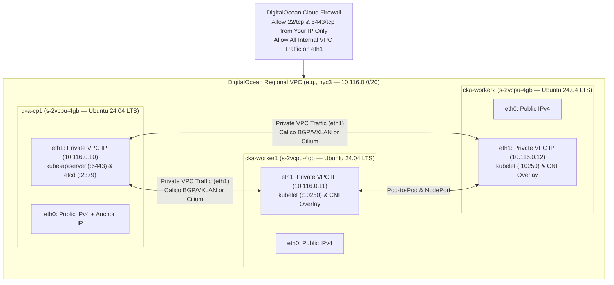

# DigitalOcean Droplet Lab Architecture & Automation Guide (CKA)

This guide provides a complete, automated workflow for running your **Certified Kubernetes Administrator (CKA)** multi-node `kubeadm` clusters on **DigitalOcean Droplets** using `doctl` and `cloud-init`.

---

## 1. DigitalOcean Droplet Topology & Networking Architecture

When running raw `kubeadm` clusters on DigitalOcean Droplets, understanding how DigitalOcean provisions network interfaces is critical:



### The 3 Golden Rules of `kubeadm` on DigitalOcean Droplets

> [!IMPORTANT]
> **1. Always Bind to `eth1` (Private VPC IP), Never `eth0` (Public/Anchor IP):**
> Every DigitalOcean Droplet has two interfaces:
> - `eth0`: Has the **Public IPv4** AND a hidden `10.x.x.x` DigitalOcean Anchor IP.
> - `eth1`: Has the **DigitalOcean VPC Private IPv4** (e.g., `10.116.0.x`).
>
> Extract the true VPC Private IP on any Droplet with:
> ```bash
> VPC_IP=$(ip -4 addr show eth1 | awk '/inet / {print $2}' | cut -d/ -f1)
> ```
>
> **2. Configure `--node-ip=${VPC_IP}` on Every Droplet's Kubelet:**
> Without `--node-ip`, `kubelet` registers the `eth0` Public IP (or `eth0` Anchor IP) as the Node's `InternalIP`, causing cross-node `kubectl exec`, `kubectl logs`, and CNI tunnels to fail or route over the public internet. Always write `/etc/default/kubelet`:
> ```bash
> echo "KUBELET_EXTRA_ARGS=--node-ip=${VPC_IP}" | sudo tee /etc/default/kubelet
> ```
>
> **3. Point Your CNI Plugin (Calico / Cilium) to `eth1`:**
> - **Calico:** Set `IP_AUTODETECTION_METHOD=interface=eth1` so BGP/VXLAN binds to `eth1`.
> - **Cilium:** Pass `--set devices=eth1` during `cilium install`.

---

## 2. Sizing & Hourly Cost Breakdown

Because DigitalOcean bills Droplets **by the hour** (up to the monthly cap), you can spin up a 3-node cluster for a 3-hour study session and destroy it when finished for **~$0.32 total**:

| Node Role | Droplet Name | Recommended Slug | Specs | Hourly Rate | Monthly Cap |
| :--- | :--- | :--- | :--- | :---: | :---: |
| **Control Plane** | `cka-cp1` | `s-2vcpu-4gb` | 2 vCPU, 4 GB RAM, 80 GB NVMe | `$0.036 / hr` | `$24 / mo` |
| **Worker Node 1** | `cka-worker1` | `s-2vcpu-4gb` | 2 vCPU, 4 GB RAM, 80 GB NVMe | `$0.036 / hr` | `$24 / mo` |
| **Worker Node 2** | `cka-worker2` | `s-2vcpu-4gb` | 2 vCPU, 4 GB RAM, 80 GB NVMe | `$0.036 / hr` | `$24 / mo` |
| **Total (3 Nodes)** | — | — | **6 vCPU, 12 GB RAM, 240 GB NVMe** | **`$0.107 / hr`** | `$72 / mo` |

---

## 3. Automated Provisioning with `doctl` & `cloud-init`

### Step 1: Create `cloud-init-k8s.yaml` on Your Local Workstation
This `cloud-init` file automatically prepares Ubuntu 24.04 LTS Droplets with `containerd` (`SystemdCgroup = true`), kernel modules, sysctls, Kubernetes `v1.31` packages (`kubeadm`, `kubelet`, `kubectl`), `helm`, and configures `kubelet` to bind to `eth1`:

```yaml
#cloud-config
package_update: true
package_upgrade: false
packages:
  - apt-transport-https
  - ca-certificates
  - curl
  - gpg
  - jq
  - socat
  - conntrack
  - ipset
  - nfs-common
  - bash-completion
  - containerd

write_files:
  - path: /etc/modules-load.d/k8s.conf
    content: |
      overlay
      br_netfilter
  - path: /etc/sysctl.d/99-k8s-cri.conf
    content: |
      net.bridge.bridge-nf-call-iptables  = 1
      net.bridge.bridge-nf-call-ip6tables = 1
      net.ipv4.ip_forward                 = 1

runcmd:
  - swapoff -a
  - sed -i '/ swap / s/^\(.*\)$/#\1/g' /etc/fstab
  - modprobe overlay
  - modprobe br_netfilter
  - sysctl --system
  - mkdir -p /etc/containerd
  - containerd config default > /etc/containerd/config.toml
  - sed -i 's/SystemdCgroup = false/SystemdCgroup = true/g' /etc/containerd/config.toml
  - systemctl enable --now containerd
  - systemctl restart containerd
  - mkdir -p -m 755 /etc/apt/keyrings
  - curl -fsSL https://pkgs.k8s.io/core:/stable:/v1.31/deb/Release.key | gpg --dearmor -o /etc/apt/keyrings/kubernetes-apt-keyring.gpg
  - echo 'deb [signed-by=/etc/apt/keyrings/kubernetes-apt-keyring.gpg] https://pkgs.k8s.io/core:/stable:/v1.31/deb/ /' > /etc/apt/sources.list.d/kubernetes.list
  - curl https://baltocdn.com/helm/signing.asc | gpg --dearmor -o /usr/share/keyrings/helm.gpg
  - echo "deb [arch=$(dpkg --print-architecture) signed-by=/usr/share/keyrings/helm.gpg] https://baltocdn.com/helm/stable/debian/ all main" > /etc/apt/sources.list.d/helm-stable-debian.list
  - apt-get update
  - apt-get install -y kubelet kubeadm kubectl helm
  - apt-mark hold kubelet kubeadm kubectl
  - |
    VPC_IP=$(ip -4 addr show eth1 | awk '/inet / {print $2}' | cut -d/ -f1)
    echo "KUBELET_EXTRA_ARGS=--node-ip=${VPC_IP}" > /etc/default/kubelet
  - crictl config runtime-endpoint unix:///run/containerd/containerd.sock
  - systemctl daemon-reload
  - systemctl enable kubelet
```

---

### Step 2: Launch VPC, Firewall & 3 Droplets via `doctl`

```bash
# 1. Set your preferred DigitalOcean region and get your SSH key ID
export DO_REGION="nyc3"
export SSH_KEY_ID=$(doctl compute ssh-key list --format ID --no-header | head -n 1)
export MY_PUBLIC_IP="$(curl -s https://ifconfig.me)/32"

# 2. Create a dedicated VPC for CKA/CKS labs
export VPC_UUID=$(doctl vpcs create \
  --name k8s-cert-vpc \
  --region "$DO_REGION" \
  --ip-range 10.116.0.0/20 \
  --format ID --no-header)

# 3. Launch Control Plane and 2 Worker Droplets with tag "k8s-lab"
doctl compute droplet create cka-cp1 cka-worker1 cka-worker2 \
  --region "$DO_REGION" \
  --image ubuntu-24-04-x64 \
  --size s-2vcpu-4gb \
  --vpc-uuid "$VPC_UUID" \
  --ssh-keys "$SSH_KEY_ID" \
  --tag-names k8s-lab \
  --user-data-file cloud-init-k8s.yaml \
  --wait

# 4. Create a DigitalOcean Cloud Firewall protecting eth0 while allowing all VPC traffic
doctl compute firewall create \
  --name k8s-lab-fw \
  --tag-names k8s-lab \
  --inbound-rules "protocol:tcp,ports:22,address:${MY_PUBLIC_IP} protocol:tcp,ports:6443,address:${MY_PUBLIC_IP} protocol:tcp,ports:all,address:10.116.0.0/20 protocol:udp,ports:all,address:10.116.0.0/20 protocol:icmp,address:10.116.0.0/20" \
  --outbound-rules "protocol:tcp,ports:all,address:0.0.0.0/0,address:::/0 protocol:udp,ports:all,address:0.0.0.0/0,address:::/0 protocol:icmp,address:0.0.0.0/0,address:::/0"
```

---

### Step 3: Initialize Control Plane on `cka-cp1` Over `eth1`

```bash
# 1. View Public and Private VPC IPs of your Droplets
doctl compute droplet list --tag-name k8s-lab --format Name,PublicIPv4,PrivateIPv4,Status

# 2. SSH into cka-cp1
CP_PUB_IP=$(doctl compute droplet list cka-cp1 --format PublicIPv4 --no-header)
ssh root@"${CP_PUB_IP}"

# 3. Verify cloud-init finished
cloud-init status --wait

# 4. Initialize kubeadm bound to eth1 Private VPC IP
CP_VPC_IP=$(ip -4 addr show eth1 | awk '/inet / {print $2}' | cut -d/ -f1)
kubeadm init \
  --apiserver-advertise-address="${CP_VPC_IP}" \
  --apiserver-cert-extra-sans="${CP_VPC_IP},$(curl -s http://169.254.169.254/metadata/v1/interfaces/public/0/ipv4/address)" \
  --pod-network-cidr="192.168.0.0/16" \
  --upload-certs

# 5. Configure root kubeconfig
mkdir -p $HOME/.kube
cp -i /etc/kubernetes/admin.conf $HOME/.kube/config
chown $(id -u):$(id -g) $HOME/.kube/config

# 6. Install Calico CNI configured for DigitalOcean eth1 interface
kubectl create -f https://raw.githubusercontent.com/projectcalico/calico/v3.28.2/manifests/tigera-operator.yaml
curl -sO https://raw.githubusercontent.com/projectcalico/calico/v3.28.2/manifests/custom-resources.yaml
# Pin Calico node IP detection to eth1
kubectl apply -f custom-resources.yaml
```

> [!TIP]
> **Alternative: Install Cilium CNI Bound to `eth1` (Recommended for Gateway API & CKS Labs):**
> ```bash
> CILIUM_CLI_VERSION=$(curl -s https://raw.githubusercontent.com/cilium/cilium-cli/main/stable.txt)
> curl -L --fail --remote-name-all https://github.com/cilium/cilium-cli/releases/download/${CILIUM_CLI_VERSION}/cilium-linux-amd64.tar.gz
> tar xzvfC cilium-linux-amd64.tar.gz /usr/local/bin
> cilium install --version 1.16.3 --set devices=eth1
> ```

---

### Step 4: Join `cka-worker1` and `cka-worker2` Over `eth1`

Generate the join command on `cka-cp1` and execute it on both worker Droplets:
```bash
# On cka-cp1:
JOIN_CMD=$(kubeadm token create --print-join-command)
echo "$JOIN_CMD"

# From your local workstation, run the join command on both worker Droplets:
for NODE in cka-worker1 cka-worker2; do
  W_IP=$(doctl compute droplet list "$NODE" --format PublicIPv4 --no-header)
  ssh -o StrictHostKeyChecking=no root@"${W_IP}" "cloud-init status --wait && ${JOIN_CMD}"
done
```

Verify that all 3 Droplets report `STATUS = Ready` and `INTERNAL-IP` matches their `10.116.0.x` (`eth1`) VPC address:
```bash
kubectl get nodes -o wide
```

---

## 4. Storage Options on DigitalOcean Droplets (Domain 4 Labs)

For CKA Domain 4 (`PersistentVolumes`, `StorageClasses`, `WaitForFirstConsumer`, `VolumeSnapshot`, `RWX`):

### Option A: Local Path Provisioner (Fastest Dynamic `RWO` StorageClass on Droplet NVMe Disks)
```bash
kubectl apply -f https://raw.githubusercontent.com/rancher/local-path-provisioner/v0.0.30/deploy/local-path-storage.yaml
kubectl patch storageclass local-path -p '{"metadata": {"annotations":{"storageclass.kubernetes.io/is-default-class":"true"}}}'
```

### Option B: NFS Server on `cka-cp1` Over `eth1` (For `ReadWriteMany` RWX Labs)
```bash
# On cka-cp1:
apt-get install -y nfs-kernel-server
mkdir -p /srv/nfs/kubedata
chown nobody:nogroup /srv/nfs/kubedata
chmod 0777 /srv/nfs/kubedata
echo "/srv/nfs/kubedata 10.116.0.0/20(rw,sync,no_subtree_check,no_root_squash)" >> /etc/exports
exportfs -rav
systemctl enable --now nfs-kernel-server
```

### Option C: DigitalOcean Block Storage Volumes (`doctl compute volume`)
You can attach raw DigitalOcean Block Storage Volumes to Droplets (exposed at `/dev/disk/by-id/scsi-0DO_Volume_<name>`) for testing static `PersistentVolumes`, `local` PVs, and raw block volumes (`volumeMode: Block`):
```bash
doctl compute volume create cka-block-vol --region "$DO_REGION" --size 10GiB
```

---

## 5. Tearing Down the Cluster to Zero Cost (`doctl`)

When you finish your study session, delete all lab Droplets and the firewall with a single command so you stop accruing hourly charges immediately:

```bash
# Destroy all Droplets tagged k8s-lab
doctl compute droplet delete --tag-name k8s-lab --force

# Optional: Delete firewall and VPC
FW_ID=$(doctl compute firewall list --format ID,Name --no-header | awk '$2=="k8s-lab-fw"{print $1}')
[ -n "$FW_ID" ] && doctl compute firewall delete "$FW_ID" --force
```
