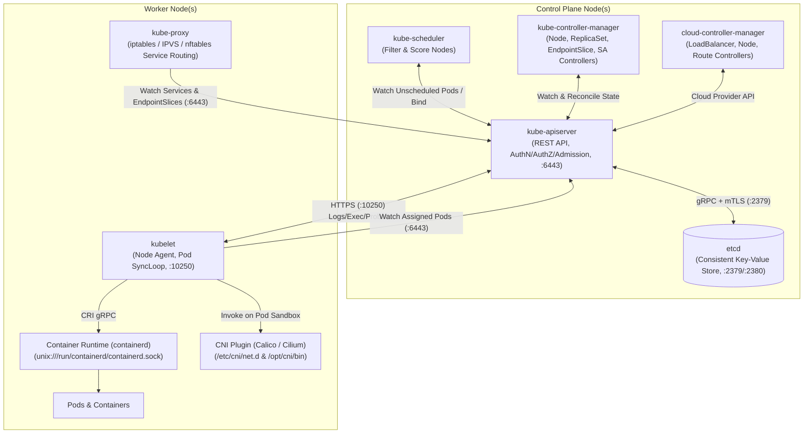
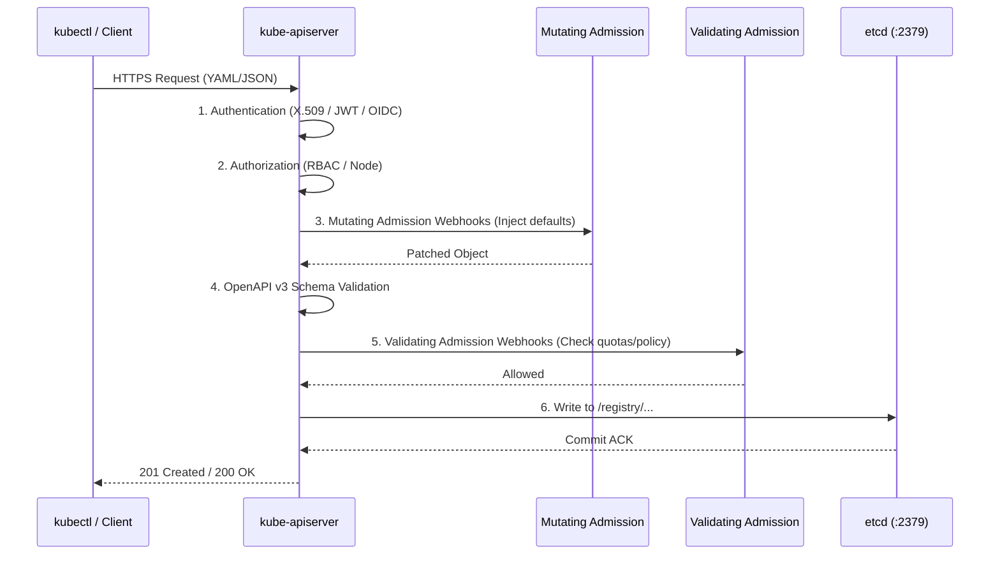
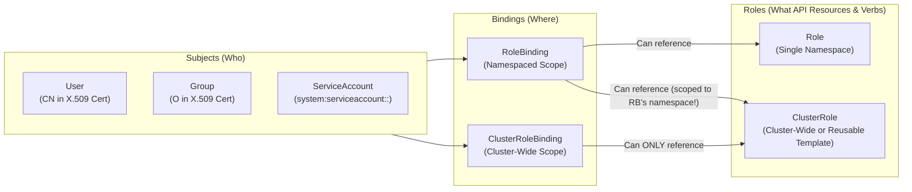
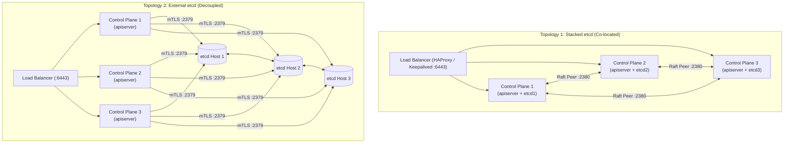

# Domain 1: Cluster Architecture, Installation & Configuration — Complete Study Guide

**Exam Weight:** 25% of the CKA Exam  
**Official Curriculum Competencies:**
- Manage role-based access control (RBAC)
- Use `kubeadm` to install a basic cluster
- Manage a highly-available Kubernetes cluster
- Provision underlying infrastructure to deploy a Kubernetes cluster
- Perform a version upgrade on a Kubernetes cluster using `kubeadm`
- Implement `etcd` backup and restore
- Understand extension interfaces (CNI, CSI, CRI)
- Understand Custom Resource Definitions (CRDs), install and configure Operators
- Manage workloads with Helm and Kustomize

---

## 1. Kubernetes Control Plane & Worker Node Architecture

Kubernetes follows a declarative, control-loop architecture divided into the **Control Plane** (which maintains cluster state and makes scheduling/lifecycle decisions) and **Worker Nodes** (which execute containerized workloads).



### 1.1 Control Plane Components

#### `kube-apiserver`
- **Role:** The sole front-end to the Kubernetes control plane. **No other component talks directly to `etcd`—only `kube-apiserver` reads from and writes to `etcd`**.
- **Default Port:** `6443/TCP` (HTTPS).
- **Request Pipeline:** Every API request passes through a strict pipeline before being persisted in `etcd`:
  1. **Authentication (AuthN):** Who are you? (X.509 Client Certificates, ServiceAccount JWT Bearer Tokens, OIDC tokens, Webhook token auth).
  2. **Authorization (AuthZ):** Are you allowed to perform this action? (`RBAC`, `Node` authorizer, `Webhook`, `ABAC`).
  3. **Mutating Admission Controllers:** Modify the incoming object (e.g., `DefaultStorageClass` injects default `storageClassName`, `LimitRanger` injects default CPU/memory requests, sidecar injectors).
  4. **Object Schema Validation:** Validates the object against OpenAPI v3 schemas (including CRD schemas).
  5. **Validating Admission Controllers:** Accept or reject the modified request (e.g., `ResourceQuota`, `PodSecurity`, `ValidatingAdmissionPolicy`).
  6. **Persistence to `etcd`:** Written to `/registry/<resource-type>/<namespace>/<name>`.



#### `etcd`
- **Role:** Distributed, strongly consistent key-value store using the **Raft consensus algorithm**. Stores all cluster state, configurations, Secrets, and metadata.
- **Default Ports:**
  - `2379/TCP`: Client requests from `kube-apiserver` (and `etcdctl`).
  - `2380/TCP`: Peer-to-peer communication between `etcd` cluster members.
- **Quorum Math:**
  - Quorum requires a strict majority of nodes:
    $$\text{Quorum} = \left\lfloor \frac{N}{2} \right\rfloor + 1$$
  - Fault tolerance for $N$ nodes is $f = \left\lfloor \frac{N - 1}{2} \right\rfloor$:
    - **1 Node:** Quorum = 1, tolerates **0** failures.
    - **2 Nodes:** Quorum = 2, tolerates **0** failures (worse availability than 1 node because if either fails, quorum is lost!).
    - **3 Nodes:** Quorum = 2, tolerates **1** failure (Recommended minimum for HA).
    - **5 Nodes:** Quorum = 3, tolerates **2** failures (Recommended for large critical HA clusters).

#### `kube-scheduler`
- **Role:** Watches `kube-apiserver` for newly created Pods with an empty `spec.nodeName` and selects an optimal Node for them to run on.
- **Two-Phase Scheduling Cycle:**
  1. **Filtering (Predicates):** Eliminates nodes that cannot run the Pod (`PodFitsResources`, `NodeName`, `NodePorts`, `NodeAffinity`, `PodToleratesNodeTaints`, `VolumeBinding`).
  2. **Scoring (Priorities):** Ranks surviving nodes from 0–100 based on plugins (`NodeResourcesBalancedAllocation`, `ImageLocality`, `InterPodAffinity`, `NodeAffinity` preferred weight) and binds the Pod to the highest-scoring node by writing a `Binding` subresource back to `kube-apiserver`.
- **Default Health Port:** `10259/TCP` (HTTPS).

#### `kube-controller-manager`
- **Role:** A single binary packaging dozens of background reconciliation control loops (`NodeController`, `DeploymentController`, `ReplicaSetController`, `DaemonSetController`, `StatefulSetController`, `JobController`, `EndpointSliceController`, `ServiceAccountController`, `PersistentVolumeBinderController`).
- **Leader Election:** In HA clusters with 3 control plane nodes, `kube-controller-manager` and `kube-scheduler` use a `Lease` object in the `kube-system` namespace (`--leader-elect=true`) so only **one active instance** performs state changes at a time, while standbys wait to take over if the leader lease expires.
- **Default Health Port:** `10257/TCP` (HTTPS).

---

### 1.2 Worker Node Components

#### `kubelet`
- **Role:** The primary node agent running as a **systemd service** (`systemctl status kubelet`), NOT as a Pod/container.
- **Responsibilities:**
  - Registers the node with `kube-apiserver`.
  - Watches `kube-apiserver` for Pods assigned to its `nodeName`.
  - Monitors the local `staticPodPath` (`/etc/kubernetes/manifests/`) and automatically starts/restarts **Static Pods** (which is how `kubeadm` boots `kube-apiserver`, `etcd`, `kube-controller-manager`, and `kube-scheduler`!).
  - Communicates with the Container Runtime (`containerd`) via the **Container Runtime Interface (CRI)** gRPC socket (`unix:///run/containerd/containerd.sock`).
  - Executes `startupProbe`, `livenessProbe`, and `readinessProbe` checks.
  - Reports node health conditions (`Ready`, `MemoryPressure`, `DiskPressure`, `PIDPressure`) via `Lease` heartbeats in the `kube-node-lease` namespace.
- **Default Port:** `10250/TCP` (HTTPS Kubelet API — used by `kube-apiserver` for `kubectl logs`, `kubectl exec`, `kubectl port-forward`, and `metrics-server`).

#### `kube-proxy`
- **Role:** Runs as a **DaemonSet** in `kube-system` on every node. Watches `Service` and `EndpointSlice` objects and programs Linux kernel packet forwarding rules (`iptables`, `ipvs`, or `nftables`) so traffic sent to a `ClusterIP` or `NodePort` is load-balanced to healthy backing Pod IPs.

#### Container Runtime & CRI (`containerd`)
- Kubernetes removed `dockershim` in v1.24. Runtimes must implement the **Container Runtime Interface (CRI)** (`containerd` or `CRI-O`).
- **Critical `containerd` Configuration (`/etc/containerd/config.toml`):**
  Both `kubelet` and `containerd` MUST use the **same cgroup driver** (`systemd` on modern Linux distributions using systemd v2 cgroups). If `SystemdCgroup = false` in `/etc/containerd/config.toml` while `kubelet` uses `cgroupDriver: systemd`, pods and control plane static pods will crashloop under load or fail to start!
  ```bash
  # Generate default containerd configuration and enable SystemdCgroup:
  sudo mkdir -p /etc/containerd
  containerd config default | sudo tee /etc/containerd/config.toml >/dev/null
  sudo sed -i 's/SystemdCgroup = false/SystemdCgroup = true/g' /etc/containerd/config.toml
  sudo systemctl restart containerd
  ```

---

### 1.3 Critical Cluster Ports & PKI Certificate Locations

| Component | Direction | Protocol / Port | Purpose |
| :--- | :---: | :---: | :--- |
| `kube-apiserver` | Inbound | TCP `6443` | Kubernetes API server (all components & `kubectl`) |
| `etcd` | Inbound | TCP `2379–2380` | `2379` client (`kube-apiserver`), `2380` peer (`etcd` cluster) |
| `kube-scheduler` | Inbound | TCP `10259` | HTTPS health/metrics endpoint |
| `kube-controller-manager` | Inbound | TCP `10257` | HTTPS health/metrics endpoint |
| `kubelet` | Inbound | TCP `10250` | Kubelet API (`logs`, `exec`, probes, metrics) |
| `NodePort` Services | Inbound | TCP/UDP `30000–32767` | External NodePort service traffic on all nodes |

#### PKI Certificates in `/etc/kubernetes/pki/`
`kubeadm` generates three separate Certificate Authorities (CAs):
1. **Cluster CA (`/etc/kubernetes/pki/ca.crt` & `ca.key`):** Signs `apiserver.crt`, `apiserver-kubelet-client.crt`, `admin.conf`, `controller-manager.conf`, `scheduler.conf`, and `kubelet` client certs.
2. **Front-Proxy CA (`/etc/kubernetes/pki/front-proxy-ca.crt`):** Secures API aggregation layer (`metrics-server`, custom extension API servers).
3. **etcd CA (`/etc/kubernetes/pki/etcd/ca.crt`):** Signs `etcd/server.crt`, `etcd/peer.crt`, `etcd/healthcheck-client.crt`, and `/etc/kubernetes/pki/apiserver-etcd-client.crt`.

---

## 2. Role-Based Access Control (RBAC)

RBAC (`rbac.authorization.k8s.io/v1`) regulates access to Kubernetes API resources based on the roles of individual users, groups, or `ServiceAccounts`.

> [!IMPORTANT]
> **Golden Principles of Kubernetes RBAC:**
> 1. **Additive Only (No Deny Rules):** RBAC permissions are purely additive. By default, a user or ServiceAccount has zero permissions, and each binding grants additional allowed actions.
> 2. **4 Core RBAC Objects:**
>    - `Role`: Defines permissions **within a single Namespace**.
>    - `ClusterRole`: Defines permissions **cluster-wide** (all namespaces, cluster-scoped resources like `nodes`/`persistentvolumes`/`namespaces`, or non-resource URLs like `/healthz`).
>    - `RoleBinding`: Grants the permissions of a `Role` **OR** a `ClusterRole` to subjects **within a single Namespace**.
>    - `ClusterRoleBinding`: Grants the permissions of a `ClusterRole` to subjects **across the entire cluster**.



### 2.1 Important Exam Pattern: `RoleBinding` Referencing a `ClusterRole`
If you bind a `ClusterRole` (e.g., `view`, `edit`, `admin`, or a custom `ClusterRole`) using a **namespaced `RoleBinding`** in namespace `finance`, the subject only receives those permissions **inside the `finance` namespace**! This avoids duplicating the same `Role` definition across 50 namespaces.
- Conversely, a `ClusterRoleBinding` **cannot** reference a namespaced `Role`.

### 2.2 API Groups, Resources, Subresources & Verbs
- **Core (`""`) API Group:** `pods`, `services`, `endpoints`, `persistentvolumeclaims`, `configmaps`, `secrets`, `namespaces`, `nodes`, `persistentvolumes`, `serviceaccounts`.
- **Named API Groups:**
  - `apps`: `deployments`, `daemonsets`, `statefulsets`, `replicasets`
  - `batch`: `jobs`, `cronjobs`
  - `networking.k8s.io`: `ingresses`, `networkpolicies`
  - `gateway.networking.k8s.io`: `gatewayclasses`, `gateways`, `httproutes`, `referencegrants`
  - `storage.k8s.io`: `storageclasses`, `volumeattachments`
  - `rbac.authorization.k8s.io`: `roles`, `clusterroles`, `rolebindings`, `clusterrolebindings`
- **Subresources (Common Exam Trap!):**
  - Reading container logs (`kubectl logs`) requires `get` on `pods` **AND** `pods/log`!
  - Executing into a pod (`kubectl exec`) requires `create`/`get` on `pods/exec`!
  - Scaling a deployment (`kubectl scale`) requires `patch`/`update` on `deployments/scale`!
  - Approving CSRs requires `update` on `certificatesigningrequests/approval` and `sign` on `signers`.
- **Common Verbs:** `get`, `list`, `watch`, `create`, `update`, `patch`, `delete`, `deletecollection`, `impersonate`.

### 2.3 Complete RBAC Manifest Example
```yaml
apiVersion: v1
kind: ServiceAccount
metadata:
  name: app-deployer
  namespace: production
---
apiVersion: rbac.authorization.k8s.io/v1
kind: Role
metadata:
  name: deployment-manager
  namespace: production
rules:
- apiGroups: ["apps"]
  resources: ["deployments", "replicasets", "statefulsets"]
  verbs: ["get", "list", "watch", "create", "update", "patch", "delete"]
- apiGroups: [""]
  resources: ["pods", "pods/log"]
  verbs: ["get", "list", "watch"]
- apiGroups: [""]
  resources: ["configmaps"]
  resourceNames: ["app-settings"] # Optional: restricts access to ONLY this specific ConfigMap!
  verbs: ["get", "update"]
---
apiVersion: rbac.authorization.k8s.io/v1
kind: RoleBinding
metadata:
  name: app-deployer-binding
  namespace: production
subjects:
- kind: ServiceAccount
  name: app-deployer
  namespace: production
- kind: User
  name: alice@example.com
  apiGroup: rbac.authorization.k8s.io
- kind: Group
  name: devops-team
  apiGroup: rbac.authorization.k8s.io
roleRef:
  kind: Role
  name: deployment-manager
  apiGroup: rbac.authorization.k8s.io
```

### 2.4 Aggregated ClusterRoles
An **Aggregated ClusterRole** dynamically combines the rules from multiple child `ClusterRoles` that match a label selector (`aggregationRule.clusterRoleSelectors`). The built-in `admin`, `edit`, and `view` `ClusterRoles` use aggregation so that when you install a CRD or Operator, you can label a new `ClusterRole` with `rbac.authorization.k8s.io/aggregate-to-edit: "true"` and its rules are automatically merged into `edit`!

```yaml
apiVersion: rbac.authorization.k8s.io/v1
kind: ClusterRole
metadata:
  name: monitoring-aggregated
aggregationRule:
  clusterRoleSelectors:
  - matchLabels:
      rbac.example.com/aggregate-to-monitoring: "true"
rules: [] # Controller-manager automatically populates rules from matching ClusterRoles!
---
apiVersion: rbac.authorization.k8s.io/v1
kind: ClusterRole
metadata:
  name: monitoring-endpoints
  labels:
    rbac.example.com/aggregate-to-monitoring: "true"
rules:
- apiGroups: ["", "discovery.k8s.io"]
  resources: ["services", "endpoints", "endpointslices"]
  verbs: ["get", "list", "watch"]
```

---

## 3. Cluster Installation & Configuration with `kubeadm`

### 3.1 Host Prerequisites (All Nodes)
Before running `kubeadm init` or `kubeadm join`, every Linux host requires:
1. **Swap Disabled:** `kubelet` fails to start if swap is enabled (unless explicitly configured otherwise).
   ```bash
   sudo swapoff -a
   sudo sed -i '/ swap / s/^\(.*\)$/#\1/g' /etc/fstab
   ```
2. **Kernel Modules & Sysctl Bridging/Forwarding:**
   ```bash
   cat <<EOF | sudo tee /etc/modules-load.d/k8s.conf
   overlay
   br_netfilter
   EOF
   sudo modprobe overlay
   sudo modprobe br_netfilter

   cat <<EOF | sudo tee /etc/sysctl.d/k8s.conf
   net.bridge.bridge-nf-call-iptables  = 1
   net.bridge.bridge-nf-call-ip6tables = 1
   net.ipv4.ip_forward                 = 1
   EOF
   sudo sysctl --system
   ```
3. **Container Runtime (`containerd`) Installed & Configured with `SystemdCgroup = true`.**
4. **`kubeadm`, `kubelet`, and `kubectl` Installed & Version-Held (`apt-mark hold`).**

### 3.2 Initializing the Control Plane (`kubeadm init`)
```bash
sudo kubeadm init \
  --apiserver-advertise-address=192.168.56.10 \
  --control-plane-endpoint="k8s-api.example.com:6443" \
  --pod-network-cidr=192.168.0.0/16 \
  --service-cidr=10.96.0.0/12 \
  --kubernetes-version=v1.31.0

# Configure kubectl for the regular user:
mkdir -p $HOME/.kube
sudo cp -i /etc/kubernetes/admin.conf $HOME/.kube/config
sudo chown $(id -u):$(id -g) $HOME/.kube/config
```
- **Alternative Declarative Config (`kubeadm init --config kubeadm-config.yaml`):**
  You can generate a default config template with `kubeadm config print init-defaults > kubeadm-config.yaml`.

### 3.3 Joining Worker Nodes & Additional Control Plane Nodes
If the bootstrap token expired (tokens expire after 24 hours by default):
```bash
# On Control Plane: generate a new bootstrap token and print the full join command
kubeadm token create --print-join-command

# Output to run on Worker Node:
sudo kubeadm join 192.168.56.10:6443 --token abcdef.0123456789abcdef \
  --discovery-token-ca-cert-hash sha256:8f9d...

# For joining an additional Control Plane node in an HA cluster:
sudo kubeadm init phase upload-certs --upload-certs
kubeadm token create --print-join-command --certificate-key <64-char-hex-key>
```

---

## 4. High-Availability (HA) Control Plane Topologies



| Characteristic | Stacked `etcd` Topology | External `etcd` Topology |
| :--- | :--- | :--- |
| **Architecture** | `etcd` runs as a Static Pod on each control plane node alongside `kube-apiserver`. | `etcd` runs on dedicated hosts separate from the Kubernetes control plane nodes. |
| **Minimum Hosts for HA** | **3 Hosts** (3 control plane/etcd nodes) | **6 Hosts** (3 control plane nodes + 3 dedicated `etcd` nodes) |
| **Management Complexity** | Simple; managed automatically by `kubeadm init` and `kubeadm join --control-plane`. | Higher; `etcd` cluster and certs must be provisioned before `kubeadm init`. |
| **Failure Blast Radius** | Losing a node loses both a control plane instance and an `etcd` voting member. | Decoupled; a control plane node crash does not affect `etcd` quorum, and vice versa. |

---

## 5. Zero-Downtime Cluster Upgrades with `kubeadm`

### Rules of Kubernetes Version Skew Policy
- **No Skipping Minor Versions:** You MUST upgrade one minor version at a time (e.g., `1.30` $\to$ `1.31` $\to$ `1.32`). Skipping from `1.30` directly to `1.32` is unsupported.
- **`kube-apiserver`** must never be older than `kube-controller-manager`, `kube-scheduler`, or `kubelet`.
- **`kubelet`** may be up to **3 minor versions older** than `kube-apiserver` (e.g., `kube-apiserver` at `1.31` supports `kubelet` at `1.31`, `1.30`, `1.29`, or `1.28`), but must **never** be newer than `kube-apiserver`.

### Complete Step-by-Step Upgrade Procedure
1. **Check Cluster & OS Repo Versions:**
   ```bash
   kubectl get nodes
   # Note the Kubernetes minor version (e.g., v1.31) to check the matching apt repo in /etc/apt/sources.list.d/kubernetes.list
   sudo apt-get update
   sudo apt-cache madison kubeadm
   ```
2. **Upgrade Primary Control Plane Node:**
   ```bash
   # Drain node
   kubectl drain cp-01 --ignore-daemonsets

   # Upgrade kubeadm binary
   sudo apt-mark unhold kubeadm
   sudo apt-get install -y kubeadm=1.31.2-1.1
   sudo apt-mark hold kubeadm

   # Plan and apply upgrade
   sudo kubeadm upgrade plan
   sudo kubeadm upgrade apply v1.31.2
   # Note: If the exam prompt says "Do NOT upgrade etcd", pass `--etcd-upgrade=false`!

   # Upgrade kubelet and kubectl
   sudo apt-mark unhold kubelet kubectl
   sudo apt-get install -y kubelet=1.31.2-1.1 kubectl=1.31.2-1.1
   sudo apt-mark hold kubelet kubectl

   sudo systemctl daemon-reload
   sudo systemctl restart kubelet
   kubectl uncordon cp-01
   ```
3. **Upgrade Worker Nodes (One at a Time):**
   ```bash
   # On jump host / control plane:
   kubectl drain worker-01 --ignore-daemonsets --delete-emptydir-data

   # On worker-01:
   ssh worker-01
   sudo apt-get update
   sudo apt-mark unhold kubeadm
   sudo apt-get install -y kubeadm=1.31.2-1.1
   sudo apt-mark hold kubeadm

   # Upgrade local kubelet config (DO NOT run `upgrade apply` on worker nodes!)
   sudo kubeadm upgrade node

   sudo apt-mark unhold kubelet kubectl
   sudo apt-get install -y kubelet=1.31.2-1.1 kubectl=1.31.2-1.1
   sudo apt-mark hold kubelet kubectl

   sudo systemctl daemon-reload
   sudo systemctl restart kubelet
   exit

   # Back on control plane:
   kubectl uncordon worker-01
   kubectl get nodes
   ```

---

## 6. `etcd` Backup & Restore Deep Dive

### 6.1 Inspecting `etcd` Configuration
Always check `/etc/kubernetes/manifests/etcd.yaml` (or `ps -ef | grep etcd` if running as an external systemd service) to confirm the exact paths for `--trusted-ca-file`, `--cert-file`, `--key-file`, and `--listen-client-urls`.

### 6.2 Taking a Snapshot Backup
```bash
ETCDCTL_API=3 sudo etcdctl snapshot save /srv/data/etcd-snapshot.db \
  --endpoints=https://127.0.0.1:2379 \
  --cacert=/etc/kubernetes/pki/etcd/ca.crt \
  --cert=/etc/kubernetes/pki/etcd/server.crt \
  --key=/etc/kubernetes/pki/etcd/server.key
```

### 6.3 Restoring from a Snapshot
> [!CAUTION]
> Never restore directly over an active `/var/lib/etcd` directory while `etcd` is running! Always restore into a **new, empty directory** (e.g., `/var/lib/etcd-restored`) and update `/etc/kubernetes/manifests/etcd.yaml` `volumes.hostPath.path` to point to the new directory.

```bash
# 1. Restore snapshot into a clean target directory
ETCDCTL_API=3 sudo etcdctl snapshot restore /srv/data/etcd-snapshot.db \
  --data-dir=/var/lib/etcd-restored

# (If etcd runs as a non-root user in your cluster, preserve ownership):
sudo chown -R $(stat -c "%u:%g" /var/lib/etcd) /var/lib/etcd-restored

# 2. Update the hostPath in /etc/kubernetes/manifests/etcd.yaml
# Find the `volumes:` section at the bottom of /etc/kubernetes/manifests/etcd.yaml:
#   - hostPath:
#       path: /var/lib/etcd-restored
#       type: DirectoryOrCreate
#     name: etcd-data
sudo sed -i 's|path: /var/lib/etcd|path: /var/lib/etcd-restored|g' /etc/kubernetes/manifests/etcd.yaml

# 3. Wait ~20 seconds for kubelet to detect the file change and recreate the etcd static pod
sudo crictl ps | grep etcd
kubectl get all -A
```

---

## 7. Custom Resource Definitions (CRDs) & Operators

### 7.1 Custom Resource Definitions (`apiextensions.k8s.io/v1`)
A **CRD** extends the Kubernetes API by registering a new REST endpoint `/apis/<group>/<version>/namespaces/<ns>/<plural>` in `kube-apiserver` without writing a custom API server.
- **CRD Alone = Storage Only:** Creating a CRD lets users run `kubectl create/get/describe/delete <custom-resource>`, and `kube-apiserver` validates and stores the JSON objects in `etcd`.
- **Custom Controller + CRD = Operator Pattern:** A custom controller running in a Pod watches the Custom Resource (`Watch` API) and continuously reconciles external or internal cluster state (Deployments, Services, backups, failovers) to match the Custom Resource's `spec`.

```yaml
apiVersion: apiextensions.k8s.io/v1
kind: CustomResourceDefinition
metadata:
  # Name MUST match: <plural>.<group>
  name: backupschedules.storage.example.com
spec:
  group: storage.example.com
  scope: Namespaced # Either "Namespaced" or "Cluster"
  names:
    plural: backupschedules
    singular: backupschedule
    kind: BackupSchedule
    shortNames:
    - bks
  versions:
  - name: v1alpha1
    served: true    # Enables the API endpoint for this version
    storage: true   # Exactly ONE version can have storage: true (stored in etcd)
    schema:
      openAPIV3Schema:
        type: object
        properties:
          spec:
            type: object
            required: ["cronExpression", "retentionDays"]
            properties:
              cronExpression:
                type: string
              retentionDays:
                type: integer
                minimum: 1
                maximum: 365
              storageBucket:
                type: string
    additionalPrinterColumns:
    - name: Schedule
      type: string
      jsonPath: .spec.cronExpression
    - name: Retention
      type: integer
      jsonPath: .spec.retentionDays
```

### 7.2 Inspecting CRDs on the Exam
```bash
# List all CRDs in the cluster
kubectl get crd

# Find CRDs matching a keyword
kubectl get crd | grep -i cert

# Inspect fields of a Custom Resource using kubectl explain!
kubectl explain backupschedule.spec
kubectl explain certificates.spec --recursive
```

---

## 8. Helm — The Kubernetes Package Manager

Helm packages Kubernetes manifests into versioned **Charts**. Each deployment of a Chart into a cluster is a **Release** (stored by default as compressed/base64 Secrets with `type: helm.sh/release.v1` in the release's namespace).

### 8.1 Chart Directory Structure
```text
mychart/
├── Chart.yaml          # Chart metadata (name, version, appVersion, dependencies)
├── values.yaml         # Default configuration values for templates
├── charts/             # Chart dependencies
└── templates/          # Go template files rendered with values (.Values.replicaCount)
    ├── deployment.yaml
    ├── service.yaml
    ├── _helpers.tpl
    └── NOTES.txt
```

### 8.2 High-Frequency Helm Exam Workflows
```bash
# 1. Add a repo and update index
helm repo add bitnami https://charts.bitnami.com/bitnami
helm repo update

# 2. Search for specific chart versions
helm search repo bitnami/apache --versions

# 3. Inspect default configurable values of a chart
helm show values bitnami/apache > apache-values.yaml

# 4. Install a specific chart version with custom overrides
helm install web-portal bitnami/apache \
  --namespace portal \
  --create-namespace \
  --version 11.2.1 \
  --set replicaCount=2 \
  --set service.type=ClusterIP

# 5. List all releases across all namespaces (INCLUDING failed/pending releases!)
helm list -A -a

# 6. Upgrade an existing release while reusing existing values + overriding one field
helm upgrade web-portal bitnami/apache -n portal --reuse-values --set image.debug=true

# 7. Check release revision history and rollback
helm history web-portal -n portal
helm rollback web-portal 1 -n portal

# 8. Render YAML manifests locally (when exam asks to save output or customize before kubectl apply)
helm template my-release ./local-chart-dir --namespace prod -f custom-values.yaml > /root/rendered-manifests.yaml
```

> [!WARNING]
> **Exam Trap: `helm list -A` Does Not Show `pending-install` Releases by Default!**
> If a previous Helm install was interrupted or hung, `helm list -A` might look empty, or `helm upgrade` will fail with `Error: UPGRADE FAILED: another operation (install/upgrade/rollback) is in progress`.
> Always run `helm list -A -a` (or `--all` / `--pending`) to see stuck releases, then either `helm rollback <release> <rev> -n <ns>` or `helm uninstall <release> -n <ns>`.

---

## 9. Kustomize — Template-Free Native Configuration Management

Kustomize is built directly into `kubectl` (`kubectl kustomize <dir>` and `kubectl apply -k <dir>`). It customizes base Kubernetes YAML manifests using overlays, generators, transformers, and patches without modifying the original base files.

### 9.1 Base & Overlay Directory Structure
```text
app/
├── base/
│   ├── kustomization.yaml
│   ├── deployment.yaml
│   └── service.yaml
└── overlays/
    ├── staging/
    │   ├── kustomization.yaml
    │   └── replica-patch.yaml
    └── production/
        ├── kustomization.yaml
        └── replica-patch.yaml
```

### 9.2 Base `kustomization.yaml`
```yaml
apiVersion: kustomize.config.k8s.io/v1beta1
kind: Kustomization

resources:
  - deployment.yaml
  - service.yaml

commonLabels:
  app.kubernetes.io/part-of: ecommerce

configMapGenerator:
  - name: app-env
    literals:
      - LOG_LEVEL=info
      - CACHE_ENABLED=true
```
*(Note: `configMapGenerator` and `secretGenerator` automatically append a content hash suffix like `app-env-8g9m2k4b7f` to the generated ConfigMap/Secret name and update all Pod/Deployment references, triggering an automatic rolling update whenever a config value changes! To disable the hash suffix, add `generatorOptions: { disableNameSuffixHash: true }`.)*

### 9.3 Overlay `kustomization.yaml` (Strategic Merge Patch vs JSON 6902 Patch)
```yaml
apiVersion: kustomize.config.k8s.io/v1beta1
kind: Kustomization

namespace: production
namePrefix: prod-
nameSuffix: -v2

resources:
  - ../../base

images:
  - name: nginx
    newName: registry.example.com/nginx
    newTag: "1.27.2-alpine"

patches:
  # 1. Strategic Merge Patch (inline or file): merges fields by matching apiVersion/kind/metadata.name
  - patch: |-
      apiVersion: apps/v1
      kind: Deployment
      metadata:
        name: api-server
      spec:
        replicas: 5
        template:
          spec:
            containers:
            - name: api
              resources:
                limits:
                  memory: 512Mi

  # 2. JSON 6902 Patch (explicit target + op: add | replace | remove)
  - target:
      group: apps
      version: v1
      kind: Deployment
      name: api-server
    patch: |-
      - op: replace
        path: /spec/replicas
        value: 5
      - op: add
        path: /spec/template/spec/containers/0/env/-
        value:
          name: FEATURE_FLAG_X
          value: "enabled"
```

### 9.4 Comparing Strategic Merge Patch vs JSON 6902 Patch

| Feature | Strategic Merge Patch | JSON 6902 Patch |
| :--- | :--- | :--- |
| **Syntax** | Partial Kubernetes resource YAML | RFC 6902 list of `{op, path, value}` operations |
| **Target Identification** | Embedded inside the patch (`apiVersion`, `kind`, `metadata.name`) | Explicitly specified in `patches[].target` |
| **Best Use Case** | Modifying maps, container specs, replicas, or merging lists by key (`name`) | Removing a specific array element by index, replacing a single deep scalar field, or patching CRDs that lack strategic merge metadata |

---

## 10. Domain 1 Exam Review Checklist

- [ ] Can you create a `ServiceAccount`, `Role`/`ClusterRole`, and `RoleBinding`/`ClusterRoleBinding` imperatively in under 60 seconds and verify with `kubectl auth can-i`?
- [ ] Do you know how to scope a `ClusterRole` to a single namespace using a `RoleBinding`?
- [ ] Can you perform a full minor version upgrade on both a Control Plane node (`kubeadm upgrade apply`) and a Worker node (`kubeadm upgrade node`) including `kubectl drain`, `apt-mark unhold/hold`, and `kubectl uncordon`?
- [ ] Can you take an `etcd` snapshot (`etcdctl snapshot save`) and restore it to a new `--data-dir` while updating `/etc/kubernetes/manifests/etcd.yaml`?
- [ ] Can you inspect, install, upgrade, rollback, and troubleshoot `pending-install` releases with `helm`?
- [ ] Can you write a `kustomization.yaml` overlay with `images`, `namePrefix`, Strategic Merge Patches, and JSON 6902 Patches, and apply it with `kubectl apply -k`?
