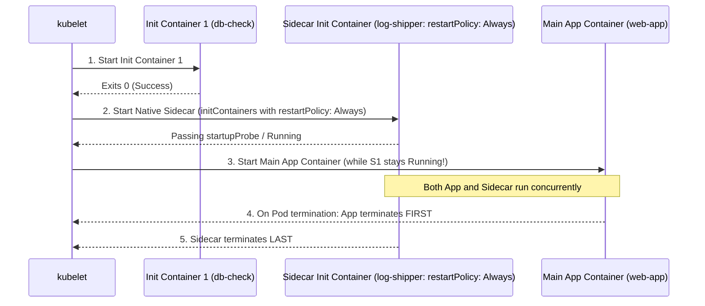
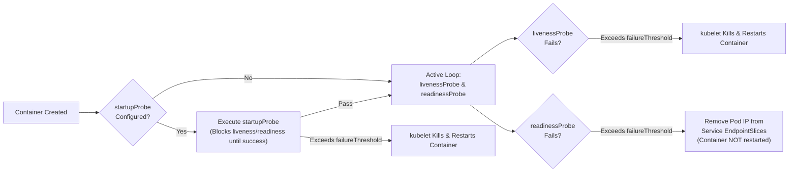

# Domain 2: Workloads & Scheduling — Complete Study Guide

**Exam Weight:** 15% of the CKA Exam  
**Official Curriculum Competencies:**
- Understand deployments and how to perform rolling update and rollbacks
- Use ConfigMaps and Secrets to configure applications
- Know how to scale applications (manual and autoscaling)
- Understand the primitives used to create robust, self-healing, application deployments
- Understand how resource limits can affect Pod scheduling and QoS classes
- Awareness of manifest management and common templating tools
- Understand how to configure Pod scheduling (Affinity, Taints/Tolerations, PriorityClass, PDB)

---

## 1. Pod Lifecycle, Init Containers & Native Sidecar Containers

### 1.1 Pod Phases & Container States
A **Pod** is the smallest deployable unit of computing in Kubernetes. All containers in a Pod share:
- **Network Namespace:** Same IP address, port space (`localhost`), routing table, and `iptables` rules.
- **Storage Volumes:** Any Pod-level `volumes[]` can be mounted into multiple containers in the Pod.
- **IPC Namespace:** Inter-process communication via shared memory/semaphores.

#### Pod `status.phase` Values:
1. `Pending`: Accepted by `kube-apiserver`, waiting to be scheduled to a node or pulling container images / starting `initContainers`.
2. `Running`: Bound to a node, all `initContainers` have completed (or started, for sidecars), and at least one container is running or restarting.
3. `Succeeded`: All containers in the Pod terminated voluntarily with exit code `0` and will not be restarted (`restartPolicy: Never` or `OnFailure`).
4. `Failed`: All containers have terminated, and at least one container terminated with a non-zero exit code.
5. `Unknown`: The state of the Pod cannot be obtained (typically because the node's `kubelet` lost contact with `kube-apiserver`).

#### Pod `restartPolicy` (Pod-Level Field):
- `Always` *(Default — Mandatory for Deployments/DaemonSets/StatefulSets)*: Restarts containers regardless of exit code (`0` or non-zero).
- `OnFailure` *(Used by Jobs/CronJobs)*: Restarts a container only if it exits with a non-zero exit code.
- `Never` *(Used by Jobs or diagnostic Pods)*: Never restarts terminated containers.

> [!NOTE]
> **Exponential BackOff on Container Restarts:**
> When `kubelet` restarts a crashing container, it delays restarts exponentially: **10s $\to$ 20s $\to$ 40s $\to$ 80s $\to$ 160s $\to$ capped at 300s (5 minutes)**. Once a container runs successfully without crashing for **10 minutes**, `kubelet` resets the backoff timer to 0.

---

### 1.2 Standard `initContainers` vs Native Sidecar Containers (`restartPolicy: Always`)

In Kubernetes 1.28+ (GA in 1.29+), Kubernetes introduced **Native Sidecar Containers**, a heavily tested topic in the 2025/2026 CKA exam!



| Feature | Standard `initContainers` | Native Sidecar Containers (`initContainers` with `restartPolicy: Always`) | Regular Multi-Container (`spec.containers`) |
| :--- | :--- | :--- | :--- |
| **YAML Location** | `spec.initContainers[]` | `spec.initContainers[]` | `spec.containers[]` |
| **Container `restartPolicy`** | Omitted | **`restartPolicy: Always`** | Omitted (uses Pod-level `restartPolicy`) |
| **Execution Order** | Runs sequentially to completion (`Exit 0`) **before** the next init container or main container starts. | Starts in sequential order during init phase; once `startupProbe` passes (or process starts), the next container starts immediately **while the sidecar continues running**! | All `spec.containers[]` start in parallel with no ordering guarantee. |
| **Shutdown Order** | Already exited before main app starts. | Terminates **after** all main `spec.containers[]` have exited! | Terminate in parallel. |
| **Probes Supported** | None | **`startupProbe`, `livenessProbe`, `readinessProbe` all supported!** | All 3 supported. |
| **Job Completion Behavior** | Must exit `0`. | Does **not** block a `Job` Pod from completing once main containers exit `0`! | Blocks a `Job` from completing if it runs forever. |

#### Native Sidecar Container YAML Example (High-Probability CKA Task!)
When an exam question says: *"Add a sidecar container named `log-shipper` using image `busybox:1.36` to an existing Deployment so that it runs as a native sidecar container (`restartPolicy: Always`) and reads `/var/log/app/access.log` via a shared volume"*:

```yaml
apiVersion: v1
kind: Pod
metadata:
  name: payment-service
spec:
  initContainers:
  # 1. Traditional Init Container (runs to completion)
  - name: wait-for-db
    image: busybox:1.36
    command: ["sh", "-c", "echo 'Checking DB...' && sleep 2"]
  # 2. Native Sidecar Container (starts before main app, runs for the entire Pod lifecycle!)
  - name: log-shipper
    image: busybox:1.36
    restartPolicy: Always   # <-- Turns this initContainer into a Native Sidecar!
    command: ["sh", "-c", "tail -n+1 -F /var/log/app/access.log"]
    volumeMounts:
    - name: log-storage
      mountPath: /var/log/app
  containers:
  # 3. Primary Application Container
  - name: payment-app
    image: nginx:1.27
    volumeMounts:
    - name: log-storage
      mountPath: /var/log/nginx
  volumes:
  - name: log-storage
    emptyDir: {}
```

---

## 2. Workload Controllers: Deployments, DaemonSets, StatefulSets, Jobs & CronJobs

### 2.1 Deployments & ReplicaSets
A **Deployment** manages stateless application updates by creating and scaling underlying **ReplicaSets**.

#### Update Strategies (`spec.strategy.type`):
1. **`RollingUpdate` (Default):** Gradually replaces old ReplicaSet pods with new ReplicaSet pods without downtime.
   - `maxUnavailable` (Default `25%`): Maximum number or percentage of Pods that can be unavailable during the update (rounded **down** to an integer).
   - `maxSurge` (Default `25%`): Maximum number or percentage of extra Pods that can be created above the desired `replicas` count during the update (rounded **up** to an integer).
   - **Example Math (`replicas: 4`, `maxUnavailable: 25%`, `maxSurge: 25%`):**
     - Minimum available Pods at any moment = $4 - \lfloor 4 \times 0.25 \rfloor = 3$ Pods.
     - Maximum total Pods at any moment = $4 + \lceil 4 \times 0.25 \rceil = 5$ Pods.
2. **`Recreate`:** Terminates **all** existing Pods before creating any new Pods. Causes downtime, but useful when legacy storage or single-writer locks prevent two versions from running simultaneously.

```yaml
apiVersion: apps/v1
kind: Deployment
metadata:
  name: checkout-api
  namespace: production
spec:
  replicas: 4
  revisionHistoryLimit: 10
  progressDeadlineSeconds: 600
  strategy:
    type: RollingUpdate
    rollingUpdate:
      maxSurge: 1
      maxUnavailable: 0 # Zero capacity loss during rollout!
  selector:
    matchLabels:
      app: checkout-api
  template:
    metadata:
      labels:
        app: checkout-api
    spec:
      containers:
      - name: api
        image: registry.example.com/checkout:v2.1.0
```

---

### 2.2 DaemonSets
A **DaemonSet** ensures that all (or a subset of) Nodes run exactly one copy of a Pod. As nodes are added to the cluster, DaemonSet Pods are automatically placed on them.
- **Typical Use Cases:** CNI network plugins (`calico-node`, `cilium`), Service proxies (`kube-proxy`), node log collectors (`fluent-bit`, `promtail`), node monitoring exporters (`prometheus-node-exporter`), storage daemons (`ceph-osd`).
- **How DaemonSets Schedule Pods:** Modern DaemonSet controllers set `spec.affinity.nodeAffinity` on each Pod to target a specific node's `metadata.name` and automatically inject tolerations for node-level taints (`node.kubernetes.io/not-ready`, `node.kubernetes.io/unreachable`, `node.kubernetes.io/disk-pressure`, `node.kubernetes.io/memory-pressure`, `node.kubernetes.io/unschedulable`).
- **Exam Pro-Tip (Generating a DaemonSet YAML Fast):**
  `kubectl create` does not have a `kubectl create daemonset` subcommand! Instead, generate a Deployment YAML and change `kind: Deployment` to `kind: DaemonSet`, then remove `replicas`, `strategy`, and `status`:
  ```bash
  kubectl create deploy node-agent --image=fluent/fluent-bit:3.1 $do > ds.yaml
  # Edit ds.yaml: change kind: DaemonSet and delete replicas/strategy!
  ```

---

### 2.3 StatefulSets
A **StatefulSet** manages stateful applications (databases, Kafka, ZooKeeper, distributed consensus systems) that require:
1. **Stable, Unique Network Identifiers:** Pods are named deterministically with an ordinal index from `0` to $N-1$: `<statefulset-name>-0`, `<statefulset-name>-1`, `<statefulset-name>-2`.
   - Requires a **Headless Service** (`clusterIP: None`) specified in `spec.serviceName`.
   - Each Pod receives a stable DNS A record:
     `<pod-name>.<headless-service-name>.<namespace>.svc.cluster.local`
     (e.g., `mysql-0.mysql-headless.prod.svc.cluster.local`).
2. **Stable, Persistent Storage (`volumeClaimTemplates`):** Each ordinal Pod gets its own dedicated PersistentVolumeClaim named `<volumeClaimTemplate-name>-<statefulset-name>-<ordinal>` (e.g., `data-mysql-0`).
   - Deleting or scaling down a StatefulSet **never deletes its PVCs**! If `mysql-0` is rescheduled to another node, it reattaches to `data-mysql-0`.
3. **Ordered, Graceful Deployment and Scaling (`podManagementPolicy: OrderedReady`):**
   - **Scale Up:** `0` $\to$ `1` $\to$ `2` (`mysql-1` is not created until `mysql-0` is `Running` and `Ready`).
   - **Scale Down / Rolling Update:** Reverse order `2` $\to$ `1` $\to$ `0`.
   - *(Can be changed to `podManagementPolicy: Parallel` if ordered startup/shutdown is not needed.)*

```yaml
apiVersion: v1
kind: Service
metadata:
  name: postgres-hl
spec:
  clusterIP: None # Mandatory Headless Service for StatefulSet DNS
  selector:
    app: postgres
  ports:
  - port: 5432
    name: pg
---
apiVersion: apps/v1
kind: StatefulSet
metadata:
  name: postgres
spec:
  serviceName: "postgres-hl"
  replicas: 3
  selector:
    matchLabels:
      app: postgres
  template:
    metadata:
      labels:
        app: postgres
    spec:
      containers:
      - name: postgres
        image: postgres:16-alpine
        env:
        - name: POSTGRES_PASSWORD
          value: "supersecret"
        ports:
        - containerPort: 5432
          name: pg
        volumeMounts:
        - name: pgdata
          mountPath: /var/lib/postgresql/data
  volumeClaimTemplates:
  - metadata:
      name: pgdata
    spec:
      accessModes: ["ReadWriteOnce"]
      storageClassName: "standard"
      resources:
        requests:
          storage: 10Gi
```

---

### 2.4 Jobs & CronJobs
- **Job (`batch/v1`):** Creates one or more Pods and retries execution until a specified number of Pods terminate successfully (`Exit 0`).
  - `completions`: Total number of successful Pod completions required (default `1`).
  - `parallelism`: Maximum number of Pods allowed to run concurrently (default `1`).
  - `backoffLimit`: Maximum number of retries before marking the Job as failed (default `6`).
  - `activeDeadlineSeconds`: Maximum wall-clock duration for the entire Job; if exceeded, all running Pods are terminated and the Job fails with `reason: DeadlineExceeded`.
  - `ttlSecondsAfterFinished`: Automatically cleans up completed/failed Job and its Pods after $N$ seconds.
- **CronJob (`batch/v1`):** Creates `Job` objects on a repeating cron schedule (`* * * * *`: Minute [0-59], Hour [0-23], Day of Month [1-31], Month [1-12], Day of Week [0-6]).
  - `concurrencyPolicy`:
    - `Allow` *(Default)*: Allows concurrent Job runs if the previous run hasn't finished.
    - `Forbid`: Skips the new run if the previous run is still active.
    - `Replace`: Cancels the currently running Job and replaces it with a new Job.
  - `startingDeadlineSeconds`: Maximum window in seconds to start a missed scheduled Job.

---

## 3. Application Configuration: ConfigMaps & Secrets

| Aspect | `ConfigMap` | `Secret` |
| :--- | :--- | :--- |
| **Intended Data** | Non-sensitive config files, CLI args, env vars | Passwords, OAuth tokens, TLS certs, SSH keys, Docker registry credentials |
| **Encoding in YAML** | Plaintext strings under `data:` (or binary under `binaryData:`) | Base64-encoded strings under `data:` (or plaintext write-only under `stringData:`) |
| **Built-in Types** | N/A | `Opaque` (default), `kubernetes.io/tls`, `kubernetes.io/dockerconfigjson`, `kubernetes.io/service-account-token`, `bootstrap.kubernetes.io/token` |
| **Size Limit** | 1 MiB (etcd object limit) | 1 MiB (etcd object limit) |

### 3.1 Injecting ConfigMaps & Secrets into Pods
1. **All Keys as Environment Variables (`envFrom`):**
   ```yaml
   envFrom:
   - configMapRef:
       name: app-config
   - secretRef:
       name: db-credentials
   ```
2. **Single Specific Key as Environment Variable (`valueFrom`):**
   ```yaml
   env:
   - name: DATABASE_PASSWORD
      valueFrom:
        secretKeyRef:
          name: db-credentials
          key: password
   ```
3. **Mounted as Files in a Volume (`volumes` + `volumeMounts`):**
   ```yaml
   volumeMounts:
   - name: config-vol
     mountPath: /etc/app/config
     readOnly: true
   volumes:
   - name: config-vol
     configMap:
       name: app-config
       defaultMode: 0644 # Must be octal 0000-0777 or decimal (e.g., 420 = 0644, 256 = 0400)
   ```

> [!WARNING]
> **Critical CKA Exam Trap: Live Updates vs `subPath` and `env`!**
> - When a `ConfigMap` or `Secret` is mounted as a standard directory volume, `kubelet` automatically updates the mounted files inside the running container within ~60–90 seconds (sync period + cache TTL) when the `ConfigMap`/`Secret` is modified.
> - **EXCEPTIONS (NEVER Auto-Updated!):**
>   1. Environment variables (`env` / `envFrom`) are **never** updated while a container is running; the Pod must be restarted.
>   2. Volume mounts that use **`subPath`** (mounting a single file into an existing directory without hiding other files) **NEVER receive automatic updates** when the `ConfigMap` or `Secret` changes!

---

## 4. Container Probes: `startupProbe`, `livenessProbe`, `readinessProbe`



### 4.1 The 3 Probe Types
1. **`startupProbe`:** Verifies whether the application inside the container has finished starting up.
   - **Behavior:** Disables `livenessProbe` and `readinessProbe` until `startupProbe` succeeds once! If it fails `failureThreshold` times, `kubelet` kills and restarts the container.
   - **Use Case:** Legacy or Java/Spring Boot applications that take 60–180 seconds to initialize, allowing a fast `livenessProbe` (`periodSeconds: 5`) once started without killing the container during slow boot.
2. **`livenessProbe`:** Detects deadlocks where the process is still running, but unable to make progress.
   - **Behavior:** If it fails `failureThreshold` consecutive times, `kubelet` kills the container and restarts it according to the Pod's `restartPolicy`.
3. **`readinessProbe`:** Determines whether the container is ready to accept network traffic.
   - **Behavior:** If it fails, `kubelet` marks the Pod `Ready: False` and the `EndpointSlice` controller **removes the Pod's IP from all matching `Services`**. **It NEVER restarts the container!**

### 4.2 The 4 Probe Mechanisms
- **`httpGet`:** Performs an HTTP GET request to `path`, `port`, `httpHeaders`. Status codes `200`–`399` indicate success.
- **`tcpSocket`:** Attempts to open a TCP connection on `port`. If established, the probe succeeds.
- **`exec`:** Runs a command inside the container (`command: ["cat", "/tmp/healthy"]`). Exit code `0` indicates success.
- **`grpc`:** Performs a native gRPC health check on `port` (and optional `service`).

---

## 5. Resource Management, QoS Classes, `LimitRange` & `ResourceQuota`

### 5.1 CPU vs Memory Requests and Limits
- **Requests (`resources.requests`):** Used by `kube-scheduler` during the **Filtering** phase to pick a node with sufficient `Allocatable` capacity.
- **Limits (`resources.limits`):** Enforced by the Linux kernel (`cgroups`) on the worker node:
  - **CPU is a compressible resource:** `1` CPU = `1000m` (millicores). If a container exceeds `limits.cpu`, the kernel **throttles** its CPU cycles via CFS quota; the container is **never killed** for exceeding CPU limits.
  - **Memory is an incompressible resource:** Measured in binary (`Mi`, `Gi` — $1\text{ Mi} = 2^{20}\text{ bytes}$) or decimal (`M`, `G`). If a container exceeds `limits.memory`, the Linux kernel's Out-Of-Memory killer (**OOMKiller**) terminates the process with **Exit Code `137`** (`128 + 9 SIGKILL`) and status `OOMKilled`.

### 5.2 Quality of Service (QoS) Classes
Kubernetes automatically assigns one of three QoS classes to every Pod (`status.qosClass`), determining **eviction order** when a node experiences `MemoryPressure`:

| QoS Class | Exact Assignment Rule | Node MemoryPressure Eviction Priority |
| :--- | :--- | :--- |
| **`Guaranteed`** | **Every** container in the Pod must have **both** `memory` and `cpu` limits and requests set, AND `requests.memory == limits.memory` AND `requests.cpu == limits.cpu`. *(Note: If you specify only `limits` with no `requests`, Kubernetes automatically sets `requests = limits`!)* | **Evicted LAST** (Highest protection) |
| **`Burstable`** | The Pod does not meet `Guaranteed` criteria, cleanly having at least **one** container with a `memory` or `cpu` request or limit specified. | **Evicted SECOND** (Ranked by % of memory request exceeded) |
| **`BestEffort`** | **Zero** containers in the Pod have any `cpu` or `memory` requests or limits defined. | **Evicted FIRST** (Lowest protection) |

### 5.3 `LimitRange` vs `ResourceQuota`
- **`LimitRange` (Per-Pod / Per-Container Admission Control):**
  - Enforces `min` and `max` CPU/memory per container/Pod or PVC storage size.
  - Injects `default` (`limits`) and `defaultRequest` (`requests`) into any newly created container in the namespace that omits resource requests/limits!
- **`ResourceQuota` (Namespace Aggregate Cap):**
  - Caps the **total sum** of resources across all Pods/PVCs in a namespace (`requests.cpu`, `limits.cpu`, `requests.memory`, `limits.memory`, `requests.storage`, `count/pods`, `count/services.loadbalancers`).
  - **Exam Gotcha:** Once a `ResourceQuota` for CPU or memory is active in a namespace, **every Pod created in that namespace MUST specify CPU/memory requests/limits** (or a `LimitRange` must exist in the namespace to auto-inject defaults), otherwise `kube-apiserver` rejects the Pod creation!

---

## 6. Advanced Pod Scheduling

### 6.1 Manual Scheduling (`nodeName`) vs `nodeSelector`
- **`spec.nodeName: worker-02`:** Bypasses `kube-scheduler` completely! Even if `kube-scheduler` is broken or deleted, `kubelet` on `worker-02` will see the Pod and start it.
- **`spec.nodeSelector`:** Simplest label-based scheduling constraint (exact key-value AND matching).

### 6.2 Node Affinity & Anti-Affinity
Provides expressive scheduling rules (`In`, `NotIn`, `Exists`, `DoesNotExist`, `Gt`, `Lt`):
1. **`requiredDuringSchedulingIgnoredDuringExecution` (Hard Requirement):** Pod will remain `Pending` unless a node satisfies the expression.
2. **`preferredDuringSchedulingIgnoredDuringExecution` (Soft Preference):** Scheduler adds `weight` (`1`–`100`) to matching nodes, but still schedules the Pod elsewhere if no node matches.
3. *(Both end with `IgnoredDuringExecution`: if labels are removed from a node after the Pod is already running, the Pod is **not** evicted.)*

```yaml
spec:
  affinity:
    nodeAffinity:
      requiredDuringSchedulingIgnoredDuringExecution:
        nodeSelectorTerms:
        # Multiple nodeSelectorTerms are OR'ed together!
        - matchExpressions:
          # Multiple matchExpressions inside a single term are AND'ed together!
          - key: accelerator
            operator: In
            values: ["nvidia-a100", "nvidia-h100"]
          - key: disktype
            operator: Exists
      preferredDuringSchedulingIgnoredDuringExecution:
      - weight: 80
        preference:
          matchExpressions:
          - key: topology.kubernetes.io/zone
            operator: In
            values: ["us-east-1a"]
```

### 6.3 Inter-Pod Affinity & Anti-Affinity (`podAffinity` / `podAntiAffinity`)
Schedules a Pod relative to the labels of **other Pods already running** on nodes across a failure domain defined by **`topologyKey`** (e.g., `kubernetes.io/hostname` for per-node separation, or `topology.kubernetes.io/zone` for per-AZ separation).

```yaml
# Spread replicas of 'web-frontend' so NO two replicas ever land on the same Node:
spec:
  affinity:
    podAntiAffinity:
      requiredDuringSchedulingIgnoredDuringExecution:
      - labelSelector:
          matchExpressions:
          - key: app
            operator: In
            values: ["web-frontend"]
        topologyKey: "kubernetes.io/hostname"
```

---

### 6.4 Taints & Tolerations
- **Node Affinity** is a property of **Pods** that *attracts* them to a set of nodes.
- **Taints** are applied to **Nodes** to *repel* Pods that do not have a matching **Toleration**.

> [!IMPORTANT]
> **Critical Exam Concept:** A Toleration allows a Pod to schedule onto a tainted node, **but does NOT force or guarantee** that the Pod will land on that node! To dedicate a node exclusively to a group of Pods, you must combine **BOTH**:
> 1. **Taint + Toleration** (to keep all other Pods off the node), **AND**
> 2. **Node Label + `nodeSelector` / `nodeAffinity`** (to force your target Pods onto that node).

#### The 3 Taint Effects:
1. **`NoSchedule`:** New Pods without a matching toleration will **not** be scheduled onto the node. Existing running Pods on the node are **not** evicted.
2. **`PreferNoSchedule`:** Soft version of `NoSchedule`; scheduler tries to avoid placing intolerant Pods on the node, but will do so if no other capacity exists.
3. **`NoExecute`:**
   - New Pods without a matching toleration will **not** be scheduled onto the node, **AND**
   - **Existing running Pods** on the node that do not tolerate the taint are **immediately evicted** (or evicted after `tolerationSeconds` if they tolerate it with a timer)!

```yaml
spec:
  tolerations:
  - key: "dedicated"
    operator: "Equal" # Default is "Equal"; use "Exists" when omitting 'value'
    value: "gpu-workloads"
    effect: "NoExecute"
    tolerationSeconds: 300 # Pod stays bound for 300s after taint is added before eviction
```

---

### 6.5 `PriorityClass`, `PodDisruptionBudget` (PDB) & `HorizontalPodAutoscaler` (HPA)

#### `PriorityClass` (`scheduling.k8s.io/v1`)
Assigns an integer priority value to Pods (`spec.priorityClassName`). When a high-priority Pod cannot be scheduled due to insufficient node resources, `kube-scheduler` **preempts (evicts)** lower-priority Pods from a node so the high-priority Pod can schedule (unless `preemptionPolicy: Never` is set).

#### `PodDisruptionBudget` (`policy/v1`)
Protects application availability during **voluntary disruptions** (such as `kubectl drain` during node upgrades). It does not prevent involuntary hardware crashes, but blocks `kubectl drain` from evicting a Pod if doing so would violate `minAvailable` or `maxUnavailable`.

```yaml
apiVersion: policy/v1
kind: PodDisruptionBudget
metadata:
  name: zk-pdb
  namespace: prod
spec:
  minAvailable: 2 # Or maxUnavailable: 1 (Cannot specify both in the same PDB!)
  selector:
    matchLabels:
      app: zookeeper
```

#### `HorizontalPodAutoscaler` (`autoscaling/v2`)
Queries `metrics.k8s.io` (`metrics-server`) every 15 seconds and scales a Deployment/StatefulSet's `replicas` using:
$$\text{Desired Replicas} = \left\lceil \text{Current Replicas} \times \left( \frac{\text{Current Metric Value}}{\text{Desired Target Value}} \right) \right\rceil$$

```yaml
apiVersion: autoscaling/v2
kind: HorizontalPodAutoscaler
metadata:
  name: api-hpa
  namespace: prod
spec:
  scaleTargetRef:
    apiVersion: apps/v1
    kind: Deployment
    name: checkout-api
  minReplicas: 2
  maxReplicas: 10
  metrics:
  - type: Resource
    resource:
      name: cpu
      target:
        type: Utilization
        averageUtilization: 70
  - type: Resource
    resource:
      name: memory
      target:
        type: AverageValue
        averageValue: 200Mi
  behavior:
    scaleDown:
      stabilizationWindowSeconds: 120
```

---

## 7. Domain 2 Exam Review Checklist

- [ ] Can you configure a **Native Sidecar Container** inside `spec.initContainers[]` with `restartPolicy: Always` and a shared `emptyDir` volume?
- [ ] Can you tune `maxSurge` and `maxUnavailable` on a Deployment, update its image, check rollout history, and roll back to a specific revision?
- [ ] Do you know why `ConfigMap` mounts using `subPath` do not auto-update?
- [ ] Can you configure `startupProbe`, `livenessProbe`, and `readinessProbe` (`httpGet`, `exec`, `tcpSocket`)?
- [ ] Can you write a `Guaranteed` QoS Pod and pair a `ResourceQuota` with a `LimitRange`?
- [ ] Can you combine `kubectl taint nodes`, `tolerations`, and `nodeAffinity` (`requiredDuringSchedulingIgnoredDuringExecution`)?
