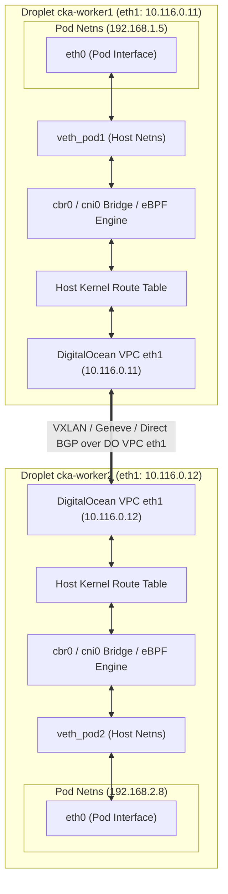

# Domain 3: Services & Networking — In-Depth Master Study Guide

**Exam Weight:** 20% of CKA  
**Target Mastery:** The Kubernetes Network Model, CNI Plugins (Calico, Flannel, Cilium) on DigitalOcean Droplet VPC interfaces (`eth1`), kube-proxy internals (`iptables` vs `ipvs` vs eBPF), ClusterIP/NodePort/LoadBalancer/ExternalName/Headless Services, EndpointSlices, CoreDNS architecture and custom stub domains, Ingress Controllers and path/host routing, Kubernetes Gateway API (`GatewayClass`, `Gateway`, `HTTPRoute`, `GRPCRoute`, `ReferenceGrant`), and complete NetworkPolicy ingress/egress rules.

---

## 1. The Kubernetes Network Model & CNI Internals

### Fundamental Networking Invariants
Every compliant Kubernetes cluster must satisfy three foundational principles:
1. **All Pods can communicate with all other Pods** on any node without NAT.
2. **All Nodes can communicate with all Pods** (and vice versa) on any node without NAT.
3. **The IP that a Pod sees itself as is the exact same IP that all other Pods see it as.**

### Container Network Interface (CNI) Architecture
- When `kubelet` initializes a Pod sandbox, it invokes CNI plugins to allocate IP addresses, set up network namespaces (`netns`), and create virtual ethernet pairs (`veth`).
- **Configuration Directory:** `/etc/cni/net.d/` (e.g. `10-calico.conflist`, `10-flannel.conflist`, `05-cilium.conflist`). Kubelet parses the lexicographically first configuration file unless specified otherwise.
- **Binary Directory:** `/opt/cni/bin/` (`bridge`, `host-local`, `loopback`, `portmap`, `macvlan`, `ipvlan`, `calico`, `calico-ipam`, `cilium-cni`).
- **IP Address Management (IPAM):** Plugins like `host-local` allocate CIDR blocks per node from the cluster-wide `pod-network-cidr` (e.g. Node 1 gets `10.244.1.0/24`, Node 2 gets `10.244.2.0/24`).



### CNI Provider Comparison & DigitalOcean Droplet `eth1` Binding
- **Flannel:** Simple overlay network using VXLAN (`8472/udp`) or `host-gw`. Does **NOT** support NetworkPolicies! (On DigitalOcean Droplets, pass `--iface=eth1` in the `kube-flannel` args).
- **Calico:** Uses BGP (Border Gateway Protocol) for pure L3 routing or IP-in-IP / VXLAN overlay. Full NetworkPolicy and Calico GlobalNetworkPolicy engine.
  - **DigitalOcean Droplet Binding:** Because `eth0` holds the public IP and an internal `10.x.x.x` anchor IP, always bind Calico to the private DigitalOcean VPC interface (`eth1`):
    ```bash
    kubectl set env daemonset/calico-node -n kube-system IP_AUTODETECTION_METHOD=interface=eth1
    ```
- **Cilium:** eBPF-powered networking, observability, and security. Evaluates network policies directly at Linux socket/kernel layers without iptables connection-tracking overhead. Supports L7 application-aware policies (HTTP method/path, DNS filtering) and Gateway API.
  - **DigitalOcean Droplet Binding:**
    ```bash
    cilium install --version 1.16.3 --set devices=eth1
    ```

---

## 2. Kubernetes Services & kube-proxy Deep Dive

### Service Types Matrix

- **ClusterIP**
  - **IP Allocation:** Virtual VIP from `service-cluster-ip-range` (e.g., `10.96.0.0/12`).
  - **Routing Mechanism:** iptables DNAT or ipvs virtual server. Never responds to ping (ICMP)!
  - **Node Port Range:** None
  - **Primary Use Case:** Internal East-West cluster communication.
- **NodePort**
  - **IP Allocation:** ClusterIP + opens static port on every cluster node.
  - **Routing Mechanism:** `<NodeIP>:<NodePort>` DNATs to ClusterIP/Endpoint.
  - **Node Port Range:** `30000–32767`
  - **Primary Use Case:** Direct node entry, self-managed DigitalOcean Droplet ingress.
- **LoadBalancer**
  - **IP Allocation:** Superset of NodePort + ClusterIP.
  - **Routing Mechanism:** Calls Cloud Provider (`digitalocean-cloud-controller-manager` for DO Load Balancers, or MetalLB) to provision external LB pointing to NodePorts.
  - **Node Port Range:** `30000–32767` (or cloud provider bypass)
  - **Primary Use Case:** Direct North-South TCP/UDP external ingress.
- **ExternalName**
  - **IP Allocation:** No IP, no proxying, no EndpointSlice.
  - **Routing Mechanism:** CoreDNS returns CNAME pointing to external FQDN (`spec.externalName`).
  - **Node Port Range:** None
  - **Primary Use Case:** Aliasing external databases (e.g., DigitalOcean Managed DB) or third-party APIs.
- **Headless** (`clusterIP: None`)
  - **IP Allocation:** No ClusterIP allocated. No kube-proxy load balancing.
  - **Routing Mechanism:** DNS returns `A`/`AAAA` records containing Pod IPs directly (or SRV records for named ports).
  - **Node Port Range:** None
  - **Primary Use Case:** StatefulSets (Cassandra, Kafka, Elastic), peer discovery.

### kube-proxy Operating Modes
- **`iptables` mode (Default):**
  - Uses Linux Netfilter `PREROUTING`, `OUTPUT`, and `KUBE-SERVICES` chains.
  - Backing endpoints are chosen randomly with equal probability using the statistic module (`-m statistic --mode random --probability 0.5`).
  - Limitations: Evaluation is $O(N)$ sequential chain scanning. With 5,000+ services and 20,000+ endpoints, iptables kernel lock contention degrades throughput.
- **`ipvs` mode:**
  - Uses IP Virtual Server (IPVS) Netfilter transport-layer load balancing.
  - Uses hash tables ($O(1)$ lookup time) regardless of fleet size.
  - Supports advanced load-balancing algorithms: Round-Robin (`rr`), Least Connection (`lc`), Destination Hashing (`dh`), Source Hashing (`sh`), Shortest Expected Delay (`sed`), Never Queue (`nq`).
- **Traffic Policy: `externalTrafficPolicy` vs `internalTrafficPolicy`:**
  - `externalTrafficPolicy: Cluster` (default): Traffic hitting any NodePort is routed to all endpoints cluster-wide. Incurs an extra network hop and masks original client source IP!
  - `externalTrafficPolicy: Local`: Traffic hitting `<NodeIP>:<NodePort>` is forwarded ONLY to local pods on that exact node. Preserves client source IP! If no pods exist on that node, packets are dropped.
  - `internalTrafficPolicy: Local`: ClusterIP traffic from a pod is routed exclusively to endpoints residing on the same node.

---

## 3. Endpoints & EndpointSlices Architecture

- A Service selects Pods via `spec.selector`. The control plane's `endpoint-slice-controller` monitors matching pods and updates `EndpointSlice` resources (`discovery.k8s.io/v1`).
- **Why EndpointSlices replaced Endpoints:** Legacy `Endpoints` object stored all backend IPs in a single API resource. When a single pod scaled or terminated in a 1,000-replica service, the entire megabyte-sized object had to be marshaled and transmitted to every node. `EndpointSlice` chunks backends into max 100 endpoints per slice.

```bash
# Check service endpoints and slices
kubectl get endpoints my-service
kubectl get endpointslices -l kubernetes.io/service-name=my-service -o wide

# Key debugging command: Verify selector matching
kubectl get pods --show-labels -l app=payment,tier=backend
kubectl describe svc my-service | grep -E "Selector|Endpoints"
```

---

## 4. CoreDNS Architecture & Service Discovery

### CoreDNS Configuration (`/etc/coredns/Corefile` via ConfigMap `coredns` in `kube-system`)
```text
.:53 {
    errors
    health {
       lameduck 5s
    }
    ready
    kubernetes cluster.local in-addr.arpa ip6.arpa {
       pods insecure
       fallthrough in-addr.arpa ip6.arpa
       ttl 30
    }
    prometheus :9153
    forward . /etc/resolv.conf {
       max_concurrent 1000
    }
    cache 30
    loop
    reload
    loadbalance
}
```

### DNS Name Resolution Rules
For a service `order-api` in namespace `ecommerce` with port `http` (8080):
- **Inside same namespace (`ecommerce`):** `order-api`
- **Across namespaces:** `order-api.ecommerce`
- **Full FQDN:** `order-api.ecommerce.svc.cluster.local`
- **SRV Record for named port:** `_http._tcp.order-api.ecommerce.svc.cluster.local`
- **StatefulSet Headless Pod FQDN:** `<pod-name>.order-api.ecommerce.svc.cluster.local` (e.g., `redis-0.redis-service.databases.svc.cluster.local`)

### Pod `dnsPolicy` Modes
- `ClusterFirst` (default): Queries non-cluster domains via the upstream nameservers defined in `/etc/resolv.conf`.
- `Default`: Inherits the node's `/etc/resolv.conf` directly, bypassing CoreDNS.
- `ClusterFirstWithHostNet`: Required for Pods running with `hostNetwork: true` that still need cluster DNS resolution.
- `None`: Ignores Kubernetes and host DNS; requires explicit `dnsConfig` in the pod spec.

---

## 5. Ingress Controllers & Ingress Resources

An Ingress Controller (e.g. `ingress-nginx`, Traefik, Envoy Gateway, Cilium Ingress) operates as a reverse proxy interpreting `networking.k8s.io/v1` `Ingress` resources.

### Complete Production Ingress Spec with TLS & Path Rewriting
```yaml
apiVersion: networking.k8s.io/v1
kind: Ingress
metadata:
  name: api-gateway-ingress
  namespace: production
  annotations:
    nginx.ingress.kubernetes.io/rewrite-target: /$2
    nginx.ingress.kubernetes.io/ssl-redirect: "true"
    nginx.ingress.kubernetes.io/proxy-body-size: "20m"
    nginx.ingress.kubernetes.io/proxy-connect-timeout: "15"
    nginx.ingress.kubernetes.io/proxy-read-timeout: "600"
spec:
  ingressClassName: nginx
  tls:
  - hosts:
    - api.corp.enterprise.com
    secretName: enterprise-wildcard-tls
  rules:
  - host: api.corp.enterprise.com
    http:
      paths:
      - path: /billing(/|$)(.*)
        pathType: Prefix
        backend:
          service:
            name: billing-svc
            port:
              number: 8443
      - path: /catalog(/|$)(.*)
        pathType: Prefix
        backend:
          service:
            name: catalog-svc
            port:
              number: 8080
```

### Ingress Path Matching Types
- `Exact`: Matches the URL path exactly and with case-sensitivity (e.g., `/orders` matches `/orders`, but NOT `/orders/` or `/orders/123`).
- `Prefix`: Matches URL path prefix split by `/` delimiter (e.g., `/orders` matches `/orders`, `/orders/`, and `/orders/item/123`).
- `ImplementationSpecific`: Delegated entirely to the IngressClass controller.

---

## 6. Kubernetes Gateway API (The Modern CKA Exam Standard)

The **Gateway API** (`gateway.networking.k8s.io/v1`) decouples routing into discrete persona roles:
1. **`GatewayClass`:** Defined by Cluster Infrastructure Provider (e.g. Envoy, Istio, Cilium, NGINX).
2. **`Gateway`:** Defined by Cluster Operator (binds IP addresses, listening ports, TLS certificates).
3. **`HTTPRoute` / `GRPCRoute` / `TCPRoute`:** Defined by Application Developers (path matching, header manipulation, traffic splitting).

```yaml
apiVersion: gateway.networking.k8s.io/v1
kind: Gateway
metadata:
  name: corporate-edge-gw
  namespace: gateway-system
spec:
  gatewayClassName: cilium-gateway
  listeners:
  - name: https
    protocol: HTTPS
    port: 443
    tls:
      mode: Terminate
      certificateRefs:
      - name: corporate-tls-cert
    allowedRoutes:
      namespaces:
        from: All
---
apiVersion: gateway.networking.k8s.io/v1
kind: HTTPRoute
metadata:
  name: checkout-traffic-split
  namespace: payments
spec:
  parentRefs:
  - name: corporate-edge-gw
    namespace: gateway-system
  hostnames:
  - "pay.corp.enterprise.com"
  rules:
  - matches:
    - path:
        type: PathPrefix
        value: /v2/charge
    backendRefs:
    - name: payment-v1
      port: 8080
      weight: 85
    - name: payment-v2-canary
      port: 8080
      weight: 15
```

---

## 7. NetworkPolicies Deep Dive

NetworkPolicies are implemented by the CNI plugin (Calico, Cilium, Weave, Kube-router). **Flannel does NOT enforce NetworkPolicies!**

> [!IMPORTANT]
> **Default Ingress / Egress Isolation Rules:**
> - Pods are non-isolated by default.
> - As soon as a NetworkPolicy selects a pod (`podSelector`), the pod is **isolated** for the directions listed in `policyTypes`.
> - If `policyTypes` includes `Ingress`, all incoming traffic not explicitly matched in `ingress:` rules is **DENIED**.
> - If `policyTypes` includes `Egress`, all outgoing traffic not explicitly matched in `egress:` rules is **DENIED** (including DNS resolution on port 53!).

### Complete Multi-Tier Hardened NetworkPolicy
```yaml
apiVersion: networking.k8s.io/v1
kind: NetworkPolicy
metadata:
  name: secure-database-tier
  namespace: db-layer
spec:
  podSelector:
    matchLabels:
      app: postgres-cluster
  policyTypes:
  - Ingress
  - Egress
  ingress:
  # Allow connections ONLY from backend pods in the 'backend-layer' namespace on port 5432
  - from:
    - namespaceSelector:
        matchLabels:
          kubernetes.io/metadata.name: backend-layer
      podSelector:
        matchLabels:
          role: app-server
    ports:
    - protocol: TCP
      port: 5432
  egress:
  # Crucial: Allow DNS resolution to kube-system CoreDNS pods
  - to:
    - namespaceSelector:
        matchLabels:
          kubernetes.io/metadata.name: kube-system
      podSelector:
        matchLabels:
          k8s-app: kube-dns
    ports:
    - protocol: UDP
      port: 53
    - protocol: TCP
      port: 53
  # Allow replication traffic to specific CIDR block
  - to:
    - ipBlock:
        cidr: 10.50.0.0/16
        except:
        - 10.50.1.0/24
    ports:
    - protocol: TCP
      port: 5432
```

### AND vs OR Syntax Trap in NetworkPolicies
```yaml
# SCENARIO A: Logical OR (Two dashes - two list items)
from:
- namespaceSelector:
    matchLabels:
      env: prod
- podSelector:
    matchLabels:
      role: client
# Meaning: Allow traffic from ANY pod in namespaces labeled 'env: prod'
#          OR from ANY pod labeled 'role: client' in the LOCAL namespace!

# SCENARIO B: Logical AND (Single dash - both selectors under same list item)
from:
- namespaceSelector:
    matchLabels:
      env: prod
  podSelector:
    matchLabels:
      role: client
# Meaning: Allow traffic ONLY from pods labeled 'role: client' that reside inside namespaces labeled 'env: prod'!
```

---

## 8. CKA Exam Traps & Fast Troubleshooting Workflows

1. **Service Selector Typo:**
   - Symptom: `curl <ClusterIP>` times out or returns `Connection Refused`.
   - Action: Run `kubectl get endpoints <service-name>`. If `<none>`, inspect labels on pods (`kubectl get pods --show-labels`) and compare with `kubectl describe svc <service-name> | grep Selector`.
2. **CoreDNS Fails to Resolve:**
   - Symptom: Pod cannot resolve cluster services, but `curl <ClusterIP>` works.
   - Action: Check `kubectl get pods -n kube-system -l k8s-app=kube-dns`. Check logs: `kubectl logs -n kube-system -l k8s-app=kube-dns`. Look for loop detection crash (`plugin/loop: Loop detected`).
3. **Egress NetworkPolicy Blocks DNS:**
   - Symptom: Pod cannot resolve any hostnames after applying an Egress NetworkPolicy.
   - Fix: Always include an explicit Egress rule permitting UDP and TCP traffic on port 53 to namespace `kube-system`!
4. **NodePort Connection Refused from External IP:**
   - Check if `externalTrafficPolicy: Local` is set on a service and whether the Droplet you are hitting actually hosts a backing pod replica. If not, hit a Droplet that does, or change to `Cluster`.
