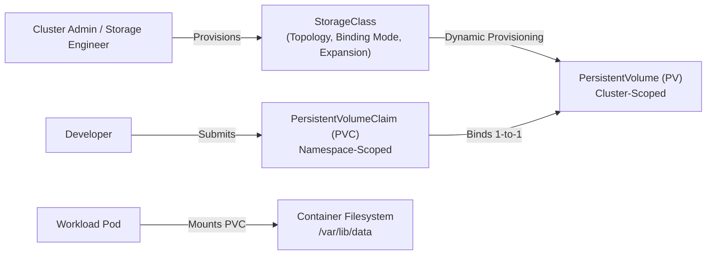
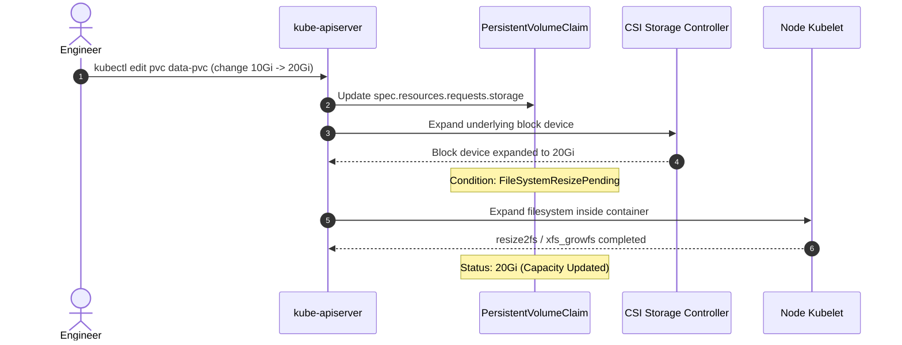

# Domain 4: Storage — In-Depth Master Study Guide

> [!IMPORTANT]
> **Exam Weighting & Core Architecture Focus:** Domain 4 accounts for **10% of the Certified Kubernetes Administrator (CKA)** examination. Questions test hands-on terminal speed: statically provisioning PersistentVolumes (PVs), configuring PVCs with exact AccessModes and StorageClasses, dynamic CSI provisioning, setting `volumeBindingMode: WaitForFirstConsumer` for topology awareness, resizing volumes via online PVC expansion (`allowVolumeExpansion: true`), recovering `Released` volumes by clearing `claimRef`, configuring raw block volumes (`volumeDevices`), and managing VolumeSnapshots.

---

## 1. Kubernetes Storage Architecture & PV/PVC Lifecycle

Kubernetes decouples storage infrastructure configuration (managed by cluster administrators) from storage consumption (requested by application developers) through PersistentVolumes and PersistentVolumeClaims.



### 1.1 The 4 Phases of the PV/PVC Lifecycle

1. **Provisioning:**
   * **Static Provisioning:** An administrator manually creates `PersistentVolume` objects pointing to physical SAN/NAS disks, cloud block storage, or local directories.
   * **Dynamic Provisioning:** A PVC references a `StorageClass`. The Container Storage Interface (CSI) provisioner automatically provisions the underlying physical volume and creates a matching PV.
2. **Binding:**
   * The master control-plane (`pv-controller`) watches for unbound PVCs and finds a matching PV by checking:
     * Storage capacity (PV capacity $\ge$ PVC requested capacity).
     * `accessModes` compatibility.
     * `storageClassName` match (`spec.storageClassName`).
     * `volumeMode` (`Filesystem` vs. `Block`).
   * **Exclusive 1-to-1 Binding Rule:** Binding is strictly **exclusive and 1-to-1**. A 100 Gi PV bound to a 10 Gi PVC cannot bind to any other PVC—the remaining 90 Gi is wasted!
3. **Using:**
   * Pod manifests reference the claim: `volumes: [{name: my-vol, persistentVolumeClaim: {claimName: my-pvc}}]`.
   * The `kubelet` attaches the volume (via CSI Node plugin) and mounts the filesystem into the container target directory.
4. **Reclaiming:**
   * When a user deletes a PVC, the bound PV transitions to the `Released` status.
   * The `persistentVolumeReclaimPolicy` governs what happens next.

### 1.2 Access Modes Deep Dive

* **ReadWriteOnce (`RWO`)**
  * **Mount Capability:** Mounted as read-write by a **single node**. Multiple pods scheduled onto the *same node* can access it simultaneously.
  * **Backends:** Cloud block storage (AWS EBS, GCP Persistent Disk, DigitalOcean Block Storage), iSCSI, local disks.

* **ReadOnlyMany (`ROX`)**
  * **Mount Capability:** Mounted as read-only by **many nodes** simultaneously.
  * **Backends:** NFS shares, CephFS, read-only cloud storage mounts.

* **ReadWriteMany (`RWX`)**
  * **Mount Capability:** Mounted as read-write by **many nodes** simultaneously.
  * **Backends:** Network filesystems (NFSv4, GlusterFS, CephFS, AWS EFS, Google Cloud Filestore).

* **ReadWriteOncePod (`RWOP`)**
  * **Mount Capability:** Mounted as read-write by a **single Pod across the entire cluster**. Guarantees that only one Pod can ever write to the volume at any given time.
  * **Backends:** Modern CSI drivers supporting Kubernetes v1.27+ GA `ReadWriteOncePod`.

### 1.3 Reclaim Policies & The `Released` PV Re-Binding Playbook

* **`Delete` Reclaim Policy (Default for dynamic SC):** Deleting the PVC automatically deletes the underlying PV and deletes the physical cloud volume.
* **`Retain` Reclaim Policy:** Deleting the PVC leaves the PV intact in **`Released`** status. The underlying storage and data are preserved.
* **CKA Terminal Rescue Playbook (Re-binding a `Released` PV):**
  * When a PV is `Released`, other PVCs **cannot bind to it** because its `spec.claimRef` still contains the UID of the deleted PVC!
  * To make the `Released` PV `Available` again for a new claim without data loss:
    ```bash
    # 1. Patch the PV to remove the old claim reference
    kubectl patch pv my-retained-pv -p '{"spec":{"claimRef": null}}'
    
    # 2. Verify status changes from Released back to Available
    kubectl get pv my-retained-pv
    ```

---

## 2. StorageClass & Volume Binding Modes

```yaml
apiVersion: storage.k8s.io/v1
kind: StorageClass
metadata:
  name: fast-ssd-topology
provisioner: pd.csi.storage.gke.io
volumeBindingMode: WaitForFirstConsumer # Critical CKA exam parameter!
allowVolumeExpansion: true              # Enables online PVC resizing
reclaimPolicy: Retain
parameters:
  type: pd-ssd
```

### 2.1 `Immediate` vs. `WaitForFirstConsumer` (Topology Awareness)

* **`Immediate` (Default):**
  * Volume provisioning and PV-to-PVC binding occur **immediately** when the PVC is created, before any Pod referencing the PVC is scheduled.
  * *Hazard / Deadlock:* In multi-zone clusters, the storage provisioner might randomly create the volume in `us-central1-a`. Later, when the Pod is scheduled, the scheduler might place the Pod in `us-central1-b` due to CPU limits, causing the Pod to remain permanently stuck in **`CrashLoopBackOff` / `VolumeAttachmentError`** because a volume in zone A cannot attach to a VM in zone B!
* **`WaitForFirstConsumer` (Mandatory for Multi-Zone & Local PVs):**
  * Delays volume provisioning and binding **until a Pod referencing the PVC is actively scheduled onto a specific node**.
  * The CSI provisioner then creates the volume in the **exact same zone/node** where the Pod was placed, completely eliminating cross-zone mounting failures.

---

## 3. Online PVC Volume Expansion

Kubernetes supports expanding volumes without stopping running workloads (`allowVolumeExpansion: true`).



```bash
# 1. Verify StorageClass supports expansion
kubectl get sc fast-ssd-topology -o jsonpath='{.allowVolumeExpansion}'

# 2. Expand the PVC by increasing requested storage
kubectl patch pvc data-pvc -p '{"spec":{"resources":{"requests":{"storage":"20Gi"}}}}'

# 3. Monitor status condition
kubectl describe pvc data-pvc | grep -i resize
```

* **CKA Expansion Rules:**
  * Volume size can **only be increased, NEVER decreased**. Attempting to shrink a PVC triggers an API validation error.
  * If the volume uses `xfs` or `ext4`, the filesystem automatically resizes when mounted.

---

## 4. Local Persistent Volumes & Node Affinity

For ultra-fast databases (Cassandra, Elasticsearch, Kafka) requiring direct NVMe SSD throughput without network storage latency, Kubernetes supports **Local PersistentVolumes**:

```yaml
apiVersion: v1
kind: PersistentVolume
metadata:
  name: local-nvme-pv
spec:
  capacity:
    storage: 500Gi
  volumeMode: Filesystem
  accessModes:
    - ReadWriteOnce
  persistentVolumeReclaimPolicy: Retain
  storageClassName: local-storage
  local:
    path: /mnt/disks/nvme0n1
  nodeAffinity:
    required:
      nodeSelectorTerms:
        - matchExpressions:
            - key: kubernetes.io/hostname
              operator: In
              values:
                - worker-node-02
```

* **Mandatory Constraint:** The referencing StorageClass **MUST** specify `volumeBindingMode: WaitForFirstConsumer`. If set to `Immediate`, the controller cannot evaluate node affinity.

---

## 5. Raw Block Volumes (`volumeDevices`)

Some specialized applications (e.g., Ceph OSDs, high-performance database engines) bypass the filesystem overhead and write directly to raw block storage devices.

```yaml
apiVersion: v1
kind: Pod
metadata:
  name: raw-block-database
spec:
  containers:
    - name: db
      image: postgres:16
      volumeDevices:
        - name: block-data
          devicePath: /dev/xvda1 # Exposed directly as a raw character/block device
  volumes:
    - name: block-data
      persistentVolumeClaim:
        claimName: raw-block-pvc
```

---

## 6. VolumeSnapshots & Volume Cloning

* **VolumeSnapshot:** A request to create a point-in-time snapshot copy of an existing PVC volume.
* **VolumeSnapshotClass:** Declares the CSI snapshot driver and deletion policy.

```yaml
apiVersion: snapshot.storage.k8s.io/v1
kind: VolumeSnapshot
metadata:
  name: order-db-snapshot
  namespace: production
spec:
  volumeSnapshotClassName: csi-snapclass
  source:
    persistentVolumeClaimName: order-db-pvc
```

* **Restoring a PVC from a Snapshot:**

```yaml
apiVersion: v1
kind: PersistentVolumeClaim
metadata:
  name: restored-order-db-pvc
  namespace: production
spec:
  storageClassName: fast-ssd-topology
  dataSource:
    name: order-db-snapshot
    kind: VolumeSnapshot
    apiGroup: snapshot.storage.k8s.io
  accessModes:
    - ReadWriteOnce
  resources:
    requests:
      storage: 20Gi # Must be >= snapshot source size
```
